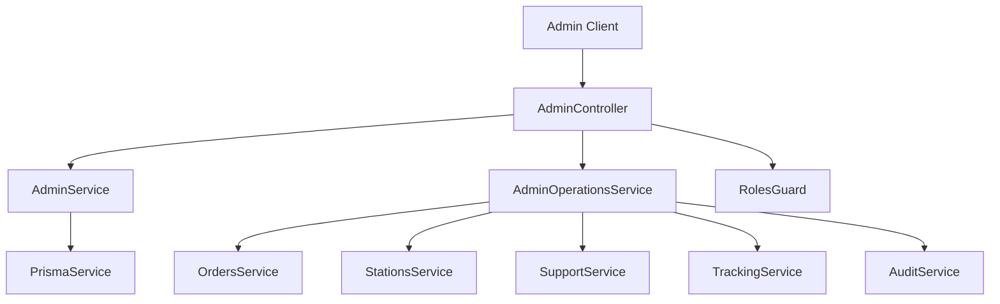
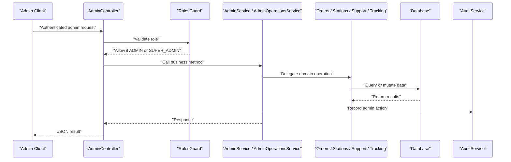
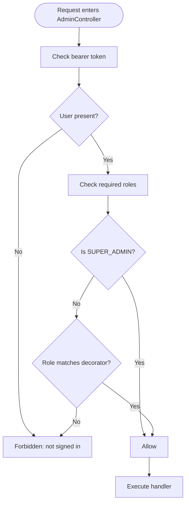
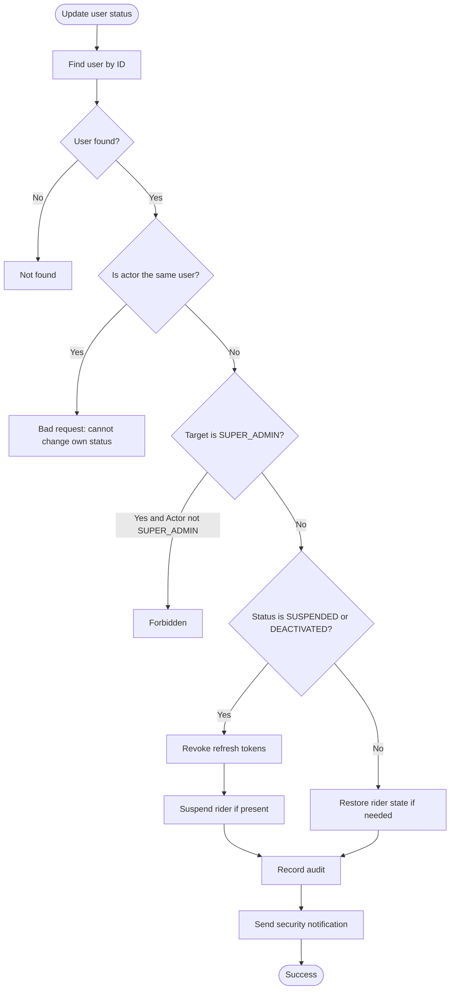
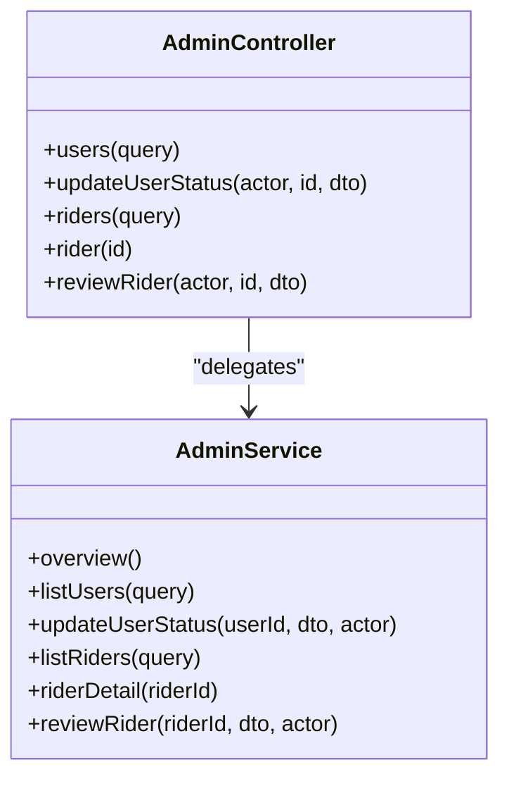
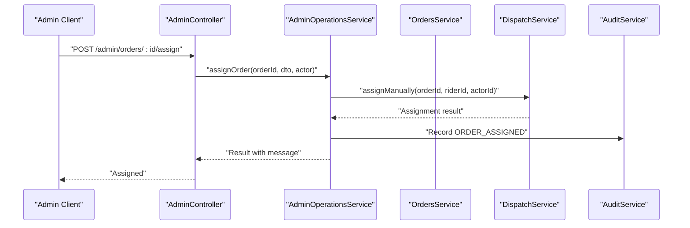
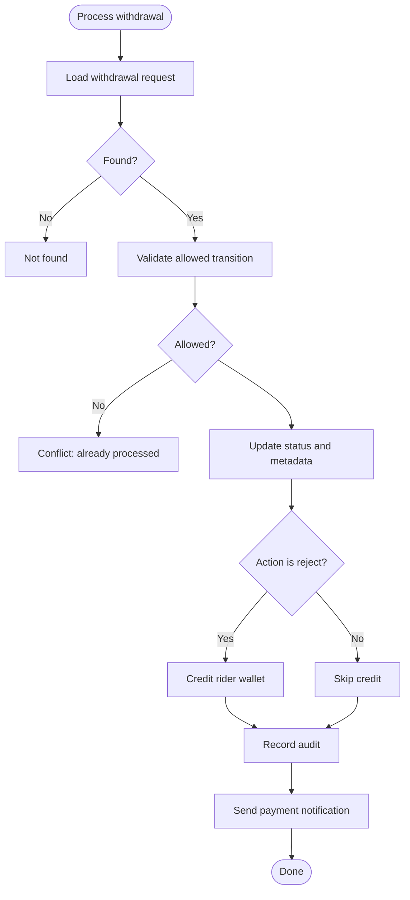
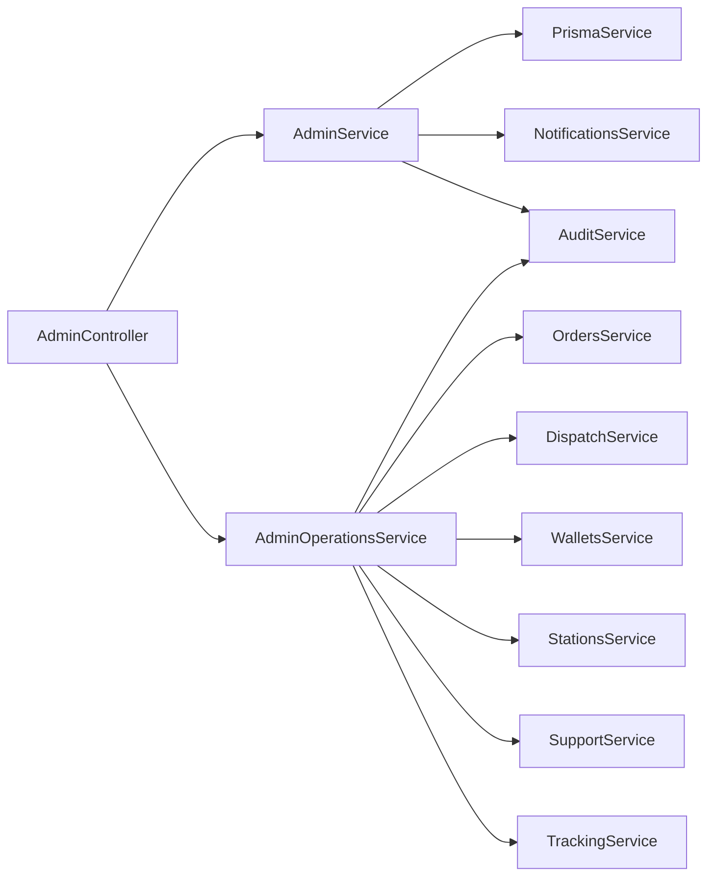

# Administrative API

<cite>
**Referenced Files in This Document**
- [admin.controller.ts](file://backend/src/admin/admin.controller.ts)
- [admin.service.ts](file://backend/src/admin/admin.service.ts)
- [admin-operations.service.ts](file://backend/src/admin/admin-operations.service.ts)
- [admin.dto.ts](file://backend/src/admin/dto/admin.dto.ts)
- [roles.guard.ts](file://backend/src/common/guards/roles.guard.ts)
- [roles.decorator.ts](file://backend/src/common/decorators/roles.decorator.ts)
- [orders.service.ts](file://backend/src/orders/orders.service.ts)
- [stations.service.ts](file://backend/src/stations/stations.service.ts)
- [support.service.ts](file://backend/src/support/support.service.ts)
- [tracking.service.ts](file://backend/src/tracking/tracking.service.ts)
- [audit.service.ts](file://backend/src/audit/audit.service.ts)
- [configuration.ts](file://backend/src/config/configuration.ts)
</cite>

## Table of Contents
1. [Introduction](#introduction)
2. [Project Structure](#project-structure)
3. [Core Components](#core-components)
4. [Architecture Overview](#architecture-overview)
5. [Detailed Component Analysis](#detailed-component-analysis)
6. [Dependency Analysis](#dependency-analysis)
7. [Performance Considerations](#performance-considerations)
8. [Troubleshooting Guide](#troubleshooting-guide)
9. [Conclusion](#conclusion)
10. [Appendices](#appendices)

## Introduction
This document provides detailed API documentation for the administrative endpoints exposed by the platform. It covers platform administration, user management, rider verification, order oversight, payment reconciliation, station management, support ticket handling, audit trail inspection, and live delivery monitoring.

Administrative endpoints are protected by bearer authentication and role-based access control. Only users with the `ADMIN` or `SUPER_ADMIN` roles may call these endpoints. The `SUPER_ADMIN` role bypasses additional role checks inside guards.

The base path for administrative operations is `/api/v1/admin`, assuming the default API prefix configuration. All admin endpoints require a valid JWT bearer token.

## Project Structure
The administrative API is implemented as a NestJS module under the `admin` directory:

- `admin.controller.ts`: HTTP routes for all administrative operations.
- `admin.service.ts`: Platform overview, user listing, user status changes, rider listing, rider detail, and rider review logic.
- `admin-operations.service.ts`: Operational workflows for orders, withdrawals, payments, stations, support tickets, audit logs, and live deliveries.
- `dto/admin.dto.ts`: Request validation models for admin queries and mutations.
- Common security helpers:
  - `common/decorators/roles.decorator.ts`: Role metadata decorator.
  - `common/guards/roles.guard.ts`: Role enforcement guard.

**Diagram sources**
- [admin.controller.ts:36-44](file://backend/src/admin/admin.controller.ts#L36-L44)
- [admin.service.ts:52-61](file://backend/src/admin/admin.service.ts#L52-L61)
- [admin-operations.service.ts:37-52](file://backend/src/admin/admin-operations.service.ts#L37-L52)
- [roles.guard.ts:7-32](file://backend/src/common/guards/roles.guard.ts#L7-L32)

**Section sources**
- [admin.controller.ts:1-218](file://backend/src/admin/admin.controller.ts#L1-L218)
- [admin.service.ts:1-493](file://backend/src/admin/admin.service.ts#L1-L493)
- [admin-operations.service.ts:1-363](file://backend/src/admin/admin-operations.service.ts#L1-L363)
- [admin.dto.ts:1-140](file://backend/src/admin/dto/admin.dto.ts#L1-L140)
- [roles.guard.ts:1-33](file://backend/src/common/guards/roles.guard.ts#L1-L33)
- [roles.decorator.ts:1-8](file://backend/src/common/decorators/roles.decorator.ts#L1-L8)

## Core Components
The administrative API is organized around two main services:

- **AdminService**: Handles platform overview statistics, user listing and status updates, rider roster and detail retrieval, and rider application review.
- **AdminOperationsService**: Handles operational tasks such as order listing, manual assignment, refunds, forced status transitions, withdrawal processing, payment reconciliation, station creation and updates, support ticket management, audit log querying, and live delivery data.

Both services use Prisma for database access, the audit service for compliance logging, and the notifications service for user-facing alerts.

Key responsibilities:

| Component | Responsibilities |
|---|---|
| `AdminController` | Defines REST endpoints, applies bearer authentication and role restrictions, validates request bodies and query parameters. |
| `AdminService` | Computes dashboard metrics, lists users and riders, updates account status, reviews rider applications. |
| `AdminOperationsService` | Manages orders, withdrawals, payments, stations, support tickets, audit logs, and live tracking data. |
| `RolesGuard` | Enforces that only allowed roles can access protected handlers. |
| `AuditService` | Records who performed what action on which entity. |

**Section sources**
- [admin.controller.ts:36-218](file://backend/src/admin/admin.controller.ts#L36-L218)
- [admin.service.ts:52-493](file://backend/src/admin/admin.service.ts#L52-L493)
- [admin-operations.service.ts:37-363](file://backend/src/admin/admin-operations.service.ts#L37-L363)
- [roles.guard.ts:7-32](file://backend/src/common/guards/roles.guard.ts#L7-L32)
- [audit.service.ts:21-46](file://backend/src/audit/audit.service.ts#L21-L46)

## Architecture Overview
The administrative API follows a layered architecture:

1. **Controller Layer**: Exposes HTTP endpoints under `/admin`.
2. **Service Layer**: Encapsulates business logic and orchestrates domain services.
3. **Domain Services**: Reuse existing modules such as orders, stations, support, tracking, wallets, and dispatch.
4. **Persistence Layer**: Uses Prisma to interact with the relational database.
5. **Cross-Cutting Concerns**: Authentication, authorization, auditing, notifications, and pagination.

**Diagram sources**
- [admin.controller.ts:36-44](file://backend/src/admin/admin.controller.ts#L36-L44)
- [roles.guard.ts:12-30](file://backend/src/common/guards/roles.guard.ts#L12-L30)
- [admin-operations.service.ts:63-110](file://backend/src/admin/admin-operations.service.ts#L63-L110)
- [audit.service.ts:27-44](file://backend/src/audit/audit.service.ts#L27-L44)

## Detailed Component Analysis

### Authentication and Authorization
All administrative endpoints are protected by:

- Bearer authentication via Swagger’s `ApiBearerAuth`.
- A controller-level `@Roles(RoleName.ADMIN, RoleName.SUPER_ADMIN)` restriction.
- A global roles guard that enforces the declared roles.

Important authorization rules:

- If no user is present, the guard returns a forbidden error.
- `SUPER_ADMIN` always passes the role check.
- Other roles must be explicitly included in the decorator.
- Some services add additional business-level checks, such as preventing an admin from changing their own account status or restricting super-admin modifications.

**Diagram sources**
- [admin.controller.ts:36-44](file://backend/src/admin/admin.controller.ts#L36-L44)
- [roles.decorator.ts:4-7](file://backend/src/common/decorators/roles.decorator.ts#L4-L7)
- [roles.guard.ts:12-30](file://backend/src/common/guards/roles.guard.ts#L12-L30)

**Section sources**
- [admin.controller.ts:36-44](file://backend/src/admin/admin.controller.ts#L36-L44)
- [roles.decorator.ts:1-8](file://backend/src/common/decorators/roles.decorator.ts#L1-L8)
- [roles.guard.ts:1-33](file://backend/src/common/guards/roles.guard.ts#L1-L33)

### Platform Statistics and Dashboard
Endpoint: `GET /admin/stats`

Purpose:
- Returns platform counters, revenue totals, active orders, pending withdrawals, open tickets, failed payments, and a seven-day revenue series.
- Includes top-performing stations by completed order revenue over the last month.

Key response areas:

| Area | Meaning |
|---|---|
| `revenue` | Currency, today’s revenue, monthly revenue, and total revenue. |
| `orders` | Today’s orders, yesterday’s orders, active orders, delivered today, and counts by status. |
| `people` | Total customers, riders, pending rider approvals, and online verified riders. |
| `operations` | Pending withdrawals, open tickets, and failed payments in the last seven days. |
| `revenueSeries` | Seven-day array of daily revenue and order counts. |
| `topStations` | Top five stations by completed order revenue over the last month. |

Implementation notes:
- Revenue series uses raw SQL grouped by day and fills missing days with zeroes.
- Counts are computed concurrently using `Promise.all`.
- Station ranking uses completed orders within the last month.

**Section sources**
- [admin.controller.ts:46-51](file://backend/src/admin/admin.controller.ts#L46-L51)
- [admin.service.ts:63-190](file://backend/src/admin/admin.service.ts#L63-L190)

### User Management
Endpoints:

| Method | Path | Description |
|---|---|---|
| `GET` | `/admin/users` | Search and filter users by role, status, and text fragment. |
| `PATCH` | `/admin/users/:id/status` | Activate, suspend, or deactivate a user account. |

User listing:
- Supports pagination through `page` and `limit`.
- Filters by `role`, `status`, and `search`.
- Returns user identity fields, role, status, avatar, verification timestamps, customer loyalty and order count, and rider verification and rating information when applicable.

User status update:
- Prevents self-modification.
- Restricts modifying another `SUPER_ADMIN` to only `SUPER_ADMIN`.
- Suspensions revoke active sessions and set rider suspension state when applicable.
- Reactivation restores previous rider state where possible.
- Records an audit entry and sends a security notification.

**Diagram sources**
- [admin.service.ts:235-302](file://backend/src/admin/admin.service.ts#L235-L302)

**Section sources**
- [admin.controller.ts:53-68](file://backend/src/admin/admin.controller.ts#L53-L68)
- [admin.service.ts:192-302](file://backend/src/admin/admin.service.ts#L192-L302)
- [admin.dto.ts:14-42](file://backend/src/admin/dto/admin.dto.ts#L14-L42)

### Rider Management and Verification
Endpoints:

| Method | Path | Description |
|---|---|---|
| `GET` | `/admin/riders` | List riders with filters and pagination. |
| `GET` | `/admin/riders/:id` | Get rider details, documents, location, recent deliveries, and payouts. |
| `POST` | `/admin/riders/:id/review` | Approve or reject a rider application. |

Rider listing:
- Filters by `status` and `search`.
- Includes user identity, active vehicles, assignment count, rating, total deliveries, online availability, and verification history.

Rider detail:
- Returns full rider profile, account status, identification numbers, vehicle list, current location, recent withdrawals, recent assignments, and counts.

Rider review:
- Approving sets rider status to verified, records verification timestamp and verifier, clears rejection reason, and activates the user account.
- Rejecting sets rider status to rejected, forces offline and unavailable states, and stores rejection reason.
- Both actions record audit entries and send notifications.

**Diagram sources**
- [admin.controller.ts:70-92](file://backend/src/admin/admin.controller.ts#L70-L92)
- [admin.service.ts:304-491](file://backend/src/admin/admin.service.ts#L304-L491)

**Section sources**
- [admin.controller.ts:70-92](file://backend/src/admin/admin.controller.ts#L70-L92)
- [admin.service.ts:304-491](file://backend/src/admin/admin.service.ts#L304-L491)
- [admin.dto.ts:44-67](file://backend/src/admin/dto/admin.dto.ts#L44-L67)

### Order Administration
Endpoints:

| Method | Path | Description |
|---|---|---|
| `GET` | `/admin/orders` | List orders with filters. |
| `GET` | `/admin/orders/:id` | Get order detail for support and dispatch. |
| `POST` | `/admin/orders/:id/assign` | Manually assign a verified rider. |
| `POST` | `/admin/orders/:id/refund` | Refund an order to the customer wallet. |
| `PATCH` | `/admin/orders/:id/status` | Force a legal status transition. |

Order listing and detail:
- Delegates to `OrdersService.adminList` and `OrdersService.detail`.
- Returns comprehensive order context including station, address, fuel type, vehicle, items, customer, payment, and assignments.

Manual assignment:
- Calls dispatch logic to assign a specific rider.
- Records an audit entry with assignment identifier.

Refund:
- Delegates to order refund logic.
- Records amount and reason in audit metadata.

Forced status transition:
- Uses the order state machine transition helper.
- Records the new status and optional note.

**Diagram sources**
- [admin.controller.ts:107-116](file://backend/src/admin/admin.controller.ts#L107-L116)
- [admin-operations.service.ts:63-76](file://backend/src/admin/admin-operations.service.ts#L63-L76)

**Section sources**
- [admin.controller.ts:94-137](file://backend/src/admin/admin.controller.ts#L94-L137)
- [admin-operations.service.ts:54-110](file://backend/src/admin/admin-operations.service.ts#L54-L110)
- [orders.service.ts:76-85](file://backend/src/orders/orders.service.ts#L76-L85)

### Withdrawal Processing
Endpoints:

| Method | Path | Description |
|---|---|---|
| `GET` | `/admin/withdrawals` | List withdrawal requests with status filtering. |
| `POST` | `/admin/withdrawals/:id/process` | Approve, reject, or mark a payout as paid. |

Withdrawal listing:
- Returns paginated withdrawal requests with rider identity, destination, method, status, requested time, processed time, and processor identity.

Withdrawal processing:
- Validates allowed state transitions per action.
- Updates withdrawal status and processor metadata.
- On rejection, credits the rider’s wallet back to the original amount.
- Records audit entries and sends payment-related notifications.

**Diagram sources**
- [admin-operations.service.ts:157-238](file://backend/src/admin/admin-operations.service.ts#L157-L238)

**Section sources**
- [admin.controller.ts:139-155](file://backend/src/admin/admin.controller.ts#L139-L155)
- [admin-operations.service.ts:112-238](file://backend/src/admin/admin-operations.service.ts#L112-L238)
- [admin.dto.ts:81-98](file://backend/src/admin/dto/admin.dto.ts#L81-L98)

### Payment Reconciliation
Endpoint: `GET /admin/payments`

Purpose:
- Provides a reconciled view of payments with order and customer context.

Filters:
- `status`: payment status enum.
- `method`: payment method enum.

Response includes:
- Payment identifier, associated order reference and status, customer name and phone, method, status, amount, provider references, failure reason, paid timestamp, and creation timestamp.

**Section sources**
- [admin.controller.ts:157-162](file://backend/src/admin/admin.controller.ts#L157-L162)
- [admin-operations.service.ts:240-282](file://backend/src/admin/admin-operations.service.ts#L240-L282)
- [admin.dto.ts:100-110](file://backend/src/admin/dto/admin.dto.ts#L100-L110)

### Station Administration
Endpoints:

| Method | Path | Description |
|---|---|---|
| `GET` | `/admin/stations` | List all stations, including inactive ones. |
| `POST` | `/admin/stations` | Create a station. |
| `PATCH` | `/admin/stations/:id` | Update station location, manager, hours, or status. |

Station listing:
- Delegates to `StationsService.adminList` with `includeInactive: true`.

Station creation and update:
- Delegates to `StationsService.create` and `StationsService.update`.
- Records audit entries with relevant metadata.

Note:
- Station price updates are handled by the station manager workflow rather than this admin endpoint.

**Section sources**
- [admin.controller.ts:164-185](file://backend/src/admin/admin.controller.ts#L164-L185)
- [admin-operations.service.ts:284-317](file://backend/src/admin/admin-operations.service.ts#L284-L317)
- [stations.service.ts:42-48](file://backend/src/stations/stations.service.ts#L42-L48)

### Support Ticket Administration
Endpoints:

| Method | Path | Description |
|---|---|---|
| `GET` | `/admin/support/tickets` | View the support inbox. |
| `PATCH` | `/admin/support/tickets/:id` | Assign, prioritize, resolve, or close a ticket. |

Ticket listing:
- Delegates to `SupportService.adminList`.

Ticket update:
- Delegates to `SupportService.adminUpdate`.
- Supports staff-driven lifecycle changes and real-time notifications.

**Section sources**
- [admin.controller.ts:187-202](file://backend/src/admin/admin.controller.ts#L187-L202)
- [admin-operations.service.ts:349-356](file://backend/src/admin/admin-operations.service.ts#L349-L356)
- [support.service.ts:52-61](file://backend/src/support/support.service.ts#L52-L61)

### Audit Trail Inspection
Endpoint: `GET /admin/audit-logs`

Purpose:
- Provides an auditable history of administrative actions.

Filters:
- `actorId`: filter by actor user identifier.
- `entity`: filter by entity type.
- `action`: substring match against action names.
- `from` and `to`: ISO date range boundaries.

Response:
- Paginated audit entries with actor identity and role.

Audit recording:
- Most administrative mutations call `AuditService.record`.
- Audit failures are logged but do not break the originating request.

**Section sources**
- [admin.controller.ts:204-209](file://backend/src/admin/admin.controller.ts#L204-L209)
- [admin-operations.service.ts:319-347](file://backend/src/admin/admin-operations.service.ts#L319-L347)
- [audit.service.ts:5-46](file://backend/src/audit/audit.service.ts#L5-L46)
- [admin.dto.ts:112-139](file://backend/src/admin/dto/admin.dto.ts#L112-L139)

### Live Delivery Monitoring
Endpoint: `GET /admin/tracking/deliveries`

Purpose:
- Returns active deliveries for the live map used by administrators.

Implementation:
- Delegates to `TrackingService.activeDeliveries`.

Live tracking background:
- Rider location ingestion is throttled and stored in Redis and PostgreSQL.
- Order visibility is restricted to owners, assigned riders, staff, and authorized station managers.

**Section sources**
- [admin.controller.ts:211-216](file://backend/src/admin/admin.controller.ts#L211-L216)
- [admin-operations.service.ts:358-361](file://backend/src/admin/admin-operations.service.ts#L358-L361)
- [tracking.service.ts:32-39](file://backend/src/tracking/tracking.service.ts#L32-L39)
- [tracking.service.ts:41-75](file://backend/src/tracking/tracking.service.ts#L41-L75)
- [tracking.service.ts:128-200](file://backend/src/tracking/tracking.service.ts#L128-L200)

## Dependency Analysis
Administrative endpoints depend on multiple domain services:

**Diagram sources**
- [admin.controller.ts:41-44](file://backend/src/admin/admin.controller.ts#L41-L44)
- [admin.service.ts:57-61](file://backend/src/admin/admin.service.ts#L57-L61)
- [admin-operations.service.ts:42-52](file://backend/src/admin/admin-operations.service.ts#L42-L52)

Coupling and cohesion observations:

- Controllers are thin and delegate most logic to services.
- `AdminService` focuses on platform overview and people management.
- `AdminOperationsService` centralizes operational workflows across orders, withdrawals, payments, stations, support, and tracking.
- Auditing is consistently applied to sensitive mutations.
- External dependencies such as orders, stations, support, and tracking are reused rather than reimplemented.

Potential circular dependencies:
- No direct circular imports are visible in the analyzed files.
- Cross-module delegation occurs through service constructors, which is standard NestJS dependency injection.

External integration points:
- Database via Prisma.
- Real-time events via `RealtimeGateway`.
- Configuration via `ConfigService`.
- Payments and mobile money providers are configured but not directly invoked by admin endpoints.

**Section sources**
- [admin.controller.ts:41-44](file://backend/src/admin/admin.controller.ts#L41-L44)
- [admin.service.ts:57-61](file://backend/src/admin/admin.service.ts#L57-L61)
- [admin-operations.service.ts:42-52](file://backend/src/admin/admin-operations.service.ts#L42-L52)
- [configuration.ts:1-38](file://backend/src/config/configuration.ts#L1-L38)

## Performance Considerations
- Concurrent metric aggregation: The dashboard overview uses parallel queries to reduce latency.
- Pagination: Most list endpoints accept `page` and `limit` and return paginated results.
- Raw SQL for time-series revenue: Reduces application-side grouping overhead.
- Redis caching for live locations: Hot path reads from Redis before falling back to PostgreSQL.
- Throttling rider location pings: Prevents excessive writes and network traffic.
- Audit logging is non-blocking at the logger level; audit write failures are warned but do not fail requests.

Recommendations:
- Keep page sizes reasonable for large datasets such as audit logs and payments.
- Use targeted filters like `status`, `method`, `entity`, and date ranges to reduce query load.
- Monitor raw SQL performance for revenue series and station rankings.
- Ensure Redis availability for live tracking endpoints.

[No sources needed since this section provides general guidance]

## Troubleshooting Guide
Common issues and resolutions:

| Issue | Likely Cause | Resolution |
|---|---|---|
| Forbidden when calling admin endpoints | Missing or invalid bearer token, or insufficient role. | Verify JWT and ensure the user has `ADMIN` or `SUPER_ADMIN`. |
| Cannot change own account status | Business rule prevents self-modification. | Use another admin account to update the target user. |
| Cannot modify another super admin | Only `SUPER_ADMIN` can modify other super admins. | Perform the operation as a `SUPER_ADMIN`. |
| Withdrawal already processed | Duplicate or invalid action for current status. | Check current withdrawal status and choose a valid action. |
| Not found errors | Invalid UUID or deleted entity. | Verify identifiers and retry with correct IDs. |
| Audit logs missing | Audit write failure or incorrect filters. | Check server warnings and refine filters by actor, entity, action, or date range. |

Error types used:

- `BadRequestException`: Invalid input or self-modification attempts.
- `ForbiddenException`: Unauthorized role or missing user.
- `NotFoundException`: Entity not found.
- `ConflictException`: Invalid state transition or duplicate key scenarios.

**Section sources**
- [roles.guard.ts:20-28](file://backend/src/common/guards/roles.guard.ts#L20-L28)
- [admin.service.ts:235-247](file://backend/src/admin/admin.service.ts#L235-L247)
- [admin-operations.service.ts:170-172](file://backend/src/admin/admin-operations.service.ts#L170-L172)
- [audit.service.ts:41-44](file://backend/src/audit/audit.service.ts#L41-L44)

## Conclusion
The administrative API provides a comprehensive control plane for platform oversight. It exposes secure endpoints for dashboard analytics, user and rider management, order operations, withdrawal processing, payment reconciliation, station administration, support ticket handling, audit inspection, and live delivery monitoring. Security is enforced through bearer authentication and role-based access control, while operational integrity is reinforced by audit logging, transactional updates, and consistent error handling.

Administrators should:
- Use pagination and filters for large datasets.
- Prefer explicit status transitions with notes for auditability.
- Treat withdrawal rejections as financial reversals requiring confirmation.
- Monitor audit logs for accountability and compliance.
- Rely on the dashboard for high-level health and revenue insights.

[No sources needed since this section summarizes without analyzing specific files]

## Appendices

### Administrative Endpoint Reference

| Category | Method | Path | Access | Summary |
|---|---|---|---|---|
| Overview | `GET` | `/admin/stats` | `ADMIN`, `SUPER_ADMIN` | Dashboard counters, revenue, and seven-day revenue series. |
| Users | `GET` | `/admin/users` | `ADMIN`, `SUPER_ADMIN` | Search and filter every account. |
| Users | `PATCH` | `/admin/users/:id/status` | `ADMIN`, `SUPER_ADMIN` | Activate, suspend, or deactivate an account. |
| Riders | `GET` | `/admin/riders` | `ADMIN`, `SUPER_ADMIN` | Rider roster with verification queue. |
| Riders | `GET` | `/admin/riders/:id` | `ADMIN`, `SUPER_ADMIN` | Rider documents, location, recent deliveries, and payouts. |
| Riders | `POST` | `/admin/riders/:id/review` | `ADMIN`, `SUPER_ADMIN` | Approve or reject a rider application. |
| Orders | `GET` | `/admin/orders` | `ADMIN`, `SUPER_ADMIN` | Every order with filters. |
| Orders | `GET` | `/admin/orders/:id` | `ADMIN`, `SUPER_ADMIN` | Order detail for support and dispatch. |
| Orders | `POST` | `/admin/orders/:id/assign` | `ADMIN`, `SUPER_ADMIN` | Manually assign a verified rider. |
| Orders | `POST` | `/admin/orders/:id/refund` | `ADMIN`, `SUPER_ADMIN` | Refund an order to the customer wallet. |
| Orders | `PATCH` | `/admin/orders/:id/status` | `ADMIN`, `SUPER_ADMIN` | Force a legal status transition. |
| Withdrawals | `GET` | `/admin/withdrawals` | `ADMIN`, `SUPER_ADMIN` | Rider payout queue. |
| Withdrawals | `POST` | `/admin/withdrawals/:id/process` | `ADMIN`, `SUPER_ADMIN` | Approve, reject, or mark a payout as paid. |
| Payments | `GET` | `/admin/payments` | `ADMIN`, `SUPER_ADMIN` | Payment reconciliation list. |
| Stations | `GET` | `/admin/stations` | `ADMIN`, `SUPER_ADMIN` | All stations including inactive ones. |
| Stations | `POST` | `/admin/stations` | `ADMIN`, `SUPER_ADMIN` | Create a station. |
| Stations | `PATCH` | `/admin/stations/:id` | `ADMIN`, `SUPER_ADMIN` | Update a station. |
| Support | `GET` | `/admin/support/tickets` | `ADMIN`, `SUPER_ADMIN` | Support inbox. |
| Support | `PATCH` | `/admin/support/tickets/:id` | `ADMIN`, `SUPER_ADMIN` | Assign, prioritize, resolve, or close a ticket. |
| Audit | `GET` | `/admin/audit-logs` | `ADMIN`, `SUPER_ADMIN` | Who changed what, when. |
| Tracking | `GET` | `/admin/tracking/deliveries` | `ADMIN`, `SUPER_ADMIN` | Active deliveries for the live map. |

**Section sources**
- [admin.controller.ts:46-216](file://backend/src/admin/admin.controller.ts#L46-L216)

### Request and Response Patterns

Pagination pattern:
- Query parameters: `page`, `limit`.
- Responses include paginated data and total counts where applicable.

Filter patterns:
- Enum filters: `role`, `status`, `method`, `entity`, `action`.
- Text search: `search` for users and riders.
- Date range: `from` and `to` for audit logs.

Security headers:
- `Authorization: Bearer <jwt>`

**Section sources**
- [admin.dto.ts:14-139](file://backend/src/admin/dto/admin.dto.ts#L14-L139)
- [admin.controller.ts:36-38](file://backend/src/admin/admin.controller.ts#L36-L38)