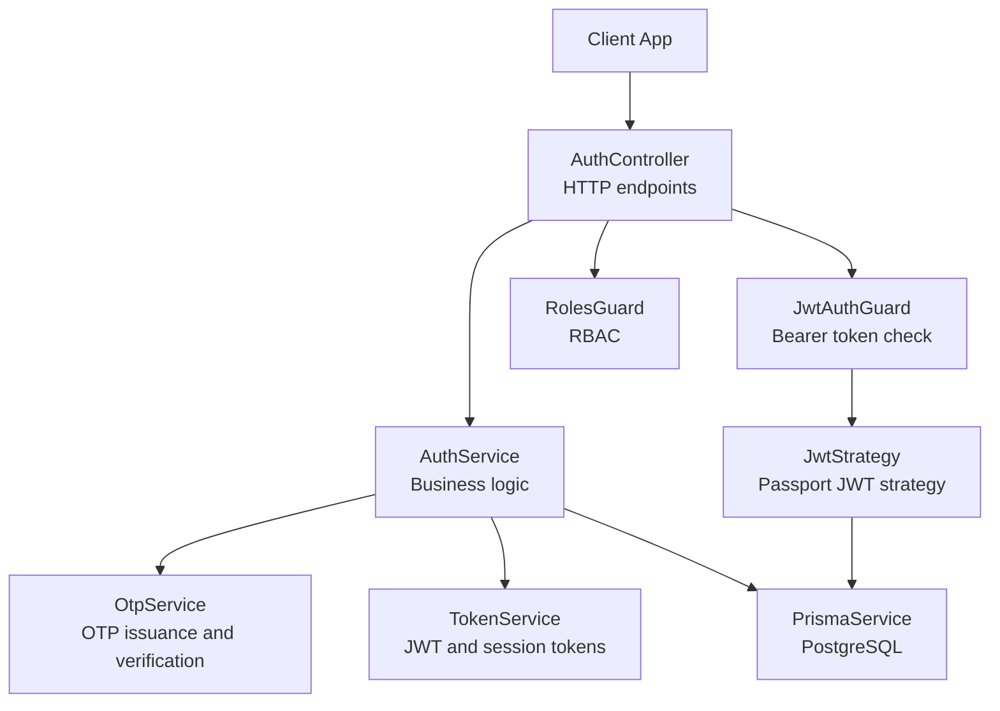
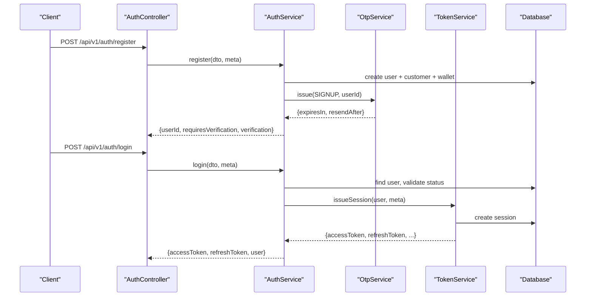
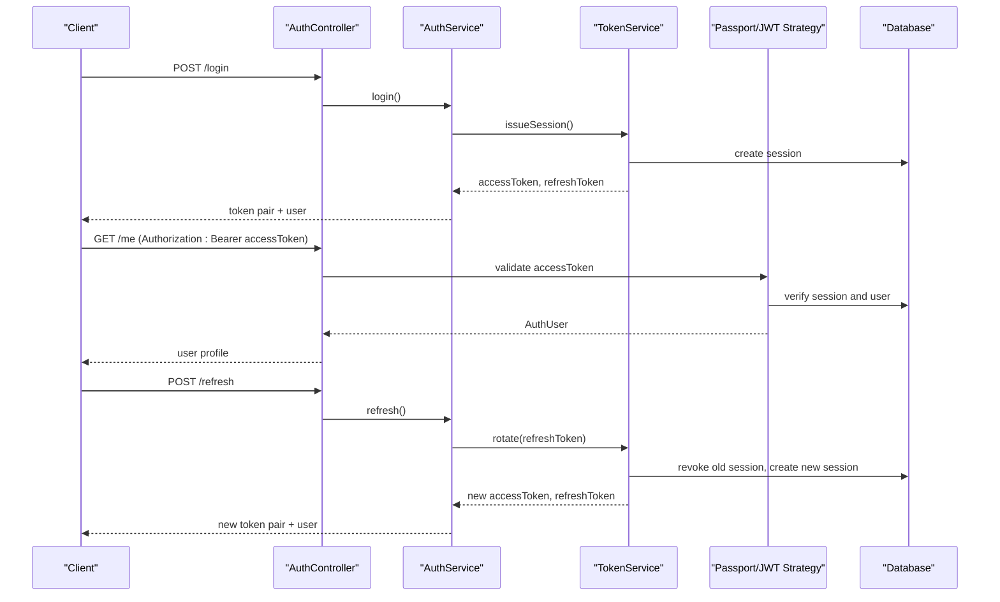
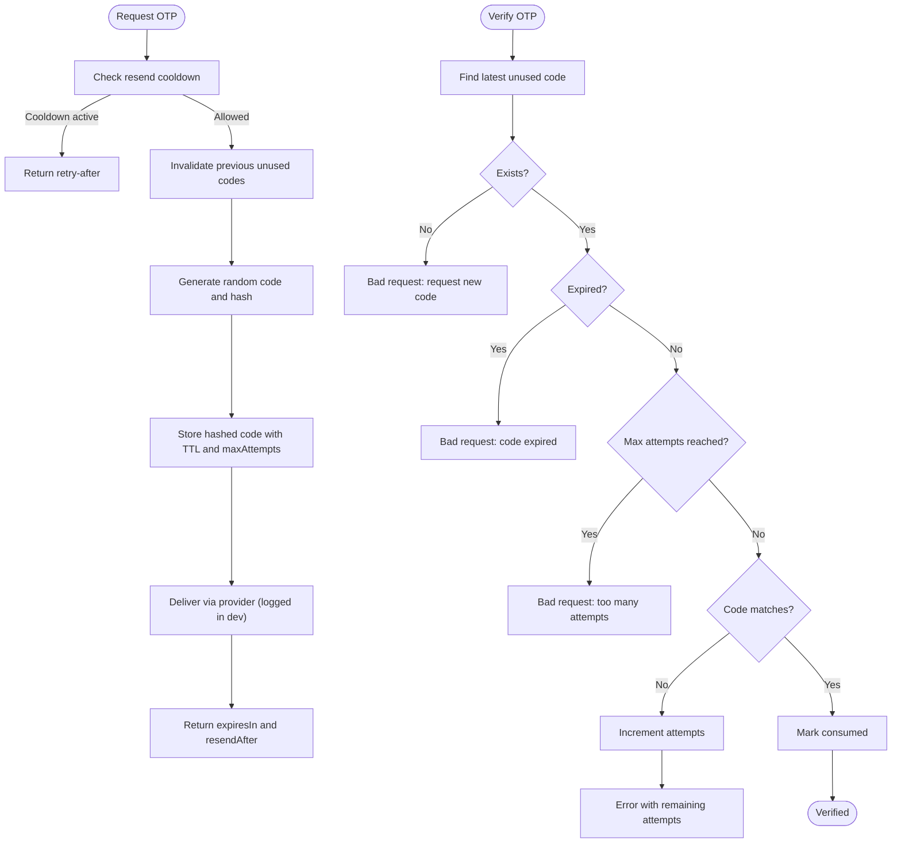
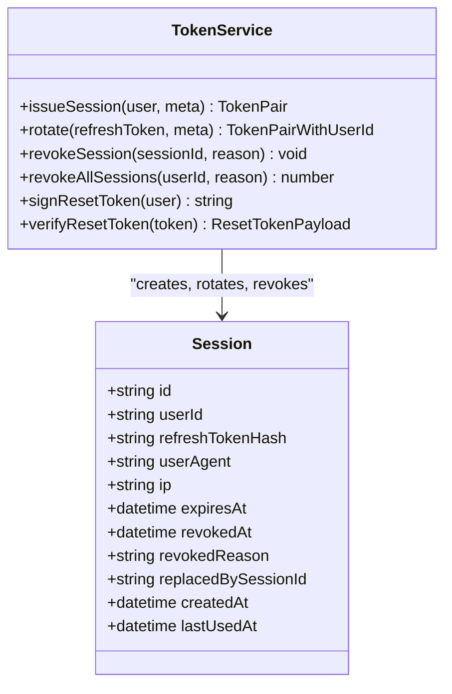
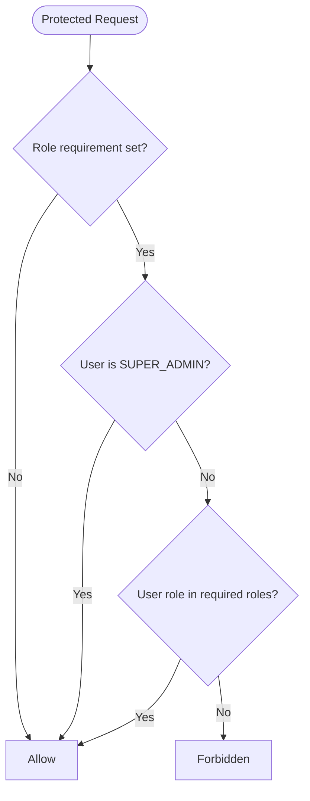
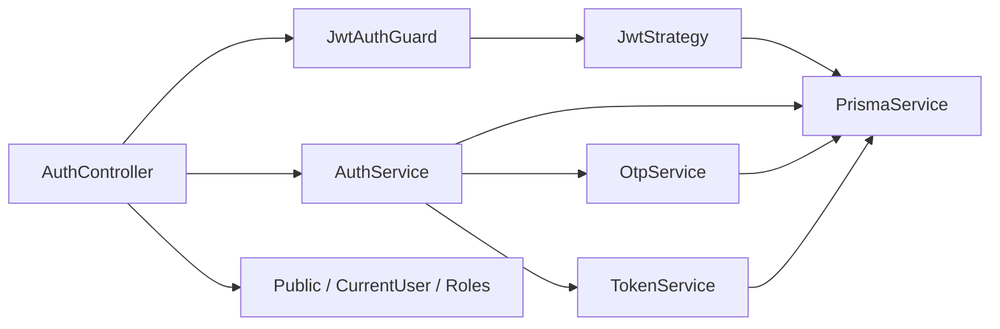

# Authentication & Authorization API

<cite>
**Referenced Files in This Document**
- [auth.controller.ts](file://backend/src/auth/auth.controller.ts)
- [auth.service.ts](file://backend/src/auth/auth.service.ts)
- [auth.dto.ts](file://backend/src/auth/dto/auth.dto.ts)
- [jwt.strategy.ts](file://backend/src/auth/strategies/jwt.strategy.ts)
- [otp.service.ts](file://backend/src/auth/otp.service.ts)
- [token.service.ts](file://backend/src/auth/token.service.ts)
- [jwt-auth.guard.ts](file://backend/src/common/guards/jwt-auth.guard.ts)
- [roles.guard.ts](file://backend/src/common/guards/roles.guard.ts)
- [auth-user.ts](file://backend/src/common/types/auth-user.ts)
- [configuration.ts](file://backend/src/config/configuration.ts)
- [schema.prisma](file://backend/prisma/schema.prisma)
</cite>

## Table of Contents
1. [Introduction](#introduction)
2. [Project Structure](#project-structure)
3. [Core Components](#core-components)
4. [Architecture Overview](#architecture-overview)
5. [Detailed Component Analysis](#detailed-component-analysis)
6. [Dependency Analysis](#dependency-analysis)
7. [Performance Considerations](#performance-considerations)
8. [Troubleshooting Guide](#troubleshooting-guide)
9. [Conclusion](#conclusion)

## Introduction
This document describes the authentication and authorization API for the backend service. It covers user registration, login, OTP verification, password management, session handling, profile management, role-based access control, JWT token flow, rate limiting, and security measures. It also provides request/response specifications, error behavior, and end-to-end flows from registration through token refresh and multi-device session management.

The API is implemented with a NestJS controller layer, services for business logic, Passport-based JWT validation, Prisma-managed PostgreSQL storage, and Throttler-based rate limiting.

## Project Structure
The authentication subsystem lives under `backend/src/auth`, with shared guards, decorators, types, and configuration supporting it. The database schema defines users, sessions, OTP codes, roles, statuses, and related entities.

**Diagram sources**
- [auth.controller.ts:42-165](file://backend/src/auth/auth.controller.ts#L42-L165)
- [auth.service.ts:39-560](file://backend/src/auth/auth.service.ts#L39-L560)
- [otp.service.ts:29-164](file://backend/src/auth/otp.service.ts#L29-L164)
- [token.service.ts:32-198](file://backend/src/auth/token.service.ts#L32-L198)
- [jwt.strategy.ts:9-75](file://backend/src/auth/strategies/jwt.strategy.ts#L9-L75)
- [jwt-auth.guard.ts:11-35](file://backend/src/common/guards/jwt-auth.guard.ts#L11-L35)
- [roles.guard.ts:8-33](file://backend/src/common/guards/roles.guard.ts#L8-L33)

**Section sources**
- [auth.controller.ts:42-165](file://backend/src/auth/auth.controller.ts#L42-L165)
- [schema.prisma:17-207](file://backend/prisma/schema.prisma#L17-L207)

## Core Components
- AuthController: HTTP endpoints for auth flows, decorated with public or bearer protection, and throttled.
- AuthService: Orchestrates registration, login, OTP, password reset/change, profile updates, and session management.
- OtpService: Issues hashed OTPs, enforces cooldowns, attempts, expiry, and safe comparison; logs delivery.
- TokenService: Creates short-lived access JWTs, opaque rotated refresh tokens, and reset tokens; manages sessions.
- JwtStrategy: Validates access tokens, checks active sessions, and loads minimal user context per request.
- Guards and Decorators: Public decorator to skip auth, JWT guard to enforce Bearer tokens, roles guard for RBAC, current-user decorator to inject principal.
- Configuration: Centralizes JWT, OTP, and other runtime settings.

**Section sources**
- [auth.controller.ts:42-165](file://backend/src/auth/auth.controller.ts#L42-L165)
- [auth.service.ts:39-560](file://backend/src/auth/auth.service.ts#L39-L560)
- [otp.service.ts:29-164](file://backend/src/auth/otp.service.ts#L29-L164)
- [token.service.ts:32-198](file://backend/src/auth/token.service.ts#L32-L198)
- [jwt.strategy.ts:9-75](file://backend/src/auth/strategies/jwt.strategy.ts#L9-L75)
- [jwt-auth.guard.ts:11-35](file://backend/src/common/guards/jwt-auth.guard.ts#L11-L35)
- [roles.guard.ts:8-33](file://backend/src/common/guards/roles.guard.ts#L8-L33)
- [configuration.ts:1-97](file://backend/src/config/configuration.ts#L1-L97)

## Architecture Overview
The authentication architecture uses layered separation:
- Controllers expose REST endpoints and apply rate limits.
- Services implement domain logic and coordinate OTP, tokens, and persistence.
- Guards and strategies enforce authentication and authorization at the framework level.
- Database models capture identity, sessions, and OTP records.

**Diagram sources**
- [auth.controller.ts:48-71](file://backend/src/auth/auth.controller.ts#L48-L71)
- [auth.service.ts:53-98](file://backend/src/auth/auth.service.ts#L53-L98)
- [auth.service.ts:163-239](file://backend/src/auth/auth.service.ts#L163-L239)
- [otp.service.ts:38-90](file://backend/src/auth/otp.service.ts#L38-L90)
- [token.service.ts:40-67](file://backend/src/auth/token.service.ts#L40-L67)

## Detailed Component Analysis

### Authentication Endpoints

Base path: `/api/v1/auth`

#### Register Customer
- Method: `POST`
- Path: `/register`
- Public: Yes
- Rate limit: 5 requests per 60 seconds
- Request body:
  - `fullName`: string, length 2–80
  - `phone`: Uganda phone pattern
  - `email`: valid email
  - `password`: minimum 8 characters, includes letter and number
- Success response:
  - `userId`: string
  - `phone`: string
  - `role`: enum (customer)
  - `requiresVerification`: boolean
  - `verification`: object containing OTP metadata such as expiration and resend delay
- Errors:
  - Conflict if phone or email already exists
  - Validation errors for invalid fields

#### Register Rider
- Method: `POST`
- Path: `/register/rider`
- Public: Yes
- Rate limit: 5 requests per 60 seconds
- Request body: extends customer registration with rider fields:
  - `licenseNumber`: string
  - `nationalIdNumber`: string
  - `vehicleType`: enum value
  - `plateNumber`: string
  - `dateOfBirth`: optional date string
- Success response:
  - `userId`, `phone`, `role` (rider)
  - `requiresVerification`: boolean
  - `requiresApproval`: boolean
  - `verification`: OTP metadata
- Errors:
  - Conflict on duplicate contact info
  - Validation errors

#### Login
- Method: `POST`
- Path: `/login`
- Public: Yes
- Rate limit: 8 requests per 60 seconds
- Request body:
  - `phone`: Uganda phone pattern
  - `password`: string
- Success response:
  - `accessToken`: string
  - `refreshToken`: string
  - `tokenType`: "Bearer"
  - `expiresIn`: number (seconds)
  - `refreshExpiresAt`: timestamp
  - `user`: profile object including role, status, wallet, and related data
- Error responses:
  - Unauthorized for incorrect credentials
  - Too many requests when account is locked after repeated failures
  - Forbidden for suspended, pending, inactive, or suspended rider accounts

#### Request OTP
- Method: `POST`
- Path: `/otp/request`
- Public: Yes
- Rate limit: 5 requests per 60 seconds
- Request body:
  - `phone`: Uganda phone pattern
  - `purpose`: enum (`SIGNUP`, `LOGIN`, `RESET`)
- Success response:
  - `purpose`, `phone`, `expiresIn`, `resendAfter`
  - Optional `devCode` when OTP dev mode is enabled
- Errors:
  - Not found for missing account when purpose is LOGIN
  - Too many requests if resend cooldown not elapsed

#### Verify OTP
- Method: `POST`
- Path: `/otp/verify`
- Public: Yes
- Rate limit: 10 requests per 60 seconds
- Request body:
  - `phone`: Uganda phone pattern
  - `purpose`: enum
  - `code`: numeric code
- Behavior:
  - For `RESET`: returns a short-lived reset token instead of access tokens
  - For `SIGNUP` or `LOGIN`: activates pending accounts, sets verification timestamps, and issues access and refresh tokens
- Success response:
  - For reset: `verified`, `purpose`, `resetToken`, `expiresIn`
  - For signup/login: standard token payload plus user profile
- Errors:
  - Bad request for expired, consumed, or exceeded-attempt OTPs
  - Not found for missing account
  - Forbidden for suspended accounts

#### Refresh Token
- Method: `POST`
- Path: `/refresh`
- Public: Yes
- Rate limit: 30 requests per 60 seconds
- Request body:
  - `refreshToken`: opaque token
- Success response:
  - New `accessToken` and `refreshToken`, along with expiration metadata and user profile
- Errors:
  - Unauthorized if session is revoked, expired, or account is inactive

#### Forgot Password
- Method: `POST`
- Path: `/password/forgot`
- Public: Yes
- Rate limit: 5 requests per 60 seconds
- Request body:
  - `phone`: Uganda phone pattern
- Success response:
  - OTP metadata for reset flow

#### Reset Password
- Method: `POST`
- Path: `/password/reset`
- Public: Yes
- Rate limit: 5 requests per 60 seconds
- Request body:
  - `resetToken`: short-lived token from verify OTP reset flow
  - `newPassword`: strong password rules
- Success response:
  - Confirmation message
- Errors:
  - Not found if account no longer exists
  - Bad request if new password equals old password

#### Change Password
- Method: `POST`
- Path: `/password/change`
- Protected: Yes (Bearer token required)
- Request body:
  - `currentPassword`: string
  - `newPassword`: strong password rules
- Success response:
  - Confirmation message instructing re-login on other devices
- Errors:
  - Bad request if current password is incorrect or new password equals old password

#### Get Current Profile
- Method: `GET`
- Path: `/me`
- Protected: Yes
- Response:
  - User profile including role, status, wallet, and related details

#### Update Profile
- Method: `PATCH`
- Path: `/me`
- Protected: Yes
- Request body:
  - `fullName`: optional string
  - `email`: optional valid email
  - `avatarUrl`: optional URL
- Success response:
  - Updated user profile
- Errors:
  - Conflict if email already taken by another account

#### List Sessions
- Method: `GET`
- Path: `/sessions`
- Protected: Yes
- Response:
  - Array of active sessions with device metadata and expiration

#### Revoke Session
- Method: `DELETE`
- Path: `/sessions/:id`
- Protected: Yes
- Path parameter:
  - `id`: UUID of the session
- Success response:
  - Confirmation message

#### Logout
- Method: `POST`
- Path: `/logout`
- Protected: Yes
- Behavior:
  - Revokes the current session if provided, otherwise revokes all sessions for the user
- Success response:
  - Confirmation message

**Section sources**
- [auth.controller.ts:48-165](file://backend/src/auth/auth.controller.ts#L48-L165)
- [auth.service.ts:53-560](file://backend/src/auth/auth.service.ts#L53-L560)
- [auth.dto.ts:19-162](file://backend/src/auth/dto/auth.dto.ts#L19-L162)

### JWT Token Flow

Access tokens are short-lived JWTs carrying user identity, role, phone, and session ID. Refresh tokens are opaque secrets stored hashed in the database and rotated on every use. Reset tokens are short-lived JWTs used only for password reset.

**Diagram sources**
- [auth.controller.ts:64-98](file://backend/src/auth/auth.controller.ts#L64-L98)
- [auth.service.ts:163-239](file://backend/src/auth/auth.service.ts#L163-L239)
- [token.service.ts:40-151](file://backend/src/auth/token.service.ts#L40-L151)
- [jwt.strategy.ts:22-73](file://backend/src/auth/strategies/jwt.strategy.ts#L22-L73)

**Section sources**
- [token.service.ts:10-198](file://backend/src/auth/token.service.ts#L10-L198)
- [jwt.strategy.ts:9-75](file://backend/src/auth/strategies/jwt.strategy.ts#L9-L75)
- [auth-user.ts:1-34](file://backend/src/common/types/auth-user.ts#L1-L34)

### OTP Verification Process

OTP codes are generated, hashed, stored, and verified with strict controls:
- Cooldown between resends
- Expiration time
- Maximum attempts
- Single-use consumption
- Safe timing-safe comparison

**Diagram sources**
- [otp.service.ts:38-90](file://backend/src/auth/otp.service.ts#L38-L90)
- [otp.service.ts:92-127](file://backend/src/auth/otp.service.ts#L92-L127)

**Section sources**
- [otp.service.ts:29-164](file://backend/src/auth/otp.service.ts#L29-L164)

### Multi-Device Session Management

Each login creates a new session record storing a hashed refresh token, IP, user agent, and expiration. Access tokens include the session ID so that each request validates against an active session. Rotation replaces the old refresh token with a new one and marks the old session as replaced.

Key behaviors:
- Multiple concurrent sessions allowed
- Reuse of a rotated refresh token revokes the entire family
- Password change revokes all other sessions
- Explicit logout can revoke single or all sessions
- Session listing shows active devices

**Diagram sources**
- [schema.prisma:172-189](file://backend/prisma/schema.prisma#L172-L189)
- [token.service.ts:40-166](file://backend/src/auth/token.service.ts#L40-L166)

**Section sources**
- [token.service.ts:40-166](file://backend/src/auth/token.service.ts#L40-L166)
- [schema.prisma:172-189](file://backend/prisma/schema.prisma#L172-L189)

### Role-Based Access Control

Roles are enforced via a dedicated guard:
- Super admin bypasses role checks
- Other roles must match declared requirements
- Missing or unauthorized roles result in forbidden responses

**Diagram sources**
- [roles.guard.ts:8-33](file://backend/src/common/guards/roles.guard.ts#L8-L33)

**Section sources**
- [roles.guard.ts:8-33](file://backend/src/common/guards/roles.guard.ts#L8-L33)
- [auth-user.ts:1-34](file://backend/src/common/types/auth-user.ts#L1-L34)

### Security Measures

- Phone normalization and validation ensure consistent input format.
- Password hashing and strength checks prevent weak credentials.
- Account lockout after repeated failed logins with configurable lock duration.
- OTP codes are hashed and compared safely; they expire quickly and allow limited attempts.
- Access tokens are short-lived and validated per request, including active session checks.
- Refresh tokens are opaque, rotated, and stored hashed; reuse triggers family revocation.
- Audit logging records sensitive actions like registration and password resets.
- Rate limiting protects endpoints from abuse.

**Section sources**
- [auth.service.ts:53-560](file://backend/src/auth/auth.service.ts#L53-L560)
- [otp.service.ts:29-164](file://backend/src/auth/otp.service.ts#L29-L164)
- [token.service.ts:32-198](file://backend/src/auth/token.service.ts#L32-L198)
- [auth.controller.ts:48-165](file://backend/src/auth/auth.controller.ts#L48-L165)

## Dependency Analysis

**Diagram sources**
- [auth.controller.ts:42-165](file://backend/src/auth/auth.controller.ts#L42-L165)
- [auth.service.ts:39-560](file://backend/src/auth/auth.service.ts#L39-L560)
- [otp.service.ts:29-164](file://backend/src/auth/otp.service.ts#L29-L164)
- [token.service.ts:32-198](file://backend/src/auth/token.service.ts#L32-L198)
- [jwt.strategy.ts:9-75](file://backend/src/auth/strategies/jwt.strategy.ts#L9-L75)
- [jwt-auth.guard.ts:11-35](file://backend/src/common/guards/jwt-auth.guard.ts#L11-L35)

**Section sources**
- [auth.controller.ts:42-165](file://backend/src/auth/auth.controller.ts#L42-L165)
- [auth.service.ts:39-560](file://backend/src/auth/auth.service.ts#L39-L560)
- [otp.service.ts:29-164](file://backend/src/auth/otp.service.ts#L29-L164)
- [token.service.ts:32-198](file://backend/src/auth/token.service.ts#L32-L198)
- [jwt.strategy.ts:9-75](file://backend/src/auth/strategies/jwt.strategy.ts#L9-L75)
- [jwt-auth.guard.ts:11-35](file://backend/src/common/guards/jwt-auth.guard.ts#L11-L35)

## Performance Considerations
- Access tokens are short-lived to reduce exposure risk and minimize server-side state.
- Refresh token rotation avoids long-lived secrets and detects replay attacks.
- Per-request user resolution ensures immediate effect of suspension or deletion.
- OTP operations are lightweight and bounded by TTL and attempt limits.
- Database queries are scoped to avoid unnecessary joins; profiles are loaded selectively.
- Rate limiting reduces load from brute-force and spamming.

[No sources needed since this section provides general guidance]

## Troubleshooting Guide

Common issues and resolutions:
- Invalid phone number: Ensure the phone follows the expected Uganda format.
- Duplicate registration: Use sign-in if phone or email already exists.
- Locked account: Wait for the lockout period to expire after multiple failed attempts.
- Suspended or inactive account: Contact support to review account status.
- OTP resend too soon: Respect the resend cooldown returned by the API.
- Expired OTP: Request a new code before attempting verification.
- Wrong OTP code: Observe remaining attempts and request a new code if exhausted.
- Expired refresh token: Re-authenticate using login or OTP verification.
- Reused refresh token: Indicates possible theft; sign in again on a trusted device.
- Password change requiring re-login: After changing your password, other sessions are revoked.

**Section sources**
- [auth.service.ts:163-239](file://backend/src/auth/auth.service.ts#L163-L239)
- [auth.service.ts:241-352](file://backend/src/auth/auth.service.ts#L241-L352)
- [otp.service.ts:92-127](file://backend/src/auth/otp.service.ts#L92-L127)
- [token.service.ts:69-151](file://backend/src/auth/token.service.ts#L69-L151)

## Conclusion
The authentication and authorization system provides secure, scalable flows for registering users, verifying identities via OTP, managing passwords, and maintaining sessions across devices. JWT access tokens are short-lived and validated per request, while refresh tokens are rotated and stored securely. Role-based access control and comprehensive rate limiting protect endpoints. The design emphasizes safety, auditability, and operational clarity, making it suitable for production environments with robust security expectations.

[No sources needed since this section summarizes without analyzing specific files]