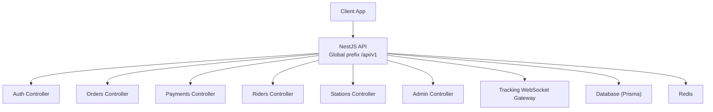
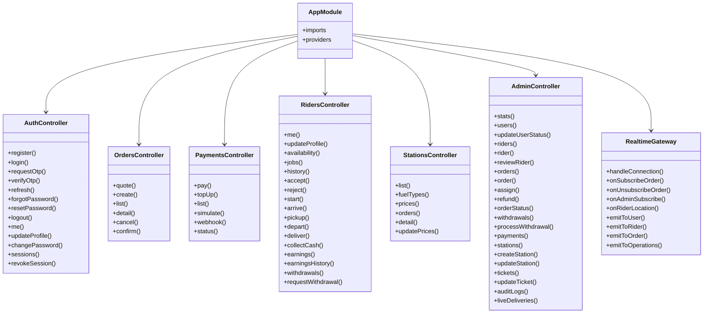
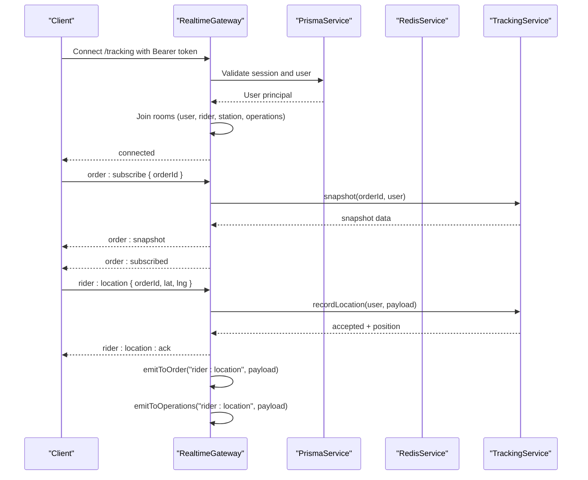
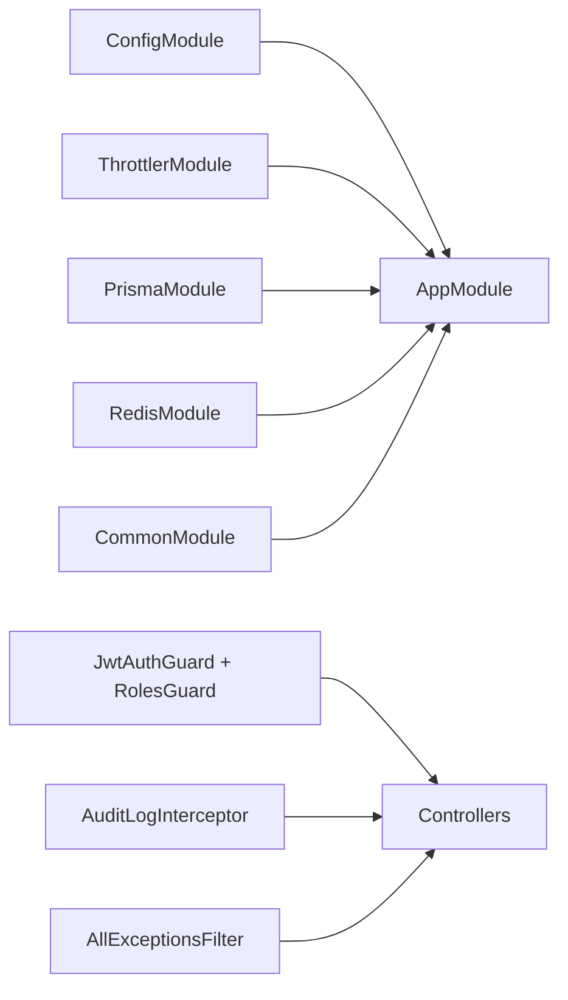

# Backend API Documentation

<cite>
**Referenced Files in This Document**
- [main.ts](file://backend/src/main.ts)
- [app.module.ts](file://backend/src/app.module.ts)
- [auth.controller.ts](file://backend/src/auth/auth.controller.ts)
- [orders.controller.ts](file://backend/src/orders/orders.controller.ts)
- [payments.controller.ts](file://backend/src/payments/payments.controller.ts)
- [riders.controller.ts](file://backend/src/riders/riders.controller.ts)
- [stations.controller.ts](file://backend/src/stations/stations.controller.ts)
- [admin.controller.ts](file://backend/src/admin/admin.controller.ts)
- [realtime.gateway.ts](file://backend/src/tracking/realtime.gateway.ts)
- [auth.dto.ts](file://backend/src/auth/dto/auth.dto.ts)
- [orders.dto.ts](file://backend/src/orders/dto/orders.dto.ts)
- [payments.dto.ts](file://backend/src/payments/dto/payments.dto.ts)
- [riders.dto.ts](file://backend/src/riders/dto/riders.dto.ts)
- [stations.dto.ts](file://backend/src/stations/dto/stations.dto.ts)
</cite>

## Table of Contents
1. [Introduction](#introduction)
2. [Project Structure](#project-structure)
3. [Core Components](#core-components)
4. [Architecture Overview](#architecture-overview)
5. [Detailed Component Analysis](#detailed-component-analysis)
6. [Dependency Analysis](#dependency-analysis)
7. [Performance Considerations](#performance-considerations)
8. [Troubleshooting Guide](#troubleshooting-guide)
9. [Conclusion](#conclusion)

## Introduction
This document specifies the FuelConnect backend REST APIs and WebSocket endpoints for customer, rider, station manager, and administrative clients. It covers authentication, order management, payment processing, rider lifecycle, station operations, admin functions, and real-time tracking via Socket.IO. The API is versioned under a global prefix and exposes Swagger documentation for interactive exploration.

Key characteristics:
- Global API prefix: `/api/v1`
- Authentication: Bearer JWT with short-lived access tokens and rotating refresh tokens
- Rate limiting: 120 requests per minute per IP by default; sensitive endpoints are further throttled
- Real-time tracking: Socket.IO namespace `/tracking`
- Security: Helmet enabled, CORS configured, validation enforced globally, HMAC-signed webhooks for payment providers

## Project Structure
The backend is a NestJS application organized by feature modules:
- Authentication and user sessions
- Orders and dispatch
- Payments and provider webhooks
- Rider profile, availability, jobs, and earnings
- Station catalog, pricing, and orders
- Admin dashboard and operational controls
- Real-time tracking gateway

**Diagram sources**
- [main.ts:11-91](file://backend/src/main.ts#L11-L91)
- [app.module.ts:29-67](file://backend/src/app.module.ts#L29-L67)

**Section sources**
- [main.ts:11-91](file://backend/src/main.ts#L11-L91)
- [app.module.ts:29-67](file://backend/src/app.module.ts#L29-L67)

## Core Components
- Authentication controller: registration, login, OTP flows, password reset, session management, profile updates
- Orders controller: quoting, creation with idempotency, listing, detail, cancellation, delivery confirmation
- Payments controller: pay order, wallet top-up, payment history, sandbox simulation, provider webhook, status polling
- Riders controller: profile, availability, job offers, lifecycle transitions, cash collection, earnings, withdrawals
- Stations controller: nearby stations, fuel types, prices, station orders, price updates
- Admin controller: overview stats, users, riders, orders, payments, withdrawals, stations, support tickets, audit logs, live deliveries
- Realtime gateway: authenticated connections, order rooms, operations room, location broadcasting

**Section sources**
- [auth.controller.ts:42-165](file://backend/src/auth/auth.controller.ts#L42-L165)
- [orders.controller.ts:21-83](file://backend/src/orders/orders.controller.ts#L21-L83)
- [payments.controller.ts:26-99](file://backend/src/payments/payments.controller.ts#L26-L99)
- [riders.controller.ts:27-152](file://backend/src/riders/riders.controller.ts#L27-L152)
- [stations.controller.ts:39-96](file://backend/src/stations/stations.controller.ts#L39-L96)
- [admin.controller.ts:36-217](file://backend/src/admin/admin.controller.ts#L36-L217)
- [realtime.gateway.ts:45-293](file://backend/src/tracking/realtime.gateway.ts#L45-L293)

## Architecture Overview
The system uses role-based access control, global guards, and interceptors for auditing and exception handling. Swagger is configured with bearer auth and tags for each domain.

**Diagram sources**
- [app.module.ts:29-67](file://backend/src/app.module.ts#L29-L67)
- [auth.controller.ts:42-165](file://backend/src/auth/auth.controller.ts#L42-L165)
- [orders.controller.ts:21-83](file://backend/src/orders/orders.controller.ts#L21-L83)
- [payments.controller.ts:26-99](file://backend/src/payments/payments.controller.ts#L26-L99)
- [riders.controller.ts:27-152](file://backend/src/riders/riders.controller.ts#L27-L152)
- [stations.controller.ts:39-96](file://backend/src/stations/stations.controller.ts#L39-L96)
- [admin.controller.ts:36-217](file://backend/src/admin/admin.controller.ts#L36-L217)
- [realtime.gateway.ts:45-293](file://backend/src/tracking/realtime.gateway.ts#L45-L293)

## Detailed Component Analysis

### Authentication API
Base path: `/api/v1/auth`

Authentication methods:
- Bearer JWT required on protected routes
- Access token lifetime: 15 minutes
- Refresh token rotation supported

Endpoints:
- POST `/api/v1/auth/register`
  - Public, rate-limited to 5 requests per minute
  - Request body: `RegisterDto`
  - Response: account created, signup OTP sent
- POST `/api/v1/auth/register/rider`
  - Public, rate-limited to 5 requests per minute
  - Request body: `RegisterRiderDto`
  - Response: rider application submitted for admin verification
- POST `/api/v1/auth/login`
  - Public, rate-limited to 8 requests per minute
  - Request body: `LoginDto`
  - Response: access token and refresh token
- POST `/api/v1/auth/otp/request`
  - Public, rate-limited to 5 requests per minute
  - Request body: `RequestOtpDto`
  - Response: OTP dispatched
- POST `/api/v1/auth/otp/verify`
  - Public, rate-limited to 10 requests per minute
  - Request body: `VerifyOtpDto`
  - Response: access token and refresh token or reset token
- POST `/api/v1/auth/refresh`
  - Public, rate-limited to 30 requests per minute
  - Request body: `RefreshTokenDto`
  - Response: new access token
- POST `/api/v1/auth/password/forgot`
  - Public, rate-limited to 5 requests per minute
  - Request body: `ForgotPasswordDto`
  - Response: reset flow initiated
- POST `/api/v1/auth/password/reset`
  - Public, rate-limited to 5 requests per minute
  - Request body: `ResetPasswordDto`
  - Response: password updated
- POST `/api/v1/auth/logout`
  - Protected
  - Response: current session revoked
- GET `/api/v1/auth/me`
  - Protected
  - Response: current account, profiles, wallet summary
- PATCH `/api/v1/auth/me`
  - Protected
  - Request body: `UpdateProfileDto`
  - Response: updated profile
- POST `/api/v1/auth/password/change`
  - Protected
  - Request body: `ChangePasswordDto`
  - Response: password changed
- GET `/api/v1/auth/sessions`
  - Protected
  - Response: active sessions/devices
- DELETE `/api/v1/auth/sessions/:id`
  - Protected
  - Path parameter: UUID session id
  - Response: session revoked

Validation rules and examples are defined in the DTOs. Phone numbers follow Uganda patterns; passwords require letters and digits.

**Section sources**
- [auth.controller.ts:42-165](file://backend/src/auth/auth.controller.ts#L42-L165)
- [auth.dto.ts:19-161](file://backend/src/auth/dto/auth.dto.ts#L19-L161)

### Orders API
Base path: `/api/v1/orders`

Access: Customer role required unless otherwise noted.

Endpoints:
- POST `/api/v1/orders/quote`
  - Request body: `QuoteOrderDto`
  - Response: price breakdown including fuel, delivery, service fees, and ETA
- POST `/api/v1/orders`
  - Idempotency header: `Idempotency-Key` recommended to prevent duplicate orders
  - Request body: `CreateOrderDto`
  - Response: order created with initial payment state
- GET `/api/v1/orders`
  - Query parameters: pagination and optional filters (`status`, `scope`)
  - Response: list of orders for the authenticated customer
- GET `/api/v1/orders/:id`
  - Path parameter: UUID order id
  - Response: order detail visible to owner, assigned rider, station manager, or staff
- POST `/api/v1/orders/:id/cancel`
  - Request body: `CancelOrderDto`
  - Response: order cancelled; paid orders refunded to wallet
- POST `/api/v1/orders/:id/confirm`
  - Response: moves delivered order to completed

Payment method aliases accepted include common variants like `mtn`, `airtel`, `wallet`, `cash`, `card`.

**Section sources**
- [orders.controller.ts:21-83](file://backend/src/orders/orders.controller.ts#L21-L83)
- [orders.dto.ts:37-127](file://backend/src/orders/dto/orders.dto.ts#L37-L127)

### Payments API
Base path: `/api/v1/payments`

Endpoints:
- POST `/api/v1/payments/orders/:orderId/pay`
  - Protected, customer role
  - Request body: `PayOrderDto`
  - Response: payment initiated using selected method
- POST `/api/v1/payments/wallet/topup`
  - Protected, customer role
  - Request body: `WalletTopUpDto`
  - Response: top-up process started
- GET `/api/v1/payments`
  - Protected, customer role
  - Query parameters: pagination
  - Response: payment history
- POST `/api/v1/payments/:id/simulate`
  - Protected, customer/admin/super-admin roles
  - Sandbox only
  - Request body: `SimulatePaymentDto`
  - Response: simulated provider outcome applied
- POST `/api/v1/payments/webhooks/:provider`
  - Public endpoint for provider callbacks
  - Header: `x-payments-signature` must be hex HMAC-SHA256 keyed with secret
  - Body: raw request body used for signature verification
  - Response: processed webhook result
- GET `/api/v1/payments/:id`
  - Protected, customer/admin/super-admin/station-manager roles
  - Response: payment status for polling after mobile money prompt

**Section sources**
- [payments.controller.ts:26-99](file://backend/src/payments/payments.controller.ts#L26-L99)
- [payments.dto.ts:7-42](file://backend/src/payments/dto/payments.dto.ts#L7-L42)

### Riders API
Base path: `/api/v1/rider`

Access: Rider role required.

Endpoints:
- GET `/api/v1/rider/me`
  - Response: profile, stats, vehicles, wallet balance
- PATCH `/api/v1/rider/me`
  - Request body: `UpdateRiderProfileDto`
  - Response: profile updated
- POST `/api/v1/rider/availability`
  - Request body: `UpdateAvailabilityDto`
  - Response: online/offline status set
- GET `/api/v1/rider/jobs`
  - Response: current offers plus active delivery
- GET `/api/v1/rider/jobs/history`
  - Query parameters: pagination
  - Response: completed and cancelled deliveries
- POST `/api/v1/rider/jobs/:orderId/accept`
  - Response: offer accepted
- POST `/api/v1/rider/jobs/:orderId/reject`
  - Request body: `RejectJobDto`
  - Response: offer rejected
- POST `/api/v1/rider/orders/:orderId/start`
  - Response: trip started heading to station
- POST `/api/v1/rider/orders/:orderId/arrive`
  - Response: arrived at station
- POST `/api/v1/rider/orders/:orderId/pickup`
  - Response: fuel collected
- POST `/api/v1/rider/orders/:orderId/depart`
  - Response: departed to customer
- POST `/api/v1/rider/orders/:orderId/deliver`
  - Response: delivered to customer
- POST `/api/v1/rider/orders/:orderId/collect-cash`
  - Response: cash recorded for COD order
- GET `/api/v1/rider/earnings`
  - Response: earnings summaries
- GET `/api/v1/rider/earnings/transactions`
  - Query parameters: pagination
  - Response: wallet ledger entries
- GET `/api/v1/rider/withdrawals`
  - Query parameters: pagination
  - Response: withdrawal requests
- POST `/api/v1/rider/withdrawals`
  - Request body: `WithdrawDto`
  - Response: payout requested

**Section sources**
- [riders.controller.ts:27-152](file://backend/src/riders/riders.controller.ts#L27-L152)
- [riders.dto.ts:16-89](file://backend/src/riders/dto/riders.dto.ts#L16-L89)

### Stations API
Base path: `/api/v1/stations`

Endpoints:
- GET `/api/v1/stations`
  - Public
  - Query parameters: latitude, longitude, radius, fuel filter, sort, search
  - Response: nearby stations with live prices, distance, ETA
- GET `/api/v1/stations/fuel-types`
  - Public
  - Response: available fuel types
- GET `/api/v1/stations/:id/prices`
  - Public
  - Response: current price list for station
- GET `/api/v1/stations/:id/orders`
  - Protected, station-manager/admin/super-admin roles
  - Query parameters: pagination and filter
  - Response: orders placed at the station
- GET `/api/v1/stations/:id`
  - Public
  - Optional query: lat/lng to compute distance
  - Response: station detail
- PATCH `/api/v1/stations/:id/prices`
  - Protected, station-manager/admin/super-admin roles
  - Request body: array of fuel type price updates
  - Response: prices updated

**Section sources**
- [stations.controller.ts:39-96](file://backend/src/stations/stations.controller.ts#L39-L96)
- [stations.dto.ts:22-210](file://backend/src/stations/dto/stations.dto.ts#L22-L210)

### Admin API
Base path: `/api/v1/admin`

Access: Admin or super-admin roles.

Endpoints:
- GET `/api/v1/admin/stats`
  - Response: dashboard counters, revenue, 7-day series
- GET `/api/v1/admin/users`
  - Query parameters: search and filters
  - Response: user accounts
- PATCH `/api/v1/admin/users/:id/status`
  - Request body: update status (activate, suspend, deactivate)
  - Response: status updated, sessions revoked
- GET `/api/v1/admin/riders`
  - Query parameters: filters
  - Response: rider roster and verification queue
- GET `/api/v1/admin/riders/:id`
  - Response: rider documents, location, recent deliveries, payouts
- POST `/api/v1/admin/riders/:id/review`
  - Request body: approve or reject application
  - Response: review result
- GET `/api/v1/admin/orders`
  - Query parameters: filters
  - Response: all orders
- GET `/api/v1/admin/orders/:id`
  - Response: order detail for support/dispatch
- POST `/api/v1/admin/orders/:id/assign`
  - Request body: assign verified rider
  - Response: assignment result
- POST `/api/v1/admin/orders/:id/refund`
  - Request body: refund amount and reason
  - Response: refund processed
- PATCH `/api/v1/admin/orders/:id/status`
  - Request body: legal status transition
  - Response: status updated
- GET `/api/v1/admin/withdrawals`
  - Query parameters: filters
  - Response: payout queue
- POST `/api/v1/admin/withdrawals/:id/process`
  - Request body: approve, reject, or mark paid
  - Response: withdrawal processed
- GET `/api/v1/admin/payments`
  - Query parameters: reconciliation filters
  - Response: payment records
- GET `/api/v1/admin/stations`
  - Query parameters: pagination
  - Response: all stations including inactive
- POST `/api/v1/admin/stations`
  - Request body: create station
  - Response: station created
- PATCH `/api/v1/admin/stations/:id`
  - Request body: update station fields
  - Response: station updated
- GET `/api/v1/admin/support/tickets`
  - Query parameters: filters
  - Response: support inbox
- PATCH `/api/v1/admin/support/tickets/:id`
  - Request body: assign, prioritize, resolve, close
  - Response: ticket updated
- GET `/api/v1/admin/audit-logs`
  - Query parameters: filters
  - Response: audit trail
- GET `/api/v1/admin/tracking/deliveries`
  - Response: active deliveries for live map

**Section sources**
- [admin.controller.ts:36-217](file://backend/src/admin/admin.controller.ts#L36-L217)

### WebSocket Real-Time Tracking API
Namespace: `/tracking`

Connection handling:
- Authenticate via Bearer token passed in handshake auth, authorization header, or query token
- On success, client joins personal and role-based rooms
- On failure, client receives `unauthorized` event and disconnects

Inbound events:
- `order:subscribe`
  - Payload: `{ orderId }`
  - Response: `order:subscribed` with snapshot `order:snapshot`
- `order:unsubscribe`
  - Payload: `{ orderId }`
  - Response: `order:unsubscribed`
- `admin:subscribe`
  - Payload: `{}`
  - Response: `operations:subscribed` with snapshot `operations:snapshot`
- `rider:location`
  - Payload: `{ orderId, lat, lng, speedKph?, heading?, accuracyM? }`
  - Response: `rider:location:ack` with acceptance and optional reason

Outbound events:
- `connected`: connection metadata
- `order:snapshot`: full delivery snapshot upon subscription
- `rider:location`: live position broadcast to order room and operations room
- `order:status`: order status changes
- `rider:offer`: delivery offer for specific rider
- `notification`: generic per-user notification

**Diagram sources**
- [realtime.gateway.ts:80-143](file://backend/src/tracking/realtime.gateway.ts#L80-L143)
- [realtime.gateway.ts:151-252](file://backend/src/tracking/realtime.gateway.ts#L151-L252)

**Section sources**
- [realtime.gateway.ts:45-293](file://backend/src/tracking/realtime.gateway.ts#L45-L293)

## Dependency Analysis
Global dependencies and cross-cutting concerns:
- Configuration module loads environment variables and validates them
- ThrottlerGuard enforces rate limits globally; sensitive endpoints use stricter limits
- JwtAuthGuard and RolesGuard protect controllers
- AuditLogInterceptor records actions
- AllExceptionsFilter normalizes error responses
- PrismaModule provides database access
- RedisModule supports caching and adapter for Socket.IO scaling

**Diagram sources**
- [app.module.ts:29-67](file://backend/src/app.module.ts#L29-L67)

**Section sources**
- [app.module.ts:29-67](file://backend/src/app.module.ts#L29-L67)

## Performance Considerations
- Use idempotency keys when creating orders to avoid duplicates on retries
- Paginate lists for orders, payments, riders, and withdrawals
- Prefer filtering by status and scope to reduce payload size
- For real-time tracking, subscribe only to necessary order rooms and unsubscribe promptly
- For station queries, provide lat/lng to enable efficient distance calculations and sorting
- Avoid frequent polling of payment status; rely on webhooks where possible

[No sources needed since this section provides general guidance]

## Troubleshooting Guide
Common issues and resolutions:
- Validation errors: The global ValidationPipe returns structured errors with flattened messages; inspect the response body for field-level details
- Rate limiting: If you receive throttling errors, back off and retry; sensitive endpoints have lower limits
- Authentication failures: Ensure Bearer token is present and valid; check session expiration and token type
- Payment webhook signature mismatch: Verify HMAC-SHA256 signature over raw body using the configured secret
- WebSocket unauthorized: Confirm token is attached during handshake and that the session is active and not revoked

Operational tips:
- Use Swagger UI at `/docs` to test endpoints interactively
- Monitor audit logs via admin endpoints to trace changes
- Inspect active deliveries through admin tracking endpoint for live map debugging

**Section sources**
- [main.ts:40-51](file://backend/src/main.ts#L40-L51)
- [payments.controller.ts:74-90](file://backend/src/payments/payments.controller.ts#L74-L90)
- [realtime.gateway.ts:80-143](file://backend/src/tracking/realtime.gateway.ts#L80-L143)

## Conclusion
The FuelConnect backend provides a comprehensive, secure, and scalable API surface for fuel delivery operations. It combines robust authentication, role-based authorization, strict input validation, rate limiting, and real-time capabilities. Clients should adhere to the documented request/response schemas, handle idempotency and pagination, and implement proper error handling and security practices.

[No sources needed since this section summarizes without analyzing specific files]