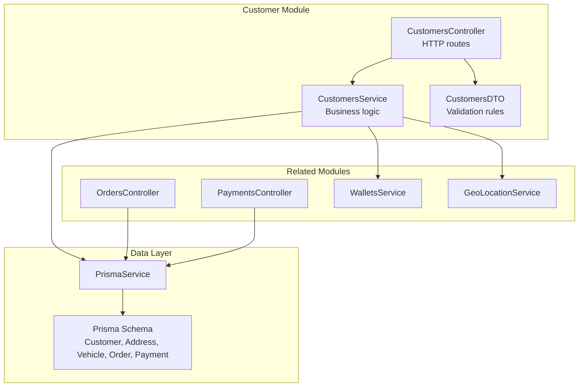
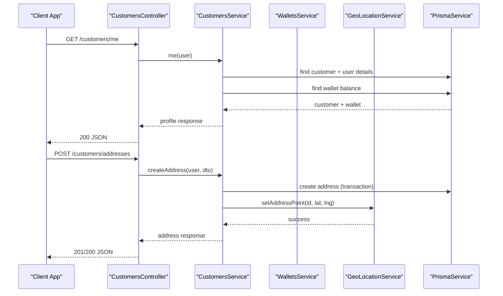
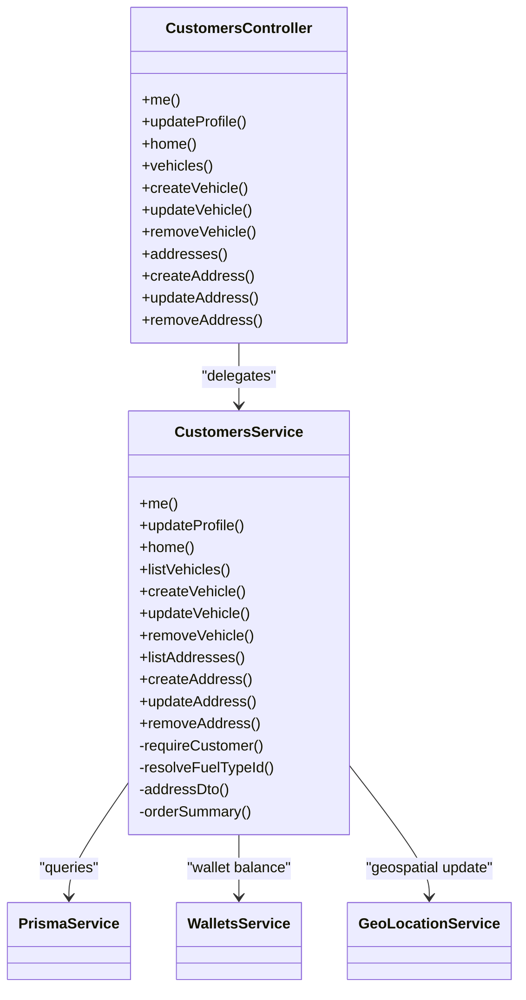

# Customer Management API

<cite>
**Referenced Files in This Document**
- [customers.controller.ts](file://backend/src/customers/customers.controller.ts)
- [customers.service.ts](file://backend/src/customers/customers.service.ts)
- [customers.dto.ts](file://backend/src/customers/dto/customers.dto.ts)
- [orders.controller.ts](file://backend/src/orders/orders.controller.ts)
- [payments.controller.ts](file://backend/src/payments/payments.controller.ts)
- [schema.prisma](file://backend/prisma/schema.prisma)
</cite>

## Table of Contents
1. [Introduction](#introduction)
2. [Project Structure](#project-structure)
3. [Core Components](#core-components)
4. [Architecture Overview](#architecture-overview)
5. [Detailed Component Analysis](#detailed-component-analysis)
6. [Dependency Analysis](#dependency-analysis)
7. [Performance Considerations](#performance-considerations)
8. [Troubleshooting Guide](#troubleshooting-guide)
9. [Conclusion](#conclusion)

## Introduction
This document provides comprehensive API documentation for the customer management endpoints in FuelConnect. It covers:
- Customer profile management
- Vehicle management
- Address book
- Loyalty program data exposure
- Integration with orders and payments

The customer endpoints are protected by bearer authentication and require the `CUSTOMER` role. They return structured JSON responses suitable for mobile and web clients, including Flutter-based applications.

## Project Structure
The customer management feature is implemented as a NestJS module under `backend/src/customers`. The controller defines HTTP routes, the service contains business logic, and DTOs define request validation rules. Related domain models such as customers, vehicles, addresses, orders, and payments are defined in the Prisma schema.

**Diagram sources**
- [customers.controller.ts:27-110](file://backend/src/customers/customers.controller.ts#L27-L110)
- [customers.service.ts:48-54](file://backend/src/customers/customers.service.ts#L48-L54)
- [schema.prisma:212-275](file://backend/prisma/schema.prisma#L212-L275)

**Section sources**
- [customers.controller.ts:27-110](file://backend/src/customers/customers.controller.ts#L27-L110)
- [schema.prisma:212-275](file://backend/prisma/schema.prisma#L212-L275)

## Core Components
- **CustomersController**: Defines REST endpoints for profile, home bundle, vehicles, and addresses.
- **CustomersService**: Implements profile retrieval and updates, vehicle CRUD, address CRUD, order summaries, wallet balance integration, and geolocation updates.
- **CustomersDTO**: Validates profile updates, vehicle creation/updates, and address creation/updates.
- **Prisma Schema**: Defines `Customer`, `CustomerVehicle`, `Address`, `Order`, `Payment`, and related relationships.

Key responsibilities:
- Profile read/update with loyalty points and wallet balance.
- Home screen aggregation combining wallet, active/recent orders, saved places, and notifications.
- Vehicle registration with default selection and fuel type resolution.
- Address management with soft delete and coordinate indexing.
- Integration with orders and payments through shared data models.

**Section sources**
- [customers.controller.ts:27-110](file://backend/src/customers/customers.controller.ts#L27-L110)
- [customers.service.ts:56-424](file://backend/src/customers/customers.service.ts#L56-L424)
- [customers.dto.ts:15-134](file://backend/src/customers/dto/customers.dto.ts#L15-L134)
- [schema.prisma:212-275](file://backend/prisma/schema.prisma#L212-L275)

## Architecture Overview
The customer API follows a layered architecture:
- Controller layer handles HTTP routing, parameter parsing, and role guards.
- Service layer enforces business rules, performs database operations via Prisma, and coordinates with wallets and geolocation services.
- Data layer uses PostgreSQL with PostGIS extensions and Prisma ORM.

**Diagram sources**
- [customers.controller.ts:34-44](file://backend/src/customers/customers.controller.ts#L34-L44)
- [customers.controller.ts:89-93](file://backend/src/customers/customers.controller.ts#L89-L93)
- [customers.service.ts:57-79](file://backend/src/customers/customers.service.ts#L57-L79)
- [customers.service.ts:278-307](file://backend/src/customers/customers.service.ts#L278-L307)

## Detailed Component Analysis

### Authentication and Authorization
- All customer endpoints require a valid bearer token.
- The `CUSTOMER` role guard restricts access to authenticated customer accounts.
- The current user context is injected into controllers and validated in the service layer.

Security notes:
- UUID parameters are parsed using `ParseUUIDPipe`.
- Role checks are applied at the controller level.
- Service methods enforce ownership by matching `customerId`.

**Section sources**
- [customers.controller.ts:27-30](file://backend/src/customers/customers.controller.ts#L27-L30)
- [customers.controller.ts:65-79](file://backend/src/customers/customers.controller.ts#L65-L79)
- [customers.service.ts:361-377](file://backend/src/customers/customers.service.ts#L361-L377)

### Profile Management Endpoints

#### GET /customers/me
Returns the authenticated customer’s profile, loyalty metrics, and wallet summary.

Response fields:
- `id`: Customer identifier
- `name`: Full name
- `phone`: Phone number
- `email`: Email address
- `avatarUrl`: Avatar URL
- `loyaltyPoints`: Loyalty points balance
- `totalOrders`: Total completed orders
- `totalSpent`: Cumulative spending
- `wallet.balance`: Wallet balance
- `wallet.currency`: Currency code
- `memberSince`: Account creation timestamp

Behavior:
- Requires `CUSTOMER` role.
- Fetches customer record and associated user details.
- Retrieves wallet balance and currency.

Error handling:
- Throws a bad request if no customer profile exists.
- Throws not found if the customer record is missing.

**Section sources**
- [customers.controller.ts:34-38](file://backend/src/customers/customers.controller.ts#L34-L38)
- [customers.service.ts:57-79](file://backend/src/customers/customers.service.ts#L57-L79)
- [schema.prisma:212-229](file://backend/prisma/schema.prisma#L212-L229)

#### PATCH /customers/me
Updates profile fields: full name, email, or avatar URL.

Request body fields:
- `fullName`: Optional string, length 2–80
- `email`: Optional email
- `avatarUrl`: Optional URL

Behavior:
- Trims and normalizes inputs.
- Updates only provided fields.
- Returns updated profile.

Validation:
- Uses class-validator decorators for optional fields and constraints.

**Section sources**
- [customers.controller.ts:40-44](file://backend/src/customers/customers.controller.ts#L40-L44)
- [customers.service.ts:81-94](file://backend/src/customers/customers.service.ts#L81-L94)
- [customers.dto.ts:15-31](file://backend/src/customers/dto/customers.dto.ts#L15-L31)

### Home Bundle Endpoint

#### GET /customers/home
Aggregates key dashboard data for the customer home screen.

Response includes:
- `customer`: Basic profile plus loyalty points, total orders, total spent, and wallet balance
- `activeOrder`: Active order summary if present
- `recentOrders`: Up to three recent completed/cancelled/refunded/failed orders
- `addresses`: Up to five saved addresses
- `vehicles`: Up to five saved vehicles
- `unreadNotifications`: Count of unread notifications

Behavior:
- Parallel queries for wallet, addresses, vehicles, active order, recent orders, and notification count.
- Includes station, address, and fuel type metadata for order summaries.
- Normalizes order summaries and addresses for UI consumption.

**Section sources**
- [customers.controller.ts:46-50](file://backend/src/customers/customers.controller.ts#L46-L50)
- [customers.service.ts:96-163](file://backend/src/customers/customers.service.ts#L96-L163)
- [schema.prisma:452-503](file://backend/prisma/schema.prisma#L452-L503)

### Vehicle Management Endpoints

#### GET /customers/vehicles
Lists all saved vehicles for the authenticated customer.

Response items include:
- `id`, `label`, `make`, `model`, `plateNumber`, `color`, `tankCapacityLitres`
- `fuelType`: Code from linked fuel type
- `fuelName`: Name from linked fuel type
- `isDefault`: Default flag
- `createdAt`: Creation timestamp

Behavior:
- Orders by default flag and creation time.
- Includes fuel type metadata.

**Section sources**
- [customers.controller.ts:53-57](file://backend/src/customers/customers.controller.ts#L53-L57)
- [customers.service.ts:166-187](file://backend/src/customers/customers.service.ts#L166-L187)
- [schema.prisma:232-252](file://backend/prisma/schema.prisma#L232-L252)

#### POST /customers/vehicles
Registers a new vehicle.

Request body fields:
- `label`: Optional label up to 40 characters
- `make`: Required, 2–40 characters
- `model`: Required, 1–40 characters
- `plateNumber`: Required, 4–16 characters
- `color`: Optional, up to 30 characters
- `tankCapacityLitres`: Optional numeric value between 1 and 1000
- `fuelTypeCode`: Optional fuel code; resolved to an active fuel type
- `isDefault`: Optional boolean; if true, clears other defaults

Behavior:
- Normalizes plate number to uppercase.
- Ensures only one default vehicle per customer.
- Resolves fuel type code to ID and validates it is active.
- Wraps creation in a transaction.

Response:
- Created vehicle object plus a message.

**Section sources**
- [customers.controller.ts:59-63](file://backend/src/customers/customers.controller.ts#L59-L63)
- [customers.service.ts:189-217](file://backend/src/customers/customers.service.ts#L189-L217)
- [customers.dto.ts:33-82](file://backend/src/customers/dto/customers.dto.ts#L33-L82)
- [schema.prisma:372-387](file://backend/prisma/schema.prisma#L372-L387)

#### PATCH /customers/vehicles/:id
Updates an existing vehicle.

Request body fields:
- Same as vehicle creation but partial.

Behavior:
- Ownership check ensures the vehicle belongs to the customer.
- Clears other default vehicles when setting this one as default.
- Updates only provided fields.
- Resolves fuel type code if provided.

Response:
- Updated vehicle object plus a message.

**Section sources**
- [customers.controller.ts:65-73](file://backend/src/customers/customers.controller.ts#L65-L73)
- [customers.service.ts:219-256](file://backend/src/customers/customers.service.ts#L219-L256)

#### DELETE /customers/vehicles/:id
Removes a saved vehicle.

Behavior:
- Ownership check.
- Returns success message even on successful deletion.

Response:
- Success message.

**Section sources**
- [customers.controller.ts:75-80](file://backend/src/customers/customers.controller.ts#L75-L80)
- [customers.service.ts:258-265](file://backend/src/customers/customers.service.ts#L258-L265)

### Address Book Endpoints

#### GET /customers/addresses
Lists saved delivery addresses for the authenticated customer.

Response items include:
- `id`, `label`, `line1`, `area`, `city`, `notes`
- `lat`, `lng`: Coordinates
- `isDefault`: Default flag
- `createdAt`: Creation timestamp

Behavior:
- Excludes soft-deleted addresses.
- Orders by default flag and creation time.

**Section sources**
- [customers.controller.ts:83-87](file://backend/src/customers/customers.controller.ts#L83-L87)
- [customers.service.ts:268-276](file://backend/src/customers/customers.service.ts#L268-L276)
- [schema.prisma:254-275](file://backend/prisma/schema.prisma#L254-L275)

#### POST /customers/addresses
Saves a delivery address with coordinates.

Request body fields:
- `label`: Required, 1–40 characters
- `line1`: Required, 3–200 characters
- `area`: Optional, up to 80 characters
- `city`: Optional, up to 80 characters; defaults to Kampala
- `notes`: Optional, up to 280 characters
- `lat`: Required latitude between -90 and 90
- `lng`: Required longitude between -180 and 180
- `isDefault`: Optional boolean; if true, clears other defaults

Behavior:
- Ensures only one default address per customer.
- Saves address in a transaction.
- Updates geospatial index via geolocation service.

Response:
- Saved address object plus a message.

**Section sources**
- [customers.controller.ts:89-93](file://backend/src/customers/customers.controller.ts#L89-L93)
- [customers.service.ts:278-307](file://backend/src/customers/customers.service.ts#L278-L307)
- [customers.dto.ts:84-134](file://backend/src/customers/dto/customers.dto.ts#L84-L134)

#### PATCH /customers/addresses/:id
Updates an existing address.

Request body fields:
- Same as address creation but partial.

Behavior:
- Ownership and existence check.
- Clears other defaults when setting this one as default.
- Updates geospatial index if coordinates change.

Response:
- Updated address object plus a message.

**Section sources**
- [customers.controller.ts:95-103](file://backend/src/customers/customers.controller.ts#L95-L103)
- [customers.service.ts:309-345](file://backend/src/customers/customers.service.ts#L309-L345)

#### DELETE /customers/addresses/:id
Soft deletes a saved address.

Behavior:
- Sets `deletedAt` and clears default flag.
- Preserves historical order references.

Response:
- Success message.

**Section sources**
- [customers.controller.ts:105-110](file://backend/src/customers/customers.controller.ts#L105-L110)
- [customers.service.ts:347-358](file://backend/src/customers/customers.service.ts#L347-L358)

### Loyalty Program Features
Loyalty data is exposed through:
- `GET /customers/me`: Returns `loyaltyPoints`, `totalOrders`, and `totalSpent`.
- `GET /customers/home`: Returns the same loyalty metrics alongside wallet balance and activity summaries.

Notes:
- Loyalty points and totals are stored in the `Customer` model.
- No dedicated endpoint updates loyalty; updates are expected to occur through order completion flows managed elsewhere.

**Section sources**
- [customers.service.ts:57-79](file://backend/src/customers/customers.service.ts#L57-L79)
- [customers.service.ts:138-146](file://backend/src/customers/customers.service.ts#L138-L146)
- [schema.prisma:212-229](file://backend/prisma/schema.prisma#L212-L229)

### Customer Analytics Exposure
Customer analytics are primarily available through:
- Profile metrics: loyalty points, total orders, total spent.
- Home bundle: recent orders and active order summary.
- Admin analytics: platform-level metrics exist in admin modules, but customer-facing analytics are limited to personal history and wallet data.

For deeper analytics, clients should aggregate order history and payment records returned by their respective endpoints.

**Section sources**
- [customers.service.ts:96-163](file://backend/src/customers/customers.service.ts#L96-L163)
- [orders.controller.ts:51-56](file://backend/src/orders/orders.controller.ts#L51-L56)
- [payments.controller.ts:53-59](file://backend/src/payments/payments.controller.ts#L53-L59)

### Integration with Orders and Payments

#### Orders Integration
Customers can:
- Quote orders before placing them.
- Create orders with idempotency support.
- List orders with pagination.
- Retrieve order details.
- Cancel orders before pickup.
- Confirm delivery.

Relevant endpoints:
- `POST /orders/quote`
- `POST /orders`
- `GET /orders`
- `GET /orders/:id`
- `POST /orders/:id/cancel`
- `POST /orders/:id/confirm`

These endpoints integrate with customer profiles through shared `customerId` and use order summaries that include station, address, and fuel type information.

**Section sources**
- [orders.controller.ts:27-82](file://backend/src/orders/orders.controller.ts#L27-L82)
- [customers.service.ts:27-38](file://backend/src/customers/customers.service.ts#L27-L38)
- [schema.prisma:452-503](file://backend/prisma/schema.prisma#L452-L503)

#### Payments Integration
Customers can:
- Pay for orders via wallet, cash on delivery, MTN Mobile Money, or Airtel Money.
- Start wallet top-ups.
- View payment history.
- Simulate provider callbacks in sandbox.
- Receive webhook notifications from providers.
- Poll payment status.

Relevant endpoints:
- `POST /payments/orders/:orderId/pay`
- `POST /payments/wallet/topup`
- `GET /payments`
- `POST /payments/:id/simulate`
- `POST /payments/webhooks/:provider`
- `GET /payments/:id`

Integration notes:
- Payment flow validates order ownership.
- Settlement states prevent duplicate payments.
- Webhooks are public and HMAC-signed for security.

**Section sources**
- [payments.controller.ts:31-98](file://backend/src/payments/payments.controller.ts#L31-L98)
- [schema.prisma:552-579](file://backend/prisma/schema.prisma#L552-L579)

### Request and Response Examples

#### Update Profile Example
- Method: `PATCH`
- Path: `/customers/me`
- Body fields: `fullName`, `email`, `avatarUrl`
- Success response: Updated profile including loyalty points and wallet summary

Reference:
- [customers.controller.ts:40-44](file://backend/src/customers/customers.controller.ts#L40-L44)
- [customers.service.ts:81-94](file://backend/src/customers/customers.service.ts#L81-L94)
- [customers.dto.ts:15-31](file://backend/src/customers/dto/customers.dto.ts#L15-L31)

#### Register Vehicle Example
- Method: `POST`
- Path: `/customers/vehicles`
- Body fields: `make`, `model`, `plateNumber`, optional `label`, `color`, `tankCapacityLitres`, `fuelTypeCode`, `isDefault`
- Success response: Vehicle object with message

Reference:
- [customers.controller.ts:59-63](file://backend/src/customers/customers.controller.ts#L59-L63)
- [customers.service.ts:189-217](file://backend/src/customers/customers.service.ts#L189-L217)
- [customers.dto.ts:33-82](file://backend/src/customers/dto/customers.dto.ts#L33-L82)

#### Save Address Example
- Method: `POST`
- Path: `/customers/addresses`
- Body fields: `label`, `line1`, optional `area`, `city`, `notes`, required `lat`, `lng`, optional `isDefault`
- Success response: Address object with message

Reference:
- [customers.controller.ts:89-93](file://backend/src/customers/customers.controller.ts#L89-L93)
- [customers.service.ts:278-307](file://backend/src/customers/customers.service.ts#L278-L307)
- [customers.dto.ts:84-134](file://backend/src/customers/dto/customers.dto.ts#L84-L134)

#### Place Order Example
- Method: `POST`
- Path: `/orders`
- Headers: Optional `Idempotency-Key`
- Body: Order creation payload (defined in orders DTO)
- Success response: Order creation result

Reference:
- [orders.controller.ts:35-49](file://backend/src/orders/orders.controller.ts#L35-L49)

#### Pay Order Example
- Method: `POST`
- Path: `/payments/orders/:orderId/pay`
- Body: Payment method and details
- Success response: Payment initiation or already-paid confirmation

Reference:
- [payments.controller.ts:31-42](file://backend/src/payments/payments.controller.ts#L31-L42)

## Dependency Analysis
The customer module depends on:
- PrismaService for database operations.
- WalletsService for wallet balance retrieval.
- GeoLocationService for updating geospatial indexes on addresses.
- Shared types and decorators for authentication and roles.

**Diagram sources**
- [customers.controller.ts:31-110](file://backend/src/customers/customers.controller.ts#L31-L110)
- [customers.service.ts:48-54](file://backend/src/customers/customers.service.ts#L48-L54)
- [customers.service.ts:361-424](file://backend/src/customers/customers.service.ts#L361-L424)

**Section sources**
- [customers.controller.ts:31-110](file://backend/src/customers/customers.controller.ts#L31-L110)
- [customers.service.ts:48-54](file://backend/src/customers/customers.service.ts#L48-L54)

## Performance Considerations
- Use parallel queries for dashboard aggregation to reduce latency.
- Limit list sizes for home screen data to avoid heavy payloads.
- Ensure indexes exist on frequently filtered columns such as `customerId`, `status`, and timestamps.
- Normalize and trim inputs server-side to reduce downstream processing.
- Avoid unnecessary joins; select only needed fields in Prisma queries.

[No sources needed since this section provides general guidance]

## Troubleshooting Guide
Common issues and resolutions:
- Missing customer profile: Ensure the authenticated user has a linked customer record.
- Unknown fuel type: Validate `fuelTypeCode` against active fuel types before submission.
- Not found errors: Verify resource ownership and correct UUID parameters.
- Soft-deleted addresses: Deleted addresses remain hidden but retain historical references; recreate if needed.
- Duplicate default flags: Setting a new default clears previous defaults automatically.

Error handling patterns:
- Bad request exceptions for invalid input or missing customer profile.
- Not found exceptions for missing resources or ownership mismatches.
- Transactional writes ensure consistency for default flag updates.

**Section sources**
- [customers.service.ts:361-377](file://backend/src/customers/customers.service.ts#L361-L377)
- [customers.service.ts:379-392](file://backend/src/customers/customers.service.ts#L379-L392)
- [customers.service.ts:219-265](file://backend/src/customers/customers.service.ts#L219-L265)
- [customers.service.ts:347-358](file://backend/src/customers/customers.service.ts#L347-L358)

## Conclusion
The Customer Management API provides robust endpoints for managing customer profiles, vehicles, and addresses, while exposing loyalty metrics and integrating seamlessly with orders and payments. The design emphasizes security, data integrity, and performance, making it suitable for scalable fuel delivery platforms. Clients should leverage the home bundle for dashboard data, validate inputs according to DTO specifications, and handle errors consistently across profile, vehicle, and address operations.

[No sources needed since this section summarizes without analyzing specific files]