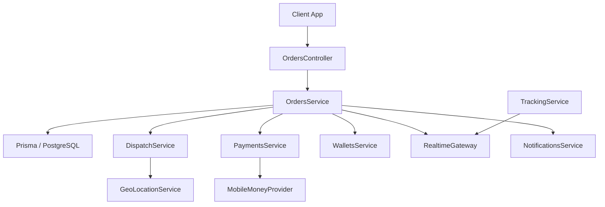
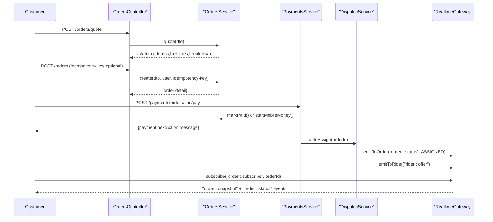
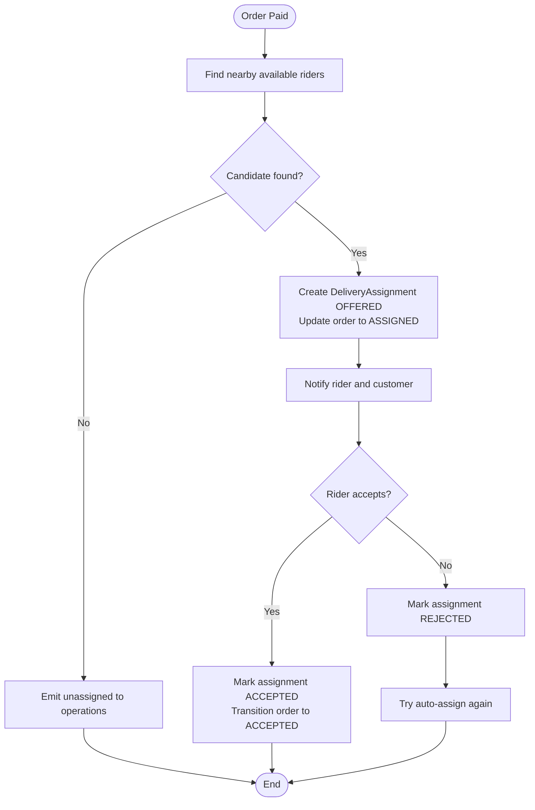
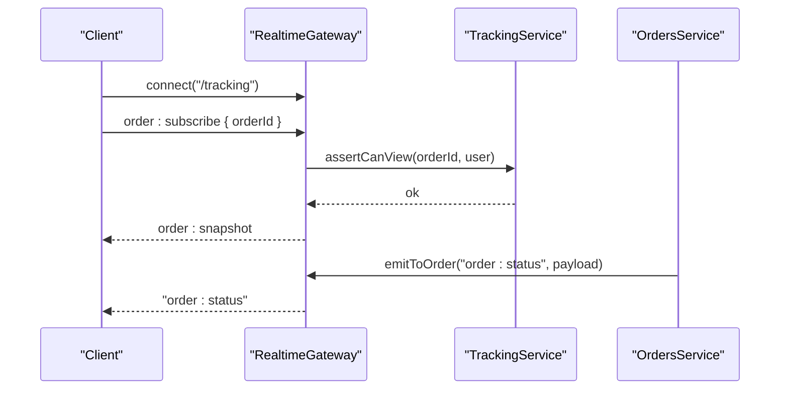
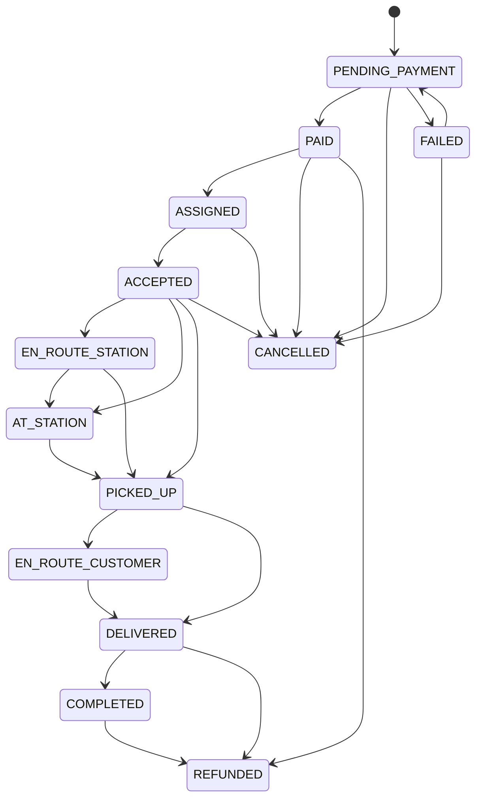
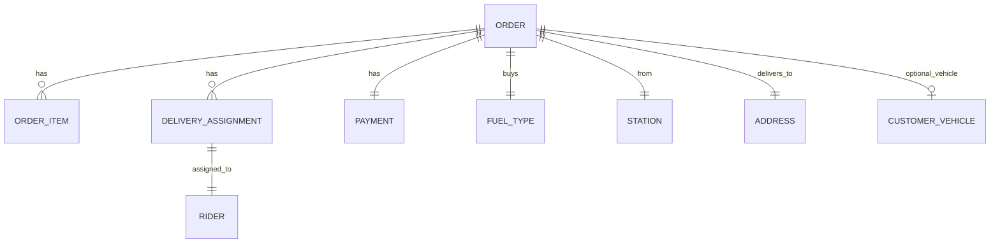
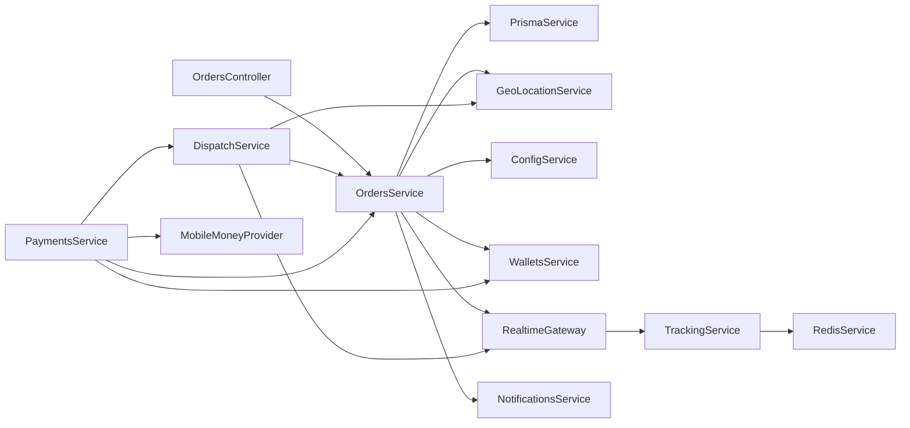

# Orders Management API

<cite>
**Referenced Files in This Document**   
- [orders.controller.ts](file://backend/src/orders/orders.controller.ts)
- [orders.service.ts](file://backend/src/orders/orders.service.ts)
- [orders.dto.ts](file://backend/src/orders/dto/orders.dto.ts)
- [order-status.ts](file://backend/src/orders/order-status.ts)
- [dispatch.service.ts](file://backend/src/orders/dispatch.service.ts)
- [payments.service.ts](file://backend/src/payments/payments.service.ts)
- [mobile-money.provider.ts](file://backend/src/payments/providers/mobile-money.provider.ts)
- [realtime.gateway.ts](file://backend/src/tracking/realtime.gateway.ts)
- [tracking.service.ts](file://backend/src/tracking/tracking.service.ts)
- [schema.prisma](file://backend/prisma/schema.prisma)
</cite>

## Table of Contents
1. [Introduction](#introduction)
2. [Project Structure](#project-structure)
3. [Core Components](#core-components)
4. [Architecture Overview](#architecture-overview)
5. [Detailed Component Analysis](#detailed-component-analysis)
6. [Dependency Analysis](#dependency-analysis)
7. [Performance Considerations](#performance-considerations)
8. [Troubleshooting Guide](#troubleshooting-guide)
9. [Conclusion](#conclusion)

## Introduction
This document provides detailed API documentation for order management endpoints in the FuelConnect backend. It covers:
- Order creation with vehicle selection and pricing calculation
- Payment integration including mobile money, wallet, cash, and card handling
- Delivery assignment and rider lifecycle
- Real-time order tracking via WebSocket
- Status transitions and error handling across the full order workflow

The system is a NestJS backend using Prisma with PostgreSQL and PostGIS, Socket.IO for real-time updates, and modular services for orders, payments, dispatch, and tracking.

## Project Structure
The order-related functionality lives primarily under `backend/src/orders`, with supporting modules for payments, tracking, and shared utilities. The data model is defined in Prisma.

**Diagram sources**
- [orders.controller.ts:21-83](file://backend/src/orders/orders.controller.ts#L21-L83)
- [orders.service.ts:76-85](file://backend/src/orders/orders.service.ts#L76-L85)
- [dispatch.service.ts:37-49](file://backend/src/orders/dispatch.service.ts#L37-L49)
- [payments.service.ts:74-80](file://backend/src/payments/payments.service.ts#L74-L80)
- [realtime.gateway.ts:45-61](file://backend/src/tracking/realtime.gateway.ts#L45-L61)
- [tracking.service.ts:32-39](file://backend/src/tracking/tracking.service.ts#L32-L39)

**Section sources**
- [orders.controller.ts:21-83](file://backend/src/orders/orders.controller.ts#L21-L83)
- [schema.prisma:47-87](file://backend/prisma/schema.prisma#L47-L87)

## Core Components
- OrdersController: HTTP endpoints for quoting, creating, listing, viewing, canceling, and confirming orders.
- OrdersService: Business logic for quoting, creation, payment coordination, lifecycle transitions, refunds, and DTO mapping.
- DispatchService: Rider auto-assignment, manual admin assignment, offer lifecycle, accept/reject, and sweep expired offers.
- PaymentsService: Payment initiation for wallet, cash, mobile money, and card; provider orchestration; callback handling.
- RealtimeGateway: Socket.IO events for order status, rider offers, location streaming, and operations feed.
- TrackingService: Access control and live position handling for order tracking.
- Data Model: Order, Payment, DeliveryAssignment, Rider, Station, Address, CustomerVehicle, FuelType, and related entities.

**Section sources**
- [orders.controller.ts:21-83](file://backend/src/orders/orders.controller.ts#L21-L83)
- [orders.service.ts:76-85](file://backend/src/orders/orders.service.ts#L76-L85)
- [dispatch.service.ts:37-49](file://backend/src/orders/dispatch.service.ts#L37-L49)
- [payments.service.ts:74-80](file://backend/src/payments/payments.service.ts#L74-L80)
- [realtime.gateway.ts:45-61](file://backend/src/tracking/realtime.gateway.ts#L45-L61)
- [tracking.service.ts:32-39](file://backend/src/tracking/tracking.service.ts#L32-L39)
- [schema.prisma:452-547](file://backend/prisma/schema.prisma#L452-L547)

## Architecture Overview
The order flow integrates REST endpoints with background dispatch and real-time updates:
- Customers quote and place orders (PENDING_PAYMENT).
- Payments are processed; on success, orders move to PAID and trigger rider dispatch.
- Dispatch finds nearby riders, creates delivery assignments, and emits offers.
- Riders accept or reject; accepted orders transition through station pickup and delivery.
- Real-time events broadcast status changes and rider locations.

**Diagram sources**
- [orders.controller.ts:27-49](file://backend/src/orders/orders.controller.ts#L27-L49)
- [orders.service.ts:88-125](file://backend/src/orders/orders.service.ts#L88-L125)
- [orders.service.ts:128-254](file://backend/src/orders/orders.service.ts#L128-L254)
- [payments.service.ts:83-150](file://backend/src/payments/payments.service.ts#L83-L150)
- [dispatch.service.ts:63-110](file://backend/src/orders/dispatch.service.ts#L63-L110)
- [realtime.gateway.ts:179-199](file://backend/src/tracking/realtime.gateway.ts#L179-L199)

## Detailed Component Analysis

### Orders REST Endpoints
Base path: `/orders`
Authentication: Bearer token required; customer role required for most endpoints.

- Quote an order
  - Method: POST
  - Path: `/orders/quote`
  - Role: CUSTOMER
  - Request body: QuoteOrderDto
    - stationId: UUID
    - fuelTypeId: optional UUID
    - fuelTypeCode: optional string alias like PETROL
    - litres: number between 1 and 2000
    - addressId: UUID
  - Response: Quote result including station, address, fuel type, litres, distanceKm, etaMinutes, pricePerLitre, fuelTotal, deliveryFee, serviceFee, total, commission, riderEarning, currency UGX.
  - Notes: Uses configuration-based pricing and geolocation to compute breakdown.

- Create an order
  - Method: POST
  - Path: `/orders`
  - Role: CUSTOMER
  - Headers: Idempotency-Key (optional)
  - Request body: CreateOrderDto extends QuoteOrderDto
    - vehicleId: optional UUID belonging to the customer
    - paymentMethod: enum MTN_MOMO | AIRTEL_MONEY | WALLET | CASH | CARD
    - scheduledFor: optional ISO timestamp
    - deliveryNote: optional string up to 280 characters
  - Response: Order detail DTO including status PENDING_PAYMENT, paymentStatus PENDING, timestamps, station/address/fuel/vehicle/items/payment/assignment/rider/customer.
  - Behavior:
    - Validates idempotency key if provided.
    - Reuses recent duplicate requests within two minutes.
    - Creates order, order item, and payment record inside a transaction.
    - Emits notification to the customer.

- List my orders
  - Method: GET
  - Path: `/orders`
  - Query parameters: PaginationDto plus optional status and scope active|past
  - Response: Paginated list of order DTOs.

- Get order detail
  - Method: GET
  - Path: `/orders/:id`
  - Authorization: Owner, assigned rider, station manager, admin/super-admin.
  - Response: Full order DTO with relations.

- Cancel an order
  - Method: POST
  - Path: `/orders/:id/cancel`
  - Role: CUSTOMER
  - Request body: CancelOrderDto with optional reason
  - Response: Updated order detail.
  - Behavior:
    - Allows cancellation from PENDING_PAYMENT, PAID, ASSIGNED, ACCEPTED.
    - Refunds paid orders to the customer wallet and marks payment REFUNDED.
    - Transitions order to CANCELLED and emits notifications.

- Confirm delivery
  - Method: POST
  - Path: `/orders/:id/confirm`
  - Role: CUSTOMER
  - Response: Updated order detail.
  - Behavior: Moves DELIVERED to COMPLETED.

Error scenarios handled by controllers and services:
- Not found: invalid order, station, fuel type, address, or vehicle.
- Forbidden: non-customer account trying to place orders; wrong owner attempting cancel/confirm.
- Conflict: invalid status transitions; duplicate idempotency key; already paid or failed order states.
- Bad request: missing or invalid payload fields.

**Section sources**
- [orders.controller.ts:27-82](file://backend/src/orders/orders.controller.ts#L27-L82)
- [orders.dto.ts:37-106](file://backend/src/orders/dto/orders.dto.ts#L37-L106)
- [orders.service.ts:88-254](file://backend/src/orders/orders.service.ts#L88-L254)
- [orders.service.ts:257-317](file://backend/src/orders/orders.service.ts#L257-L317)
- [orders.service.ts:422-476](file://backend/src/orders/orders.service.ts#L422-L476)
- [orders.service.ts:667-698](file://backend/src/orders/orders.service.ts#L667-L698)
- [orders.service.ts:700-748](file://backend/src/orders/orders.service.ts#L700-L748)
- [orders.service.ts:750-794](file://backend/src/orders/orders.service.ts#L750-L794)
- [orders.service.ts:815-894](file://backend/src/orders/orders.service.ts#L815-L894)

### Pricing and Vehicle Selection
- Vehicle selection:
  - Optional vehicleId must belong to the authenticated customer.
  - If provided but not found, returns not found error.
- Pricing calculation:
  - Distance computed via PostGIS when available; otherwise haversine fallback.
  - Delivery fee uses base fee, per-km fee, free kilometers, and rounding rules.
  - Service fee is fixed.
  - Total = fuelTotal + deliveryFee + serviceFee.
  - Commission and riderEarning derived from delivery fee and configured percentage.
  - ETA estimated from distance plus buffer.

Configuration keys used:
- pricing.deliveryBaseFee
- pricing.deliveryPerKmFee
- pricing.deliveryFreeKm
- pricing.serviceFee
- pricing.riderCommissionPercent

**Section sources**
- [orders.service.ts:146-152](file://backend/src/orders/orders.service.ts#L146-L152)
- [orders.service.ts:750-794](file://backend/src/orders/orders.service.ts#L750-L794)

### Payment Integration
Supported methods:
- MTN Mobile Money
- Airtel Money
- Wallet
- Cash
- Card (not yet available; returns bad request)

Payment flow:
- Initiate payment for an order:
  - Validates order ownership and allowed states.
  - For wallet: debit customer wallet and mark payment succeeded.
  - For cash: mark order confirmed and schedule rider dispatch; payment remains pending until collected.
  - For mobile money: call provider to request collection; return instructions and next action.
  - For card: currently unsupported.
- Provider abstraction:
  - MobileMoneyProvider supports MTN and Airtel.
  - Sandbox mode returns simulated instructions and simulate endpoint.
- Callbacks and failures:
  - Mark payment failed transitions order to FAILED and notifies the customer.
  - Mark cash collected finalizes payment after delivery.

Response includes:
- Payment DTO with method, status, amount, providerReference, paidAt.
- nextAction: simulate | wait_for_provider | pay_on_delivery | track_order.
- Message guiding client behavior.

**Section sources**
- [payments.service.ts:83-150](file://backend/src/payments/payments.service.ts#L83-L150)
- [payments.service.ts:152-219](file://backend/src/payments/payments.service.ts#L152-L219)
- [payments.service.ts:221-286](file://backend/src/payments/payments.service.ts#L221-L286)
- [mobile-money.provider.ts:41-79](file://backend/src/payments/providers/mobile-money.provider.ts#L41-L79)
- [orders.service.ts:320-419](file://backend/src/orders/orders.service.ts#L320-L419)

### Delivery Assignment and Rider Lifecycle
Auto-assignment:
- Triggered after successful payment or cash confirmation.
- Finds verified, online, available riders near the station within a configured radius.
- Skips previously offered riders for the same order.
- If no candidates, emits unassigned event to operations and returns reason.

Offer lifecycle:
- Creates DeliveryAssignment with OFFERED status, earning, distance, expiresAt.
- Updates order to ASSIGNED and emits real-time events to rider, customer, and operations.
- Sends notification to rider with earnings and station details.

Rider responses:
- Accept: validates assignment exists and has not expired; marks assignment ACCEPTED; sets rider unavailable; transitions order to ACCEPTED; notifies customer.
- Reject: marks assignment REJECTED; triggers re-dispatch if order still needs a rider.

Manual assignment:
- Admin can assign any verified rider regardless of radius.
- Prevents assigning busy or unverified riders.
- Clears previous OFFERED assignments before offering to the selected rider.

Sweeping:
- Background job periodically marks expired OFFERED assignments EXPIRED.
- Triggers re-dispatch for orders still needing a rider.

**Diagram sources**
- [dispatch.service.ts:63-110](file://backend/src/orders/dispatch.service.ts#L63-L110)
- [dispatch.service.ts:163-246](file://backend/src/orders/dispatch.service.ts#L163-L246)
- [dispatch.service.ts:249-317](file://backend/src/orders/dispatch.service.ts#L249-L317)
- [dispatch.service.ts:320-353](file://backend/src/orders/dispatch.service.ts#L320-L353)

**Section sources**
- [dispatch.service.ts:63-110](file://backend/src/orders/dispatch.service.ts#L63-L110)
- [dispatch.service.ts:112-161](file://backend/src/orders/dispatch.service.ts#L112-L161)
- [dispatch.service.ts:163-246](file://backend/src/orders/dispatch.service.ts#L163-L246)
- [dispatch.service.ts:249-317](file://backend/src/orders/dispatch.service.ts#L249-L317)
- [dispatch.service.ts:320-353](file://backend/src/orders/dispatch.service.ts#L320-L353)

### Real-Time Order Tracking
WebSocket namespace: `/tracking`
Events:
- Inbound:
  - order:subscribe { orderId }
  - order:unsubscribe { orderId }
  - admin:subscribe (staff only)
  - rider:location { orderId, lat, lng, speedKph?, heading?, accuracyM? }
- Outbound:
  - order:snapshot (on subscribe)
  - rider:location (broadcast to order room and admins)
  - order:status (status change)
  - rider:offer (delivery offer)
  - notification (generic per-user)

Access control:
- Only owners, assigned riders, staff, or station managers can watch an order.
- Operations feed restricted to staff roles.

Integration points:
- OrdersService emits order:status events on lifecycle transitions.
- DispatchService emits rider:offer and order:status during assignment.
- RealtimeGateway handles subscriptions and broadcasts.

**Diagram sources**
- [realtime.gateway.ts:29-44](file://backend/src/tracking/realtime.gateway.ts#L29-L44)
- [realtime.gateway.ts:179-199](file://backend/src/tracking/realtime.gateway.ts#L179-L199)
- [tracking.service.ts:41-43](file://backend/src/tracking/tracking.service.ts#L41-L43)
- [orders.service.ts:796-813](file://backend/src/orders/orders.service.ts#L796-L813)

**Section sources**
- [realtime.gateway.ts:45-61](file://backend/src/tracking/realtime.gateway.ts#L45-L61)
- [realtime.gateway.ts:179-199](file://backend/src/tracking/realtime.gateway.ts#L179-L199)
- [tracking.service.ts:32-39](file://backend/src/tracking/tracking.service.ts#L32-L39)
- [orders.service.ts:796-813](file://backend/src/orders/orders.service.ts#L796-L813)

### Order Status Transitions
Legal transitions are enforced centrally:
- PENDING_PAYMENT -> PAID | CANCELLED | FAILED
- PAID -> ASSIGNED | CANCELLED | REFUNDED
- ASSIGNED -> ACCEPTED | CANCELLED
- ACCEPTED -> EN_ROUTE_STATION | AT_STATION | PICKED_UP | CANCELLED
- EN_ROUTE_STATION -> AT_STATION | PICKED_UP
- AT_STATION -> PICKED_UP
- PICKED_UP -> EN_ROUTE_CUSTOMER | DELIVERED
- EN_ROUTE_CUSTOMER -> DELIVERED
- DELIVERED -> COMPLETED | REFUNDED
- COMPLETED -> REFUNDED
- CANCELLED -> none
- REFUNDED -> none
- FAILED -> PENDING_PAYMENT | CANCELLED

Active statuses include all non-terminal states used for filtering lists.

**Diagram sources**
- [order-status.ts:7-30](file://backend/src/orders/order-status.ts#L7-L30)
- [order-status.ts:32-46](file://backend/src/orders/order-status.ts#L32-L46)

**Section sources**
- [order-status.ts:7-30](file://backend/src/orders/order-status.ts#L7-L30)
- [order-status.ts:32-46](file://backend/src/orders/order-status.ts#L32-L46)
- [orders.service.ts:482-603](file://backend/src/orders/orders.service.ts#L482-L603)

### Data Models Relevant to Orders
Key entities:
- Order: core order record with status, payment info, timestamps, distances, and scheduling.
- OrderItem: line item for fuel quantity and pricing.
- DeliveryAssignment: rider assignment lifecycle with offer/expiry/response.
- Payment: payment method, status, provider reference, timestamps.
- Rider: rider profile, availability, ratings, earnings.
- Station: fuel station with location and operational hours.
- Address: customer delivery location with coordinates.
- CustomerVehicle: optional vehicle linked to customer orders.
- FuelType: fuel code, name, unit, and active flag.

**Diagram sources**
- [schema.prisma:452-547](file://backend/prisma/schema.prisma#L452-L547)
- [schema.prisma:389-447](file://backend/prisma/schema.prisma#L389-L447)
- [schema.prisma:552-579](file://backend/prisma/schema.prisma#L552-L579)
- [schema.prisma:280-367](file://backend/prisma/schema.prisma#L280-L367)
- [schema.prisma:232-275](file://backend/prisma/schema.prisma#L232-L275)

**Section sources**
- [schema.prisma:452-547](file://backend/prisma/schema.prisma#L452-L547)
- [schema.prisma:389-447](file://backend/prisma/schema.prisma#L389-L447)
- [schema.prisma:552-579](file://backend/prisma/schema.prisma#L552-L579)
- [schema.prisma:280-367](file://backend/prisma/schema.prisma#L280-L367)
- [schema.prisma:232-275](file://backend/prisma/schema.prisma#L232-L275)

## Dependency Analysis
Component relationships:
- OrdersController depends on OrdersService for business logic.
- OrdersService depends on PrismaService, GeoLocationService, ConfigService, WalletsService, RealtimeGateway, NotificationsService.
- DispatchService depends on PrismaService, GeoLocationService, RealtimeGateway, NotificationsService, OrdersService, ConfigService.
- PaymentsService depends on PrismaService, WalletsService, OrdersService, DispatchService, NotificationsService, AuditService, MobileMoneyProvider.
- RealtimeGateway depends on JwtService, PrismaService, RedisService, TrackingService.
- TrackingService depends on PrismaService, RedisService, GeoLocationService, ConfigService.

Potential coupling:
- OrdersService orchestrates multiple subsystems; ensure consistent error propagation.
- DispatchService relies on geo queries and config; misconfiguration can lead to no-rider scenarios.
- PaymentsService abstracts providers; sandbox vs production behavior differs.

External dependencies:
- PostgreSQL with PostGIS for spatial queries.
- Redis for Socket.IO adapter and caching.
- Mobile money providers (MTN/Airtel) via MobileMoneyProvider.

**Diagram sources**
- [orders.controller.ts:21-25](file://backend/src/orders/orders.controller.ts#L21-L25)
- [orders.service.ts:76-85](file://backend/src/orders/orders.service.ts#L76-L85)
- [dispatch.service.ts:42-49](file://backend/src/orders/dispatch.service.ts#L42-L49)
- [payments.service.ts:74-80](file://backend/src/payments/payments.service.ts#L74-L80)
- [realtime.gateway.ts:56-61](file://backend/src/tracking/realtime.gateway.ts#L56-L61)
- [tracking.service.ts:34-39](file://backend/src/tracking/tracking.service.ts#L34-L39)

**Section sources**
- [orders.controller.ts:21-25](file://backend/src/orders/orders.controller.ts#L21-L25)
- [orders.service.ts:76-85](file://backend/src/orders/orders.service.ts#L76-L85)
- [dispatch.service.ts:42-49](file://backend/src/orders/dispatch.service.ts#L42-L49)
- [payments.service.ts:74-80](file://backend/src/payments/payments.service.ts#L74-L80)
- [realtime.gateway.ts:56-61](file://backend/src/tracking/realtime.gateway.ts#L56-L61)
- [tracking.service.ts:34-39](file://backend/src/tracking/tracking.service.ts#L34-L39)

## Performance Considerations
- Use PostGIS distance queries where possible; fallback to haversine when unavailable.
- Batch database reads using Prisma includes to reduce N+1 queries.
- Limit pagination with skip/take and count for efficient listing.
- Avoid heavy computations in hot paths; rely on configuration-driven pricing.
- Use Redis adapter for Socket.IO to support horizontal scaling.
- Sweep expired offers in batches to avoid blocking.

[No sources needed since this section provides general guidance]

## Troubleshooting Guide
Common issues and resolutions:
- No riders available:
  - Check rider availability and verification status.
  - Increase dispatch radius or adjust assignment timeout.
  - Monitor operations feed for unassigned events.
- Payment failures:
  - Verify provider credentials and sandbox settings.
  - Inspect payment status and failureReason.
  - Retry or switch payment method if supported.
- Invalid status transitions:
  - Ensure state machine transitions are valid.
  - Review actor permissions and order ownership.
- Duplicate order creation:
  - Use Idempotency-Key header to prevent duplicates.
  - Handle conflict responses gracefully.
- Real-time connection issues:
  - Validate JWT and user roles.
  - Ensure Redis adapter is configured for multi-instance deployments.

Operational checks:
- Confirm station is active and sells the requested fuel type.
- Validate addresses and vehicles belong to the customer.
- Review audit logs and notifications for context.

**Section sources**
- [dispatch.service.ts:99-107](file://backend/src/orders/dispatch.service.ts#L99-L107)
- [payments.service.ts:143-149](file://backend/src/payments/payments.service.ts#L143-L149)
- [orders.service.ts:491-495](file://backend/src/orders/orders.service.ts#L491-L495)
- [orders.service.ts:131-139](file://backend/src/orders/orders.service.ts#L131-L139)
- [realtime.gateway.ts:63-74](file://backend/src/tracking/realtime.gateway.ts#L63-L74)

## Conclusion
The Orders Management API provides a robust, stateful workflow for fuel delivery orders. It integrates pricing, payment processing, rider dispatch, and real-time tracking while enforcing strict status transitions and access controls. Clients should handle idempotency, payment flows, and WebSocket events to deliver a seamless experience from order creation to completion.

[No sources needed since this section summarizes without analyzing specific files]