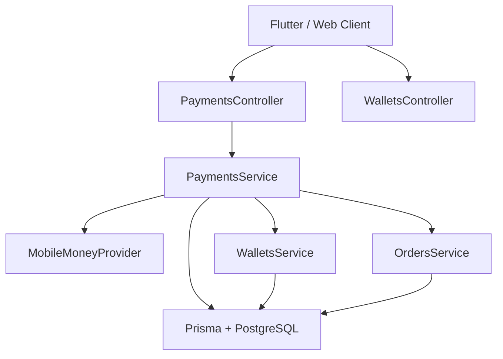
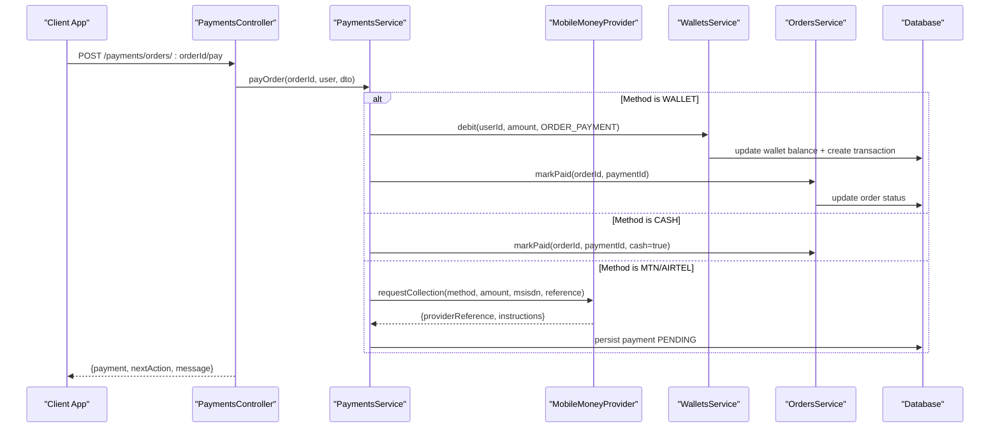
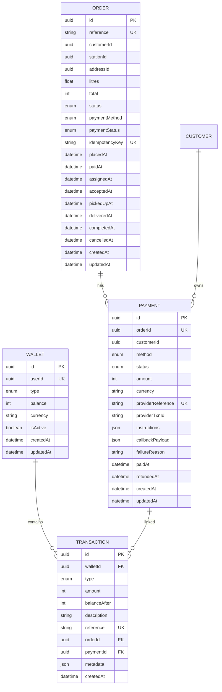
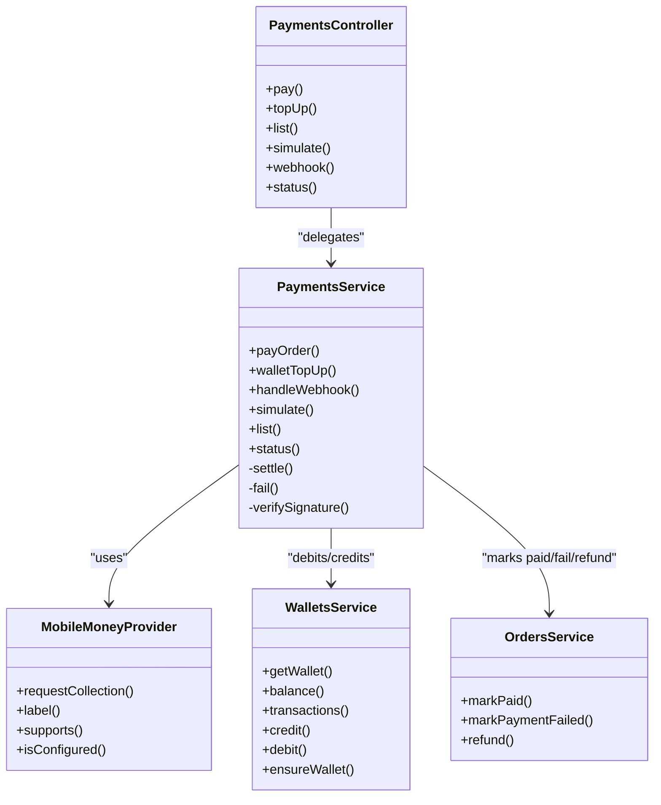

# Payment Processing API

<cite>
**Referenced Files in This Document**
- [payments.controller.ts](file://backend/src/payments/payments.controller.ts)
- [payments.service.ts](file://backend/src/payments/payments.service.ts)
- [mobile-money.provider.ts](file://backend/src/payments/providers/mobile-money.provider.ts)
- [payments.dto.ts](file://backend/src/payments/dto/payments.dto.ts)
- [wallets.controller.ts](file://backend/src/wallets/wallets.controller.ts)
- [wallets.service.ts](file://backend/src/wallets/wallets.service.ts)
- [orders.service.ts](file://backend/src/orders/orders.service.ts)
- [schema.prisma](file://backend/prisma/schema.prisma)
</cite>

## Table of Contents
1. [Introduction](#introduction)
2. [Project Structure](#project-structure)
3. [Core Components](#core-components)
4. [Architecture Overview](#architecture-overview)
5. [Detailed Component Analysis](#detailed-component-analysis)
6. [Dependency Analysis](#dependency-analysis)
7. [Performance Considerations](#performance-considerations)
8. [Troubleshooting Guide](#troubleshooting-guide)
9. [Conclusion](#conclusion)

## Introduction
This document describes the payment processing API for FuelConnect. It covers:
- Initiating payments for orders
- Topping up the customer wallet
- Querying payment history and status
- Handling provider webhooks with HMAC signature verification
- Managing wallet balance and ledger transactions
- Refund handling through order cancellation and admin operations
- Supported payment methods: MTN Mobile Money, Airtel Money, Wallet, Cash, and a placeholder for Card

The system is designed so that only verified provider callbacks or sandbox simulation can settle a payment. The Flutter client never decides whether a payment succeeded. Settlement is idempotent, auditable, and coordinated with order state and wallet accounting.

## Project Structure
The payment-related backend code lives under `backend/src`:
- `payments/` exposes HTTP endpoints and orchestrates payment flows
- `payments/providers/` abstracts mobile money providers
- `wallets/` manages wallet balance and transaction ledger
- `orders/` coordinates order lifecycle and refund logic
- `prisma/schema.prisma` defines the database model used by all modules

**Diagram sources**
- [payments.controller.ts:26-99](file://backend/src/payments/payments.controller.ts#L26-L99)
- [payments.service.ts:67-80](file://backend/src/payments/payments.service.ts#L67-L80)
- [mobile-money.provider.ts:40-53](file://backend/src/payments/providers/mobile-money.provider.ts#L40-L53)
- [wallets.controller.ts:7-24](file://backend/src/wallets/wallets.controller.ts#L7-L24)
- [wallets.service.ts:22-24](file://backend/src/wallets/wallets.service.ts#L22-L24)
- [orders.service.ts:76-85](file://backend/src/orders/orders.service.ts#L76-L85)

**Section sources**
- [payments.controller.ts:26-99](file://backend/src/payments/payments.controller.ts#L26-L99)
- [payments.service.ts:67-80](file://backend/src/payments/payments.service.ts#L67-L80)
- [wallets.controller.ts:7-24](file://backend/src/wallets/wallets.controller.ts#L7-L24)
- [wallets.service.ts:22-24](file://backend/src/wallets/wallets.service.ts#L22-L24)
- [schema.prisma:452-615](file://backend/prisma/schema.prisma#L452-L615)

## Core Components
- **PaymentsController**: REST endpoints for paying orders, topping up wallets, listing payments, simulating provider outcomes, polling payment status, and receiving provider webhooks.
- **PaymentsService**: Business logic for payment initiation, wallet debits, mobile money collection requests, webhook validation, settlement, failure handling, and sandbox simulation.
- **MobileMoneyProvider**: Provider abstraction for MTN Mobile Money and Airtel Money. Currently stubbed; it validates configuration and returns instructions suitable for sandbox testing.
- **WalletsController**: Endpoints to read wallet balance and list wallet transactions.
- **WalletsService**: Double-entry-like wallet ledger with atomic credit/debit operations and transaction records.
- **OrdersService**: Order lifecycle, including marking orders paid, failed, cancelled, and refunded.

**Section sources**
- [payments.controller.ts:26-99](file://backend/src/payments/payments.controller.ts#L26-L99)
- [payments.service.ts:67-80](file://backend/src/payments/payments.service.ts#L67-L80)
- [mobile-money.provider.ts:40-127](file://backend/src/payments/providers/mobile-money.provider.ts#L40-L127)
- [wallets.controller.ts:7-24](file://backend/src/wallets/wallets.controller.ts#L7-L24)
- [wallets.service.ts:22-164](file://backend/src/wallets/wallets.service.ts#L22-L164)
- [orders.service.ts:76-85](file://backend/src/orders/orders.service.ts#L76-L85)

## Architecture Overview
The payment flow has three main paths:
1. **Order payment**: The client calls the pay endpoint. Depending on method, the service either debits the wallet, marks cash-on-delivery, or starts a mobile money collection.
2. **Provider callback (webhook)**: The provider sends an HMAC-signed callback. The service verifies the signature, reconciles the reference, checks amount and state, then settles or fails the payment.
3. **Wallet top-up**: The client initiates a top-up using MTN or Airtel Money. When the provider confirms, the wallet is credited and a notification is created.

**Diagram sources**
- [payments.controller.ts:31-51](file://backend/src/payments/payments.controller.ts#L31-L51)
- [payments.service.ts:83-150](file://backend/src/payments/payments.service.ts#L83-L150)
- [payments.service.ts:152-286](file://backend/src/payments/payments.service.ts#L152-L286)
- [mobile-money.provider.ts:89-127](file://backend/src/payments/providers/mobile-money.provider.ts#L89-L127)
- [wallets.service.ts:79-139](file://backend/src/wallets/wallets.service.ts#L79-L139)

## Detailed Component Analysis

### Payment Endpoints

#### POST `/payments/orders/:orderId/pay`
Initiates payment for an order. Requires bearer authentication and customer role.

- Path parameter:
  - `orderId`: UUID of the order
- Request body (`PayOrderDto`):
  - `method` (optional): One of `mtn`, `airtel`, `wallet`, `cash`, `card`. Defaults to the order’s selected method.
- Response:
  - Returns a payment DTO plus `nextAction` and `message`.
  - For wallet: immediate debit and order transition.
  - For cash: order marked paid with cash instruction.
  - For MTN/Airtel: returns provider instructions and waits for webhook.
  - For card: currently not available.

Security and validation:
- Only customers can pay.
- Order ownership is enforced.
- Already settled orders return early without reprocessing.
- Invalid order states reject the request.

**Section sources**
- [payments.controller.ts:31-42](file://backend/src/payments/payments.controller.ts#L31-L42)
- [payments.dto.ts:7-17](file://backend/src/payments/dto/payments.dto.ts#L7-L17)
- [payments.service.ts:83-150](file://backend/src/payments/payments.service.ts#L83-L150)

#### POST `/payments/wallet/topup`
Starts a wallet top-up using MTN or Airtel Money.

- Request body (`WalletTopUpDto`):
  - `amount`: Integer between 1,000 and 10,000,000 UGX.
  - `method`: One of `mtn`, `airtel`, `wallet`, `cash`. Only mobile money is allowed for top-ups.
- Response:
  - Creates a pending payment and returns provider instructions or sandbox simulation guidance.

Validation:
- Only customer accounts have a wallet.
- Top-up cannot use wallet or cash.
- Card top-ups are not available yet.

**Section sources**
- [payments.controller.ts:44-51](file://backend/src/payments/payments.controller.ts#L44-L51)
- [payments.dto.ts:19-31](file://backend/src/payments/dto/payments.dto.ts#L19-L31)
- [payments.service.ts:289-337](file://backend/src/payments/payments.service.ts#L289-L337)

#### GET `/payments`
Lists the authenticated user’s payments with pagination.

- Query parameters:
  - `page`: Page number
  - `limit`: Items per page
- Response: Paginated list of payment DTOs.

Authorization:
- Bearer token required.
- Customer role required.

**Section sources**
- [payments.controller.ts:53-59](file://backend/src/payments/payments.controller.ts#L53-L59)
- [payments.service.ts:478-494](file://backend/src/payments/payments.service.ts#L478-L494)

#### POST `/payments/:id/simulate`
Sandbox-only endpoint to simulate provider success or failure.

- Path parameter:
  - `id`: UUID of the payment
- Request body (`SimulatePaymentDto`):
  - `outcome`: `success` or `failure`
  - `note` (optional): Reason for simulation
- Authorization:
  - Owner of the payment or staff roles (admin, super admin).

Behavior:
- If the payment already succeeded, returns duplicate response.
- Success outcome triggers settlement.
- Failure outcome marks the payment failed.

**Section sources**
- [payments.controller.ts:61-72](file://backend/src/payments/payments.controller.ts#L61-L72)
- [payments.dto.ts:33-42](file://backend/src/payments/dto/payments.dto.ts#L33-L42)
- [payments.service.ts:439-475](file://backend/src/payments/payments.service.ts#L439-L475)

#### POST `/payments/webhooks/:provider`
Receives provider callbacks. Public endpoint but requires HMAC-SHA256 signature verification.

- Header:
  - `x-payments-signature`: Hex HMAC-SHA256 computed over the raw request body using `PAYMENT_WEBHOOK_SECRET`.
- Path parameter:
  - `provider`: Provider name string
- Request body:
  - Flexible payload containing fields such as `providerReference`, `status`, `amount`, and provider-specific identifiers.
- Response:
  - Structured outcome indicating received, duplicate, ignored, succeeded, or failed.

Webhook behavior:
- Signature must be present and valid.
- Reference lookup resolves the payment.
- Duplicate successful payments are ignored.
- Pending/processing payloads are stored and ignored until final state.
- Successful amounts are validated against expected payment amount.
- Failed payloads mark the payment failed and attempt to mark the order failed.

**Section sources**
- [payments.controller.ts:74-90](file://backend/src/payments/payments.controller.ts#L74-L90)
- [payments.service.ts:339-437](file://backend/src/payments/payments.service.ts#L339-L437)
- [payments.service.ts:630-650](file://backend/src/payments/payments.service.ts#L630-L650)

#### GET `/payments/:id`
Polls payment status after initiating mobile money prompts.

- Path parameter:
  - `id`: UUID of the payment
- Authorization:
  - Owner or staff roles (admin, super admin, station manager).

Response:
- Full payment DTO including provider reference, instructions, failure reason, timestamps.

**Section sources**
- [payments.controller.ts:92-98](file://backend/src/payments/payments.controller.ts#L92-L98)
- [payments.service.ts:496-513](file://backend/src/payments/payments.service.ts#L496-L513)

### Wallet Endpoints

#### GET `/wallet`
Returns the current user’s wallet balance and metadata.

- Authorization:
  - Bearer token required.
- Response:
  - Wallet DTO with balance, currency, active status, and timestamps.

**Section sources**
- [wallets.controller.ts:13-17](file://backend/src/wallets/wallets.controller.ts#L13-L17)
- [wallets.service.ts:26-32](file://backend/src/wallets/wallets.service.ts#L26-L32)

#### GET `/wallet/transactions`
Lists wallet ledger entries newest first with pagination.

- Query parameters:
  - `page`: Page number
  - `limit`: Items per page
- Response:
  - Paginated list of transactions with type, signed amount, direction, balance after, description, reference, orderId, and createdAt.

**Section sources**
- [wallets.controller.ts:19-23](file://backend/src/wallets/wallets.controller.ts#L19-L23)
- [wallets.service.ts:42-77](file://backend/src/wallets/wallets.service.ts#L42-L77)

### Payment Providers

#### Mobile Money Provider
The `MobileMoneyProvider` supports MTN Mobile Money and Airtel Money. In this repository, live integration is intentionally stubbed. It:
- Validates supported methods
- Checks provider configuration
- Throws `ServiceUnavailableException` when credentials are missing
- Returns sandbox-friendly instructions with a stubbed provider reference

Live integration notes:
- MTN MoMo collections endpoint and headers are documented in comments.
- Airtel Money merchant payment endpoint and headers are documented in comments.
- Callbacks are handled by `PaymentsService.handleWebhook`.

**Section sources**
- [mobile-money.provider.ts:30-127](file://backend/src/payments/providers/mobile-money.provider.ts#L30-L127)

### Refunds and Idempotency

#### Refunds
Refunds are primarily handled through order cancellation and admin operations:
- Order cancellation may trigger a wallet refund when the order was paid via wallet.
- Admin operations call into order refund logic, which updates payment status to `REFUNDED`, sets refund timestamp, and notifies the customer.
- When a provider succeeds but the order cannot be marked paid, the system audits a manual refund requirement instead of silently swallowing funds.

Key behaviors:
- Wallet reversal occurs if order transition fails after wallet debit.
- Payment status transitions to `REFUNDED` during refund flows.
- Order status transitions to `REFUNDED` when full refund applies and state machine allows it.

**Section sources**
- [payments.service.ts:152-199](file://backend/src/payments/payments.service.ts#L152-L199)
- [payments.service.ts:567-592](file://backend/src/payments/payments.service.ts#L567-L592)
- [orders.service.ts:623-664](file://backend/src/orders/orders.service.ts#L623-L664)

#### Idempotency
- Order creation supports an optional idempotency key to prevent duplicate orders.
- Payment settlement is idempotent: repeated provider callbacks do not double-dispatch or double-credit.
- Duplicate successful webhooks return a duplicate outcome without side effects.
- Simulate endpoint returns duplicate result if the payment already succeeded.

**Section sources**
- [orders.service.ts:128-169](file://backend/src/orders/orders.service.ts#L128-L169)
- [payments.service.ts:516-523](file://backend/src/payments/payments.service.ts#L516-L523)
- [payments.service.ts:457-459](file://backend/src/payments/payments.service.ts#L457-L459)

### Data Model Highlights

**Diagram sources**
- [schema.prisma:452-615](file://backend/prisma/schema.prisma#L452-L615)

## Dependency Analysis

**Diagram sources**
- [payments.controller.ts:26-99](file://backend/src/payments/payments.controller.ts#L26-L99)
- [payments.service.ts:67-80](file://backend/src/payments/payments.service.ts#L67-L80)
- [mobile-money.provider.ts:40-127](file://backend/src/payments/providers/mobile-money.provider.ts#L40-L127)
- [wallets.service.ts:22-164](file://backend/src/wallets/wallets.service.ts#L22-L164)
- [orders.service.ts:76-85](file://backend/src/orders/orders.service.ts#L76-L85)

**Section sources**
- [payments.controller.ts:26-99](file://backend/src/payments/payments.controller.ts#L26-L99)
- [payments.service.ts:67-80](file://backend/src/payments/payments.service.ts#L67-L80)
- [mobile-money.provider.ts:40-127](file://backend/src/payments/providers/mobile-money.provider.ts#L40-L127)
- [wallets.service.ts:22-164](file://backend/src/wallets/wallets.service.ts#L22-L164)
- [orders.service.ts:76-85](file://backend/src/orders/orders.service.ts#L76-L85)

## Performance Considerations
- Use pagination for payment lists and wallet transactions to avoid large payloads.
- Prefer polling `/payments/:id` for mobile money prompts rather than frequent retries.
- Avoid calling simulate in production; it is sandbox-only.
- Ensure provider credentials are configured before enabling live mobile money collections to prevent unnecessary failures.
- Keep webhook payloads minimal and consistent to reduce parsing overhead.

[No sources needed since this section provides general guidance]

## Troubleshooting Guide

Common issues and resolutions:
- Missing or invalid webhook signature:
  - Ensure the `x-payments-signature` header contains the hex HMAC-SHA256 of the raw request body using the configured secret.
  - Verify the secret matches the server configuration.
- No payment found by reference:
  - Confirm the provider reference exists and matches the payment record.
  - Check that the reference format aligns with the provider’s callback payload.
- Amount mismatch:
  - The webhook amount must match the expected payment amount. Mismatches fail the payment and audit the event.
- Duplicate successful webhook:
  - Repeated successful callbacks are ignored safely.
- Insufficient wallet balance:
  - Debit operations refuse negative balances. Prompt the user to top up or choose another method.
- Card payments not available:
  - Card method is not implemented yet. Use MTN, Airtel, wallet, or cash.

**Section sources**
- [payments.service.ts:339-437](file://backend/src/payments/payments.service.ts#L339-L437)
- [payments.service.ts:630-650](file://backend/src/payments/payments.service.ts#L630-L650)
- [wallets.service.ts:106-139](file://backend/src/wallets/wallets.service.ts#L106-L139)
- [payments.service.ts:143-147](file://backend/src/payments/payments.service.ts#L143-L147)

## Conclusion
The FuelConnect payment API provides secure, idempotent, and auditable payment processing across multiple methods. It enforces strict authorization, validates provider webhooks with HMAC signatures, and coordinates order state with wallet accounting. While mobile money integrations are stubbed in this repository, the architecture clearly separates provider concerns and prepares for live MTN and Airtel Money flows. Refunds and cancellations are integrated with order lifecycle and wallet ledger semantics, ensuring financial consistency.

[No sources needed since this section summarizes without analyzing specific files]