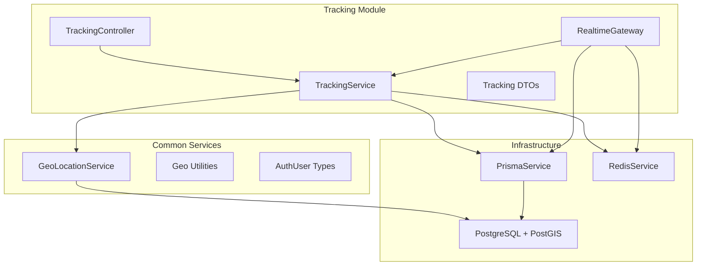
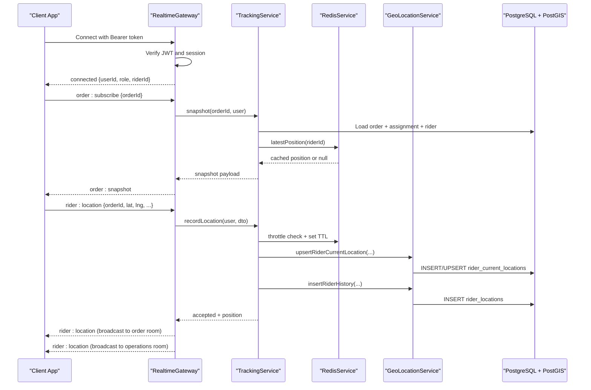
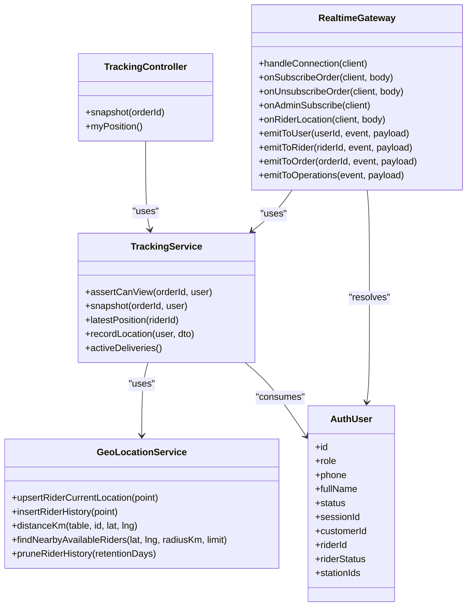
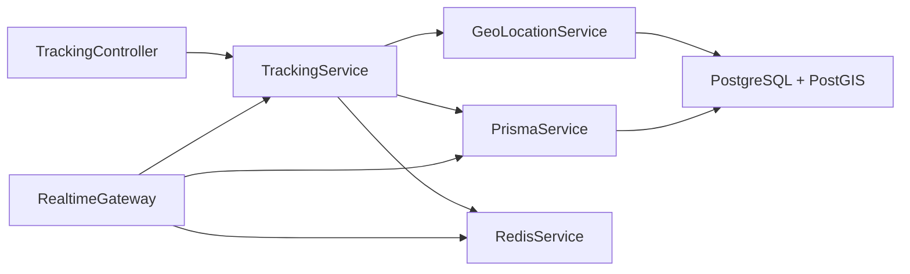

# Real-time Tracking API

<cite>
**Referenced Files in This Document**
- [tracking.controller.ts](file://backend/src/tracking/tracking.controller.ts)
- [realtime.gateway.ts](file://backend/src/tracking/realtime.gateway.ts)
- [tracking.service.ts](file://backend/src/tracking/tracking.service.ts)
- [tracking.dto.ts](file://backend/src/tracking/dto/tracking.dto.ts)
- [geo-location.service.ts](file://backend/src/common/services/geo-location.service.ts)
- [geo.ts](file://backend/src/common/utils/geo.ts)
- [auth-user.ts](file://backend/src/common/types/auth-user.ts)
- [tracking.module.ts](file://backend/src/tracking/tracking.module.ts)
</cite>

## Table of Contents
1. [Introduction](#introduction)
2. [Project Structure](#project-structure)
3. [Core Components](#core-components)
4. [Architecture Overview](#architecture-overview)
5. [Detailed Component Analysis](#detailed-component-analysis)
6. [Dependency Analysis](#dependency-analysis)
7. [Performance Considerations](#performance-considerations)
8. [Troubleshooting Guide](#troubleshooting-guide)
9. [Conclusion](#conclusion)
10. [Appendices](#appendices)

## Introduction
This document specifies the real-time tracking API surface for rider delivery tracking. It covers:
- REST endpoints for delivery snapshots and current rider position.
- WebSocket gateway for live location streaming, order subscriptions, and operations monitoring.
- Connection handling, authentication, message formats, event types, and throttling behavior.
- Geospatial data model and PostGIS-based queries used by the tracking pipeline.
- Practical client implementation guidance for live rider tracking, location throttling, and geospatial queries.

The system is implemented in a NestJS backend with Socket.IO over WebSocket, Redis for caching and adapter support, and PostgreSQL with PostGIS for geospatial storage and queries.

## Project Structure
The tracking feature is encapsulated under the `tracking` module and integrates with shared common services for authentication, geospatial operations, and Redis.

**Diagram sources**
- [tracking.module.ts:7-12](file://backend/src/tracking/tracking.module.ts#L7-L12)
- [tracking.controller.ts:7-25](file://backend/src/tracking/tracking.controller.ts#L7-L25)
- [realtime.gateway.ts:45-61](file://backend/src/tracking/realtime.gateway.ts#L45-L61)
- [tracking.service.ts:32-39](file://backend/src/tracking/tracking.service.ts#L32-L39)
- [geo-location.service.ts:23-27](file://backend/src/common/services/geo-location.service.ts#L23-L27)

**Section sources**
- [tracking.module.ts:1-14](file://backend/src/tracking/tracking.module.ts#L1-L14)
- [tracking.controller.ts:1-26](file://backend/src/tracking/tracking.controller.ts#L1-L26)
- [realtime.gateway.ts:1-61](file://backend/src/tracking/realtime.gateway.ts#L1-L61)
- [tracking.service.ts:1-39](file://backend/src/tracking/tracking.service.ts#L1-L39)

## Core Components
- TrackingController: REST endpoints for delivery snapshot and current rider position.
- RealtimeGateway: Socket.IO gateway handling authentication, rooms, events, and broadcasting.
- TrackingService: Business logic for access control, snapshots, location ingestion, throttling, and admin active deliveries.
- GeoLocationService: PostGIS helpers for upserting rider locations, history, distance calculations, and nearby rider search.
- AuthUser: Shared principal type used across controllers, gateways, and services.

**Section sources**
- [tracking.controller.ts:7-25](file://backend/src/tracking/tracking.controller.ts#L7-L25)
- [realtime.gateway.ts:45-61](file://backend/src/tracking/realtime.gateway.ts#L45-L61)
- [tracking.service.ts:32-39](file://backend/src/tracking/tracking.service.ts#L32-L39)
- [geo-location.service.ts:23-27](file://backend/src/common/services/geo-location.service.ts#L23-L27)
- [auth-user.ts:8-19](file://backend/src/common/types/auth-user.ts#L8-L19)

## Architecture Overview
The real-time tracking architecture combines REST fallbacks with a WebSocket gateway for live updates.

**Diagram sources**
- [realtime.gateway.ts:80-143](file://backend/src/tracking/realtime.gateway.ts#L80-L143)
- [realtime.gateway.ts:151-173](file://backend/src/tracking/realtime.gateway.ts#L151-L173)
- [realtime.gateway.ts:201-252](file://backend/src/tracking/realtime.gateway.ts#L201-L252)
- [tracking.service.ts:77-144](file://backend/src/tracking/tracking.service.ts#L77-L144)
- [tracking.service.ts:155-230](file://backend/src/tracking/tracking.service.ts#L155-L230)
- [geo-location.service.ts:43-86](file://backend/src/common/services/geo-location.service.ts#L43-L86)

## Detailed Component Analysis

### REST Endpoints

#### GET /tracking/orders/:id
- Purpose: Delivery snapshot plus last known rider position (REST fallback).
- Authentication: Bearer JWT required.
- Path parameters:
  - id: UUID of the order.
- Authorization:
  - Owner customer, assigned rider, staff, or station manager can view.
- Response fields:
  - order: delivery metadata, status, totals, fuel type, station, address, ETA, timestamps.
  - assignment: selected assignment details and statuses.
  - rider: rider profile and vehicle info.
  - location: latest position from Redis or database.
- Error responses:
  - Not found if order does not exist.
  - Forbidden if user lacks permission.

**Section sources**
- [tracking.controller.ts:13-17](file://backend/src/tracking/tracking.controller.ts#L13-L17)
- [tracking.service.ts:42-75](file://backend/src/tracking/tracking.service.ts#L42-L75)
- [tracking.service.ts:77-126](file://backend/src/tracking/tracking.service.ts#L77-L126)

#### GET /tracking/riders/me
- Purpose: Last known position of the signed-in rider.
- Authentication: Bearer JWT required.
- Response fields:
  - riderId: UUID of the rider if present.
  - position: latest position object or null.
- Behavior:
  - Returns empty riderId and null position when the authenticated user is not a rider.

**Section sources**
- [tracking.controller.ts:19-24](file://backend/src/tracking/tracking.controller.ts#L19-L24)
- [tracking.service.ts:128-144](file://backend/src/tracking/tracking.service.ts#L128-L144)

### WebSocket Gateway

Namespace: `/tracking`
Transport: WebSocket and polling fallback.
CORS: Enabled with credentials.

#### Connection Handling
- Token extraction supports:
  - handshake.auth.token
  - handshake.headers.authorization
  - handshake.query.token
- JWT verification:
  - Must be access token type.
  - Session must be active and valid.
- Principal resolution:
  - Loads user profile and related roles, rider, and managed stations.
- Room membership:
  - user:{userId}
  - rider:{riderId} (if applicable)
  - station:{stationId} (for each managed station)
  - operations (for staff/station managers)
- Events:
  - connected: initial connection confirmation with userId, role, riderId.
  - unauthorized: session expired or invalid; client disconnects after emitting.

**Section sources**
- [realtime.gateway.ts:80-143](file://backend/src/tracking/realtime.gateway.ts#L80-L143)
- [auth-user.ts:8-19](file://backend/src/common/types/auth-user.ts#L8-L19)

#### Inbound Events

##### order:subscribe
- Request body:
  - orderId: UUID of the order to subscribe to.
- Behavior:
  - Validates orderId format.
  - Loads snapshot via TrackingService.
  - Joins order room and emits order:snapshot.
- Responses:
  - order:subscribed on success.
  - error on validation or service failure.

**Section sources**
- [realtime.gateway.ts:151-173](file://backend/src/tracking/realtime.gateway.ts#L151-L173)
- [tracking.service.ts:77-126](file://backend/src/tracking/tracking.service.ts#L77-L126)

##### order:unsubscribe
- Request body:
  - orderId: optional UUID.
- Behavior:
  - Leaves order room if orderId provided.
- Response:
  - order:unsubscribed with orderId or null.

**Section sources**
- [realtime.gateway.ts:175-184](file://backend/src/tracking/realtime.gateway.ts#L175-L184)

##### admin:subscribe
- Request body: none.
- Authorization:
  - Staff roles or station manager only.
- Behavior:
  - Joins operations room.
  - Emits operations:snapshot with active deliveries.
- Response:
  - operations:subscribed with count of active deliveries.

**Section sources**
- [realtime.gateway.ts:186-199](file://backend/src/tracking/realtime.gateway.ts#L186-L199)
- [tracking.service.ts:234-280](file://backend/src/tracking/tracking.service.ts#L234-L280)

##### rider:location
- Request body:
  - orderId: UUID.
  - lat: number within [-90, 90].
  - lng: number within [-180, 180].
  - speedKph: optional number within [0, 200].
  - heading: optional number within [0, 360].
  - accuracyM: optional number within [0, 5000].
- Validation:
  - Only riders can publish.
  - Must be assigned to an accepted delivery in an active order state.
  - Throttled server-side using Redis per rider.
- Behavior:
  - Upserts rider current location into Redis and PostGIS.
  - Inserts historical point into PostGIS.
  - Broadcasts rider:location to order room and operations room when accepted.
- Acknowledgement:
  - rider:location:ack with accepted flag and optional reason.

**Section sources**
- [realtime.gateway.ts:201-252](file://backend/src/tracking/realtime.gateway.ts#L201-L252)
- [tracking.service.ts:155-230](file://backend/src/tracking/tracking.service.ts#L155-L230)
- [tracking.dto.ts:11-53](file://backend/src/tracking/dto/tracking.dto.ts#L11-L53)

#### Outbound Events
- order:snapshot: full delivery snapshot sent upon subscription.
- rider:location: live position broadcast to order room and operations room.
- order:status: status change for the order room (documented in gateway comments).
- rider:offer: new delivery offer for a specific rider (documented in gateway comments).
- notification: generic per-user notification (documented in gateway comments).

**Section sources**
- [realtime.gateway.ts:29-44](file://backend/src/tracking/realtime.gateway.ts#L29-L44)
- [realtime.gateway.ts:254-273](file://backend/src/tracking/realtime.gateway.ts#L254-L273)

### Data Model and Geospatial Operations

#### Live Position Model
- Fields:
  - lat: number
  - lng: number
  - speedKph: number | null
  - heading: number | null
  - accuracyM: number | null
  - updatedAt: string (ISO timestamp)

**Section sources**
- [tracking.service.ts:15-22](file://backend/src/tracking/tracking.service.ts#L15-L22)

#### PostGIS Tables and Queries
- rider_current_locations:
  - Stores latest rider position per rider_id with geography(Point,4326).
  - Upserted on each accepted location ping.
- rider_locations:
  - Historical points with recorded_at timestamps.
  - Used for retention pruning.
- Distance and proximity:
  - ST_Distance for exact distances between geography points.
  - ST_DWithin for radius-based filtering of available riders.

**Section sources**
- [geo-location.service.ts:43-86](file://backend/src/common/services/geo-location.service.ts#L43-L86)
- [geo-location.service.ts:88-130](file://backend/src/common/services/geo-location.service.ts#L88-L130)

#### Nearby Rider Search
- Input:
  - lat, lng: center coordinates.
  - radiusKm: search radius in kilometers.
  - limit: maximum results.
- Output:
  - Array of rider identifiers with distance_km.
- Filters:
  - Verified, online, available riders.
  - Excludes riders with active assignments.

**Section sources**
- [geo-location.service.ts:102-130](file://backend/src/common/services/geo-location.service.ts#L102-L130)

### Class Diagram

**Diagram sources**
- [tracking.controller.ts:7-25](file://backend/src/tracking/tracking.controller.ts#L7-L25)
- [realtime.gateway.ts:45-61](file://backend/src/tracking/realtime.gateway.ts#L45-L61)
- [tracking.service.ts:32-39](file://backend/src/tracking/tracking.service.ts#L32-L39)
- [geo-location.service.ts:23-27](file://backend/src/common/services/geo-location.service.ts#L23-L27)
- [auth-user.ts:8-19](file://backend/src/common/types/auth-user.ts#L8-L19)

## Dependency Analysis

**Diagram sources**
- [tracking.module.ts:7-12](file://backend/src/tracking/tracking.module.ts#L7-L12)
- [tracking.controller.ts:7-25](file://backend/src/tracking/tracking.controller.ts#L7-L25)
- [realtime.gateway.ts:45-61](file://backend/src/tracking/realtime.gateway.ts#L45-L61)
- [tracking.service.ts:32-39](file://backend/src/tracking/tracking.service.ts#L32-L39)
- [geo-location.service.ts:23-27](file://backend/src/common/services/geo-location.service.ts#L23-L27)

**Section sources**
- [tracking.module.ts:1-14](file://backend/src/tracking/tracking.module.ts#L1-L14)
- [tracking.controller.ts:1-26](file://backend/src/tracking/tracking.controller.ts#L1-L26)
- [realtime.gateway.ts:1-61](file://backend/src/tracking/realtime.gateway.ts#L1-L61)
- [tracking.service.ts:1-39](file://backend/src/tracking/tracking.service.ts#L1-L39)

## Performance Considerations
- Location ingestion throttling:
  - Server enforces a minimum interval per rider using Redis keys with TTL.
  - Clients should respect the throttle to avoid rejected pings.
- Hot path caching:
  - Latest positions are read from Redis first, falling back to PostgreSQL.
- Geospatial queries:
  - Use PostGIS functions for accurate distance and proximity calculations.
  - Avoid unnecessary large radius searches; tune radiusKm and limit.
- History retention:
  - Prune old rider_locations rows periodically to prevent unbounded growth.

[No sources needed since this section provides general guidance]

## Troubleshooting Guide
- WebSocket unauthorized:
  - Occurs when JWT is missing, wrong token type, or session invalid.
  - Client receives unauthorized event and disconnects.
- Order subscription errors:
  - Invalid orderId format triggers error event.
  - Service-level failures emit error event.
- Rider location rejection:
  - Not a rider, not assigned to delivery, inactive order, or throttled.
  - Acknowledgement includes accepted=false and reason.
- PostGIS write failures:
  - Geo writes are best-effort; failures are logged but do not break business flow.

**Section sources**
- [realtime.gateway.ts:80-143](file://backend/src/tracking/realtime.gateway.ts#L80-L143)
- [realtime.gateway.ts:151-173](file://backend/src/tracking/realtime.gateway.ts#L151-L173)
- [realtime.gateway.ts:201-252](file://backend/src/tracking/realtime.gateway.ts#L201-L252)
- [geo-location.service.ts:142-153](file://backend/src/common/services/geo-location.service.ts#L142-L153)

## Conclusion
The real-time tracking API provides robust REST fallbacks and a WebSocket gateway for live rider tracking. It enforces strict authorization, validates payloads, and applies server-side throttling. Geospatial capabilities powered by PostGIS enable efficient distance and proximity queries. Clients should implement proper connection handling, respect throttling, and use the documented events and message formats for reliable integration.

[No sources needed since this section summarizes without analyzing specific files]

## Appendices

### Client Implementation Examples

#### Live Rider Tracking (WebSocket)
- Connect to `/tracking` with Bearer token in handshake auth or query parameter.
- On connected, join order room via order:subscribe with orderId.
- Listen for order:snapshot and rider:location events.
- Handle unauthorized and error events gracefully.

**Section sources**
- [realtime.gateway.ts:80-143](file://backend/src/tracking/realtime.gateway.ts#L80-L143)
- [realtime.gateway.ts:151-173](file://backend/src/tracking/realtime.gateway.ts#L151-L173)
- [realtime.gateway.ts:254-273](file://backend/src/tracking/realtime.gateway.ts#L254-L273)

#### Location Throttling (Rider)
- Send rider:location at intervals respecting server-side throttle.
- If ack.accepted is false with reason throttled, back off and retry later.
- Include optional speedKph, heading, accuracyM for richer telemetry.

**Section sources**
- [realtime.gateway.ts:201-252](file://backend/src/tracking/realtime.gateway.ts#L201-L252)
- [tracking.service.ts:181-189](file://backend/src/tracking/tracking.service.ts#L181-L189)

#### Geospatial Queries (PostGIS)
- Use GeoLocationService methods for:
  - Distance calculation between points.
  - Finding nearby available riders within radiusKm.
  - Upserting rider current locations and inserting history.
- Tune radiusKm and limit to balance performance and coverage.

**Section sources**
- [geo-location.service.ts:88-130](file://backend/src/common/services/geo-location.service.ts#L88-L130)
- [geo-location.service.ts:43-86](file://backend/src/common/services/geo-location.service.ts#L43-L86)