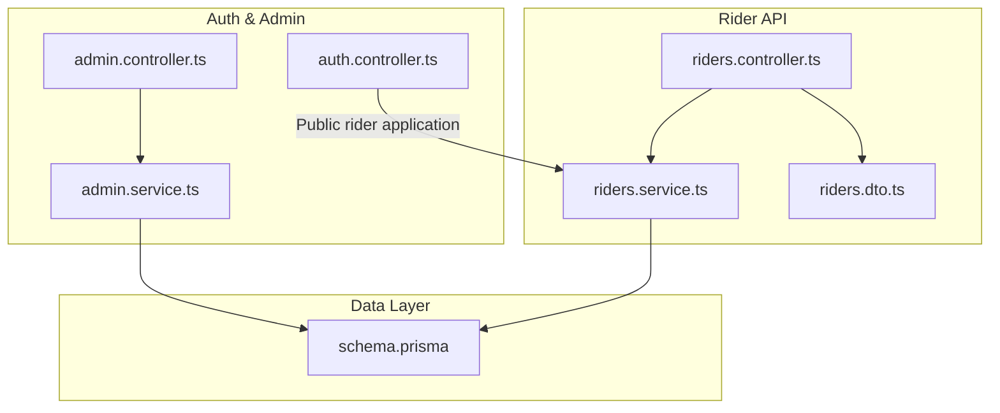
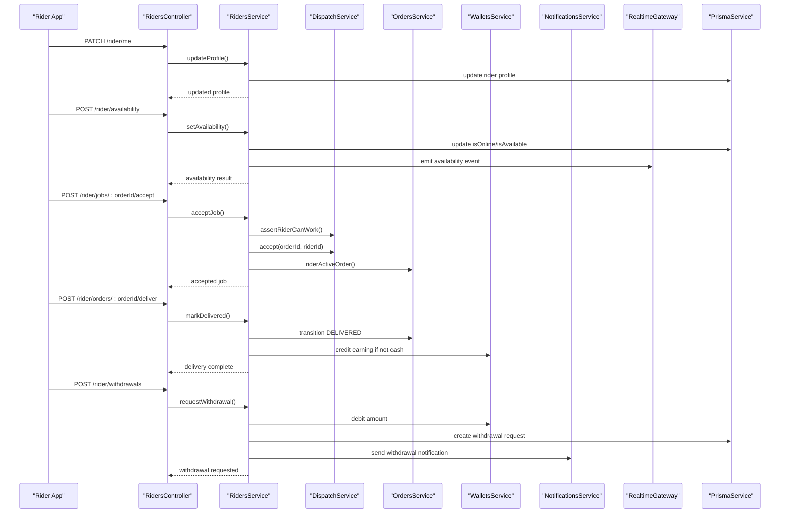
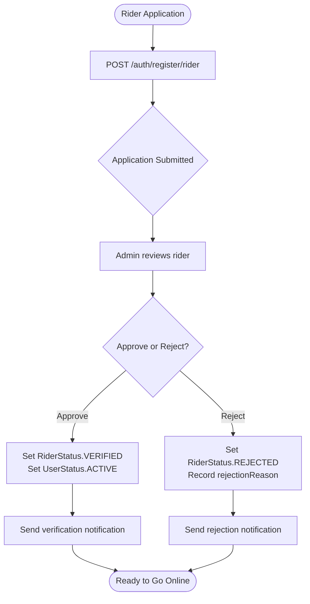
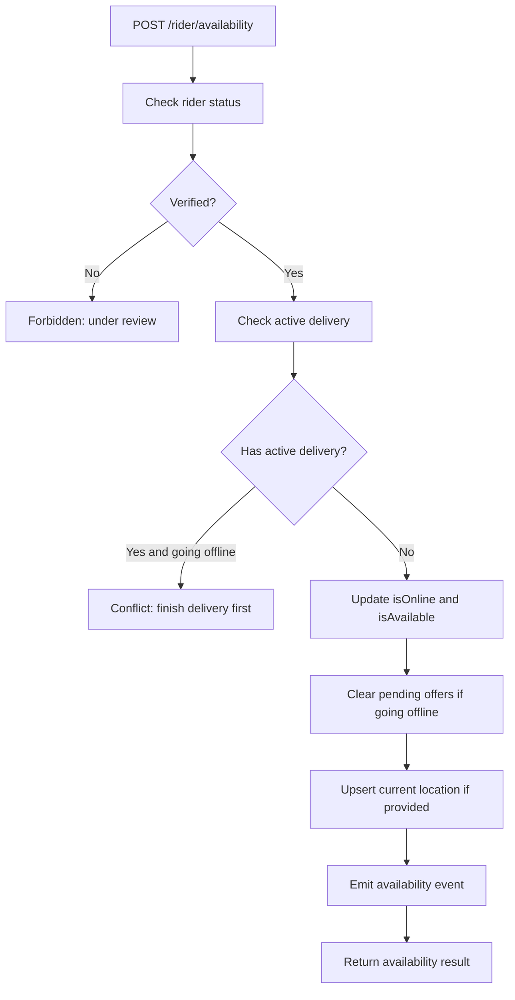
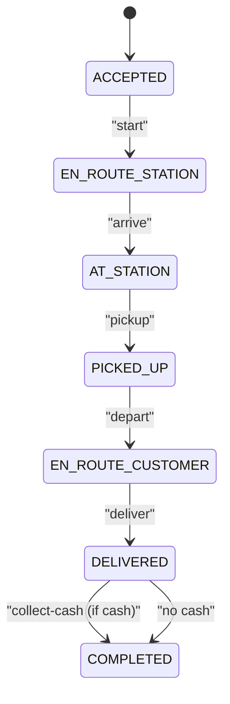
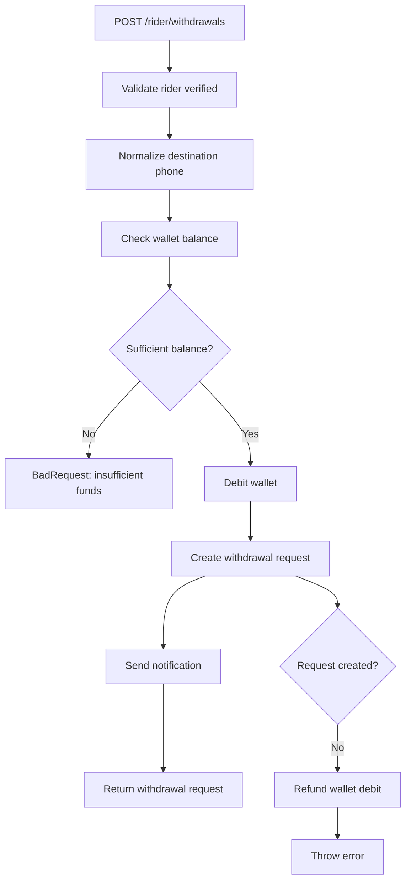
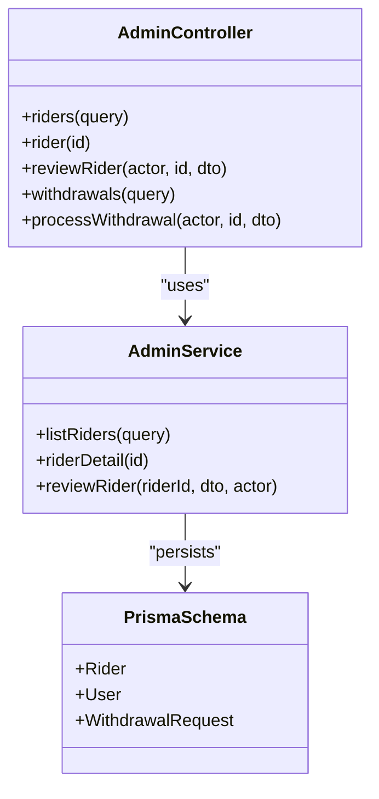
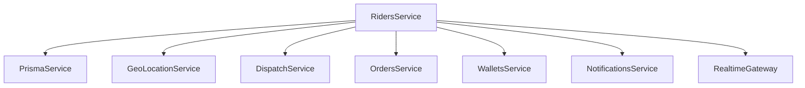

# Rider Management API

<cite>
**Referenced Files in This Document**   
- [riders.controller.ts](file://backend/src/riders/riders.controller.ts)
- [riders.service.ts](file://backend/src/riders/riders.service.ts)
- [riders.dto.ts](file://backend/src/riders/dto/riders.dto.ts)
- [auth.controller.ts](file://backend/src/auth/auth.controller.ts)
- [admin.controller.ts](file://backend/src/admin/admin.controller.ts)
- [admin.service.ts](file://backend/src/admin/admin.service.ts)
- [schema.prisma](file://backend/prisma/schema.prisma)
</cite>

## Table of Contents
1. [Introduction](#introduction)
2. [Project Structure](#project-structure)
3. [Core Components](#core-components)
4. [Architecture Overview](#architecture-overview)
5. [Detailed Component Analysis](#detailed-component-analysis)
6. [Dependency Analysis](#dependency-analysis)
7. [Performance Considerations](#performance-considerations)
8. [Troubleshooting Guide](#troubleshooting-guide)
9. [Conclusion](#conclusion)

## Introduction
This document provides comprehensive API documentation for rider management endpoints in the FuelConnect system. It covers rider registration, verification, availability management, job offers and lifecycle transitions, earnings tracking, performance metrics, and payout workflows. It also explains how riders integrate with the order dispatching system and how administrators review rider applications and process withdrawals.

The rider-facing API is protected by bearer authentication and role-based access control. Riders can manage their profile, go online or offline, accept or reject delivery offers, track delivery lifecycle events, view earnings and transaction history, and request payouts to mobile money or bank accounts. Administrators can list riders, review applications, approve or reject them, and process withdrawal requests.

## Project Structure
The rider management functionality is implemented in the backend NestJS application:

- `backend/src/riders` contains the rider controller, service, and DTOs.
- `backend/src/auth` exposes public registration endpoints including rider application submission.
- `backend/src/admin` exposes admin endpoints for rider review and withdrawal processing.
- `backend/prisma/schema.prisma` defines the database models used by rider operations.

**Diagram sources**
- [riders.controller.ts:1-153](file://backend/src/riders/riders.controller.ts#L1-L153)
- [riders.service.ts:1-659](file://backend/src/riders/riders.service.ts#L1-L659)
- [riders.dto.ts:1-90](file://backend/src/riders/dto/riders.dto.ts#L1-L90)
- [auth.controller.ts:1-166](file://backend/src/auth/auth.controller.ts#L1-L166)
- [admin.controller.ts:1-218](file://backend/src/admin/admin.controller.ts#L1-L218)
- [admin.service.ts:428-492](file://backend/src/admin/admin.service.ts#L428-L492)
- [schema.prisma:280-334](file://backend/prisma/schema.prisma#L280-L334)

**Section sources**
- [riders.controller.ts:1-153](file://backend/src/riders/riders.controller.ts#L1-L153)
- [riders.service.ts:1-659](file://backend/src/riders/riders.service.ts#L1-L659)
- [riders.dto.ts:1-90](file://backend/src/riders/dto/riders.dto.ts#L1-L90)
- [auth.controller.ts:1-166](file://backend/src/auth/auth.controller.ts#L1-L166)
- [admin.controller.ts:1-218](file://backend/src/admin/admin.controller.ts#L1-L218)
- [admin.service.ts:428-492](file://backend/src/admin/admin.service.ts#L428-L492)
- [schema.prisma:280-334](file://backend/prisma/schema.prisma#L280-L334)

## Core Components
The rider management system is centered around three main components:

- **RidersController**: Defines HTTP endpoints for rider profile, availability, jobs, delivery lifecycle, earnings, and withdrawals.
- **RidersService**: Implements business logic for rider state, job assignment, delivery lifecycle transitions, earnings aggregation, and withdrawal requests.
- **Rider DTOs**: Define validation rules and API property metadata for rider inputs such as availability updates, job rejections, profile updates, and withdrawal requests.

Key responsibilities:
- Profile retrieval and update.
- Availability toggling with location updates.
- Job offer listing, acceptance, and rejection.
- Delivery lifecycle transitions from station pickup through customer delivery.
- Earnings summaries and transaction history.
- Withdrawal request creation with wallet debits and notifications.

**Section sources**
- [riders.controller.ts:34-151](file://backend/src/riders/riders.controller.ts#L34-L151)
- [riders.service.ts:75-582](file://backend/src/riders/riders.service.ts#L75-L582)
- [riders.dto.ts:16-89](file://backend/src/riders/dto/riders.dto.ts#L16-L89)

## Architecture Overview
The rider API integrates with several internal services and data models:

- **DispatchService**: Validates whether a rider can work and manages job acceptance/rejection.
- **OrdersService**: Transitions order states and tracks cash collection.
- **WalletsService**: Manages rider wallet balance, credits, and debits.
- **NotificationsService**: Sends rider notifications for verification and withdrawal status.
- **RealtimeGateway**: Emits availability changes to operations dashboards.
- **PrismaService**: Persists rider, order, assignment, wallet, and withdrawal data.

**Diagram sources**
- [riders.controller.ts:41-151](file://backend/src/riders/riders.controller.ts#L41-L151)
- [riders.service.ts:118-551](file://backend/src/riders/riders.service.ts#L118-L551)
- [schema.prisma:280-334](file://backend/prisma/schema.prisma#L280-L334)

## Detailed Component Analysis

### Rider Registration and Verification Workflow
Rider registration begins with a public endpoint that allows users to apply to become riders. The application creates a rider record with a pending status. Administrators then review the application and either approve or reject it. Approval sets the rider status to verified and activates the user account; rejection sets the status to rejected and records a reason.

Relevant endpoints:
- Public: `POST /auth/register/rider` — submit rider application.
- Admin: `GET /admin/riders` — list riders and verification queue.
- Admin: `GET /admin/riders/:id` — rider details including documents and recent activity.
- Admin: `POST /admin/riders/:id/review` — approve or reject rider application.

**Diagram sources**
- [auth.controller.ts:56-62](file://backend/src/auth/auth.controller.ts#L56-L62)
- [admin.controller.ts:70-92](file://backend/src/admin/admin.controller.ts#L70-L92)
- [admin.service.ts:435-492](file://backend/src/admin/admin.service.ts#L435-L492)
- [schema.prisma:40-45](file://backend/prisma/schema.prisma#L40-L45)

**Section sources**
- [auth.controller.ts:56-62](file://backend/src/auth/auth.controller.ts#L56-L62)
- [admin.controller.ts:70-92](file://backend/src/admin/admin.controller.ts#L70-L92)
- [admin.service.ts:435-492](file://backend/src/admin/admin.service.ts#L435-L492)
- [schema.prisma:40-45](file://backend/prisma/schema.prisma#L40-L45)

### Rider Profile and Document Management
Riders can retrieve their profile and update key fields such as license number, vehicle type, and plate number. The profile response includes rider status, verification timestamp, rating, total deliveries, total earnings, active assignment, vehicles, and wallet balance.

Endpoints:
- `GET /rider/me` — get rider profile, stats, vehicles, and wallet balance.
- `PATCH /rider/me` — update license number, vehicle type, or plate number.

Validation and behavior:
- License number length is validated.
- Vehicle type must be one of allowed values.
- Plate number is trimmed and normalized to uppercase.

**Section sources**
- [riders.controller.ts:34-45](file://backend/src/riders/riders.controller.ts#L34-L45)
- [riders.service.ts:75-131](file://backend/src/riders/riders.service.ts#L75-L131)
- [riders.dto.ts:47-64](file://backend/src/riders/dto/riders.dto.ts#L47-L64)
- [schema.prisma:280-312](file://backend/prisma/schema.prisma#L280-L312)

### Availability Management (Online/Offline)
Riders toggle their availability to receive delivery offers. Only verified riders can go online. If a rider has an active delivery, they cannot go offline until the delivery is completed. Going offline clears pending offers. When going online, optional latitude and longitude are stored as the current location and emitted via real-time events.

Endpoints:
- `POST /rider/availability` — go online or offline, optionally update location.

Behavior:
- Non-verified riders receive a forbidden error when attempting to go online.
- Active deliveries prevent going offline.
- Pending offers expire when going offline.
- Real-time availability events are emitted to operations.

**Diagram sources**
- [riders.controller.ts:47-52](file://backend/src/riders/riders.controller.ts#L47-L52)
- [riders.service.ts:133-188](file://backend/src/riders/riders.service.ts#L133-L188)
- [riders.dto.ts:16-37](file://backend/src/riders/dto/riders.dto.ts#L16-L37)

**Section sources**
- [riders.controller.ts:47-52](file://backend/src/riders/riders.controller.ts#L47-L52)
- [riders.service.ts:133-188](file://backend/src/riders/riders.service.ts#L133-L188)
- [riders.dto.ts:16-37](file://backend/src/riders/dto/riders.dto.ts#L16-L37)

### Job Offers and Acceptance
Riders can list current offers and the active delivery. They can accept or reject offers. Acceptance validates that the rider can work and delegates to the dispatch service. Rejection returns a message indicating the offer was declined.

Endpoints:
- `GET /rider/jobs` — list offers and active delivery.
- `POST /rider/jobs/:orderId/accept` — accept a delivery offer.
- `POST /rider/jobs/:orderId/reject` — decline a delivery offer.

Response structure for jobs includes assignment ID, order reference, station details, drop address, fuel type, litres, vehicle info, pay amount, ETA minutes, distances, and timestamps.

**Section sources**
- [riders.controller.ts:55-83](file://backend/src/riders/riders.controller.ts#L55-L83)
- [riders.service.ts:190-255](file://backend/src/riders/riders.service.ts#L190-L255)
- [riders.service.ts:617-657](file://backend/src/riders/riders.service.ts#L617-L657)

### Delivery Lifecycle Management
Once a rider accepts a delivery, they progress through a defined lifecycle: heading to the station, arriving at the station, confirming pickup, departing to the customer, delivering, and optionally collecting cash for cash-on-delivery orders. Each step transitions the order state and may update assignment timestamps.

Endpoints:
- `POST /rider/orders/:orderId/start` — heading to the station.
- `POST /rider/orders/:orderId/arrive` — arrived at the station.
- `POST /rider/orders/:orderId/pickup` — fuel collected at the station.
- `POST /rider/orders/:orderId/depart` — on the way to the customer.
- `POST /rider/orders/:orderId/deliver` — handed fuel to the customer.
- `POST /rider/orders/:orderId/collect-cash` — record cash received.

**Diagram sources**
- [riders.controller.ts:85-126](file://backend/src/riders/riders.controller.ts#L85-L126)
- [riders.service.ts:257-358](file://backend/src/riders/riders.service.ts#L257-L358)
- [schema.prisma:47-61](file://backend/prisma/schema.prisma#L47-L61)

**Section sources**
- [riders.controller.ts:85-126](file://backend/src/riders/riders.controller.ts#L85-L126)
- [riders.service.ts:257-358](file://backend/src/riders/riders.service.ts#L257-L358)
- [schema.prisma:47-61](file://backend/prisma/schema.prisma#L47-L61)

### Earnings Tracking and Performance Metrics
Riders can view aggregated earnings and delivery counts for today, week, month, and lifetime. The earnings endpoint also returns the rider’s wallet currency and balance, rating, total deliveries, and recent transactions involving rider earnings and withdrawals.

Endpoints:
- `GET /rider/earnings` — summary of earnings and performance metrics.
- `GET /rider/earnings/transactions` — paginated wallet ledger.

Metrics include:
- Currency and wallet balance.
- Today, week, month, and lifetime earnings.
- Delivery counts per period.
- Recent transactions with type, amount, description, reference, and timestamp.

**Section sources**
- [riders.controller.ts:128-139](file://backend/src/riders/riders.controller.ts#L128-L139)
- [riders.service.ts:360-479](file://backend/src/riders/riders.service.ts#L360-L479)
- [schema.prisma:581-615](file://backend/prisma/schema.prisma#L581-L615)

### Payout Calculations and Withdrawals
Riders can request payouts to mobile money or bank accounts. The request validates the rider’s verified status, normalizes the destination phone number, checks wallet balance, debits the wallet immediately, creates a withdrawal request, and sends a notification. If creating the withdrawal request fails, the system attempts to refund the debited amount.

Endpoints:
- `GET /rider/withdrawals` — list withdrawal requests.
- `POST /rider/withdrawals` — request a payout.

Validation and constraints:
- Amount must be within allowed range.
- Destination must be a valid Ugandan mobile money number format.
- Method defaults to mobile money but supports bank withdrawals.
- Note is optional.

**Diagram sources**
- [riders.controller.ts:141-151](file://backend/src/riders/riders.controller.ts#L141-L151)
- [riders.service.ts:481-551](file://backend/src/riders/riders.service.ts#L481-L551)
- [riders.dto.ts:66-89](file://backend/src/riders/dto/riders.dto.ts#L66-L89)
- [schema.prisma:617-634](file://backend/prisma/schema.prisma#L617-L634)

**Section sources**
- [riders.controller.ts:141-151](file://backend/src/riders/riders.controller.ts#L141-L151)
- [riders.service.ts:481-551](file://backend/src/riders/riders.service.ts#L481-L551)
- [riders.dto.ts:66-89](file://backend/src/riders/dto/riders.dto.ts#L66-L89)
- [schema.prisma:617-634](file://backend/prisma/schema.prisma#L617-L634)

### Integration with Order Dispatching System
Rider job acceptance integrates with the dispatch service to ensure riders are eligible to work and to persist the acceptance. The order service handles state transitions and active order queries. This integration ensures consistent order lifecycle management and accurate rider assignment tracking.

Key interactions:
- `dispatch.assertRiderCanWork(riderId)` — eligibility check.
- `dispatch.accept(orderId, riderId)` — persist acceptance.
- `orders.riderActiveOrder(riderId)` — return active delivery context.

**Section sources**
- [riders.service.ts:243-250](file://backend/src/riders/riders.service.ts#L243-L250)

### Admin Rider Review and Withdrawal Processing
Administrators manage rider verification and payout approvals:

- List riders and verification queue.
- View rider details.
- Approve or reject rider applications.
- List and process withdrawal requests.

**Diagram sources**
- [admin.controller.ts:70-92](file://backend/src/admin/admin.controller.ts#L70-L92)
- [admin.controller.ts:139-155](file://backend/src/admin/admin.controller.ts#L139-L155)
- [admin.service.ts:435-492](file://backend/src/admin/admin.service.ts#L435-L492)
- [schema.prisma:280-334](file://backend/prisma/schema.prisma#L280-L334)
- [schema.prisma:617-634](file://backend/prisma/schema.prisma#L617-L634)

**Section sources**
- [admin.controller.ts:70-92](file://backend/src/admin/admin.controller.ts#L70-L92)
- [admin.controller.ts:139-155](file://backend/src/admin/admin.controller.ts#L139-L155)
- [admin.service.ts:435-492](file://backend/src/admin/admin.service.ts#L435-L492)
- [schema.prisma:280-334](file://backend/prisma/schema.prisma#L280-L334)
- [schema.prisma:617-634](file://backend/prisma/schema.prisma#L617-L634)

## Dependency Analysis
The rider management module depends on several internal services and shared utilities:

- **PrismaService**: Database persistence for rider, order, assignment, wallet, and withdrawal entities.
- **GeoLocationService**: Stores rider current location when going online.
- **DispatchService**: Manages job offers and acceptance.
- **OrdersService**: Handles order state transitions and cash collection.
- **WalletsService**: Manages rider wallet balance and transactions.
- **NotificationsService**: Sends rider notifications for verification and withdrawal events.
- **RealtimeGateway**: Emits availability events to operations.

**Diagram sources**
- [riders.service.ts:1-28](file://backend/src/riders/riders.service.ts#L1-L28)

**Section sources**
- [riders.service.ts:1-28](file://backend/src/riders/riders.service.ts#L1-L28)

## Performance Considerations
- Use pagination for large lists such as earnings history and withdrawals to reduce payload size and database load.
- Batch related reads using parallel promises where possible, as seen in earnings aggregation.
- Avoid unnecessary updates by only sending optional location coordinates when going online.
- Keep job offer responses concise by selecting only required fields.

[No sources needed since this section provides general guidance]

## Troubleshooting Guide
Common issues and resolutions:

- **Cannot go online**: Ensure rider status is verified. Non-verified riders receive a forbidden error.
- **Cannot go offline**: Finish any active delivery before going offline.
- **Insufficient funds for withdrawal**: Check wallet balance and adjust the requested amount.
- **Invalid destination phone number**: Ensure the destination follows the expected Ugandan mobile money format.
- **Not assigned to delivery**: Verify that the rider has accepted the delivery and that the order state is consistent.

Error types:
- ForbiddenException: Unauthorized actions due to rider status or assignment.
- ConflictException: Business rule violations such as going offline with an active delivery.
- BadRequestException: Input validation failures such as invalid amounts or phone numbers.
- NotFoundException: Missing resources such as orders or rider profiles.

**Section sources**
- [riders.service.ts:133-188](file://backend/src/riders/riders.service.ts#L133-L188)
- [riders.service.ts:481-551](file://backend/src/riders/riders.service.ts#L481-L551)
- [riders.service.ts:584-615](file://backend/src/riders/riders.service.ts#L584-L615)

## Conclusion
The Rider Management API provides a robust foundation for rider lifecycle management, job dispatch integration, earnings tracking, and payout workflows. Riders can manage their profile, availability, and deliveries, while administrators oversee verification and withdrawals. The system enforces clear state transitions, validates inputs rigorously, and integrates with real-time and notification services to keep all stakeholders informed.

[No sources needed since this section summarizes without analyzing specific files]