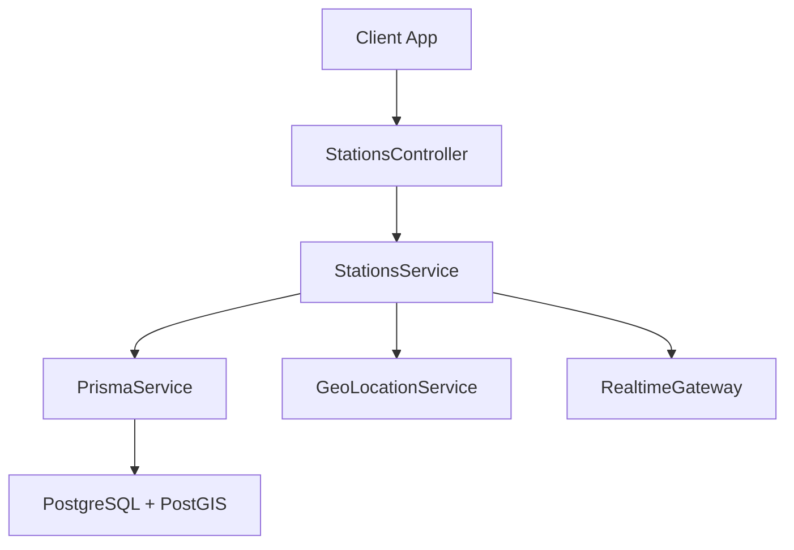
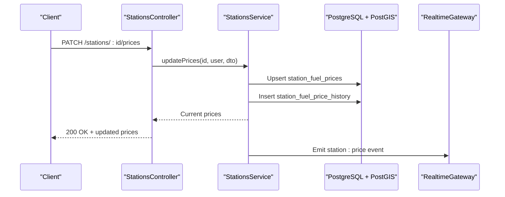
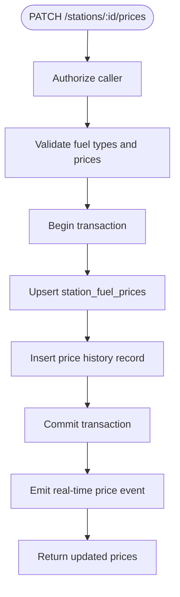
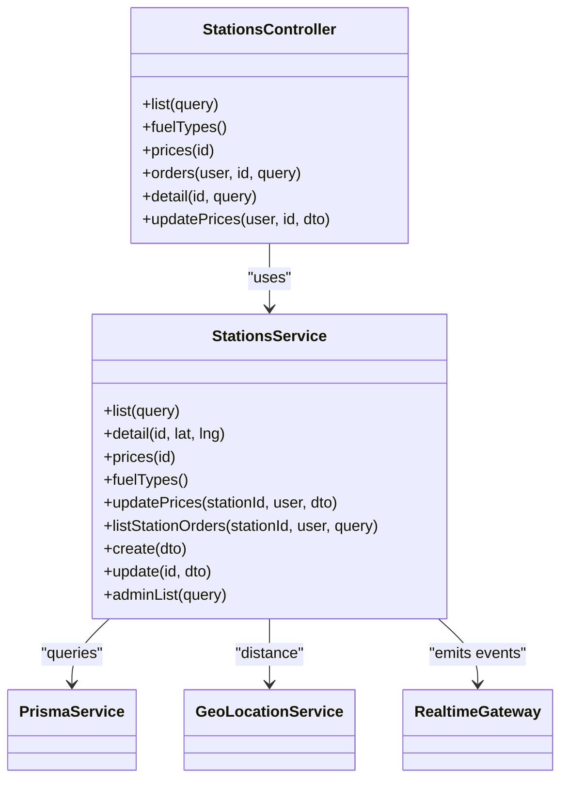

# Station Management API

<cite>
**Referenced Files in This Document**
- [stations.controller.ts](file://backend/src/stations/stations.controller.ts)
- [stations.service.ts](file://backend/src/stations/stations.service.ts)
- [stations.dto.ts](file://backend/src/stations/dto/stations.dto.ts)
- [schema.prisma](file://backend/prisma/schema.prisma)
- [README.md](file://backend/README.md)
</cite>

## Table of Contents
1. [Introduction](#introduction)
2. [Project Structure](#project-structure)
3. [Core Components](#core-components)
4. [Architecture Overview](#architecture-overview)
5. [Detailed Component Analysis](#detailed-component-analysis)
6. [Dependency Analysis](#dependency-analysis)
7. [Performance Considerations](#performance-considerations)
8. [Troubleshooting Guide](#troubleshooting-guide)
9. [Conclusion](#conclusion)

## Introduction
This document provides detailed API documentation for the station management endpoints exposed by the backend service. It covers:

- Station registration and updates (admin operations).
- Fuel inventory and price management.
- Operating hours and basic station metadata.
- Customer-facing station discovery, including geospatial queries for nearby stations.
- Fuel type reference data.
- Station order listing for station managers.

The API is implemented with NestJS controllers and services backed by Prisma and PostgreSQL with PostGIS for geospatial queries.

## Project Structure
The station-related functionality lives under the `stations` module:

- Controller: HTTP route definitions, request validation, and role guards.
- Service: Business logic, database access, geospatial calculations, sorting, DTO mapping, and real-time notifications.
- DTOs: Request/response validation schemas.
- Database schema: Station, fuel types, prices, and related entities.

**Diagram sources**
- [stations.controller.ts:39-96](file://backend/src/stations/stations.controller.ts#L39-L96)
- [stations.service.ts:42-48](file://backend/src/stations/stations.service.ts#L42-L48)
- [schema.prisma:372-447](file://backend/prisma/schema.prisma#L372-L447)

**Section sources**
- [stations.controller.ts:1-97](file://backend/src/stations/stations.controller.ts#L1-L97)
- [stations.service.ts:1-382](file://backend/src/stations/stations.service.ts#L1-L382)
- [stations.dto.ts:1-211](file://backend/src/stations/dto/stations.dto.ts#L1-L211)
- [schema.prisma:372-447](file://backend/prisma/schema.prisma#L372-L447)

## Core Components
- StationsController: Defines public and protected routes for listing, searching, pricing, and order access.
- StationsService: Implements listing with distance/ETA, detail retrieval, fuel-type catalog, price updates with history, admin create/update/list, and sorting strategies.
- DTOs: Define query parameters, creation/update payloads, and price update structures.
- Data model: Station, FuelType, StationFuelPrice, and StationFuelPriceHistory.

Key responsibilities:
- Public endpoints expose active stations, fuel types, and current prices.
- Protected endpoints allow station managers and admins to update prices and list orders.
- Geospatial filtering uses PostGIS geography columns; fallback Haversine calculation is available.
- Price updates are transactional and emit real-time events.

**Section sources**
- [stations.controller.ts:39-96](file://backend/src/stations/stations.controller.ts#L39-L96)
- [stations.service.ts:50-196](file://backend/src/stations/stations.service.ts#L50-L196)
- [stations.dto.ts:22-211](file://backend/src/stations/dto/stations.dto.ts#L22-L211)
- [schema.prisma:372-447](file://backend/prisma/schema.prisma#L372-L447)

## Architecture Overview
The station API follows a layered architecture:

- HTTP layer: Controllers validate inputs and enforce roles.
- Service layer: Encapsulates business rules, database queries, geospatial logic, and event emission.
- Persistence layer: Prisma maps to PostgreSQL tables with PostGIS extensions.
- Real-time layer: Updates trigger WebSocket events for live price changes.

**Diagram sources**
- [stations.controller.ts:84-95](file://backend/src/stations/stations.controller.ts#L84-L95)
- [stations.service.ts:137-196](file://backend/src/stations/stations.service.ts#L137-L196)
- [schema.prisma:418-447](file://backend/prisma/schema.prisma#L418-L447)

## Detailed Component Analysis

### Authentication and Authorization
- Public endpoints:
  - GET /stations
  - GET /stations/fuel-types
  - GET /stations/:id
  - GET /stations/:id/prices
- Protected endpoints:
  - GET /stations/:id/orders
  - PATCH /stations/:id/prices
- Roles:
  - STATION_MANAGER, ADMIN, SUPER_ADMIN can manage prices and view orders.
  - Customers and anonymous users can discover stations and read prices.

Authorization checks:
- Role-based guards applied via decorators on controller methods.
- Service-level authorization ensures station managers can only manage their own stations.

**Section sources**
- [stations.controller.ts:44-95](file://backend/src/stations/stations.controller.ts#L44-L95)
- [stations.service.ts:305-311](file://backend/src/stations/stations.service.ts#L305-L311)

### Station Discovery and Location-Based Search
Endpoint: GET /stations

Query parameters:
- lat: Optional latitude enabling distance and ETA.
- lng: Optional longitude enabling distance and ETA.
- radiusKm: Radius in kilometers (default 25, range 1–100).
- sort: Sorting strategy — distance, price, rating.
- fuel: Fuel code used when sorting by price.
- search: Free-text filter matching station name or brand.
- page, limit: Pagination.

Behavior:
- Filters active stations.
- If lat/lng provided, performs PostGIS distance query within radius and returns up to 50 candidates.
- Enriches results with fuel prices and fuel type details.
- Sorts by:
  - Distance if lat/lng present and not overridden.
  - Price by specific fuel code if sort=price and fuel provided.
  - Minimum price across all fuels if sort=price without fuel.
  - Rating otherwise.
- Returns paginated results with distanceKm, etaMinutes, etaLabel, prices map, and priceList array.

Response fields include:
- id, name, brand, address, phone, lat, lng, imageUrl
- isActive, rating, reviewCount
- opensAt, closesAt
- distanceKm, etaMinutes, etaLabel
- prices (map keyed by fuel code), priceList (array of fuel price objects), minPrice, updatedAt

Example usage scenarios:
- Customer discovers nearby stations sorted by distance with live prices.
- Customer filters by brand or station name.
- Customer sorts by cheapest petrol price using sort=price and fuel=PETROL.

**Section sources**
- [stations.controller.ts:44-49](file://backend/src/stations/stations.controller.ts#L44-L49)
- [stations.service.ts:51-99](file://backend/src/stations/stations.service.ts#L51-L99)
- [stations.service.ts:313-338](file://backend/src/stations/stations.service.ts#L313-L338)
- [stations.service.ts:340-380](file://backend/src/stations/stations.service.ts#L340-L380)
- [stations.dto.ts:22-58](file://backend/src/stations/dto/stations.dto.ts#L22-L58)

### Fuel Type Reference
Endpoint: GET /stations/fuel-types

Purpose:
- Return active fuel types available on the platform.

Response includes:
- id, code, name, unit

Use cases:
- Populate dropdowns for ordering flows.
- Validate fuel codes in other endpoints.

**Section sources**
- [stations.controller.ts:51-56](file://backend/src/stations/stations.controller.ts#L51-L56)
- [stations.service.ts:128-134](file://backend/src/stations/stations.service.ts#L128-L134)
- [schema.prisma:372-387](file://backend/prisma/schema.prisma#L372-L387)

### Station Detail
Endpoint: GET /stations/:id

Optional query:
- lat, lng: When provided, calculates distance and ETA.

Behavior:
- Returns full station object with fuel prices and price list.
- Computes distance using GeoLocationService or Haversine fallback.

**Section sources**
- [stations.controller.ts:77-82](file://backend/src/stations/stations.controller.ts#L77-L82)
- [stations.service.ts:101-117](file://backend/src/stations/stations.service.ts#L101-L117)

### Current Prices for a Station
Endpoint: GET /stations/:id/prices

Purpose:
- Retrieve the current price list for a single station.

Response:
- Array of fuel price entries including fuel code, name, unit, pricePerLitre, and updatedAt.

**Section sources**
- [stations.controller.ts:58-63](file://backend/src/stations/stations.controller.ts#L58-L63)
- [stations.service.ts:119-126](file://backend/src/stations/stations.service.ts#L119-L126)

### Update Fuel Prices
Endpoint: PATCH /stations/:id/prices

Roles:
- STATION_MANAGER, ADMIN, SUPER_ADMIN

Request body:
- prices: Array of { fuelTypeId, pricePerLitre }
- Validation:
  - At least one item, up to ten items.
  - Each fuelTypeId must exist.
  - pricePerLitre must be an integer between 500 and 100,000.

Behavior:
- Authorizes the caller against the station.
- Upserts station fuel prices per fuel type.
- Records each change in the price history table.
- Emits a real-time event with updated prices.
- Returns the refreshed price list.

**Diagram sources**
- [stations.service.ts:137-196](file://backend/src/stations/stations.service.ts#L137-L196)
- [schema.prisma:418-447](file://backend/prisma/schema.prisma#L418-L447)

**Section sources**
- [stations.controller.ts:84-95](file://backend/src/stations/stations.controller.ts#L84-L95)
- [stations.service.ts:137-196](file://backend/src/stations/stations.service.ts#L137-L196)
- [stations.dto.ts:182-203](file://backend/src/stations/dto/stations.dto.ts#L182-L203)

### Station Orders Listing
Endpoint: GET /stations/:id/orders

Roles:
- STATION_MANAGER, ADMIN, SUPER_ADMIN

Query parameters:
- filter: active, completed, cancelled, all (default all)
- page, limit: Pagination

Behavior:
- Authorizes the caller against the station.
- Filters orders by status groups:
  - Active: paid, assigned, accepted, en-route/at-station/picked-up/en-route-customer.
  - Completed: completed, delivered.
  - Cancelled: cancelled, refunded, failed.
- Includes fuel type, customer info, and latest assignment where applicable.

**Section sources**
- [stations.controller.ts:65-75](file://backend/src/stations/stations.controller.ts#L65-L75)
- [stations.service.ts:198-232](file://backend/src/stations/stations.service.ts#L198-L232)
- [stations.dto.ts:205-211](file://backend/src/stations/dto/stations.dto.ts#L205-L211)

### Station Registration and Updates (Admin Operations)
Note: The controller exposes public and manager/admin endpoints for listing, pricing, and orders. Admin-only station creation and update methods exist in the service but are not bound to controller routes in the provided file. Consumers should use these service methods through internal admin APIs or extend the controller accordingly.

Create station (service method):
- Fields: name, brand, address, phone, lat, lng, imageUrl, opensAt, closesAt, managerId.
- Sets PostGIS point after creation.
- Returns station detail.

Update station (service method):
- Partial update of name, brand, address, phone, lat, lng, imageUrl, opensAt, closesAt, isActive, managerId.
- Updates PostGIS point if coordinates change.
- Returns station detail.

Admin list stations:
- Paginated list with optional inclusion of inactive stations.
- Includes fuel prices, manager info, and order counts.

**Section sources**
- [stations.service.ts:235-302](file://backend/src/stations/stations.service.ts#L235-L302)
- [stations.dto.ts:60-180](file://backend/src/stations/dto/stations.dto.ts#L60-L180)
- [schema.prisma:389-416](file://backend/prisma/schema.prisma#L389-L416)

### Operating Hours and Capacity
Operating hours:
- Station entity includes opensAt and closesAt fields stored as time strings.
- Default values are 00:00 and 23:59.

Capacity:
- There is no explicit station capacity field in the schema.
- Capacity may be modeled at the vehicle level (customer vehicles have tankCapacityLitres).

**Section sources**
- [schema.prisma:389-416](file://backend/prisma/schema.prisma#L389-L416)
- [schema.prisma:232-252](file://backend/prisma/schema.prisma#L232-L252)

### Geospatial Queries and Distance/ETA
Geospatial features:
- Station location stored as PostGIS geography(Point, 4326).
- Nearby stations filtered using ST_DWithin and ordered by distance.
- Distance computed in meters and converted to kilometers.
- ETA estimated from distance using a helper function.

Fallback:
- If PostGIS point is missing, Haversine formula computes approximate distance.

**Section sources**
- [stations.service.ts:67-84](file://backend/src/stations/stations.service.ts#L67-L84)
- [stations.service.ts:109-114](file://backend/src/stations/stations.service.ts#L109-L114)
- [schema.prisma:389-416](file://backend/prisma/schema.prisma#L389-L416)

## Dependency Analysis
The station module depends on:

- Common utilities:
  - GeoLocationService for distance computation and PostGIS integration.
  - RealtimeGateway for emitting price update events.
- Prisma models:
  - Station, FuelType, StationFuelPrice, StationFuelPriceHistory.
- Shared guards/decorators:
  - Roles, Public, CurrentUser.

**Diagram sources**
- [stations.controller.ts:39-96](file://backend/src/stations/stations.controller.ts#L39-L96)
- [stations.service.ts:42-48](file://backend/src/stations/stations.service.ts#L42-L48)

**Section sources**
- [stations.controller.ts:1-97](file://backend/src/stations/stations.controller.ts#L1-L97)
- [stations.service.ts:1-382](file://backend/src/stations/stations.service.ts#L1-L382)

## Performance Considerations
- Geospatial filtering:
  - Uses PostGIS geography index-friendly functions (ST_DWithin) to limit candidate stations before applying application-level sorting.
  - Limits initial results to 50 rows to reduce memory and processing overhead.
- Sorting:
  - In-memory sorting after fetching enriched station records.
  - Prefer providing lat/lng to leverage distance sorting efficiently.
- Pagination:
  - All list endpoints support page and limit to control response size.
- Transactions:
  - Price updates run in a transaction to ensure consistency between price upserts and history inserts.
- Real-time events:
  - Price updates emit events asynchronously; consider client-side caching to avoid excessive re-renders.

[No sources needed since this section provides general guidance]

## Troubleshooting Guide
Common issues and resolutions:

- Invalid fuel type IDs in price updates:
  - Error: BadRequestException indicating invalid fuel types.
  - Resolution: Ensure all fuelTypeId values exist in the fuel_types table.

- Unauthorized price updates:
  - Error: ForbiddenException if the user is not an admin/super-admin and not the station manager.
  - Resolution: Authenticate as an allowed role or assign the correct station manager.

- Station not found:
  - Error: NotFoundException for missing station IDs.
  - Resolution: Verify station ID and that the station is active where required.

- Missing geospatial data:
  - If PostGIS location is null, distance falls back to Haversine approximation.
  - Resolution: Ensure station coordinates are set and PostGIS point is synchronized.

- Excessive payload in price updates:
  - Error: Validation errors if prices array exceeds maximum size or contains invalid integers.
  - Resolution: Limit to 1–10 items and ensure pricePerLitre is within allowed bounds.

**Section sources**
- [stations.service.ts:146-153](file://backend/src/stations/stations.service.ts#L146-L153)
- [stations.service.ts:305-311](file://backend/src/stations/stations.service.ts#L305-L311)
- [stations.service.ts:107-108](file://backend/src/stations/stations.service.ts#L107-L108)
- [stations.dto.ts:182-203](file://backend/src/stations/dto/stations.dto.ts#L182-L203)

## Conclusion
The Station Management API provides robust capabilities for discovering stations, retrieving live fuel prices, managing operating hours, and updating prices securely. Geospatial queries enable efficient nearby station searches with distance and ETA estimates. Admin and manager roles are enforced both at the controller and service layers, ensuring safe operations. For best performance, clients should provide lat/lng for distance sorting, paginate list responses, and cache fuel type catalogs.

[No sources needed since this section summarizes without analyzing specific files]