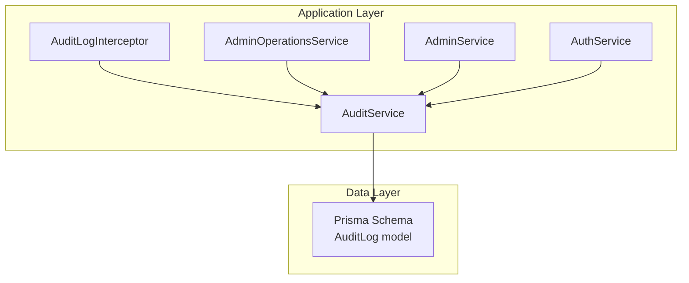
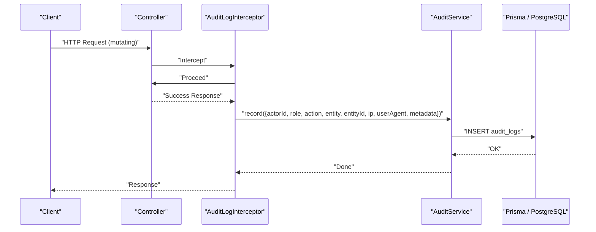
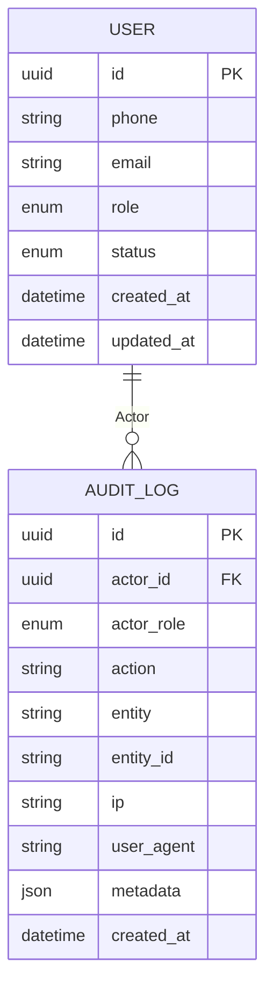
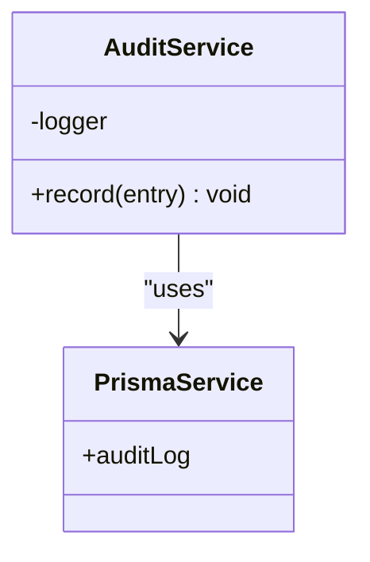
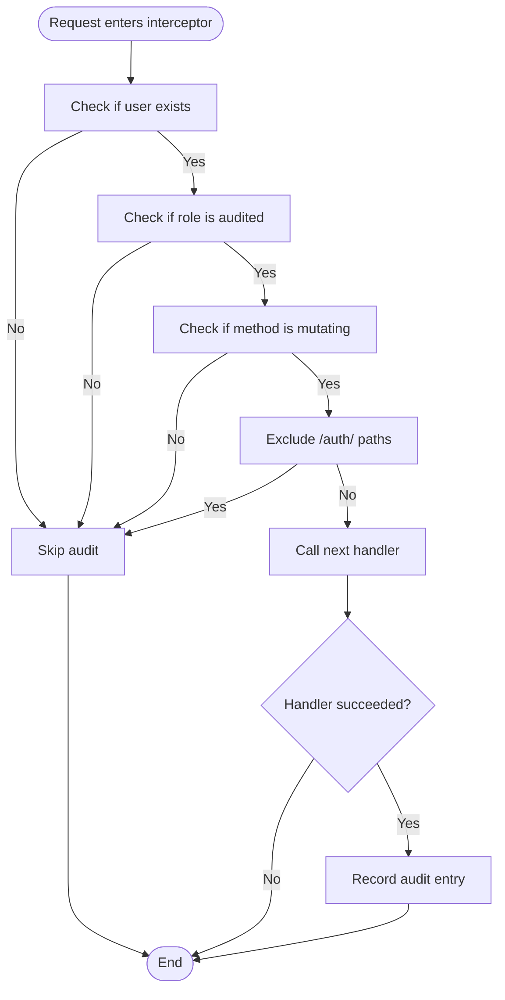
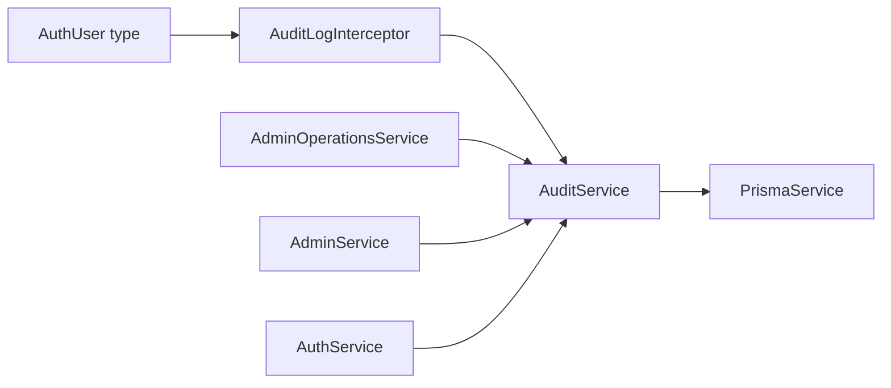

# Audit & Compliance Tracking

<cite>
**Referenced Files in This Document**
- [schema.prisma](file://backend/prisma/schema.prisma)
- [audit.service.ts](file://backend/src/audit/audit.service.ts)
- [audit.module.ts](file://backend/src/audit/audit.module.ts)
- [audit-log.interceptor.ts](file://backend/src/common/interceptors/audit-log.interceptor.ts)
- [auth-user.ts](file://backend/src/common/types/auth-user.ts)
- [admin-operations.service.ts](file://backend/src/admin/admin-operations.service.ts)
- [admin.service.ts](file://backend/src/admin/admin.service.ts)
- [auth.service.ts](file://backend/src/auth/auth.service.ts)
</cite>

## Table of Contents
1. [Introduction](#introduction)
2. [Project Structure](#project-structure)
3. [Core Components](#core-components)
4. [Architecture Overview](#architecture-overview)
5. [Detailed Component Analysis](#detailed-component-analysis)
6. [Dependency Analysis](#dependency-analysis)
7. [Performance Considerations](#performance-considerations)
8. [Compliance Requirements](#compliance-requirements)
9. [Audit Query Patterns and Reporting](#audit-query-patterns-and-reporting)
10. [Security Investigation Workflows](#security-investigation-workflows)
11. [Troubleshooting Guide](#troubleshooting-guide)
12. [Conclusion](#conclusion)

## Introduction
This document explains the audit and compliance tracking system centered on the AuditLog model. It covers how critical operations are recorded with actor identification, action categorization, entity modification logging, and rich metadata such as IP addresses and user agents for forensic analysis. It also documents the relationship between audit logs and users through the Actor relation, outlines compliance considerations including data retention and immutability, and provides practical examples for querying audit trails, generating compliance reports, and conducting security investigations.

## Project Structure
The audit capability is implemented as a small, focused set of backend components:
- Data model definition for AuditLog and its relationships.
- A service to persist audit entries safely without impacting request processing.
- An interceptor that automatically records administrative mutations.
- Integration points across admin and auth services where explicit audit calls are made.

**Diagram sources**
- [schema.prisma:713-730](file://backend/prisma/schema.prisma#L713-L730)
- [audit.service.ts:21-46](file://backend/src/audit/audit.service.ts#L21-L46)
- [audit-log.interceptor.ts:24-63](file://backend/src/common/interceptors/audit-log.interceptor.ts#L24-L63)
- [admin-operations.service.ts:66-100](file://backend/src/admin/admin-operations.service.ts#L66-L100)
- [admin.service.ts:284-284](file://backend/src/admin/admin.service.ts#L284-L284)
- [auth.service.ts:81-81](file://backend/src/auth/auth.service.ts#L81-L81)

**Section sources**
- [schema.prisma:713-730](file://backend/prisma/schema.prisma#L713-L730)
- [audit.service.ts:1-46](file://backend/src/audit/audit.service.ts#L1-L46)
- [audit-log.interceptor.ts:1-64](file://backend/src/common/interceptors/audit-log.interceptor.ts#L1-L64)

## Core Components
- AuditLog model: Stores who performed an action (actor), what was done (action), which business object was affected (entity and entityId), and contextual details (ip, userAgent, metadata). It is indexed by createdAt and actorId for efficient queries.
- AuditService: Provides a safe record method that writes audit entries via Prisma. Failures are logged but do not break the calling request.
- AuditLogInterceptor: Automatically captures successful administrative mutations for audited roles, excluding authentication routes. It enriches each entry with HTTP context like IP and User-Agent.
- AuditModule: Exposes AuditService globally so it can be injected anywhere.

Key responsibilities:
- Capture immutable, append-only audit trail entries.
- Associate entries with authenticated actors when available.
- Enrich entries with network and session context.
- Ensure auditing does not impact application availability.

**Section sources**
- [schema.prisma:713-730](file://backend/prisma/schema.prisma#L713-L730)
- [audit.service.ts:10-46](file://backend/src/audit/audit.service.ts#L10-L46)
- [audit-log.interceptor.ts:12-63](file://backend/src/common/interceptors/audit-log.interceptor.ts#L12-L63)
- [audit.module.ts:1-9](file://backend/src/audit/audit.module.ts#L1-L9)

## Architecture Overview
The audit architecture combines automatic interception with explicit service-level recording:

**Diagram sources**
- [audit-log.interceptor.ts:28-63](file://backend/src/common/interceptors/audit-log.interceptor.ts#L28-L63)
- [audit.service.ts:27-45](file://backend/src/audit/audit.service.ts#L27-L45)
- [schema.prisma:713-730](file://backend/prisma/schema.prisma#L713-L730)

## Detailed Component Analysis

### AuditLog Model
The AuditLog model defines the canonical audit record:
- actorId and actorRole identify the user and their role at time of action.
- action describes the operation in a human-readable format.
- entity and entityId point to the affected domain object.
- ip and userAgent capture network/session context.
- metadata allows flexible extension fields for additional context.
- createdAt is timestamped; indexes support time-based and actor-based queries.

Relationships:
- Optional relation to User via Actor relation enables accountability tracing back to the user profile.

**Diagram sources**
- [schema.prisma:137-170](file://backend/prisma/schema.prisma#L137-L170)
- [schema.prisma:713-730](file://backend/prisma/schema.prisma#L713-L730)

**Section sources**
- [schema.prisma:713-730](file://backend/prisma/schema.prisma#L713-L730)

### AuditService
Responsibilities:
- Provide a single, robust method to create audit entries.
- Normalize optional fields to null or JSON null to avoid invalid payloads.
- Catch and log errors without failing the caller’s request.

Design notes:
- Uses Prisma client directly for persistence.
- Wraps persistence in try/catch to ensure fire-and-forget semantics.

**Diagram sources**
- [audit.service.ts:21-46](file://backend/src/audit/audit.service.ts#L21-L46)

**Section sources**
- [audit.service.ts:1-46](file://backend/src/audit/audit.service.ts#L1-L46)

### AuditLogInterceptor
Responsibilities:
- Determine whether a request should be audited based on:
  - Presence of an authenticated user.
  - Role membership in the audited set (ADMIN, SUPER_ADMIN, STATION_MANAGER).
  - Mutating HTTP methods (POST, PUT, PATCH, DELETE).
  - Excluding authentication routes (/auth/).
- After successful handler execution, call AuditService.record with enriched context:
  - actorId and actorRole from the authenticated principal.
  - action derived from HTTP method and controller/handler names.
  - entity derived from controller name.
  - entityId from route parameters.
  - ip and userAgent from the HTTP request.
  - metadata includes the original URL path.

**Diagram sources**
- [audit-log.interceptor.ts:12-63](file://backend/src/common/interceptors/audit-log.interceptor.ts#L12-L63)

**Section sources**
- [audit-log.interceptor.ts:1-64](file://backend/src/common/interceptors/audit-log.interceptor.ts#L1-L64)

### Explicit Audit Calls in Services
Several services explicitly call AuditService.record to capture important business events beyond generic HTTP mutations:
- Admin operations: account management, station operations, and other administrative workflows.
- Admin service: broader administrative actions.
- Auth service: login, logout, password reset, and related security-sensitive events.

These calls typically include:
- actorId and actorRole from the current user.
- action describing the specific operation.
- entity and entityId identifying the affected resource.
- ip and userAgent from request context.
- metadata with additional details relevant to the operation.

**Section sources**
- [admin-operations.service.ts:66-100](file://backend/src/admin/admin-operations.service.ts#L66-L100)
- [admin.service.ts:284-284](file://backend/src/admin/admin.service.ts#L284-L284)
- [auth.service.ts:81-81](file://backend/src/auth/auth.service.ts#L81-L81)

## Dependency Analysis
High-level dependencies:
- AuditLogInterceptor depends on AuditService and the AuthUser type to enrich audit entries.
- AuditService depends on PrismaService to write to the database.
- AuditModule exports AuditService globally for injection across modules.
- Admin and Auth services depend on AuditService for explicit event logging.

**Diagram sources**
- [audit-log.interceptor.ts:9-10](file://backend/src/common/interceptors/audit-log.interceptor.ts#L9-L10)
- [audit.service.ts:1-3](file://backend/src/audit/audit.service.ts#L1-L3)
- [audit.module.ts:1-9](file://backend/src/audit/audit.module.ts#L1-L9)
- [auth-user.ts:1-19](file://backend/src/common/types/auth-user.ts#L1-L19)

**Section sources**
- [audit.module.ts:1-9](file://backend/src/audit/audit.module.ts#L1-L9)
- [audit-log.interceptor.ts:1-64](file://backend/src/common/interceptors/audit-log.interceptor.ts#L1-L64)
- [audit.service.ts:1-46](file://backend/src/audit/audit.service.ts#L1-L46)
- [auth-user.ts:1-34](file://backend/src/common/types/auth-user.ts#L1-L34)

## Performance Considerations
- Fire-and-forget design: The interceptor uses tap to record after response handling, minimizing latency impact.
- Error isolation: AuditService catches persistence errors and logs them, ensuring normal requests succeed even if audit writes fail.
- Indexing strategy: createdAt and actorId indexes support common query patterns for time-range and per-user audits.
- Metadata payload: Keep metadata concise to reduce storage overhead while retaining sufficient forensic detail.

[No sources needed since this section provides general guidance]

## Compliance Requirements
- Data retention policies:
  - Define retention periods aligned with regulatory requirements (e.g., financial, privacy, operational).
  - Implement archival and secure deletion processes for expired audit logs.
  - Ensure retention settings are configurable and auditable.
- Audit log immutability:
  - Treat audit_logs as append-only; prevent updates and deletes in application logic.
  - Enforce database-level constraints or policies to restrict modifications.
  - Maintain integrity checks (e.g., checksums or tamper-evident logs) for high-assurance environments.
- Regulatory reporting capabilities:
  - Support exportable reports filtered by date range, actor, entity, action, and IP.
  - Include standardized fields for compliance frameworks (who, what, when, where, why).
  - Provide read-only access controls for auditors and compliance teams.

[No sources needed since this section provides general guidance]

## Audit Query Patterns and Reporting
Common query patterns:
- Time-bounded investigation:
  - Filter by createdAt within a specific window.
  - Useful for incident response and SLA reviews.
- Actor-centric review:
  - Filter by actorId to see all actions performed by a specific user.
  - Combine with actorRole to analyze privilege usage.
- Entity change tracking:
  - Filter by entity and entityId to reconstruct changes to a particular business object.
- Network forensics:
  - Filter by ip to detect suspicious activity from specific sources.
- Action classification:
  - Filter by action patterns to group similar operations (e.g., “DELETE”, “UPDATE”).

Reporting examples:
- Daily audit summary:
  - Count of actions by entity and role.
  - Top actors by number of mutations.
- Security alert triggers:
  - Flag rapid successive deletions or failed attempts associated with sensitive entities.
- Compliance attestations:
  - Export logs for external auditors with consistent formatting and timestamps.

Implementation guidance:
- Use createdAt and actorId indexes for efficient filtering.
- Leverage metadata fields for additional filters (e.g., path, tenant, region).
- Avoid exposing raw logs to non-administrative users; provide controlled endpoints.

[No sources needed since this section provides general guidance]

## Security Investigation Workflows
Typical workflow steps:
1. Identify scope:
   - Define timeframe, affected entities, and suspected actors.
2. Collect evidence:
   - Retrieve audit logs matching filters (time, actor, entity, IP).
   - Correlate with session and authentication events.
3. Analyze patterns:
   - Look for anomalies such as unusual IPs, repeated failures, or privileged actions outside normal hours.
4. Contain and remediate:
   - Revoke sessions, lock accounts, or adjust permissions as needed.
5. Document findings:
   - Generate a report summarizing timeline, actions, and remediation steps.

Supporting data:
- Actor identity and role from audit logs.
- IP and user agent for device and location inference.
- Metadata for contextual enrichment (e.g., original URL path).

[No sources needed since this section provides general guidance]

## Troubleshooting Guide
Symptoms and resolutions:
- Missing audit entries:
  - Verify that the request is from an audited role and is a mutating method.
  - Confirm that the route is not under /auth/.
  - Check interceptor registration and module imports.
- Audit write failures:
  - Inspect application logs for warnings from AuditService.
  - Validate database connectivity and permissions for audit_logs table.
  - Ensure metadata payloads conform to expected JSON structure.
- Incorrect actor attribution:
  - Confirm that the authenticated principal is attached to the request.
  - Review JWT strategy and guard configuration to ensure user context propagation.

Operational tips:
- Monitor audit write error rates to detect infrastructure issues early.
- Add health checks for audit-related subsystems.
- Periodically validate index performance and adjust retention/archival strategies.

**Section sources**
- [audit.service.ts:41-44](file://backend/src/audit/audit.service.ts#L41-L44)
- [audit-log.interceptor.ts:40-59](file://backend/src/common/interceptors/audit-log.interceptor.ts#L40-L59)

## Conclusion
The audit and compliance tracking system provides a robust, extensible foundation for capturing critical operations with strong actor attribution, rich contextual metadata, and reliable persistence. By combining automatic interception with explicit service-level logging, the system supports both routine compliance reporting and deep security investigations. Adhering to data retention and immutability policies ensures the audit trail remains trustworthy and useful for regulatory and operational needs.

[No sources needed since this section summarizes without analyzing specific files]