# Core Entities & Identity Management

<cite>
**Referenced Files in This Document**   
- [schema.prisma](file://backend/prisma/schema.prisma)
- [auth.service.ts](file://backend/src/auth/auth.service.ts)
- [otp.service.ts](file://backend/src/auth/otp.service.ts)
- [token.service.ts](file://backend/src/auth/token.service.ts)
- [password.service.ts](file://backend/src/common/security/password.service.ts)
- [auth-user.ts](file://backend/src/common/types/auth-user.ts)
- [roles.guard.ts](file://backend/src/common/guards/roles.guard.ts)
- [jwt.strategy.ts](file://backend/src/auth/strategies/jwt.strategy.ts)
- [admin.service.ts](file://backend/src/admin/admin.service.ts)
</cite>

## Table of Contents
1. [Introduction](#introduction)
2. [Project Structure](#project-structure)
3. [Core Data Models](#core-data-models)
4. [Role-Based Access Control](#role-based-access-control)
5. [OTP Verification System](#otp-verification-system)
6. [Session Management and Token Storage](#session-management-and-token-storage)
7. [Authentication Flow](#authentication-flow)
8. [User Lifecycle Operations](#user-lifecycle-operations)
9. [Password Hashing and Security](#password-hashing-and-security)
10. [Account Security Features](#account-security-features)
11. [Architecture Overview](#architecture-overview)
12. [Dependency Analysis](#dependency-analysis)
13. [Performance Considerations](#performance-considerations)
14. [Troubleshooting Guide](#troubleshooting-guide)
15. [Conclusion](#conclusion)

## Introduction
This document explains the core identity and user management data model for FuelConnect. It focuses on the User, Session, and OtpCode entities, their relationships, field definitions, and business logic. It also documents the role-based access control system using RoleName, the account lifecycle states through UserStatus, the OTP verification flow with OtpPurpose, and the security mechanisms including attempt limiting, expiration, session rotation, and token revocation.

## Project Structure
The identity domain is implemented primarily in the backend:
- Database schema defines enums and core tables under Prisma.
- Authentication service orchestrates registration, login, OTP verification, password changes, and profile operations.
- OTP service manages code issuance, cooldown, hashing, attempts, and delivery stubs.
- Token service handles short-lived access tokens, refresh token rotation, and session revocation.
- Password service implements secure hashing and verification.
- Guards and strategies enforce authentication and authorization.
- Admin service provides account status management and related side effects.

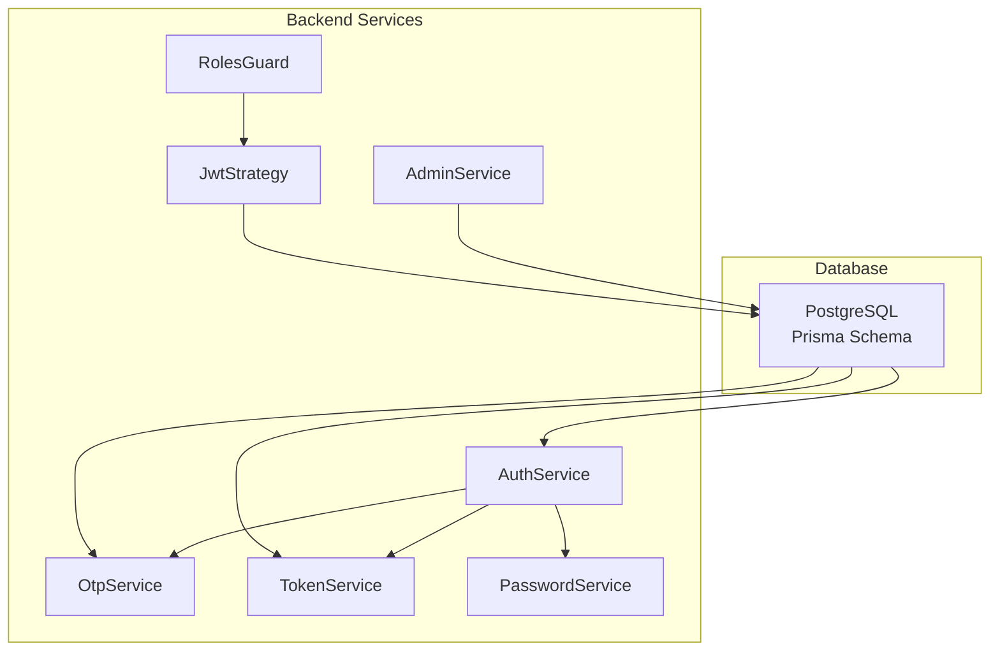

**Diagram sources**
- [schema.prisma:17-38](file://backend/prisma/schema.prisma#L17-L38)
- [auth.service.ts:40-48](file://backend/src/auth/auth.service.ts#L40-L48)
- [otp.service.ts:29-36](file://backend/src/auth/otp.service.ts#L29-L36)
- [token.service.ts:32-38](file://backend/src/auth/token.service.ts#L32-L38)
- [password.service.ts:11-24](file://backend/src/common/security/password.service.ts#L11-L24)
- [roles.guard.ts:8-32](file://backend/src/common/guards/roles.guard.ts#L8-L32)
- [jwt.strategy.ts:36-74](file://backend/src/auth/strategies/jwt.strategy.ts#L36-L74)
- [admin.service.ts:52-61](file://backend/src/admin/admin.service.ts#L52-L61)

**Section sources**
- [schema.prisma:17-38](file://backend/prisma/schema.prisma#L17-L38)
- [auth.service.ts:40-48](file://backend/src/auth/auth.service.ts#L40-L48)

## Core Data Models
FuelConnect models identity around three primary entities: User, Session, and OtpCode.

### User Model
- Purpose: Central identity record for all platform actors.
- Key fields:
  - Unique identifiers: id, phone (unique), optional email (unique).
  - Credentials: passwordHash.
  - Profile: fullName, avatarUrl.
  - Role and state: role defaults to CUSTOMER; status defaults to PENDING.
  - Verification timestamps: phoneVerifiedAt, emailVerifiedAt.
  - Login tracking: lastLoginAt, failedLoginAttempts, lockedUntil.
  - Auditability: createdAt, updatedAt, deletedAt.
- Relationships:
  - One-to-one optional Customer, Rider, Wallet.
  - One-to-many Session, OtpCode, Notification, AuditLog, SupportTicket messages, Rider verifications, Withdrawal processing, Station price updates.
  - Many-to-many via StationManager relation.

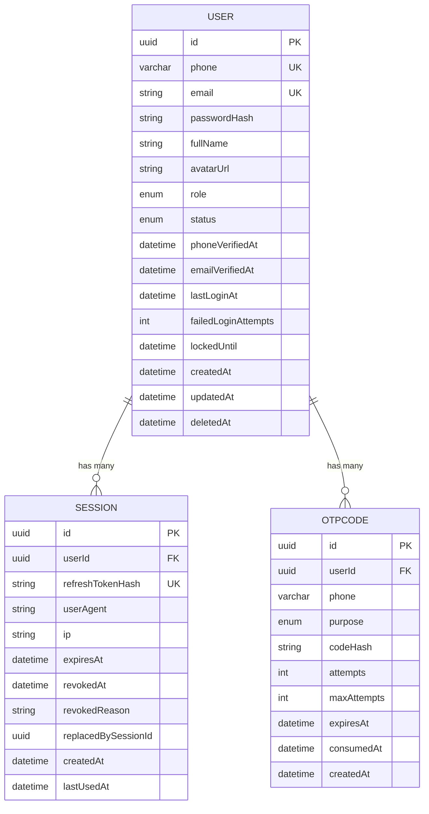

**Diagram sources**
- [schema.prisma:137-170](file://backend/prisma/schema.prisma#L137-L170)
- [schema.prisma:172-189](file://backend/prisma/schema.prisma#L172-L189)
- [schema.prisma:191-207](file://backend/prisma/schema.prisma#L191-L207)

**Section sources**
- [schema.prisma:137-170](file://backend/prisma/schema.prisma#L137-L170)

### Session Model
- Purpose: Tracks active device sessions and stores hashed refresh tokens.
- Key fields:
  - userId references User.
  - refreshTokenHash unique secret stored server-side.
  - Device metadata: userAgent, ip.
  - Lifecycle: expiresAt, revokedAt, revokedReason, replacedBySessionId.
  - Usage tracking: createdAt, lastUsedAt.
- Behavior:
  - Sessions are created on successful authentication.
  - Refresh tokens are rotated per use; reuse triggers family revocation.
  - Sessions can be revoked individually or en masse.

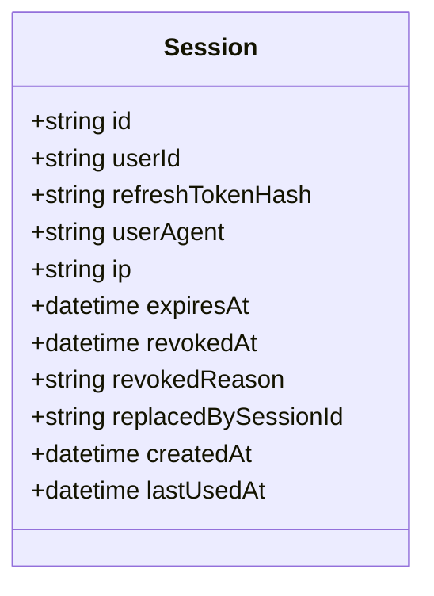

**Diagram sources**
- [schema.prisma:172-189](file://backend/prisma/schema.prisma#L172-L189)

**Section sources**
- [schema.prisma:172-189](file://backend/prisma/schema.prisma#L172-L189)

### OtpCode Model
- Purpose: Stores hashed OTP codes with purpose scoping, attempt limits, and expiration.
- Key fields:
  - Optional userId when tied to an existing account.
  - phone and purpose scope the OTP.
  - codeHash stores a secure hash of the code.
  - attempts and maxAttempts limit brute-force guessing.
  - expiresAt enforces time-bound validity.
  - consumedAt marks single-use redemption.
- Behavior:
  - Cooldown prevents rapid resends.
  - Invalid attempts increment counters and provide remaining attempts feedback.
  - Successful verification consumes the code.

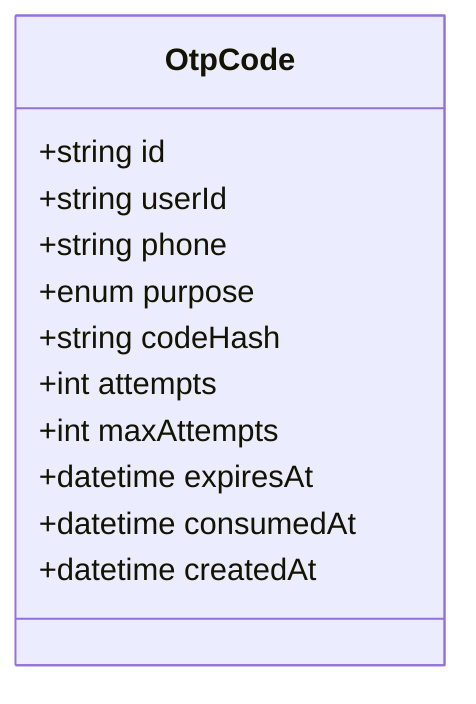

**Diagram sources**
- [schema.prisma:191-207](file://backend/prisma/schema.prisma#L191-L207)

**Section sources**
- [schema.prisma:191-207](file://backend/prisma/schema.prisma#L191-L207)

## Role-Based Access Control
FuelConnect uses a RoleName enum to define platform roles and a RolesGuard to enforce permissions.

- RoleName values:
  - CUSTOMER
  - RIDER
  - STATION_MANAGER
  - ADMIN
  - SUPER_ADMIN

- Authorization behavior:
  - The guard reads required roles from decorators.
  - If no roles are required, access is allowed.
  - SUPER_ADMIN bypasses role checks.
  - Otherwise, the current user’s role must be included in the required set.

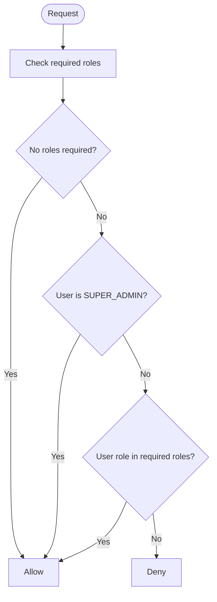

**Diagram sources**
- [roles.guard.ts:8-32](file://backend/src/common/guards/roles.guard.ts#L8-L32)

**Section sources**
- [schema.prisma:19-25](file://backend/prisma/schema.prisma#L19-L25)
- [roles.guard.ts:8-32](file://backend/src/common/guards/roles.guard.ts#L8-L32)

## OTP Verification System
The OTP system supports three purposes defined by OtpPurpose: SIGNUP, LOGIN, RESET.

- Issuance:
  - Enforces resend cooldown based on configuration.
  - Marks previous unconsumed codes as consumed before issuing a new one.
  - Generates a numeric code, hashes it with phone and secret, stores hash, maxAttempts, and expiry.
  - Delivers via a pluggable provider (currently a logger stub).

- Verification:
  - Finds the latest unconsumed code for the phone and purpose.
  - Validates expiry and attempt limits.
  - Compares provided code against stored hash using constant-time comparison.
  - Increments attempts on mismatch; consumes on success.

- Purpose-specific flows:
  - SIGNUP: Used during registration and activation.
  - LOGIN: Used for passwordless login initiation.
  - RESET: Used for password reset; after verification, issues a short-lived reset token.

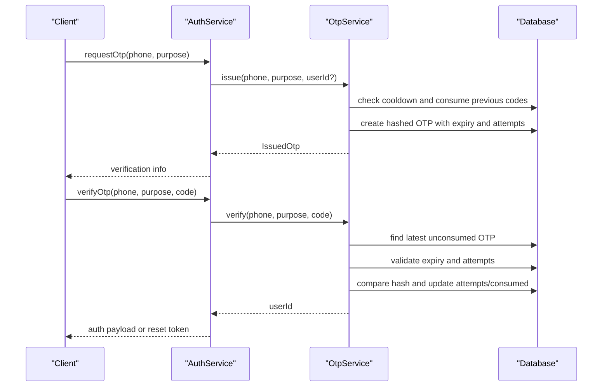

**Diagram sources**
- [auth.service.ts:297-317](file://backend/src/auth/auth.service.ts#L297-L317)
- [auth.service.ts:241-295](file://backend/src/auth/auth.service.ts#L241-L295)
- [otp.service.ts:38-90](file://backend/src/auth/otp.service.ts#L38-L90)
- [otp.service.ts:92-127](file://backend/src/auth/otp.service.ts#L92-L127)

**Section sources**
- [schema.prisma:34-38](file://backend/prisma/schema.prisma#L34-L38)
- [otp.service.ts:38-90](file://backend/src/auth/otp.service.ts#L38-L90)
- [otp.service.ts:92-127](file://backend/src/auth/otp.service.ts#L92-L127)
- [auth.service.ts:241-317](file://backend/src/auth/auth.service.ts#L241-L317)

## Session Management and Token Storage
Sessions combine short-lived JWT access tokens with long-lived opaque refresh tokens.

- Access tokens:
  - Short TTL configured via jwt.accessTtl.
  - Payload includes user id, role, phone, and sessionId.
  - Verified per request by JwtStrategy, which re-resolves user state.

- Refresh tokens:
  - Randomly generated and hashed before storage in Session.refreshTokenHash.
  - Rotated on every use; reuse of an old token revokes the entire session family.
  - Expiration managed via jwt.refreshTtlDays.

- Session lifecycle:
  - Created on login or OTP verification.
  - Revoked on logout, password change, admin suspension, or token reuse detection.
  - Supports listing active sessions and revoking individual sessions.

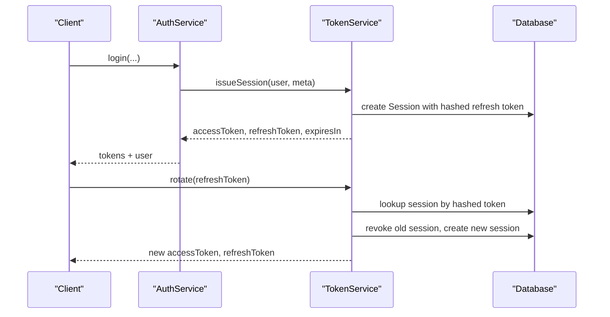

**Diagram sources**
- [auth.service.ts:163-238](file://backend/src/auth/auth.service.ts#L163-L238)
- [token.service.ts:40-67](file://backend/src/auth/token.service.ts#L40-L67)
- [token.service.ts:69-151](file://backend/src/auth/token.service.ts#L69-L151)

**Section sources**
- [token.service.ts:40-67](file://backend/src/auth/token.service.ts#L40-L67)
- [token.service.ts:69-151](file://backend/src/auth/token.service.ts#L69-L151)
- [auth.service.ts:163-238](file://backend/src/auth/auth.service.ts#L163-L238)

## Authentication Flow
The authentication flow integrates phone normalization, credential verification, OTP verification, session creation, and audit logging.

- Registration:
  - Normalizes phone and email, asserts uniqueness.
  - Hashes password, creates User with role CUSTOMER or RIDER and status PENDING.
  - Creates associated Customer/Rider profile and Wallet.
  - Issues OTP for SIGNUP and records audit event.

- Login:
  - Resolves user by phone, checks lockout due to failed attempts.
  - Verifies password; increments failed attempts and sets lockout threshold.
  - Validates account status (PENDING requires verification; SUSPENDED blocked).
  - Resets failed attempts and lastLoginAt on success.
  - Issues session tokens.

- OTP verification:
  - For RESET: returns a short-lived reset token.
  - For SIGNUP: activates account if PENDING, sets phoneVerifiedAt, sends welcome notification.
  - Issues session tokens for verified users.

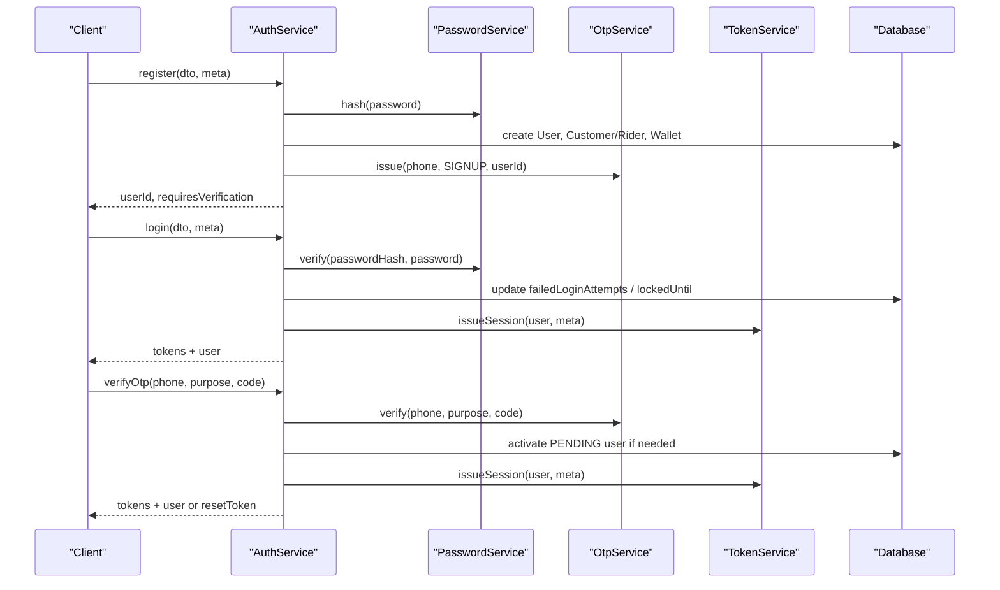

**Diagram sources**
- [auth.service.ts:53-98](file://backend/src/auth/auth.service.ts#L53-L98)
- [auth.service.ts:100-158](file://backend/src/auth/auth.service.ts#L100-L158)
- [auth.service.ts:163-238](file://backend/src/auth/auth.service.ts#L163-L238)
- [auth.service.ts:241-295](file://backend/src/auth/auth.service.ts#L241-L295)
- [otp.service.ts:38-90](file://backend/src/auth/otp.service.ts#L38-L90)
- [token.service.ts:40-67](file://backend/src/auth/token.service.ts#L40-L67)

**Section sources**
- [auth.service.ts:53-98](file://backend/src/auth/auth.service.ts#L53-L98)
- [auth.service.ts:100-158](file://backend/src/auth/auth.service.ts#L100-L158)
- [auth.service.ts:163-238](file://backend/src/auth/auth.service.ts#L163-L238)
- [auth.service.ts:241-295](file://backend/src/auth/auth.service.ts#L241-L295)

## User Lifecycle Operations
User lifecycle spans registration, verification, activation, and administrative status changes.

- Registration:
  - Creates User with role and PENDING status.
  - Creates Customer or Rider profile and Wallet.
  - Issues OTP for SIGNUP.

- Verification and Activation:
  - On OTP verification for SIGNUP, transitions PENDING to ACTIVE.
  - Sets phoneVerifiedAt and lastLoginAt.
  - Sends a welcome notification.

- Administrative Status Changes:
  - Admin can set status to ACTIVE, SUSPENDED, or DEACTIVATED.
  - Suspension revokes all sessions and may suspend rider availability.
  - Re-activation restores rider status based on prior verification state.
  - Audits and notifications are recorded.

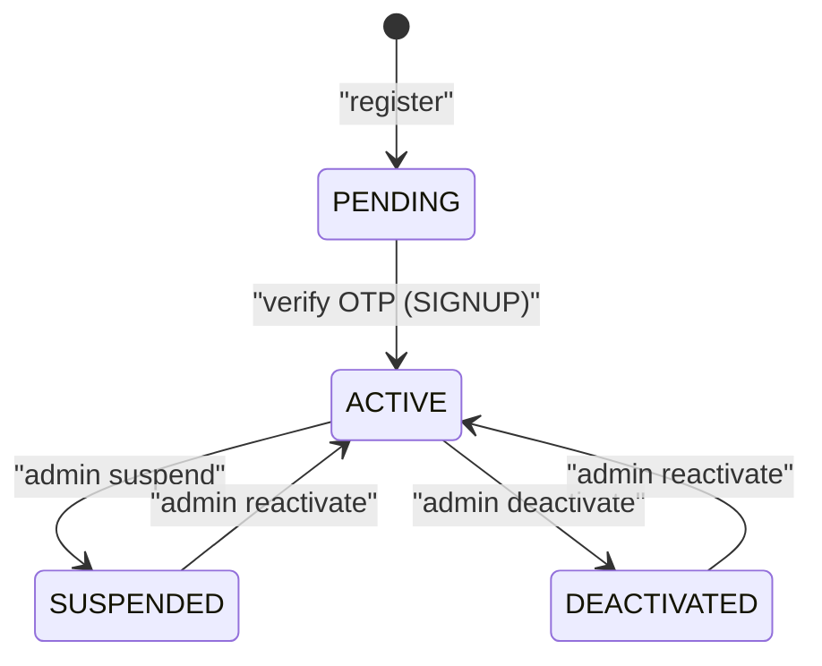

**Diagram sources**
- [auth.service.ts:268-287](file://backend/src/auth/auth.service.ts#L268-L287)
- [admin.service.ts:235-302](file://backend/src/admin/admin.service.ts#L235-L302)

**Section sources**
- [auth.service.ts:268-287](file://backend/src/auth/auth.service.ts#L268-L287)
- [admin.service.ts:235-302](file://backend/src/admin/admin.service.ts#L235-L302)

## Password Hashing and Security
Passwords are securely hashed using Argon2id with OWASP-recommended parameters.

- Implementation:
  - Uses @node-rs/argon2 for hashing and verification.
  - Configuration includes memoryCost, timeCost, and parallelism.
  - Verification wraps errors to return false safely.

- Usage:
  - During registration and password changes.
  - During login verification.
  - Prevents reusing the same password on change/reset.

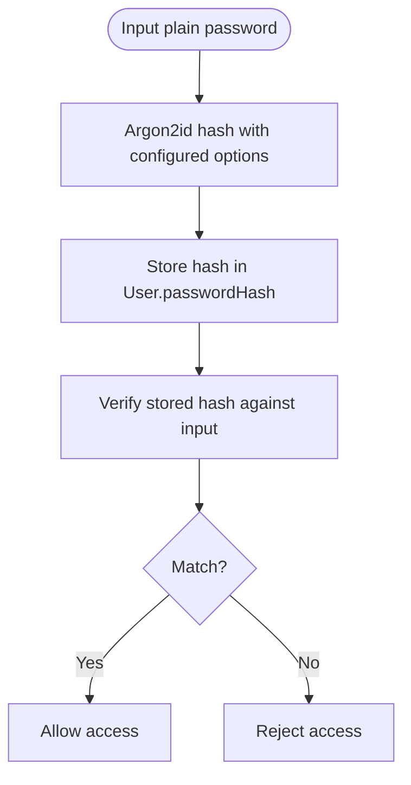

**Diagram sources**
- [password.service.ts:4-24](file://backend/src/common/security/password.service.ts#L4-L24)
- [auth.service.ts:58-58](file://backend/src/auth/auth.service.ts#L58-L58)
- [auth.service.ts:182-182](file://backend/src/auth/auth.service.ts#L182-L182)
- [auth.service.ts:333-351](file://backend/src/auth/auth.service.ts#L333-L351)

**Section sources**
- [password.service.ts:4-24](file://backend/src/common/security/password.service.ts#L4-L24)
- [auth.service.ts:58-58](file://backend/src/auth/auth.service.ts#L58-L58)
- [auth.service.ts:182-182](file://backend/src/auth/auth.service.ts#L182-L182)
- [auth.service.ts:333-351](file://backend/src/auth/auth.service.ts#L333-L351)

## Account Security Features
Security controls protect accounts against brute force, unauthorized access, and session hijacking.

- Attempt limiting:
  - Failed login attempts tracked in User.failedLoginAttempts.
  - Lockout triggered after MAX_FAILED_LOGINS, setting lockedUntil timestamp.
  - Attempts reset on successful login.

- OTP security:
  - Code hashing with SHA-256 using phone and secret.
  - Constant-time comparison to prevent timing attacks.
  - Attempt counting and remaining attempts messaging.
  - Expiration enforcement and single-use consumption.

- Session security:
  - Refresh token rotation on each use.
  - Family revocation on reuse detection.
  - Per-session revocation and global revocation on password changes or admin actions.

- Access control:
  - JwtStrategy resolves user state per request, enforcing active status.
  - RolesGuard enforces role-based permissions with SUPER_ADMIN override.

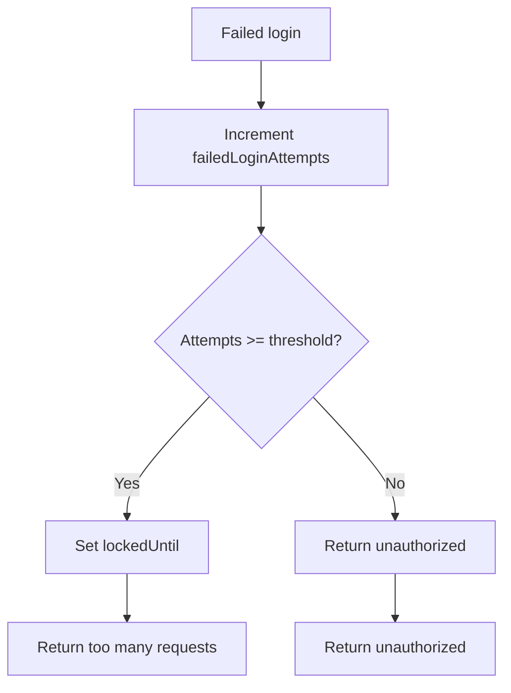

**Diagram sources**
- [auth.service.ts:174-205](file://backend/src/auth/auth.service.ts#L174-L205)
- [otp.service.ts:149-157](file://backend/src/auth/otp.service.ts#L149-L157)
- [token.service.ts:86-93](file://backend/src/auth/token.service.ts#L86-L93)
- [jwt.strategy.ts:49-59](file://backend/src/auth/strategies/jwt.strategy.ts#L49-L59)
- [roles.guard.ts:12-30](file://backend/src/common/guards/roles.guard.ts#L12-L30)

**Section sources**
- [auth.service.ts:174-205](file://backend/src/auth/auth.service.ts#L174-L205)
- [otp.service.ts:149-157](file://backend/src/auth/otp.service.ts#L149-L157)
- [token.service.ts:86-93](file://backend/src/auth/token.service.ts#L86-L93)
- [jwt.strategy.ts:49-59](file://backend/src/auth/strategies/jwt.strategy.ts#L49-L59)
- [roles.guard.ts:12-30](file://backend/src/common/guards/roles.guard.ts#L12-L30)

## Architecture Overview
The identity architecture combines database models, services, guards, and strategies to provide secure, auditable, and scalable user management.

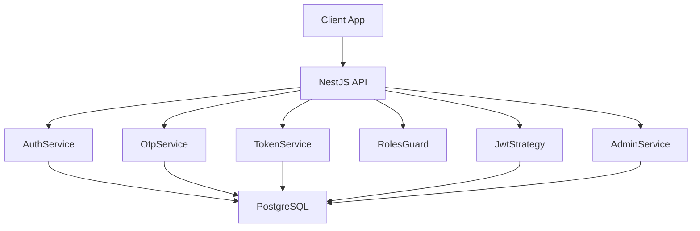

**Diagram sources**
- [auth.service.ts:40-48](file://backend/src/auth/auth.service.ts#L40-L48)
- [otp.service.ts:29-36](file://backend/src/auth/otp.service.ts#L29-L36)
- [token.service.ts:32-38](file://backend/src/auth/token.service.ts#L32-L38)
- [roles.guard.ts:8-32](file://backend/src/common/guards/roles.guard.ts#L8-L32)
- [jwt.strategy.ts:36-74](file://backend/src/auth/strategies/jwt.strategy.ts#L36-L74)
- [admin.service.ts:52-61](file://backend/src/admin/admin.service.ts#L52-L61)

## Dependency Analysis
Key dependencies among identity components:

- AuthService depends on:
  - PrismaService for database access.
  - PasswordService for hashing and verification.
  - OtpService for OTP issuance and verification.
  - TokenService for session and token management.
  - ConfigService for environment-driven settings.
  - AuditService for logging critical events.

- OtpService depends on:
  - PrismaService for OTP persistence.
  - ConfigService for OTP TTL, resend cooldown, and dev mode.

- TokenService depends on:
  - JwtService for signing and verifying tokens.
  - PrismaService for session CRUD.
  - ConfigService for token TTLs.

- RolesGuard depends on:
  - Reflector for decorator metadata.
  - AuthUser type for request context.

- JwtStrategy depends on:
  - PrismaService to resolve user state per request.
  - AuthUser type for enriched principal.

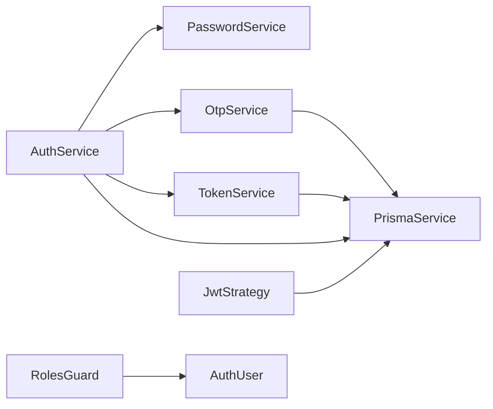

**Diagram sources**
- [auth.service.ts:40-48](file://backend/src/auth/auth.service.ts#L40-L48)
- [otp.service.ts:29-36](file://backend/src/auth/otp.service.ts#L29-L36)
- [token.service.ts:32-38](file://backend/src/auth/token.service.ts#L32-L38)
- [roles.guard.ts:8-32](file://backend/src/common/guards/roles.guard.ts#L8-L32)
- [jwt.strategy.ts:36-74](file://backend/src/auth/strategies/jwt.strategy.ts#L36-L74)

**Section sources**
- [auth.service.ts:40-48](file://backend/src/auth/auth.service.ts#L40-L48)
- [otp.service.ts:29-36](file://backend/src/auth/otp.service.ts#L29-L36)
- [token.service.ts:32-38](file://backend/src/auth/token.service.ts#L32-L38)
- [roles.guard.ts:8-32](file://backend/src/common/guards/roles.guard.ts#L8-L32)
- [jwt.strategy.ts:36-74](file://backend/src/auth/strategies/jwt.strategy.ts#L36-L74)

## Performance Considerations
- Database indexing:
  - Session.userId index improves session queries.
  - OtpCode.phone, purpose, createdAt composite index optimizes OTP lookups.
- Token rotation:
  - Rotation occurs within a transaction to ensure atomicity and reduce race conditions.
- OTP verification:
  - Constant-time comparison avoids timing leaks while maintaining performance.
- User resolution:
  - JwtStrategy selects minimal fields to reduce payload size and query cost.

[No sources needed since this section provides general guidance]

## Troubleshooting Guide
Common issues and resolutions:

- Too many failed login attempts:
  - Symptom: HTTP 429 with lockout message.
  - Cause: failedLoginAttempts reached threshold; lockedUntil set.
  - Resolution: Wait until lockedUntil passes; admin can clear lockout during status changes.

- OTP expired or too many attempts:
  - Symptom: BadRequest indicating expired code or too many attempts.
  - Cause: OTP exceeded expiresAt or attempts reached maxAttempts.
  - Resolution: Request a new OTP; respect resend cooldown.

- Session invalid or reused:
  - Symptom: Unauthorized error on refresh.
  - Cause: Refresh token reused after rotation or session revoked.
  - Resolution: Sign in again; client should handle token rotation properly.

- Account suspended or inactive:
  - Symptom: Forbidden or Unauthorized on login or API calls.
  - Cause: UserStatus not ACTIVE or rider suspended.
  - Resolution: Admin reactivates account; verify rider status if applicable.

**Section sources**
- [auth.service.ts:174-205](file://backend/src/auth/auth.service.ts#L174-L205)
- [otp.service.ts:92-127](file://backend/src/auth/otp.service.ts#L92-L127)
- [token.service.ts:86-105](file://backend/src/auth/token.service.ts#L86-L105)
- [jwt.strategy.ts:49-59](file://backend/src/auth/strategies/jwt.strategy.ts#L49-L59)
- [admin.service.ts:235-302](file://backend/src/admin/admin.service.ts#L235-L302)

## Conclusion
FuelConnect’s identity system centers on robust, auditable, and secure data models and workflows. User, Session, and OtpCode entities provide a strong foundation for role-based access control, OTP verification, and session management. Security measures such as Argon2id hashing, OTP attempt limiting, token rotation, and session revocation ensure protection against common threats. The architecture balances usability with safety, enabling smooth user lifecycles while maintaining strict operational controls.