# Customer Domain Models

<cite>
**Referenced Files in This Document**
- [schema.prisma](file://backend/prisma/schema.prisma)
- [customers.service.ts](file://backend/src/customers/customers.service.ts)
- [customers.dto.ts](file://backend/src/customers/dto/customers.dto.ts)
- [geo-location.service.ts](file://backend/src/common/services/geo-location.service.ts)
- [orders.service.ts](file://backend/src/orders/orders.service.ts)
- [payments.service.ts](file://backend/src/payments/payments.service.ts)
- [reviews.service.ts](file://backend/src/reviews/reviews.service.ts)
- [support.service.ts](file://backend/src/support/support.service.ts)
- [auth.service.ts](file://backend/src/auth/auth.service.ts)
</cite>

## Table of Contents
1. [Introduction](#introduction)
2. [Project Structure](#project-structure)
3. [Core Components](#core-components)
4. [Architecture Overview](#architecture-overview)
5. [Detailed Component Analysis](#detailed-component-analysis)
6. [Dependency Analysis](#dependency-analysis)
7. [Performance Considerations](#performance-considerations)
8. [Troubleshooting Guide](#troubleshooting-guide)
9. [Conclusion](#conclusion)

## Introduction
This document explains the customer domain models that power FuelConnect’s delivery fueling experience. It focuses on three core entities:

- **Customer**: the profile, loyalty program, and lifetime order aggregation.
- **CustomerVehicle**: the vehicle management system with fuel type associations, capacity constraints, and default selection.
- **Address**: the address book with geospatial coordinates using PostGIS geography columns, location validation, and delivery optimization.

It also documents how these models relate to orders, payments, reviews, and support tickets, and provides practical examples for registration, vehicle addition, and address management.

## Project Structure
The customer domain is implemented primarily in the backend NestJS application:

- The database schema defines `Customer`, `CustomerVehicle`, and `Address` alongside related entities such as `Order`, `Payment`, `Review`, and `SupportTicket`.
- The `CustomersService` exposes profile, vehicle, and address operations.
- DTOs define input validation for profile updates, vehicles, and addresses.
- The `GeoLocationService` maintains PostGIS geography columns for accurate distance calculations.
- Order lifecycle logic updates customer loyalty points and aggregates order history.
- Payments, reviews, and support services integrate with the customer domain through foreign keys.

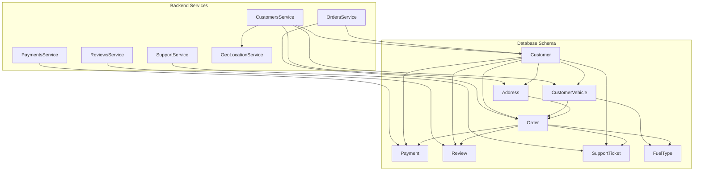

**Diagram sources**
- [schema.prisma:212-275](file://backend/prisma/schema.prisma#L212-L275)
- [schema.prisma:372-387](file://backend/prisma/schema.prisma#L372-L387)
- [schema.prisma:452-503](file://backend/prisma/schema.prisma#L452-L503)
- [schema.prisma:552-579](file://backend/prisma/schema.prisma#L552-L579)
- [schema.prisma:656-671](file://backend/prisma/schema.prisma#L656-L671)
- [schema.prisma:673-696](file://backend/prisma/schema.prisma#L673-L696)
- [customers.service.ts:48-54](file://backend/src/customers/customers.service.ts#L48-L54)
- [orders.service.ts:76-85](file://backend/src/orders/orders.service.ts#L76-L85)
- [payments.service.ts:67-80](file://backend/src/payments/payments.service.ts#L67-L80)
- [reviews.service.ts:20-25](file://backend/src/reviews/reviews.service.ts#L20-L25)
- [support.service.ts:52-61](file://backend/src/support/support.service.ts#L52-L61)
- [geo-location.service.ts:23-27](file://backend/src/common/services/geo-location.service.ts#L23-L27)

**Section sources**
- [schema.prisma:1-14](file://backend/prisma/schema.prisma#L1-L14)
- [schema.prisma:212-275](file://backend/prisma/schema.prisma#L212-L275)
- [customers.service.ts:48-54](file://backend/src/customers/customers.service.ts#L48-L54)

## Core Components
This section summarizes the primary customer-domain responsibilities:

- **Customer model**: stores identity linkage, loyalty points, total orders, and total spent. It is created automatically during user registration and linked to a wallet.
- **CustomerVehicle model**: stores vehicle details, optional tank capacity, fuel type association, and default flag.
- **Address model**: stores delivery address text fields, latitude/longitude, optional PostGIS geography point, default flag, and soft delete support.
- **CustomersService**: orchestrates profile reads/updates, vehicle CRUD, address CRUD, and integration with geo and wallet services.
- **Order lifecycle**: increments customer totals and loyalty points when an order reaches delivered status.
- **PostGIS geography**: maintained by `GeoLocationService` for station and address distance queries.

Key implementation references:
- Customer, CustomerVehicle, Address definitions and relationships are defined in the Prisma schema.
- Profile, vehicle, and address operations are implemented in `CustomersService`.
- Loyalty point and order aggregation updates occur in `OrdersService`.
- Geospatial writes and distance calculations are handled by `GeoLocationService`.

**Section sources**
- [schema.prisma:212-275](file://backend/prisma/schema.prisma#L212-L275)
- [schema.prisma:372-387](file://backend/prisma/schema.prisma#L372-L387)
- [schema.prisma:452-503](file://backend/prisma/schema.prisma#L452-L503)
- [customers.service.ts:56-79](file://backend/src/customers/customers.service.ts#L56-L79)
- [orders.service.ts:528-552](file://backend/src/orders/orders.service.ts#L528-L552)
- [geo-location.service.ts:29-41](file://backend/src/common/services/geo-location.service.ts#L29-L41)

## Architecture Overview
The customer domain integrates across authentication, ordering, payment, review, and support flows.

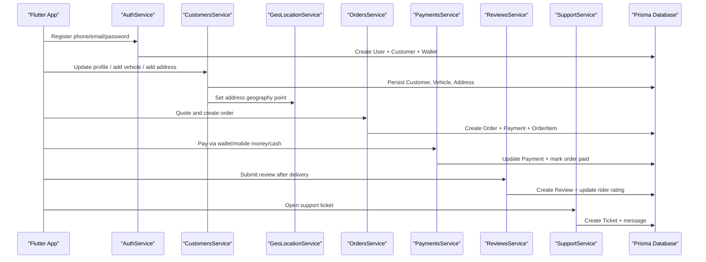

**Diagram sources**
- [auth.service.ts:53-84](file://backend/src/auth/auth.service.ts#L53-L84)
- [customers.service.ts:278-306](file://backend/src/customers/customers.service.ts#L278-L306)
- [orders.service.ts:127-254](file://backend/src/orders/orders.service.ts#L127-L254)
- [payments.service.ts:83-150](file://backend/src/payments/payments.service.ts#L83-L150)
- [reviews.service.ts:27-105](file://backend/src/reviews/reviews.service.ts#L27-L105)
- [support.service.ts:64-130](file://backend/src/support/support.service.ts#L64-L130)

## Detailed Component Analysis

### Customer Model and Profile
The `Customer` model links to a `User`, tracks loyalty points, total orders, and total spent. It also has one-to-many relationships with vehicles, addresses, orders, payments, reviews, and support tickets.

Profile behavior:
- `me()` returns customer identity, loyalty metrics, and wallet balance.
- `updateProfile()` updates user-level fields like full name, email, and avatar URL.
- `home()` aggregates wallet balance, recent addresses, vehicles, active order, recent completed/cancelled/refunded/failed orders, and unread notifications.

Loyalty program integration:
- Loyalty points are incremented when an order transitions to delivered.
- Total orders and total spent are incremented at the same time.

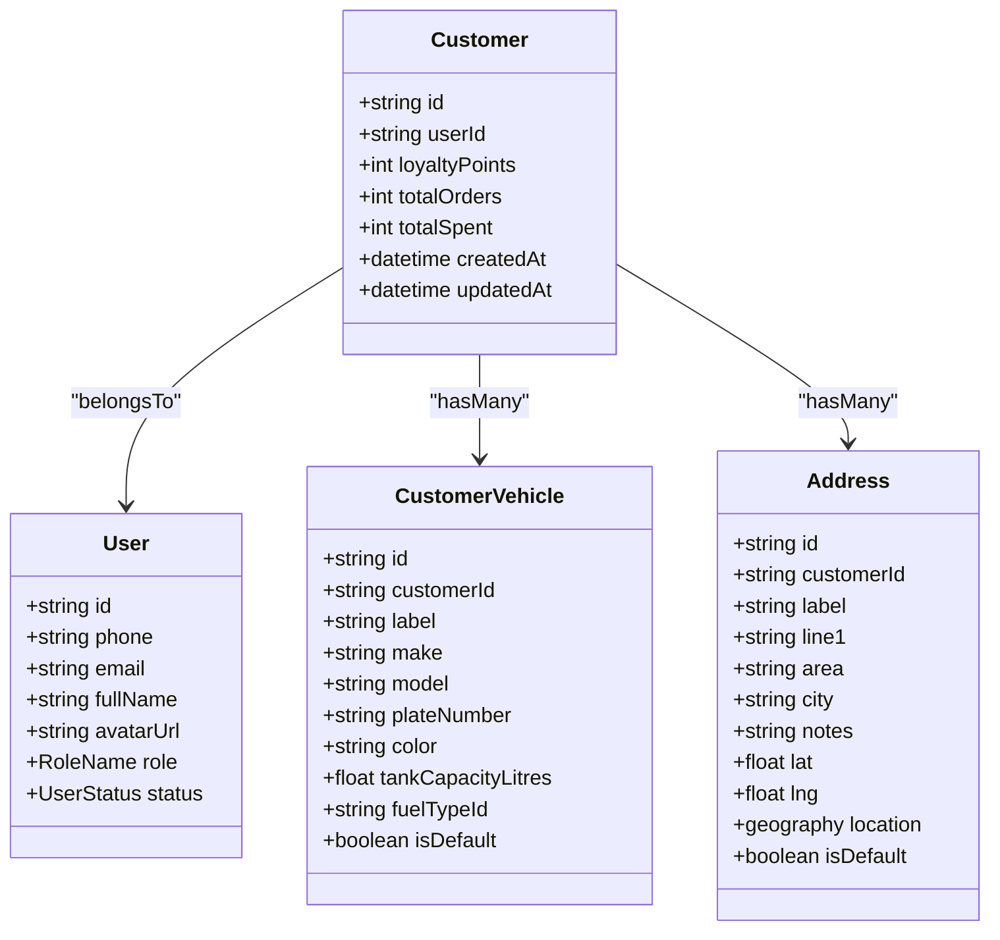

**Diagram sources**
- [schema.prisma:137-170](file://backend/prisma/schema.prisma#L137-L170)
- [schema.prisma:212-230](file://backend/prisma/schema.prisma#L212-L230)
- [schema.prisma:232-252](file://backend/prisma/schema.prisma#L232-L252)
- [schema.prisma:254-275](file://backend/prisma/schema.prisma#L254-L275)

**Section sources**
- [schema.prisma:212-230](file://backend/prisma/schema.prisma#L212-L230)
- [customers.service.ts:56-79](file://backend/src/customers/customers.service.ts#L56-L79)
- [customers.service.ts:96-163](file://backend/src/customers/customers.service.ts#L96-L163)
- [orders.service.ts:528-552](file://backend/src/orders/orders.service.ts#L528-L552)

### CustomerVehicle Model and Vehicle Management
The `CustomerVehicle` model captures vehicle metadata and its relationship to fuel types. It supports:

- Label, make, model, plate number, color.
- Optional tank capacity in litres.
- Association to `FuelType` via `fuelTypeId`.
- Default vehicle selection (`isDefault`).
- Relationship to orders through `vehicleId`.

Vehicle management behavior:
- `listVehicles()` returns all vehicles with fuel type code and name.
- `createVehicle()` validates fuel type, normalizes inputs, enforces single default per customer, and persists the vehicle.
- `updateVehicle()` allows partial updates, including changing default and fuel type.
- `removeVehicle()` performs deletion with ownership checks.

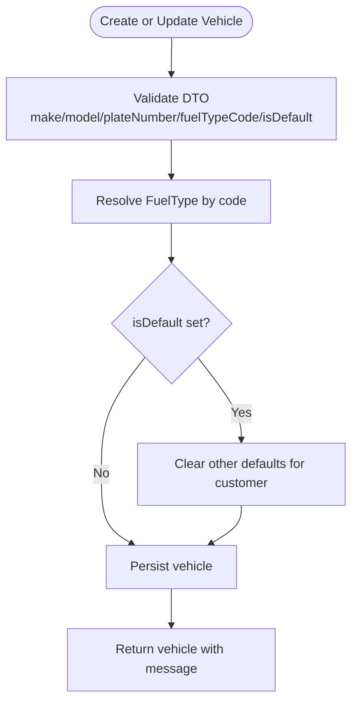

**Diagram sources**
- [customers.service.ts:189-217](file://backend/src/customers/customers.service.ts#L189-L217)
- [customers.service.ts:219-256](file://backend/src/customers/customers.service.ts#L219-L256)
- [customers.dto.ts:33-82](file://backend/src/customers/dto/customers.dto.ts#L33-L82)
- [schema.prisma:232-252](file://backend/prisma/schema.prisma#L232-L252)

**Section sources**
- [schema.prisma:232-252](file://backend/prisma/schema.prisma#L232-L252)
- [schema.prisma:372-387](file://backend/prisma/schema.prisma#L372-L387)
- [customers.service.ts:165-265](file://backend/src/customers/customers.service.ts#L165-L265)
- [customers.dto.ts:33-82](file://backend/src/customers/dto/customers.dto.ts#L33-L82)

### Address Model and Geospatial Functionality
The `Address` model includes standard address fields plus latitude/longitude and an optional PostGIS geography column. It supports:

- Label, line1, area, city, notes.
- Latitude and longitude validation.
- Default address selection.
- Soft delete via `deletedAt`.
- Relationship to orders through `addressId`.

Geospatial behavior:
- On create/update, if latitude/longitude change, `GeoLocationService.setAddressPoint()` updates the geography column.
- Distance calculations between stations and addresses use PostGIS geography for accuracy.
- Nearby rider discovery uses geography-based spatial filters.

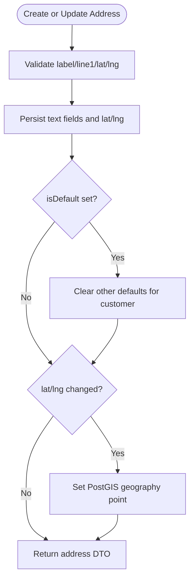

**Diagram sources**
- [customers.service.ts:278-345](file://backend/src/customers/customers.service.ts#L278-L345)
- [geo-location.service.ts:36-41](file://backend/src/common/services/geo-location.service.ts#L36-L41)
- [geo-location.service.ts:88-100](file://backend/src/common/services/geo-location.service.ts#L88-L100)
- [customers.dto.ts:84-135](file://backend/src/customers/dto/customers.dto.ts#L84-L135)
- [schema.prisma:254-275](file://backend/prisma/schema.prisma#L254-L275)

**Section sources**
- [schema.prisma:254-275](file://backend/prisma/schema.prisma#L254-L275)
- [customers.service.ts:267-358](file://backend/src/customers/customers.service.ts#L267-L358)
- [geo-location.service.ts:15-27](file://backend/src/common/services/geo-location.service.ts#L15-L27)
- [geo-location.service.ts:36-41](file://backend/src/common/services/geo-location.service.ts#L36-L41)
- [geo-location.service.ts:88-100](file://backend/src/common/services/geo-location.service.ts#L88-L100)
- [customers.dto.ts:84-135](file://backend/src/customers/dto/customers.dto.ts#L84-L135)

### Order History Aggregation and Loyalty Points
Order completion triggers customer aggregation updates:

- `totalOrders` increments by one.
- `totalSpent` increments by order total.
- `loyaltyPoints` increments by floor(total / 1000).

These updates happen inside the central order state machine transition to delivered status.

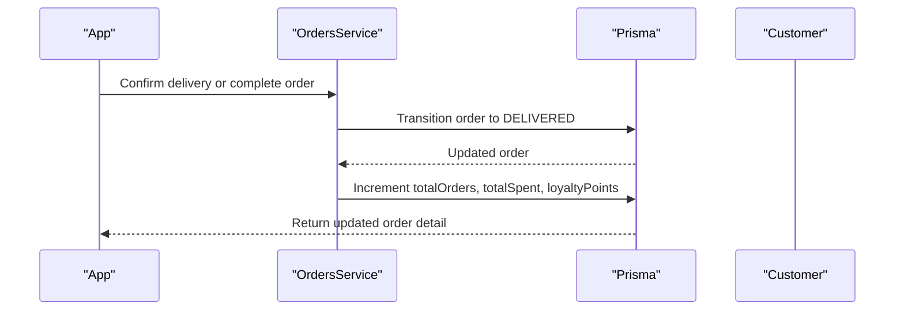

**Diagram sources**
- [orders.service.ts:468-476](file://backend/src/orders/orders.service.ts#L468-L476)
- [orders.service.ts:528-552](file://backend/src/orders/orders.service.ts#L528-L552)
- [schema.prisma:212-230](file://backend/prisma/schema.prisma#L212-L230)

**Section sources**
- [orders.service.ts:528-552](file://backend/src/orders/orders.service.ts#L528-L552)
- [schema.prisma:212-230](file://backend/prisma/schema.prisma#L212-L230)

### Relationship Mappings Across Domains
The customer domain connects to several other domains:

- **Orders**: linked by `customerId`; optionally linked to `vehicleId` and `addressId`.
- **Payments**: linked by `customerId`; optionally linked to `orderId`.
- **Reviews**: linked by `customerId`; uniquely tied to `orderId` and associated with a `riderId`.
- **SupportTickets**: linked by `customerId`; optionally linked to `orderId`.

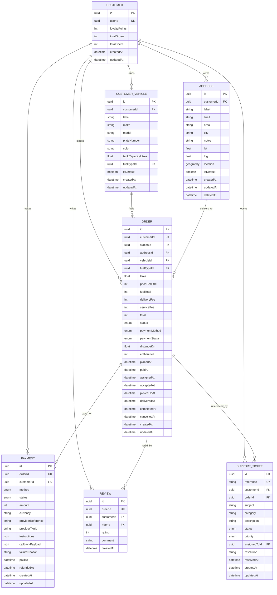

**Diagram sources**
- [schema.prisma:212-230](file://backend/prisma/schema.prisma#L212-L230)
- [schema.prisma:232-252](file://backend/prisma/schema.prisma#L232-L252)
- [schema.prisma:254-275](file://backend/prisma/schema.prisma#L254-L275)
- [schema.prisma:452-503](file://backend/prisma/schema.prisma#L452-L503)
- [schema.prisma:552-579](file://backend/prisma/schema.prisma#L552-L579)
- [schema.prisma:656-671](file://backend/prisma/schema.prisma#L656-L671)
- [schema.prisma:673-696](file://backend/prisma/schema.prisma#L673-L696)

**Section sources**
- [schema.prisma:212-275](file://backend/prisma/schema.prisma#L212-L275)
- [schema.prisma:452-503](file://backend/prisma/schema.prisma#L452-L503)
- [schema.prisma:552-579](file://backend/prisma/schema.prisma#L552-L579)
- [schema.prisma:656-696](file://backend/prisma/schema.prisma#L656-L696)

### Example Flows

#### Customer Registration Flow
Registration creates a `User`, a `Customer`, and a `Wallet`, then issues an OTP for verification.

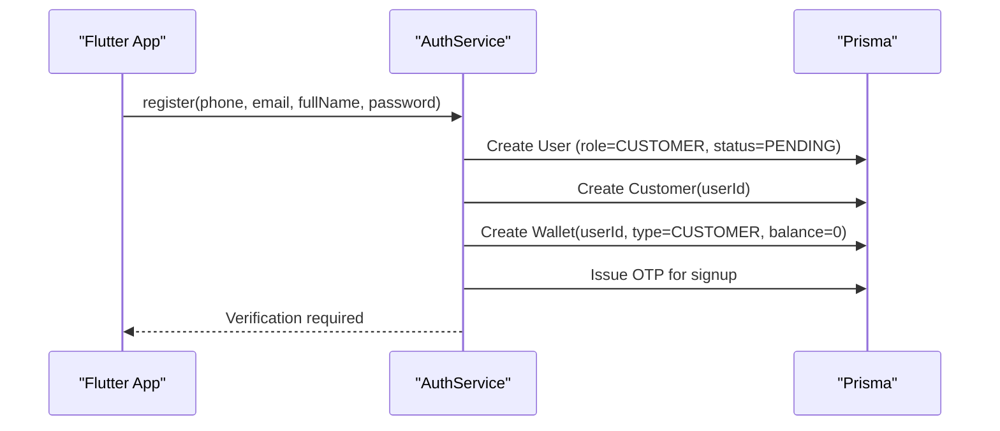

**Diagram sources**
- [auth.service.ts:53-84](file://backend/src/auth/auth.service.ts#L53-L84)
- [schema.prisma:137-170](file://backend/prisma/schema.prisma#L137-L170)
- [schema.prisma:212-230](file://backend/prisma/schema.prisma#L212-L230)
- [schema.prisma:581-595](file://backend/prisma/schema.prisma#L581-L595)

**Section sources**
- [auth.service.ts:53-84](file://backend/src/auth/auth.service.ts#L53-L84)

#### Vehicle Addition Process
Adding a vehicle validates fuel type, clears previous default if needed, and persists the new vehicle.

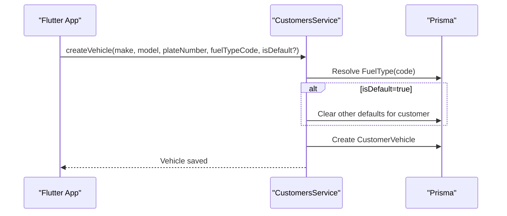

**Diagram sources**
- [customers.service.ts:189-217](file://backend/src/customers/customers.service.ts#L189-L217)
- [customers.service.ts:379-392](file://backend/src/customers/customers.service.ts#L379-L392)
- [schema.prisma:232-252](file://backend/prisma/schema.prisma#L232-L252)

**Section sources**
- [customers.service.ts:189-217](file://backend/src/customers/customers.service.ts#L189-L217)
- [customers.dto.ts:33-82](file://backend/src/customers/dto/customers.dto.ts#L33-L82)

#### Address Management Operations
Creating or updating an address persists text fields, manages default selection, and updates the PostGIS geography point when coordinates change.

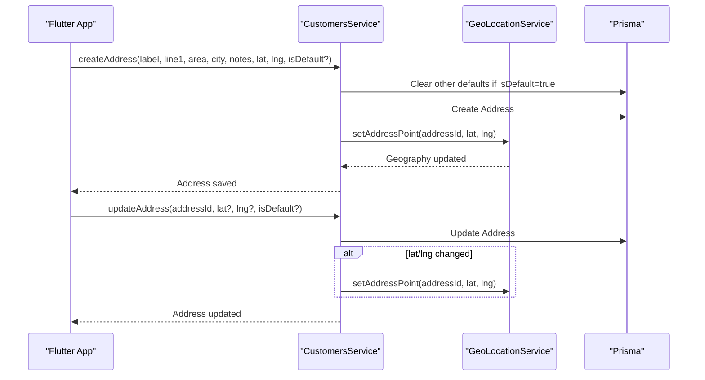

**Diagram sources**
- [customers.service.ts:278-345](file://backend/src/customers/customers.service.ts#L278-L345)
- [geo-location.service.ts:36-41](file://backend/src/common/services/geo-location.service.ts#L36-L41)
- [schema.prisma:254-275](file://backend/prisma/schema.prisma#L254-L275)

**Section sources**
- [customers.service.ts:278-345](file://backend/src/customers/customers.service.ts#L278-L345)
- [customers.dto.ts:84-135](file://backend/src/customers/dto/customers.dto.ts#L84-L135)

## Dependency Analysis
The customer domain depends on several services and external capabilities:

- **PrismaService**: database access for all customer-related entities.
- **GeoLocationService**: PostGIS geography maintenance and distance queries.
- **WalletsService**: wallet balance retrieval and credit/debit operations.
- **OrdersService**: order creation, quoting, lifecycle transitions, and loyalty aggregation.
- **PaymentsService**: payment initiation, webhook settlement, and order payment marking.
- **ReviewsService**: post-delivery rating and rider rating recalculation.
- **SupportService**: ticket creation, replies, and staff operations.

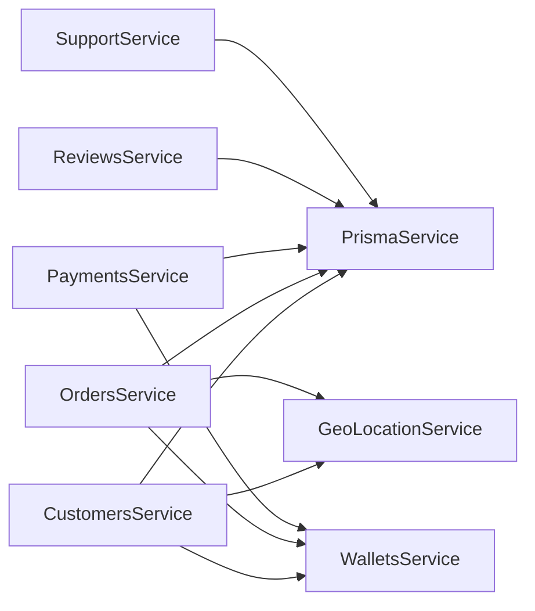

**Diagram sources**
- [customers.service.ts:48-54](file://backend/src/customers/customers.service.ts#L48-L54)
- [orders.service.ts:76-85](file://backend/src/orders/orders.service.ts#L76-L85)
- [payments.service.ts:67-80](file://backend/src/payments/payments.service.ts#L67-L80)
- [reviews.service.ts:20-25](file://backend/src/reviews/reviews.service.ts#L20-L25)
- [support.service.ts:52-61](file://backend/src/support/support.service.ts#L52-L61)

**Section sources**
- [customers.service.ts:48-54](file://backend/src/customers/customers.service.ts#L48-L54)
- [orders.service.ts:76-85](file://backend/src/orders/orders.service.ts#L76-L85)
- [payments.service.ts:67-80](file://backend/src/payments/payments.service.ts#L67-L80)
- [reviews.service.ts:20-25](file://backend/src/reviews/reviews.service.ts#L20-L25)
- [support.service.ts:52-61](file://backend/src/support/support.service.ts#L52-L61)

## Performance Considerations
- **Geography writes are best-effort**: `GeoLocationService.safe()` catches errors so missing PostGIS extension or stale rows do not break business flows.
- **Soft deletes for addresses**: keeps order history readable while hiding removed addresses.
- **Default flags are managed atomically**: transactions clear other defaults before setting a new default for vehicles and addresses.
- **Order aggregation is centralized**: loyalty points and totals are updated only in the order transition to delivered, reducing drift risk.
- **Pagination and selective includes**: home and list endpoints return compact payloads to reduce payload size.

[No sources needed since this section provides general guidance]

## Troubleshooting Guide
Common issues and resolutions:

- **Unknown fuel type**: When creating or updating a vehicle, ensure the fuel type code exists and is active; otherwise a bad request error is thrown.
- **Address not found**: Updates require the address to belong to the authenticated customer and be undeleted; otherwise a not found error is returned.
- **Vehicle not found**: Updates and deletions require ownership checks; otherwise a not found error is returned.
- **PostGIS write failures**: Geography updates are logged but do not fail the main flow; verify the PostGIS extension is enabled and the geography column is present.
- **Loyalty points not increasing**: Ensure the order reached delivered status; loyalty increments occur only in the delivered transition.

**Section sources**
- [customers.service.ts:219-265](file://backend/src/customers/customers.service.ts#L219-L265)
- [customers.service.ts:309-358](file://backend/src/customers/customers.service.ts#L309-L358)
- [customers.service.ts:379-392](file://backend/src/customers/customers.service.ts#L379-L392)
- [geo-location.service.ts:142-153](file://backend/src/common/services/geo-location.service.ts#L142-L153)
- [orders.service.ts:528-552](file://backend/src/orders/orders.service.ts#L528-L552)

## Conclusion
The customer domain centers around three core models:

- **Customer**: identity-linked profile with loyalty points and lifetime order aggregation.
- **CustomerVehicle**: vehicle registry with fuel type associations, capacity constraints, and default selection.
- **Address**: address book with geospatial coordinates using PostGIS geography columns, supporting delivery optimization.

These models integrate tightly with orders, payments, reviews, and support tickets. The implementation emphasizes safety (transactions, soft deletes), correctness (PostGIS geography, validated DTOs), and consistency (centralized order transitions for loyalty and totals). For developers extending the domain, focus on maintaining these guarantees while adding new features such as advanced loyalty tiers, vehicle compatibility checks, or enhanced delivery routing.

[No sources needed since this section summarizes without analyzing specific files]