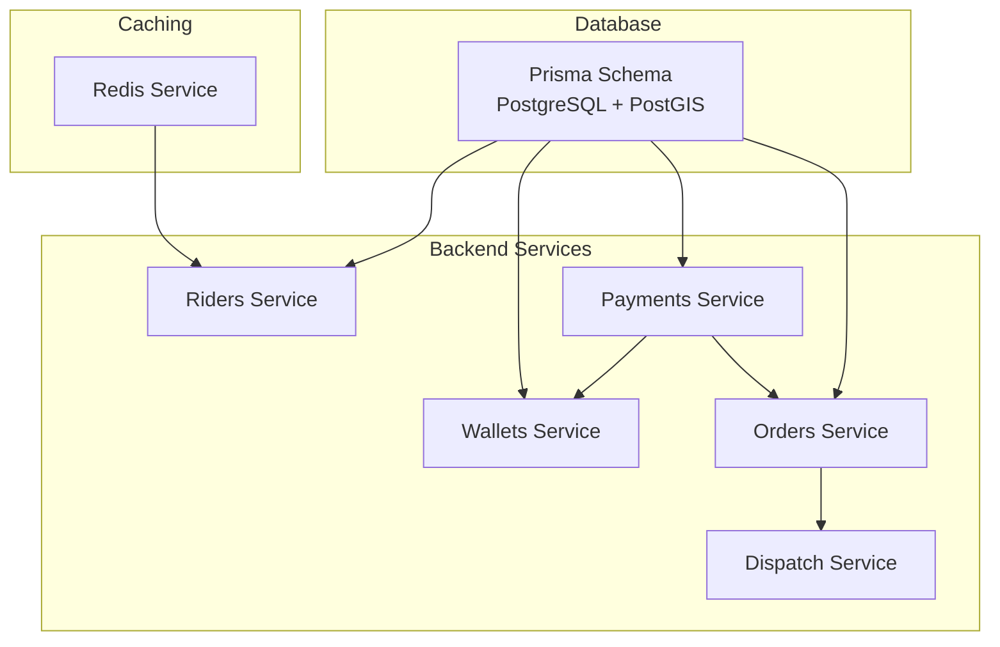
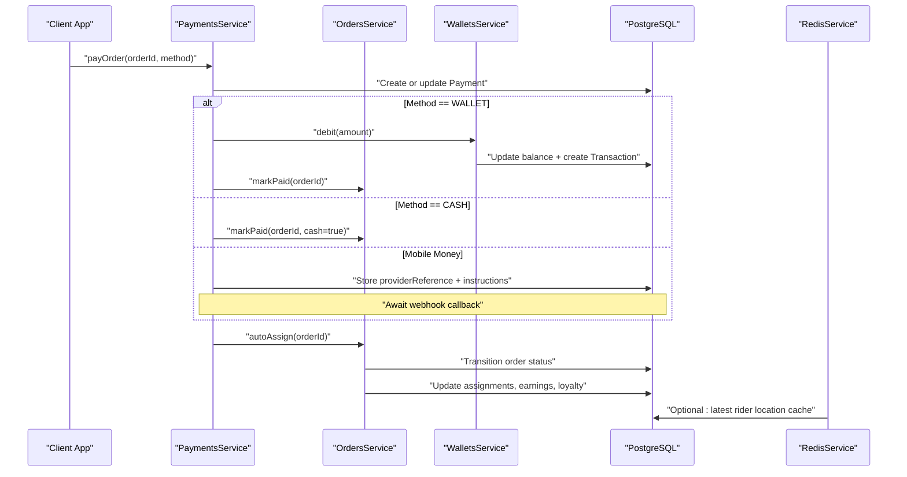
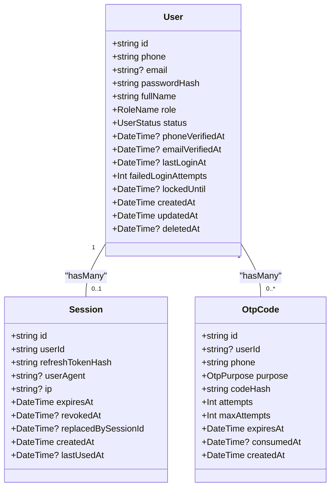
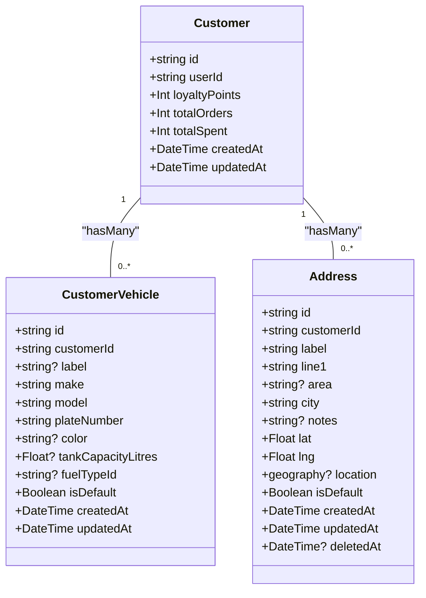
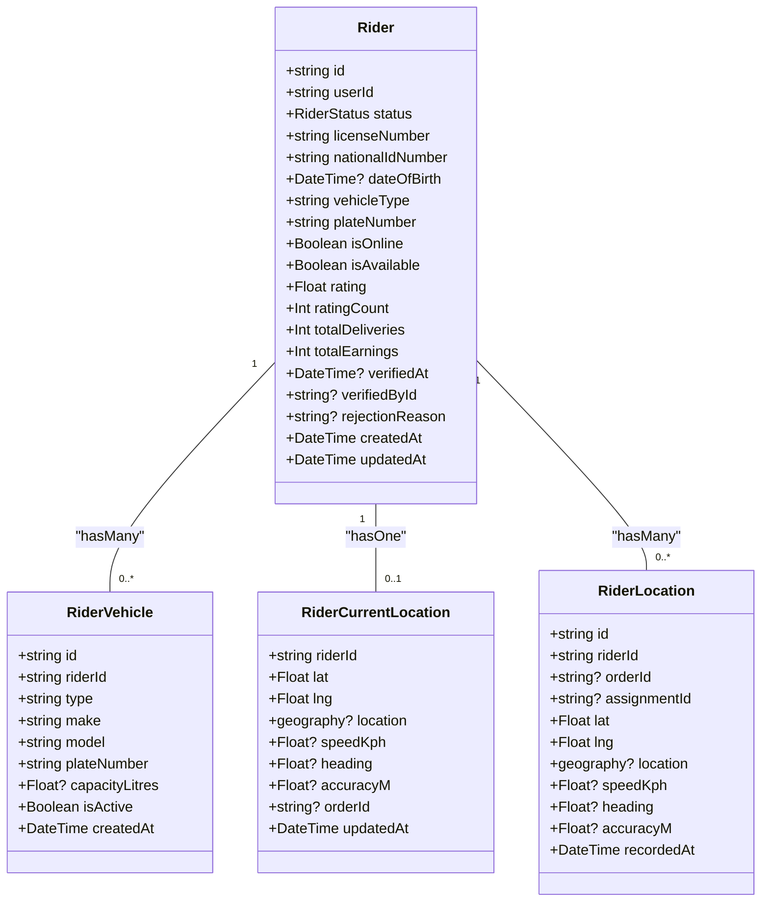
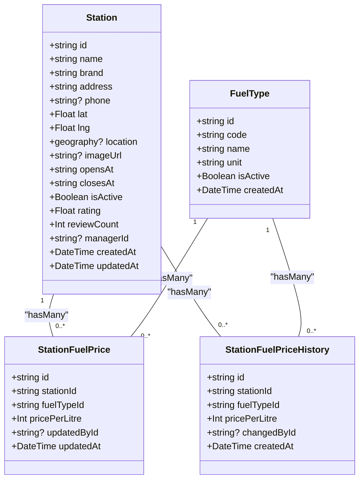
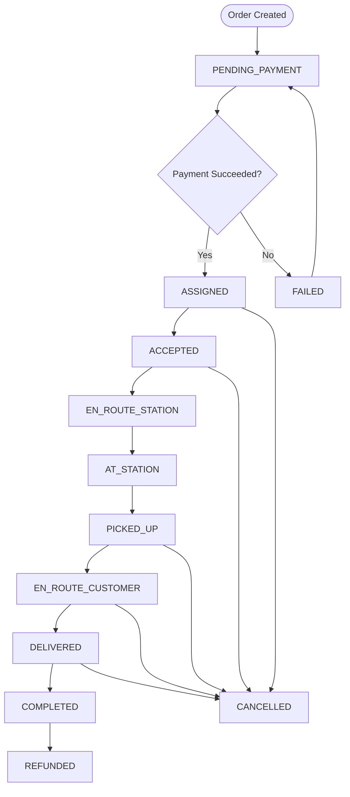
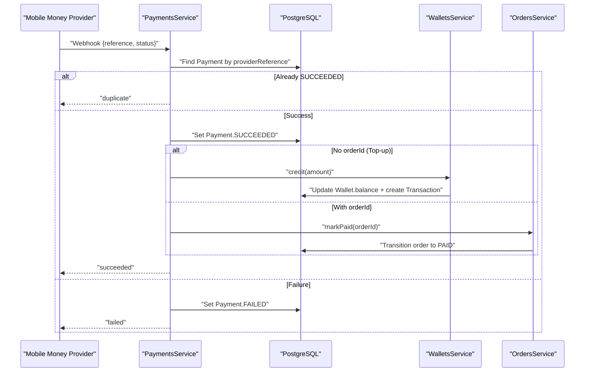
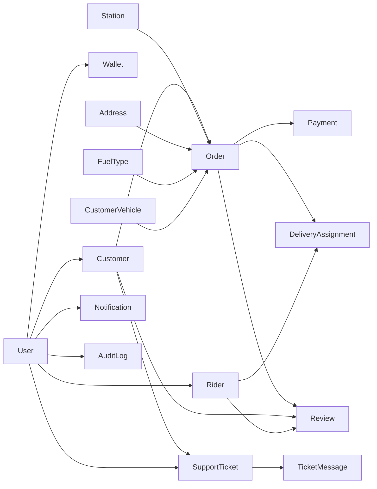

# Database Schema Design

<cite>
**Referenced Files in This Document**
- [schema.prisma](file://backend/prisma/schema.prisma)
- [seed.ts](file://backend/prisma/seed.ts)
- [order-status.ts](file://backend/src/orders/order-status.ts)
- [orders.service.ts](file://backend/src/orders/orders.service.ts)
- [payments.service.ts](file://backend/src/payments/payments.service.ts)
- [wallets.service.ts](file://backend/src/wallets/wallets.service.ts)
- [riders.service.ts](file://backend/src/riders/riders.service.ts)
- [redis.service.ts](file://backend/src/redis/redis.service.ts)
- [configuration.ts](file://backend/src/config/configuration.ts)
</cite>

## Table of Contents
1. [Introduction](#introduction)
2. [Project Structure](#project-structure)
3. [Core Components](#core-components)
4. [Architecture Overview](#architecture-overview)
5. [Detailed Component Analysis](#detailed-component-analysis)
6. [Dependency Analysis](#dependency-analysis)
7. [Performance Considerations](#performance-considerations)
8. [Data Lifecycle and Retention](#data-lifecycle-and-retention)
9. [Security, Privacy, and Access Control](#security-privacy-and-access-control)
10. [Migration and Version Management](#migration-and-version-management)
11. [Sample Queries and Common Operations](#sample-queries-and-common-operations)
12. [Troubleshooting Guide](#troubleshooting-guide)
13. [Conclusion](#conclusion)

## Introduction
This document describes the FuelConnect database schema defined in Prisma, including entities, relationships, constraints, indexes, validation rules, and business logic embedded in the schema and services. It also covers data access patterns, Redis caching for live rider location, performance considerations, lifecycle and retention policies, migration strategy, security and privacy requirements, and sample queries.

## Project Structure
The database model is defined in a single Prisma schema file. The backend implements business logic around orders, payments, wallets, riders, stations, and support. Seed data demonstrates realistic usage of the schema.

**Diagram sources**
- [schema.prisma:1-731](file://backend/prisma/schema.prisma#L1-L731)
- [orders.service.ts:478-554](file://backend/src/orders/orders.service.ts#L478-L554)
- [payments.service.ts:515-607](file://backend/src/payments/payments.service.ts#L515-L607)
- [wallets.service.ts:79-139](file://backend/src/wallets/wallets.service.ts#L79-L139)
- [riders.service.ts:261-301](file://backend/src/riders/riders.service.ts#L261-L301)
- [redis.service.ts:10-19](file://backend/src/redis/redis.service.ts#L10-L19)

**Section sources**
- [schema.prisma:1-14](file://backend/prisma/schema.prisma#L1-L14)
- [seed.ts:1-6](file://backend/prisma/seed.ts#L1-L6)

## Core Components
FuelConnect models cover identity, customers, riders, stations, fuel types, orders, deliveries, payments, wallets, transactions, reviews, support tickets, notifications, and audit logs. Key design characteristics:
- PostgreSQL with PostGIS geography columns for spatial queries.
- Strongly typed enums for roles, statuses, methods, and types.
- UUID primary keys across all tables.
- Soft deletes on selected entities (User, Address).
- Comprehensive timestamps for lifecycle tracking.
- Unique constraints to prevent duplicates and idempotency.

High-level entity groups:
- Identity and sessions: User, Session, OtpCode.
- Customer domain: Customer, CustomerVehicle, Address.
- Rider domain: Rider, RiderVehicle, RiderCurrentLocation, RiderLocation.
- Station and pricing: FuelType, Station, StationFuelPrice, StationFuelPriceHistory.
- Orders and delivery: Order, OrderItem, DeliveryAssignment.
- Money: Payment, Wallet, Transaction, WithdrawalRequest.
- Engagement and governance: Notification, Review, SupportTicket, TicketMessage, AuditLog.

**Section sources**
- [schema.prisma:17-133](file://backend/prisma/schema.prisma#L17-L133)
- [schema.prisma:137-731](file://backend/prisma/schema.prisma#L137-L731)

## Architecture Overview
The database supports an order-to-delivery workflow with payment orchestration and wallet accounting.

**Diagram sources**
- [payments.service.ts:83-150](file://backend/src/payments/payments.service.ts#L83-L150)
- [payments.service.ts:152-219](file://backend/src/payments/payments.service.ts#L152-L219)
- [payments.service.ts:221-286](file://backend/src/payments/payments.service.ts#L221-L286)
- [orders.service.ts:478-554](file://backend/src/orders/orders.service.ts#L478-L554)
- [redis.service.ts:10-19](file://backend/src/redis/redis.service.ts#L10-L19)

## Detailed Component Analysis

### Identity and Authentication Data Model
- User: Central identity with role, status, verification timestamps, login lockout fields, and soft delete.
- Session: Refresh token storage with expiration, revocation, device metadata, and cascade deletion.
- OtpCode: Time-bound, hashed OTP codes with attempt limits and purpose scoping.

Key constraints and validations:
- Phone unique; email optional but unique when present.
- Role defaults to CUSTOMER; status defaults to PENDING.
- Failed login attempts and lockedUntil support brute-force protection.

Indexes:
- Sessions indexed by userId.
- OTP indexed by phone, purpose, createdAt for fast lookup and rate limiting.

Business rules:
- Password hashing via Argon2 in seed; application should hash before persisting.
- OTP maxAttempts enforced at service layer; code enforces TTL and consumption.

**Section sources**
- [schema.prisma:137-207](file://backend/prisma/schema.prisma#L137-L207)

#### Class Diagram: Identity

**Diagram sources**
- [schema.prisma:137-207](file://backend/prisma/schema.prisma#L137-L207)

### Customer Domain
- Customer: Profile extension with loyalty points, total orders, and total spent counters.
- CustomerVehicle: Vehicle details with default flag and linked fuel type preference.
- Address: Geocoded address with PostGIS geography column and default city.

Constraints and validations:
- Customer.userId unique one-to-one with User.
- CustomerVehicle.customerId indexed; fuelTypeId nullable.
- Address.customerId indexed; lat/lng required; location optional geography.

Relationships:
- Customer has many vehicles, addresses, orders, payments, reviews, and support tickets.

**Section sources**
- [schema.prisma:212-275](file://backend/prisma/schema.prisma#L212-L275)

#### Class Diagram: Customer Domain

**Diagram sources**
- [schema.prisma:212-275](file://backend/prisma/schema.prisma#L212-L275)

### Rider Domain
- Rider: Verification state, availability flags, rating metrics, earnings, and assignment history.
- RiderVehicle: Multiple vehicle profiles per rider.
- RiderCurrentLocation: Hot location snapshot with speed, heading, accuracy, and current order context.
- RiderLocation: Historical location events tied to orders and assignments.

Constraints and validations:
- Rider.userId unique; status defaults to PENDING.
- Rider indexed by status, isOnline, isAvailable for dispatch queries.
- RiderCurrentLocation uses composite primary key riderId.
- RiderLocation indexed by riderId+recordedAt and orderId.

Business rules:
- Riders can be verified by another user (audit trail via verifiedById).
- Location updates are frequent; consider indexing and archival strategies.

**Section sources**
- [schema.prisma:280-367](file://backend/prisma/schema.prisma#L280-L367)

#### Class Diagram: Rider Domain

**Diagram sources**
- [schema.prisma:280-367](file://backend/prisma/schema.prisma#L280-L367)

### Stations and Fuel Pricing
- FuelType: Canonical fuel kinds with code, name, unit, and active flag.
- Station: Geographic station with operating hours, manager link, and ratings.
- StationFuelPrice: Current price per litre per fuel type per station; unique per station-fuel pair.
- StationFuelPriceHistory: Immutable price change log with updater and timestamp.

Constraints and validations:
- FuelType.code unique.
- StationFuelPrice unique on stationId+fuelTypeId.
- Price history indexed by stationId+createdAt for trend analysis.

Business rules:
- Manager relationship allows station oversight.
- Price updates tracked with updatedById for auditability.

**Section sources**
- [schema.prisma:372-447](file://backend/prisma/schema.prisma#L372-L447)

#### Class Diagram: Stations and Pricing

**Diagram sources**
- [schema.prisma:372-447](file://backend/prisma/schema.prisma#L372-L447)

### Orders and Delivery Workflow
- Order: Central transactional record with totals, fees, distances, ETA, scheduling, and lifecycle timestamps.
- OrderItem: Line items for multi-fuel orders.
- DeliveryAssignment: Per-rider offer/acceptance with earning, distance metrics, and lifecycle timestamps.

Constraints and validations:
- Order.reference unique; idempotencyKey unique for idempotent creation.
- Order indexed by customerId+createdAt, status+createdAt, and stationId for common queries.
- DeliveryAssignment unique on orderId+riderId; indexed by riderId+status and orderId.

Business rules:
- Status transitions enforced by service layer using ORDER_TRANSITIONS.
- Timestamps set automatically during transitions (paidAt, assignedAt, acceptedAt, pickedUpAt, deliveredAt, completedAt, cancelledAt).
- On delivery completion, rider earnings and customer loyalty counters are updated atomically.

**Diagram sources**
- [order-status.ts:7-30](file://backend/src/orders/order-status.ts#L7-L30)
- [orders.service.ts:478-554](file://backend/src/orders/orders.service.ts#L478-L554)

**Section sources**
- [schema.prisma:452-547](file://backend/prisma/schema.prisma#L452-L547)
- [order-status.ts:1-79](file://backend/src/orders/order-status.ts#L1-L79)
- [orders.service.ts:478-554](file://backend/src/orders/orders.service.ts#L478-L554)

### Payments and Wallet Accounting
- Payment: Provider-agnostic payment record with method, status, provider reference, and callback payload.
- Wallet: Per-user account with balance, currency, and active flag.
- Transaction: Double-entry-like ledger entries with signed amounts and running balanceAfter.
- WithdrawalRequest: Rider payout requests with processing audit trail.

Constraints and validations:
- Payment.orderId unique when present; providerReference unique; idempotencyKey unique.
- Wallet.userId unique; Transaction.reference unique.
- WithdrawalRequest indexed by riderId+status.

Business rules:
- Only verified provider callbacks or sandbox simulation can settle payments.
- Settlement is idempotent; duplicate webhooks are ignored.
- Wallet debit and order transition are coordinated; reversals occur if order transition fails.
- Successful top-ups credit the wallet; successful order payments mark the order paid and trigger auto-dispatch.

**Diagram sources**
- [payments.service.ts:339-437](file://backend/src/payments/payments.service.ts#L339-L437)
- [payments.service.ts:515-607](file://backend/src/payments/payments.service.ts#L515-L607)
- [wallets.service.ts:79-139](file://backend/src/wallets/wallets.service.ts#L79-L139)

**Section sources**
- [schema.prisma:552-634](file://backend/prisma/schema.prisma#L552-L634)
- [payments.service.ts:57-66](file://backend/src/payments/payments.service.ts#L57-L66)
- [payments.service.ts:339-437](file://backend/src/payments/payments.service.ts#L339-L437)
- [payments.service.ts:515-607](file://backend/src/payments/payments.service.ts#L515-L607)
- [wallets.service.ts:18-21](file://backend/src/wallets/wallets.service.ts#L18-L21)

### Reviews, Support, Notifications, and Audit
- Review: One-to-one with Order; links customer and rider; includes rating and comment.
- SupportTicket: Customer-initiated support with category, priority, assignee, resolution, and timestamps.
- TicketMessage: Threaded messages between customer/staff and support agents.
- Notification: In-app notifications scoped to users with read tracking.
- AuditLog: System-wide action logging with actor, entity, IP, user agent, and metadata.

Constraints and validations:
- Review.orderId unique ensures one review per order.
- SupportTicket.reference unique; indexed by status+createdAt and customerId.
- TicketMessage indexed by ticketId+createdAt.
- Notification indexed by userId+createdAt and userId+readAt.
- AuditLog indexed by createdAt and actorId.

**Section sources**
- [schema.prisma:639-730](file://backend/prisma/schema.prisma#L639-L730)

## Dependency Analysis
The schema defines clear dependency chains:
- User is central; Customer/Rider/Wallet extend identity.
- Order depends on Customer, Station, Address, FuelType; optionally CustomerVehicle.
- Payment depends on Order and Customer; Transaction depends on Wallet and Payment.
- DeliveryAssignment links Order and Rider; RiderLocation ties to both Order and Assignment.
- Review links Order, Customer, Rider.
- SupportTicket links Customer and Staff (User).

**Diagram sources**
- [schema.prisma:137-731](file://backend/prisma/schema.prisma#L137-L731)

**Section sources**
- [schema.prisma:137-731](file://backend/prisma/schema.prisma#L137-L731)

## Performance Considerations
- Indexes:
  - Orders: customerId+createdAt, status+createdAt, stationId.
  - DeliveryAssignment: riderId+status, orderId.
  - RiderLocation: riderId+recordedAt, orderId.
  - Notifications: userId+createdAt, userId+readAt.
  - AuditLog: createdAt, actorId.
- Spatial queries:
  - PostGIS geography columns on Address, Station, RiderCurrentLocation, RiderLocation enable efficient distance/radius calculations.
- Caching:
  - Redis caches latest rider positions, shared rate-limit signals, and Socket.IO fan-out across replicas. Falls back to in-process map when Redis is unavailable.
- Transactions:
  - Critical money operations use database transactions to ensure consistency between wallet balances and ledger entries.
- Counters:
  - Precomputed counters (totalOrders, totalSpent, loyaltyPoints, totalDeliveries, totalEarnings) reduce aggregation costs.

Recommendations:
- Partition high-volume tables like RiderLocation and AuditLog by time if growth warrants it.
- Use materialized views for station/fuel price trends and rider performance metrics.
- Keep Redis TTLs short for hot location data; implement background cleanup jobs.

**Section sources**
- [schema.prisma:187-206](file://backend/prisma/schema.prisma#L187-L206)
- [schema.prisma:310-311](file://backend/prisma/schema.prisma#L310-L311)
- [schema.prisma:364-366](file://backend/prisma/schema.prisma#L364-L366)
- [schema.prisma:499-502](file://backend/prisma/schema.prisma#L499-L502)
- [schema.prisma:543-546](file://backend/prisma/schema.prisma#L543-L546)
- [schema.prisma:651-653](file://backend/prisma/schema.prisma#L651-L653)
- [schema.prisma:727-729](file://backend/prisma/schema.prisma#L727-L729)
- [redis.service.ts:10-19](file://backend/src/redis/redis.service.ts#L10-L19)

## Data Lifecycle and Retention
- Soft deletes:
  - User.deletedAt and Address.deletedAt allow logical deletion while preserving referential integrity.
- Expiration:
  - Session.expiresAt and revokedAt manage session lifecycles.
  - OtpCode.expiresAt and consumedAt enforce OTP validity windows.
- Tracking history:
  - RiderLocation records historical locations; configuration exposes tracking.historyRetentionDays for periodic purging.
- Price history:
  - StationFuelPriceHistory retains historical prices for auditing and analytics.
- Audit logs:
  - AuditLog captures system actions; consider retention policies based on compliance needs.

Operational guidance:
- Implement scheduled jobs to archive or purge expired OTPs, sessions, and old RiderLocation records beyond configured retention.
- Archive closed SupportTickets after a defined period while retaining essential metadata.

**Section sources**
- [schema.prisma:172-207](file://backend/prisma/schema.prisma#L172-L207)
- [schema.prisma:254-275](file://backend/prisma/schema.prisma#L254-L275)
- [schema.prisma:347-367](file://backend/prisma/schema.prisma#L347-L367)
- [schema.prisma:434-447](file://backend/prisma/schema.prisma#L434-L447)
- [schema.prisma:713-730](file://backend/prisma/schema.prisma#L713-L730)
- [configuration.ts:34-37](file://backend/src/config/configuration.ts#L34-L37)

## Security, Privacy, and Access Control
- Authentication:
  - JWT-based authentication with configurable TTLs for access and refresh tokens.
  - OTP flow with hashed codes, attempt limits, and expiry.
- Authorization:
  - Role-based access control via RoleName enum; guards and decorators enforce permissions.
- Secrets:
  - Webhook secret for payment providers; environment-driven configuration.
- Data protection:
  - Password hashes stored; OTP codes hashed.
  - Audit trails capture actor, IP, user agent, and metadata.
- Privacy:
  - Personal data (phone, email, national ID) requires strict access controls and encryption at rest where applicable.
  - Minimize exposure of sensitive fields in API responses.

Access control mechanisms:
- Guards validate JWT presence and roles.
- Decorators restrict endpoints to specific roles.
- Service-layer checks enforce ownership (e.g., only customers can pay for their orders).

**Section sources**
- [configuration.ts:7-18](file://backend/src/config/configuration.ts#L7-L18)
- [configuration.ts:78-90](file://backend/src/config/configuration.ts#L78-L90)
- [schema.prisma:19-25](file://backend/prisma/schema.prisma#L19-L25)
- [schema.prisma:137-170](file://backend/prisma/schema.prisma#L137-L170)
- [payments.service.ts:630-650](file://backend/src/payments/payments.service.ts#L630-L650)

## Migration and Version Management
- Tooling:
  - Prisma client generator configured; PostGIS extension enabled.
  - Commands referenced in schema comments: prisma push/migrate dev and db seed.
- Strategy:
  - Use Prisma migrations to evolve schema incrementally.
  - Maintain backward compatibility for critical fields (e.g., nullable geography columns).
- Seeding:
  - Seed script creates demo fuel types, stations, prices, users, wallets, riders, and a historical order to bootstrap development.

Best practices:
- Always run migrations in CI/CD before deploying services.
- Back up databases before major schema changes.
- Use idempotent seed operations (upsert) to avoid duplication.

**Section sources**
- [schema.prisma:5-14](file://backend/prisma/schema.prisma#L5-L14)
- [schema.prisma:1-3](file://backend/prisma/schema.prisma#L1-L3)
- [seed.ts:1-6](file://backend/prisma/seed.ts#L1-L6)
- [seed.ts:28-141](file://backend/prisma/seed.ts#L28-L141)
- [seed.ts:143-219](file://backend/prisma/seed.ts#L143-L219)
- [seed.ts:275-351](file://backend/prisma/seed.ts#L275-L351)
- [seed.ts:353-428](file://backend/prisma/seed.ts#L353-L428)

## Sample Queries and Common Operations
Note: These are conceptual examples aligned with the schema. Replace placeholders with actual values in your environment.

- Find a customer’s recent orders:
  - Select orders by customerId ordered by createdAt descending with pagination.
- Get current rider location:
  - Query RiderCurrentLocation by riderId; optionally filter by orderId.
- List available riders near a station:
  - Use PostGIS geography on Station and RiderCurrentLocation to compute distances and filter by isAvailable/isOnline.
- Retrieve station fuel prices:
  - Join StationFuelPrice with FuelType; filter by stationId and fuelTypeId.
- Payment history for a customer:
  - Query Payment by customerId with orderBy createdAt desc; include related Order if needed.
- Wallet ledger:
  - Query Transaction by walletId with orderBy createdAt desc; compute running balance from balanceAfter.
- Support ticket thread:
  - Query TicketMessage by ticketId ordered by createdAt; join with SupportTicket for context.

Common operations:
- Create order:
  - Validate inputs, create Order and OrderItems, create Payment.PENDING, then await provider callback or wallet debit.
- Mark order paid:
  - Update Order.paymentStatus and timestamps; trigger auto-dispatch.
- Assign rider:
  - Create DeliveryAssignment with OFFERED; accept transitions to ACCEPTED; track pickup/delivery timestamps.
- Credit wallet:
  - Use WalletsService.credit within a transaction to update balance and append Transaction.
- Debit wallet:
  - Use WalletsService.debit with balance check to prevent negative balances.

**Section sources**
- [schema.prisma:452-547](file://backend/prisma/schema.prisma#L452-L547)
- [schema.prisma:552-634](file://backend/prisma/schema.prisma#L552-L634)
- [schema.prisma:639-730](file://backend/prisma/schema.prisma#L639-L730)
- [wallets.service.ts:79-139](file://backend/src/wallets/wallets.service.ts#L79-L139)
- [payments.service.ts:83-150](file://backend/src/payments/payments.service.ts#L83-L150)

## Troubleshooting Guide
Common issues and resolutions:
- Payment webhook signature invalid:
  - Verify HMAC computation and secret configuration; ensure raw body is not modified.
- Duplicate payment settlement:
  - Idempotency handled; check Payment.status and providerReference uniqueness.
- Order cannot transition:
  - Validate allowed transitions via ORDER_TRANSITIONS; ensure correct actor and timing.
- Wallet debit insufficient funds:
  - Check Wallet.balance and concurrency; ensure atomic updates via transactions.
- Rider location not updating:
  - Confirm Redis connectivity; verify TTL and write paths; fallback to in-memory cache in dev.

Diagnostic steps:
- Inspect AuditLog for actor actions and metadata.
- Review Payment.callbackPayload for provider-specific diagnostics.
- Check Session.expiry and revocation for auth-related failures.
- Validate OTP attempts and expiry for authentication issues.

**Section sources**
- [payments.service.ts:630-650](file://backend/src/payments/payments.service.ts#L630-L650)
- [payments.service.ts:339-437](file://backend/src/payments/payments.service.ts#L339-L437)
- [order-status.ts:44-46](file://backend/src/orders/order-status.ts#L44-L46)
- [wallets.service.ts:106-139](file://backend/src/wallets/wallets.service.ts#L106-L139)
- [redis.service.ts:60-132](file://backend/src/redis/redis.service.ts#L60-L132)
- [schema.prisma:713-730](file://backend/prisma/schema.prisma#L713-L730)

## Conclusion
The FuelConnect database schema provides a robust foundation for a fuel-on-demand platform with strong typing, comprehensive relationships, and clear business rules. PostGIS enables spatial features, while Redis supports real-time capabilities. Payments and wallets are designed for safety and auditability, and the order lifecycle is strictly governed. Proper migration management, retention policies, and security controls ensure scalability and compliance.