# Order & Delivery Management

<cite>
**Referenced Files in This Document**
- [schema.prisma](file://backend/prisma/schema.prisma)
- [order-status.ts](file://backend/src/orders/order-status.ts)
- [orders.service.ts](file://backend/src/orders/orders.service.ts)
- [dispatch.service.ts](file://backend/src/orders/dispatch.service.ts)
- [riders.service.ts](file://backend/src/riders/riders.service.ts)
- [geo-location.service.ts](file://backend/src/common/services/geo-location.service.ts)
- [geo.ts](file://backend/src/common/utils/geo.ts)
- [realtime.gateway.ts](file://backend/src/tracking/realtime.gateway.ts)
- [wallets.service.ts](file://backend/src/wallets/wallets.service.ts)
</cite>

## Table of Contents
1. [Introduction](#introduction)
2. [Project Structure](#project-structure)
3. [Core Data Models](#core-data-models)
4. [Order Lifecycle and Status Transitions](#order-lifecycle-and-status-transitions)
5. [Order Composition, Pricing, and Fees](#order-composition-pricing-and-fees)
6. [Delivery Assignment System](#delivery-assignment-system)
7. [Distance, ETA, and Route Optimization](#distance-eta-and-route-optimization)
8. [Realtime Tracking and Notifications](#realtime-tracking-and-notifications)
9. [Wallet, Earnings, and Performance Metrics](#wallet-earnings-and-performance-metrics)
10. [Example Workflows](#example-workflows)
11. [Dependency Analysis](#dependency-analysis)
12. [Performance Considerations](#performance-considerations)
13. [Troubleshooting Guide](#troubleshooting-guide)
14. [Conclusion](#conclusion)

## Introduction
This document explains the order and delivery domain for the fuel delivery system. It focuses on the `Order`, `OrderItem`, and `DeliveryAssignment` models, the complete order lifecycle with `OrderStatus` transitions, pricing and fee structures, rider matching and assignment, distance and ETA calculations, and performance metrics. The backend is implemented in NestJS with Prisma and PostgreSQL, using PostGIS for geospatial queries and Socket.IO for realtime updates.

## Project Structure
The order and delivery logic spans several modules:

- **Data model**: Prisma schema defines orders, items, assignments, riders, stations, addresses, payments, wallets, and location history.
- **Order service**: Handles quoting, creation, payment marking, cancellation, refunds, status transitions, and DTO mapping.
- **Dispatch service**: Implements automatic rider discovery, offer creation, expiration handling, manual admin assignment, and re-dispatch.
- **Rider service**: Manages rider availability, job offers, delivery lifecycle events, earnings, and withdrawals.
- **Geolocation service**: Provides PostGIS-based distance queries and nearby rider search.
- **Geo utilities**: Provide Haversine distance, ETA estimation, and currency rounding.
- **Realtime gateway**: Emits order status changes, rider offers, and live location updates over WebSocket channels.
- **Wallet service**: Maintains double-entry-style ledger entries and balances for customers and riders.

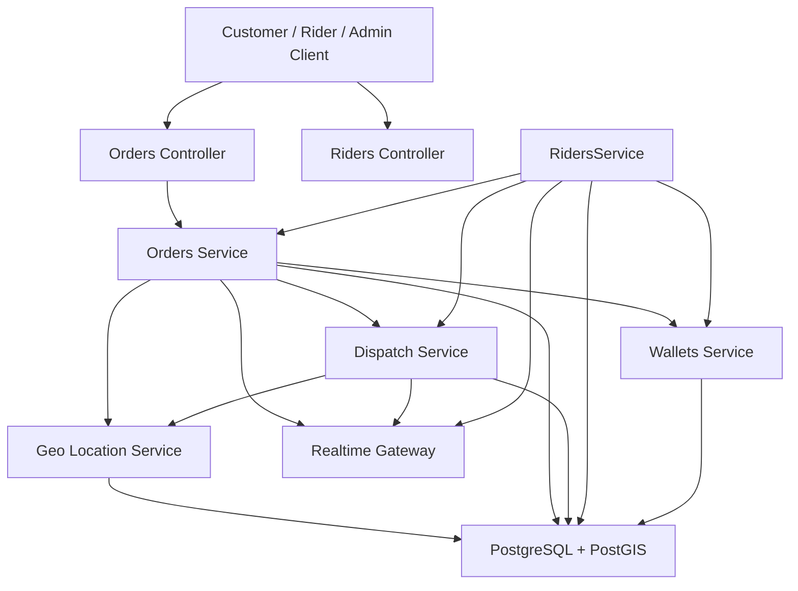

**Diagram sources**
- [orders.service.ts:76-85](file://backend/src/orders/orders.service.ts#L76-L85)
- [dispatch.service.ts:37-49](file://backend/src/orders/dispatch.service.ts#L37-L49)
- [riders.service.ts:61-73](file://backend/src/riders/riders.service.ts#L61-L73)
- [geo-location.service.ts:23-27](file://backend/src/common/services/geo-location.service.ts#L23-L27)
- [realtime.gateway.ts:45-61](file://backend/src/tracking/realtime.gateway.ts#L45-L61)
- [wallets.service.ts:22-24](file://backend/src/wallets/wallets.service.ts#L22-L24)

**Section sources**
- [schema.prisma:452-547](file://backend/prisma/schema.prisma#L452-L547)
- [orders.service.ts:76-85](file://backend/src/orders/orders.service.ts#L76-L85)
- [dispatch.service.ts:37-49](file://backend/src/orders/dispatch.service.ts#L37-L49)
- [riders.service.ts:61-73](file://backend/src/riders/riders.service.ts#L61-L73)

## Core Data Models
The core entities are:

- **Order**: Represents a fuel delivery request with station, address, vehicle, fuel type, litres, pricing fields, timestamps, and status.
- **OrderItem**: Represents one line item in an order, including fuel type, litres, price per litre, and line total.
- **DeliveryAssignment**: Represents a delivery offer or accepted delivery between an order and a rider, including status, earning, distances, and timestamps.

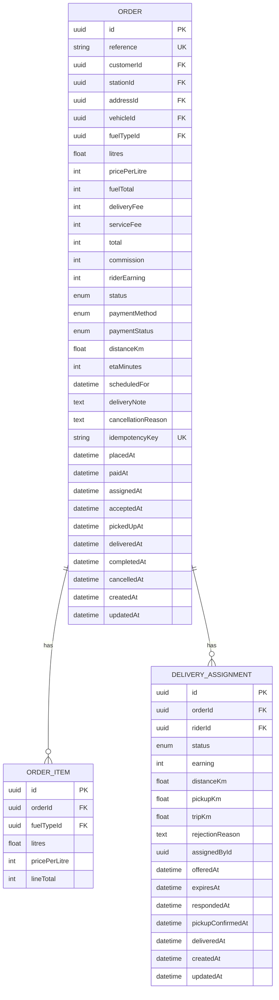

**Diagram sources**
- [schema.prisma:452-547](file://backend/prisma/schema.prisma#L452-L547)

**Section sources**
- [schema.prisma:452-547](file://backend/prisma/schema.prisma#L452-L547)

## Order Lifecycle and Status Transitions
The order lifecycle is enforced by a strict state machine. The allowed transitions are defined centrally so that orders cannot jump directly from early states to final states.

### Allowed Transitions
- `PENDING_PAYMENT` → `PAID`, `CANCELLED`, `FAILED`
- `PAID` → `ASSIGNED`, `CANCELLED`, `REFUNDED`
- `ASSIGNED` → `ACCEPTED`, `CANCELLED`
- `ACCEPTED` → `EN_ROUTE_STATION`, `AT_STATION`, `PICKED_UP`, `CANCELLED`
- `EN_ROUTE_STATION` → `AT_STATION`, `PICKED_UP`
- `AT_STATION` → `PICKED_UP`
- `PICKED_UP` → `EN_ROUTE_CUSTOMER`, `DELIVERED`
- `EN_ROUTE_CUSTOMER` → `DELIVERED`
- `DELIVERED` → `COMPLETED`, `REFUNDED`
- `COMPLETED` → `REFUNDED`
- `CANCELLED` → terminal
- `REFUNDED` → terminal
- `FAILED` → `PENDING_PAYMENT`, `CANCELLED`

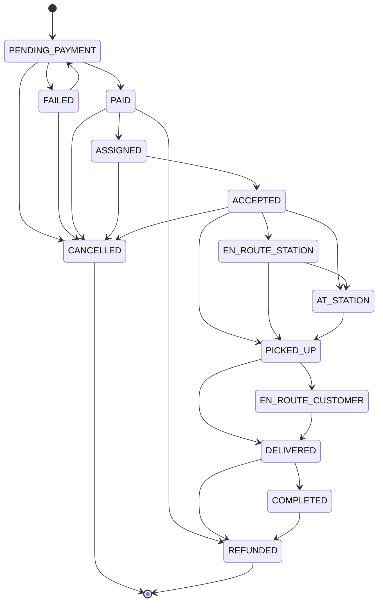

**Diagram sources**
- [order-status.ts:7-30](file://backend/src/orders/order-status.ts#L7-L30)

### Transition Enforcement
The central transition method validates whether a move is legal, updates timestamps, handles delivery completion side effects (rider earnings, rider availability, customer loyalty), cancels active assignments when needed, emits realtime events, and sends notifications.

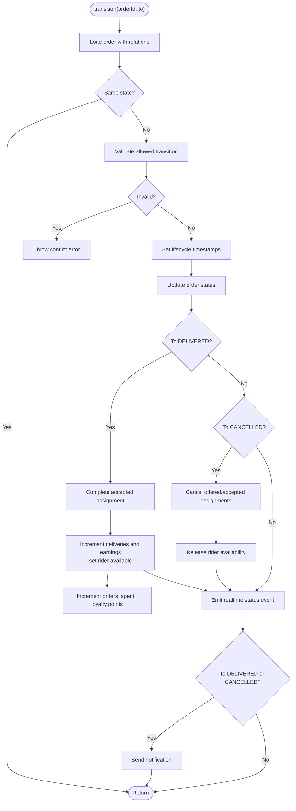

**Diagram sources**
- [orders.service.ts:482-603](file://backend/src/orders/orders.service.ts#L482-L603)
- [order-status.ts:44-46](file://backend/src/orders/order-status.ts#L44-L46)

**Section sources**
- [order-status.ts:7-46](file://backend/src/orders/order-status.ts#L7-L46)
- [orders.service.ts:482-603](file://backend/src/orders/orders.service.ts#L482-L603)

## Order Composition, Pricing, and Fees
An order can contain multiple `OrderItem` rows, although typical fuel orders often have one item per fuel type. Each item records the fuel type, litres, price per litre, and line total. The order itself stores aggregated pricing fields such as `fuelTotal`, `deliveryFee`, `serviceFee`, `total`, `commission`, and `riderEarning`.

### Pricing Calculation Flow
1. Resolve station, fuel type, and delivery address.
2. Fetch current station fuel price.
3. Compute distance between station and address using PostGIS or Haversine fallback.
4. Calculate billable kilometres after free kilometres.
5. Round delivery fee to a configured step.
6. Compute fuel total, service fee, and overall total.
7. Derive platform commission and rider earning from delivery fee.
8. Estimate ETA based on distance and traffic assumptions.

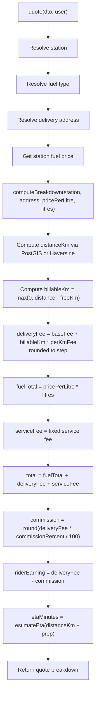

**Diagram sources**
- [orders.service.ts:87-125](file://backend/src/orders/orders.service.ts#L87-L125)
- [orders.service.ts:750-794](file://backend/src/orders/orders.service.ts#L750-L794)
- [geo.ts:15-22](file://backend/src/common/utils/geo.ts#L15-L22)

### Fee Structure Summary
- **Fuel cost**: Price per litre multiplied by litres.
- **Delivery fee**: Base fee plus per-kilometre charge after free kilometres; rounded to a configured step.
- **Service fee**: Fixed platform service fee.
- **Commission**: Percentage of delivery fee retained by the platform.
- **Rider earning**: Delivery fee minus commission.
- **ETA**: Estimated minutes based on distance and average road speed plus preparation time.

**Section sources**
- [schema.prisma:452-518](file://backend/prisma/schema.prisma#L452-L518)
- [orders.service.ts:87-125](file://backend/src/orders/orders.service.ts#L87-L125)
- [orders.service.ts:750-794](file://backend/src/orders/orders.service.ts#L750-L794)
- [geo.ts:15-22](file://backend/src/common/utils/geo.ts#L15-L22)

## Delivery Assignment System
The delivery assignment system connects orders with verified, online, and available riders. It supports automatic dispatch, manual admin override, offer expiration, rider acceptance/rejection, and re-dispatch.

### Rider Matching Algorithm
1. Check order status is `PAID` or `ASSIGNED`.
2. Ensure no active assignment exists for the order.
3. Exclude previously offered riders.
4. Query nearby verified, online, available riders within a configured radius using PostGIS.
5. Pick the nearest eligible rider.
6. Create a `DeliveryAssignment` with `OFFERED` status and an expiration time.
7. Update order status to `ASSIGNED`.
8. Emit realtime offer events and create a rider notification.

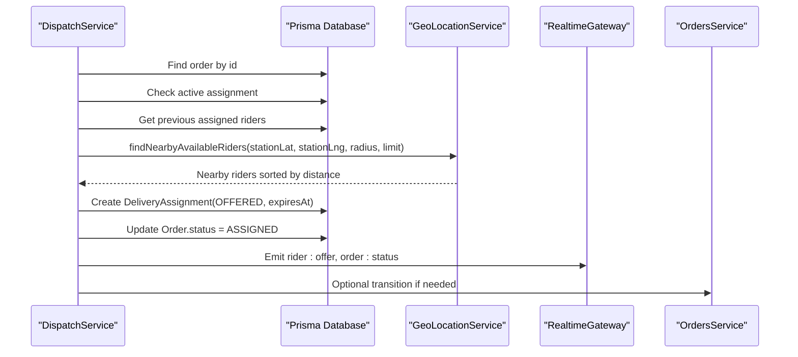

**Diagram sources**
- [dispatch.service.ts:63-110](file://backend/src/orders/dispatch.service.ts#L63-L110)
- [dispatch.service.ts:163-246](file://backend/src/orders/dispatch.service.ts#L163-L246)
- [geo-location.service.ts:106-130](file://backend/src/common/services/geo-location.service.ts#L106-L130)
- [realtime.gateway.ts:254-273](file://backend/src/tracking/realtime.gateway.ts#L254-L273)

### Offer Expiration and Re-dispatch
A background sweep periodically marks expired offers as `EXPIRED`. If the order is still waiting for a rider, it attempts re-dispatch to another nearby rider.

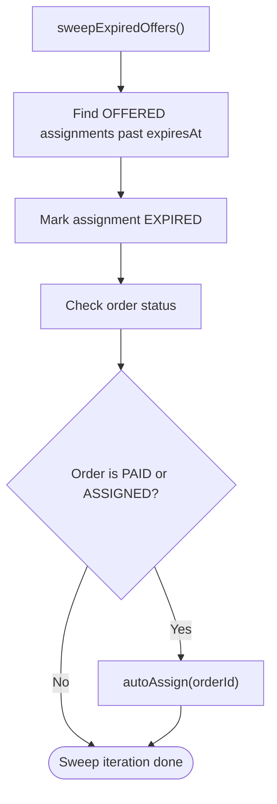

**Diagram sources**
- [dispatch.service.ts:319-353](file://backend/src/orders/dispatch.service.ts#L319-L353)

### Rider Acceptance and Rejection
- **Accept**: Validates the offer is not expired, marks assignment `ACCEPTED`, sets rider unavailable, transitions order to `ACCEPTED`, and notifies the customer.
- **Reject**: Marks assignment `REJECTED`, then triggers re-dispatch if the order is still in a dispatchable state.

**Section sources**
- [dispatch.service.ts:63-110](file://backend/src/orders/dispatch.service.ts#L63-L110)
- [dispatch.service.ts:163-246](file://backend/src/orders/dispatch.service.ts#L163-L246)
- [dispatch.service.ts:249-317](file://backend/src/orders/dispatch.service.ts#L249-L317)
- [dispatch.service.ts:319-353](file://backend/src/orders/dispatch.service.ts#L319-L353)

## Distance, ETA, and Route Optimization
Distance and ETA are computed using two approaches:

- **PostGIS distance**: Preferred when geography columns exist.
- **Haversine fallback**: Used when PostGIS data is missing or unavailable.

ETA estimation assumes an average road speed and adds preparation time at the station.

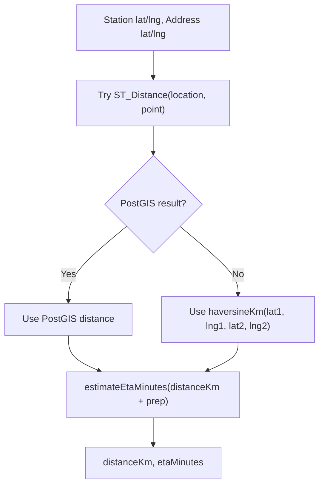

**Diagram sources**
- [orders.service.ts:750-794](file://backend/src/orders/orders.service.ts#L750-L794)
- [geo-location.service.ts:88-100](file://backend/src/common/services/geo-location.service.ts#L88-L100)
- [geo.ts:5-18](file://backend/src/common/utils/geo.ts#L5-L18)

### Route Optimization Notes
The current implementation optimizes rider selection by distance rather than full route planning. It does not compute multi-stop routes or dynamic rerouting. Optimization opportunities include:

- Using routing APIs for estimated travel time instead of straight-line distance.
- Scoring riders by rating, recent performance, and capacity.
- Batching nearby orders for multi-stop deliveries.
- Updating ETA dynamically based on rider location and traffic.

**Section sources**
- [geo-location.service.ts:88-130](file://backend/src/common/services/geo-location.service.ts#L88-L130)
- [geo.ts:5-18](file://backend/src/common/utils/geo.ts#L5-L18)
- [orders.service.ts:750-794](file://backend/src/orders/orders.service.ts#L750-L794)

## Realtime Tracking and Notifications
Realtime communication uses Socket.IO with optional Redis adapter support for horizontal scaling. Clients subscribe to order rooms, rider channels, and operations channels.

Key events:
- `order:subscribe` / `order:unsubscribe`: Join or leave an order room.
- `admin:subscribe`: Staff-only operations feed.
- `rider:location`: Live rider position broadcast.
- `order:snapshot`: Full delivery snapshot on subscription.
- `rider:offer`: New delivery offer sent to rider and operations.
- `order:status`: Order status change broadcast.

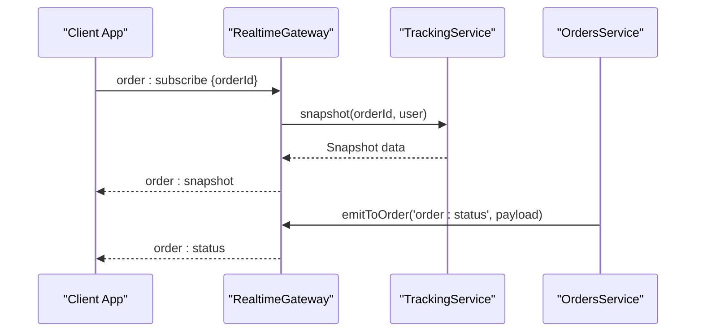

**Diagram sources**
- [realtime.gateway.ts:150-173](file://backend/src/tracking/realtime.gateway.ts#L150-L173)
- [realtime.gateway.ts:254-273](file://backend/src/tracking/realtime.gateway.ts#L254-L273)
- [orders.service.ts:796-813](file://backend/src/orders/orders.service.ts#L796-L813)

**Section sources**
- [realtime.gateway.ts:45-78](file://backend/src/tracking/realtime.gateway.ts#L45-L78)
- [realtime.gateway.ts:150-173](file://backend/src/tracking/realtime.gateway.ts#L150-L173)
- [realtime.gateway.ts:201-252](file://backend/src/tracking/realtime.gateway.ts#L201-L252)
- [realtime.gateway.ts:254-273](file://backend/src/tracking/realtime.gateway.ts#L254-L273)
- [orders.service.ts:796-813](file://backend/src/orders/orders.service.ts#L796-L813)

## Wallet, Earnings, and Performance Metrics
The wallet system maintains a cached balance and a transaction ledger. Credits and debits are atomic and validated to prevent negative balances.

- **Credits**: Top-ups, refunds, rider earnings, adjustments.
- **Debits**: Withdrawals and charges.
- **Transactions**: Signed amounts with `balanceAfter`, description, reference, and optional order/payment linkage.

Rider earnings are credited when an order reaches `DELIVERED`. Rider performance metrics include:

- Rating and rating count.
- Total deliveries.
- Total earnings.
- Daily, weekly, monthly, and lifetime earnings summaries.
- Recent transactions.

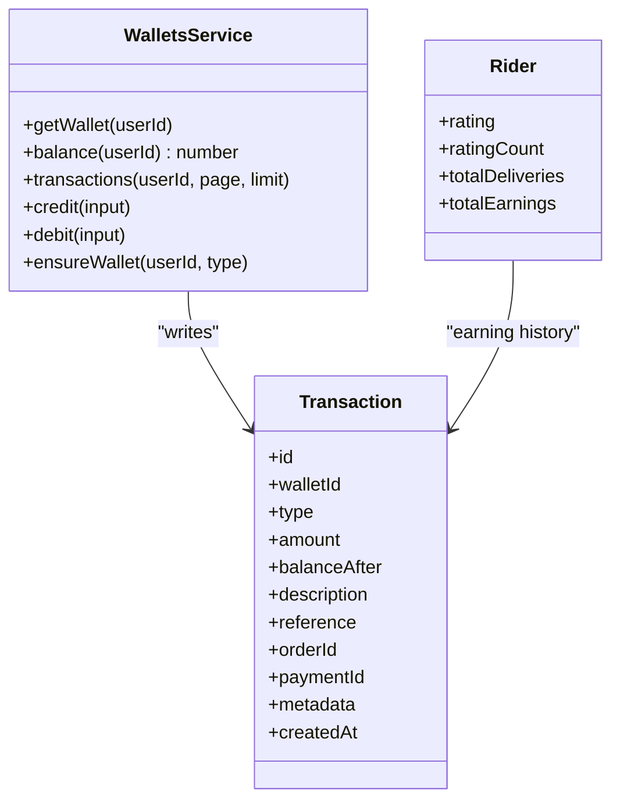

**Diagram sources**
- [wallets.service.ts:22-164](file://backend/src/wallets/wallets.service.ts#L22-L164)
- [riders.service.ts:360-442](file://backend/src/riders/riders.service.ts#L360-L442)
- [schema.prisma:597-615](file://backend/prisma/schema.prisma#L597-L615)

**Section sources**
- [wallets.service.ts:79-139](file://backend/src/wallets/wallets.service.ts#L79-L139)
- [riders.service.ts:360-442](file://backend/src/riders/riders.service.ts#L360-L442)
- [schema.prisma:597-615](file://backend/prisma/schema.prisma#L597-L615)

## Example Workflows

### Order Creation Workflow
1. Customer calls quote endpoint with station, address, fuel type, and litres.
2. System resolves station, fuel type, address, and price.
3. System computes breakdown including distance, ETA, fees, and totals.
4. Customer creates order with idempotency key protection.
5. System creates order, order item, and pending payment.
6. System sends order placement notification.

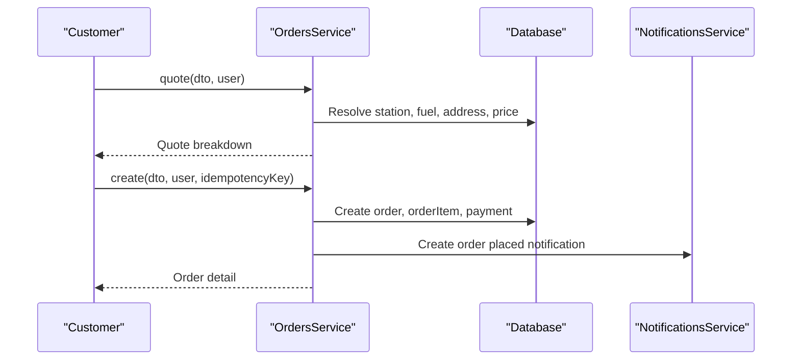

**Diagram sources**
- [orders.service.ts:87-125](file://backend/src/orders/orders.service.ts#L87-L125)
- [orders.service.ts:127-254](file://backend/src/orders/orders.service.ts#L127-L254)

### Delivery Assignment Algorithm
1. After payment confirmation, system attempts auto-assignment.
2. Nearby verified, online, available riders are queried.
3. Nearest eligible rider receives an offer with countdown.
4. If rider accepts, order transitions to `ACCEPTED`.
5. If rider rejects or offer expires, system re-dispatches.

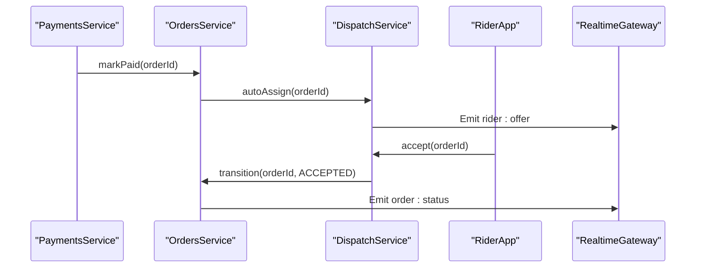

**Diagram sources**
- [orders.service.ts:320-365](file://backend/src/orders/orders.service.ts#L320-L365)
- [dispatch.service.ts:63-110](file://backend/src/orders/dispatch.service.ts#L63-L110)
- [dispatch.service.ts:249-289](file://backend/src/orders/dispatch.service.ts#L249-L289)

### Order Status Progression Queries
Common queries include:

- List active orders: filter by `ACTIVE_STATUSES`.
- List past orders: filter by `COMPLETED`, `CANCELLED`, `REFUNDED`, `FAILED`.
- Rider active order: find accepted assignment and return order details.
- Admin list: filter by status and scope.

These queries are implemented in the orders service and use the `ACTIVE_STATUSES` array for consistent filtering.

**Section sources**
- [orders.service.ts:256-317](file://backend/src/orders/orders.service.ts#L256-L317)
- [order-status.ts:32-42](file://backend/src/orders/order-status.ts#L32-L42)

## Dependency Analysis
The order and delivery subsystem has clear dependencies:

- `OrdersService` depends on `PrismaService`, `GeoLocationService`, `ConfigService`, `WalletsService`, `RealtimeGateway`, and `NotificationsService`.
- `DispatchService` depends on `PrismaService`, `GeoLocationService`, `RealtimeGateway`, `NotificationsService`, `OrdersService`, and `ConfigService`.
- `RidersService` depends on `PrismaService`, `GeoLocationService`, `DispatchService`, `OrdersService`, `WalletsService`, `NotificationsService`, and `RealtimeGateway`.
- `GeoLocationService` depends on `PrismaService` and raw SQL for PostGIS operations.
- `RealtimeGateway` depends on `JwtService`, `PrismaService`, `RedisService`, and `TrackingService`.
- `WalletsService` depends on `PrismaService`.

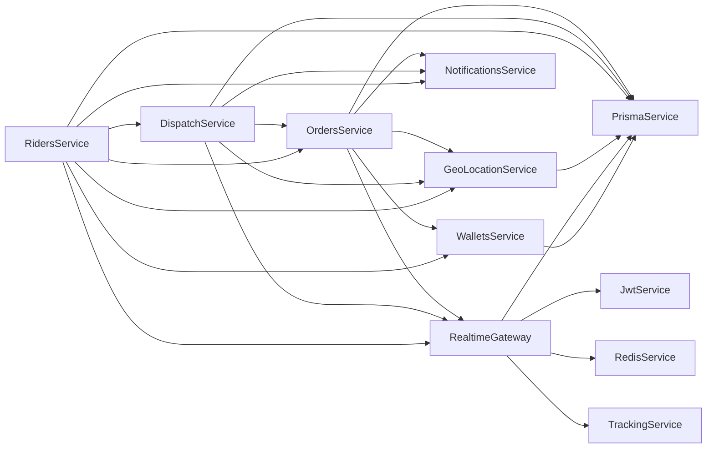

**Diagram sources**
- [orders.service.ts:76-85](file://backend/src/orders/orders.service.ts#L76-L85)
- [dispatch.service.ts:42-49](file://backend/src/orders/dispatch.service.ts#L42-L49)
- [riders.service.ts:65-73](file://backend/src/riders/riders.service.ts#L65-L73)
- [geo-location.service.ts:23-27](file://backend/src/common/services/geo-location.service.ts#L23-L27)
- [realtime.gateway.ts:56-61](file://backend/src/tracking/realtime.gateway.ts#L56-L61)
- [wallets.service.ts:22-24](file://backend/src/wallets/wallets.service.ts#L22-L24)

**Section sources**
- [orders.service.ts:76-85](file://backend/src/orders/orders.service.ts#L76-L85)
- [dispatch.service.ts:42-49](file://backend/src/orders/dispatch.service.ts#L42-L49)
- [riders.service.ts:65-73](file://backend/src/riders/riders.service.ts#L65-L73)
- [geo-location.service.ts:23-27](file://backend/src/common/services/geo-location.service.ts#L23-L27)
- [realtime.gateway.ts:56-61](file://backend/src/tracking/realtime.gateway.ts#L56-L61)
- [wallets.service.ts:22-24](file://backend/src/wallets/wallets.service.ts#L22-L24)

## Performance Considerations
- **Database transactions**: Order creation, payment marking, and status transitions use transactions to ensure consistency.
- **Idempotency**: Order creation supports idempotency keys to prevent duplicate orders.
- **Duplicate guard**: Recent identical orders are detected to avoid accidental double taps.
- **PostGIS vs Haversine**: Prefer PostGIS for accurate distance; fall back to Haversine when needed.
- **Background sweep**: Expired offers are swept periodically without blocking request paths.
- **Realtime scaling**: Socket.IO Redis adapter enables horizontal scaling across instances.
- **Wallet concurrency**: Debit operations check sufficient balance atomically to prevent negative balances.

[No sources needed since this section provides general guidance]

## Troubleshooting Guide
Common issues and resolutions:

- **Invalid status transition**: Ensure transitions follow the defined state machine. Use the central `transition` method to validate moves.
- **No riders available**: Increase dispatch radius, verify rider availability, or allow manual admin assignment.
- **Offer expired before acceptance**: Adjust assignment timeout or improve rider response times.
- **Payment failed**: Check payment provider callbacks and update order status to `FAILED`; allow retry to `PENDING_PAYMENT`.
- **Cash payment not recorded**: Use cash collection endpoint after delivery to mark payment as succeeded.
- **Refund errors**: Verify payment status is successful before refunding; ensure refund amount does not exceed order total.
- **Realtime events not received**: Confirm client subscriptions, token validity, and Redis adapter configuration.

**Section sources**
- [orders.service.ts:320-419](file://backend/src/orders/orders.service.ts#L320-L419)
- [orders.service.ts:421-603](file://backend/src/orders/orders.service.ts#L421-L603)
- [orders.service.ts:605-664](file://backend/src/orders/orders.service.ts#L605-L664)
- [dispatch.service.ts:63-110](file://backend/src/orders/dispatch.service.ts#L63-L110)
- [dispatch.service.ts:249-317](file://backend/src/orders/dispatch.service.ts#L249-L317)
- [realtime.gateway.ts:80-143](file://backend/src/tracking/realtime.gateway.ts#L80-L143)

## Conclusion
The order and delivery management system enforces a robust order lifecycle, precise pricing and fee calculations, and a reliable delivery assignment process. It integrates geospatial queries, realtime tracking, and financial ledgers to provide end-to-end visibility and control. Future enhancements can focus on advanced routing, dynamic ETA, rider scoring, and batched deliveries to further optimize efficiency and customer experience.

[No sources needed since this section summarizes without analyzing specific files]