# Payment & Wallet System

<cite>
**Referenced Files in This Document**
- [schema.prisma](file://backend/prisma/schema.prisma)
- [payments.service.ts](file://backend/src/payments/payments.service.ts)
- [mobile-money.provider.ts](file://backend/src/payments/providers/mobile-money.provider.ts)
- [payments.dto.ts](file://backend/src/payments/dto/payments.dto.ts)
- [wallets.service.ts](file://backend/src/wallets/wallets.service.ts)
- [wallets.controller.ts](file://backend/src/wallets/wallets.controller.ts)
- [riders.service.ts](file://backend/src/riders/riders.service.ts)
- [admin-operations.service.ts](file://backend/src/admin/admin-operations.service.ts)
- [orders.service.ts](file://backend/src/orders/orders.service.ts)
</cite>

## Table of Contents
1. [Introduction](#introduction)
2. [Project Structure](#project-structure)
3. [Core Components](#core-components)
4. [Architecture Overview](#architecture-overview)
5. [Detailed Component Analysis](#detailed-component-analysis)
6. [Dependency Analysis](#dependency-analysis)
7. [Performance Considerations](#performance-considerations)
8. [Troubleshooting Guide](#troubleshooting-guide)
9. [Conclusion](#conclusion)
10. [Appendices](#appendices)

## Introduction
This document explains the payment and financial subsystem for FuelConnect. It covers:
- The `Payment`, `Wallet`, `Transaction`, and `WithdrawalRequest` models.
- The multi-provider payment system supporting MTN Mobile Money, Airtel Money, wallet, cash on delivery, and card.
- Payment status workflows from pending to success or failure.
- The dual-wallet model for customers and riders with balance management and transaction auditing.
- The signed-amount ledger that keeps balances consistent and auditable.
- Rider withdrawal processing with approval workflows.
- Practical examples of payment flows, wallet operations, transaction queries, and financial reporting patterns.

## Project Structure
The financial domain is implemented primarily in the backend NestJS application:
- Database schema defines money-related entities and enums.
- Payments service orchestrates order payments, wallet top-ups, provider callbacks, and settlement.
- Mobile money provider abstracts MTN and Airtel collection requests.
- Wallets service implements a double-entry-like ledger with atomic credits and debits.
- Riders service handles rider withdrawal requests.
- Admin operations provide withdrawal approval, rejection, and payment listing.

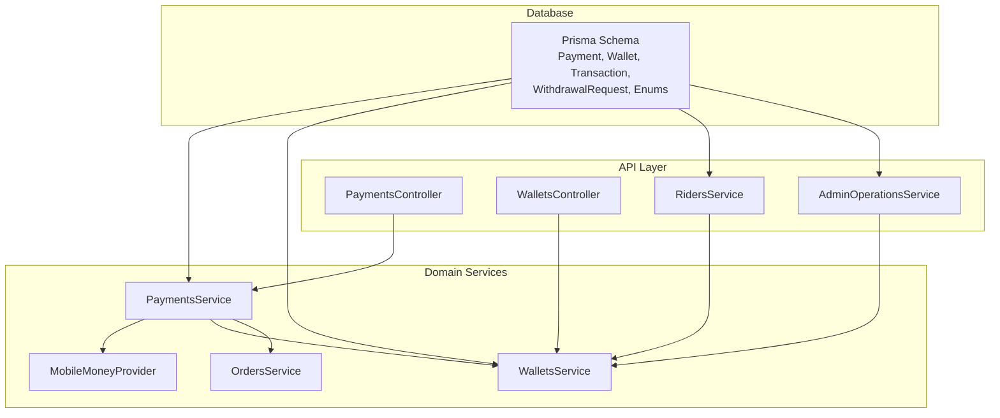

**Diagram sources**
- [schema.prisma:552-634](file://backend/prisma/schema.prisma#L552-L634)
- [payments.service.ts:67-737](file://backend/src/payments/payments.service.ts#L67-L737)
- [mobile-money.provider.ts:40-127](file://backend/src/payments/providers/mobile-money.provider.ts#L40-L127)
- [wallets.service.ts:22-163](file://backend/src/wallets/wallets.service.ts#L22-L163)
- [riders.service.ts:527-570](file://backend/src/riders/riders.service.ts#L527-L570)
- [admin-operations.service.ts:157-222](file://backend/src/admin/admin-operations.service.ts#L157-L222)

**Section sources**
- [schema.prisma:63-132](file://backend/prisma/schema.prisma#L63-L132)
- [payments.service.ts:67-737](file://backend/src/payments/payments.service.ts#L67-L737)
- [wallets.service.ts:22-163](file://backend/src/wallets/wallets.service.ts#L22-L163)

## Core Components
This section summarizes the core financial entities and their responsibilities.

### Payment Model
- Represents a single payment attempt tied to an order or a standalone wallet top-up.
- Tracks method (`MTN_MOMO`, `AIRTEL_MONEY`, `WALLET`, `CASH`, `CARD`), amount, currency, provider reference, provider transaction ID, instructions, callback payload, failure reason, and timestamps.
- Status transitions are controlled by webhooks or sandbox simulation; the client cannot declare success.

Key fields and relationships:
- Optional `orderId` links to `Order`.
- Required `customerId` links to `Customer`.
- One-to-many relationship with `Transaction` for audit trail.

**Section sources**
- [schema.prisma:552-579](file://backend/prisma/schema.prisma#L552-L579)
- [payments.service.ts:82-150](file://backend/src/payments/payments.service.ts#L82-L150)

### Wallet Model
- Each user has one wallet with type `CUSTOMER` or `RIDER`.
- Stores cached `balance`, `currency`, and activation state.
- Used for customer top-ups and order payments, and for rider earnings and withdrawals.

Key fields and relationships:
- Unique `userId`.
- One-to-many relationship with `Transaction`.

**Section sources**
- [schema.prisma:581-595](file://backend/prisma/schema.prisma#L581-L595)
- [wallets.service.ts:26-40](file://backend/src/wallets/wallets.service.ts#L26-L40)

### Transaction Model
- Immutable ledger entry per wallet change.
- Uses signed amounts: positive for credits, negative for debits.
- Records `balanceAfter` snapshot after each operation.
- Links back to optional `orderId` and `paymentId` for traceability.

Key fields and relationships:
- `walletId` links to `Wallet`.
- `type` uses `TxType` enum including `TOPUP`, `ORDER_PAYMENT`, `REFUND`, `RIDER_EARNING`, `WITHDRAWAL`, `ADJUSTMENT`, `COMMISSION`.

**Section sources**
- [schema.prisma:597-615](file://backend/prisma/schema.prisma#L597-L615)
- [wallets.service.ts:80-139](file://backend/src/wallets/wallets.service.ts#L80-L139)

### WithdrawalRequest Model
- Captures rider withdrawal requests with amount, destination, note, and status.
- Status workflow: `PENDING` → `APPROVED` → `PAID`, or `REJECTED`.
- Tracks who processed it and when.

Key fields and relationships:
- `riderId` links to `Rider`.
- `processedById` links to admin/super-admin who approved or paid out.

**Section sources**
- [schema.prisma:617-634](file://backend/prisma/schema.prisma#L617-L634)
- [admin-operations.service.ts:157-222](file://backend/src/admin/admin-operations.service.ts#L157-L222)

### Enums
- `PaymentMethod`: `MTN_MOMO`, `AIRTEL_MONEY`, `WALLET`, `CASH`, `CARD`.
- `PaymentStatus`: `PENDING`, `AUTHORIZED`, `SUCCEEDED`, `FAILED`, `REFUNDED`, `CANCELLED`.
- `WalletType`: `CUSTOMER`, `RIDER`.
- `TxType`: `TOPUP`, `ORDER_PAYMENT`, `REFUND`, `RIDER_EARNING`, `WITHDRAWAL`, `ADJUSTMENT`, `COMMISSION`.
- `WithdrawalStatus`: `PENDING`, `APPROVED`, `PAID`, `REJECTED`.

**Section sources**
- [schema.prisma:63-132](file://backend/prisma/schema.prisma#L63-L132)

## Architecture Overview
The payment architecture separates concerns across controllers, services, providers, and database models:
- Clients initiate payments via REST endpoints.
- `PaymentsService` validates inputs, creates or updates `Payment` records, and delegates to either wallet debit, cash confirmation, or mobile money provider.
- Provider callbacks (webhooks) settle payments safely using HMAC verification and idempotent logic.
- `WalletsService` ensures atomic balance changes and immutable transaction records.
- `RidersService` allows riders to request withdrawals; `AdminOperationsService` approves, rejects, or marks them paid.

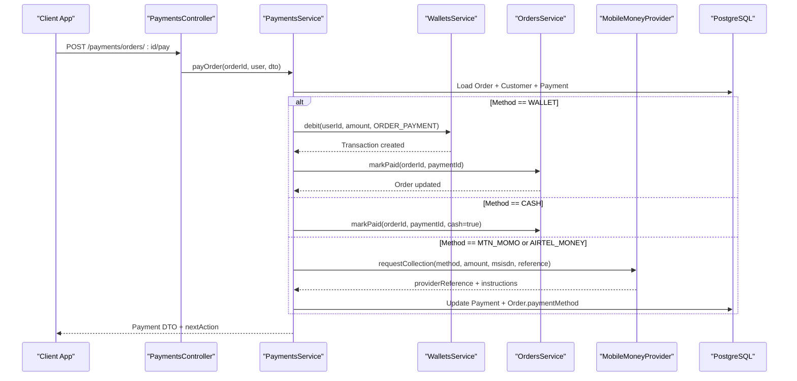

**Diagram sources**
- [payments.service.ts:82-150](file://backend/src/payments/payments.service.ts#L82-L150)
- [payments.service.ts:152-286](file://backend/src/payments/payments.service.ts#L152-L286)
- [mobile-money.provider.ts:89-126](file://backend/src/payments/providers/mobile-money.provider.ts#L89-L126)
- [wallets.service.ts:107-139](file://backend/src/wallets/wallets.service.ts#L107-L139)

## Detailed Component Analysis

### Payment Processing Flows
There are four primary payment paths:
1. **Wallet**: Atomic debit followed by order marking; reversal if order transition fails.
2. **Cash on Delivery**: Order marked paid immediately; rider collects cash later.
3. **Mobile Money (MTN/Airtel)**: Payment set to pending with provider instructions; settlement occurs via webhook or sandbox simulation.
4. **Card**: Currently rejected with a bad request error.

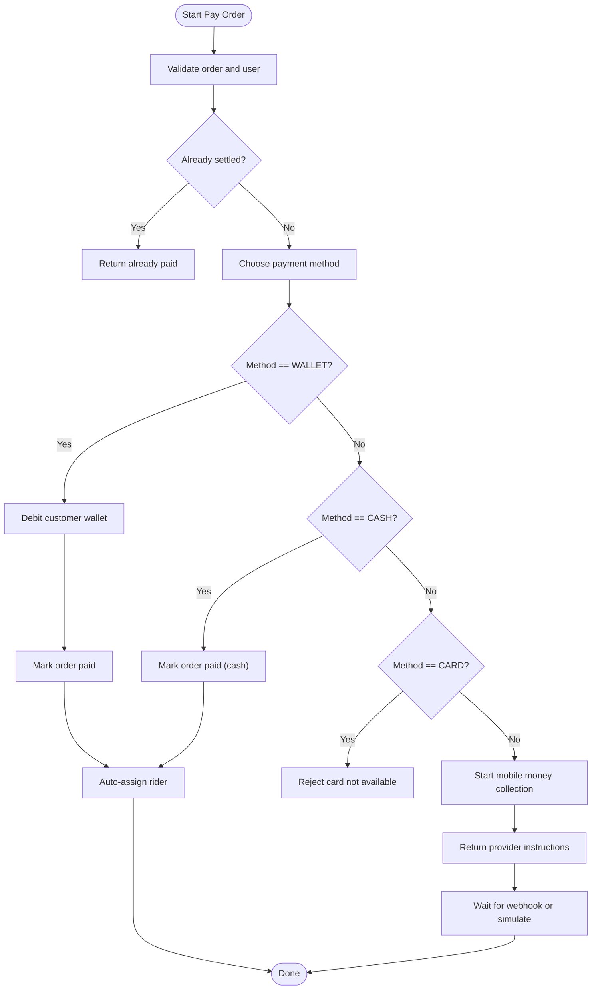

**Diagram sources**
- [payments.service.ts:82-150](file://backend/src/payments/payments.service.ts#L82-L150)
- [payments.service.ts:152-286](file://backend/src/payments/payments.service.ts#L152-L286)

**Section sources**
- [payments.service.ts:82-150](file://backend/src/payments/payments.service.ts#L82-L150)
- [payments.service.ts:152-286](file://backend/src/payments/payments.service.ts#L152-L286)

### Multi-Provider Payment System
The mobile money provider supports MTN MoMo and Airtel Money:
- Validates supported methods and configuration.
- Generates provider references and instructions.
- In production, integrates with official APIs; currently stubbed for sandbox.

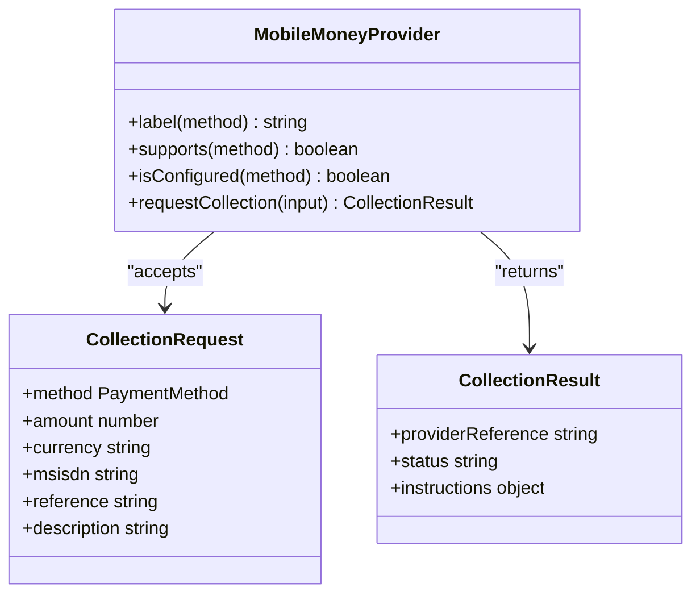

**Diagram sources**
- [mobile-money.provider.ts:7-22](file://backend/src/payments/providers/mobile-money.provider.ts#L7-L22)
- [mobile-money.provider.ts:40-127](file://backend/src/payments/providers/mobile-money.provider.ts#L40-L127)

**Section sources**
- [mobile-money.provider.ts:40-127](file://backend/src/payments/providers/mobile-money.provider.ts#L40-L127)

### Webhook Settlement and Idempotency
Webhooks are the only trusted source for settling external payments:
- HMAC signature verification protects against tampering.
- Duplicate successful payments are ignored.
- Pending states store callback payloads until final resolution.
- Amount mismatch triggers failure and audit logging.
- Successful settlements credit wallets for top-ups or mark orders paid.

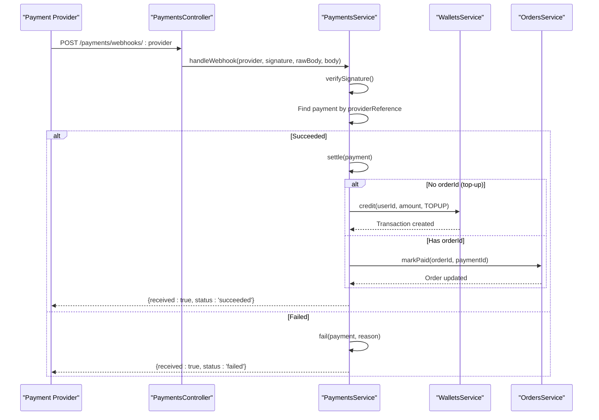

**Diagram sources**
- [payments.service.ts:339-437](file://backend/src/payments/payments.service.ts#L339-L437)
- [payments.service.ts:515-628](file://backend/src/payments/payments.service.ts#L515-L628)

**Section sources**
- [payments.service.ts:339-437](file://backend/src/payments/payments.service.ts#L339-L437)
- [payments.service.ts:515-628](file://backend/src/payments/payments.service.ts#L515-L628)

### Wallet System and Balance Management
The wallet system provides:
- Balance retrieval and pagination of transactions.
- Atomic credit and debit operations within database transactions.
- Signed amounts ensuring immutability and auditability.
- Prevention of negative balances under concurrency.

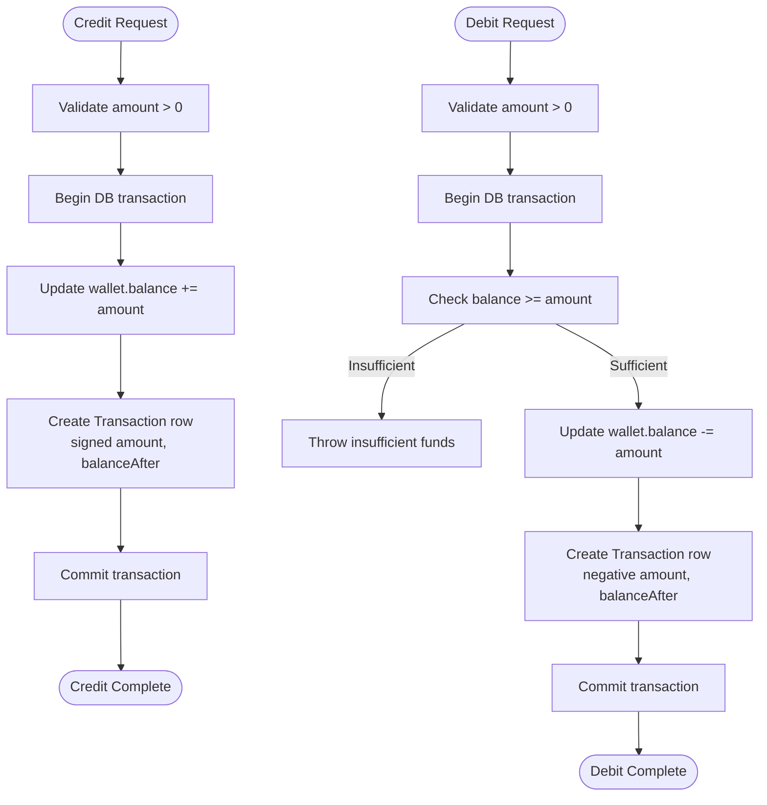

**Diagram sources**
- [wallets.service.ts:80-139](file://backend/src/wallets/wallets.service.ts#L80-L139)

**Section sources**
- [wallets.service.ts:26-40](file://backend/src/wallets/wallets.service.ts#L26-L40)
- [wallets.service.ts:80-139](file://backend/src/wallets/wallets.service.ts#L80-L139)

### Transaction Ledger and Audit Trail
The ledger design guarantees:
- Every balance change writes a `Transaction` record with signed amount and post-operation balance.
- Transactions link to related `orderId` and `paymentId` for full traceability.
- Types include top-ups, order payments, refunds, rider earnings, withdrawals, adjustments, and commissions.

Reporting patterns:
- Paginated transaction lists ordered by newest first.
- Direction derived from sign of amount (`credit` vs `debit`).
- Filters can be applied by wallet, time range, type, and reference.

**Section sources**
- [schema.prisma:597-615](file://backend/prisma/schema.prisma#L597-L615)
- [wallets.service.ts:42-77](file://backend/src/wallets/wallets.service.ts#L42-L77)

### Withdrawal Processing for Riders
Rider withdrawals follow this lifecycle:
1. Rider submits a withdrawal request; funds are debited from the rider’s wallet.
2. Admin approves, rejects, or marks the withdrawal as paid.
3. Rejections credit the rider’s wallet back with an adjustment.
4. All actions are audited and notify the rider.

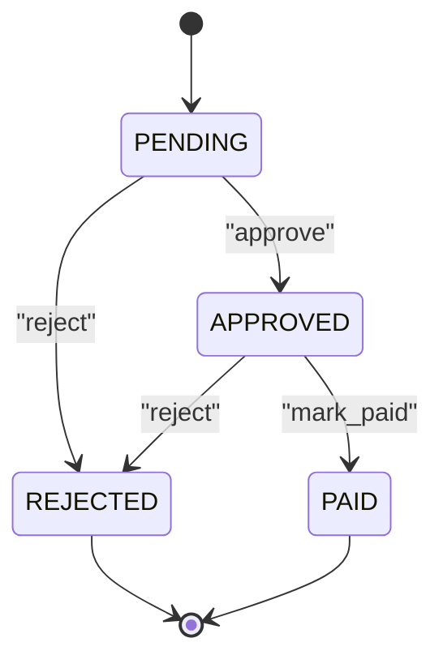

**Diagram sources**
- [schema.prisma:127-132](file://backend/prisma/schema.prisma#L127-L132)
- [admin-operations.service.ts:157-222](file://backend/src/admin/admin-operations.service.ts#L157-L222)

**Section sources**
- [riders.service.ts:527-570](file://backend/src/riders/riders.service.ts#L527-L570)
- [admin-operations.service.ts:157-222](file://backend/src/admin/admin-operations.service.ts#L157-L222)

### Examples of Financial Workflows

#### Example: Wallet Top-Up Flow
- Customer initiates a top-up with MTN or Airtel.
- A `Payment` record is created with provider instructions.
- On successful webhook, the customer’s wallet is credited and a notification is sent.

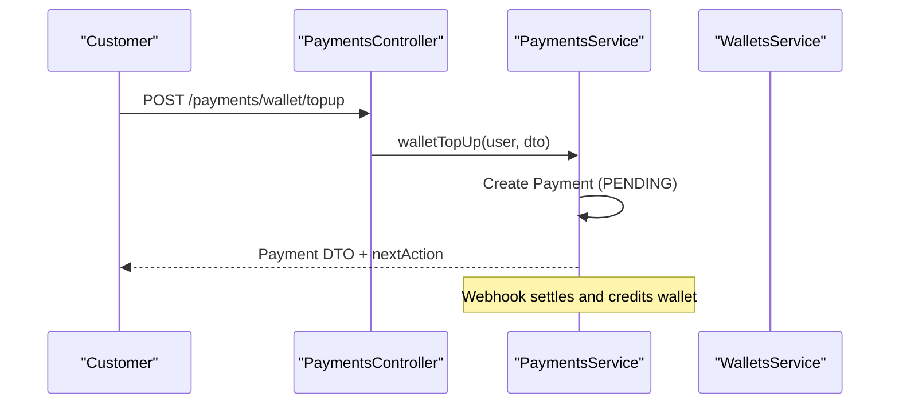

**Diagram sources**
- [payments.service.ts:288-337](file://backend/src/payments/payments.service.ts#L288-L337)
- [payments.service.ts:541-564](file://backend/src/payments/payments.service.ts#L541-L564)

**Section sources**
- [payments.service.ts:288-337](file://backend/src/payments/payments.service.ts#L288-L337)

#### Example: Order Payment via Wallet
- Customer pays using wallet balance.
- Wallet is debited atomically; order is marked paid; rider auto-assignment starts.

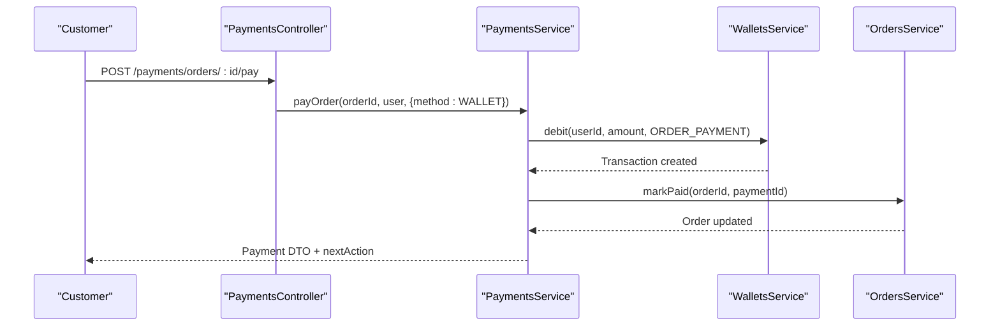

**Diagram sources**
- [payments.service.ts:152-199](file://backend/src/payments/payments.service.ts#L152-L199)

**Section sources**
- [payments.service.ts:152-199](file://backend/src/payments/payments.service.ts#L152-L199)

#### Example: Transaction Queries
- Retrieve paginated wallet transactions sorted by newest first.
- Include direction derived from signed amount.

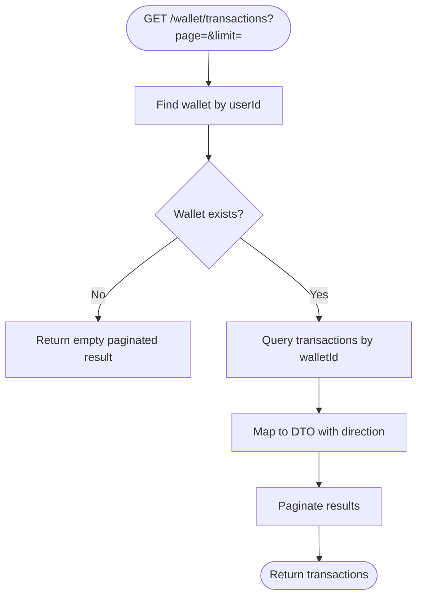

**Diagram sources**
- [wallets.service.ts:42-77](file://backend/src/wallets/wallets.service.ts#L42-L77)

**Section sources**
- [wallets.service.ts:42-77](file://backend/src/wallets/wallets.service.ts#L42-L77)

#### Example: Financial Reporting Patterns
- List payments filtered by status and method for admin dashboards.
- Include order and customer details for reconciliation.

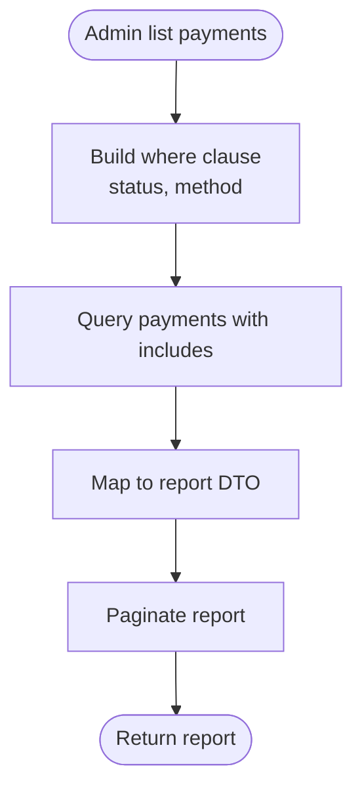

**Diagram sources**
- [admin-operations.service.ts:241-282](file://backend/src/admin/admin-operations.service.ts#L241-L282)

**Section sources**
- [admin-operations.service.ts:241-282](file://backend/src/admin/admin-operations.service.ts#L241-L282)

## Dependency Analysis
The financial subsystem exhibits clear separation of concerns:
- `PaymentsService` depends on `WalletsService`, `OrdersService`, `DispatchService`, `NotificationsService`, `AuditService`, and `MobileMoneyProvider`.
- `WalletsService` depends only on Prisma for atomic ledger operations.
- `RidersService` interacts with `WalletsService` for withdrawal debits and reversals.
- `AdminOperationsService` manages withdrawal approvals and rejections, also interacting with `WalletsService`.

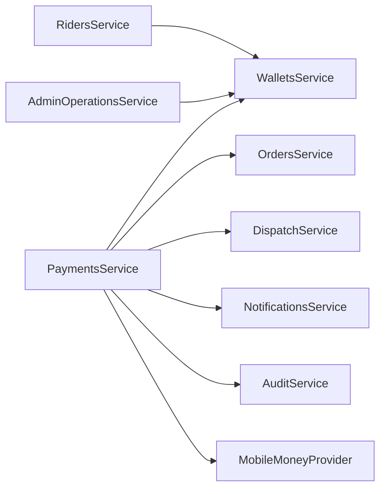

**Diagram sources**
- [payments.service.ts:67-80](file://backend/src/payments/payments.service.ts#L67-L80)
- [riders.service.ts:527-570](file://backend/src/riders/riders.service.ts#L527-L570)
- [admin-operations.service.ts:157-222](file://backend/src/admin/admin-operations.service.ts#L157-L222)

**Section sources**
- [payments.service.ts:67-80](file://backend/src/payments/payments.service.ts#L67-L80)
- [riders.service.ts:527-570](file://backend/src/riders/riders.service.ts#L527-L570)
- [admin-operations.service.ts:157-222](file://backend/src/admin/admin-operations.service.ts#L157-L222)

## Performance Considerations
- Use database transactions for all balance mutations to ensure consistency and prevent race conditions.
- Prefer indexed queries for payment and transaction lookups; the schema includes indexes on common filters such as `walletId`, `createdAt`, and `status`.
- Avoid unnecessary joins in high-frequency reads; return DTOs with minimal fields.
- For large reports, paginate aggressively and consider materialized views for aggregated metrics like daily revenue by method.

[No sources needed since this section provides general guidance]

## Troubleshooting Guide
Common issues and resolutions:
- **Missing or invalid webhook signature**: Ensure the provider sends the correct HMAC-SHA256 header and the server secret matches.
- **Duplicate webhook events**: The system ignores already succeeded payments; check `PaymentStatus.SUCCEEDED` before retrying.
- **Amount mismatch**: The webhook handler fails the payment and logs an audit event; reconcile expected vs received amounts.
- **Insufficient wallet balance**: Debit operations reject attempts when balance is too low; prompt users to top up or choose another method.
- **Order cannot be marked paid after successful payment**: An audit event flags manual refund requirements; investigate order state and process refunds manually.

**Section sources**
- [payments.service.ts:630-649](file://backend/src/payments/payments.service.ts#L630-L649)
- [payments.service.ts:400-422](file://backend/src/payments/payments.service.ts#L400-L422)
- [wallets.service.ts:107-139](file://backend/src/wallets/wallets.service.ts#L107-L139)
- [orders.service.ts:397-419](file://backend/src/orders/orders.service.ts#L397-L419)

## Conclusion
FuelConnect’s payment and wallet system provides a robust, auditable foundation for multi-provider payments and internal ledgers. Key strengths include:
- Strict control over payment settlement through verified webhooks and sandbox simulation.
- Double-entry-like wallet accounting with signed amounts and immutable transaction records.
- Clear status workflows for payments and withdrawals.
- Strong integration between payments, orders, dispatch, notifications, and audit logging.

For future enhancements:
- Implement live integrations for MTN and Airtel APIs.
- Add more granular reporting and reconciliation tools.
- Expand card payment support when ready.

[No sources needed since this section summarizes without analyzing specific files]

## Appendices

### API Endpoints Summary

| Endpoint | Method | Description | Roles |
| --- | --- | --- | --- |
| `/payments/orders/:orderId/pay` | POST | Pay for an order using wallet, cash, MTN, or Airtel | CUSTOMER |
| `/payments/wallet/topup` | POST | Start a wallet top-up with MTN or Airtel | CUSTOMER |
| `/payments` | GET | List my payments | CUSTOMER |
| `/payments/:id/simulate` | POST | Sandbox simulation of provider outcome | CUSTOMER, ADMIN, SUPER_ADMIN |
| `/payments/webhooks/:provider` | POST | Provider callback (public, HMAC signed) | Public |
| `/payments/:id` | GET | Payment status polling | CUSTOMER, ADMIN, SUPER_ADMIN, STATION_MANAGER |
| `/wallet` | GET | Wallet balance | Authenticated |
| `/wallet/transactions` | GET | Wallet ledger (paginated) | Authenticated |

**Section sources**
- [payments.controller.ts:26-99](file://backend/src/payments/payments.controller.ts#L26-L99)
- [wallets.controller.ts:7-24](file://backend/src/wallets/wallets.controller.ts#L7-L24)