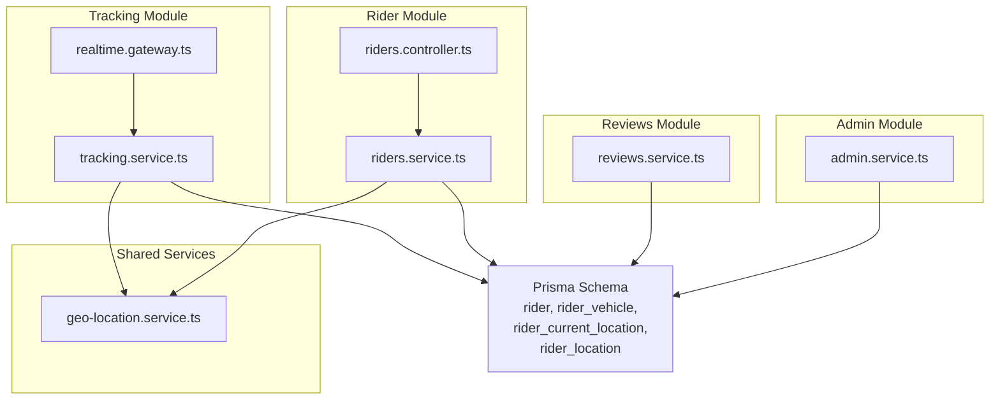
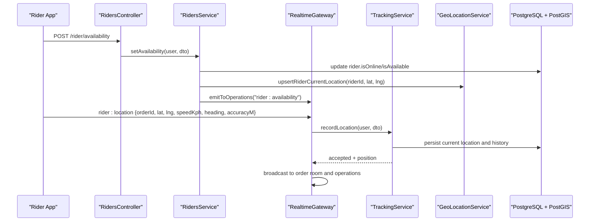
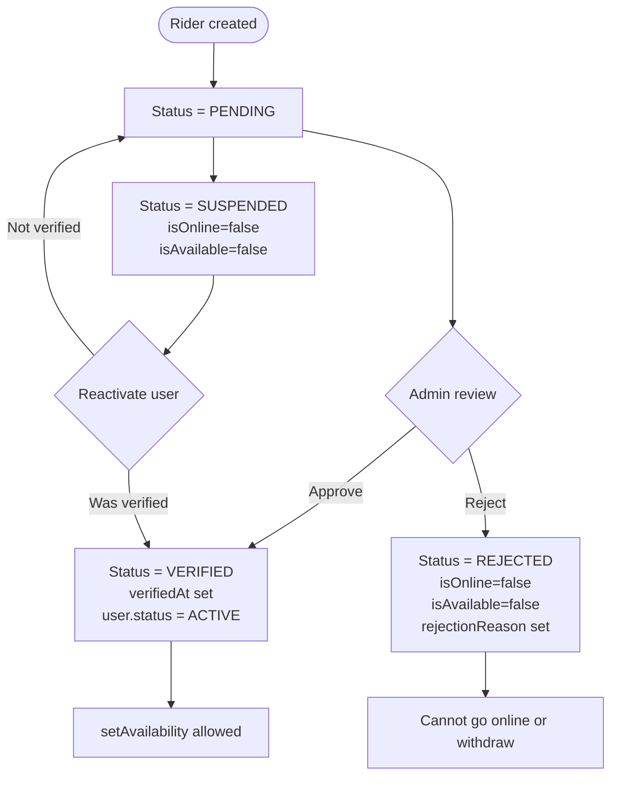
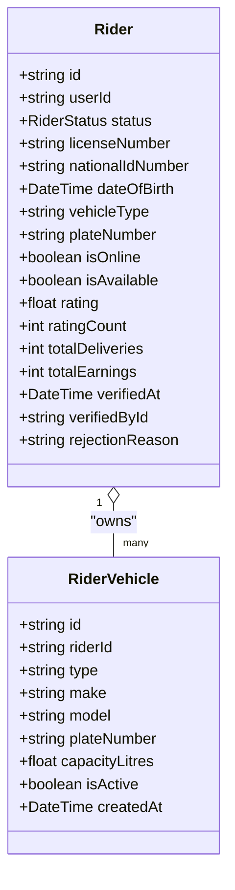
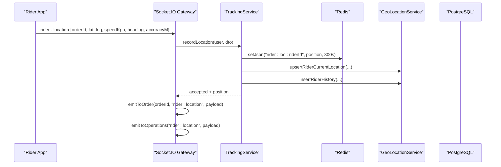
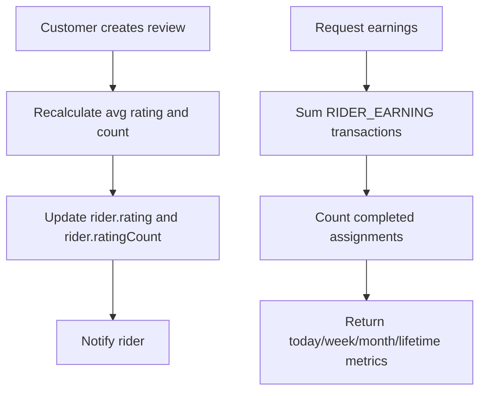
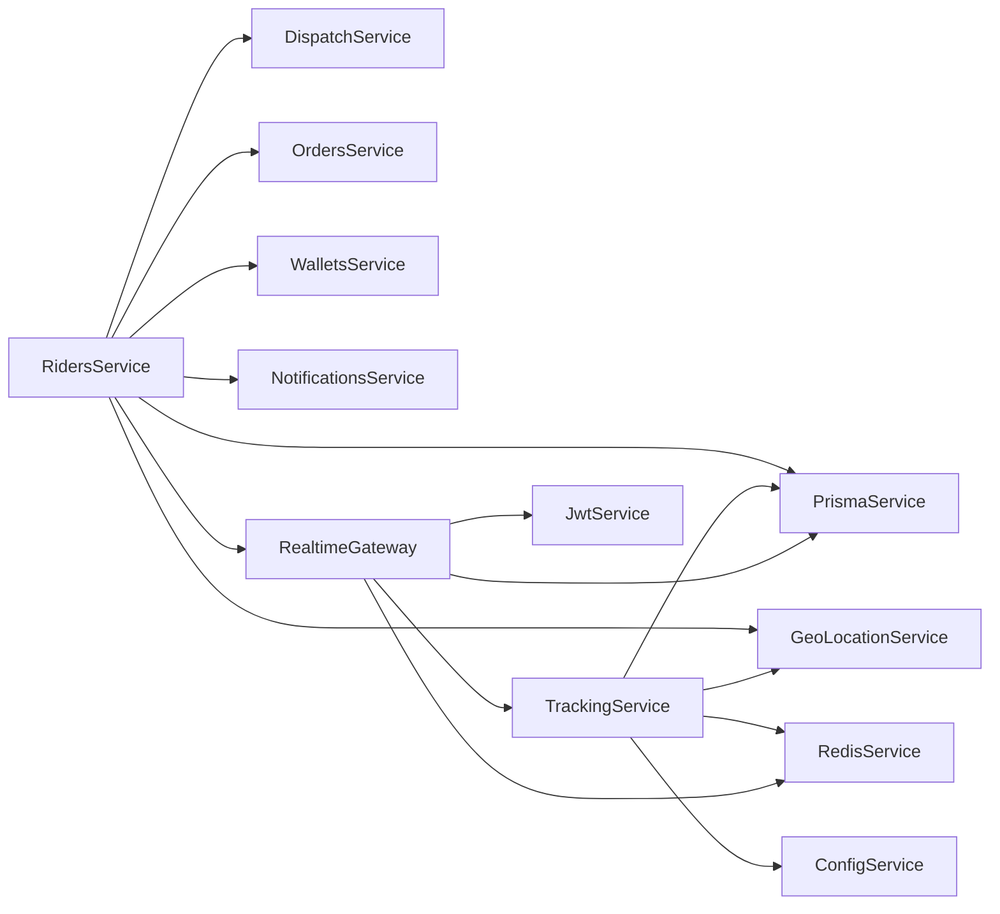

# Rider Domain Models

<cite>
**Referenced Files in This Document**
- [schema.prisma](file://backend/prisma/schema.prisma)
- [riders.service.ts](file://backend/src/riders/riders.service.ts)
- [riders.controller.ts](file://backend/src/riders/riders.controller.ts)
- [tracking.service.ts](file://backend/src/tracking/tracking.service.ts)
- [realtime.gateway.ts](file://backend/src/tracking/realtime.gateway.ts)
- [geo-location.service.ts](file://backend/src/common/services/geo-location.service.ts)
- [admin.service.ts](file://backend/src/admin/admin.service.ts)
- [reviews.service.ts](file://backend/src/reviews/reviews.service.ts)
</cite>

## Table of Contents
1. [Introduction](#introduction)
2. [Project Structure](#project-structure)
3. [Core Components](#core-components)
4. [Architecture Overview](#architecture-overview)
5. [Detailed Component Analysis](#detailed-component-analysis)
6. [Dependency Analysis](#dependency-analysis)
7. [Performance Considerations](#performance-considerations)
8. [Troubleshooting Guide](#troubleshooting-guide)
9. [Conclusion](#conclusion)

## Introduction
This document explains the rider domain models and workflows for a fuel delivery platform. It focuses on:
- Rider identity, verification status transitions, and approval processes.
- Real-time location tracking with GPS coordinates, speed, heading, and accuracy.
- Rider performance metrics including ratings, delivery counts, and earnings.
- Rider vehicle management with capacity constraints and type specifications.
- Practical examples for rider onboarding, location updates, and performance monitoring.

The backend is implemented in NestJS with Prisma and PostgreSQL (PostGIS). Real-time features use Socket.IO with Redis-backed broadcasting.

## Project Structure
The rider-related functionality spans several modules:
- Data model definitions are in the Prisma schema.
- Rider profile, availability, jobs, lifecycle, earnings, and withdrawals are handled by the riders module.
- Real-time location ingestion and live snapshots are handled by the tracking module.
- PostGIS helpers are provided by a shared geo-location service.
- Admin operations include rider listing, detail retrieval, and approval or rejection.
- Reviews update rider ratings and rating counts.

**Diagram sources**
- [riders.controller.ts:1-153](file://backend/src/riders/riders.controller.ts#L1-L153)
- [riders.service.ts:1-659](file://backend/src/riders/riders.service.ts#L1-L659)
- [realtime.gateway.ts:1-294](file://backend/src/tracking/realtime.gateway.ts#L1-L294)
- [tracking.service.ts:1-282](file://backend/src/tracking/tracking.service.ts#L1-L282)
- [geo-location.service.ts:1-155](file://backend/src/common/services/geo-location.service.ts#L1-L155)
- [admin.service.ts:1-493](file://backend/src/admin/admin.service.ts#L1-L493)
- [reviews.service.ts:1-155](file://backend/src/reviews/reviews.service.ts#L1-L155)
- [schema.prisma:280-367](file://backend/prisma/schema.prisma#L280-L367)

**Section sources**
- [riders.controller.ts:1-153](file://backend/src/riders/riders.controller.ts#L1-L153)
- [riders.service.ts:1-659](file://backend/src/riders/riders.service.ts#L1-L659)
- [tracking.service.ts:1-282](file://backend/src/tracking/tracking.service.ts#L1-L282)
- [realtime.gateway.ts:1-294](file://backend/src/tracking/realtime.gateway.ts#L1-L294)
- [geo-location.service.ts:1-155](file://backend/src/common/services/geo-location.service.ts#L1-L155)
- [admin.service.ts:1-493](file://backend/src/admin/admin.service.ts#L1-L493)
- [reviews.service.ts:1-155](file://backend/src/reviews/reviews.service.ts#L1-L155)
- [schema.prisma:280-367](file://backend/prisma/schema.prisma#L280-L367)

## Core Components
The rider domain centers on four core data entities:
- Rider: Identity, verification state, availability, and aggregate performance counters.
- RiderVehicle: Per-rider vehicle records with type and capacity.
- RiderCurrentLocation: The latest GPS position, speed, heading, and accuracy for each rider.
- RiderLocation: Historical GPS points tied to orders and assignments.

Key responsibilities:
- Rider profile and availability control.
- Delivery job offers, acceptance, and lifecycle transitions.
- Earnings aggregation and withdrawal requests.
- Real-time location ingestion and live map broadcasting.
- Rating updates from customer reviews.
- Admin review and approval of rider applications.

**Section sources**
- [schema.prisma:280-367](file://backend/prisma/schema.prisma#L280-L367)
- [riders.service.ts:75-188](file://backend/src/riders/riders.service.ts#L75-L188)
- [tracking.service.ts:128-230](file://backend/src/tracking/tracking.service.ts#L128-L230)
- [admin.service.ts:435-491](file://backend/src/admin/admin.service.ts#L435-L491)
- [reviews.service.ts:27-105](file://backend/src/reviews/reviews.service.ts#L27-L105)

## Architecture Overview
The rider system combines REST APIs, real-time WebSocket events, and database persistence:
- Riders interact via REST endpoints for profile, availability, jobs, lifecycle, earnings, and withdrawals.
- Real-time location updates flow through a Socket.IO gateway into a tracking service that persists positions and broadcasts them.
- PostGIS geometry columns store geographic data for accurate distance queries.
- Admins manage rider approvals and account statuses.
- Customer reviews update rider ratings atomically.

**Diagram sources**
- [riders.controller.ts:47-52](file://backend/src/riders/riders.controller.ts#L47-L52)
- [riders.service.ts:133-188](file://backend/src/riders/riders.service.ts#L133-L188)
- [realtime.gateway.ts:201-252](file://backend/src/tracking/realtime.gateway.ts#L201-L252)
- [tracking.service.ts:155-230](file://backend/src/tracking/tracking.service.ts#L155-L230)
- [geo-location.service.ts:43-86](file://backend/src/common/services/geo-location.service.ts#L43-L86)

## Detailed Component Analysis

### Rider Model and Verification Workflow
The Rider entity stores:
- Verification status: PENDING, VERIFIED, REJECTED, SUSPENDED.
- License number, national ID, date of birth.
- Vehicle type and plate number at the rider level.
- Availability flags: isOnline, isAvailable.
- Performance aggregates: rating, ratingCount, totalDeliveries, totalEarnings.
- Audit fields: verifiedAt, verifiedById, rejectionReason.

Verification workflow:
- New rider profiles start in PENDING.
- Admins approve or reject via admin.reviewRider.
- Approval sets status to VERIFIED, timestamps verifiedAt, records verifier, clears rejection reason, and activates the user account.
- Rejection sets status to REJECTED, forces offline/available false, and records rejection reason.
- Suspension sets status to SUSPENDED and clears online/available; reactivation restores prior state based on whether the rider was previously verified.

**Diagram sources**
- [schema.prisma:40-45](file://backend/prisma/schema.prisma#L40-L45)
- [schema.prisma:280-312](file://backend/prisma/schema.prisma#L280-L312)
- [admin.service.ts:435-491](file://backend/src/admin/admin.service.ts#L435-L491)
- [admin.service.ts:235-302](file://backend/src/admin/admin.service.ts#L235-L302)
- [riders.service.ts:133-188](file://backend/src/riders/riders.service.ts#L133-L188)

**Section sources**
- [schema.prisma:40-45](file://backend/prisma/schema.prisma#L40-L45)
- [schema.prisma:280-312](file://backend/prisma/schema.prisma#L280-L312)
- [admin.service.ts:435-491](file://backend/src/admin/admin.service.ts#L435-L491)
- [admin.service.ts:235-302](file://backend/src/admin/admin.service.ts#L235-L302)
- [riders.service.ts:133-188](file://backend/src/riders/riders.service.ts#L133-L188)

### Rider Vehicle Management
Each rider can have multiple vehicles:
- Fields include type, make, model, plateNumber, capacityLitres, and isActive.
- Capacity is modeled as an optional float in litres.
- The rider-level vehicleType provides a default or primary vehicle type.
- Active vehicles are included in rider profile responses.

Capacity constraints:
- The schema defines capacityLitres but does not enforce hard limits at the database level.
- Business logic should validate that assigned deliveries do not exceed vehicle capacity where applicable.

**Diagram sources**
- [schema.prisma:280-329](file://backend/prisma/schema.prisma#L280-L329)

**Section sources**
- [schema.prisma:280-329](file://backend/prisma/schema.prisma#L280-L329)
- [riders.service.ts:75-116](file://backend/src/riders/riders.service.ts#L75-L116)

### Real-Time Location Tracking System
The tracking system captures:
- GPS coordinates (lat, lng).
- Optional speed in km/h.
- Optional heading.
- Optional accuracy in meters.
- Association with an active order when applicable.

Data storage strategy:
- Latest position is stored in Redis with TTL for fast reads.
- Current location is persisted to rider_current_locations with PostGIS geography column.
- Historical points are inserted into rider_locations with indexes for efficient queries.

Access control:
- Only the assigned rider can publish locations for an active delivery.
- Tracking is only allowed while the order is in active delivery states.
- Throttling prevents excessive pings using Redis.

Broadcasting:
- Accepted location updates are emitted to the order room and operations channel.
- Clients subscribe to order rooms to receive live position updates.

**Diagram sources**
- [realtime.gateway.ts:201-252](file://backend/src/tracking/realtime.gateway.ts#L201-L252)
- [tracking.service.ts:155-230](file://backend/src/tracking/tracking.service.ts#L155-L230)
- [geo-location.service.ts:43-86](file://backend/src/common/services/geo-location.service.ts#L43-L86)

**Section sources**
- [tracking.service.ts:15-30](file://backend/src/tracking/tracking.service.ts#L15-L30)
- [tracking.service.ts:128-230](file://backend/src/tracking/tracking.service.ts#L128-L230)
- [realtime.gateway.ts:201-252](file://backend/src/tracking/realtime.gateway.ts#L201-L252)
- [geo-location.service.ts:43-86](file://backend/src/common/services/geo-location.service.ts#L43-L86)

### Rider Performance Metrics
Rider performance includes:
- Ratings and rating count updated from customer reviews.
- Total deliveries counted from completed delivery assignments.
- Earnings aggregated from wallet transactions of type RIDER_EARNING.

Rating updates:
- When a customer submits a review, the system recalculates the average rating and count for the rider atomically.
- Notifications inform the rider about new ratings.

Earnings and delivery counts:
- Earnings are computed per day, week, month, and lifetime by summing relevant transactions.
- Delivery counts are computed per period by counting completed assignments within time windows.

**Diagram sources**
- [reviews.service.ts:61-87](file://backend/src/reviews/reviews.service.ts#L61-L87)
- [riders.service.ts:360-442](file://backend/src/riders/riders.service.ts#L360-L442)

**Section sources**
- [reviews.service.ts:27-105](file://backend/src/reviews/reviews.service.ts#L27-L105)
- [riders.service.ts:360-442](file://backend/src/riders/riders.service.ts#L360-L442)

### Rider Onboarding Example
Typical onboarding steps:
1. Create a user with role RIDER and status PENDING.
2. Create a Rider profile with license, national ID, vehicle type, and plate number.
3. Add one or more RiderVehicle entries with type, make, model, plate, and capacity.
4. Admin reviews the rider application and approves or rejects.
5. If approved, the rider can go online and start receiving delivery offers.

Operational notes:
- A rider cannot set availability until status is VERIFIED.
- Going offline expires pending offers.
- An active assignment must be completed before going offline.

**Section sources**
- [schema.prisma:280-329](file://backend/prisma/schema.prisma#L280-L329)
- [admin.service.ts:435-491](file://backend/src/admin/admin.service.ts#L435-L491)
- [riders.service.ts:133-188](file://backend/src/riders/riders.service.ts#L133-L188)

### Location Updates Example
A rider publishes location updates during an active delivery:
- The client sends orderId, lat, lng, and optional speed, heading, and accuracy.
- The server validates the rider’s assignment and order status.
- The position is throttled, cached in Redis, persisted to current and historical tables, and broadcast to subscribers.

Constraints:
- Latitude and longitude must be finite numbers.
- Tracking is closed for non-active orders.
- Excessive pings are rejected with a throttled reason.

**Section sources**
- [tracking.service.ts:155-230](file://backend/src/tracking/tracking.service.ts#L155-L230)
- [realtime.gateway.ts:201-252](file://backend/src/tracking/realtime.gateway.ts#L201-L252)

### Performance Monitoring Example
A rider views their performance dashboard:
- Profile endpoint returns status, rating, ratingCount, totalDeliveries, totalEarnings, and active assignment.
- Earnings endpoint returns currency, balance, and summaries for today, week, month, and lifetime.
- Earnings history lists recent wallet transactions for earnings and withdrawals.

**Section sources**
- [riders.service.ts:75-116](file://backend/src/riders/riders.service.ts#L75-L116)
- [riders.service.ts:360-479](file://backend/src/riders/riders.service.ts#L360-L479)

## Dependency Analysis
Key dependencies:
- RidersService depends on PrismaService, GeoLocationService, DispatchService, OrdersService, WalletsService, NotificationsService, and RealtimeGateway.
- TrackingService depends on PrismaService, RedisService, GeoLocationService, and ConfigService.
- RealtimeGateway depends on JwtService, PrismaService, RedisService, and TrackingService.
- AdminService depends on PrismaService, NotificationsService, and AuditService.
- ReviewsService depends on PrismaService and NotificationsService.

Coupling and cohesion:
- RidersService encapsulates rider business logic and orchestrates cross-module interactions.
- TrackingService isolates location ingestion and snapshot logic.
- GeoLocationService centralizes PostGIS operations, improving cohesion and safety.
- RealtimeGateway handles authentication, authorization, and event routing.

Potential circular dependencies:
- No direct circular imports are evident among these modules; they communicate via services and gateways.

External integrations:
- PostgreSQL with PostGIS extension for geospatial queries.
- Redis for caching and rate limiting.
- Socket.IO for real-time communication.

**Diagram sources**
- [riders.service.ts:1-73](file://backend/src/riders/riders.service.ts#L1-L73)
- [tracking.service.ts:1-39](file://backend/src/tracking/tracking.service.ts#L1-L39)
- [realtime.gateway.ts:1-61](file://backend/src/tracking/realtime.gateway.ts#L1-L61)

**Section sources**
- [riders.service.ts:1-73](file://backend/src/riders/riders.service.ts#L1-L73)
- [tracking.service.ts:1-39](file://backend/src/tracking/tracking.service.ts#L1-L39)
- [realtime.gateway.ts:1-61](file://backend/src/tracking/realtime.gateway.ts#L1-L61)

## Performance Considerations
- Use Redis for hot rider positions to reduce database load.
- Throttle location pings to prevent abuse and reduce write pressure.
- Keep rider_current_locations minimal and indexed by riderId.
- Prune rider_locations periodically to control table growth.
- Batch or limit queries for admin dashboards and live maps.
- Avoid unnecessary joins; select only required fields in high-frequency endpoints.

[No sources needed since this section provides general guidance]

## Troubleshooting Guide
Common issues and resolutions:
- Rider cannot go online: Ensure status is VERIFIED and no active assignment exists.
- Location updates rejected: Verify assignment status is ACCEPTED and order status is active; check latitude/longitude validity and throttling.
- Ratings not updating: Confirm the order is DELIVERED or COMPLETED and that the reviewer is the order owner.
- Withdrawal fails: Check rider status is VERIFIED and wallet balance covers the requested amount.
- Admin suspension not taking effect: Ensure sessions are revoked and rider flags are cleared.

Relevant error handling:
- ForbiddenException for unauthorized access to rider endpoints or location publishing.
- BadRequestException for invalid payloads or incorrect order states.
- ConflictException for duplicate ratings or conflicting availability changes.
- NotFoundException for missing riders, orders, or assignments.

**Section sources**
- [riders.service.ts:133-188](file://backend/src/riders/riders.service.ts#L133-L188)
- [tracking.service.ts:155-230](file://backend/src/tracking/tracking.service.ts#L155-L230)
- [reviews.service.ts:27-105](file://backend/src/reviews/reviews.service.ts#L27-L105)
- [admin.service.ts:235-302](file://backend/src/admin/admin.service.ts#L235-L302)

## Conclusion
The rider domain models provide a robust foundation for managing rider identities, verification workflows, vehicle assets, and performance metrics. The real-time location system ensures accurate tracking with efficient caching and broadcasting. Together, these components support reliable rider onboarding, operational visibility, and continuous performance monitoring. Proper validation, throttling, and audit trails help maintain system integrity and user trust.

[No sources needed since this section summarizes without analyzing specific files]