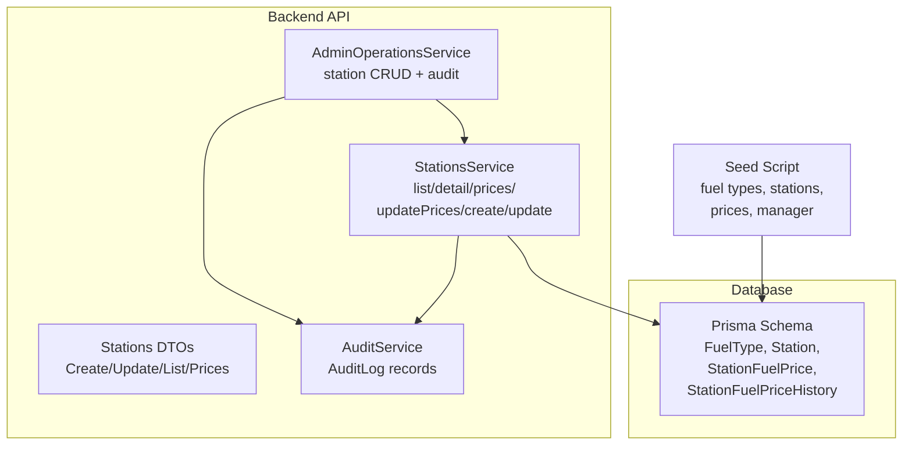
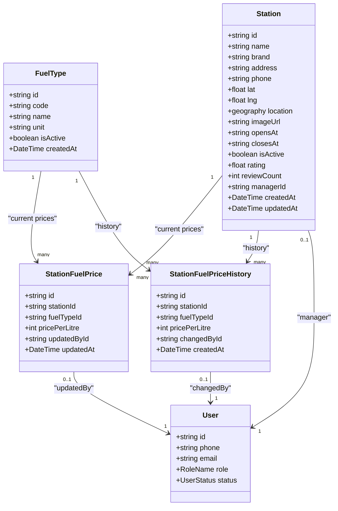
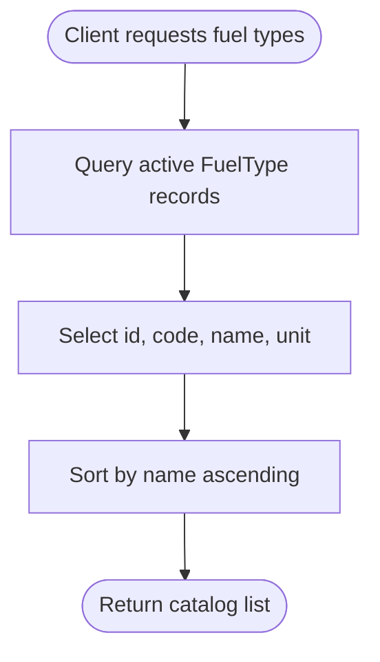
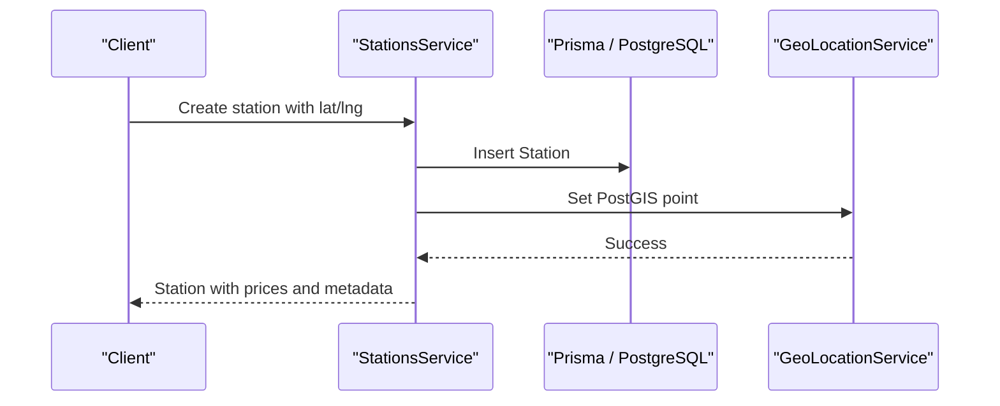
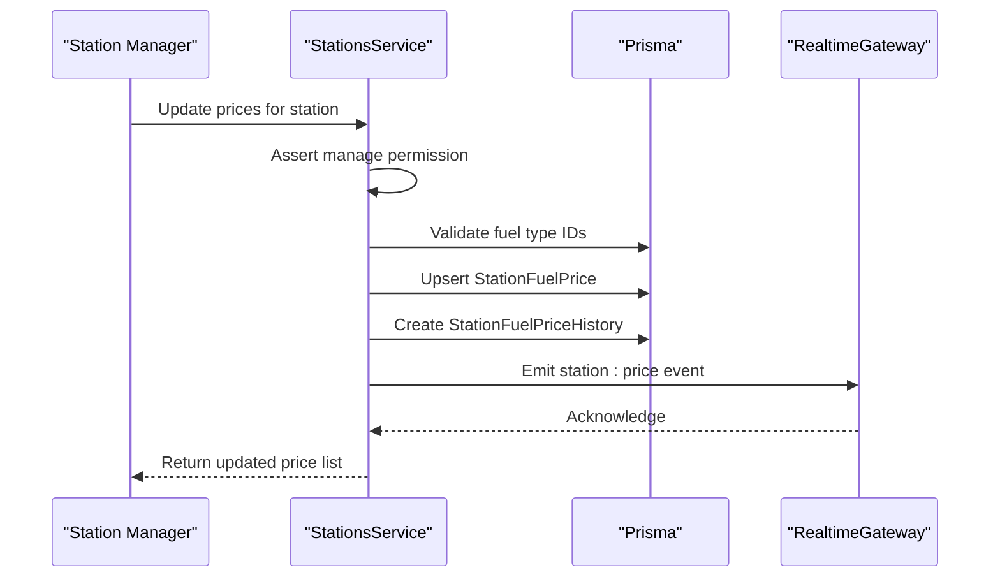
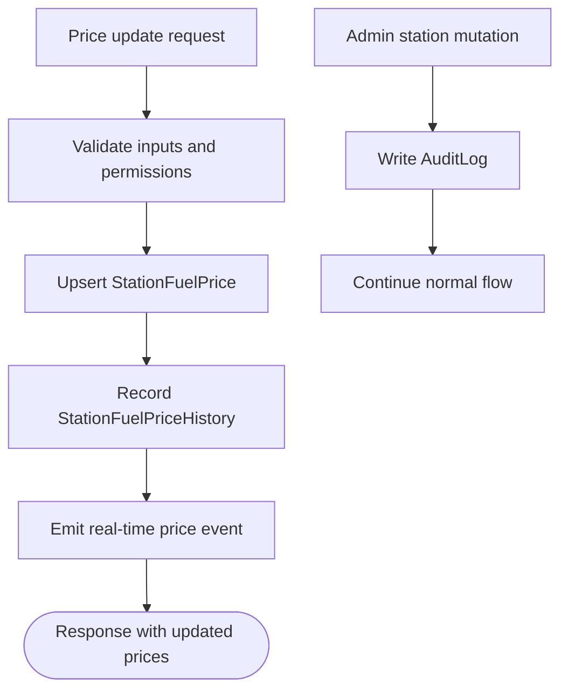
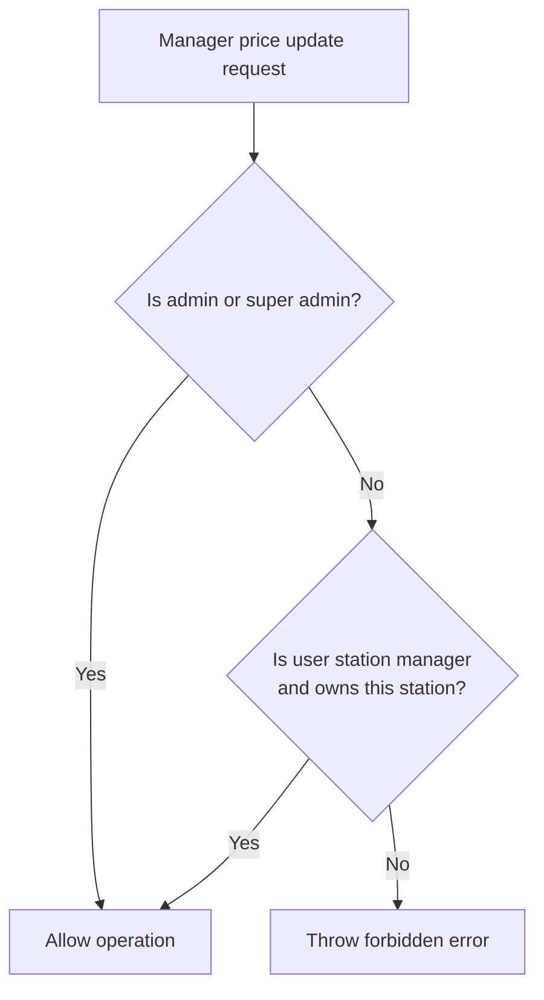
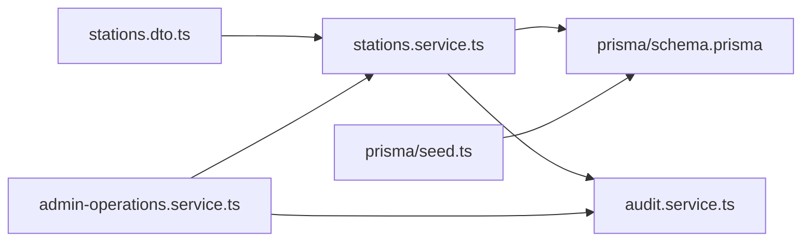

# Station & Fuel Management

<cite>
**Referenced Files in This Document**
- [schema.prisma](file://backend/prisma/schema.prisma)
- [stations.service.ts](file://backend/src/stations/stations.service.ts)
- [stations.dto.ts](file://backend/src/stations/dto/stations.dto.ts)
- [seed.ts](file://backend/prisma/seed.ts)
- [admin-operations.service.ts](file://backend/src/admin/admin-operations.service.ts)
- [audit.service.ts](file://backend/src/audit/audit.service.ts)
</cite>

## Table of Contents
1. [Introduction](#introduction)
2. [Project Structure](#project-structure)
3. [Core Components](#core-components)
4. [Architecture Overview](#architecture-overview)
5. [Detailed Component Analysis](#detailed-component-analysis)
6. [Dependency Analysis](#dependency-analysis)
7. [Performance Considerations](#performance-considerations)
8. [Troubleshooting Guide](#troubleshooting-guide)
9. [Conclusion](#conclusion)

## Introduction
This document explains the station and fuel management domain in the FuelConnect backend. It focuses on four core models:

- `FuelType`: standardized fuel catalog with codes, names, units, and active status.
- `Station`: geospatially positioned station registry with operating hours and manager assignment.
- `StationFuelPrice`: current price per litre for each fuel type at a station.
- `StationFuelPriceHistory`: immutable audit trail of historical price changes.

It also documents the dynamic pricing workflow, permission controls for station managers, and practical examples for configuration, registration, price updates, and historical analysis.

## Project Structure
The relevant implementation is primarily under the backend NestJS application:

- Database schema and relationships are defined in Prisma.
- Station listing, detail, pricing, and manager operations live in the stations service.
- Request validation and API documentation metadata are defined in DTOs.
- Seed data demonstrates fuel types, stations, prices, and manager assignment.
- Admin operations wrap station mutations with audit logging.
- Audit logging is implemented through a global audit service.

**Diagram sources**
- [schema.prisma:372-447](file://backend/prisma/schema.prisma#L372-L447)
- [stations.service.ts:50-196](file://backend/src/stations/stations.service.ts#L50-L196)
- [stations.dto.ts:22-211](file://backend/src/stations/dto/stations.dto.ts#L22-L211)
- [seed.ts:28-140](file://backend/prisma/seed.ts#L28-L140)
- [admin-operations.service.ts:290-317](file://backend/src/admin/admin-operations.service.ts#L290-L317)
- [audit.service.ts:27-45](file://backend/src/audit/audit.service.ts#L27-L45)

**Section sources**
- [schema.prisma:372-447](file://backend/prisma/schema.prisma#L372-L447)
- [stations.service.ts:50-196](file://backend/src/stations/stations.service.ts#L50-L196)
- [stations.dto.ts:22-211](file://backend/src/stations/dto/stations.dto.ts#L22-L211)
- [seed.ts:28-140](file://backend/prisma/seed.ts#L28-L140)
- [admin-operations.service.ts:290-317](file://backend/src/admin/admin-operations.service.ts#L290-L317)
- [audit.service.ts:27-45](file://backend/src/audit/audit.service.ts#L27-L45)

## Core Components
This section summarizes the four key entities and their responsibilities.

### FuelType
- Purpose: Centralized catalog of supported fuels.
- Key fields:
  - Unique code (e.g., PETROL, DIESEL, POWER).
  - Human-readable name.
  - Unit, defaulting to litres.
  - Active flag to enable or disable a fuel type without deleting history.
- Relationships:
  - One-to-many with current station prices.
  - One-to-many with price history.
  - Referenced by orders and order items.
  - Optional reference from customer vehicles.

**Section sources**
- [schema.prisma:372-387](file://backend/prisma/schema.prisma#L372-L387)

### Station
- Purpose: Registry of physical fuel stations.
- Key fields:
  - Name, brand, address, optional phone.
  - Latitude and longitude coordinates.
  - PostGIS geography point for spatial queries.
  - Operating hours as time strings.
  - Active status, rating, review count.
  - Optional manager user reference.
- Relationships:
  - Many-to-one with User via managerId.
  - One-to-many with current prices and price history.
  - Referenced by orders.

**Section sources**
- [schema.prisma:389-416](file://backend/prisma/schema.prisma#L389-L416)

### StationFuelPrice
- Purpose: Current price per litre for a specific fuel type at a station.
- Key fields:
  - Unique composite key over station and fuel type.
  - Price per litre.
  - Updated-by user reference.
  - Timestamp updated automatically.
- Relationships:
  - Belongs to one station and one fuel type.
  - Updated-by relation to User.

**Section sources**
- [schema.prisma:418-432](file://backend/prisma/schema.prisma#L418-L432)

### StationFuelPriceHistory
- Purpose: Immutable record of every price change.
- Key fields:
  - Station and fuel type references.
  - Snapshot of price per litre at the time of change.
  - Changed-by user reference.
  - Creation timestamp.
- Indexes:
  - Optimized for querying by station and time.

**Section sources**
- [schema.prisma:434-447](file://backend/prisma/schema.prisma#L434-L447)

## Architecture Overview
The station and fuel system combines database modeling, service-layer business logic, request validation, seed data, and audit trails.

**Diagram sources**
- [schema.prisma:137-170](file://backend/prisma/schema.prisma#L137-L170)
- [schema.prisma:372-447](file://backend/prisma/schema.prisma#L372-L447)

## Detailed Component Analysis

### Fuel Type Catalog System
The fuel type catalog provides standardized codes, human-readable names, units, and an active status. The service exposes only active fuel types for clients, ensuring that deprecated fuels do not appear in normal UI flows while preserving historical data.

Key behaviors:
- Codes such as PETROL, DIESEL, and POWER are unique identifiers.
- Default unit is litres.
- Active status controls visibility in public endpoints.
- Seed script initializes demo fuel types.

**Diagram sources**
- [stations.service.ts:128-134](file://backend/src/stations/stations.service.ts#L128-L134)
- [schema.prisma:372-387](file://backend/prisma/schema.prisma#L372-L387)
- [seed.ts:28-45](file://backend/prisma/seed.ts#L28-L45)

**Section sources**
- [stations.service.ts:128-134](file://backend/src/stations/stations.service.ts#L128-L134)
- [schema.prisma:372-387](file://backend/prisma/schema.prisma#L372-L387)
- [seed.ts:28-45](file://backend/prisma/seed.ts#L28-L45)

### Station Registry with Geospatial Positioning and Operating Hours
Stations are registered with geographic coordinates and a PostGIS geography column. The service supports:

- Listing stations with optional distance-based filtering using latitude, longitude, and radius.
- Detail retrieval with distance calculation and ETA estimation.
- Creating and updating stations, including setting or updating the PostGIS point when coordinates change.
- Operating hours stored as time strings.
- Manager assignment via a nullable user reference.

**Diagram sources**
- [stations.service.ts:234-253](file://backend/src/stations/stations.service.ts#L234-L253)
- [stations.service.ts:256-282](file://backend/src/stations/stations.service.ts#L256-L282)
- [schema.prisma:389-416](file://backend/prisma/schema.prisma#L389-L416)

**Section sources**
- [stations.service.ts:50-117](file://backend/src/stations/stations.service.ts#L50-L117)
- [stations.service.ts:234-282](file://backend/src/stations/stations.service.ts#L234-L282)
- [stations.dto.ts:60-114](file://backend/src/stations/dto/stations.dto.ts#L60-L114)
- [stations.dto.ts:116-180](file://backend/src/stations/dto/stations.dto.ts#L116-L180)
- [schema.prisma:389-416](file://backend/prisma/schema.prisma#L389-L416)

### Dynamic Pricing System: Price Per Litre Tracking
Current prices are maintained per station and fuel type. The service enforces:

- Validation of provided fuel type IDs against known active fuel types.
- Upsert behavior so existing prices are updated and new ones created.
- Recording the user who updated the price.
- Emitting real-time price update events to operations dashboards.

**Diagram sources**
- [stations.service.ts:137-196](file://backend/src/stations/stations.service.ts#L137-L196)
- [schema.prisma:418-447](file://backend/prisma/schema.prisma#L418-L447)

**Section sources**
- [stations.service.ts:137-196](file://backend/src/stations/stations.service.ts#L137-L196)
- [stations.dto.ts:182-203](file://backend/src/stations/dto/stations.dto.ts#L182-L203)
- [schema.prisma:418-447](file://backend/prisma/schema.prisma#L418-L447)

### Historical Price Changes and Audit Trails
Every price update creates a corresponding history record. In addition, administrative station mutations are recorded in the audit log.

- Price history captures station, fuel type, price snapshot, changer, and timestamp.
- Audit logs capture actor identity, role, action, entity, entity identifier, IP, user agent, and metadata.
- Audit writes are isolated from request success; failures are logged but do not break the operation.

**Diagram sources**
- [stations.service.ts:155-195](file://backend/src/stations/stations.service.ts#L155-L195)
- [admin-operations.service.ts:290-317](file://backend/src/admin/admin-operations.service.ts#L290-L317)
- [audit.service.ts:27-45](file://backend/src/audit/audit.service.ts#L27-L45)
- [schema.prisma:713-730](file://backend/prisma/schema.prisma#L713-L730)

**Section sources**
- [stations.service.ts:155-195](file://backend/src/stations/stations.service.ts#L155-L195)
- [admin-operations.service.ts:290-317](file://backend/src/admin/admin-operations.service.ts#L290-L317)
- [audit.service.ts:27-45](file://backend/src/audit/audit.service.ts#L27-L45)
- [schema.prisma:434-447](file://backend/prisma/schema.prisma#L434-L447)
- [schema.prisma:713-730](file://backend/prisma/schema.prisma#L713-L730)

### Station-Manager Relationship and Permission Controls
Stations can be assigned a manager user. Permission checks ensure:

- Administrators and super administrators can manage any station.
- Station managers can only manage stations where they are assigned.
- Unauthorized attempts return a forbidden error.

**Diagram sources**
- [stations.service.ts:305-311](file://backend/src/stations/stations.service.ts#L305-L311)
- [schema.prisma:389-416](file://backend/prisma/schema.prisma#L389-L416)

**Section sources**
- [stations.service.ts:305-311](file://backend/src/stations/stations.service.ts#L305-L311)
- [schema.prisma:389-416](file://backend/prisma/schema.prisma#L389-L416)

## Dependency Analysis
The following diagram shows how the station and fuel components depend on each other and on shared services.

**Diagram sources**
- [stations.dto.ts:22-211](file://backend/src/stations/dto/stations.dto.ts#L22-L211)
- [stations.service.ts:1-48](file://backend/src/stations/stations.service.ts#L1-L48)
- [schema.prisma:372-447](file://backend/prisma/schema.prisma#L372-L447)
- [admin-operations.service.ts:290-317](file://backend/src/admin/admin-operations.service.ts#L290-L317)
- [audit.service.ts:1-46](file://backend/src/audit/audit.service.ts#L1-L46)
- [seed.ts:28-140](file://backend/prisma/seed.ts#L28-L140)

**Section sources**
- [stations.dto.ts:22-211](file://backend/src/stations/dto/stations.dto.ts#L22-L211)
- [stations.service.ts:1-48](file://backend/src/stations/stations.service.ts#L1-L48)
- [schema.prisma:372-447](file://backend/prisma/schema.prisma#L372-L447)
- [admin-operations.service.ts:290-317](file://backend/src/admin/admin-operations.service.ts#L290-L317)
- [audit.service.ts:1-46](file://backend/src/audit/audit.service.ts#L1-L46)
- [seed.ts:28-140](file://backend/prisma/seed.ts#L28-L140)

## Performance Considerations
- Spatial queries use PostGIS geography columns and distance functions to efficiently filter stations within a radius.
- Composite indexes on station and fuel type improve upsert performance for current prices.
- History table is indexed by station and creation time to support efficient historical analysis.
- Pagination is applied to station listings and order listings to limit result sets.
- Real-time price events are emitted after successful updates, avoiding blocking the database transaction.

[No sources needed since this section provides general guidance]

## Troubleshooting Guide
Common issues and resolutions:

- Invalid fuel type IDs during price updates:
  - Cause: Submitting fuel type IDs that do not exist.
  - Resolution: Ensure all provided fuel type IDs exist in the FuelType catalog before updating prices.
  - Evidence: Validation rejects unknown IDs before transactional updates.

- Forbidden station management:
  - Cause: A station manager attempting to manage a station they do not own.
  - Resolution: Assign the correct manager to the station or use an administrator account.
  - Evidence: Permission check throws a forbidden exception for unauthorized users.

- Missing PostGIS point after station coordinate changes:
  - Cause: Updating latitude or longitude without synchronizing the geography column.
  - Resolution: Use the station update endpoint, which calls the geo service to set the PostGIS point when coordinates change.
  - Evidence: Update method conditionally sets the station point when lat/lng are provided.

- Audit logs not appearing:
  - Cause: Audit write failure should not block the request, but may indicate infrastructure issues.
  - Resolution: Check audit service logs for warnings about failed audit writes.
  - Evidence: Audit service catches errors and logs warnings without failing the caller.

**Section sources**
- [stations.service.ts:137-196](file://backend/src/stations/stations.service.ts#L137-L196)
- [stations.service.ts:256-282](file://backend/src/stations/stations.service.ts#L256-L282)
- [stations.service.ts:305-311](file://backend/src/stations/stations.service.ts#L305-L311)
- [audit.service.ts:27-45](file://backend/src/audit/audit.service.ts#L27-L45)

## Conclusion
The station and fuel management subsystem provides a robust foundation for managing fuel catalogs, registering geospatial stations, tracking current prices, and maintaining an immutable history of price changes. Permissions ensure that only authorized users can modify station data, while audit logs provide operational oversight. The design balances simplicity with strong relational integrity, spatial query support, and extensibility for future pricing strategies.

[No sources needed since this section summarizes without analyzing specific files]

## Appendices

### Examples

#### Fuel Type Configuration
- Initialize standard fuel types with unique codes and names.
- Keep units consistent, defaulting to litres.
- Activate fuel types for client consumption.

Relevant paths:
- [FuelType model:372-387](file://backend/prisma/schema.prisma#L372-L387)
- [Seed fuel types:28-45](file://backend/prisma/seed.ts#L28-L45)
- [Active fuel types endpoint:128-134](file://backend/src/stations/stations.service.ts#L128-L134)

#### Station Registration
- Register a station with name, brand, address, phone, coordinates, image URL, operating hours, and optional manager.
- Coordinates are synchronized with PostGIS geography for spatial queries.

Relevant paths:
- [Create station DTO:60-114](file://backend/src/stations/dto/stations.dto.ts#L60-L114)
- [Create station service:234-253](file://backend/src/stations/stations.service.ts#L234-L253)
- [Station model:389-416](file://backend/prisma/schema.prisma#L389-L416)

#### Price Updates
- Submit a list of fuel type IDs and price-per-litre values.
- System validates fuel types, upserts current prices, records history, and emits real-time events.

Relevant paths:
- [Update prices DTO:182-203](file://backend/src/stations/dto/stations.dto.ts#L182-L203)
- [Update prices service:137-196](file://backend/src/stations/stations.service.ts#L137-L196)
- [Current price model:418-432](file://backend/prisma/schema.prisma#L418-L432)
- [Price history model:434-447](file://backend/prisma/schema.prisma#L434-L447)

#### Historical Price Analysis Queries
- Query price history by station and date range.
- Join with fuel types to analyze trends by fuel code.
- Combine with audit logs to correlate operator actions with price changes.

Relevant paths:
- [Price history model:434-447](file://backend/prisma/schema.prisma#L434-L447)
- [Audit log model:713-730](file://backend/prisma/schema.prisma#L713-L730)
- [Audit service:27-45](file://backend/src/audit/audit.service.ts#L27-L45)