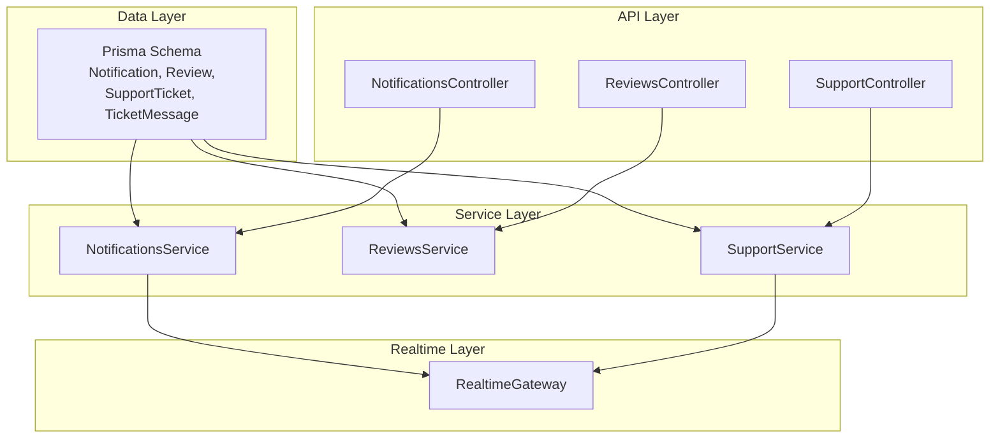
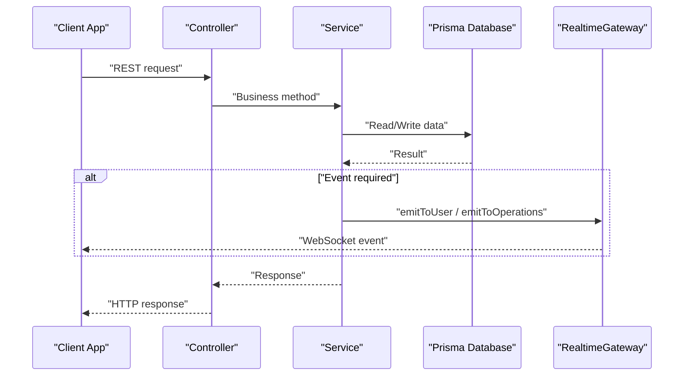
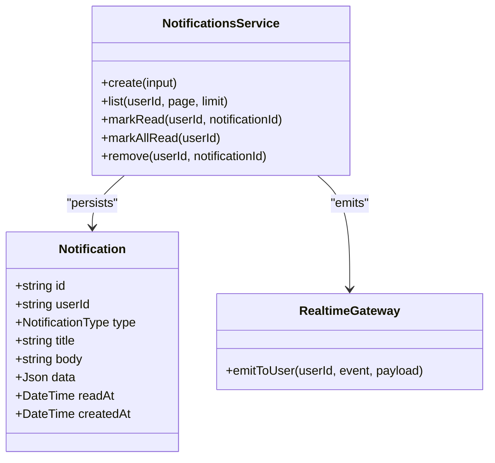
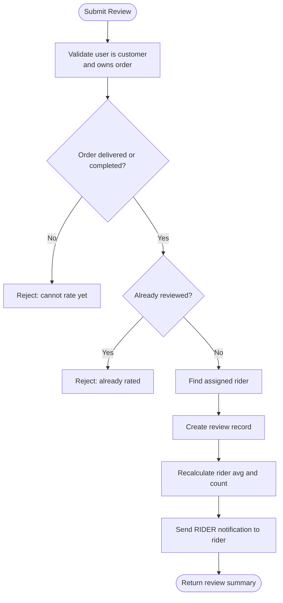
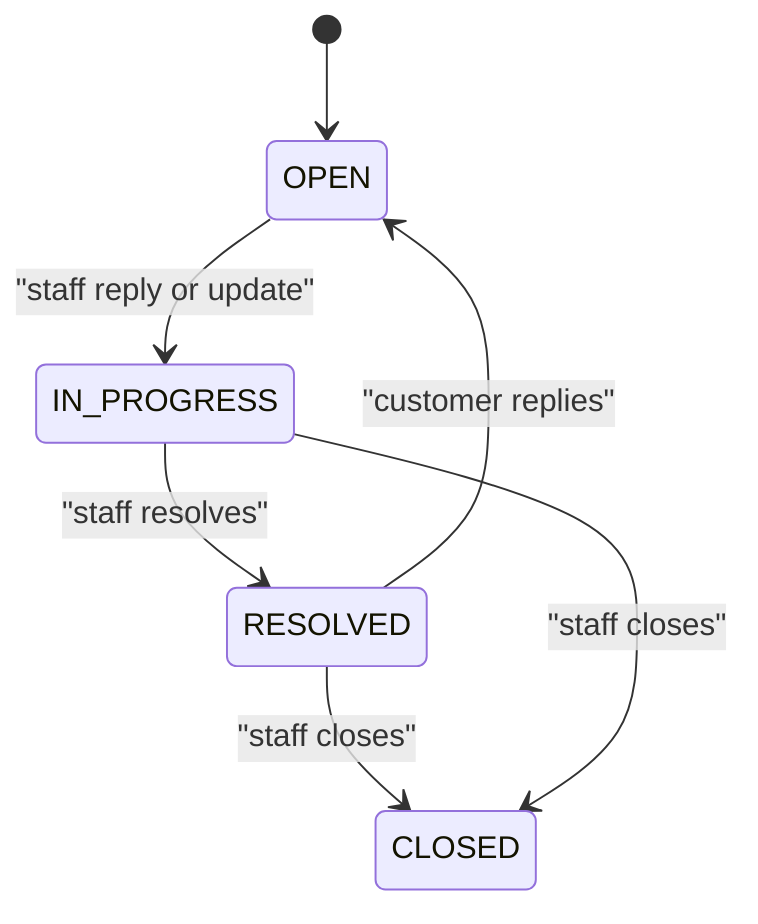
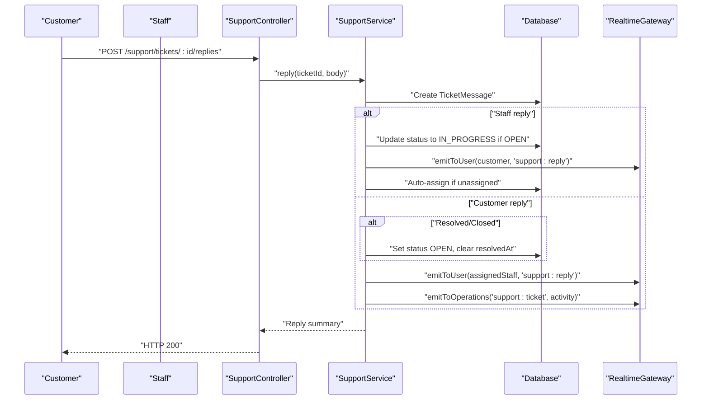
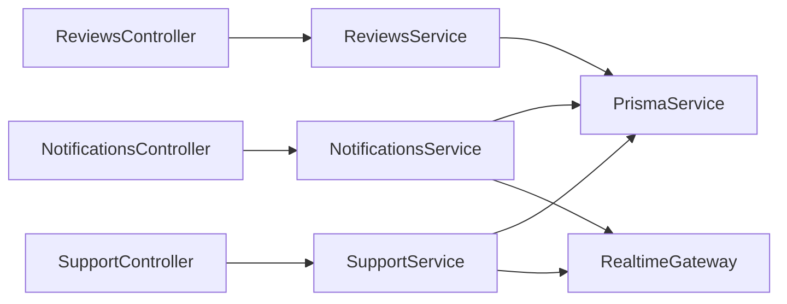

# Support & Engagement System

<cite>
**Referenced Files in This Document**
- [schema.prisma](file://backend/prisma/schema.prisma)
- [notifications.service.ts](file://backend/src/notifications/notifications.service.ts)
- [notifications.controller.ts](file://backend/src/notifications/notifications.controller.ts)
- [reviews.service.ts](file://backend/src/reviews/reviews.service.ts)
- [reviews.controller.ts](file://backend/src/reviews/reviews.controller.ts)
- [reviews.dto.ts](file://backend/src/reviews/dto/reviews.dto.ts)
- [support.service.ts](file://backend/src/support/support.service.ts)
- [support.controller.ts](file://backend/src/support/support.controller.ts)
- [support.dto.ts](file://backend/src/support/dto/support.dto.ts)
- [realtime.gateway.ts](file://backend/src/tracking/realtime.gateway.ts)
</cite>

## Table of Contents
1. [Introduction](#introduction)
2. [Project Structure](#project-structure)
3. [Core Components](#core-components)
4. [Architecture Overview](#architecture-overview)
5. [Detailed Component Analysis](#detailed-component-analysis)
6. [Dependency Analysis](#dependency-analysis)
7. [Performance Considerations](#performance-considerations)
8. [Troubleshooting Guide](#troubleshooting-guide)
9. [Conclusion](#conclusion)

## Introduction
This document explains the support and engagement subsystem for FuelConnect, focusing on four core entities: Notification, Review, SupportTicket, and TicketMessage. It covers:
- The notification system with types ORDER, RIDER, PAYMENT, PROMO, SYSTEM, SECURITY and its WebSocket-based delivery mechanism.
- The review and rating system that links customers, riders, and orders and maintains rider quality metrics.
- The support ticketing system including priority levels, category management, assignment, status transitions, and resolution workflows.
- The messaging layer for customer support conversations and staff communication channels.
It also provides practical examples of notification dispatch, review submission, ticket creation, and support conversation management.

## Project Structure
The support and engagement features are implemented as NestJS modules under backend/src with a Prisma data model defined in backend/prisma/schema.prisma.

**Diagram sources**
- [schema.prisma:639-710](file://backend/prisma/schema.prisma#L639-L710)
- [notifications.controller.ts:18-52](file://backend/src/notifications/notifications.controller.ts#L18-L52)
- [notifications.service.ts:14-42](file://backend/src/notifications/notifications.service.ts#L14-L42)
- [reviews.controller.ts:18-46](file://backend/src/reviews/reviews.controller.ts#L18-L46)
- [reviews.service.ts:20-105](file://backend/src/reviews/reviews.service.ts#L20-L105)
- [support.controller.ts:18-53](file://backend/src/support/support.controller.ts#L18-L53)
- [support.service.ts:52-130](file://backend/src/support/support.service.ts#L52-L130)
- [realtime.gateway.ts:45-61](file://backend/src/tracking/realtime.gateway.ts#L45-L61)

**Section sources**
- [schema.prisma:104-125](file://backend/prisma/schema.prisma#L104-L125)
- [schema.prisma:639-710](file://backend/prisma/schema.prisma#L639-L710)
- [notifications.controller.ts:18-52](file://backend/src/notifications/notifications.controller.ts#L18-L52)
- [reviews.controller.ts:18-46](file://backend/src/reviews/reviews.controller.ts#L18-L46)
- [support.controller.ts:18-53](file://backend/src/support/support.controller.ts#L18-L53)

## Core Components
- Notification: Persistent per-user notifications with type classification and read tracking. Delivered via WebSocket to the user’s client.
- Review: One-time rating per order linking customer and rider; updates rider average and count atomically.
- SupportTicket: Customer-initiated support cases with subject, description, category, priority, status, assignment, and resolution.
- TicketMessage: Threaded messages within a ticket, distinguishing customer vs staff authorship.

Key responsibilities:
- NotificationsService persists notifications and emits them through RealtimeGateway.
- ReviewsService validates eligibility, creates reviews, recalculates rider metrics, and notifies riders.
- SupportService manages ticket lifecycle, replies, assignment, status transitions, audit logging, and real-time operations feed.

**Section sources**
- [notifications.service.ts:14-42](file://backend/src/notifications/notifications.service.ts#L14-L42)
- [reviews.service.ts:15-105](file://backend/src/reviews/reviews.service.ts#L15-L105)
- [support.service.ts:52-130](file://backend/src/support/support.service.ts#L52-L130)
- [schema.prisma:639-710](file://backend/prisma/schema.prisma#L639-L710)

## Architecture Overview
The support and engagement system integrates three layers:
- API controllers expose REST endpoints for clients.
- Services implement business logic, enforce rules, and coordinate persistence and events.
- RealtimeGateway broadcasts live events to clients and operations dashboards.

**Diagram sources**
- [notifications.controller.ts:24-50](file://backend/src/notifications/notifications.controller.ts#L24-L50)
- [notifications.service.ts:21-42](file://backend/src/notifications/notifications.service.ts#L21-L42)
- [realtime.gateway.ts:45-61](file://backend/src/tracking/realtime.gateway.ts#L45-L61)

## Detailed Component Analysis

### Notification System
The notification system supports six types: ORDER, RIDER, PAYMENT, PROMO, SYSTEM, SECURITY. Notifications are persisted and immediately emitted to the target user via WebSocket. Clients can list, mark read, mark all read, and delete notifications.

**Diagram sources**
- [schema.prisma:639-654](file://backend/prisma/schema.prisma#L639-L654)
- [notifications.service.ts:14-42](file://backend/src/notifications/notifications.service.ts#L14-L42)
- [realtime.gateway.ts:45-61](file://backend/src/tracking/realtime.gateway.ts#L45-L61)

Example: Dispatching a notification
- A service calls NotificationsService.create with userId, type (e.g., RIDER), title, body, and optional data.
- The service persists the notification and emits a WebSocket event to the user.
- The client receives the event and displays it in the notification center.

Operational notes:
- Default type is SYSTEM when not provided.
- Unread counts and pagination are included in listing responses.

**Section sources**
- [schema.prisma:104-111](file://backend/prisma/schema.prisma#L104-L111)
- [schema.prisma:639-654](file://backend/prisma/schema.prisma#L639-L654)
- [notifications.service.ts:21-42](file://backend/src/notifications/notifications.service.ts#L21-L42)
- [notifications.controller.ts:24-50](file://backend/src/notifications/notifications.controller.ts#L24-L50)

### Review and Rating System
Customers rate completed deliveries once an order reaches DELIVERED or COMPLETED. Each order can be rated once. The system ensures:
- Only the order’s customer can submit a review.
- The order must have an accepted/completed assignment with a rider.
- Rider average and ratingCount are recalculated atomically.
- Riders receive a RIDER-type notification about their new rating.

**Diagram sources**
- [reviews.service.ts:27-105](file://backend/src/reviews/reviews.service.ts#L27-L105)

Example: Submitting a review
- Client sends orderId, rating (1–5), and optional comment.
- Server validates ownership, order status, and existing review.
- Server creates the review, recalculates rider metrics, and notifies the rider.

Quality metrics:
- Rider.rating and Rider.ratingCount reflect aggregated review data.
- Public and private endpoints expose paginated reviews and summaries.

**Section sources**
- [schema.prisma:656-671](file://backend/prisma/schema.prisma#L656-L671)
- [schema.prisma:280-312](file://backend/prisma/schema.prisma#L280-L312)
- [reviews.service.ts:27-105](file://backend/src/reviews/reviews.service.ts#L27-L105)
- [reviews.controller.ts:24-46](file://backend/src/reviews/reviews.controller.ts#L24-L46)
- [reviews.dto.ts:5-22](file://backend/src/reviews/dto/reviews.dto.ts#L5-L22)

### Support Ticketing System
Support tickets allow customers to open issues optionally linked to an order. Tickets include:
- Subject and description.
- Category from a controlled set.
- Priority level.
- Status workflow and resolution tracking.
- Assignment to staff members.

Supported categories: GENERAL, PAYMENT, DELIVERY, ACCOUNT, APP.
Supported priorities: LOW, NORMAL, HIGH, URGENT.
Supported statuses: OPEN, IN_PROGRESS, RESOLVED, CLOSED.

**Diagram sources**
- [support.service.ts:146-211](file://backend/src/support/support.service.ts#L146-L211)
- [support.service.ts:218-271](file://backend/src/support/support.service.ts#L218-L271)

Example: Creating a ticket
- Customer submits subject, description, optional category, priority, and optional orderId.
- Server validates ownership if orderId is provided.
- Server creates the ticket and an initial message, then emits an operations event.

Resolution workflow:
- Staff can update status, priority, assignee, and resolution text.
- Resolving or closing triggers a SYSTEM notification to the customer.
- Audit logs capture ticket updates.

**Section sources**
- [schema.prisma:673-710](file://backend/prisma/schema.prisma#L673-L710)
- [support.dto.ts:6-33](file://backend/src/support/dto/support.dto.ts#L6-L33)
- [support.service.ts:64-130](file://backend/src/support/support.service.ts#L64-L130)
- [support.service.ts:218-271](file://backend/src/support/support.service.ts#L218-L271)

### Messaging System for Support Conversations
Each ticket has a threaded conversation via TicketMessage:
- Customers and staff can post messages.
- Messages are marked by author role (isStaff).
- Staff replies auto-transition OPEN to IN_PROGRESS and may auto-assign the ticket.
- Customer replies to resolved/closed tickets reopen them.
- Realtime events notify the customer and/or assigned staff member.

**Diagram sources**
- [support.service.ts:146-211](file://backend/src/support/support.service.ts#L146-L211)
- [support.controller.ts:44-52](file://backend/src/support/support.controller.ts#L44-L52)

Examples:
- Customer opens a ticket and posts the first message automatically.
- Staff responds, updating status and notifying the customer.
- Customer reopens a closed ticket by replying.

**Section sources**
- [support.service.ts:146-211](file://backend/src/support/support.service.ts#L146-L211)
- [support.controller.ts:44-52](file://backend/src/support/support.controller.ts#L44-L52)

## Dependency Analysis
The following diagram shows how controllers depend on services, which depend on Prisma and RealtimeGateway.

**Diagram sources**
- [notifications.controller.ts:18-52](file://backend/src/notifications/notifications.controller.ts#L18-L52)
- [notifications.service.ts:14-42](file://backend/src/notifications/notifications.service.ts#L14-L42)
- [reviews.controller.ts:18-46](file://backend/src/reviews/reviews.controller.ts#L18-L46)
- [reviews.service.ts:20-105](file://backend/src/reviews/reviews.service.ts#L20-L105)
- [support.controller.ts:18-53](file://backend/src/support/support.controller.ts#L18-L53)
- [support.service.ts:52-130](file://backend/src/support/support.service.ts#L52-L130)
- [realtime.gateway.ts:45-61](file://backend/src/tracking/realtime.gateway.ts#L45-L61)

Coupling and cohesion:
- Controllers are thin and delegate to services, improving cohesion.
- Services encapsulate domain rules and orchestrate database and realtime events.
- RealtimeGateway is used by services that need live updates (notifications and support).

Potential circular dependencies:
- No direct circular imports observed between these modules.
- RealtimeGateway is consumed by services without being imported back into controllers.

External integration points:
- PrismaService for PostgreSQL data access.
- RealtimeGateway for WebSocket broadcasting to clients and operations dashboard.

**Section sources**
- [notifications.service.ts:14-42](file://backend/src/notifications/notifications.service.ts#L14-L42)
- [reviews.service.ts:20-105](file://backend/src/reviews/reviews.service.ts#L20-L105)
- [support.service.ts:52-130](file://backend/src/support/support.service.ts#L52-L130)
- [realtime.gateway.ts:45-61](file://backend/src/tracking/realtime.gateway.ts#L45-L61)

## Performance Considerations
- Pagination: All list endpoints return paginated results with total counts and unread metrics where applicable.
- Aggregations: Review averages are computed at write time to avoid expensive runtime aggregations.
- Transactions: Critical writes (review creation and rider metric updates; ticket creation plus initial message) use transactions to ensure consistency.
- Realtime scaling: RealtimeGateway uses Redis adapter when available for multi-instance deployments.

[No sources needed since this section provides general guidance]

## Troubleshooting Guide
Common issues and resolutions:
- Cannot rate an order:
  - Ensure the order belongs to the authenticated customer and is in DELIVERED or COMPLETED state.
  - Ensure there is an accepted/completed assignment with a rider.
  - Ensure no prior review exists for the order.
- Duplicate review attempts:
  - The system rejects duplicate reviews per order.
- Ticket creation failures:
  - Reference collisions are retried internally; persistent failures indicate external constraints or invalid inputs.
- Unauthorized access:
  - Only customers can create/view their own tickets.
  - Staff roles can view all tickets and manage assignments/statuses.
- Missing rider metrics:
  - Rider ratings are recalculated on review creation; verify the review was created successfully.

**Section sources**
- [reviews.service.ts:27-105](file://backend/src/reviews/reviews.service.ts#L27-L105)
- [support.service.ts:64-130](file://backend/src/support/support.service.ts#L64-L130)
- [support.service.ts:323-335](file://backend/src/support/support.service.ts#L323-L335)

## Conclusion
The support and engagement system provides a robust foundation for user notifications, rider quality measurement, and customer support workflows. Notifications are reliably persisted and delivered in real time. Reviews maintain accurate rider metrics and keep users informed. Support tickets offer structured case management with clear status transitions, categorization, prioritization, and threaded messaging. Together, these components improve transparency, accountability, and responsiveness across the platform.

[No sources needed since this section summarizes without analyzing specific files]