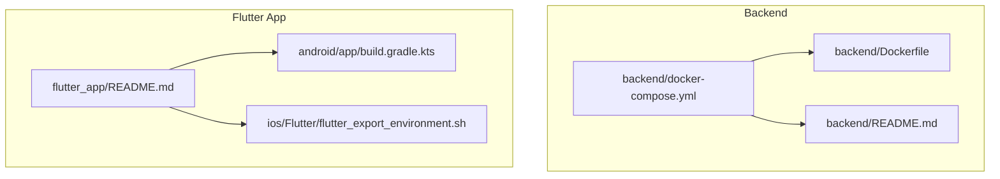
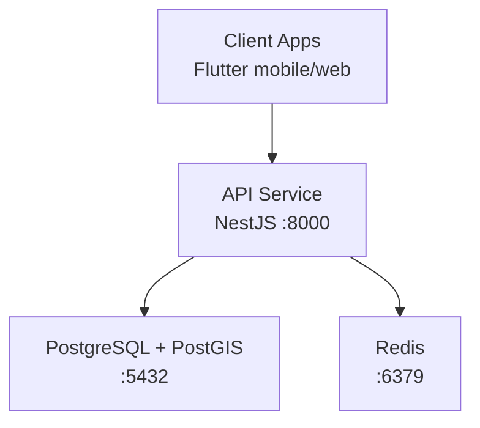
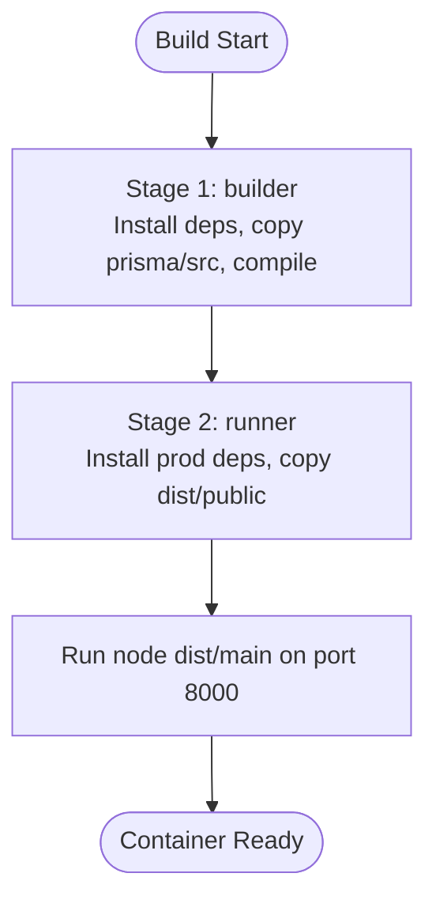
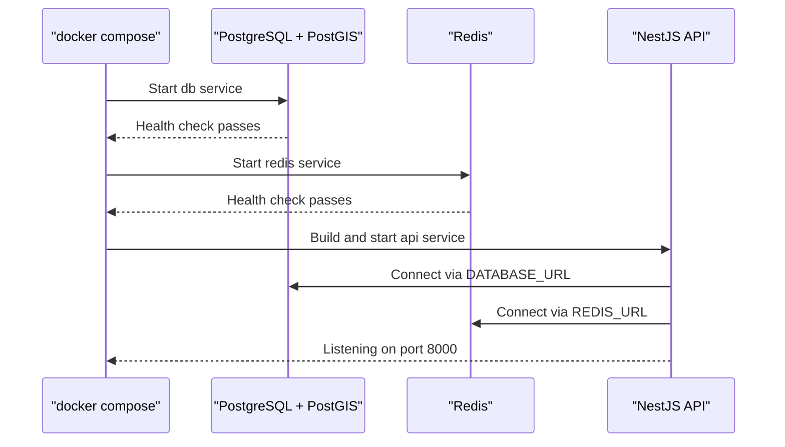
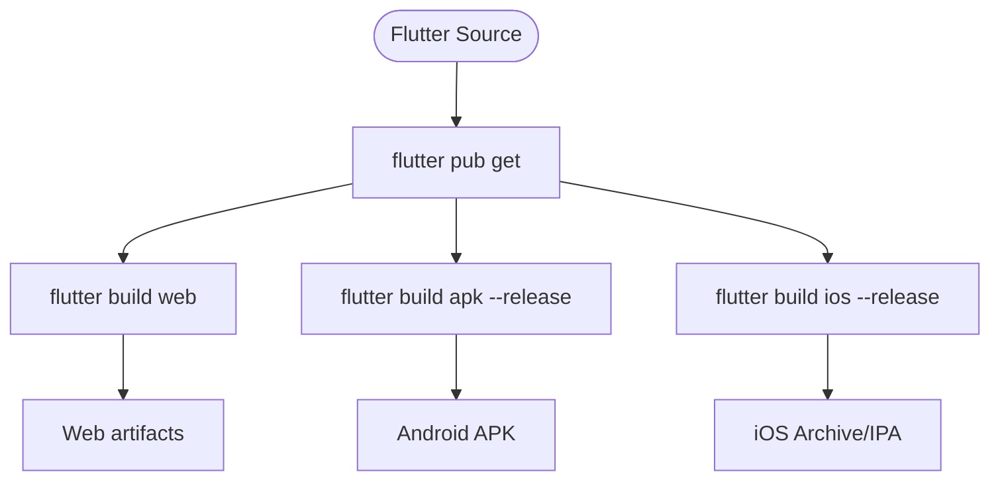
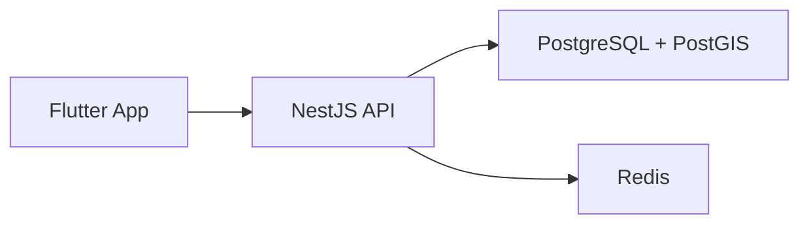

# Containerization & Docker Setup

<cite>
**Referenced Files in This Document**
- [backend/Dockerfile](file://backend/Dockerfile)
- [backend/docker-compose.yml](file://backend/docker-compose.yml)
- [backend/README.md](file://backend/README.md)
- [flutter_app/README.md](file://flutter_app/README.md)
- [flutter_app/android/app/build.gradle.kts](file://flutter_app/android/app/build.gradle.kts)
- [flutter_app/ios/Flutter/flutter_export_environment.sh](file://flutter_app/ios/Flutter/flutter_export_environment.sh)
</cite>

## Table of Contents
1. [Introduction](#introduction)
2. [Project Structure](#project-structure)
3. [Core Components](#core-components)
4. [Architecture Overview](#architecture-overview)
5. [Detailed Component Analysis](#detailed-component-analysis)
6. [Dependency Analysis](#dependency-analysis)
7. [Performance Considerations](#performance-considerations)
8. [Troubleshooting Guide](#troubleshooting-guide)
9. [Conclusion](#conclusion)
10. [Appendices](#appendices)

## Introduction
This document explains how FuelConnect is containerized and orchestrated with Docker. It covers the NestJS backend image, multi-stage build optimization, Docker Compose orchestration for PostgreSQL with PostGIS and Redis, environment configuration, networking, volumes, and health checks. It also documents the current Flutter app setup and provides practical guidance for building Flutter containers, Android APK generation, and iOS builds in CI or remote environments. Finally, it includes security best practices, image optimization techniques, resource allocation strategies, troubleshooting steps, and performance tuning recommendations.

## Project Structure
FuelConnect consists of:
- A NestJS backend under `backend/` with its own Dockerfile and Docker Compose file.
- A Flutter frontend under `flutter_app/` that currently runs locally but can be built into web artifacts and packaged for Android/iOS.

**Diagram sources**
- [backend/Dockerfile:1-30](file://backend/Dockerfile#L1-L30)
- [backend/docker-compose.yml:1-54](file://backend/docker-compose.yml#L1-L54)
- [backend/README.md:1-100](file://backend/README.md#L1-L100)
- [flutter_app/README.md:1-65](file://flutter_app/README.md#L1-L65)
- [flutter_app/android/app/build.gradle.kts:1-44](file://flutter_app/android/app/build.gradle.kts#L1-L44)
- [flutter_app/ios/Flutter/flutter_export_environment.sh:1-13](file://flutter_app/ios/Flutter/flutter_export_environment.sh#L1-L13)

**Section sources**
- [backend/Dockerfile:1-30](file://backend/Dockerfile#L1-L30)
- [backend/docker-compose.yml:1-54](file://backend/docker-compose.yml#L1-L54)
- [backend/README.md:1-100](file://backend/README.md#L1-L100)
- [flutter_app/README.md:1-65](file://flutter_app/README.md#L1-L65)

## Core Components
- Backend runtime: Node.js Alpine image running a compiled NestJS application on port 8000.
- Database: PostgreSQL 16 with PostGIS extension via the official PostGIS image.
- Cache and real-time fan-out: Redis 7 with append-only persistence enabled.
- Frontend: Flutter app producing web artifacts and native binaries; no dedicated Dockerfile exists yet.

Key responsibilities:
- The backend Dockerfile performs a two-stage build to minimize the production image size.
- Docker Compose defines services, ports, volumes, environment variables, health checks, and service dependencies.
- The Flutter app README describes local development and web builds; Android and iOS configurations are present for native packaging.

**Section sources**
- [backend/Dockerfile:1-30](file://backend/Dockerfile#L1-L30)
- [backend/docker-compose.yml:1-54](file://backend/docker-compose.yml#L1-L54)
- [backend/README.md:50-100](file://backend/README.md#L50-L100)
- [flutter_app/README.md:1-65](file://flutter_app/README.md#L1-L65)

## Architecture Overview
The container architecture connects three primary services:
- API (NestJS): Exposes REST and Socket.IO endpoints on port 8000.
- Database (PostgreSQL + PostGIS): Persists application data and spatial features.
- Cache (Redis): Provides caching and Socket.IO adapter-based event fan-out across instances.

**Diagram sources**
- [backend/docker-compose.yml:1-54](file://backend/docker-compose.yml#L1-L54)
- [backend/README.md:80-90](file://backend/README.md#L80-L90)

## Detailed Component Analysis

### Backend Dockerfile: Multi-Stage Build and Optimization
The backend uses a two-stage build:
- Builder stage: Installs dependencies, copies Prisma schema, compiles TypeScript to JavaScript under `dist/`.
- Runner stage: Installs only production dependencies, copies compiled output and static assets, exposes port 8000, and starts the application.

Optimization highlights:
- Uses lightweight Alpine base images for both stages.
- Separates dev and prod dependency installation to reduce image size.
- Copies only necessary files (`package*.json`, `prisma`, `src`, `public`).
- Sets `NODE_ENV=production` at runtime.

**Diagram sources**
- [backend/Dockerfile:1-30](file://backend/Dockerfile#L1-L30)

**Section sources**
- [backend/Dockerfile:1-30](file://backend/Dockerfile#L1-L30)

### Docker Compose Orchestration: Services, Dependencies, Networking, Volumes, Environment
Docker Compose defines:
- `db`: PostgreSQL with PostGIS, persistent volume, health check using `pg_isready`.
- `redis`: Redis with append-only mode, persistent volume, health check using `redis-cli ping`.
- `api`: Builds from the backend directory, loads `.env`, sets database and Redis URLs, depends on healthy `db` and `redis`, exposes port 8000.

Networking:
- All services share a default Compose network; they resolve each other by service name (`db`, `redis`).

Volumes:
- Named volumes persist database and Redis data across container restarts.

Environment:
- `DATABASE_URL` points to the `db` service.
- `REDIS_URL` points to the `redis` service.
- The `api` service reads additional variables from `.env`.

**Diagram sources**
- [backend/docker-compose.yml:1-54](file://backend/docker-compose.yml#L1-L54)

**Section sources**
- [backend/docker-compose.yml:1-54](file://backend/docker-compose.yml#L1-L54)
- [backend/README.md:50-100](file://backend/README.md#L50-L100)

### Flutter App Containers: Web Build, Android APK, iOS Configuration
Current state:
- No dedicated Dockerfile exists for the Flutter app.
- The Flutter README instructs local development and web builds.
- Android Gradle configuration is present for native builds.
- iOS generated environment script shows build metadata used by Flutter tooling.

Recommended container strategy:
- Use a Flutter SDK image to run `flutter pub get`, `flutter build web`, and optionally `flutter build apk` or `flutter build ios`.
- For Android APK generation in CI, use an Android emulator or headless build environment with required SDK tools and signing keys.
- For iOS builds, use a macOS runner with Xcode toolchain and provisioning profiles.

[No sources needed since this diagram shows conceptual workflow, not actual code structure]

Practical notes:
- Android build configuration references Flutter-managed SDK versions and Java 17 compatibility.
- iOS environment script contains Flutter root path, target, and build flags.

**Section sources**
- [flutter_app/README.md:1-65](file://flutter_app/README.md#L1-L65)
- [flutter_app/android/app/build.gradle.kts:1-44](file://flutter_app/android/app/build.gradle.kts#L1-L44)
- [flutter_app/ios/Flutter/flutter_export_environment.sh:1-13](file://flutter_app/ios/Flutter/flutter_export_environment.sh#L1-L13)

### Container Security Best Practices
- Use minimal base images (Alpine) and install only required packages.
- Avoid copying source control metadata or unnecessary files into images.
- Pin exact image tags and dependency versions for reproducibility.
- Validate environment variables at boot time (the backend validates configuration).
- Restrict exposed ports and bind to localhost when appropriate.
- Use secrets management for sensitive values like JWT secrets and payment webhook keys.
- Enable read-only filesystems where possible and drop unnecessary capabilities.
- Regularly update base images and dependencies to patch vulnerabilities.

[No sources needed since this section provides general guidance]

### Image Optimization Techniques
- Multi-stage builds to separate compilation and runtime.
- Install production dependencies only in the final image.
- Clean npm caches after installation.
- Copy only necessary directories (`dist`, `public`, `prisma`).
- Leverage Docker layer caching by ordering instructions to maximize cache hits.
- Use `.dockerignore` to exclude `node_modules`, build outputs, and irrelevant files.

**Section sources**
- [backend/Dockerfile:1-30](file://backend/Dockerfile#L1-L30)

### Resource Allocation Strategies
- Set CPU and memory limits for containers in production orchestrators (Kubernetes, Docker Swarm).
- Tune PostgreSQL connection pools and Redis maxmemory policies based on workload.
- Monitor container resource usage and adjust limits accordingly.
- Scale horizontally by running multiple API replicas behind a load balancer, relying on Redis for session/event sharing.

[No sources needed since this section provides general guidance]

## Dependency Analysis
Service-level dependencies:
- API depends on PostgreSQL and Redis.
- Docker Compose ensures API starts only after DB and Redis are healthy.
- Flutter app communicates with the API over HTTP and WebSocket.

**Diagram sources**
- [backend/docker-compose.yml:1-54](file://backend/docker-compose.yml#L1-L54)
- [backend/README.md:80-90](file://backend/README.md#L80-L90)

**Section sources**
- [backend/docker-compose.yml:1-54](file://backend/docker-compose.yml#L1-L54)
- [backend/README.md:80-90](file://backend/README.md#L80-L90)

## Performance Considerations
- Prefer Alpine images to reduce image size and attack surface.
- Use health checks to prevent cascading failures during startup.
- Enable Redis append-only mode for durability in development and consider snapshots in production.
- Keep database and cache connections pooled appropriately.
- Monitor API latency and database query performance; add indexes where necessary.
- For Flutter web builds, optimize assets and enable tree shaking and minification.

[No sources needed since this section provides general guidance]

## Troubleshooting Guide
Common issues and resolutions:
- API cannot connect to database:
  - Verify `DATABASE_URL` points to the correct service name and credentials.
  - Ensure the `db` service is healthy before starting the API.
- API cannot connect to Redis:
  - Verify `REDIS_URL` points to the correct service name.
  - Check Redis health check and logs.
- Port conflicts:
  - Confirm host ports 5432, 6379, and 8000 are available.
- Flutter app cannot reach backend:
  - On Android emulators, use the special loopback address for the host machine.
  - Ensure CORS settings allow the client origin.
- Flutter web build fails:
  - Ensure Flutter SDK is installed and PATH is configured correctly.
  - Clear Flutter cache if necessary.

Operational tips:
- Use `docker compose logs` to inspect service logs.
- Use `docker compose exec` to enter containers for debugging.
- Validate environment variables with the backend’s configuration validation.

**Section sources**
- [backend/docker-compose.yml:1-54](file://backend/docker-compose.yml#L1-L54)
- [backend/README.md:80-90](file://backend/README.md#L80-L90)
- [flutter_app/README.md:1-65](file://flutter_app/README.md#L1-L65)

## Conclusion
FuelConnect’s containerization centers on a well-structured NestJS backend with a multi-stage Dockerfile and a Docker Compose setup that orchestrates PostgreSQL with PostGIS and Redis. The Flutter frontend currently focuses on local development and web builds, with clear paths to containerize Flutter builds for Android and iOS in CI environments. By following the security, optimization, and performance recommendations outlined here, teams can deploy scalable, secure, and efficient containerized applications.

## Appendices

### Quick Start Commands
- Backend with Docker:
  - Start infrastructure: `docker compose up -d db redis`
  - Initialize database: `npm run db:setup`
  - Start API: `npm run start:dev`
- Flutter web:
  - Run locally: `flutter run -d chrome`
  - Build web: `flutter build web`

**Section sources**
- [backend/README.md:50-100](file://backend/README.md#L50-L100)
- [flutter_app/README.md:1-65](file://flutter_app/README.md#L1-L65)