# Deployment Guide

<cite>
**Referenced Files in This Document**
- [README.md](file://README.md)
- [backend/Dockerfile](file://backend/Dockerfile)
- [backend/docker-compose.yml](file://backend/docker-compose.yml)
- [backend/src/main.ts](file://backend/src/main.ts)
- [backend/src/app.module.ts](file://backend/src/app.module.ts)
- [backend/src/config/configuration.ts](file://backend/src/config/configuration.ts)
- [backend/src/config/env.validation.ts](file://backend/src/config/env.validation.ts)
- [backend/src/health/health.controller.ts](file://backend/src/health/health.controller.ts)
- [backend/src/prisma/prisma.service.ts](file://backend/src/prisma/prisma.service.ts)
- [backend/src/redis/redis.service.ts](file://backend/src/redis/redis.service.ts)
</cite>

## Table of Contents
1. [Introduction](#introduction)
2. [Project Structure](#project-structure)
3. [Core Components](#core-components)
4. [Architecture Overview](#architecture-overview)
5. [Detailed Component Analysis](#detailed-component-analysis)
6. [Environment and Configuration](#environment-and-configuration)
7. [Deployment Procedures](#deployment-procedures)
8. [CI/CD, Testing, and Automation](#cicd-testing-and-automation)
9. [Database Migration, Backup, and Disaster Recovery](#database-migration-backup-and-disaster-recovery)
10. [Monitoring, Logging, Health Checks, and Performance](#monitoring-logging-health-checks-and-performance)
11. [Scaling, Load Balancing, and High Availability](#scaling-load-balancing-and-high-availability)
12. [Troubleshooting Guide](#troubleshooting-guide)
13. [Conclusion](#conclusion)

## Introduction
FuelConnect is a full-stack platform with a NestJS backend API and a Flutter frontend. The backend exposes REST endpoints, Swagger documentation, an admin dashboard, and real-time tracking via Socket.IO. It uses PostgreSQL with PostGIS for geospatial data, Redis for optional caching and scaling features, and Prisma as the database client.

This deployment guide explains how to containerize, orchestrate, configure, and operate FuelConnect across development, staging, and production environments. It also covers CI/CD setup, automated testing, database migrations, backups, disaster recovery, monitoring, performance tuning, and troubleshooting.

## Project Structure
The repository contains:
- Backend (NestJS): Dockerized API, configuration, modules, health checks, Redis integration, and Prisma database client.
- Flutter app: Frontend application that consumes the backend API.

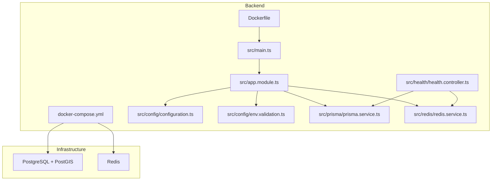

**Diagram sources**
- [backend/Dockerfile:1-30](file://backend/Dockerfile#L1-L30)
- [backend/docker-compose.yml:1-54](file://backend/docker-compose.yml#L1-L54)
- [backend/src/main.ts:12-102](file://backend/src/main.ts#L12-L102)
- [backend/src/app.module.ts:29-67](file://backend/src/app.module.ts#L29-L67)
- [backend/src/config/configuration.ts:48-96](file://backend/src/config/configuration.ts#L48-L96)
- [backend/src/config/env.validation.ts:3-44](file://backend/src/config/env.validation.ts#L3-L44)
- [backend/src/health/health.controller.ts:17-40](file://backend/src/health/health.controller.ts#L17-L40)
- [backend/src/prisma/prisma.service.ts:19-26](file://backend/src/prisma/prisma.service.ts#L19-L26)
- [backend/src/redis/redis.service.ts:28-52](file://backend/src/redis/redis.service.ts#L28-L52)

**Section sources**
- [README.md:1-18](file://README.md#L1-L18)

## Core Components
- Container image: Multi-stage Node.js build and runtime using Alpine Linux.
- Orchestration: Docker Compose defines PostgreSQL, Redis, and the API service with health checks and persistent volumes.
- Application bootstrap: Configures CORS, global prefix, static assets, validation, Swagger, shutdown hooks, and listens on port 8000.
- Configuration: Centralized environment-based configuration with type-safe defaults and Joi validation.
- Database: Prisma client with graceful lifecycle management.
- Cache/Scaling: Optional Redis integration with in-process fallback for local development.
- Health endpoint: Liveness/readiness-style check covering database and Redis status.

**Section sources**
- [backend/Dockerfile:1-30](file://backend/Dockerfile#L1-L30)
- [backend/docker-compose.yml:1-54](file://backend/docker-compose.yml#L1-L54)
- [backend/src/main.ts:12-102](file://backend/src/main.ts#L12-L102)
- [backend/src/app.module.ts:29-67](file://backend/src/app.module.ts#L29-L67)
- [backend/src/config/configuration.ts:48-96](file://backend/src/config/configuration.ts#L48-L96)
- [backend/src/config/env.validation.ts:3-44](file://backend/src/config/env.validation.ts#L3-L44)
- [backend/src/health/health.controller.ts:17-40](file://backend/src/health/health.controller.ts#L17-L40)
- [backend/src/prisma/prisma.service.ts:19-26](file://backend/src/prisma/prisma.service.ts#L19-L26)
- [backend/src/redis/redis.service.ts:28-52](file://backend/src/redis/redis.service.ts#L28-L52)

## Architecture Overview
The backend runs inside a container exposing port 8000. It connects to PostgreSQL (with PostGIS) and optionally Redis. The health endpoint verifies dependencies. Static assets serve the admin dashboard under /dashboard.

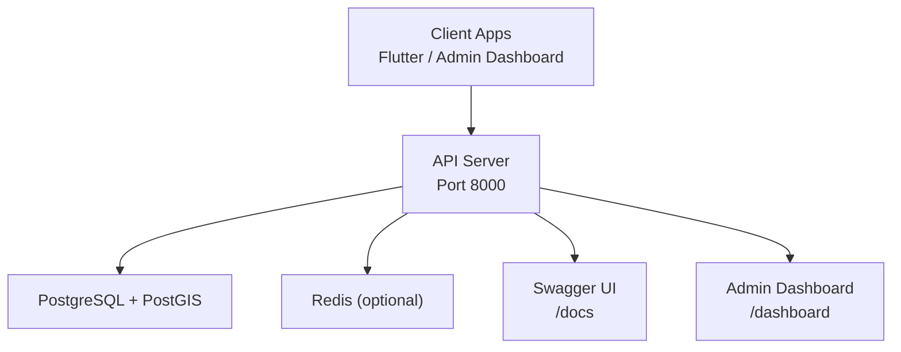

**Diagram sources**
- [backend/src/main.ts:36-48](file://backend/src/main.ts#L36-L48)
- [backend/src/main.ts:63-101](file://backend/src/main.ts#L63-L101)
- [backend/docker-compose.yml:35-49](file://backend/docker-compose.yml#L35-L49)

## Detailed Component Analysis

### Docker Image Build and Runtime
- Multi-stage build: builder stage compiles TypeScript; runner stage installs production dependencies and serves compiled output.
- Environment: NODE_ENV set to production; OpenSSL installed for crypto operations.
- Exposed port: 8000; entrypoint runs the compiled main module.

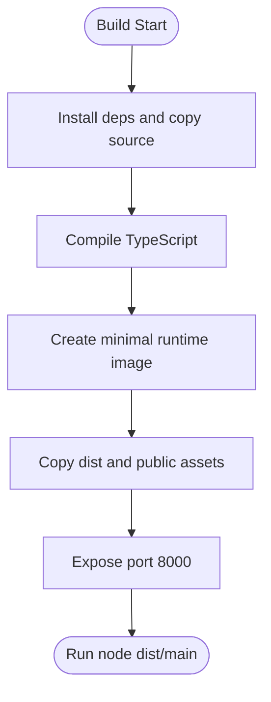

**Diagram sources**
- [backend/Dockerfile:1-30](file://backend/Dockerfile#L1-L30)

**Section sources**
- [backend/Dockerfile:1-30](file://backend/Dockerfile#L1-L30)

### Docker Compose Orchestration
- Services:
  - db: PostgreSQL with PostGIS, persistent volume, healthcheck via pg_isready.
  - redis: Redis with appendonly enabled, persistent volume, healthcheck via redis-cli ping.
  - api: Builds from Dockerfile, depends on healthy db and redis, maps env_file and environment variables, exposes port 8000.
- Volumes: Named volumes for db and redis data persistence.

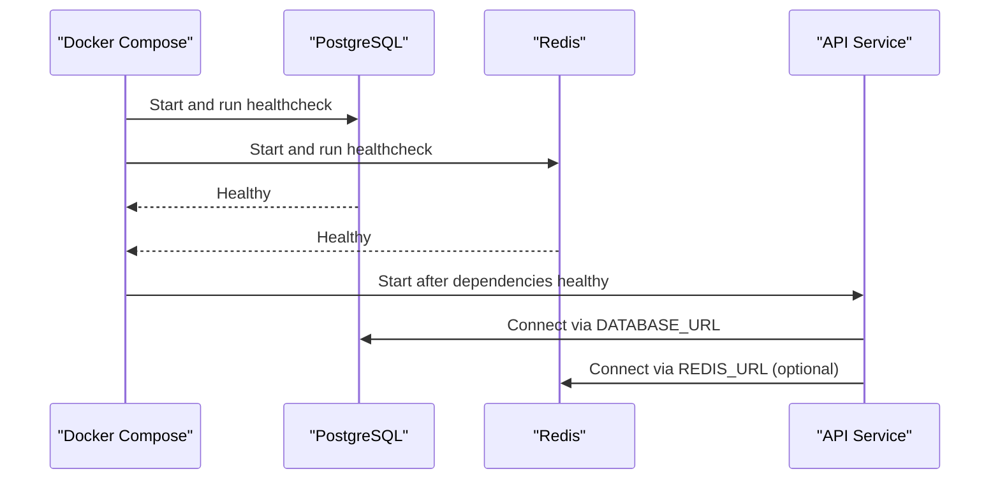

**Diagram sources**
- [backend/docker-compose.yml:1-54](file://backend/docker-compose.yml#L1-L54)

**Section sources**
- [backend/docker-compose.yml:1-54](file://backend/docker-compose.yml#L1-L54)

### Application Bootstrap and Global Settings
- Security: Helmet applied with specific policy toggles.
- CORS: Configured from CORS_ORIGINS; warns if empty in production.
- Prefix: Global API prefix set from config.
- Static assets: Serves admin dashboard at /dashboard.
- Validation: Global ValidationPipe whitelisting and transformation.
- Documentation: Swagger UI mounted at /docs.
- Shutdown: Graceful shutdown hooks enabled.

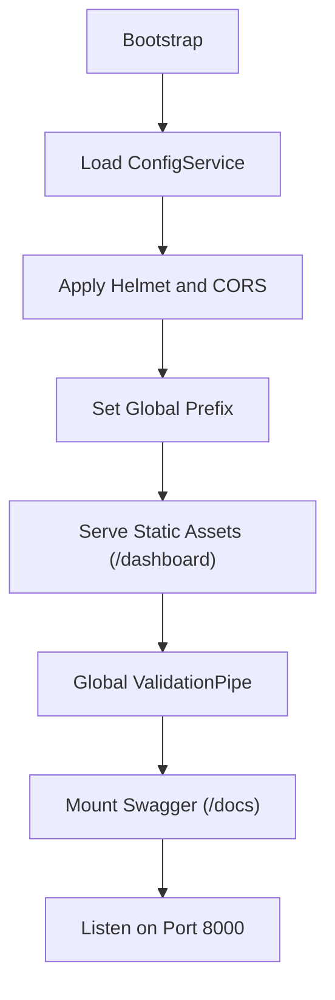

**Diagram sources**
- [backend/src/main.ts:12-102](file://backend/src/main.ts#L12-L102)

**Section sources**
- [backend/src/main.ts:12-102](file://backend/src/main.ts#L12-L102)

### Module Composition and Guards
- ConfigModule: Loads typed configuration and validates environment variables.
- ThrottlerModule: Default rate limiting (120 req/min per IP).
- PrismaModule and RedisModule: Database and cache integrations.
- Feature modules: Auth, Orders, Payments, Tracking, etc.
- Global guards and interceptors: JWT auth, roles, audit logging, exception filter.

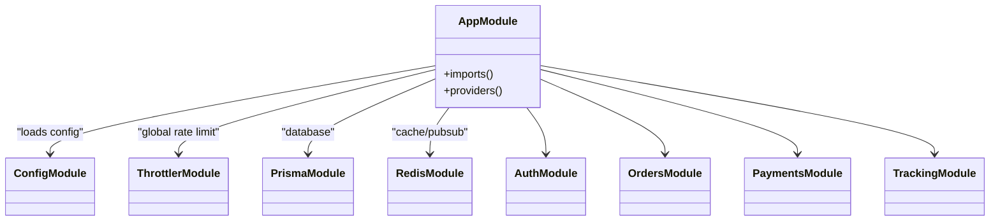

**Diagram sources**
- [backend/src/app.module.ts:29-67](file://backend/src/app.module.ts#L29-L67)

**Section sources**
- [backend/src/app.module.ts:29-67](file://backend/src/app.module.ts#L29-L67)

### Configuration Model and Defaults
- Typed AppConfig interface defines all settings: environment, port, API prefix, CORS origins, Redis URL, JWT options, OTP behavior, pricing rules, payment provider settings, and tracking parameters.
- Helper functions parse integers and booleans safely.
- Defaults provide safe values for development and configurable overrides via environment variables.

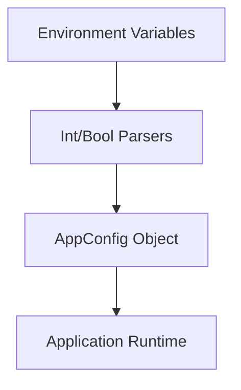

**Diagram sources**
- [backend/src/config/configuration.ts:1-96](file://backend/src/config/configuration.ts#L1-L96)

**Section sources**
- [backend/src/config/configuration.ts:1-96](file://backend/src/config/configuration.ts#L1-L96)

### Environment Variable Validation
- Joi schema enforces required fields (e.g., DATABASE_URL, JWT_SECRET, PAYMENT_WEBHOOK_SECRET), ranges, and defaults.
- Abort early disabled to collect all validation errors; unknown keys allowed.

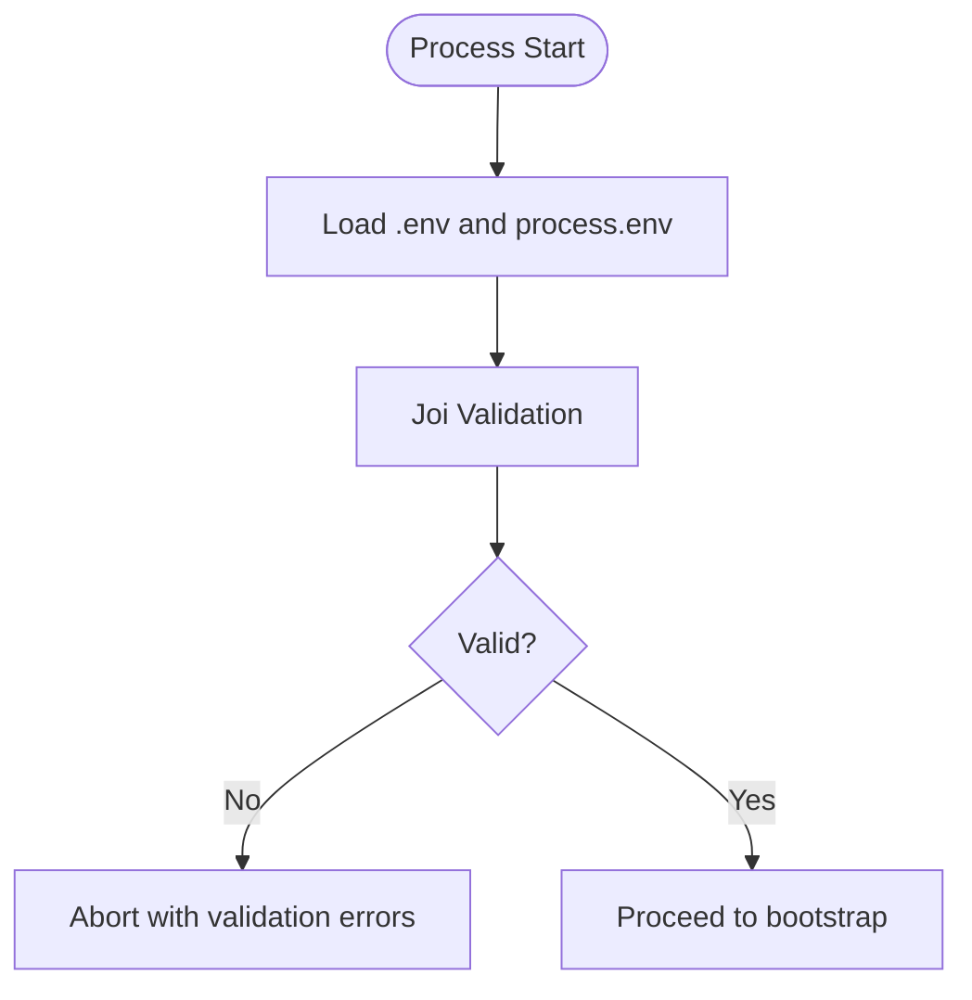

**Diagram sources**
- [backend/src/config/env.validation.ts:3-44](file://backend/src/config/env.validation.ts#L3-L44)
- [backend/src/app.module.ts:31-37](file://backend/src/app.module.ts#L31-L37)

**Section sources**
- [backend/src/config/env.validation.ts:3-44](file://backend/src/config/env.validation.ts#L3-L44)
- [backend/src/app.module.ts:31-37](file://backend/src/app.module.ts#L31-L37)

### Database Integration (Prisma)
- Lifecycle: Connect on module init, disconnect on destroy.
- Logging: Warn and error events forwarded to logger.
- Shutdown: Graceful close via enableShutdownHooks.

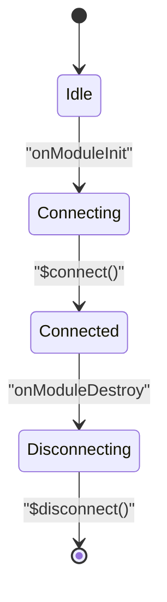

**Diagram sources**
- [backend/src/prisma/prisma.service.ts:1-33](file://backend/src/prisma/prisma.service.ts#L1-L33)

**Section sources**
- [backend/src/prisma/prisma.service.ts:1-33](file://backend/src/prisma/prisma.service.ts#L1-L33)

### Redis Integration and Fallback
- Optional Redis: If REDIS_URL is missing or connection fails, falls back to in-process memory map.
- Use cases: Rider position cache, cross-instance rate limiting signals, Socket.IO fan-out.
- Methods: setJson, getJson, del, exists, ping; robust error handling and TTL support.

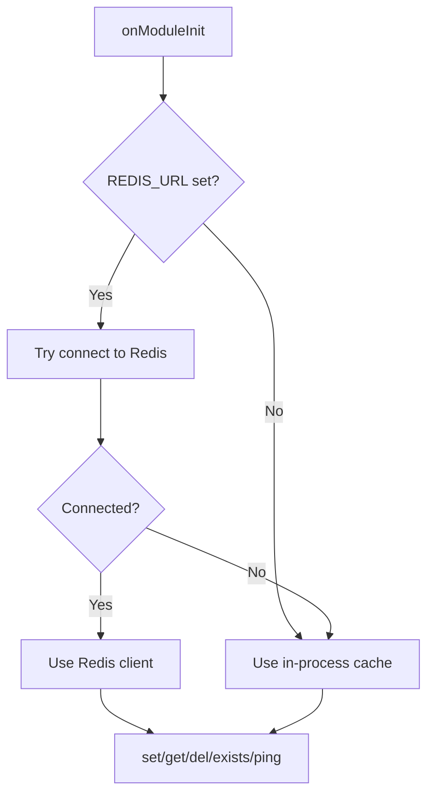

**Diagram sources**
- [backend/src/redis/redis.service.ts:28-52](file://backend/src/redis/redis.service.ts#L28-L52)
- [backend/src/redis/redis.service.ts:69-131](file://backend/src/redis/redis.service.ts#L69-L131)

**Section sources**
- [backend/src/redis/redis.service.ts:1-133](file://backend/src/redis/redis.service.ts#L1-L133)

### Health Endpoint
- Public endpoint returning liveness and dependency status.
- Checks:
  - Database connectivity via Prisma raw query.
  - Redis availability via ping when enabled.
- Response includes uptime, version, and timestamp.

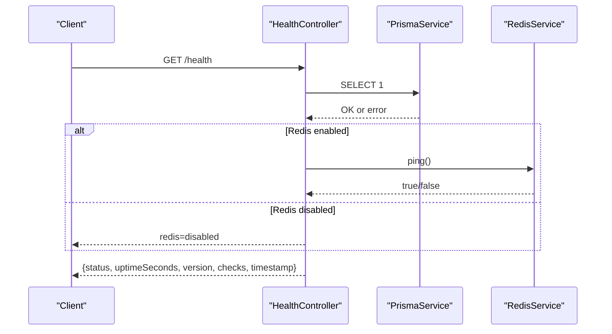

**Diagram sources**
- [backend/src/health/health.controller.ts:17-40](file://backend/src/health/health.controller.ts#L17-L40)

**Section sources**
- [backend/src/health/health.controller.ts:1-42](file://backend/src/health/health.controller.ts#L1-L42)

## Environment and Configuration
Key environment variables and their purpose:
- General:
  - NODE_ENV: Environment mode (development, test, production).
  - PORT: Listening port (default 8000).
  - API_PREFIX: Global API prefix (default api/v1).
  - CORS_ORIGINS: Comma-separated allowed origins.
- Database:
  - DATABASE_URL: PostgreSQL connection string (required).
- Cache:
  - REDIS_URL: Redis connection string (optional).
- Authentication:
  - JWT_SECRET: Secret key (minimum length enforced).
  - JWT_ACCESS_TTL: Access token lifetime in seconds.
  - REFRESH_TOKEN_TTL_DAYS: Refresh token lifetime in days.
  - RESET_TOKEN_TTL: Password reset token lifetime in seconds.
- OTP:
  - OTP_TTL_SECONDS: OTP validity period.
  - OTP_RESEND_SECONDS: Minimum resend interval.
  - OTP_MAX_ATTEMPTS: Max attempts per OTP flow.
  - OTP_DEV_MODE: Development bypass flag.
- Pricing and Dispatch:
  - DELIVERY_BASE_FEE, DELIVERY_PER_KM_FEE, DELIVERY_FREE_KM, SERVICE_FEE, RIDER_COMMISSION_PERCENT, DISPATCH_RADIUS_KM, ASSIGNMENT_TIMEOUT_SECONDS.
- Payments:
  - PAYMENT_WEBHOOK_SECRET: Webhook signature secret (required).
  - PAYMENTS_SANDBOX: Enable sandbox mode.
  - MTN_MOMO_API_KEY, MTN_MOMO_USER_ID, MTN_MOMO_SUBSCRIPTION_KEY.
  - AIRTEL_MONEY_CLIENT_ID, AIRTEL_MONEY_CLIENT_SECRET, AIRTEL_MONEY_MERCHANT_CODE.
- Tracking:
  - TRACKING_MIN_INTERVAL_MS: Minimum tracking interval.
  - TRACKING_HISTORY_RETENTION_DAYS: History retention duration.

Validation and defaults are enforced by the configuration loader and Joi schema.

**Section sources**
- [backend/src/config/configuration.ts:48-96](file://backend/src/config/configuration.ts#L48-L96)
- [backend/src/config/env.validation.ts:3-44](file://backend/src/config/env.validation.ts#L3-L44)

## Deployment Procedures

### Development
- Ensure Docker and Docker Compose are installed.
- Create a .env file in backend/ with required variables (DATABASE_URL, JWT_SECRET, PAYMENT_WEBHOOK_SECRET, and any optional ones like REDIS_URL).
- Start services:
  - docker compose up --build
- Verify:
  - API at http://localhost:8000/api/v1
  - Swagger at http://localhost:8000/docs
  - Admin dashboard at http://localhost:8000/dashboard
  - Health at http://localhost:8000/health

Notes:
- The default compose sets DATABASE_URL and REDIS_URL for the API service.
- PostgreSQL and Redis ports are exposed locally for tooling access.

**Section sources**
- [backend/docker-compose.yml:1-54](file://backend/docker-compose.yml#L1-L54)
- [backend/src/main.ts:97-101](file://backend/src/main.ts#L97-L101)

### Staging
- Prepare environment-specific .env.staging with secure secrets and production-like settings.
- Build and deploy the API container to your staging environment (Kubernetes, ECS, or VMs).
- Configure external PostgreSQL and Redis instances with proper networking and security groups.
- Set CORS_ORIGINS to allow only staging domains.
- Disable sandbox payments unless explicitly needed.
- Verify health and dependency checks.

### Production
- Use hardened images and minimal base OS layers.
- Store secrets in a secure vault and inject them into the runtime environment.
- Set NODE_ENV=production and enforce strict CORS_ORIGINS.
- Ensure DATABASE_URL points to a managed, backed-up PostgreSQL instance.
- Ensure REDIS_URL points to a managed, clustered Redis instance for multi-instance deployments.
- Configure reverse proxy/load balancer to terminate TLS and route to port 8000.
- Enable structured logging and forward logs to a centralized collector.
- Monitor health endpoint and set alerts for degraded status.

**Section sources**
- [backend/src/main.ts:25-34](file://backend/src/main.ts#L25-L34)
- [backend/src/config/configuration.ts:48-96](file://backend/src/config/configuration.ts#L48-L96)

## CI/CD, Testing, and Automation
Recommended pipeline stages:
- Lint and type-check:
  - Run TypeScript compiler checks and linting.
- Unit tests:
  - Execute backend unit tests (if present).
- Integration tests:
  - Spin up ephemeral PostgreSQL and Redis containers.
  - Run database migrations and seeders.
  - Execute API integration tests against a test database.
- Build image:
  - Build Docker image using the provided Dockerfile.
- Push image:
  - Tag with commit SHA and push to registry.
- Deploy:
  - Update deployment manifests or run docker compose with environment variables injected from secrets manager.
- Smoke tests:
  - Call /health and assert status ok.

Automation tips:
- Use separate .env files or secret stores per environment.
- Fail fast on validation errors during startup.
- Rollback strategy: keep previous image tag and revert deployment on failure.

[No sources needed since this section provides general guidance]

## Database Migration, Backup, and Disaster Recovery

### Migrations
- Use Prisma migrations to evolve schema.
- Apply migrations before starting the API in new environments.
- Seed data for development/staging using provided seed scripts where applicable.

### Backups
- Schedule regular logical backups of PostgreSQL (e.g., pg_dump) to durable storage.
- For PostGIS, ensure spatial indexes and geometry data are included.
- Back up Redis snapshots if used for critical state; otherwise rely on durability flags and replication.

### Disaster Recovery
- Test restore procedures regularly.
- Maintain runbooks for failover to a secondary database region.
- Validate data integrity post-restore.

[No sources needed since this section provides general guidance]

## Monitoring, Logging, Health Checks, and Performance

### Monitoring
- Health endpoint:
  - GET /health returns status, uptime, version, and dependency checks.
- Metrics:
  - Integrate application metrics (CPU, memory, request latency, error rates) and export to a time-series store.
- Alerts:
  - Alert on degraded status, high error rates, slow responses, and dependency failures.

### Logging
- Structured JSON logs recommended.
- Capture request IDs, user context (where appropriate), and correlation IDs.
- Forward logs to a centralized system (e.g., ELK, Loki, CloudWatch).

### Health Checks
- Kubernetes readiness/liveness probes can call /health.
- External monitors should poll /health and verify database and Redis states.

### Performance Tuning
- Connection pooling:
  - Tune Prisma/PostgreSQL pool sizes based on workload.
- Rate limiting:
  - Adjust throttling limits per environment.
- Redis:
  - Use Redis for hot paths (rider positions, pub/sub) in multi-instance deployments.
- Static assets:
  - Serve admin dashboard via CDN or reverse proxy caching.

**Section sources**
- [backend/src/health/health.controller.ts:17-40](file://backend/src/health/health.controller.ts#L17-L40)
- [backend/src/app.module.ts:38-40](file://backend/src/app.module.ts#L38-L40)
- [backend/src/redis/redis.service.ts:10-19](file://backend/src/redis/redis.service.ts#L10-L19)

## Scaling, Load Balancing, and High Availability

### Horizontal Scaling
- Run multiple API replicas behind a load balancer.
- Ensure shared state is externalized:
  - PostgreSQL (primary with read replicas if needed).
  - Redis (clustered or managed service).
- Sticky sessions are not required if state is externalized.

### Load Balancing
- Terminate TLS at the edge (reverse proxy or cloud LB).
- Route traffic to API replicas on port 8000.
- Configure health checks to route out unhealthy instances.

### High Availability
- Multi-AZ database with automatic failover.
- Redis cluster or managed service with replication.
- Auto-scaling policies based on CPU/memory/request latency.

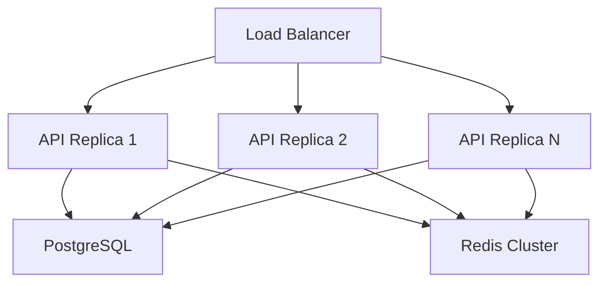

[No sources needed since this diagram shows conceptual architecture]

## Troubleshooting Guide

Common issues and resolutions:
- Startup fails due to invalid environment variables:
  - Review Joi validation errors and correct missing or invalid values (e.g., DATABASE_URL, JWT_SECRET, PAYMENT_WEBHOOK_SECRET).
- CORS errors in production:
  - Set CORS_ORIGINS to include frontend domains; avoid leaving it empty in production.
- Database connection failures:
  - Verify DATABASE_URL, network access, credentials, and PostGIS extension availability.
- Redis unavailable:
  - If REDIS_URL is missing or unreachable, the service falls back to in-process cache; note that this disables cross-instance features.
- Payment provider not configured:
  - Mobile money providers require merchant credentials; without them, collection requests will be rejected.
- Health endpoint reports degraded:
  - Inspect database and Redis statuses returned by /health and address underlying dependency failures.

Operational checks:
- Confirm container ports: API on 8000, PostgreSQL on 5432, Redis on 6379 (local dev).
- Verify persistent volumes for db and redis in development.
- Use docker compose logs to inspect service startup and errors.

**Section sources**
- [backend/src/config/env.validation.ts:3-44](file://backend/src/config/env.validation.ts#L3-L44)
- [backend/src/main.ts:25-34](file://backend/src/main.ts#L25-L34)
- [backend/src/redis/redis.service.ts:28-52](file://backend/src/redis/redis.service.ts#L28-L52)
- [backend/src/health/health.controller.ts:17-40](file://backend/src/health/health.controller.ts#L17-L40)

## Conclusion
FuelConnect’s backend is designed for reliable, scalable deployment with clear configuration boundaries, robust validation, and optional Redis-backed features. By following the environment setup, containerization, and operational practices outlined here, you can confidently deploy to development, staging, and production while maintaining observability, resilience, and performance.