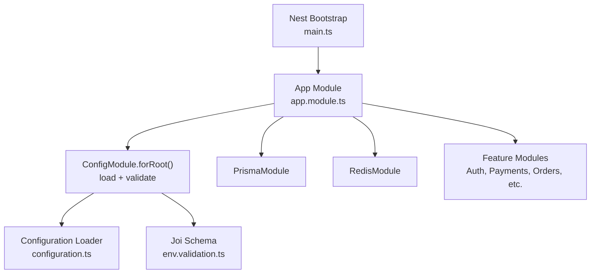
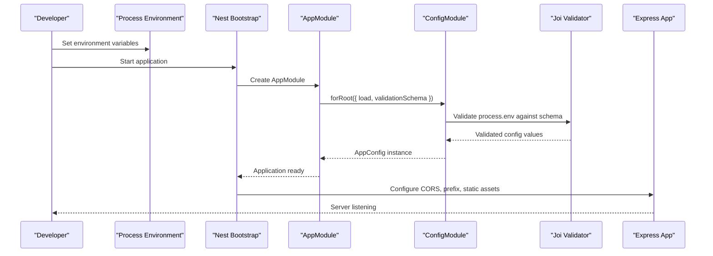
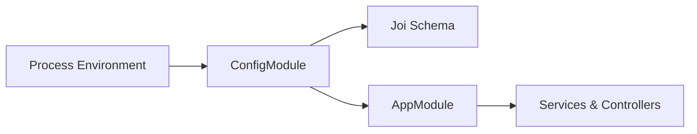

# Environment Configuration & Management

<cite>
**Referenced Files in This Document**
- [configuration.ts](file://backend/src/config/configuration.ts)
- [env.validation.ts](file://backend/src/config/env.validation.ts)
- [app.module.ts](file://backend/src/app.module.ts)
- [main.ts](file://backend/src/main.ts)
- [package.json](file://backend/package.json)
- [docker-compose.yml](file://backend/docker-compose.yml)
- [Dockerfile](file://backend/Dockerfile)
- [README.md](file://backend/README.md)
- [mobile-money.provider.ts](file://backend/src/payments/providers/mobile-money.provider.ts)
</cite>

## Table of Contents
1. [Introduction](#introduction)
2. [Project Structure](#project-structure)
3. [Core Components](#core-components)
4. [Architecture Overview](#architecture-overview)
5. [Detailed Component Analysis](#detailed-component-analysis)
6. [Environment Variables Reference](#environment-variables-reference)
7. [Environment-Specific Behavior](#environment-specific-behavior)
8. [Configuration Validation Rules](#configuration-validation-rules)
9. [Secure Secret Management Practices](#secure-secret-management-practices)
10. [Environment Setup Scripts and Automation](#environment-setup-scripts-and-automation)
11. [Dependency Analysis](#dependency-analysis)
12. [Performance Considerations](#performance-considerations)
13. [Troubleshooting Guide](#troubleshooting-guide)
14. [Conclusion](#conclusion)

## Introduction
This document explains how FuelConnect manages environment configuration using NestJS ConfigModule, Joi-based validation, and type-safe configuration access. It covers the separation of development, staging, and production environments, documents all required environment variables (database, Redis, JWT, payments, tracking), provides guidance for configuration templates and overrides, and outlines secure secret management practices.

## Project Structure
The backend uses a centralized configuration approach:
- A typed configuration loader returns an `AppConfig` object from environment variables.
- A Joi schema validates environment variables at boot.
- The application module registers the configuration globally.
- The bootstrap process reads configuration to set up CORS, API prefix, static assets, Swagger, and server listening.

**Diagram sources**
- [main.ts:12-36](file://backend/src/main.ts#L12-L36)
- [app.module.ts:29-44](file://backend/src/app.module.ts#L29-L44)
- [configuration.ts:48-96](file://backend/src/config/configuration.ts#L48-L96)
- [env.validation.ts:3-44](file://backend/src/config/env.validation.ts#L3-L44)

**Section sources**
- [app.module.ts:29-44](file://backend/src/app.module.ts#L29-L44)
- [main.ts:12-36](file://backend/src/main.ts#L12-L36)

## Core Components
- Typed configuration loader: exports an `AppConfig` interface and a default function that maps environment variables into a strongly-typed object with sensible defaults.
- Validation schema: defines Joi rules for each environment variable, including required fields, ranges, and defaults.
- Global configuration registration: ConfigModule is configured once in AppModule with load and validation enabled.
- Bootstrap usage: main.ts reads env, port, API prefix, and CORS origins from ConfigService to configure the Express app.

Key responsibilities:
- Centralize configuration shape and defaults.
- Fail fast on invalid or missing required configuration.
- Provide type-safe access via ConfigService across modules.

**Section sources**
- [configuration.ts:1-96](file://backend/src/config/configuration.ts#L1-L96)
- [env.validation.ts:1-44](file://backend/src/config/env.validation.ts#L1-L44)
- [app.module.ts:29-44](file://backend/src/app.module.ts#L29-L44)
- [main.ts:18-36](file://backend/src/main.ts#L18-L36)

## Architecture Overview
The configuration pipeline ensures that only valid, validated configuration reaches runtime services.

**Diagram sources**
- [app.module.ts:29-44](file://backend/src/app.module.ts#L29-L44)
- [main.ts:12-36](file://backend/src/main.ts#L12-L36)
- [env.validation.ts:3-44](file://backend/src/config/env.validation.ts#L3-L44)

## Detailed Component Analysis

### Configuration Loader (configuration.ts)
- Defines `AppConfig` with nested sections: jwt, otp, pricing, payments, tracking.
- Provides helper functions to parse integers and booleans safely.
- Maps environment variables to typed properties with fallbacks.
- Some sensitive fields have development-only defaults; these must be overridden in non-development environments.

Important behaviors:
- Boolean parsing accepts multiple truthy strings.
- Numeric parsing falls back to defaults when values are missing or invalid.
- Payment provider credentials are read from environment but may be empty in sandbox mode.

**Section sources**
- [configuration.ts:1-96](file://backend/src/config/configuration.ts#L1-L96)

### Validation Schema (env.validation.ts)
- Enforces allowed values for NODE_ENV.
- Requires DATABASE_URL and JWT_SECRET with minimum length constraints.
- Sets safe defaults for optional settings like REDIS_URL, payment provider keys, and tracking intervals.
- Uses allowUnknown to avoid failing on extra variables while still validating known ones.

Validation highlights:
- PORT must be a valid port number.
- Pricing percentages are bounded between 0 and 100.
- OTP attempts are constrained to a reasonable range.
- Payment webhook secret is required.

**Section sources**
- [env.validation.ts:1-44](file://backend/src/config/env.validation.ts#L1-L44)

### AppModule Registration (app.module.ts)
- Registers ConfigModule globally with caching enabled.
- Loads the typed configuration and applies the Joi schema.
- Enables throttling and imports feature modules.

**Section sources**
- [app.module.ts:29-44](file://backend/src/app.module.ts#L29-L44)

### Bootstrap Usage (main.ts)
- Reads env, port, API prefix, and CORS origins from ConfigService.
- Applies Helmet security headers.
- Enables CORS based on configured origins; warns if CORS_ORIGINS is empty in production.
- Sets global API prefix and serves the dashboard static assets.
- Initializes Swagger documentation.

**Section sources**
- [main.ts:12-36](file://backend/src/main.ts#L12-L36)
- [main.ts:63-102](file://backend/src/main.ts#L63-L102)

### Payment Provider Settings Access (mobile-money.provider.ts)
- Merges default payment settings with those loaded from configuration.
- Checks whether provider credentials are configured before enabling methods.

**Section sources**
- [mobile-money.provider.ts:44-53](file://backend/src/payments/providers/mobile-money.provider.ts#L44-L53)
- [mobile-money.provider.ts:74-79](file://backend/src/payments/providers/mobile-money.provider.ts#L74-L79)

## Environment Variables Reference
Below is the complete list of environment variables used by FuelConnect, their types, defaults, and notes.

- NODE_ENV
  - Type: string
  - Allowed: development, test, production
  - Default: development
  - Notes: Controls environment behavior and OTP dev mode.

- PORT
  - Type: number
  - Default: 8000
  - Notes: REST and Socket.IO server port.

- API_PREFIX
  - Type: string
  - Default: api/v1
  - Notes: Must match Flutter client base path.

- CORS_ORIGINS
  - Type: string (comma-separated)
  - Default: empty
  - Notes: If empty in production, CORS allows all origins with a warning.

- DATABASE_URL
  - Type: string
  - Required: true
  - Notes: PostgreSQL connection string (PostGIS).

- REDIS_URL
  - Type: string
  - Default: empty
  - Notes: Optional; empty enables in-process fallback for single-instance deployments.

- JWT_SECRET
  - Type: string
  - Required: true
  - Min length: 32 characters
  - Notes: Strong secret required for token signing.

- JWT_ACCESS_TTL
  - Type: number (seconds)
  - Default: 900
  - Notes: Minimum 60 seconds.

- REFRESH_TOKEN_TTL_DAYS
  - Type: number (days)
  - Default: 30
  - Notes: Rotating refresh token lifetime.

- RESET_TOKEN_TTL
  - Type: number (seconds)
  - Default: 600
  - Notes: Password reset token lifetime.

- OTP_TTL_SECONDS
  - Type: number
  - Default: 120
  - Notes: Minimum 60 seconds.

- OTP_RESEND_SECONDS
  - Type: number
  - Default: 30
  - Notes: Minimum 10 seconds.

- OTP_MAX_ATTEMPTS
  - Type: number
  - Default: 5
  - Notes: Range 1–10.

- OTP_DEV_MODE
  - Type: boolean
  - Default: false
  - Notes: In development, devMode is enabled unless explicitly disabled.

- DELIVERY_BASE_FEE
  - Type: number
  - Default: 8000
  - Notes: Currency units consistent with business logic.

- DELIVERY_PER_KM_FEE
  - Type: number
  - Default: 500
  - Notes: Per-kilometer fee beyond free distance.

- DELIVERY_FREE_KM
  - Type: number
  - Default: 3
  - Notes: Kilometers included in base fee.

- SERVICE_FEE
  - Type: number
  - Default: 2500
  - Notes: Platform service fee.

- RIDER_COMMISSION_PERCENT
  - Type: number
  - Default: 15
  - Notes: Percentage of total; range 0–100.

- DISPATCH_RADIUS_KM
  - Type: number
  - Default: 10
  - Notes: Rider search radius.

- ASSIGNMENT_TIMEOUT_SECONDS
  - Type: number
  - Default: 60
  - Notes: Offer expiry timeout; minimum 15 seconds.

- PAYMENT_WEBHOOK_SECRET
  - Type: string
  - Required: true
  - Notes: HMAC key for verifying provider webhooks.

- PAYMENTS_SANDBOX
  - Type: boolean
  - Default: true
  - Notes: Disables external calls; simulate payments.

- MTN_MOMO_API_KEY
  - Type: string
  - Default: empty
  - Notes: Required for MTN Mobile Money integration.

- MTN_MOMO_USER_ID
  - Type: string
  - Default: empty
  - Notes: Required for MTN Mobile Money integration.

- MTN_MOMO_SUBSCRIPTION_KEY
  - Type: string
  - Default: empty
  - Notes: Required for MTN Mobile Money integration.

- AIRTEL_MONEY_CLIENT_ID
  - Type: string
  - Default: empty
  - Notes: Required for Airtel Money integration.

- AIRTEL_MONEY_CLIENT_SECRET
  - Type: string
  - Default: empty
  - Notes: Required for Airtel Money integration.

- AIRTEL_MONEY_MERCHANT_CODE
  - Type: string
  - Default: empty
  - Notes: Required for Airtel Money integration.

- TRACKING_MIN_INTERVAL_MS
  - Type: number
  - Default: 2500
  - Notes: GPS throttle per rider; minimum 1000 ms.

- TRACKING_HISTORY_RETENTION_DAYS
  - Type: number
  - Default: 30
  - Notes: History pruning window; minimum 1 day.

**Section sources**
- [env.validation.ts:3-44](file://backend/src/config/env.validation.ts#L3-L44)
- [configuration.ts:48-96](file://backend/src/config/configuration.ts#L48-L96)
- [README.md:158-192](file://backend/README.md#L158-L192)

## Environment-Specific Behavior
- Development
  - NODE_ENV defaults to development.
  - OTP dev mode is enabled unless explicitly disabled.
  - CORS allows all origins when CORS_ORIGINS is empty, with a warning in production only.
  - Payment sandbox mode is enabled by default.

- Test
  - Use NODE_ENV=test to run tests with strict validation.
  - Keep secrets out of test configurations; use minimal fixtures.

- Production
  - NODE_ENV=production.
  - CORS_ORIGINS should be explicitly set; otherwise, a warning is logged and all origins are allowed.
  - JWT_SECRET and PAYMENT_WEBHOOK_SECRET are required and must be strong.
  - PAYMENTS_SANDBOX should be disabled when integrating with live providers.

Staging
- Treat staging similarly to production but can keep PAYMENTS_SANDBOX enabled for testing.
- Ensure all required secrets are present and rotated regularly.

**Section sources**
- [configuration.ts:48-96](file://backend/src/config/configuration.ts#L48-L96)
- [main.ts:27-34](file://backend/src/main.ts#L27-L34)
- [README.md:158-192](file://backend/README.md#L158-L192)

## Configuration Validation Rules
- NODE_ENV must be one of development, test, production.
- PORT must be a valid port number.
- DATABASE_URL must be a valid URI with postgresql or postgres scheme and is required.
- JWT_SECRET is required and must be at least 32 characters.
- TTLs and timeouts enforce minimum bounds to prevent misconfiguration.
- Pricing percentages are bounded between 0 and 100.
- OTP attempts are limited to a safe range.
- Payment webhook secret is required.
- Provider credential fields are optional but must be provided to enable respective payment methods.

Error handling:
- Validation failures cause the application to refuse to start.
- Missing required variables result in startup errors.
- Unknown variables are allowed without failing due to allowUnknown.

**Section sources**
- [env.validation.ts:3-44](file://backend/src/config/env.validation.ts#L3-L44)
- [app.module.ts:31-37](file://backend/src/app.module.ts#L31-L37)

## Secure Secret Management Practices
- Never commit secrets to version control.
- Use environment variables injected by your deployment platform or secret manager.
- Rotate JWT_SECRET and PAYMENT_WEBHOOK_SECRET regularly.
- Use strong, unique secrets for each environment.
- Avoid logging sensitive configuration values.
- Prefer container orchestration platforms that support secret injection (e.g., Kubernetes Secrets, Docker secrets).
- For local development, use .env files excluded from version control and ensure they are not shared.

Operational recommendations:
- Store DATABASE_URL, REDIS_URL, JWT_SECRET, PAYMENT_WEBHOOK_SECRET, and provider credentials in a secure vault.
- Inject them at runtime via CI/CD pipelines.
- Validate configuration early and fail fast on invalid inputs.

[No sources needed since this section provides general guidance]

## Environment Setup Scripts and Automation
Local development:
- Install dependencies and generate Prisma client: npm ci
- Run database migrations and seed data: npm run db:setup
- Start development server with hot reload: npm run start:dev
- Start production build: npm run build && npm run start:prod

Docker Compose:
- The compose file defines PostGIS and Redis services and sets environment variables for the API service.
- The API service references an .env file and also overrides DATABASE_URL and REDIS_URL inline.

Dockerfile:
- Builds the application in a multi-stage build.
- Sets NODE_ENV=production in the runtime image.
- Exposes port 8000 and runs the compiled main entry point.

Package scripts:
- Build, start, debug, typecheck, Prisma commands, and DB setup are defined in package.json.

**Section sources**
- [package.json:7-20](file://backend/package.json#L7-L20)
- [docker-compose.yml:1-54](file://backend/docker-compose.yml#L1-L54)
- [Dockerfile:1-30](file://backend/Dockerfile#L1-L30)

## Dependency Analysis
The configuration system depends on:
- @nestjs/config for loading and providing configuration.
- Joi for validation.
- Process environment variables populated by the host or container orchestrator.

**Diagram sources**
- [app.module.ts:29-44](file://backend/src/app.module.ts#L29-L44)
- [env.validation.ts:1-44](file://backend/src/config/env.validation.ts#L1-L44)

**Section sources**
- [app.module.ts:29-44](file://backend/src/app.module.ts#L29-L44)
- [env.validation.ts:1-44](file://backend/src/config/env.validation.ts#L1-L44)

## Performance Considerations
- ConfigModule caching reduces repeated configuration resolution overhead.
- Redis URL is optional; omitting it enables in-process fallback suitable for single-instance deployments.
- Tracking interval and history retention affect memory and I/O; tune according to workload.
- Avoid excessive CORS origins; restrict to known domains in production.

[No sources needed since this section provides general guidance]

## Troubleshooting Guide
Common issues and resolutions:
- Startup fails due to missing required variables:
  - Ensure DATABASE_URL and JWT_SECRET are set.
  - Verify PAYMENT_WEBHOOK_SECRET is present.
- Invalid configuration values:
  - Check PORT is a valid number.
  - Confirm TTLs meet minimum thresholds.
  - Ensure pricing percentages are within 0–100.
- CORS warnings in production:
  - Set CORS_ORIGINS explicitly to trusted domains.
- Payment methods not available:
  - Provide MTN or Airtel credentials to enable respective methods.
  - Toggle PAYMENTS_SANDBOX appropriately.

Validation error handling:
- The application refuses to start if validation fails.
- Review logs for specific validation messages and correct the environment accordingly.

**Section sources**
- [env.validation.ts:3-44](file://backend/src/config/env.validation.ts#L3-L44)
- [main.ts:27-34](file://backend/src/main.ts#L27-L34)

## Conclusion
FuelConnect’s configuration system centralizes environment settings through a typed loader and robust Joi validation. This approach ensures predictable behavior across development, staging, and production, enforces security requirements for secrets, and provides clear defaults for non-sensitive settings. By following the environment variable reference and secure secret management practices outlined here, teams can deploy FuelConnect reliably and maintain consistency across environments.

[No sources needed since this section summarizes without analyzing specific files]