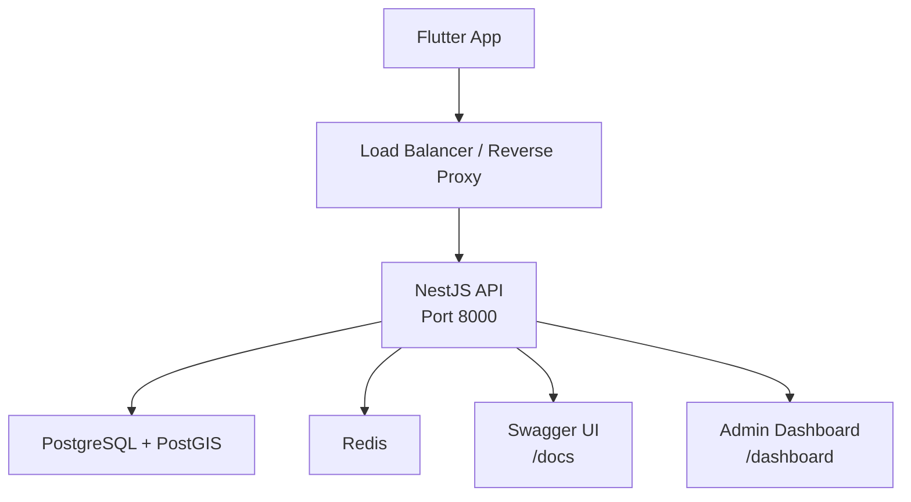
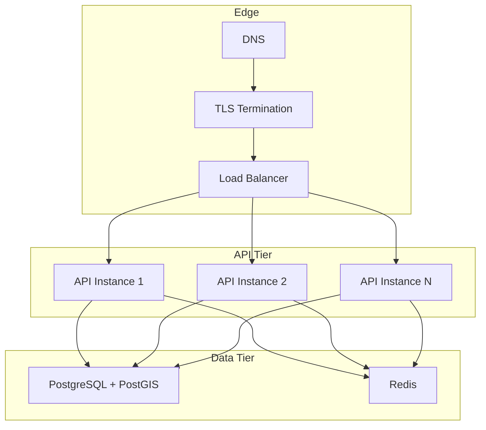
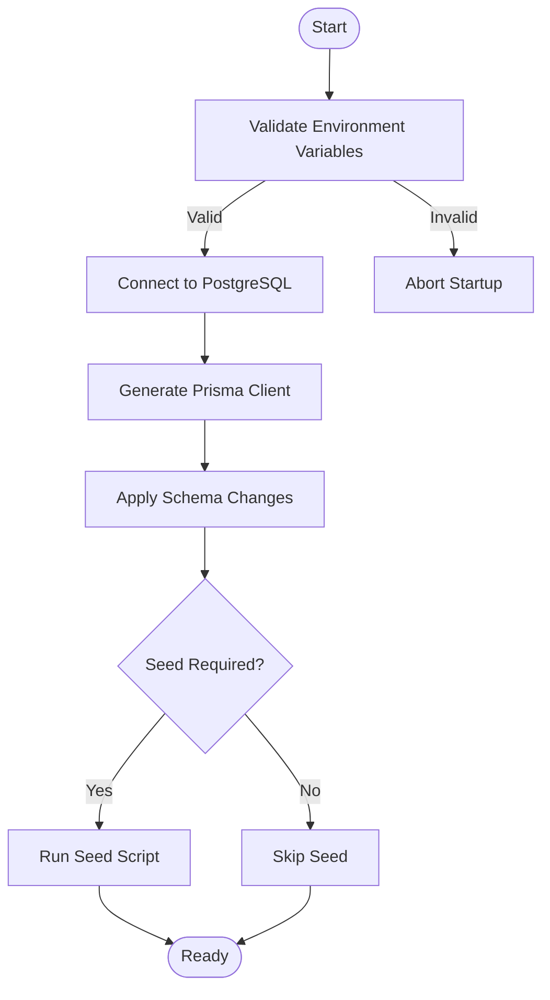
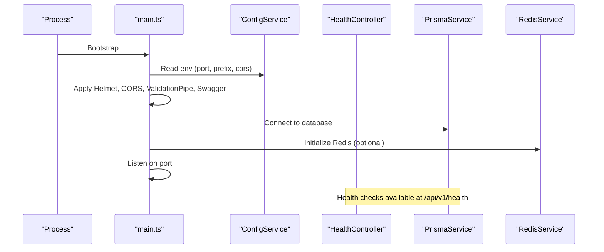
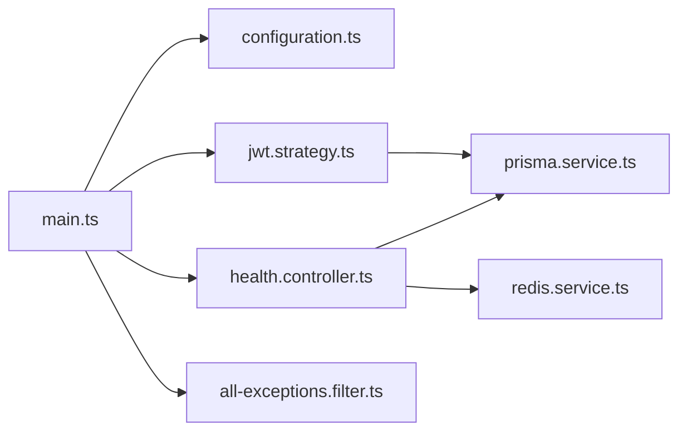

# Production Deployment Procedures

<cite>
**Referenced Files in This Document**
- [README.md](file://README.md)
- [backend/README.md](file://backend/README.md)
- [backend/package.json](file://backend/package.json)
- [backend/Dockerfile](file://backend/Dockerfile)
- [backend/docker-compose.yml](file://backend/docker-compose.yml)
- [backend/src/main.ts](file://backend/src/main.ts)
- [backend/src/config/configuration.ts](file://backend/src/config/configuration.ts)
- [backend/src/config/env.validation.ts](file://backend/src/config/env.validation.ts)
- [backend/prisma/schema.prisma](file://backend/prisma/schema.prisma)
- [backend/prisma/seed.ts](file://backend/prisma/seed.ts)
- [backend/src/health/health.controller.ts](file://backend/src/health/health.controller.ts)
- [backend/src/auth/strategies/jwt.strategy.ts](file://backend/src/auth/strategies/jwt.strategy.ts)
- [backend/src/common/filters/all-exceptions.filter.ts](file://backend/src/common/filters/all-exceptions.filter.ts)
- [backend/src/redis/redis.service.ts](file://backend/src/redis/redis.service.ts)
- [backend/src/prisma/prisma.service.ts](file://backend/src/prisma/prisma.service.ts)
</cite>

## Table of Contents
1. [Introduction](#introduction)
2. [Project Structure](#project-structure)
3. [Core Components](#core-components)
4. [Architecture Overview](#architecture-overview)
5. [Detailed Component Analysis](#detailed-component-analysis)
6. [Dependency Analysis](#dependency-analysis)
7. [Performance Considerations](#performance-considerations)
8. [Troubleshooting Guide](#troubleshooting-guide)
9. [Conclusion](#conclusion)
10. [Appendices](#appendices)

## Introduction
This document defines production deployment procedures for the FuelConnect platform. It covers database migrations, seed data initialization, service startup sequences, zero-downtime deployment strategies, infrastructure requirements, backup and disaster recovery, monitoring, rollback procedures, incident response, post-deployment verification, scaling considerations, and capacity planning.

The backend is a NestJS API running on port 8000 with an `/api/v1` prefix, Swagger documentation at `/docs`, a static admin dashboard at `/dashboard`, and Socket.IO support for real-time tracking. The Flutter frontend is separate and currently uses mocked data; the API contract is already aligned with the app expectations.

**Section sources**
- [README.md:1-18](file://README.md#L1-L18)
- [backend/README.md:50-90](file://backend/README.md#L50-L90)

## Project Structure
FuelConnect consists of:
- Backend: NestJS API, Prisma schema, PostGIS-enabled PostgreSQL, Redis, Docker Compose, and a Dockerfile.
- Flutter frontend: mobile/web prototype that can be connected to the same API.

**Diagram sources**
- [backend/src/main.ts:36-48](file://backend/src/main.ts#L36-L48)
- [backend/src/main.ts:63-101](file://backend/src/main.ts#L63-L101)
- [backend/docker-compose.yml:1-54](file://backend/docker-compose.yml#L1-L54)

**Section sources**
- [backend/Dockerfile:1-30](file://backend/Dockerfile#L1-L30)
- [backend/docker-compose.yml:1-54](file://backend/docker-compose.yml#L1-L54)
- [backend/src/main.ts:12-101](file://backend/src/main.ts#L12-L101)

## Core Components
- API bootstrap and configuration:
  - Port, API prefix, CORS, Helmet, validation pipe, Swagger, shutdown hooks, and static assets are configured during application bootstrap.
- Configuration model and validation:
  - All environment variables are validated at boot using Joi; invalid configuration prevents startup.
- Database layer:
  - Prisma client connects to PostgreSQL with PostGIS extension enabled.
- Redis integration:
  - Redis is used for shared state across replicas (rate limiting, Socket.IO fan-out, rider location cache). It is optional and falls back to in-process memory when unavailable.
- Health endpoint:
  - Liveness and dependency checks for database and Redis.
- Authentication:
  - JWT strategy validates access tokens and enforces session validity and user status.
- Error handling:
  - Global exception filter normalizes error responses and maps Prisma errors to HTTP statuses.

**Section sources**
- [backend/src/main.ts:12-101](file://backend/src/main.ts#L12-L101)
- [backend/src/config/configuration.ts:1-96](file://backend/src/config/configuration.ts#L1-L96)
- [backend/src/config/env.validation.ts:1-44](file://backend/src/config/env.validation.ts#L1-L44)
- [backend/src/prisma/prisma.service.ts:1-34](file://backend/src/prisma/prisma.service.ts#L1-L34)
- [backend/src/redis/redis.service.ts:1-133](file://backend/src/redis/redis.service.ts#L1-L133)
- [backend/src/health/health.controller.ts:1-42](file://backend/src/health/health.controller.ts#L1-L42)
- [backend/src/auth/strategies/jwt.strategy.ts:1-75](file://backend/src/auth/strategies/jwt.strategy.ts#L1-L75)
- [backend/src/common/filters/all-exceptions.filter.ts:1-126](file://backend/src/common/filters/all-exceptions.filter.ts#L1-L126)

## Architecture Overview
Production architecture should include:
- One or more API instances behind a load balancer.
- Managed PostgreSQL with PostGIS extension.
- Managed Redis for multi-instance features.
- TLS termination at the reverse proxy/load balancer.
- Health check endpoints for readiness/liveness probes.

[No sources needed since this diagram shows conceptual architecture, not specific code structure]

## Detailed Component Analysis

### Database Migrations and Seed Data Initialization
- Schema and extensions:
  - The Prisma schema enables the PostGIS extension and includes geography columns for spatial queries.
- Migration approach:
  - Use `prisma db push` to create the schema and enable PostGIS, as required by geography columns.
- Seed data:
  - Run the seed script to populate demo users, stations, fuel prices, wallets, locations, and sample orders.

Recommended production workflow:
1. Provision PostgreSQL with PostGIS extension.
2. Set `DATABASE_URL` to point to the production database.
3. Generate Prisma client.
4. Apply schema changes via `prisma db push`.
5. Run seed only if you need initial data; avoid re-seeding existing production data unless explicitly intended.

**Diagram sources**
- [backend/src/config/env.validation.ts:1-44](file://backend/src/config/env.validation.ts#L1-L44)
- [backend/prisma/schema.prisma:1-14](file://backend/prisma/schema.prisma#L1-L14)
- [backend/package.json:14-20](file://backend/package.json#L14-L20)
- [backend/prisma/seed.ts:1-445](file://backend/prisma/seed.ts#L1-L445)

**Section sources**
- [backend/prisma/schema.prisma:1-14](file://backend/prisma/schema.prisma#L1-L14)
- [backend/package.json:14-20](file://backend/package.json#L14-L20)
- [backend/prisma/seed.ts:1-445](file://backend/prisma/seed.ts#L1-L445)
- [backend/README.md:50-90](file://backend/README.md#L50-L90)

### Service Startup Sequence
Bootstrap order:
1. Load environment variables and validate them.
2. Create NestJS application with raw body parsing.
3. Configure Helmet, CORS, global prefix, static assets, validation pipe, and Swagger.
4. Enable shutdown hooks.
5. Listen on configured port.

**Diagram sources**
- [backend/src/main.ts:12-101](file://backend/src/main.ts#L12-L101)
- [backend/src/health/health.controller.ts:1-42](file://backend/src/health/health.controller.ts#L1-L42)
- [backend/src/prisma/prisma.service.ts:19-26](file://backend/src/prisma/prisma.service.ts#L19-L26)
- [backend/src/redis/redis.service.ts:28-51](file://backend/src/redis/redis.service.ts#L28-L51)

**Section sources**
- [backend/src/main.ts:12-101](file://backend/src/main.ts#L12-L101)
- [backend/src/prisma/prisma.service.ts:1-34](file://backend/src/prisma/prisma.service.ts#L1-L34)
- [backend/src/redis/redis.service.ts:1-133](file://backend/src/redis/redis.service.ts#L1-L133)

### Zero-Downtime Deployments
Strategies:
- Blue-Green:
  - Maintain two identical environments (blue/green). Route traffic to blue, deploy green, run health checks, then switch traffic. Rollback by switching back to blue.
- Rolling Updates:
  - Update API instances one at a time behind the load balancer. Drain connections before stopping each instance. Ensure database migrations are backward compatible or use migration scripts that support both old and new versions.

Operational notes:
- Use readiness probes to ensure the API is fully initialized before receiving traffic.
- Keep database migrations idempotent and safe to run multiple times where possible.
- Avoid destructive schema changes without dual-write/dual-read strategies.

[No sources needed since this section provides general guidance]

### Infrastructure Requirements
Server specifications:
- Node.js runtime version >= 20.
- CPU and memory sized according to expected request rate and concurrent WebSocket connections.
- Disk space for logs, artifacts, and backups.

Dependencies:
- PostgreSQL 16 with PostGIS extension.
- Redis for multi-instance caching, rate limiting, and Socket.IO adapter.

Reverse proxy/load balancer:
- TLS termination.
- Sticky sessions are not required because state is externalized to Redis.
- Rate limiting and request size limits at the edge.

SSL certificate setup:
- Obtain certificates from a trusted CA.
- Configure the reverse proxy to terminate TLS and forward HTTP to the API.
- Enforce HTTPS and HSTS.

**Section sources**
- [backend/package.json:64-66](file://backend/package.json#L64-L66)
- [backend/docker-compose.yml:1-54](file://backend/docker-compose.yml#L1-L54)
- [backend/README.md:158-192](file://backend/README.md#L158-L192)

### Backup and Disaster Recovery
Database backup automation:
- Schedule logical backups (e.g., `pg_dump`) for all schemas and PostGIS data.
- Store backups in secure, offsite storage with encryption.
- Retain backups per compliance policy and test restoration regularly.

Data restoration process:
1. Stop writes to the database if necessary.
2. Restore the latest valid backup.
3. Verify integrity and PostGIS extension availability.
4. Re-run migrations if needed.
5. Validate application connectivity and health checks.

Disaster recovery plan:
- Define RPO/RTO targets.
- Automate failover to a standby database region.
- Test failover drills periodically.

[No sources needed since this section provides general guidance]

### Monitoring Setup
Health checks:
- Expose `/api/v1/health` for liveness and dependency checks.
- Monitor uptime, version, database status, and Redis status.

Performance metrics collection:
- Collect Node.js metrics (CPU, memory, event loop lag).
- Track API latency, error rates, and throughput.
- Monitor database query performance and connection pool usage.
- Monitor Redis hit/miss ratios and memory usage.

Alerting configurations:
- Alert on high error rates, failed health checks, slow queries, and Redis failures.
- Alert on resource exhaustion (CPU, memory, disk).
- Integrate with incident management systems.

**Section sources**
- [backend/src/health/health.controller.ts:1-42](file://backend/src/health/health.controller.ts#L1-L42)
- [backend/src/prisma/prisma.service.ts:1-34](file://backend/src/prisma/prisma.service.ts#L1-L34)
- [backend/src/redis/redis.service.ts:1-133](file://backend/src/redis/redis.service.ts#L1-L133)

### Rollback Procedures
Rollback steps:
1. Stop rolling updates and revert traffic to the previous stable version.
2. If schema changes were applied, prepare a rollback migration or restore from backup.
3. Restart services with the previous artifact set.
4. Verify health checks and critical flows.
5. Investigate root cause and prepare a fix.

Incident response plan:
- Detect via monitoring and alerting.
- Triage and assign responders.
- Contain impact (feature flags, circuit breakers, rate limiting).
- Communicate status to stakeholders.
- Resolve and verify.
- Conduct postmortem and implement preventive measures.

**Section sources**
- [backend/src/common/filters/all-exceptions.filter.ts:1-126](file://backend/src/common/filters/all-exceptions.filter.ts#L1-L126)
- [backend/src/health/health.controller.ts:1-42](file://backend/src/health/health.controller.ts#L1-L42)

### Post-Deployment Verification
Verification checklist:
- Health endpoint returns OK with database up and Redis up/disabled appropriately.
- Swagger UI loads at `/docs`.
- Admin dashboard loads at `/dashboard`.
- Authentication flow works (login, token issuance, session validation).
- Sample API endpoints respond correctly.
- Real-time tracking namespace is reachable.
- Error responses follow the normalized envelope.

**Section sources**
- [backend/src/main.ts:36-101](file://backend/src/main.ts#L36-L101)
- [backend/src/health/health.controller.ts:1-42](file://backend/src/health/health.controller.ts#L1-L42)
- [backend/src/auth/strategies/jwt.strategy.ts:1-75](file://backend/src/auth/strategies/jwt.strategy.ts#L1-L75)
- [backend/src/common/filters/all-exceptions.filter.ts:1-126](file://backend/src/common/filters/all-exceptions.filter.ts#L1-L126)

### Scaling Considerations
Horizontal scaling:
- Run multiple API instances behind a load balancer.
- Use Redis for shared state (rate limiting, Socket.IO fan-out, rider location cache).
- Stateless API design allows easy scaling.

Capacity planning:
- Measure baseline CPU, memory, and I/O under expected load.
- Scale out based on request rate and WebSocket concurrency.
- Tune database connection pools and Redis memory limits.
- Plan for peak traffic and growth projections.

**Section sources**
- [backend/src/redis/redis.service.ts:10-18](file://backend/src/redis/redis.service.ts#L10-L18)
- [backend/docker-compose.yml:35-49](file://backend/docker-compose.yml#L35-L49)

## Dependency Analysis
Runtime dependencies:
- NestJS framework and modules.
- Prisma client for PostgreSQL.
- Redis client for caching and real-time features.
- Socket.IO for real-time tracking.
- Helmet for security headers.
- Swagger for API documentation.

**Diagram sources**
- [backend/src/main.ts:12-101](file://backend/src/main.ts#L12-L101)
- [backend/src/health/health.controller.ts:1-42](file://backend/src/health/health.controller.ts#L1-L42)
- [backend/src/auth/strategies/jwt.strategy.ts:1-75](file://backend/src/auth/strategies/jwt.strategy.ts#L1-L75)
- [backend/src/common/filters/all-exceptions.filter.ts:1-126](file://backend/src/common/filters/all-exceptions.filter.ts#L1-L126)
- [backend/src/prisma/prisma.service.ts:1-34](file://backend/src/prisma/prisma.service.ts#L1-L34)
- [backend/src/redis/redis.service.ts:1-133](file://backend/src/redis/redis.service.ts#L1-L133)

**Section sources**
- [backend/package.json:25-49](file://backend/package.json#L25-L49)
- [backend/src/main.ts:12-101](file://backend/src/main.ts#L12-L101)

## Performance Considerations
- Use Redis for hot paths like rider location updates and rate limiting signals.
- Keep JWT secrets strong and rotate periodically.
- Limit payload sizes and enforce validation to reduce processing overhead.
- Monitor database query performance and optimize indexes.
- Tune Socket.IO settings for real-time tracking throughput.

[No sources needed since this section provides general guidance]

## Troubleshooting Guide
Common issues:
- Invalid environment variables:
  - Boot fails due to Joi validation; review required variables such as `JWT_SECRET` and `PAYMENT_WEBHOOK_SECRET`.
- Database connectivity:
  - Check `DATABASE_URL`, PostGIS extension, and network access.
- Redis unavailability:
  - API falls back to in-process cache; multi-instance features may be limited.
- Authentication failures:
  - Verify JWT secret and session validity.
- Error envelopes:
  - Use the global exception filter output to diagnose request-level issues.

**Section sources**
- [backend/src/config/env.validation.ts:1-44](file://backend/src/config/env.validation.ts#L1-L44)
- [backend/src/redis/redis.service.ts:28-51](file://backend/src/redis/redis.service.ts#L28-L51)
- [backend/src/auth/strategies/jwt.strategy.ts:26-73](file://backend/src/auth/strategies/jwt.strategy.ts#L26-L73)
- [backend/src/common/filters/all-exceptions.filter.ts:45-104](file://backend/src/common/filters/all-exceptions.filter.ts#L45-L104)

## Conclusion
FuelConnect’s production deployment relies on a validated configuration model, a PostGIS-enabled PostgreSQL database, optional Redis for multi-instance features, and a robust health check endpoint. Adopt blue-green or rolling update strategies, automate backups, monitor health and performance, and maintain clear rollback and incident response procedures. Horizontal scaling is straightforward due to the stateless API design and externalized state through Redis.

[No sources needed since this section summarizes without analyzing specific files]

## Appendices

### Environment Variables Reference
Key variables validated at boot:
- `NODE_ENV`, `PORT`, `API_PREFIX`, `CORS_ORIGINS`
- `DATABASE_URL`, `REDIS_URL`
- `JWT_SECRET`, `JWT_ACCESS_TTL`, `REFRESH_TOKEN_TTL_DAYS`, `RESET_TOKEN_TTL`
- `OTP_TTL_SECONDS`, `OTP_RESEND_SECONDS`, `OTP_MAX_ATTEMPTS`, `OTP_DEV_MODE`
- `DELIVERY_BASE_FEE`, `DELIVERY_PER_KM_FEE`, `DELIVERY_FREE_KM`, `SERVICE_FEE`, `RIDER_COMMISSION_PERCENT`, `DISPATCH_RADIUS_KM`, `ASSIGNMENT_TIMEOUT_SECONDS`
- `PAYMENT_WEBHOOK_SECRET`, `PAYMENTS_SANDBOX`, `MTN_MOMO_*`, `AIRTEL_MONEY_*`
- `TRACKING_MIN_INTERVAL_MS`, `TRACKING_HISTORY_RETENTION_DAYS`

**Section sources**
- [backend/src/config/env.validation.ts:1-44](file://backend/src/config/env.validation.ts#L1-L44)
- [backend/src/config/configuration.ts:1-96](file://backend/src/config/configuration.ts#L1-L96)
- [backend/README.md:158-192](file://backend/README.md#L158-L192)