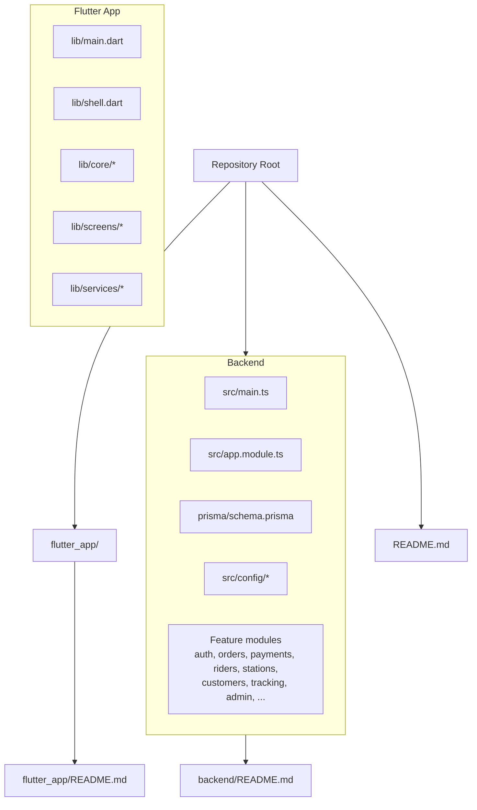
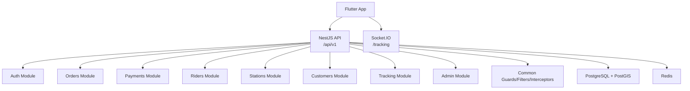
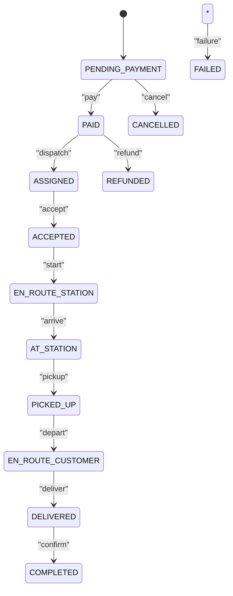

# Developer Guide

<cite>
**Referenced Files in This Document**   
- [README.md](file://README.md)
- [backend/README.md](file://backend/README.md)
- [flutter_app/README.md](file://flutter_app/README.md)
- [backend/package.json](file://backend/package.json)
- [flutter_app/pubspec.yaml](file://flutter_app/pubspec.yaml)
- [backend/src/main.ts](file://backend/src/main.ts)
- [backend/src/app.module.ts](file://backend/src/app.module.ts)
- [backend/prisma/schema.prisma](file://backend/prisma/schema.prisma)
- [flutter_app/lib/main.dart](file://flutter_app/lib/main.dart)
- [flutter_app/lib/core/rider_state.dart](file://flutter_app/lib/core/rider_state.dart)
</cite>

## Table of Contents
1. [Introduction](#introduction)
2. [Project Structure](#project-structure)
3. [Development Workflow](#development-workflow)
4. [Code Style and Conventions](#code-style-and-conventions)
5. [Architecture Overview](#architecture-overview)
6. [Core Components](#core-components)
7. [Adding New Features](#adding-new-features)
8. [Business Logic Guidelines](#business-logic-guidelines)
9. [Utilities, Services, and Reusable Components](#utilities-services-and-reusable-components)
10. [Debugging, Profiling, and Performance Optimization](#debugging-profiling-and-performance-optimization)
11. [Documentation, Pull Requests, and Code Review](#documentation-pull-requests-and-code-review)
12. [Troubleshooting Guide](#troubleshooting-guide)
13. [Extending Functionality and Integrating New Services](#extending-functionality-and-integrating-new-services)
14. [Conclusion](#conclusion)

## Introduction
FuelConnect is a full-stack platform with:
- A Flutter frontend for customer and rider experiences.
- A NestJS backend providing REST APIs, Socket.IO real-time tracking, an admin dashboard, and payment handling.
- PostgreSQL with PostGIS for geospatial data.
- Redis as an optional fan-out and caching layer.
- JWT-based authentication with rotating refresh tokens.
- A wallet system, order lifecycle, dispatch logic, reviews, support tickets, notifications, and audit logging.

The repository root README explains that the backend serves both mobile apps and the admin dashboard, while the Flutter app currently runs on mocked data but is structured to connect screen by screen to the API.

**Section sources**
- [README.md:1-18](file://README.md#L1-L18)

## Project Structure
At a high level:
- `backend/` contains the NestJS application, Prisma schema, seed data, Docker configuration, and static admin dashboard assets.
- `flutter_app/` contains the Flutter project, including Android/iOS/web scaffolding, Dart source under `lib/`, tests, and package configuration.

**Diagram sources**
- [README.md:1-18](file://README.md#L1-L18)
- [backend/README.md:19-46](file://backend/README.md#L19-L46)
- [flutter_app/README.md:1-17](file://flutter_app/README.md#L1-L17)

Key structural notes:
- The backend uses a feature-based module layout under `src/`.
- The Flutter app follows a typical structure with `main.dart` bootstrapping the app, `shell.dart` defining navigation, `core/` for shared state and theme, `screens/` for UI screens, and `services/` for API or local data seams.

**Section sources**
- [backend/README.md:19-46](file://backend/README.md#L19-L46)
- [flutter_app/README.md:1-17](file://flutter_app/README.md#L1-L17)

## Development Workflow
### Backend Quick Start
Recommended path:
1. Copy `.env.example` to `.env` and configure secrets such as `JWT_SECRET` and `PAYMENT_WEBHOOK_SECRET`.
2. Start PostgreSQL (PostGIS) and Redis using Docker Compose.
3. Install dependencies, generate Prisma client, push schema, and seed demo data.
4. Start the development server.
5. Access Swagger at `/docs` and the admin dashboard at `/dashboard`.

Alternative without Docker requires a running PostgreSQL instance with the PostGIS extension enabled.

Important URLs:
- API base: `/api/v1`
- Admin dashboard: `/dashboard`
- Swagger UI: `/docs`
- Health probe: `/api/v1/health`
- Socket.IO namespace: `/tracking`

Scripts available include development watch mode, production build, type checking, Prisma generation, database operations, and seeding.

**Section sources**
- [backend/README.md:50-103](file://backend/README.md#L50-L103)
- [backend/README.md:81-103](file://backend/README.md#L81-L103)
- [backend/package.json:7-24](file://backend/package.json#L7-L24)

### Flutter Quick Start
Run the Flutter app locally:
1. Generate platform folders if needed.
2. Get dependencies.
3. Run on Chrome or any emulator/device.
4. Build web output when ready.

The Flutter README also documents demo accounts, flows that work, responsive behavior, mocked services, and offline font bundling.

**Section sources**
- [flutter_app/README.md:8-17](file://flutter_app/README.md#L8-L17)
- [flutter_app/README.md:23-40](file://flutter_app/README.md#L23-L40)
- [flutter_app/README.md:54-65](file://flutter_app/README.md#L54-L65)

## Code Style and Conventions
### Backend Conventions
- Error envelope: All failures return a consistent JSON shape with status code, message, errors map, path, timestamp, and request ID.
- Pagination: List endpoints accept page and limit and return data plus metadata.
- Idempotency: Orders and some payment retries honor an idempotency header.
- Payment method aliases: Client-friendly aliases are normalized to canonical values.
- Validation: Global validation pipe whitelists fields, transforms inputs, and rejects unknown fields.
- Security: Helmet, CORS allow-list, rate limiting, RBAC guards, per-resource checks, HMAC webhook verification, and audit logging.

These conventions should be followed when adding new endpoints or modifying existing ones.

**Section sources**
- [backend/README.md:278-318](file://backend/README.md#L278-L318)
- [backend/src/main.ts:50-61](file://backend/src/main.ts#L50-L61)

### Flutter Conventions
- The app initializes system UI overlays, ensures Flutter binding, initializes auth, and runs the main app widget.
- Theme and accessibility settings are applied globally through the app builder.
- State management uses ChangeNotifier-based classes for domain areas like rider state.
- Services act as seams between UI and backend; currently many flows use mock data.

When adding screens or features:
- Keep UI components modular.
- Use the existing theme and shell patterns.
- Replace mock implementations with API calls gradually.

**Section sources**
- [flutter_app/lib/main.dart:7-57](file://flutter_app/lib/main.dart#L7-L57)
- [flutter_app/README.md:33-40](file://flutter_app/README.md#L33-L40)

## Architecture Overview
The backend architecture centers around NestJS modules, global guards, filters, interceptors, Prisma for data access, Redis for optional scaling, and Socket.IO for real-time tracking. The Flutter app provides the user interface and communicates via REST and Socket.IO once wired up.

**Diagram sources**
- [backend/src/app.module.ts:29-67](file://backend/src/app.module.ts#L29-L67)
- [backend/README.md:19-46](file://backend/README.md#L19-L46)

## Core Components
### Backend Bootstrap and Global Configuration
- `main.ts` bootstraps the NestJS application, configures Helmet, CORS, global prefix, static dashboard assets, validation pipe, Swagger, shutdown hooks, and listens on the configured port.
- `app.module.ts` imports all feature modules, configures global guards (`ThrottlerGuard`, `JwtAuthGuard`, `RolesGuard`), the audit interceptor, and the exception filter.

This is where cross-cutting concerns are centralized.

**Section sources**
- [backend/src/main.ts:12-103](file://backend/src/main.ts#L12-L103)
- [backend/src/app.module.ts:29-67](file://backend/src/app.module.ts#L29-L67)

### Data Model
The Prisma schema defines the core entities:
- Identity: `User`, `Session`, `OtpCode`
- Customer side: `Customer`, `CustomerVehicle`, `Address`
- Rider side: `Rider`, `RiderVehicle`, `RiderCurrentLocation`, `RiderLocation`
- Stations and fuel: `FuelType`, `Station`, `StationFuelPrice`, `StationFuelPriceHistory`
- Orders and delivery: `Order`, `OrderItem`, `DeliveryAssignment`
- Money: `Payment`, `Wallet`, `Transaction`, `WithdrawalRequest`
- Engagement and governance: `Notification`, `Review`, `SupportTicket`, `TicketMessage`, `AuditLog`

Geospatial columns use PostGIS geography types, and many tables include soft deletes or timestamps for auditing.

**Section sources**
- [backend/prisma/schema.prisma:1-731](file://backend/prisma/schema.prisma#L1-L731)

### Flutter App Entry Point
- `main.dart` initializes Flutter bindings, sets system UI overlay styles, initializes auth, and runs the app widget tree.
- The app applies theme modes, constrains text scaling, and renders the shell as the home route.

**Section sources**
- [flutter_app/lib/main.dart:7-57](file://flutter_app/lib/main.dart#L7-L57)

### Rider State Model
- `rider_state.dart` defines `RiderJob`, `RiderEarning`, and `RiderState`.
- It holds demo data, current selection, active trip, earnings metrics, and methods for sign-in/sign-out, online toggle, job selection, acceptance, rejection, completion, and withdrawal simulation.

This is a good example of how domain state is modeled in Flutter before connecting to the backend.

**Section sources**
- [flutter_app/lib/core/rider_state.dart:1-180](file://flutter_app/lib/core/rider_state.dart#L1-L180)

## Adding New Features
### Backend Feature Addition Checklist
1. Create a new feature module under `src/<feature>/` with controller, service, DTOs, and module file.
2. Register the module in `app.module.ts`.
3. Define DTOs with class-validator decorators for input validation.
4. Implement business logic in the service layer.
5. Expose endpoints in the controller with proper role guards.
6. Add pagination, error envelope compliance, and audit logging where appropriate.
7. Update Swagger tags and documentation comments.
8. Add seed data if needed.
9. Write integration or unit tests when possible.

### Flutter Feature Addition Checklist
1. Add screens under `lib/screens/` following existing naming and structure.
2. Add state models under `lib/core/` if they represent domain state.
3. Add or extend services under `lib/services/` for API seams.
4. Wire navigation from the shell or menu.
5. Replace mock data with API calls incrementally.
6. Follow theme, typography, and responsiveness guidelines.
7. Test on multiple screen sizes and orientations.

**Section sources**
- [backend/README.md:19-46](file://backend/README.md#L19-L46)
- [flutter_app/README.md:33-40](file://flutter_app/README.md#L33-L40)

## Business Logic Guidelines
### Order Lifecycle
Orders follow a strict state machine:
- Payment states: `PENDING_PAYMENT` → `PAID`
- Dispatch states: `ASSIGNED` → `ACCEPTED`
- Delivery states: `EN_ROUTE_STATION` → `AT_STATION` → `PICKED_UP` → `EN_ROUTE_CUSTOMER` → `DELIVERED` → `COMPLETED`
- Terminal states: `CANCELLED`, `REFUNDED`, `FAILED`

All transitions go through a central transition function that writes timestamps, frees riders, credits earnings, and emits real-time events. Pricing is always computed server-side from station fuel prices.

**Diagram sources**
- [backend/README.md:320-346](file://backend/README.md#L320-L346)

**Section sources**
- [backend/README.md:320-358](file://backend/README.md#L320-L358)

### Dispatch Logic
Auto-dispatch finds eligible riders within a radius using PostGIS, offers the nearest one, handles expiration, and emits socket events. Admins can manually assign orders. If no rider is found, an unassigned event is emitted.

**Section sources**
- [backend/README.md:348-358](file://backend/README.md#L348-L358)

### Payment Rules
- Wallet: atomic debit then order paid; reverse debit on failure.
- Cash: order marked pending payment; rider collects cash later.
- Mobile money: pending until webhook or sandbox simulation settles it.
- Card: not enabled yet.

Webhooks verify signatures, match provider references, handle duplicates, and flag mismatches or late successes appropriately.

**Section sources**
- [backend/README.md:361-406](file://backend/README.md#L361-L406)

## Utilities, Services, and Reusable Components
### Common Backend Utilities
- Validation utilities flatten validation errors into a consistent format.
- Geo utilities and location services support distance calculations and history pruning.
- Phone normalization ensures consistent phone storage and lookup.
- Reference utilities help generate stable identifiers.

These utilities should be reused across services to avoid duplication.

**Section sources**
- [backend/README.md:278-318](file://backend/README.md#L278-L318)
- [backend/src/main.ts:50-61](file://backend/src/main.ts#L50-L61)

### Flutter Shared State
- `RiderState` demonstrates how to model domain state, expose mutations, and notify listeners.
- Similar patterns can be used for customer state, order state, and notification state.

**Section sources**
- [flutter_app/lib/core/rider_state.dart:44-180](file://flutter_app/lib/core/rider_state.dart#L44-L180)

## Debugging, Profiling, and Performance Optimization
### Backend Debugging
- Use `npm run start:debug` for debug mode.
- Inspect logs and structured Nest logs.
- Use Swagger UI to test endpoints interactively.
- Check health endpoint for readiness.
- Use `x-request-id` headers for tracing requests.

### Flutter Debugging
- Run on Chrome or device emulators.
- Use Flutter DevTools for performance profiling, widget inspection, and memory analysis.
- Validate network calls once the backend is connected.

### Performance Considerations
- Enable Redis for Socket.IO fan-out and live position sharing in multi-instance deployments.
- Prune rider location history periodically.
- Use pagination for list endpoints.
- Avoid sending amounts from clients; compute totals server-side.
- Throttle GPS updates per rider.

**Section sources**
- [backend/package.json:7-24](file://backend/package.json#L7-L24)
- [backend/README.md:702-713](file://backend/README.md#L702-L713)
- [backend/README.md:578-591](file://backend/README.md#L578-L591)

## Documentation, Pull Requests, and Code Review
### Writing Documentation
- Update `backend/README.md` when adding endpoints, changing contracts, or introducing new configuration variables.
- Update `flutter_app/README.md` when adding screens, flows, or environment requirements.
- Keep Swagger tags and descriptions aligned with actual controllers.
- Document new DTOs, enums, and state machines clearly.

### Pull Request Process
- Describe the change, affected modules, and migration or seed updates.
- Include screenshots for UI changes.
- Provide manual test steps for critical flows like auth, payments, and order lifecycle.
- Ensure linting and type checks pass.

### Code Review Checklist
- Does the change follow the error envelope and pagination conventions?
- Are inputs validated and transformed?
- Are roles and resource ownership enforced?
- Is audit logging added for sensitive mutations?
- Are real-time events emitted correctly?
- Are there tests or manual verification steps?

[No sources needed since this section provides general guidance]

## Troubleshooting Guide
### Backend Issues
- **CORS warnings**: In production, ensure `CORS_ORIGINS` is set; otherwise, every origin may be allowed with a warning.
- **Validation errors**: Check the global validation pipe and DTO decorators.
- **Database setup**: Use `prisma db push` when PostGIS extensions are required.
- **Seed data**: Re-run seed safely; it is idempotent.
- **Payment webhooks**: Verify signature header and secret configuration.

**Section sources**
- [backend/src/main.ts:25-34](file://backend/src/main.ts#L25-L34)
- [backend/README.md:63-80](file://backend/README.md#L63-L80)
- [backend/README.md:193-210](file://backend/README.md#L193-L210)
- [backend/README.md:373-386](file://backend/README.md#L373-L386)

### Flutter Issues
- **Mocked backend**: Remember that many services currently return mock data; replace them gradually.
- **Demo account**: Use the documented demo credentials for quick testing.
- **Fonts offline**: Bundle fonts if needed for offline builds.

**Section sources**
- [flutter_app/README.md:54-65](file://flutter_app/README.md#L54-L65)
- [flutter_app/README.md:23-31](file://flutter_app/README.md#L23-L31)

## Extending Functionality and Integrating New Services
### Adding a New Payment Provider
1. Extend payment method enum and alias mapping if needed.
2. Implement provider-specific request and webhook handling.
3. Validate webhook signatures and handle idempotency.
4. Emit relevant real-time events and notifications.
5. Update sandbox simulation endpoints if applicable.
6. Document the provider’s callback URL and credentials.

**Section sources**
- [backend/README.md:361-406](file://backend/README.md#L361-L406)

### Connecting Flutter to the Backend
- Configure Dio with base URL, headers, and interceptors for token attachment and 401 retry.
- Connect Socket.IO with auth token and re-subscribe rooms on reconnect.
- Map API responses to local models and update state.
- Handle validation errors from the unified error envelope.

**Section sources**
- [backend/README.md:615-676](file://backend/README.md#L615-L676)

## Conclusion
FuelConnect provides a robust foundation for building on-demand fuel delivery features. The backend enforces strong security, validation, auditability, and real-time capabilities, while the Flutter frontend offers a responsive UI with clear separation of concerns. By following the conventions, workflows, and guidelines in this guide, contributors can add features safely, maintain consistency, and scale the platform effectively.

[No sources needed since this section summarizes without analyzing specific files]