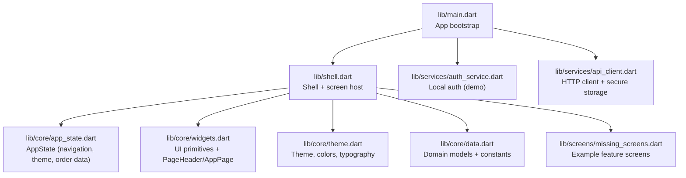
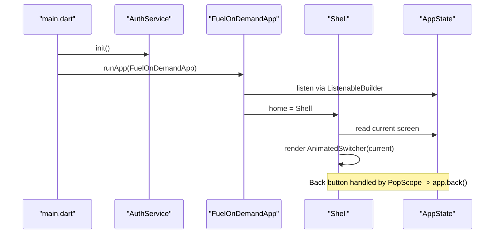
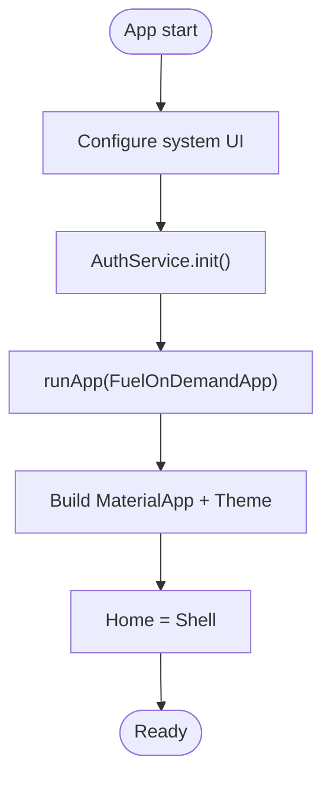
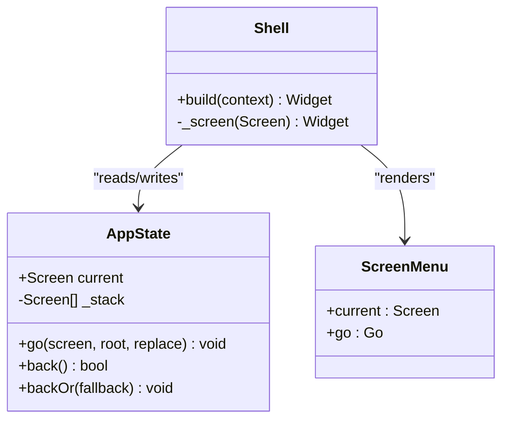
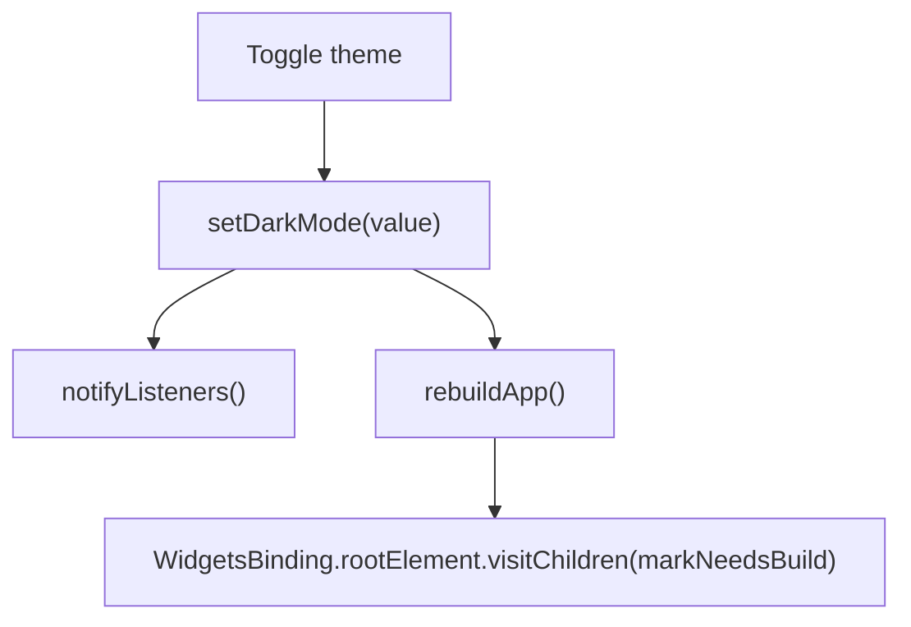
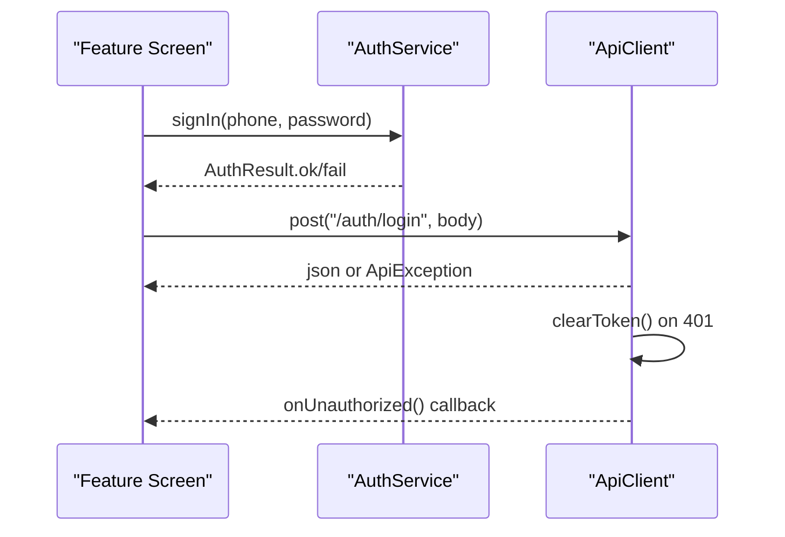
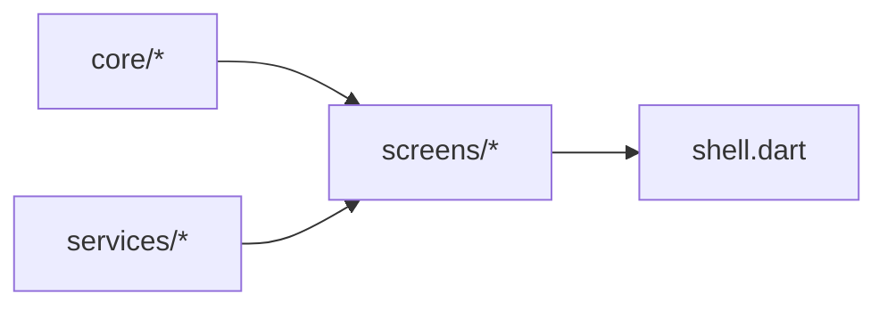
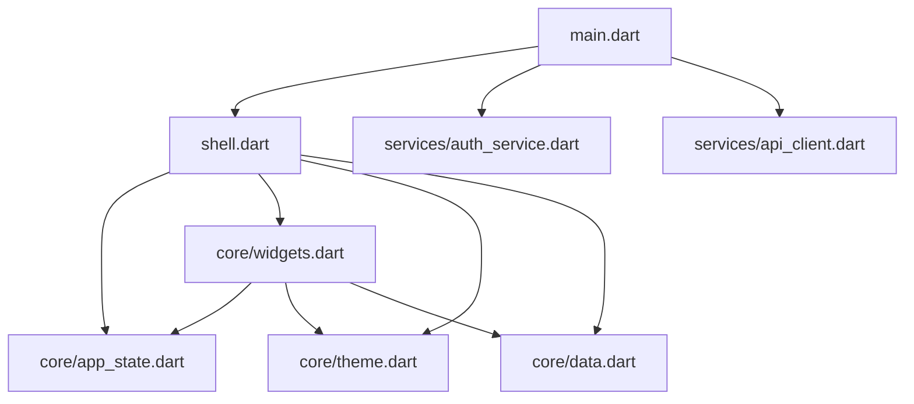

# App Architecture & Structure

<cite>
**Referenced Files in This Document**
- [main.dart](file://flutter_app/lib/main.dart)
- [shell.dart](file://flutter_app/lib/shell.dart)
- [app_state.dart](file://flutter_app/lib/core/app_state.dart)
- [core.dart](file://flutter_app/lib/core/core.dart)
- [theme.dart](file://flutter_app/lib/core/theme.dart)
- [data.dart](file://flutter_app/lib/core/data.dart)
- [widgets.dart](file://flutter_app/lib/core/widgets.dart)
- [auth_service.dart](file://flutter_app/lib/services/auth_service.dart)
- [api_client.dart](file://flutter_app/lib/services/api_client.dart)
- [missing_screens.dart](file://flutter_app/lib/screens/missing_screens.dart)
- [pubspec.yaml](file://flutter_app/pubspec.yaml)
</cite>

## Table of Contents
1. [Introduction](#introduction)
2. [Project Structure](#project-structure)
3. [Core Components](#core-components)
4. [Architecture Overview](#architecture-overview)
5. [Detailed Component Analysis](#detailed-component-analysis)
6. [Dependency Analysis](#dependency-analysis)
7. [Performance Considerations](#performance-considerations)
8. [Troubleshooting Guide](#troubleshooting-guide)
9. [Conclusion](#conclusion)
10. [Appendices](#appendices)

## Introduction
This document explains the Flutter application’s architecture and core structure, focusing on initialization, dependency injection patterns, main entry points, shell navigation, routing configuration, lifecycle management, state management with ChangeNotifier (Provider-compatible), service layer organization, and module separation. It also provides guidance for extending the app, adding new modules, implementing error handling, and maintaining clean architecture with performance and memory best practices.

## Project Structure
The Flutter app follows a simple, layered structure:
- Entry point and app bootstrap under lib
- Core domain and UI primitives under lib/core
- Feature screens grouped by area under lib/screens
- Services for authentication and HTTP under lib/services

**Diagram sources**
- [main.dart:7-18](file://flutter_app/lib/main.dart#L7-L18)
- [shell.dart:15-129](file://flutter_app/lib/shell.dart#L15-L129)
- [app_state.dart:69-119](file://flutter_app/lib/core/app_state.dart#L69-L119)
- [widgets.dart:577-698](file://flutter_app/lib/core/widgets.dart#L577-L698)
- [theme.dart:29-76](file://flutter_app/lib/core/theme.dart#L29-L76)
- [data.dart:4-81](file://flutter_app/lib/core/data.dart#L4-L81)
- [auth_service.dart:110-148](file://flutter_app/lib/services/auth_service.dart#L110-L148)
- [api_client.dart:11-55](file://flutter_app/lib/services/api_client.dart#L11-L55)
- [missing_screens.dart:8-44](file://flutter_app/lib/screens/missing_screens.dart#L8-L44)

**Section sources**
- [main.dart:7-18](file://flutter_app/lib/main.dart#L7-L18)
- [pubspec.yaml:1-29](file://flutter_app/pubspec.yaml#L1-L29)

## Core Components
- App bootstrap and runtime setup: initializes system UI, runs auth init, and builds MaterialApp with theme and global text scaling.
- Shell: hosts the active screen, manages back navigation, and renders a prototype screen menu.
- AppState: central ChangeNotifier managing navigation stack, theme mode, location, order builder data, wallet/rewards, and notifications.
- Theme: centralized color palette, typography, responsive helpers, and ThemeData builder; supports runtime dark/light switching.
- Widgets: reusable UI components including buttons, fields, page scaffolding, bottom navigation, and layout helpers.
- Data: domain models and static data for stations, partners, vehicles, places, payments, transactions, notices, and history.
- Auth service: local demo authentication with phone normalization, password hashing, OTP flow, profile, and persistence via SharedPreferences.
- API client: typed HTTP client with secure token storage, timeouts, error mapping, and unauthorized handling hook.

**Section sources**
- [main.dart:7-57](file://flutter_app/lib/main.dart#L7-L57)
- [shell.dart:15-129](file://flutter_app/lib/shell.dart#L15-L129)
- [app_state.dart:6-198](file://flutter_app/lib/core/app_state.dart#L6-L198)
- [theme.dart:29-158](file://flutter_app/lib/core/theme.dart#L29-L158)
- [widgets.dart:10-160](file://flutter_app/lib/core/widgets.dart#L10-L160)
- [data.dart:4-126](file://flutter_app/lib/core/data.dart#L4-L126)
- [auth_service.dart:110-305](file://flutter_app/lib/services/auth_service.dart#L110-L305)
- [api_client.dart:11-127](file://flutter_app/lib/services/api_client.dart#L11-L127)

## Architecture Overview
The app uses a single global ChangeNotifier (AppState) as the primary state container. The Shell listens to AppState changes and renders the current Screen. Screens are not routed via a framework router; instead, they are selected by an enum-based switch inside the Shell. Theme and UI rebuilds are triggered through ListenableBuilder and a custom rebuildApp helper.

**Diagram sources**
- [main.dart:7-18](file://flutter_app/lib/main.dart#L7-L18)
- [shell.dart:107-129](file://flutter_app/lib/shell.dart#L107-L129)
- [app_state.dart:69-101](file://flutter_app/lib/core/app_state.dart#L69-L101)

## Detailed Component Analysis

### App Initialization and Lifecycle
- System UI is configured before running the app.
- AuthService.init loads persisted accounts and ensures a demo account exists.
- FuelOnDemandApp wraps MaterialApp with theme, text scaling, and AnnotatedRegion for status/navigation bar styling.
- Home widget is Shell, which owns the active screen and back behavior.

**Diagram sources**
- [main.dart:7-18](file://flutter_app/lib/main.dart#L7-L18)
- [auth_service.dart:134-148](file://flutter_app/lib/services/auth_service.dart#L134-L148)

**Section sources**
- [main.dart:7-57](file://flutter_app/lib/main.dart#L7-L57)
- [auth_service.dart:134-148](file://flutter_app/lib/services/auth_service.dart#L134-L148)

### Shell Navigation Pattern and Routing Configuration
- Screen is an enum representing all screens.
- Shell._screen maps each Screen to a concrete widget.
- Navigation methods: go(screen, {root, replace}), back(), backOr(fallback).
- PopScope integrates with canGoBack to handle hardware back.
- Prototype menu navigates to any screen directly using go(screen, root: true).

**Diagram sources**
- [app_state.dart:69-101](file://flutter_app/lib/core/app_state.dart#L69-L101)
- [shell.dart:15-129](file://flutter_app/lib/shell.dart#L15-L129)

**Section sources**
- [shell.dart:15-129](file://flutter_app/lib/shell.dart#L15-L129)
- [app_state.dart:69-101](file://flutter_app/lib/core/app_state.dart#L69-L101)

### Provider-Based State Management
- AppState extends ChangeNotifier and is exposed as a top-level singleton.
- UI rebuilds use ListenableBuilder around MaterialApp and within Shell.
- Theme toggling updates FC.dark and calls rebuildApp to force a full rebuild while preserving widget state.
- This pattern is compatible with Provider if wrapped in ChangeNotifierProvider later.

**Diagram sources**
- [app_state.dart:108-119](file://flutter_app/lib/core/app_state.dart#L108-L119)
- [theme.dart:67-76](file://flutter_app/lib/core/theme.dart#L67-L76)

**Section sources**
- [app_state.dart:69-119](file://flutter_app/lib/core/app_state.dart#L69-L119)
- [theme.dart:67-76](file://flutter_app/lib/core/theme.dart#L67-L76)

### Service Layer Organization
- AuthService: local demo auth with phone normalization, hashed passwords, OTP flow, profile, and SharedPreferences persistence.
- ApiClient: HTTP client with secure token storage, timeouts, error mapping, and unauthorized callback hook.
- Both services are initialized early and used by screens or future features.

**Diagram sources**
- [auth_service.dart:180-200](file://flutter_app/lib/services/auth_service.dart#L180-L200)
- [api_client.dart:74-109](file://flutter_app/lib/services/api_client.dart#L74-L109)

**Section sources**
- [auth_service.dart:110-305](file://flutter_app/lib/services/auth_service.dart#L110-L305)
- [api_client.dart:11-127](file://flutter_app/lib/services/api_client.dart#L11-L127)

### Module Separation Patterns
- Core: shared state, theme, widgets, and data models.
- Screens: feature-specific UI grouped by area (auth, browse, orders, rider, etc.).
- Services: cross-cutting concerns like auth and HTTP.
- Example screens demonstrate consistent usage of AppPage, PageHeader, and navigation via app.go.

**Diagram sources**
- [core.dart:1-6](file://flutter_app/lib/core/core.dart#L1-L6)
- [missing_screens.dart:8-44](file://flutter_app/lib/screens/missing_screens.dart#L8-L44)

**Section sources**
- [core.dart:1-6](file://flutter_app/lib/core/core.dart#L1-L6)
- [missing_screens.dart:8-44](file://flutter_app/lib/screens/missing_screens.dart#L8-L44)

## Dependency Analysis
High-level dependencies between key files:

**Diagram sources**
- [main.dart:1-18](file://flutter_app/lib/main.dart#L1-L18)
- [shell.dart:1-11](file://flutter_app/lib/shell.dart#L1-L11)
- [widgets.dart:1-8](file://flutter_app/lib/core/widgets.dart#L1-L8)

**Section sources**
- [main.dart:1-18](file://flutter_app/lib/main.dart#L1-L18)
- [shell.dart:1-11](file://flutter_app/lib/shell.dart#L1-L11)
- [widgets.dart:1-8](file://flutter_app/lib/core/widgets.dart#L1-L8)

## Performance Considerations
- Use ListenableBuilder only where needed to avoid unnecessary rebuilds.
- Prefer const constructors for static widgets to reduce allocations.
- Avoid heavy computations in build methods; move to AppState or isolate when necessary.
- Minimize image sizes and use vector assets where possible.
- Keep AppState lean; split large domains into separate ChangeNotifiers if needed.
- Use ApiClient timeouts and proper error handling to prevent long-running requests.
- Avoid rebuilding the entire app frequently; prefer targeted rebuilds via ListenableBuilder.

[No sources needed since this section provides general guidance]

## Troubleshooting Guide
Common issues and resolutions:
- Theme not updating: ensure setDarkMode is called and rebuildApp is invoked; verify ListenableBuilder wraps the widget tree that needs to rebuild.
- Back navigation not working: confirm PopScope.canPop reflects app.canGoBack and onPopInvokedWithResult calls app.back().
- API errors: inspect ApiException messages; check 401 handling triggers onUnauthorized and clears tokens.
- OTP flows: verify kDemoMode and code generation logic; ensure resetVerified flag is set after successful verification.

**Section sources**
- [app_state.dart:108-119](file://flutter_app/lib/core/app_state.dart#L108-L119)
- [shell.dart:107-129](file://flutter_app/lib/shell.dart#L107-L129)
- [api_client.dart:74-109](file://flutter_app/lib/services/api_client.dart#L74-L109)
- [auth_service.dart:214-265](file://flutter_app/lib/services/auth_service.dart#L214-L265)

## Conclusion
The app uses a straightforward, maintainable architecture centered around a global AppState for state and navigation, a Shell for screen hosting, and a well-organized core/services separation. While it does not currently use a framework router, its enum-based routing and ChangeNotifier state model make it easy to extend with Provider, Riverpod, or a formal router. Following the guidelines here will help you add new modules, implement robust error handling, and keep performance and memory usage in check.

[No sources needed since this section summarizes without analyzing specific files]

## Appendices

### How to Extend the App Structure
- Add a new screen:
  - Define a new Screen enum value in AppState.
  - Create a new screen file under lib/screens and export it from the appropriate group file.
  - Map the new Screen to a widget in Shell._screen.
  - Optionally add a MenuEntry for quick navigation in development.

- Integrate a new service:
  - Create a service class under lib/services.
  - Initialize it in main.dart before runApp if needed.
  - Inject it into screens or AppState as appropriate.

- Implement error handling:
  - Wrap async operations with try/catch and surface user-friendly messages.
  - For API calls, rely on ApiException and handle 401 via ApiClient.onUnauthorized.

**Section sources**
- [app_state.dart:6-15](file://flutter_app/lib/core/app_state.dart#L6-L15)
- [shell.dart:18-104](file://flutter_app/lib/shell.dart#L18-L104)
- [api_client.dart:22-28](file://flutter_app/lib/services/api_client.dart#L22-L28)