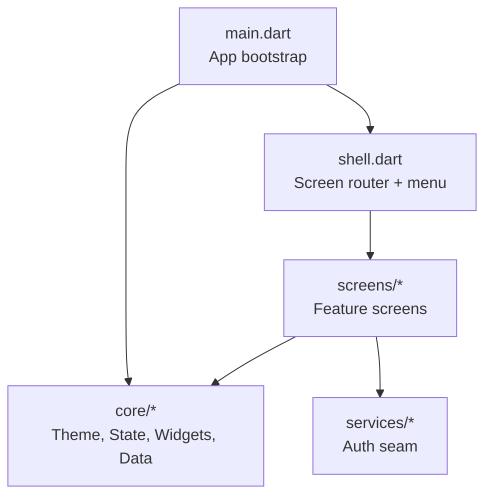
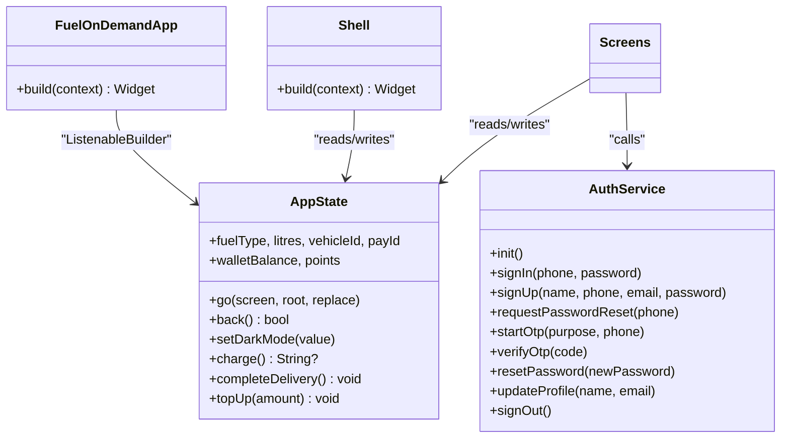
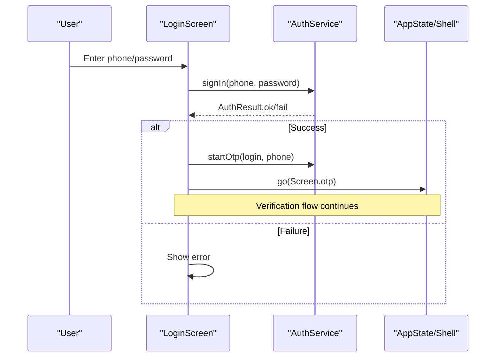
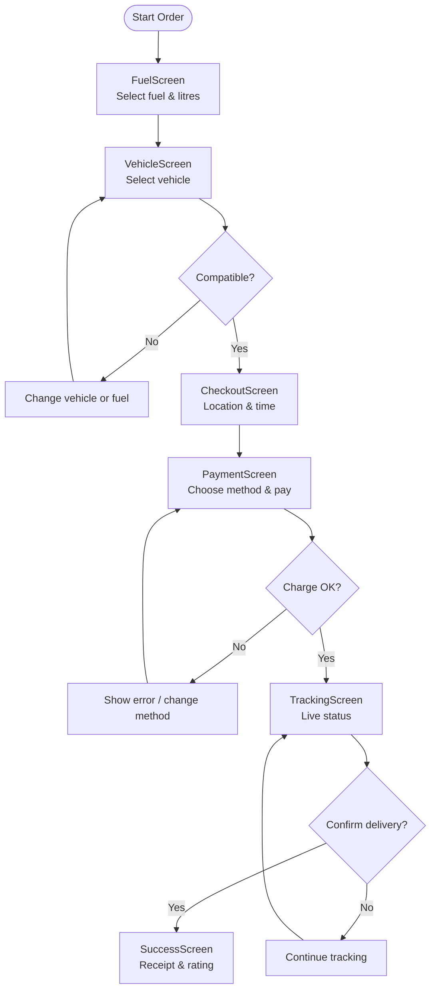
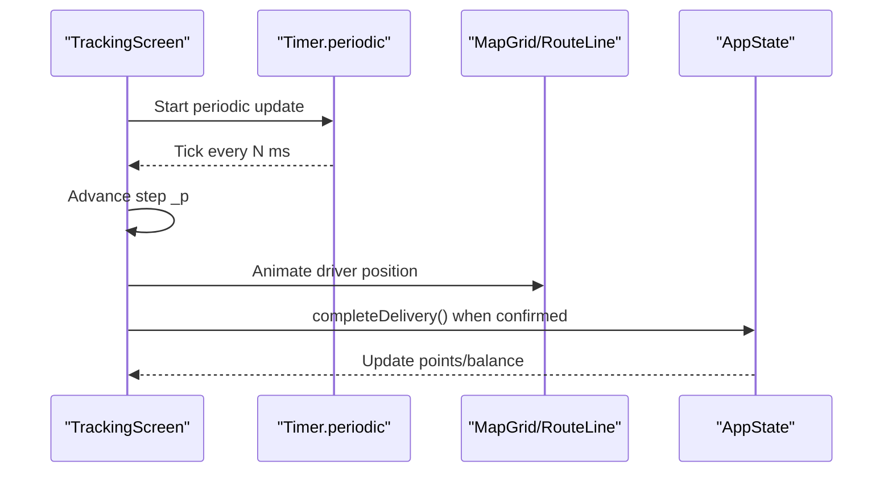
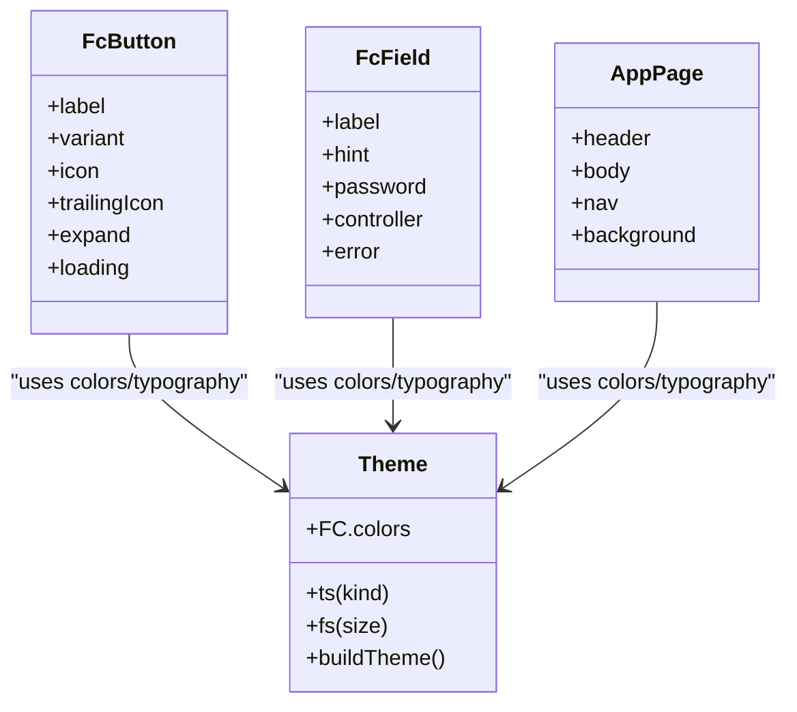
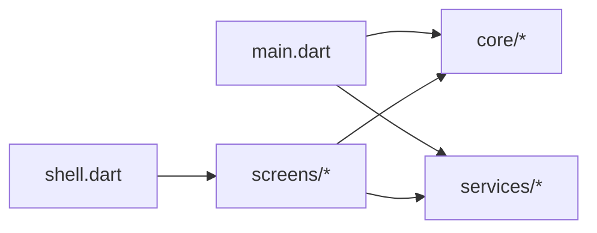

# Frontend Application

<cite>
**Referenced Files in This Document**
- [main.dart](file://flutter_app/lib/main.dart)
- [shell.dart](file://flutter_app/lib/shell.dart)
- [core.dart](file://flutter_app/lib/core/core.dart)
- [theme.dart](file://flutter_app/lib/core/theme.dart)
- [app_state.dart](file://flutter_app/lib/core/app_state.dart)
- [data.dart](file://flutter_app/lib/core/data.dart)
- [widgets.dart](file://flutter_app/lib/core/widgets.dart)
- [auth_service.dart](file://flutter_app/lib/services/auth_service.dart)
- [auth_screens.dart](file://flutter_app/lib/screens/auth_screens.dart)
- [order_screens.dart](file://flutter_app/lib/screens/order_screens.dart)
- [pubspec.yaml](file://flutter_app/pubspec.yaml)
</cite>

## Table of Contents
1. [Introduction](#introduction)
2. [Project Structure](#project-structure)
3. [Core Components](#core-components)
4. [Architecture Overview](#architecture-overview)
5. [Detailed Component Analysis](#detailed-component-analysis)
6. [Dependency Analysis](#dependency-analysis)
7. [Performance Considerations](#performance-considerations)
8. [Troubleshooting Guide](#troubleshooting-guide)
9. [Conclusion](#conclusion)
10. [Appendices](#appendices)

## Introduction
This document describes the Flutter frontend for FuelConnect, an on-demand fuel delivery application. It explains the app structure, navigation model, state management using a ChangeNotifier-based Provider pattern, UI component hierarchy, theme system, responsive design, and Material Design implementation. It also documents authentication flows, order management screens, real-time tracking interfaces, platform-specific considerations, build configuration, and deployment guidance. The current implementation uses local mock services; backend integration points are clearly marked for future wiring.

## Project Structure
The Flutter project follows a feature-oriented layout:
- lib/main.dart: App bootstrap, global UI settings, and root widget.
- lib/shell.dart: Central screen router and prototype screen menu.
- lib/core: Shared theme, data models, icons, global app state, and reusable widgets.
- lib/screens: Feature screens grouped by domain (authentication, ordering, rider, account).
- lib/services: Local service seams for authentication and API calls.
- pubspec.yaml: Dependencies, SDK constraints, and asset declarations.

**Diagram sources**
- [main.dart:7-18](file://flutter_app/lib/main.dart#L7-L18)
- [shell.dart:15-129](file://flutter_app/lib/shell.dart#L15-L129)
- [core.dart:1-6](file://flutter_app/lib/core/core.dart#L1-L6)
- [auth_screens.dart:13-33](file://flutter_app/lib/screens/auth_screens.dart#L13-L33)
- [order_screens.dart:17-22](file://flutter_app/lib/screens/order_screens.dart#L17-L22)

**Section sources**
- [main.dart:7-18](file://flutter_app/lib/main.dart#L7-L18)
- [shell.dart:15-129](file://flutter_app/lib/shell.dart#L15-L129)
- [pubspec.yaml:1-29](file://flutter_app/pubspec.yaml#L1-L29)

## Core Components
- AppState: Global state container with navigation stack, theme mode, order builder, wallet/rewards, notifications, and payment helpers. It extends ChangeNotifier to integrate with Provider-style listeners.
- Theme system: Centralized color palette, typography, responsive helpers, and ThemeData builder. Supports dark/light modes and runtime rebuilds.
- Widgets library: Reusable UI atoms (buttons, fields, panels, search box), layout helpers (AppPage, PageHeader, BottomNav), and visual primitives (gradients, grid, route lines).
- Data models: Domain entities such as Station, Partner, Vehicle, Place, PayMethod, WalletTx, Notice, and HistoryOrder.
- Auth service: Local mock authentication with phone normalization, validation, OTP flow, password reset, profile updates, and persistent accounts via SharedPreferences.

Key responsibilities:
- Navigation: Screen enum and go/back methods drive Shell’s active screen.
- Theming: FC colors and ts/fs typography ensure consistent look-and-feel across screens.
- UI composition: AppPage wraps content with optional header and bottom navigation; reusable components reduce duplication.
- Business logic: Order totals, vehicle compatibility checks, wallet charges, and rewards updates live in AppState.

**Section sources**
- [app_state.dart:6-198](file://flutter_app/lib/core/app_state.dart#L6-L198)
- [theme.dart:29-158](file://flutter_app/lib/core/theme.dart#L29-L158)
- [widgets.dart:15-160](file://flutter_app/lib/core/widgets.dart#L15-L160)
- [data.dart:4-126](file://flutter_app/lib/core/data.dart#L4-L126)
- [auth_service.dart:110-305](file://flutter_app/lib/services/auth_service.dart#L110-L305)

## Architecture Overview
The app uses a simple Provider-like architecture:
- AppState is a singleton ChangeNotifier.
- Screens and widgets listen to app changes via ListenableBuilder or direct access.
- Shell renders the active screen based on app.current and manages back navigation.
- Services encapsulate local persistence and validation; they are designed as seams for future API integration.

**Diagram sources**
- [app_state.dart:69-198](file://flutter_app/lib/core/app_state.dart#L69-L198)
- [auth_service.dart:110-305](file://flutter_app/lib/services/auth_service.dart#L110-L305)
- [shell.dart:15-129](file://flutter_app/lib/shell.dart#L15-L129)
- [main.dart:21-57](file://flutter_app/lib/main.dart#L21-L57)

## Detailed Component Analysis

### Authentication Flow
Screens involved:
- SplashScreen: Auto-transitions to Onboarding.
- OnboardingScreen: Carousel of features; navigates to Login.
- LoginScreen: Validates phone/password, calls AuthService.signIn, starts OTP, navigates to OtpScreen.
- SignupScreen: Validates name/phone/email/password, calls AuthService.signUp, starts OTP, navigates to OtpScreen.
- ForgotScreen: Validates phone, calls AuthService.requestPasswordReset, starts OTP, navigates to OtpScreen.
- OtpScreen: Handles code input, resend cooldown, expiry, verification, and routes to NewPasswordScreen or LocationAccess.
- NewPasswordScreen: Validates new password and confirmation, calls AuthService.resetPassword, shows success.

**Diagram sources**
- [auth_screens.dart:308-363](file://flutter_app/lib/screens/auth_screens.dart#L308-L363)
- [auth_service.dart:180-209](file://flutter_app/lib/services/auth_service.dart#L180-L209)
- [app_state.dart:75-97](file://flutter_app/lib/core/app_state.dart#L75-L97)

**Section sources**
- [auth_screens.dart:13-33](file://flutter_app/lib/screens/auth_screens.dart#L13-L33)
- [auth_screens.dart:308-363](file://flutter_app/lib/screens/auth_screens.dart#L308-L363)
- [auth_screens.dart:368-451](file://flutter_app/lib/screens/auth_screens.dart#L368-L451)
- [auth_screens.dart:456-519](file://flutter_app/lib/screens/auth_screens.dart#L456-L519)
- [auth_screens.dart:605-715](file://flutter_app/lib/screens/auth_screens.dart#L605-L715)
- [auth_screens.dart:720-800](file://flutter_app/lib/screens/auth_screens.dart#L720-L800)
- [auth_service.dart:180-209](file://flutter_app/lib/services/auth_service.dart#L180-L209)
- [auth_service.dart:211-280](file://flutter_app/lib/services/auth_service.dart#L211-L280)

### Order Management Screens
Screens involved:
- FuelScreen: Select fuel type and quantity; computes estimated total.
- VehicleScreen: Choose vehicle; validates fuel compatibility.
- CheckoutScreen: Set delivery location/time; shows summary.
- PaymentScreen: Select payment method; charges wallet if selected; navigates to Tracking.
- TrackingScreen: Simulated live tracking with animated map and timeline; allows confirm delivery.
- SuccessScreen: Shows receipt and rating; navigates to Home or Orders.

**Diagram sources**
- [order_screens.dart:17-122](file://flutter_app/lib/screens/order_screens.dart#L17-L122)
- [order_screens.dart:127-216](file://flutter_app/lib/screens/order_screens.dart#L127-L216)
- [order_screens.dart:221-361](file://flutter_app/lib/screens/order_screens.dart#L221-L361)
- [order_screens.dart:366-456](file://flutter_app/lib/screens/order_screens.dart#L366-L456)
- [order_screens.dart:461-657](file://flutter_app/lib/screens/order_screens.dart#L461-L657)
- [order_screens.dart:662-734](file://flutter_app/lib/screens/order_screens.dart#L662-L734)

**Section sources**
- [order_screens.dart:17-122](file://flutter_app/lib/screens/order_screens.dart#L17-L122)
- [order_screens.dart:127-216](file://flutter_app/lib/screens/order_screens.dart#L127-L216)
- [order_screens.dart:221-361](file://flutter_app/lib/screens/order_screens.dart#L221-L361)
- [order_screens.dart:366-456](file://flutter_app/lib/screens/order_screens.dart#L366-L456)
- [order_screens.dart:461-657](file://flutter_app/lib/screens/order_screens.dart#L461-L657)
- [order_screens.dart:662-734](file://flutter_app/lib/screens/order_screens.dart#L662-L734)

### Real-Time Tracking Interface
- TrackingScreen simulates driver movement and step progression using a periodic timer.
- Map visualization uses custom grid and route line widgets; driver position animates between waypoints.
- Timeline indicates order stages; user can preview arrival or confirm delivery.
- Integration point: Replace simulated steps with WebSocket events from the backend tracking module.

**Diagram sources**
- [order_screens.dart:461-657](file://flutter_app/lib/screens/order_screens.dart#L461-L657)
- [app_state.dart:184-189](file://flutter_app/lib/core/app_state.dart#L184-L189)

**Section sources**
- [order_screens.dart:461-657](file://flutter_app/lib/screens/order_screens.dart#L461-L657)

### Custom Widgets and Theme System
- Buttons: FcButton supports primary, outline, ghost, icon variants, loading states, and trailing icons.
- Fields: FcField provides labels, hints, icons, password toggles, focus styling, and error display.
- Layout: AppPage composes headers, scrollable bodies, and optional bottom navigation; PageHeader offers back actions and titles.
- Theme: FC color getters switch between dark/light palettes; ts/fs provide responsive typography; buildTheme constructs ThemeData with Material 3.

**Diagram sources**
- [widgets.dart:58-160](file://flutter_app/lib/core/widgets.dart#L58-L160)
- [widgets.dart:162-266](file://flutter_app/lib/core/widgets.dart#L162-L266)
- [widgets.dart:577-698](file://flutter_app/lib/core/widgets.dart#L577-L698)
- [theme.dart:29-158](file://flutter_app/lib/core/theme.dart#L29-L158)

**Section sources**
- [widgets.dart:58-160](file://flutter_app/lib/core/widgets.dart#L58-L160)
- [widgets.dart:162-266](file://flutter_app/lib/core/widgets.dart#L162-L266)
- [widgets.dart:577-698](file://flutter_app/lib/core/widgets.dart#L577-L698)
- [theme.dart:29-158](file://flutter_app/lib/core/theme.dart#L29-L158)

### Responsive Design Patterns
- Breakpoint: isWide(context) returns true at width >= 760 px.
- Fluid typography and spacing use cl(), vw(), vh(), topInset(), bottomInset().
- Two-column layouts on wide screens; single-column stacks on narrow devices.
- Safe-area awareness via MediaQuery viewPadding and bottom insets.

Examples:
- OnboardingScreen splits image and copy on wide screens.
- TrackingScreen uses side-by-side map and details on wide screens.
- BottomNav adapts padding and border radius based on width.

**Section sources**
- [theme.dart:84-90](file://flutter_app/lib/core/theme.dart#L84-L90)
- [auth_screens.dart:135-220](file://flutter_app/lib/screens/auth_screens.dart#L135-L220)
- [order_screens.dart:617-657](file://flutter_app/lib/screens/order_screens.dart#L617-L657)
- [widgets.dart:621-669](file://flutter_app/lib/core/widgets.dart#L621-L669)

### Material Design Implementation
- Uses Material 3 via useMaterial3: true.
- ColorScheme and text themes are customized through buildTheme.
- Splash and highlight effects are suppressed to match the design system.
- Text selection theme uses gold accent colors.

**Section sources**
- [theme.dart:129-158](file://flutter_app/lib/core/theme.dart#L129-L158)

### Backend Integration Points
- AuthService methods are stubbed for local behavior; replace bodies with HTTP/WebSocket calls.
- AppState charge() deducts wallet balance locally; wire to payments backend.
- TrackingScreen simulation should be replaced with real-time WebSocket updates from the backend tracking gateway.

Integration recommendations:
- Introduce an ApiClient abstraction for REST endpoints.
- Use a WebSocket client for tracking events; emit state updates to AppState.
- Persist tokens securely using flutter_secure_storage; store refresh tokens and session metadata.

**Section sources**
- [auth_service.dart:1-10](file://flutter_app/lib/services/auth_service.dart#L1-L10)
- [auth_service.dart:180-209](file://flutter_app/lib/services/auth_service.dart#L180-L209)
- [auth_service.dart:211-280](file://flutter_app/lib/services/auth_service.dart#L211-L280)
- [order_screens.dart:384-395](file://flutter_app/lib/screens/order_screens.dart#L384-L395)
- [order_screens.dart:461-657](file://flutter_app/lib/screens/order_screens.dart#L461-L657)

### Platform-Specific Considerations
- Android: Add tel intent queries for Safety screen dialing; edge-to-edge UI configured in main.
- iOS: SceneDelegate and Info.plist present; ensure permissions for location and camera if needed.
- Web: Build static site via flutter build web; serve via provided script.

Build and run:
- flutter create . --platforms=android,ios,web
- flutter pub get
- flutter run -d chrome or device
- flutter build web

**Section sources**
- [main.dart:7-18](file://flutter_app/lib/main.dart#L7-L18)
- [pubspec.yaml:6-8](file://flutter_app/pubspec.yaml#L6-L8)
- [pubspec.yaml:25-29](file://flutter_app/pubspec.yaml#L25-L29)

## Dependency Analysis
High-level dependencies:
- main.dart depends on core modules and services to initialize auth and run the app.
- shell.dart imports all screen modules and maps Screen enum values to widgets.
- screens depend on core widgets, theme, data, and app_state.
- services depend on shared preferences and crypto utilities.

**Diagram sources**
- [main.dart:1-18](file://flutter_app/lib/main.dart#L1-L18)
- [shell.dart:1-12](file://flutter_app/lib/shell.dart#L1-L12)
- [auth_screens.dart:1-9](file://flutter_app/lib/screens/auth_screens.dart#L1-L9)
- [order_screens.dart:1-6](file://flutter_app/lib/screens/order_screens.dart#L1-L6)

**Section sources**
- [main.dart:1-18](file://flutter_app/lib/main.dart#L1-L18)
- [shell.dart:1-12](file://flutter_app/lib/shell.dart#L1-L12)

## Performance Considerations
- Minimize unnecessary rebuilds by scoping ListenableBuilder to specific parts of the tree where possible.
- Avoid heavy computations in build methods; move to state classes or isolates if needed.
- Use const constructors for static widgets to reduce overhead.
- Debounce frequent UI updates (e.g., OTP timers, tracking animations) to prevent jank.
- Prefer lazy loading for images and assets; consider caching strategies for repeated network responses.

[No sources needed since this section provides general guidance]

## Troubleshooting Guide
Common issues and resolutions:
- OTP demo code not received: In kDemoMode, the code is shown via toast; verify that toast displays correctly.
- Phone number validation errors: Ensure numbers conform to expected formats; Validators.normalizePhone handles various inputs.
- Password reset failures: Verify that the phone was previously verified; resetVerified flag gates resetPassword.
- Wallet charge insufficient funds: charge() returns an error message; prompt user to top up or select another method.
- Back navigation not working: Ensure PopScope in Shell is used and app.backOr is called appropriately.

Debugging tips:
- Inspect AppState properties to validate state transitions.
- Log AuthService results to understand failure reasons.
- Use Flutter DevTools to inspect widget trees and performance.

**Section sources**
- [auth_service.dart:211-280](file://flutter_app/lib/services/auth_service.dart#L211-L280)
- [auth_service.dart:283-301](file://flutter_app/lib/services/auth_service.dart#L283-L301)
- [app_state.dart:173-189](file://flutter_app/lib/core/app_state.dart#L173-L189)
- [shell.dart:107-129](file://flutter_app/lib/shell.dart#L107-L129)

## Conclusion
The FuelConnect Flutter frontend implements a clean, maintainable architecture centered around a global AppState and a set of reusable widgets and screens. Authentication, ordering, and tracking flows are fully implemented with local mocks, providing a solid foundation for backend integration. The theme and responsive patterns ensure a consistent experience across devices. Future work should focus on wiring AuthService and AppState operations to real APIs and WebSocket streams, securing sensitive data, and optimizing performance for production.

[No sources needed since this section summarizes without analyzing specific files]

## Appendices
- Example usage paths:
  - Authentication entry: [auth_screens.dart:308-363](file://flutter_app/lib/screens/auth_screens.dart#L308-L363)
  - Order creation: [order_screens.dart:17-122](file://flutter_app/lib/screens/order_screens.dart#L17-L122)
  - Payment processing: [order_screens.dart:366-456](file://flutter_app/lib/screens/order_screens.dart#L366-L456)
  - Live tracking: [order_screens.dart:461-657](file://flutter_app/lib/screens/order_screens.dart#L461-L657)
  - Theme customization: [theme.dart:129-158](file://flutter_app/lib/core/theme.dart#L129-L158)
  - Global state mutations: [app_state.dart:69-198](file://flutter_app/lib/core/app_state.dart#L69-L198)