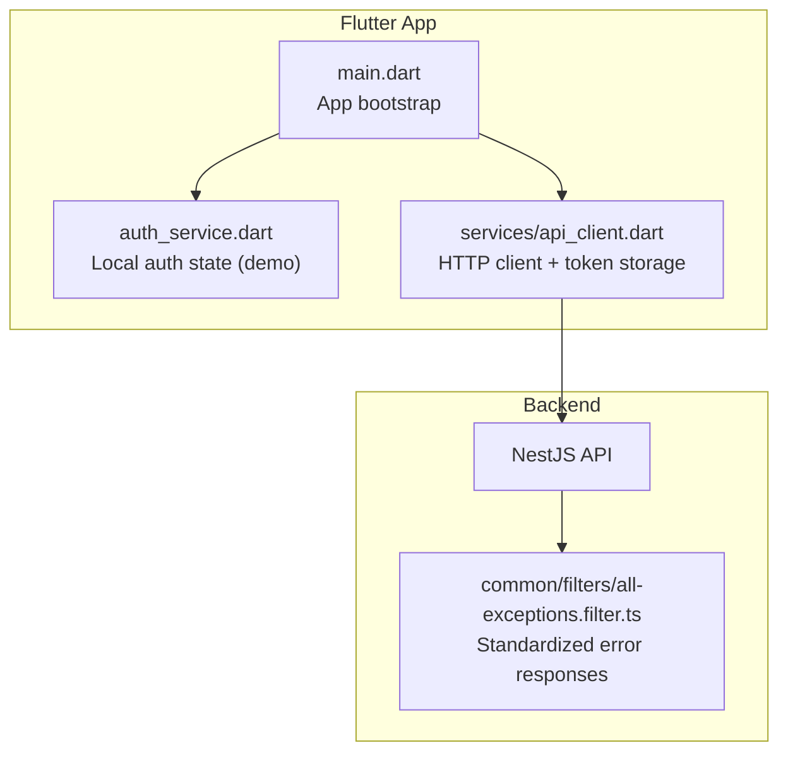
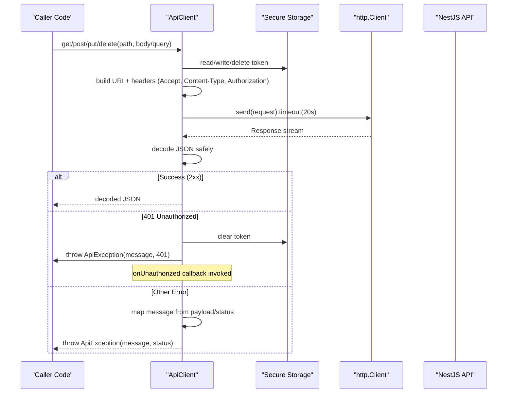
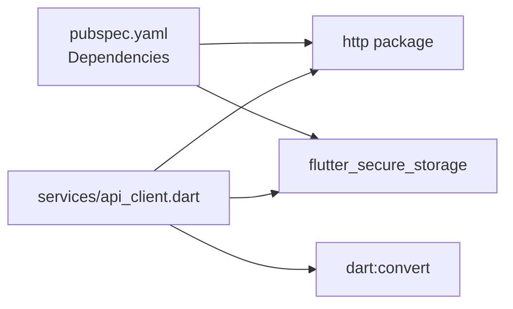

# API Client & HTTP Layer

<cite>
**Referenced Files in This Document**
- [api_client.dart](file://flutter_app/lib/services/api_client.dart)
- [auth_service.dart](file://flutter_app/lib/services/auth_service.dart)
- [main.dart](file://flutter_app/lib/main.dart)
- [pubspec.yaml](file://flutter_app/pubspec.yaml)
- [all-exceptions.filter.ts](file://backend/src/common/filters/all-exceptions.filter.ts)
</cite>

## Table of Contents
1. [Introduction](#introduction)
2. [Project Structure](#project-structure)
3. [Core Components](#core-components)
4. [Architecture Overview](#architecture-overview)
5. [Detailed Component Analysis](#detailed-component-analysis)
6. [Dependency Analysis](#dependency-analysis)
7. [Performance Considerations](#performance-considerations)
8. [Troubleshooting Guide](#troubleshooting-guide)
9. [Conclusion](#conclusion)

## Introduction
This document explains the Flutter frontend’s API client and HTTP layer for FuelConnect. It covers how requests are built, authenticated, timed out, and transformed into user-friendly errors. It also documents base URL configuration, header handling, content type management, token storage, and error recovery strategies. The backend’s standardized error response format is included to clarify how client-side error messages are derived.

## Project Structure
The HTTP client lives under the Flutter app’s services directory. The application initializes core services at startup and uses a thin JSON client to communicate with the backend.

**Diagram sources**
- [main.dart:7-18](file://flutter_app/lib/main.dart#L7-L18)
- [api_client.dart:11-40](file://flutter_app/lib/services/api_client.dart#L11-L40)
- [all-exceptions.filter.ts:48-104](file://backend/src/common/filters/all-exceptions.filter.ts#L48-L104)

**Section sources**
- [main.dart:7-18](file://flutter_app/lib/main.dart#L7-L18)
- [api_client.dart:11-40](file://flutter_app/lib/services/api_client.dart#L11-L40)

## Core Components
- ApiConfig: Base URL management and release-mode HTTPS enforcement.
- ApiException: Typed exception carrying a friendly message and optional HTTP status.
- ApiClient: Singleton HTTP client with secure token storage, timeouts, headers, JSON decoding, and error mapping.
- AuthService: Local demo authentication state; not responsible for network calls.

Key responsibilities:
- Base URL configuration via build-time environment variables.
- Secure bearer token persistence using platform keystore/encrypted storage.
- Automatic Authorization header injection when a token exists.
- Timeout and network error handling with user-friendly messages.
- Response transformation from raw bytes to JSON with safe fallbacks.
- Unauthorized flow that clears tokens and notifies callers.

**Section sources**
- [api_client.dart:11-40](file://flutter_app/lib/services/api_client.dart#L11-L40)
- [api_client.dart:48-67](file://flutter_app/lib/services/api_client.dart#L48-L67)
- [api_client.dart:74-109](file://flutter_app/lib/services/api_client.dart#L74-L109)
- [api_client.dart:111-125](file://flutter_app/lib/services/api_client.dart#L111-L125)

## Architecture Overview
The HTTP request lifecycle flows through ApiClient._send, which builds URIs, sets headers, enforces timeouts, decodes JSON, and maps server errors to ApiException. On 401, it clears stored tokens and invokes an onUnauthorized callback if provided.

**Diagram sources**
- [api_client.dart:74-109](file://flutter_app/lib/services/api_client.dart#L74-L109)
- [api_client.dart:111-125](file://flutter_app/lib/services/api_client.dart#L111-L125)

## Detailed Component Analysis

### Base URL Management and Security
- Base URL is configured at build time via a Dart define. A default points to a local development endpoint.
- In release mode, plain HTTP URLs are rejected to enforce HTTPS.

Configuration options:
- API_BASE_URL: Set during run/build commands to target different environments.

Security checks:
- Release builds assert that the base URL starts with https://.

**Section sources**
- [api_client.dart:8-20](file://flutter_app/lib/services/api_client.dart#L8-L20)

### Token Storage and Injection
- Tokens are stored securely using flutter_secure_storage with Android encrypted shared preferences enabled.
- The client loads the token on init and injects it as a Bearer Authorization header when present.
- Clearing or saving tokens updates both in-memory state and persistent storage.

Operational notes:
- If token retrieval fails, the client proceeds without a token rather than crashing.
- onUnauthorized allows UI layers to react to 401 responses by clearing state and redirecting to sign-in.

**Section sources**
- [api_client.dart:36-67](file://flutter_app/lib/services/api_client.dart#L36-L67)
- [api_client.dart:74-86](file://flutter_app/lib/services/api_client.dart#L74-L86)

### Request Building, Headers, and Content Type
- Accept and Content-Type headers are set to application/json.
- Authorization header is conditionally added when a token exists.
- Query parameters are appended to the final URI.
- Request bodies are JSON-encoded when provided.

Content negotiation:
- The client expects JSON responses and decodes them accordingly.

**Section sources**
- [api_client.dart:74-86](file://flutter_app/lib/services/api_client.dart#L74-L86)

### Timeouts and Network Error Handling
- All outbound requests are wrapped with a 20-second timeout.
- TimeoutException is converted into a user-friendly ApiException.
- Any other network-level exceptions are mapped to a generic connectivity error.

Recovery strategy:
- Clients should catch ApiException and prompt users to retry after transient failures.
- For 401, the client automatically clears the token and triggers onUnauthorized.

**Section sources**
- [api_client.dart:82-91](file://flutter_app/lib/services/api_client.dart#L82-L91)
- [api_client.dart:104-108](file://flutter_app/lib/services/api_client.dart#L104-L108)

### Response Transformation and Error Mapping
- Responses are decoded from UTF-8 bytes to JSON; decoding failures fall back to null.
- Successful responses (2xx) return decoded JSON directly.
- Non-success responses throw ApiException with a message derived from:
  - errors object (first field’s first item),
  - message string,
  - specific status codes (e.g., 429, 426, 5xx).

Backend alignment:
- The backend standardizes error payloads with fields like message and errors, enabling consistent client-side mapping.

**Section sources**
- [api_client.dart:93-109](file://flutter_app/lib/services/api_client.dart#L93-L109)
- [api_client.dart:111-125](file://flutter_app/lib/services/api_client.dart#L111-L125)
- [all-exceptions.filter.ts:48-104](file://backend/src/common/filters/all-exceptions.filter.ts#L48-L104)

### Authentication Flow Integration
- The app initializes AuthService at startup; this service currently manages local demo accounts and OTP flows.
- When integrating with the backend, use ApiClient.saveToken after successful login and ApiClient.clearToken on logout or 401.

Note:
- The current AuthService does not call the backend; replace its methods with API calls while preserving signatures.

**Section sources**
- [main.dart:7-18](file://flutter_app/lib/main.dart#L7-L18)
- [auth_service.dart:7-9](file://flutter_app/lib/services/auth_service.dart#L7-L9)
- [api_client.dart:57-67](file://flutter_app/lib/services/api_client.dart#L57-L67)

### Example Operations and Error Handling Patterns
Below are conceptual examples showing how to use the client. Replace placeholders with your actual endpoints and payloads.

- GET example
  - Call ApiClient.instance.get('/orders', query: {'status': 'pending'}).
  - Handle ApiException to show a user-friendly message.
  - On 401, ensure the UI navigates to sign-in.

- POST example
  - Call ApiClient.instance.post('/orders', body: {...}).
  - Decode the returned JSON to create domain models.
  - Catch ApiException and display validation or server errors.

- PUT example
  - Call ApiClient.instance.put('/orders/{id}', body: {...}).
  - Use the same error handling as POST.

- DELETE example
  - Call ApiClient.instance.delete('/orders/{id}').
  - Treat success as void and handle errors similarly.

Error handling pattern:
- Wrap calls in try/catch and catch ApiException.
- Map status codes to appropriate user feedback (e.g., rate limit, server error).
- For 401, rely on automatic token clearing and onUnauthorized callback.

[No sources needed since this section provides usage patterns without quoting code]

### Interceptors, Logging, and Retry Mechanisms
Current implementation:
- No interceptor framework is used; request/response processing occurs inline within _send.
- No explicit request logging is implemented in the client.
- No automatic retry mechanism is implemented.

Recommended enhancements:
- Add a simple interceptor-like wrapper around _send to log method, path, duration, and status.
- Implement exponential backoff retries for transient errors (e.g., 5xx, network errors).
- Centralize logging with a logger abstraction to avoid coupling UI code with I/O details.

[No sources needed since this section proposes enhancements beyond current code]

### Connection Timeouts, SSL Validation, and Network Recovery
Timeouts:
- Global request timeout is 20 seconds.

SSL/TLS:
- Release builds require HTTPS base URLs.
- The client uses the standard http package; certificate validation follows platform defaults.

Network recovery:
- Network errors are surfaced as ApiException with a friendly message.
- UI should implement retry prompts and backoff strategies where appropriate.

**Section sources**
- [api_client.dart:37-40](file://flutter_app/lib/services/api_client.dart#L37-L40)
- [api_client.dart:82-91](file://flutter_app/lib/services/api_client.dart#L82-L91)
- [api_client.dart:14-20](file://flutter_app/lib/services/api_client.dart#L14-L20)

## Dependency Analysis
External dependencies relevant to the HTTP layer:
- http: Provides the low-level HTTP client used by ApiClient.
- flutter_secure_storage: Stores the bearer token securely on device.
- dart:convert: Encodes/decodes JSON payloads.

Application initialization:
- main.dart initializes the app and AuthService; ApiClient can be initialized early to load the token before making requests.

**Diagram sources**
- [pubspec.yaml:10-18](file://flutter_app/pubspec.yaml#L10-L18)
- [api_client.dart:1-6](file://flutter_app/lib/services/api_client.dart#L1-L6)

**Section sources**
- [pubspec.yaml:10-18](file://flutter_app/pubspec.yaml#L10-L18)
- [api_client.dart:1-6](file://flutter_app/lib/services/api_client.dart#L1-L6)

## Performance Considerations
- Keep the single http.Client instance reused to benefit from connection pooling.
- Avoid unnecessary JSON encoding/decoding by passing typed objects only when needed.
- Prefer pagination and filtering on the server side to reduce payload sizes.
- Consider adding request caching for idempotent GET operations if applicable.

[No sources needed since this section provides general guidance]

## Troubleshooting Guide
Common issues and resolutions:
- Release build rejects HTTP base URL: Ensure API_BASE_URL uses https:// in release builds.
- 401 Unauthorized: The client clears the token and invokes onUnauthorized; navigate users to sign-in and re-authenticate.
- Network unreachable: Display a friendly message and allow retry.
- Rate limiting (429): Prompt users to wait before retrying.
- Server errors (5xx): Show a temporary failure message and retry later.

Backend error shape:
- The backend returns standardized error bodies with message and optional errors, which the client maps to user-friendly text.

**Section sources**
- [api_client.dart:14-20](file://flutter_app/lib/services/api_client.dart#L14-L20)
- [api_client.dart:104-125](file://flutter_app/lib/services/api_client.dart#L104-L125)
- [all-exceptions.filter.ts:48-104](file://backend/src/common/filters/all-exceptions.filter.ts#L48-L104)

## Conclusion
The FuelConnect Flutter app uses a focused, secure HTTP client that centralizes base URL configuration, token management, timeouts, and error mapping. While interceptors, logging, and retries are not yet implemented, the existing structure makes it straightforward to add these features. Aligning with the backend’s standardized error responses ensures consistent user-facing messaging across the system.