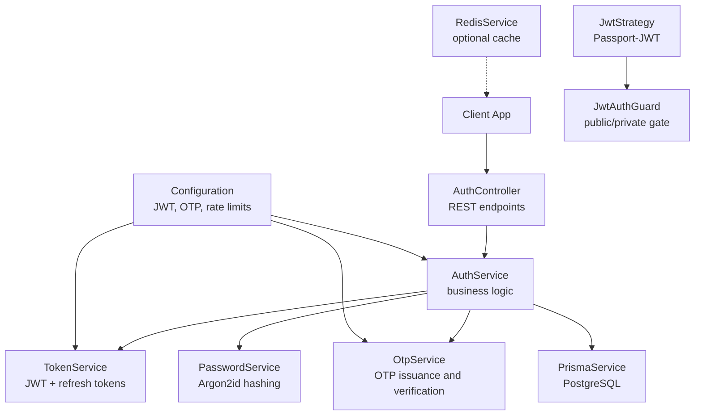
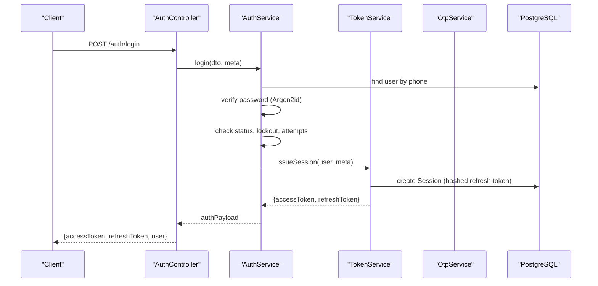
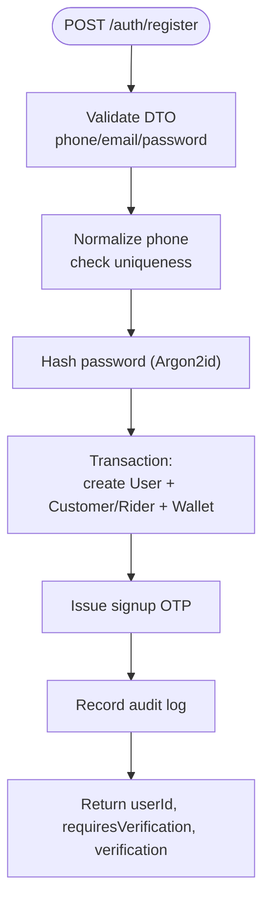
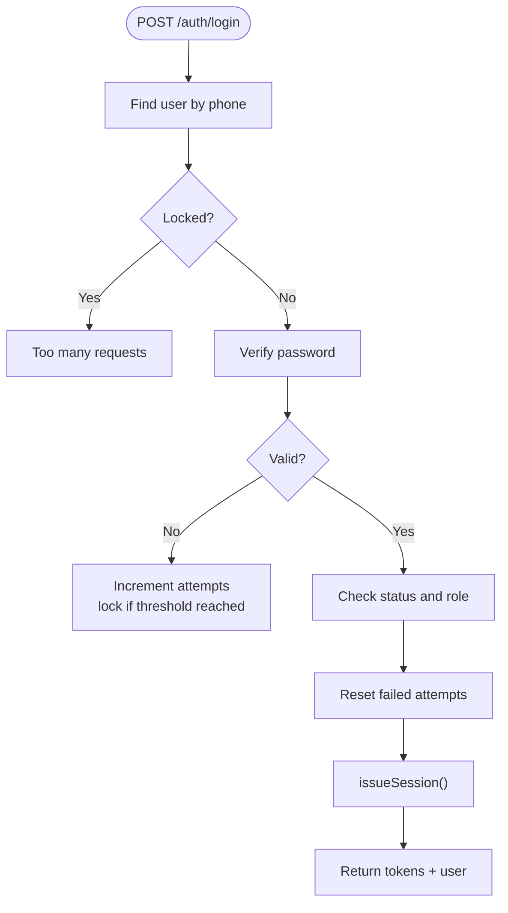
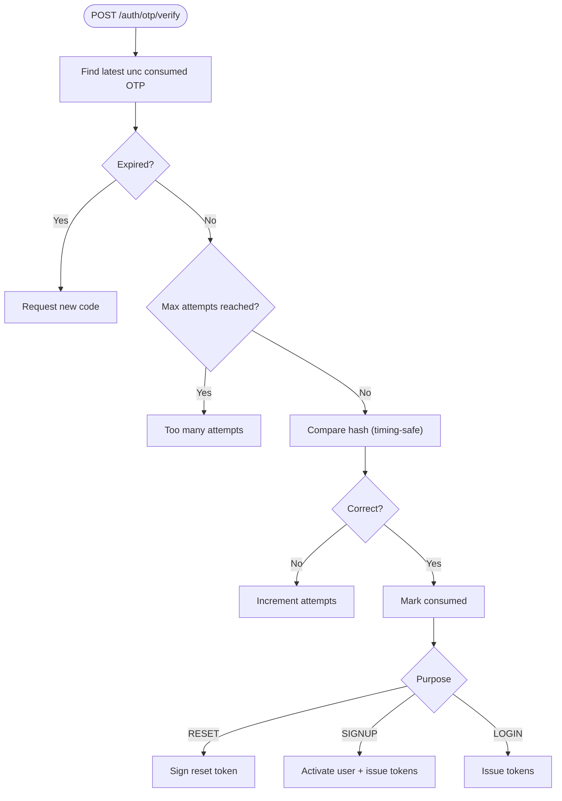
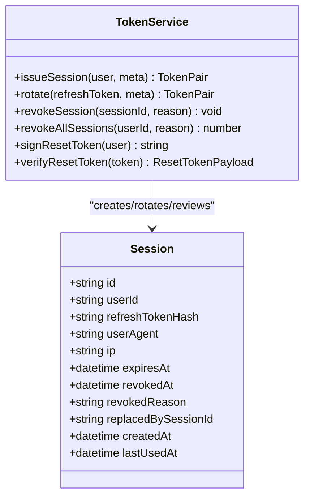
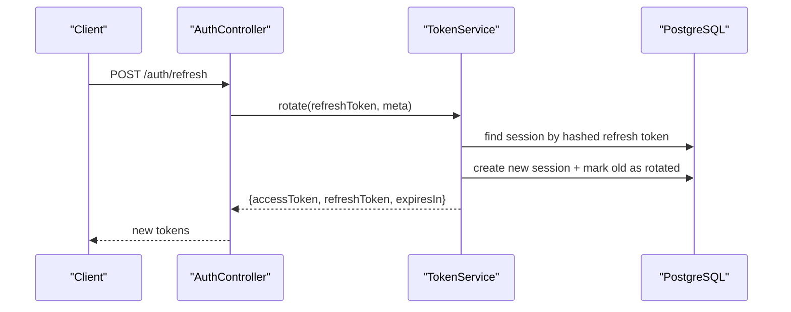
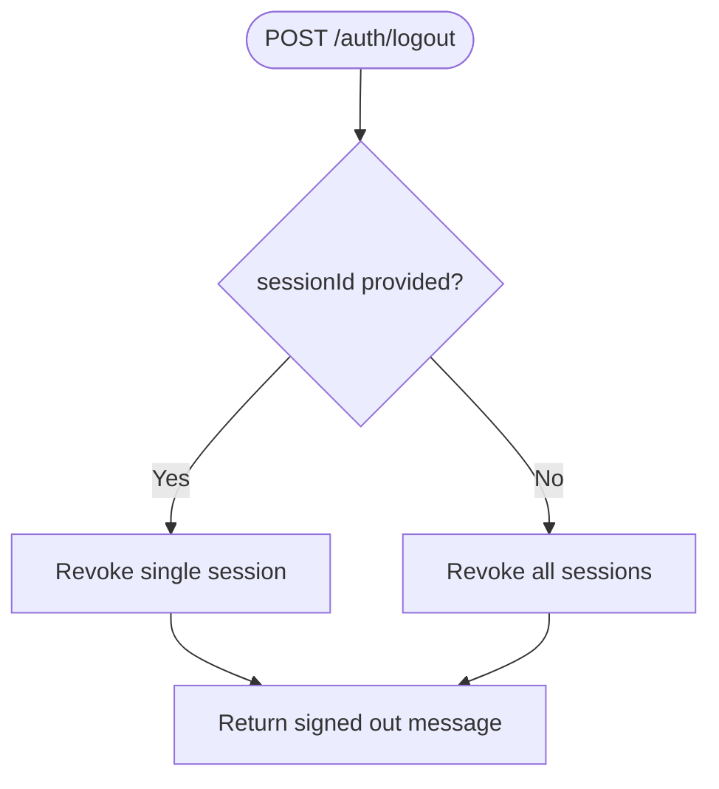
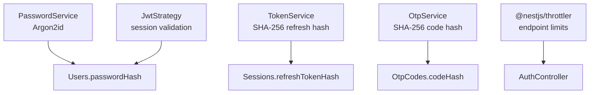
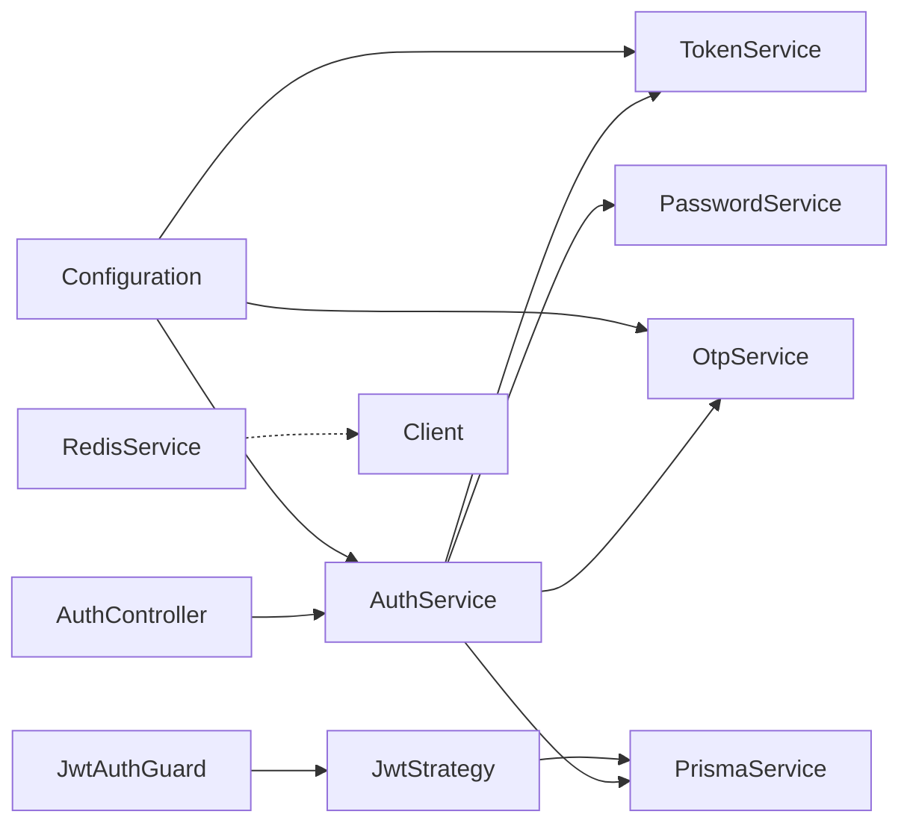

# Authentication Service

<cite>
**Referenced Files in This Document**   
- [auth.controller.ts](file://backend/src/auth/auth.controller.ts)
- [auth.service.ts](file://backend/src/auth/auth.service.ts)
- [token.service.ts](file://backend/src/auth/token.service.ts)
- [otp.service.ts](file://backend/src/auth/otp.service.ts)
- [jwt.strategy.ts](file://backend/src/auth/strategies/jwt.strategy.ts)
- [jwt-auth.guard.ts](file://backend/src/common/guards/jwt-auth.guard.ts)
- [password.service.ts](file://backend/src/common/security/password.service.ts)
- [configuration.ts](file://backend/src/config/configuration.ts)
- [auth.dto.ts](file://backend/src/auth/dto/auth.dto.ts)
- [schema.prisma](file://backend/prisma/schema.prisma)
- [auth-user.ts](file://backend/src/common/types/auth-user.ts)
- [phone.ts](file://backend/src/common/utils/phone.ts)
- [reference.ts](file://backend/src/common/utils/reference.ts)
- [redis.service.ts](file://backend/src/redis/redis.service.ts)
</cite>

## Table of Contents
1. [Introduction](#introduction)
2. [Project Structure](#project-structure)
3. [Core Components](#core-components)
4. [Architecture Overview](#architecture-overview)
5. [Detailed Component Analysis](#detailed-component-analysis)
6. [Dependency Analysis](#dependency-analysis)
7. [Performance Considerations](#performance-considerations)
8. [Troubleshooting Guide](#troubleshooting-guide)
9. [Conclusion](#conclusion)

## Introduction
This document explains the authentication service implementation for the FuelConnect backend. It covers user registration, login flows, OTP verification, session management, JWT token handling, refresh token rotation, logout procedures, credential persistence, and security measures. It also addresses multi-device support patterns and provides guidance for integrating biometric authentication on the client side.

The backend is a NestJS application using Prisma with PostgreSQL, Passport-JWT for access tokens, Argon2id for password hashing, and an opaque refresh token model stored as hashes in the database. OTPs are short-lived, hashed, attempt-limited, and single-use. Sessions are tracked per device through a `Session` entity.

## Project Structure
The authentication feature lives under `backend/src/auth`, with supporting infrastructure in `common`, `config`, `prisma`, and optional Redis integration.

**Diagram sources**
- [auth.controller.ts:42-165](file://backend/src/auth/auth.controller.ts#L42-L165)
- [auth.service.ts:39-48](file://backend/src/auth/auth.service.ts#L39-L48)
- [token.service.ts:32-38](file://backend/src/auth/token.service.ts#L32-L38)
- [otp.service.ts:29-36](file://backend/src/auth/otp.service.ts#L29-L36)
- [password.service.ts:11-24](file://backend/src/common/security/password.service.ts#L11-L24)
- [jwt.strategy.ts:9-20](file://backend/src/auth/strategies/jwt.strategy.ts#L9-L20)
- [jwt-auth.guard.ts:11-34](file://backend/src/common/guards/jwt-auth.guard.ts#L11-L34)
- [configuration.ts:48-68](file://backend/src/config/configuration.ts#L48-L68)
- [redis.service.ts:10-18](file://backend/src/redis/redis.service.ts#L10-L18)

**Section sources**
- [auth.controller.ts:42-165](file://backend/src/auth/auth.controller.ts#L42-L165)
- [auth.service.ts:39-48](file://backend/src/auth/auth.service.ts#L39-L48)
- [configuration.ts:48-68](file://backend/src/config/configuration.ts#L48-L68)

## Core Components
- AuthController: Exposes public and protected REST endpoints for registration, login, OTP, refresh, profile, sessions, and logout.
- AuthService: Orchestrates registration, login, OTP flows, password reset, profile updates, session listing, and revocation.
- TokenService: Issues short-lived access JWTs, manages opaque refresh tokens, rotates them, and revokes sessions.
- OtpService: Generates, stores, verifies, and rate-limits numeric OTPs; supports dev mode logging.
- JwtStrategy: Validates access tokens and enforces active session checks against the database.
- JwtAuthGuard: Applies global authentication while respecting public routes.
- PasswordService: Uses Argon2id with OWASP-recommended parameters for secure password hashing.
- Configuration: Centralizes JWT, OTP, and environment settings.
- Data Model: Defines users, sessions, OTP codes, roles, statuses, and related entities.

**Section sources**
- [auth.controller.ts:42-165](file://backend/src/auth/auth.controller.ts#L42-L165)
- [auth.service.ts:39-558](file://backend/src/auth/auth.service.ts#L39-L558)
- [token.service.ts:32-197](file://backend/src/auth/token.service.ts#L32-L197)
- [otp.service.ts:29-163](file://backend/src/auth/otp.service.ts#L29-L163)
- [jwt.strategy.ts:9-74](file://backend/src/auth/strategies/jwt.strategy.ts#L9-L74)
- [jwt-auth.guard.ts:11-34](file://backend/src/common/guards/jwt-auth.guard.ts#L11-L34)
- [password.service.ts:11-24](file://backend/src/common/security/password.service.ts#L11-L24)
- [configuration.ts:48-68](file://backend/src/config/configuration.ts#L48-L68)
- [schema.prisma:137-207](file://backend/prisma/schema.prisma#L137-L207)

## Architecture Overview
The authentication architecture follows a layered approach:
- Controllers handle HTTP requests and DTO validation.
- Services implement business rules and coordinate data access.
- Strategies and guards enforce authentication and authorization.
- Tokens and OTPs provide stateless access control and secure verification.
- Database models persist identity, sessions, and OTP records.

**Diagram sources**
- [auth.controller.ts:64-71](file://backend/src/auth/auth.controller.ts#L64-L71)
- [auth.service.ts:163-239](file://backend/src/auth/auth.service.ts#L163-L239)
- [token.service.ts:40-67](file://backend/src/auth/token.service.ts#L40-L67)
- [schema.prisma:172-189](file://backend/prisma/schema.prisma#L172-L189)

## Detailed Component Analysis

### User Registration Flow
Registration creates a customer or rider account, initializes wallets, sends a signup OTP, and logs audit events.

Key behaviors:
- Phone normalization and uniqueness checks.
- Email normalization and uniqueness checks.
- Password hashing via Argon2id.
- Transactional creation of user, role-specific profile, and wallet.
- Signup OTP issuance with TTL and resend cooldown.
- Audit logging including IP and user agent.

**Diagram sources**
- [auth.controller.ts:48-54](file://backend/src/auth/auth.controller.ts#L48-L54)
- [auth.service.ts:53-98](file://backend/src/auth/auth.service.ts#L53-L98)
- [password.service.ts:11-24](file://backend/src/common/security/password.service.ts#L11-L24)
- [otp.service.ts:38-90](file://backend/src/auth/otp.service.ts#L38-L90)
- [schema.prisma:137-169](file://backend/prisma/schema.prisma#L137-L169)

**Section sources**
- [auth.controller.ts:48-62](file://backend/src/auth/auth.controller.ts#L48-L62)
- [auth.service.ts:53-158](file://backend/src/auth/auth.service.ts#L53-L158)
- [auth.dto.ts:19-65](file://backend/src/auth/dto/auth.dto.ts#L19-L65)
- [phone.ts:5-18](file://backend/src/common/utils/phone.ts#L5-L18)
- [schema.prisma:137-169](file://backend/prisma/schema.prisma#L137-L169)

### Login Flow
Login validates credentials, enforces lockout and account status, resets failed attempts on success, and issues a session with access and refresh tokens.

Key behaviors:
- Phone lookup and password verification.
- Lockout enforcement after repeated failures.
- Status checks: suspended, pending, inactive, rider suspended.
- Successful login clears failed attempts and sets last login time.
- Session creation with hashed refresh token and metadata.

**Diagram sources**
- [auth.controller.ts:64-71](file://backend/src/auth/auth.controller.ts#L64-L71)
- [auth.service.ts:163-239](file://backend/src/auth/auth.service.ts#L163-L239)
- [token.service.ts:40-67](file://backend/src/auth/token.service.ts#L40-L67)

**Section sources**
- [auth.controller.ts:64-71](file://backend/src/auth/auth.controller.ts#L64-L71)
- [auth.service.ts:163-239](file://backend/src/auth/auth.service.ts#L163-L239)
- [auth.dto.ts:67-77](file://backend/src/auth/dto/auth.dto.ts#L67-L77)

### OTP Verification Process
OTP verification supports signup, login, and reset purposes. Codes are hashed, attempt-limited, and single-use.

Key behaviors:
- Cooldown enforcement prevents rapid resends.
- Code expiration and max attempts enforced.
- Timing-safe comparison to prevent timing attacks.
- For reset purpose, returns a short-lived reset token.
- For signup, activates the account and issues tokens.

**Diagram sources**
- [auth.controller.ts:82-89](file://backend/src/auth/auth.controller.ts#L82-L89)
- [auth.service.ts:241-295](file://backend/src/auth/auth.service.ts#L241-L295)
- [otp.service.ts:38-127](file://backend/src/auth/otp.service.ts#L38-L127)
- [token.service.ts:168-183](file://backend/src/auth/token.service.ts#L168-L183)

**Section sources**
- [auth.controller.ts:73-89](file://backend/src/auth/auth.controller.ts#L73-L89)
- [auth.service.ts:241-317](file://backend/src/auth/auth.service.ts#L241-L317)
- [otp.service.ts:38-127](file://backend/src/auth/otp.service.ts#L38-L127)
- [auth.dto.ts:79-95](file://backend/src/auth/dto/auth.dto.ts#L79-L95)

### Session Management and Multi-Device Support
Sessions are represented by database records storing hashed refresh tokens, expiry, IP, user agent, and revocation metadata. Each successful login or OTP verification creates a new session.

Key behaviors:
- Access tokens include a session ID (`sid`) for per-session validation.
- Refresh tokens are rotated on use; reuse revokes the entire family.
- Logout can revoke a single session or all sessions for a user.
- Listing sessions shows active devices with metadata.
- Revoking a specific session invalidates only that device.

**Diagram sources**
- [schema.prisma:172-189](file://backend/prisma/schema.prisma#L172-L189)
- [token.service.ts:40-166](file://backend/src/auth/token.service.ts#L40-L166)

**Section sources**
- [auth.service.ts:324-331](file://backend/src/auth/auth.service.ts#L324-L331)
- [auth.service.ts:427-451](file://backend/src/auth/auth.service.ts#L427-L451)
- [token.service.ts:40-166](file://backend/src/auth/token.service.ts#L40-L166)
- [schema.prisma:172-189](file://backend/prisma/schema.prisma#L172-L189)

### JWT Token Storage, Refresh Token Handling, and Automatic Renewal
Access tokens are short-lived JWTs signed with a secret and include user identity and session ID. Refresh tokens are opaque random secrets hashed and stored in the database.

Key behaviors:
- Access token payload includes `sub`, `role`, `phone`, `sid`, and `typ`.
- Refresh token rotation creates a new session and marks the old one as rotated.
- Reuse of a rotated token revokes all active sessions for the user.
- Automatic renewal occurs via `/auth/refresh` endpoint.

**Diagram sources**
- [auth.controller.ts:91-98](file://backend/src/auth/auth.controller.ts#L91-L98)
- [token.service.ts:69-151](file://backend/src/auth/token.service.ts#L69-L151)
- [schema.prisma:172-189](file://backend/prisma/schema.prisma#L172-L189)

**Section sources**
- [token.service.ts:40-197](file://backend/src/auth/token.service.ts#L40-L197)
- [auth-user.ts:21-33](file://backend/src/common/types/auth-user.ts#L21-L33)
- [configuration.ts:57-62](file://backend/src/config/configuration.ts#L57-L62)

### Logout Procedures and Credential Persistence
Logout revokes either the current session or all sessions depending on whether a session ID is provided. Credentials are persisted securely:
- Passwords are hashed with Argon2id.
- Refresh tokens are stored as SHA-256 hashes.
- OTP codes are stored as SHA-256 hashes with salt derived from phone and JWT secret.

Key behaviors:
- Logout endpoint accepts optional session ID.
- Changing password revokes all other sessions.
- Password reset revokes all sessions and clears lockout state.

**Diagram sources**
- [auth.controller.ts:119-125](file://backend/src/auth/auth.controller.ts#L119-L125)
- [auth.service.ts:324-331](file://backend/src/auth/auth.service.ts#L324-L331)
- [token.service.ts:153-166](file://backend/src/auth/token.service.ts#L153-L166)

**Section sources**
- [auth.controller.ts:119-125](file://backend/src/auth/auth.controller.ts#L119-L125)
- [auth.service.ts:324-352](file://backend/src/auth/auth.service.ts#L324-L352)
- [password.service.ts:11-24](file://backend/src/common/security/password.service.ts#L11-L24)
- [otp.service.ts:149-157](file://backend/src/auth/otp.service.ts#L149-L157)

### Security Measures
- Secure storage:
  - Passwords: Argon2id with memoryCost=19456, timeCost=2, parallelism=1.
  - Refresh tokens: SHA-256 hashed before storage.
  - OTP codes: SHA-256 hashed with phone and JWT secret; timing-safe comparison.
- Token encryption:
  - JWTs signed with a configured secret; access tokens include session ID.
  - Reset tokens are short-lived and type-checked.
- Session validation:
  - JwtStrategy queries the database to ensure the session exists, is not revoked, and is not expired.
  - Account status checks block suspended or inactive accounts.
- Rate limiting:
  - Endpoints use throttling decorators to limit brute-force attempts.
  - OTP resend cooldown and max attempts enforced.

**Diagram sources**
- [password.service.ts:11-24](file://backend/src/common/security/password.service.ts#L11-L24)
- [token.service.ts:25-67](file://backend/src/auth/token.service.ts#L25-L67)
- [otp.service.ts:149-157](file://backend/src/auth/otp.service.ts#L149-L157)
- [jwt.strategy.ts:26-73](file://backend/src/auth/strategies/jwt.strategy.ts#L26-L73)
- [auth.controller.ts:48-98](file://backend/src/auth/auth.controller.ts#L48-L98)

**Section sources**
- [password.service.ts:11-24](file://backend/src/common/security/password.service.ts#L11-L24)
- [token.service.ts:25-197](file://backend/src/auth/token.service.ts#L25-L197)
- [otp.service.ts:38-157](file://backend/src/auth/otp.service.ts#L38-L157)
- [jwt.strategy.ts:26-73](file://backend/src/auth/strategies/jwt.strategy.ts#L26-L73)
- [auth.controller.ts:48-98](file://backend/src/auth/auth.controller.ts#L48-L98)

### Biometric Authentication Integration
Biometric authentication is primarily a client-side concern. The backend does not implement biometrics directly. Recommended pattern:
- Use platform biometric APIs (e.g., local authentication on mobile) to unlock stored credentials.
- Store encrypted access tokens or refresh tokens in secure device storage (e.g., Keychain/Keystore).
- On app launch, validate biometric unlock, then present the authenticated UI without re-entering credentials.
- If tokens expire, perform silent refresh using the stored refresh token.

No direct backend changes are required unless you want to bind sessions to device fingerprints or require additional proof-of-biometric presence.

[No sources needed since this section provides general guidance]

### Account Linking and Multi-Device Support Patterns
Account linking is not implemented in the current authentication module. However, the design supports multi-device sessions:
- Each login or OTP verification creates a new session record.
- Clients can track multiple devices by maintaining separate refresh tokens.
- Users can list and revoke sessions via `/auth/sessions` and `/auth/sessions/:id`.

For future account linking (e.g., linking email to phone), consider:
- Adding a linking table to associate multiple identifiers to a single user.
- Validating uniqueness across linked identifiers.
- Issuing tokens with updated identifiers upon link completion.

[No sources needed since this section provides general guidance]

## Dependency Analysis
Authentication components depend on configuration, database models, and optional caching.

**Diagram sources**
- [auth.controller.ts:42-165](file://backend/src/auth/auth.controller.ts#L42-L165)
- [auth.service.ts:39-48](file://backend/src/auth/auth.service.ts#L39-L48)
- [token.service.ts:32-38](file://backend/src/auth/token.service.ts#L32-L38)
- [otp.service.ts:29-36](file://backend/src/auth/otp.service.ts#L29-L36)
- [password.service.ts:11-24](file://backend/src/common/security/password.service.ts#L11-L24)
- [jwt.strategy.ts:9-20](file://backend/src/auth/strategies/jwt.strategy.ts#L9-L20)
- [jwt-auth.guard.ts:11-34](file://backend/src/common/guards/jwt-auth.guard.ts#L11-L34)
- [configuration.ts:48-68](file://backend/src/config/configuration.ts#L48-L68)
- [redis.service.ts:10-18](file://backend/src/redis/redis.service.ts#L10-L18)

**Section sources**
- [auth.controller.ts:42-165](file://backend/src/auth/auth.controller.ts#L42-L165)
- [auth.service.ts:39-48](file://backend/src/auth/auth.service.ts#L39-L48)
- [configuration.ts:48-68](file://backend/src/config/configuration.ts#L48-L68)

## Performance Considerations
- Short-lived access tokens reduce exposure window and allow frequent rotation.
- Refresh token rotation avoids long-lived secrets and detects replay attacks.
- Database-backed session validation ensures immediate effect of logout and suspension.
- OTP cooldown and max attempts mitigate abuse.
- Optional Redis fallback allows development without external services but should be enabled in production for shared rate limiting and live data.

[No sources needed since this section provides general guidance]

## Troubleshooting Guide
Common issues and resolutions:
- Incorrect phone number or password:
  - Ensure phone normalization matches expected format.
  - Check lockout state and failed attempts.
- Account suspended or inactive:
  - Verify user status and role-specific status.
- OTP expired or too many attempts:
  - Resend OTP after cooldown; verify code length and purpose.
- Refresh token invalid or reused:
  - Rotate refresh token; detect reuse and revoke family.
- Session expired:
  - Validate session existence, revocation, and expiry.

**Section sources**
- [auth.service.ts:163-239](file://backend/src/auth/auth.service.ts#L163-L239)
- [auth.service.ts:241-317](file://backend/src/auth/auth.service.ts#L241-L317)
- [token.service.ts:69-151](file://backend/src/auth/token.service.ts#L69-L151)
- [jwt.strategy.ts:26-73](file://backend/src/auth/strategies/jwt.strategy.ts#L26-L73)

## Conclusion
The authentication service implements robust, secure practices:
- Strong password hashing with Argon2id.
- Short-lived JWT access tokens with session binding.
- Opaque, hashed refresh tokens with rotation and theft detection.
- OTP-based verification with cooldown, attempt limits, and timing-safe comparisons.
- Comprehensive session management enabling multi-device support and granular revocation.
- Clear separation of concerns between controllers, services, strategies, and guards.

For extended features such as biometric integration or account linking, follow the recommended client-side patterns and extend the data model and services accordingly.

[No sources needed since this section summarizes without analyzing specific files]