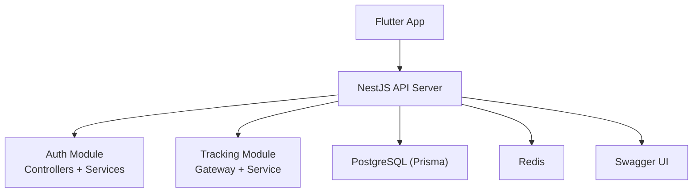
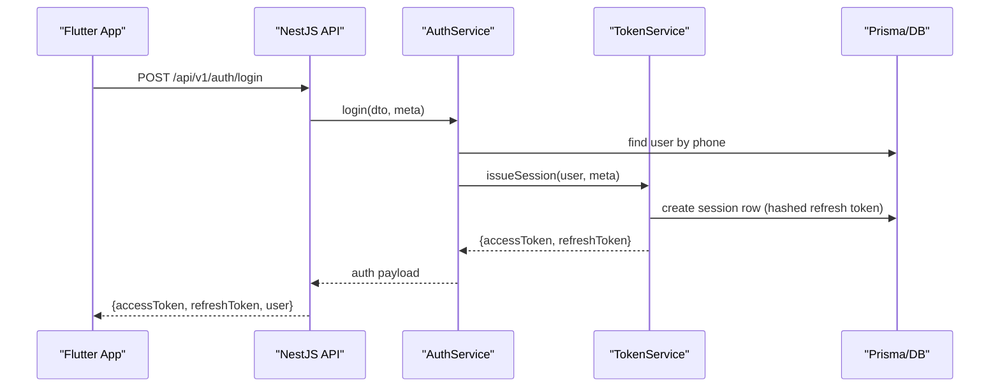
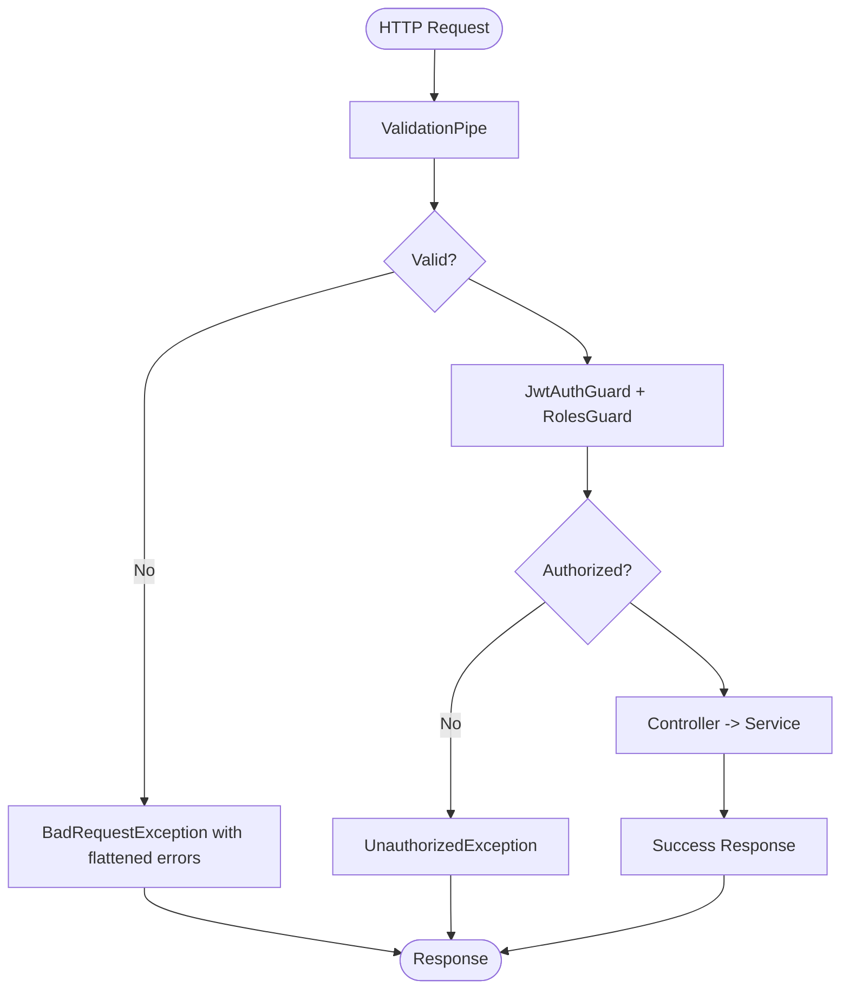
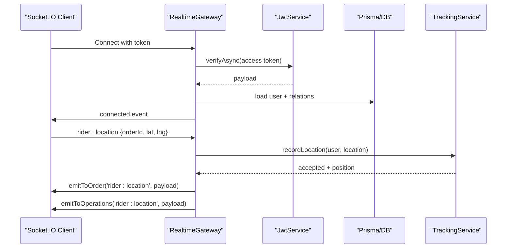
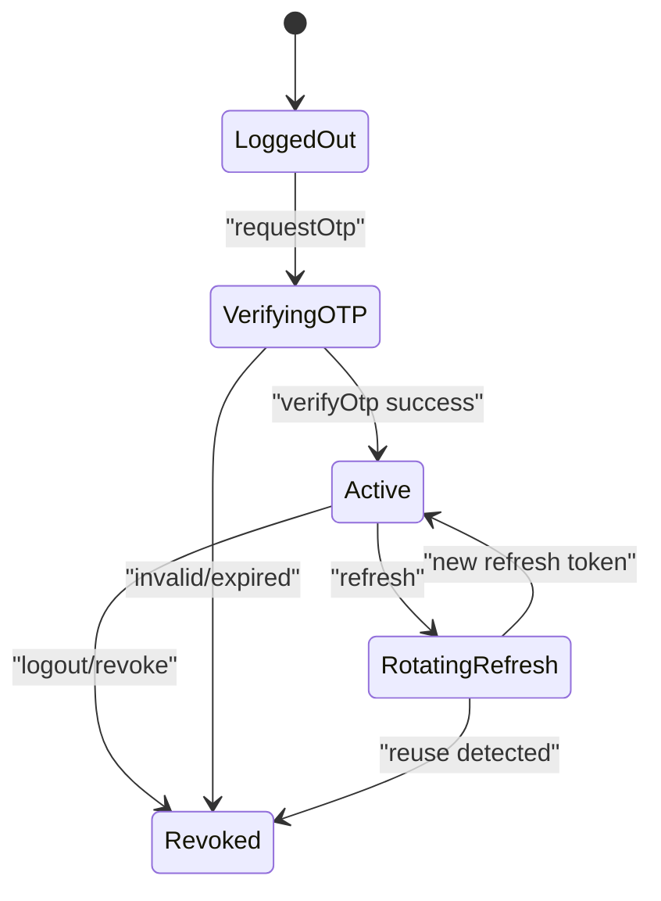
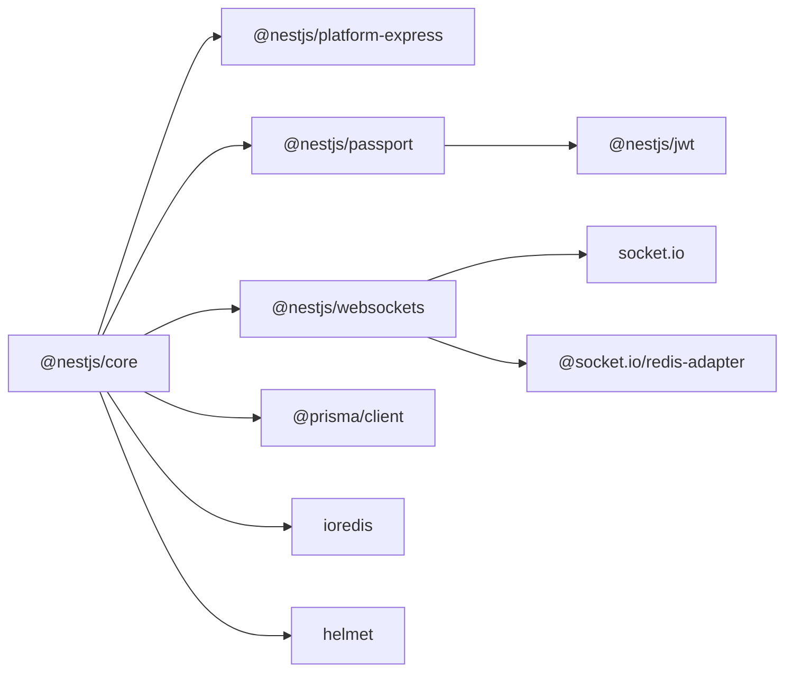

# Services & API Integration

<cite>
**Referenced Files in This Document**
- [main.ts](file://backend/src/main.ts)
- [app.module.ts](file://backend/src/app.module.ts)
- [package.json](file://backend/package.json)
- [auth.controller.ts](file://backend/src/auth/auth.controller.ts)
- [auth.service.ts](file://backend/src/auth/auth.service.ts)
- [token.service.ts](file://backend/src/auth/token.service.ts)
- [jwt-auth.guard.ts](file://backend/src/common/guards/jwt-auth.guard.ts)
- [realtime.gateway.ts](file://backend/src/tracking/realtime.gateway.ts)
- [pubspec.yaml](file://flutter_app/pubspec.yaml)
</cite>

## Table of Contents
1. [Introduction](#introduction)
2. [Project Structure](#project-structure)
3. [Core Components](#core-components)
4. [Architecture Overview](#architecture-overview)
5. [Detailed Component Analysis](#detailed-component-analysis)
6. [Dependency Analysis](#dependency-analysis)
7. [Performance Considerations](#performance-considerations)
8. [Troubleshooting Guide](#troubleshooting-guide)
9. [Conclusion](#conclusion)
10. [Appendices](#appendices)

## Introduction
This document explains the service layer and API integration patterns for FuelConnect, focusing on:
- HTTP client configuration, request/response handling, validation, and error management
- Authentication with JWT access tokens and rotating refresh tokens
- Real-time features via Socket.IO with Redis-backed horizontal scaling
- Local storage strategies and caching considerations for the Flutter frontend
- Service composition, dependency injection, and testing approaches
- Security considerations including rate limiting, helmet, CORS, token rotation, and session revocation

The backend is a NestJS application using Prisma for persistence, Redis for real-time adapter and potential caching, and Socket.IO for live tracking. The Flutter app declares secure storage and shared preferences dependencies for local state and tokens.

## Project Structure
At a high level:
- Backend entrypoint configures security, global pipes, Swagger, static assets, and module imports.
- Feature modules encapsulate controllers, services, DTOs, and domain logic.
- Common infrastructure includes guards, decorators, filters, interceptors, utilities, and security helpers.
- Tracking provides WebSocket gateway and service for real-time delivery updates.
- Auth provides authentication, OTP flows, sessions, and token management.



**Diagram sources**
- [main.ts:12-103](file://backend/src/main.ts#L12-L103)
- [app.module.ts:29-67](file://backend/src/app.module.ts#L29-L67)
- [realtime.gateway.ts:45-78](file://backend/src/tracking/realtime.gateway.ts#L45-L78)

**Section sources**
- [main.ts:12-103](file://backend/src/main.ts#L12-L103)
- [app.module.ts:29-67](file://backend/src/app.module.ts#L29-L67)

## Core Components
- Bootstrap and global configuration: Helmet, CORS, global validation pipe, Swagger, static dashboard, shutdown hooks.
- Global guards and interceptors: ThrottlerGuard, JwtAuthGuard, RolesGuard, AuditLogInterceptor, AllExceptionsFilter.
- Authentication: Controller endpoints, AuthService orchestration, TokenService for JWT and opaque refresh tokens, OTP flow.
- Real-time tracking: Socket.IO gateway with JWT verification, room-based messaging, Redis adapter for multi-instance scaling.
- Frontend dependencies: Secure storage for tokens, shared preferences for lightweight settings, crypto for hashing where needed.

Key responsibilities:
- HTTP layer validates input, enforces roles, and delegates to services.
- Services coordinate business logic, persistence, and external integrations.
- TokenService manages short-lived access tokens and long-lived rotated refresh tokens stored as hashes.
- Gateway authenticates WebSocket connections and routes events by rooms.

**Section sources**
- [main.ts:12-103](file://backend/src/main.ts#L12-L103)
- [app.module.ts:29-67](file://backend/src/app.module.ts#L29-L67)
- [auth.controller.ts:42-165](file://backend/src/auth/auth.controller.ts#L42-L165)
- [auth.service.ts:39-559](file://backend/src/auth/auth.service.ts#L39-L559)
- [token.service.ts:32-197](file://backend/src/auth/token.service.ts#L32-L197)
- [realtime.gateway.ts:45-293](file://backend/src/tracking/realtime.gateway.ts#L45-L293)
- [pubspec.yaml:10-18](file://flutter_app/pubspec.yaml#L10-L18)

## Architecture Overview
The system uses layered architecture with clear separation:
- Presentation: Controllers expose REST endpoints; Gateway exposes WebSocket events.
- Application: Services implement use cases and orchestrate data access.
- Infrastructure: Prisma for database, Redis for adapter/caching, JWT for auth, Socket.IO for real-time.



**Diagram sources**
- [auth.controller.ts:64-71](file://backend/src/auth/auth.controller.ts#L64-L71)
- [auth.service.ts:163-239](file://backend/src/auth/auth.service.ts#L163-L239)
- [token.service.ts:40-67](file://backend/src/auth/token.service.ts#L40-L67)

## Detailed Component Analysis

### Authentication and Token Management
- Login flow: Validates credentials, checks account status and lockout, issues access and refresh tokens, records last login.
- Refresh flow: Rotates refresh token, detects reuse (theft), revokes family of sessions, returns new access token.
- Session management: Lists active sessions, revokes single or all sessions, ties sessions to IP/user agent metadata.
- Password reset: OTP-based reset token issuance and verification, password change invalidates other sessions.

```mermaid
classDiagram
class AuthService {
+register(dto, meta)
+login(dto, meta)
+verifyOtp(dto, meta)
+requestOtp(phone, purpose)
+refresh(dto, meta)
+logout(userId, sessionId)
+changePassword(userId, dto)
+forgotPassword(dto)
+resetPassword(dto)
+me(userId)
+updateProfile(userId, dto)
+listSessions(userId)
+revokeSession(userId, sessionId)
}
class TokenService {
+issueSession(user, meta) TokenPair
+rotate(refreshToken, meta) TokenPair & {userId}
+revokeSession(sessionId, reason)
+revokeAllSessions(userId, reason)
+signResetToken(user) string
+verifyResetToken(token) ResetTokenPayload
}
class PrismaService
class ConfigService
class OtpService
class PasswordService
class AuditService
AuthService --> TokenService : "uses"
AuthService --> PrismaService : "persists"
AuthService --> OtpService : "issues codes"
AuthService --> PasswordService : "hashes/verifies"
AuthService --> AuditService : "records events"
TokenService --> PrismaService : "sessions"
TokenService --> ConfigService : "JWT TTLs"
```

**Diagram sources**
- [auth.service.ts:39-559](file://backend/src/auth/auth.service.ts#L39-L559)
- [token.service.ts:32-197](file://backend/src/auth/token.service.ts#L32-L197)

**Section sources**
- [auth.controller.ts:42-165](file://backend/src/auth/auth.controller.ts#L42-L165)
- [auth.service.ts:39-559](file://backend/src/auth/auth.service.ts#L39-L559)
- [token.service.ts:32-197](file://backend/src/auth/token.service.ts#L32-L197)

#### Request Validation and Error Handling
- Global ValidationPipe whitelists fields, transforms inputs, and converts validation errors into BadRequestException with flattened messages.
- All exceptions are handled by a global filter for consistent error responses.
- Rate limiting via ThrottlerGuard at the application level; additional @Throttle decorators on sensitive endpoints.



**Diagram sources**
- [main.ts:50-61](file://backend/src/main.ts#L50-L61)
- [app.module.ts:61-67](file://backend/src/app.module.ts#L61-L67)
- [jwt-auth.guard.ts:11-34](file://backend/src/common/guards/jwt-auth.guard.ts#L11-L34)

**Section sources**
- [main.ts:50-61](file://backend/src/main.ts#L50-L61)
- [app.module.ts:61-67](file://backend/src/app.module.ts#L61-L67)
- [jwt-auth.guard.ts:11-34](file://backend/src/common/guards/jwt-auth.guard.ts#L11-L34)

### Real-Time Tracking with WebSocket
- Namespace: /tracking with CORS enabled and both websocket and polling transports.
- Connection handshake supports Bearer token via auth object, Authorization header, or query parameter.
- JWT verification ensures access token type and active session; user is loaded and joined to relevant rooms (user, rider, station, operations).
- Events:
  - Inbound: order:subscribe, order:unsubscribe, admin:subscribe, rider:location
  - Outbound: connected, unauthorized, order:snapshot, rider:location, operations:snapshot, error



**Diagram sources**
- [realtime.gateway.ts:45-78](file://backend/src/tracking/realtime.gateway.ts#L45-L78)
- [realtime.gateway.ts:80-143](file://backend/src/tracking/realtime.gateway.ts#L80-L143)
- [realtime.gateway.ts:201-252](file://backend/src/tracking/realtime.gateway.ts#L201-L252)

**Section sources**
- [realtime.gateway.ts:45-293](file://backend/src/tracking/realtime.gateway.ts#L45-L293)

### HTTP Client Configuration and API Patterns
- Base URL prefix: configured via apiPrefix (default /api/v1).
- Security: Helmet applied; CORS configured from environment origins; credentials allowed.
- Documentation: Swagger UI available at /docs with bearer auth support.
- Static dashboard: served under /dashboard.

Frontend integration guidance:
- Use HTTPS and set Authorization: Bearer <accessToken> for protected endpoints.
- Persist refreshToken securely and rotate it via /auth/refresh when access token expires.
- For real-time, connect to the WebSocket namespace /tracking and pass the token in handshake.auth.token or headers.authorization.

**Section sources**
- [main.ts:12-103](file://backend/src/main.ts#L12-L103)

### Data Transformation and DTOs
- Controllers accept validated DTOs defined per feature; ValidationPipe transforms and whitelists fields.
- Services return normalized payloads tailored for clients (e.g., auth payload with user profile and wallet).

Best practices:
- Keep DTOs close to controllers and avoid leaking internal entities.
- Map domain models to response shapes in services or dedicated mappers.

**Section sources**
- [auth.controller.ts:21-32](file://backend/src/auth/auth.controller.ts#L21-L32)
- [auth.service.ts:456-465](file://backend/src/auth/auth.service.ts#L456-L465)

### Local Storage Strategies and Caching
- Flutter dependencies include flutter_secure_storage for secure token storage and shared_preferences for lightweight settings.
- Backend uses Redis primarily as a Socket.IO adapter; caching can be added via RedisService for hot reads if needed.

Recommendations:
- Store accessToken in memory after login; persist refreshToken securely.
- Cache non-sensitive read-only data (stations, riders) in Flutter with TTL and background refresh.
- On the backend, consider Redis caches for expensive queries behind services.

**Section sources**
- [pubspec.yaml:10-18](file://flutter_app/pubspec.yaml#L10-L18)
- [realtime.gateway.ts:63-78](file://backend/src/tracking/realtime.gateway.ts#L63-L78)

### Service Composition and Dependency Injection
- NestJS DI wires services through constructor injection.
- Global providers register guards, interceptors, and filters once in AppModule.

Patterns observed:
- AuthService composes PrismaService, PasswordService, OtpService, TokenService, ConfigService, AuditService.
- TokenService composes JwtService, ConfigService, PrismaService.
- RealtimeGateway composes JwtService, PrismaService, RedisService, TrackingService.

**Section sources**
- [auth.service.ts:41-48](file://backend/src/auth/auth.service.ts#L41-L48)
- [token.service.ts:34-38](file://backend/src/auth/token.service.ts#L34-L38)
- [realtime.gateway.ts:56-61](file://backend/src/tracking/realtime.gateway.ts#L56-L61)
- [app.module.ts:61-67](file://backend/src/app.module.ts#L61-L67)

### Testing Approaches
- Backend: Use NestJS testing utilities to test controllers and services in isolation; mock PrismaService, JwtService, and RedisService.
- Frontend: Unit tests for services and widgets; isolate network calls with mocks; validate secure storage interactions.

Guidelines:
- Test auth flows end-to-end with mocked tokens and sessions.
- Test WebSocket handlers by connecting a test socket and asserting emitted events.
- Validate DTO transformations and error mapping.

[No sources needed since this section provides general guidance]

### Authentication Token Lifecycle
- Access tokens: Short-lived JWTs containing minimal claims and session id.
- Refresh tokens: Opaque random secrets hashed and stored in sessions; rotated on each use; reuse triggers family revocation.
- Reset tokens: Time-limited JWTs used only for password reset flow.



**Diagram sources**
- [auth.service.ts:241-322](file://backend/src/auth/auth.service.ts#L241-L322)
- [token.service.ts:69-151](file://backend/src/auth/token.service.ts#L69-L151)

**Section sources**
- [auth.service.ts:241-322](file://backend/src/auth/auth.service.ts#L241-L322)
- [token.service.ts:69-151](file://backend/src/auth/token.service.ts#L69-L151)

### Offline Data Synchronization
- Strategy: Queue mutations locally when offline; reconcile on reconnect using optimistic updates and conflict resolution.
- Sync endpoints: Batched upserts and versioned entities to minimize conflicts.
- Conflict resolution: Last-writer-wins with server-side validation or merge strategies per entity.

[No sources needed since this section provides general guidance]

### Background Task Handling
- Use NestJS queues (e.g., BullMQ) or scheduled tasks for async jobs like notifications, reports, and cleanup.
- Ensure idempotency and retry policies with exponential backoff.
- Track job progress and failures with audit logs.

[No sources needed since this section provides general guidance]

### Security Considerations
- Helmet applied with selective policy toggles; ensure CSP aligns with app needs.
- CORS restricted to configured origins; credentials allowed.
- Rate limiting protects against brute force; sensitive endpoints have tighter limits.
- Passwords hashed with Argon2 via PasswordService.
- JWTs signed with secret from configuration; refresh tokens rotated and revoked on reuse.
- WebSocket connections authenticated via JWT and validated against active sessions.

**Section sources**
- [main.ts:25-34](file://backend/src/main.ts#L25-L34)
- [app.module.ts:38-40](file://backend/src/app.module.ts#L38-L40)
- [auth.service.ts:163-239](file://backend/src/auth/auth.service.ts#L163-L239)
- [token.service.ts:86-101](file://backend/src/auth/token.service.ts#L86-L101)
- [realtime.gateway.ts:80-143](file://backend/src/tracking/realtime.gateway.ts#L80-L143)

## Dependency Analysis
High-level runtime dependencies:
- NestJS core and platform-express
- Passport + JWT for authentication
- Socket.IO + Redis adapter for real-time
- Prisma client for database access
- Helmet for HTTP security
- ioredis for Redis connectivity



**Diagram sources**
- [package.json:25-48](file://backend/package.json#L25-L48)

**Section sources**
- [package.json:25-48](file://backend/package.json#L25-L48)

## Performance Considerations
- Database: Use Prisma transactions for multi-step writes; select only required fields; leverage indexes on frequently queried columns.
- Caching: Add Redis-backed caches for hot reads (e.g., stations, rider availability) with appropriate TTLs.
- Real-time: Enable Redis adapter for horizontal scaling; throttle location broadcasts if needed.
- Network: Minimize payload sizes; paginate lists; compress responses if necessary.

[No sources needed since this section provides general guidance]

## Troubleshooting Guide
Common issues and resolutions:
- Validation errors: Check request body against DTOs; review flattened error messages from ValidationPipe.
- Unauthorized: Verify access token presence and validity; ensure session not revoked; check JWT expiry.
- Too many requests: Review throttling configuration and endpoint-specific @Throttle decorators.
- WebSocket unauthorized: Confirm token passed in handshake; verify session exists and is active.
- CORS errors: Ensure frontend origin is included in CORS_ORIGINS; credentials must be enabled.

**Section sources**
- [main.ts:50-61](file://backend/src/main.ts#L50-L61)
- [jwt-auth.guard.ts:26-33](file://backend/src/common/guards/jwt-auth.guard.ts#L26-L33)
- [realtime.gateway.ts:136-142](file://backend/src/tracking/realtime.gateway.ts#L136-L142)

## Conclusion
FuelConnect’s backend implements a robust service layer with clear separation of concerns, strong authentication and session management, and scalable real-time capabilities. By following the documented patterns for HTTP and WebSocket integration, secure token handling, and disciplined error management, teams can extend the system confidently while maintaining security and performance.

[No sources needed since this section summarizes without analyzing specific files]

## Appendices

### API Surface Highlights
- Authentication: register, register/rider, login, otp/request, otp/verify, refresh, password/forgot, password/reset, logout, me, update profile, change password, sessions, revoke session.
- Real-time: /tracking namespace with order and rider events.

**Section sources**
- [auth.controller.ts:42-165](file://backend/src/auth/auth.controller.ts#L42-L165)
- [realtime.gateway.ts:29-44](file://backend/src/tracking/realtime.gateway.ts#L29-L44)