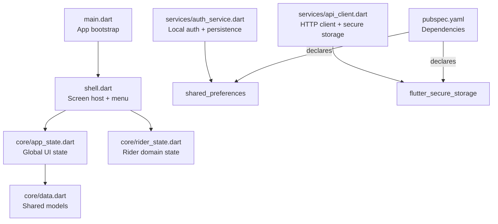
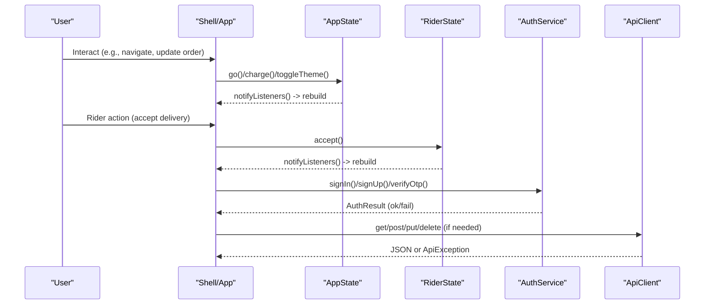
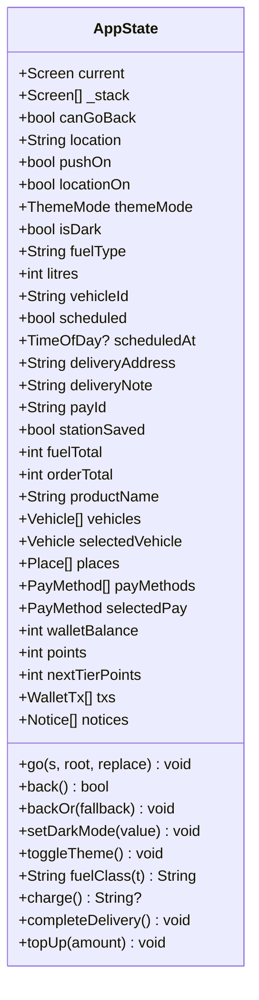
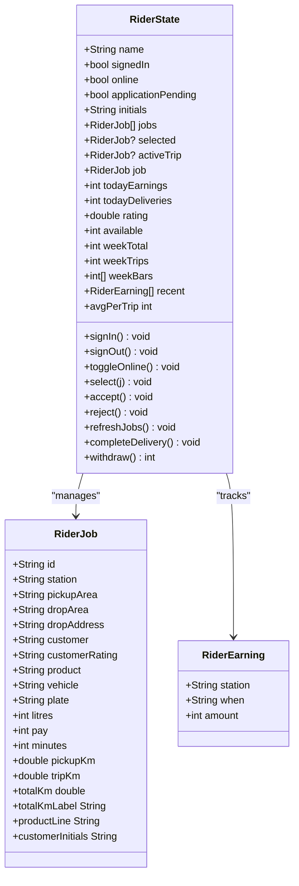
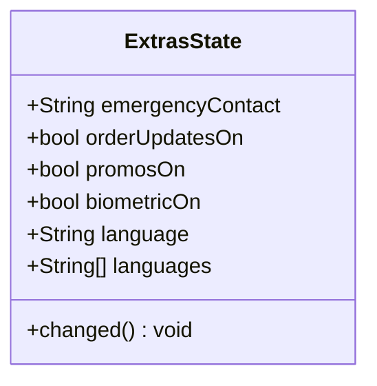
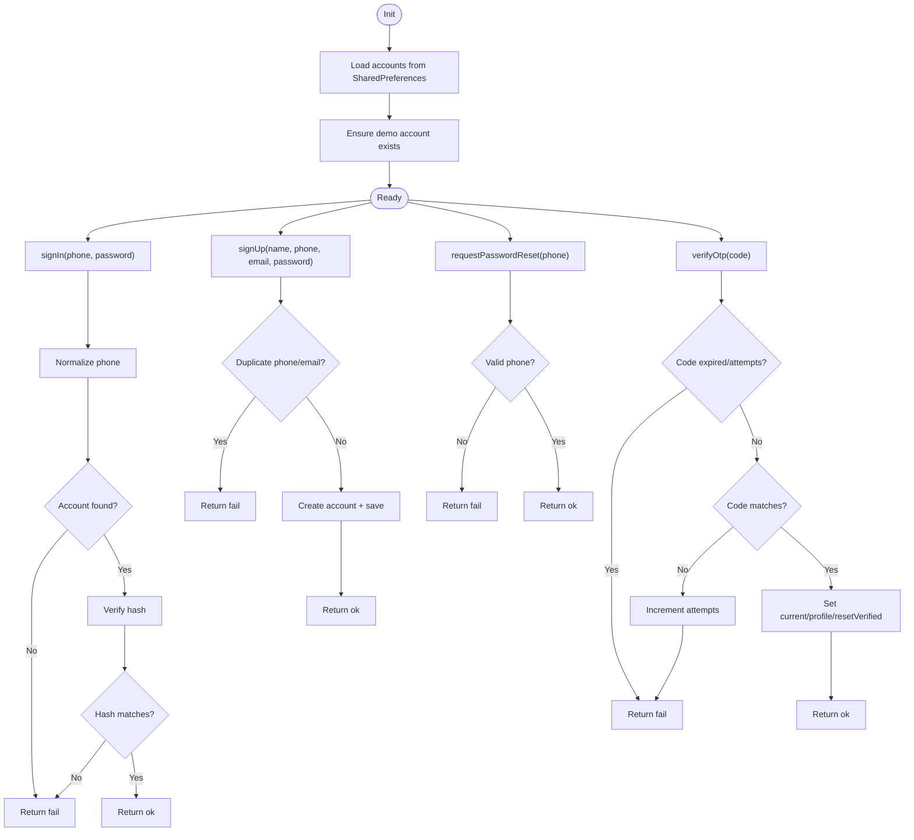
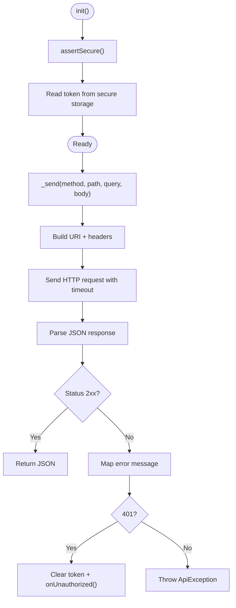
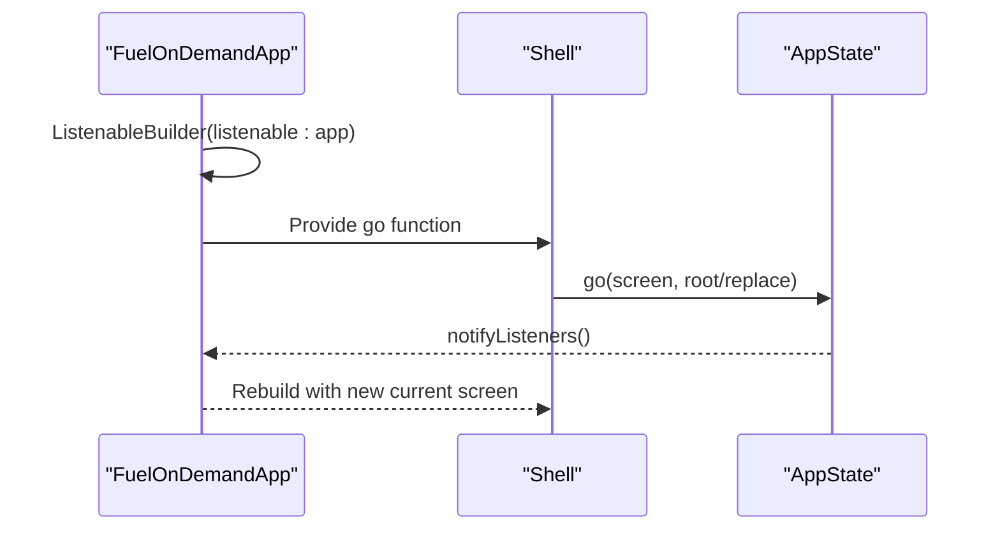
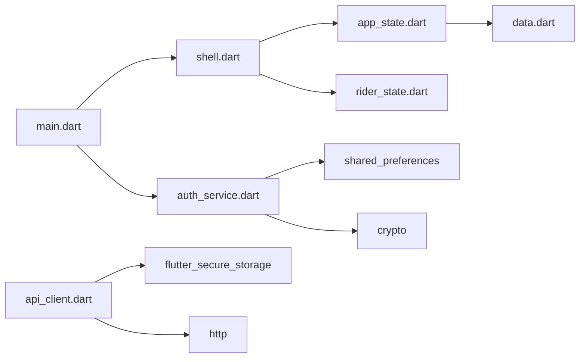

# State Management & Data Flow

<cite>
**Referenced Files in This Document**
- [main.dart](file://flutter_app/lib/main.dart)
- [shell.dart](file://flutter_app/lib/shell.dart)
- [app_state.dart](file://flutter_app/lib/core/app_state.dart)
- [rider_state.dart](file://flutter_app/lib/core/rider_state.dart)
- [extras_state.dart](file://flutter_app/lib/core/extras_state.dart)
- [data.dart](file://flutter_app/lib/core/data.dart)
- [auth_service.dart](file://flutter_app/lib/services/auth_service.dart)
- [api_client.dart](file://flutter_app/lib/services/api_client.dart)
- [pubspec.yaml](file://flutter_app/pubspec.yaml)
</cite>

## Table of Contents
1. [Introduction](#introduction)
2. [Project Structure](#project-structure)
3. [Core Components](#core-components)
4. [Architecture Overview](#architecture-overview)
5. [Detailed Component Analysis](#detailed-component-analysis)
6. [Dependency Analysis](#dependency-analysis)
7. [Performance Considerations](#performance-considerations)
8. [Troubleshooting Guide](#troubleshooting-guide)
9. [Conclusion](#conclusion)

## Introduction
This document explains the Flutter application’s state management and data flow patterns. The app uses a Provider-based approach via ChangeNotifier to manage global UI state, navigation, theme, order builder, wallet/rewards, and rider-specific flows. It also documents local persistence for authentication and secure token storage, reactive UI updates, and integration points with the backend API client. Offline-first strategies are implemented through local-only state and persisted accounts; network calls are gated by a secure API client that handles tokens, timeouts, and error mapping.

## Project Structure
The Flutter frontend is organized into:
- Core state and models under lib/core (AppState, RiderState, ExtrasState, shared data models).
- Services under lib/services (authentication service and HTTP API client).
- App entry point and shell routing under lib/main.dart and lib/shell.dart.
- Dependencies declared in pubspec.yaml.

**Diagram sources**
- [main.dart:7-18](file://flutter_app/lib/main.dart#L7-L18)
- [shell.dart:107-129](file://flutter_app/lib/shell.dart#L107-L129)
- [app_state.dart:69-198](file://flutter_app/lib/core/app_state.dart#L69-L198)
- [rider_state.dart:46-179](file://flutter_app/lib/core/rider_state.dart#L46-L179)
- [data.dart:4-126](file://flutter_app/lib/core/data.dart#L4-L126)
- [auth_service.dart:110-304](file://flutter_app/lib/services/auth_service.dart#L110-L304)
- [api_client.dart:32-126](file://flutter_app/lib/services/api_client.dart#L32-L126)
- [pubspec.yaml:10-18](file://flutter_app/pubspec.yaml#L10-L18)

**Section sources**
- [main.dart:7-18](file://flutter_app/lib/main.dart#L7-L18)
- [shell.dart:107-129](file://flutter_app/lib/shell.dart#L107-L129)
- [pubspec.yaml:10-18](file://flutter_app/pubspec.yaml#L10-L18)

## Core Components
- AppState (ChangeNotifier): Centralized global state for navigation stack, theme mode, location flags, order builder (fuel type, litres, vehicle selection), payment method, wallet balance, transactions, notifications, and derived totals. Exposes methods like go(), back(), setDarkMode(), charge(), topUp(), completeDelivery().
- RiderState (ChangeNotifier): Frontend-only rider domain state mirroring expected backend responses. Manages job list, selected/active trip, earnings stats, and actions like select(), accept(), reject(), completeDelivery(), withdraw().
- ExtrasState (ChangeNotifier): Lightweight settings for profile and app preferences (emergency contact, toggles, language).
- Shared Data Models: Station, Partner, Vehicle, Place, PayMethod, WalletTx, Notice, HistoryOrder, etc., used across screens and states.
- AuthService: Local account store with salted+hashed passwords, OTP flow, profile, and persistence via SharedPreferences.
- ApiClient: Secure HTTP client using flutter_secure_storage for bearer tokens, timeouts, and standardized error mapping.

Key responsibilities and relationships:
- UI rebuilds are driven by notifyListeners() from ChangeNotifier instances.
- AppState drives screen rendering and order calculations; RiderState drives rider flows; ExtrasState drives user preferences.
- AuthService persists accounts locally; ApiClient manages secure tokens for backend communication.

**Section sources**
- [app_state.dart:69-198](file://flutter_app/lib/core/app_state.dart#L69-L198)
- [rider_state.dart:46-179](file://flutter_app/lib/core/rider_state.dart#L46-L179)
- [extras_state.dart:5-17](file://flutter_app/lib/core/extras_state.dart#L5-L17)
- [data.dart:4-126](file://flutter_app/lib/core/data.dart#L4-L126)
- [auth_service.dart:110-304](file://flutter_app/lib/services/auth_service.dart#L110-L304)
- [api_client.dart:32-126](file://flutter_app/lib/services/api_client.dart#L32-L126)

## Architecture Overview
The app follows a Provider-like pattern using ChangeNotifier:
- Widgets listen to AppState and RiderState via ListenableBuilder or similar reactive patterns.
- Global state changes trigger UI rebuilds.
- Navigation is managed centrally in AppState with a stack.
- Authentication and API access are encapsulated in services.

**Diagram sources**
- [shell.dart:107-129](file://flutter_app/lib/shell.dart#L107-L129)
- [app_state.dart:75-117](file://flutter_app/lib/core/app_state.dart#L75-L117)
- [rider_state.dart:130-168](file://flutter_app/lib/core/rider_state.dart#L130-L168)
- [auth_service.dart:180-265](file://flutter_app/lib/services/auth_service.dart#L180-L265)
- [api_client.dart:69-109](file://flutter_app/lib/services/api_client.dart#L69-L109)

## Detailed Component Analysis

### AppState: Global UI State and Order Builder
Responsibilities:
- Navigation stack management (go, back, backOr).
- Theme mode toggle and dark/light mode propagation.
- Order builder fields (fuelType, litres, vehicleId, scheduledAt, deliveryAddress/note, payId).
- Derived computations (fuelTotal, orderTotal, productName).
- Payment processing (wallet deduction, transaction insertion).
- Wallet and rewards updates (topUp, completeDelivery).
- Notifications list.

Reactive behavior:
- All mutations call notifyListeners() to trigger UI rebuilds.
- Theme changes also rebuild the app via rebuildApp() hook.

**Diagram sources**
- [app_state.dart:69-198](file://flutter_app/lib/core/app_state.dart#L69-L198)

**Section sources**
- [app_state.dart:69-198](file://flutter_app/lib/core/app_state.dart#L69-L198)

### RiderState: Rider Domain State
Responsibilities:
- Manage available jobs, selected job, active trip.
- Earnings statistics and recent earnings list.
- Session state (signedIn, online).
- Actions: select, accept, reject, refreshJobs, completeDelivery, withdraw.

**Diagram sources**
- [rider_state.dart:4-42](file://flutter_app/lib/core/rider_state.dart#L4-L42)
- [rider_state.dart:46-179](file://flutter_app/lib/core/rider_state.dart#L46-L179)

**Section sources**
- [rider_state.dart:46-179](file://flutter_app/lib/core/rider_state.dart#L46-L179)

### ExtrasState: Lightweight Preferences
Responsibilities:
- Emergency contact, notification toggles, biometric toggle, language selection.
- Notifies listeners on changes.

**Diagram sources**
- [extras_state.dart:5-17](file://flutter_app/lib/core/extras_state.dart#L5-L17)

**Section sources**
- [extras_state.dart:5-17](file://flutter_app/lib/core/extras_state.dart#L5-L17)

### AuthService: Local Authentication and Persistence
Responsibilities:
- Account creation/sign-in with salted+hashed passwords.
- OTP verification flow with expiration and attempt limits.
- Password reset flow.
- Profile management and sign-out.
- Persistence via SharedPreferences.

**Diagram sources**
- [auth_service.dart:134-162](file://flutter_app/lib/services/auth_service.dart#L134-L162)
- [auth_service.dart:180-200](file://flutter_app/lib/services/auth_service.dart#L180-L200)
- [auth_service.dart:202-209](file://flutter_app/lib/services/auth_service.dart#L202-L209)
- [auth_service.dart:214-265](file://flutter_app/lib/services/auth_service.dart#L214-L265)
- [auth_service.dart:268-280](file://flutter_app/lib/services/auth_service.dart#L268-L280)

**Section sources**
- [auth_service.dart:110-304](file://flutter_app/lib/services/auth_service.dart#L110-L304)

### ApiClient: Secure HTTP Client
Responsibilities:
- Base URL configuration and HTTPS enforcement in release builds.
- Bearer token storage in secure storage.
- Timeouts and friendly error messages.
- Unauthorized handling callback.

**Diagram sources**
- [api_client.dart:11-20](file://flutter_app/lib/services/api_client.dart#L11-L20)
- [api_client.dart:48-67](file://flutter_app/lib/services/api_client.dart#L48-L67)
- [api_client.dart:74-109](file://flutter_app/lib/services/api_client.dart#L74-L109)
- [api_client.dart:111-125](file://flutter_app/lib/services/api_client.dart#L111-L125)

**Section sources**
- [api_client.dart:32-126](file://flutter_app/lib/services/api_client.dart#L32-L126)

### Reactive UI Updates and Navigation
- The app wraps MaterialApp with ListenableBuilder(app) to rebuild based on AppState changes.
- Shell hosts screens and uses app.go/back for navigation, updating the stack and notifying listeners.
- Screens receive a go function to navigate programmatically.

**Diagram sources**
- [main.dart:21-56](file://flutter_app/lib/main.dart#L21-L56)
- [shell.dart:107-129](file://flutter_app/lib/shell.dart#L107-L129)
- [app_state.dart:75-97](file://flutter_app/lib/core/app_state.dart#L75-L97)

**Section sources**
- [main.dart:21-56](file://flutter_app/lib/main.dart#L21-L56)
- [shell.dart:107-129](file://flutter_app/lib/shell.dart#L107-L129)
- [app_state.dart:75-97](file://flutter_app/lib/core/app_state.dart#L75-L97)

## Dependency Analysis
High-level dependencies:
- main.dart initializes system UI, calls auth.init(), then runs the app.
- shell.dart depends on core modules and routes to screens.
- AppState depends on shared data models.
- AuthService depends on shared_preferences and crypto.
- ApiClient depends on flutter_secure_storage and http.

**Diagram sources**
- [main.dart:7-18](file://flutter_app/lib/main.dart#L7-L18)
- [shell.dart:1-11](file://flutter_app/lib/shell.dart#L1-L11)
- [app_state.dart:1-4](file://flutter_app/lib/core/app_state.dart#L1-L4)
- [auth_service.dart:1-5](file://flutter_app/lib/services/auth_service.dart#L1-L5)
- [api_client.dart:1-6](file://flutter_app/lib/services/api_client.dart#L1-L6)
- [pubspec.yaml:10-18](file://flutter_app/pubspec.yaml#L10-L18)

**Section sources**
- [main.dart:7-18](file://flutter_app/lib/main.dart#L7-L18)
- [shell.dart:1-11](file://flutter_app/lib/shell.dart#L1-L11)
- [pubspec.yaml:10-18](file://flutter_app/pubspec.yaml#L10-L18)

## Performance Considerations
- Minimize rebuild scope: Use ListenableBuilder only around widgets that need to react to AppState/RiderState changes.
- Avoid heavy computations in build: Move derived calculations (e.g., totals) into computed getters in state classes.
- Debounce frequent updates: For real-time features (tracking), throttle updates to reduce rebuild frequency.
- Prefer immutable data structures where possible to avoid unnecessary re-renders.
- Keep lists small and virtualize long lists if expanded later.

[No sources needed since this section provides general guidance]

## Troubleshooting Guide
Common issues and resolutions:
- Token invalidation: ApiClient clears the token on 401 and invokes onUnauthorized callback; ensure your app redirects to login.
- Network errors: ApiClient maps server errors to friendly messages; handle ApiException in UI layers.
- Release HTTPS requirement: ApiConfig.assertSecure() throws if API_BASE_URL is not HTTPS in release builds; configure proper base URL at build time.
- Local auth persistence: If accounts do not load, check SharedPreferences initialization and versioning keys.

**Section sources**
- [api_client.dart:48-67](file://flutter_app/lib/services/api_client.dart#L48-L67)
- [api_client.dart:102-109](file://flutter_app/lib/services/api_client.dart#L102-L109)
- [api_client.dart:111-125](file://flutter_app/lib/services/api_client.dart#L111-L125)
- [auth_service.dart:134-162](file://flutter_app/lib/services/auth_service.dart#L134-L162)

## Conclusion
The application employs a straightforward yet effective state management strategy using ChangeNotifier-based providers for global and domain-specific state. AppState centralizes UI concerns and order calculations, RiderState encapsulates rider workflows, and ExtrasState holds lightweight preferences. Local persistence via SharedPreferences supports offline-first authentication, while ApiClient ensures secure and robust backend communication. This architecture enables reactive UI updates, clear separation of concerns, and extensibility for future backend integration and advanced caching strategies.