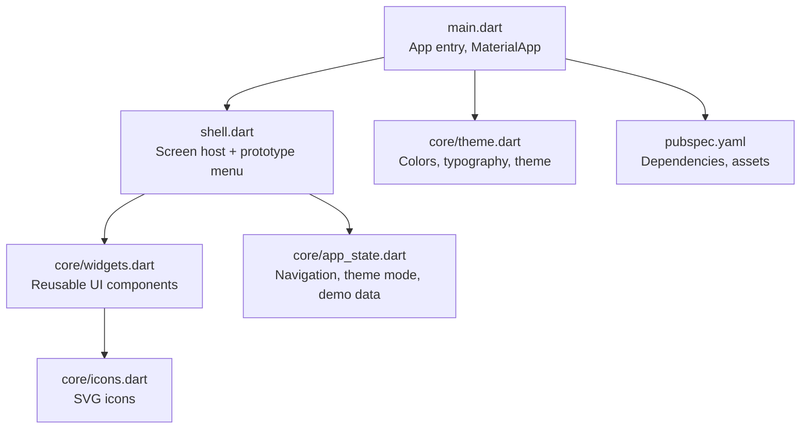
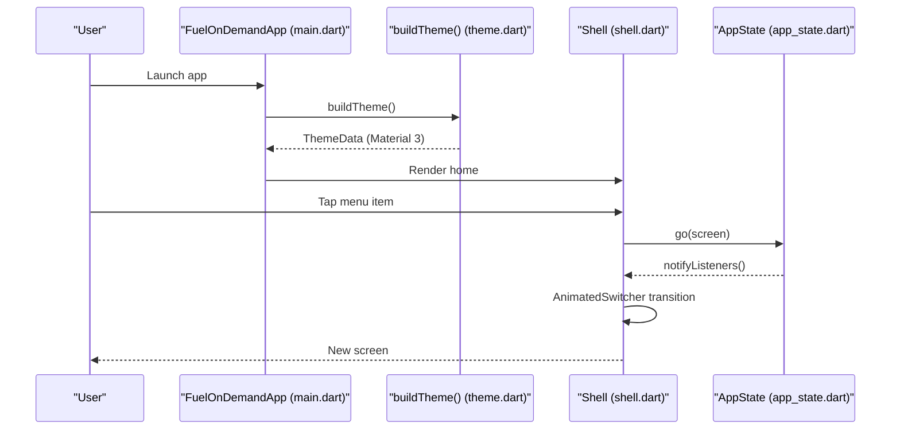
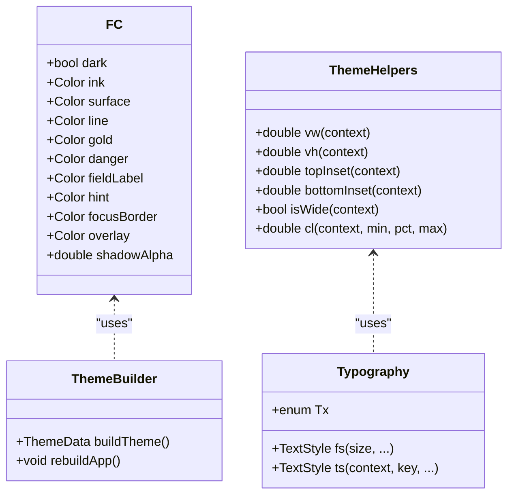
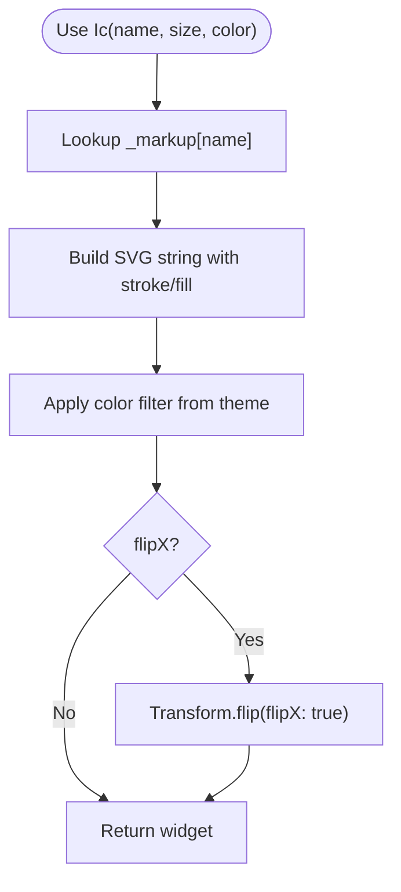
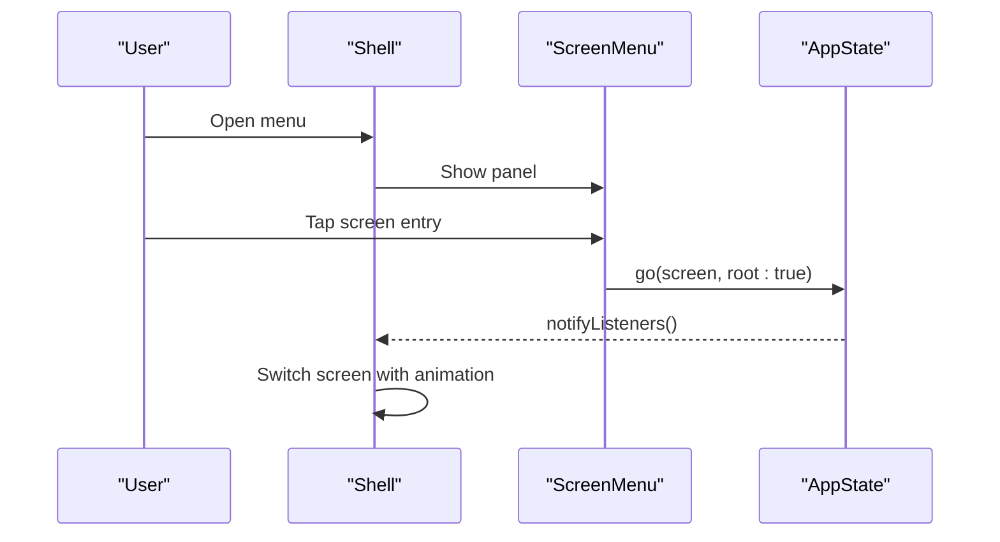
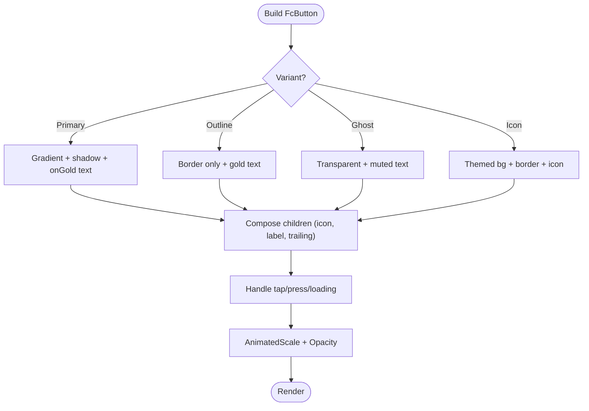
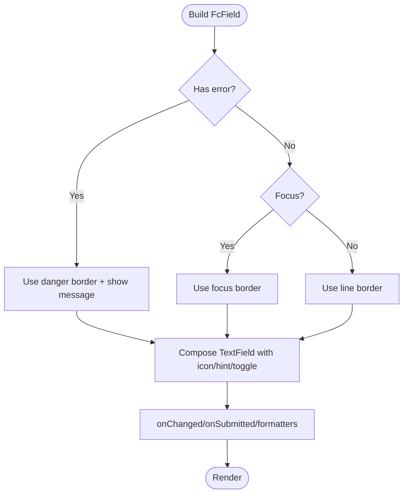
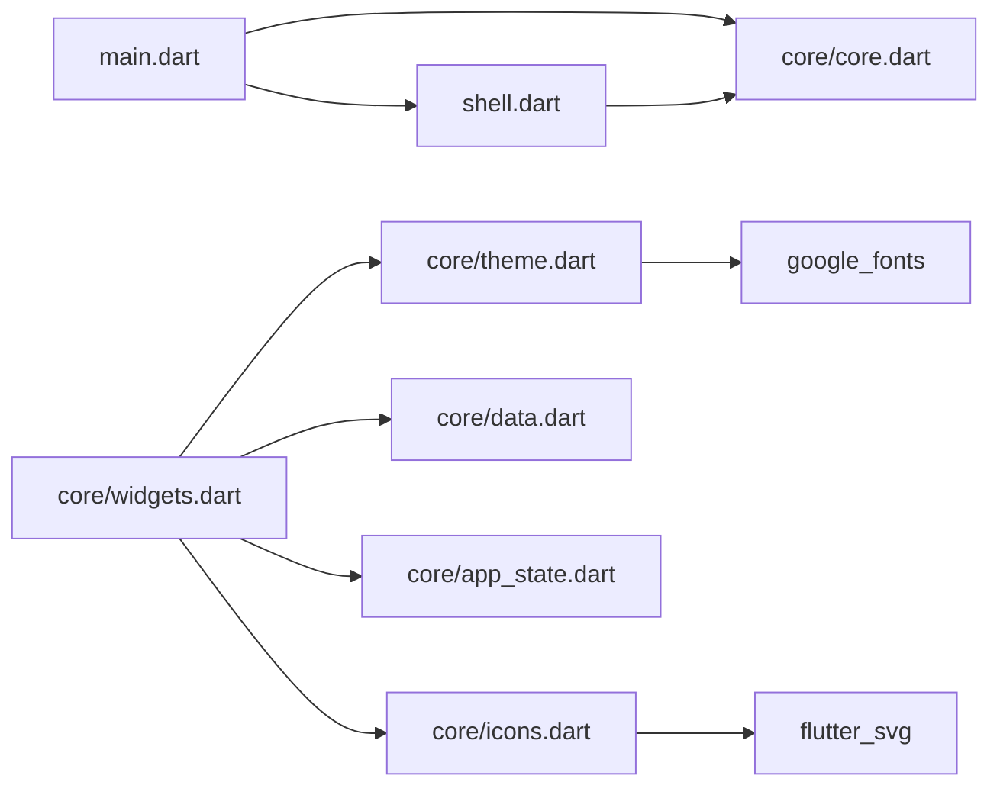

# UI Components & Theme System

<cite>
**Referenced Files in This Document**   
- [main.dart](file://flutter_app/lib/main.dart)
- [shell.dart](file://flutter_app/lib/shell.dart)
- [theme.dart](file://flutter_app/lib/core/theme.dart)
- [widgets.dart](file://flutter_app/lib/core/widgets.dart)
- [icons.dart](file://flutter_app/lib/core/icons.dart)
- [app_state.dart](file://flutter_app/lib/core/app_state.dart)
- [pubspec.yaml](file://flutter_app/pubspec.yaml)
</cite>

## Table of Contents
1. [Introduction](#introduction)
2. [Project Structure](#project-structure)
3. [Core Components](#core-components)
4. [Architecture Overview](#architecture-overview)
5. [Detailed Component Analysis](#detailed-component-analysis)
6. [Dependency Analysis](#dependency-analysis)
7. [Performance Considerations](#performance-considerations)
8. [Troubleshooting Guide](#troubleshooting-guide)
9. [Conclusion](#conclusion)
10. [Appendices](#appendices)

## Introduction
This document explains the custom UI component library and theme system used by the Flutter application. It covers:
- Reusable widgets, their properties, usage patterns, and customization options
- Material Design implementation, color schemes, typography system, and responsive design
- Creating consistent UI elements, implementing dark/light themes, and adapting layouts for different screen sizes
- Icon usage, animation patterns, and accessibility considerations
- Guidelines for extending the component library while maintaining design consistency

The codebase uses a centralized theme and widget layer under `lib/core`, with screens and navigation handled through a shell and an app state model.

## Project Structure
The UI layer is organized around a small set of core modules:
- `main.dart` initializes the app, configures system UI overlays, and provides the root `MaterialApp`.
- `shell.dart` hosts the active screen and a prototype navigation menu.
- `core/theme.dart` defines colors, typography, responsive helpers, and the Material 3 theme.
- `core/widgets.dart` contains reusable components such as buttons, fields, panels, layout helpers, and feedback dialogs.
- `core/icons.dart` provides a typed SVG icon system.
- `core/app_state.dart` holds navigation state, theme mode, and demo data.
- `pubspec.yaml` declares dependencies including Google Fonts and Material Design support.

**Diagram sources**
- [main.dart:7-57](file://flutter_app/lib/main.dart#L7-L57)
- [shell.dart:15-129](file://flutter_app/lib/shell.dart#L15-L129)
- [theme.dart:29-158](file://flutter_app/lib/core/theme.dart#L29-L158)
- [widgets.dart:15-160](file://flutter_app/lib/core/widgets.dart#L15-L160)
- [icons.dart:6-58](file://flutter_app/lib/core/icons.dart#L6-L58)
- [app_state.dart:69-119](file://flutter_app/lib/core/app_state.dart#L69-L119)
- [pubspec.yaml:10-28](file://flutter_app/pubspec.yaml#L10-L28)

**Section sources**
- [main.dart:7-57](file://flutter_app/lib/main.dart#L7-L57)
- [shell.dart:15-129](file://flutter_app/lib/shell.dart#L15-L129)
- [theme.dart:29-158](file://flutter_app/lib/core/theme.dart#L29-L158)
- [widgets.dart:15-160](file://flutter_app/lib/core/widgets.dart#L15-L160)
- [icons.dart:6-58](file://flutter_app/lib/core/icons.dart#L6-L58)
- [app_state.dart:69-119](file://flutter_app/lib/core/app_state.dart#L69-L119)
- [pubspec.yaml:10-28](file://flutter_app/pubspec.yaml#L10-L28)

## Core Components
This section summarizes the most important reusable widgets and how they fit into the design system.

- Text and actions
  - `FcText`: Centralized text style using the typography scale and theme-aware color.
  - `TextAction`: Tappable label styled with the brand accent.

- Buttons
  - `FcButton`: Primary, outline, ghost, and icon variants; supports loading indicator, leading/trailing icons, and expand behavior. Includes press animations and disabled states.

- Input fields
  - `FcField`: Label, hint, optional icon, password toggle, validation error display, focus border, and input formatters.

- Layout and structure
  - `ScrollFill`: Scrollable container that fills available height.
  - `PageHeader`: Responsive header with back button or logo and centered title.
  - `BottomNav`: Four-item bottom navigation with blur background and wide-screen constraints.
  - `AppPage`: Page scaffold with optional header, body, background, and fixed bottom nav.
  - `ContentSection`, `Narrow`: Constrained content containers with responsive padding.
  - `Panel`: Surface card with configurable radius, padding, color, and border.

- Feedback and overlays
  - `toast`: Floating snackbar with themed border and content.
  - `showFcSheet`: Themed bottom sheet with drag handle and safe area.
  - `confirmDialog`: Themed confirmation dialog with primary and ghost actions.

- Branding and visuals
  - `Logo`: App logo asset.
  - `ImageShade`, `Glow`, `MapGrid`, `RouteLine`: Backgrounds and decorative graphics.

- Small atoms
  - `VerifiedPill`, `LivePill`, `FcToggle`, `RadioDot`, `RoundAction`, `IconBox`, `SectionHeading`, `SearchBox`, `KvRow`, `TotalRow`, `PartnerMonogram`, `PartnerChip`, `StationCard`.

These components are designed to be theme-aware, responsive, and accessible where applicable.

**Section sources**
- [widgets.dart:26-54](file://flutter_app/lib/core/widgets.dart#L26-L54)
- [widgets.dart:56-160](file://flutter_app/lib/core/widgets.dart#L56-L160)
- [widgets.dart:162-266](file://flutter_app/lib/core/widgets.dart#L162-L266)
- [widgets.dart:285-302](file://flutter_app/lib/core/widgets.dart#L285-L302)
- [widgets.dart:307-409](file://flutter_app/lib/core/widgets.dart#L307-L409)
- [widgets.dart:414-561](file://flutter_app/lib/core/widgets.dart#L414-L561)
- [widgets.dart:566-718](file://flutter_app/lib/core/widgets.dart#L566-L718)
- [widgets.dart:777-822](file://flutter_app/lib/core/widgets.dart#L777-L822)
- [widgets.dart:827-930](file://flutter_app/lib/core/widgets.dart#L827-L930)
- [widgets.dart:935-1003](file://flutter_app/lib/core/widgets.dart#L935-L1003)

## Architecture Overview
The UI architecture centers on a single global app state and a centralized theme. Screens are rendered by the shell, which switches between routes via an internal stack. The theme is applied at the root and can be toggled at runtime.

**Diagram sources**
- [main.dart:21-57](file://flutter_app/lib/main.dart#L21-L57)
- [theme.dart:129-158](file://flutter_app/lib/core/theme.dart#L129-L158)
- [shell.dart:106-129](file://flutter_app/lib/shell.dart#L106-L129)
- [app_state.dart:69-97](file://flutter_app/lib/core/app_state.dart#L69-L97)

## Detailed Component Analysis

### Theme System
The theme system defines a dual palette (dark/light), typography scale, responsive helpers, and a Material 3 theme.

Key aspects:
- Color palette
  - `FC` class exposes semantic colors like ink, surface, line, gold, green, danger, and more. Colors switch based on `FC.dark`.
  - Utility `al(c, o)` applies opacity to any color.
- Typography
  - `fs(size, ...)` creates styles using Plus Jakarta Sans.
  - `Tx` enum maps to display, title, subtitle, body, caption, and label scales with responsive sizing.
- Responsive helpers
  - `vw`, `vh`, `topInset`, `bottomInset`, `isWide`, and `cl(min, pct, max)` provide CSS-like scaling.
- Material 3 theme
  - `buildTheme()` sets brightness, Material 3, scaffold background, color scheme, selection theme, and text theme.
- Runtime rebuild
  - `rebuildApp()` forces a full rebuild so theme changes apply immediately without losing widget state.

**Diagram sources**
- [theme.dart:29-79](file://flutter_app/lib/core/theme.dart#L29-L79)
- [theme.dart:84-126](file://flutter_app/lib/core/theme.dart#L84-L126)
- [theme.dart:129-158](file://flutter_app/lib/core/theme.dart#L129-L158)

**Section sources**
- [theme.dart:29-79](file://flutter_app/lib/core/theme.dart#L29-L79)
- [theme.dart:84-126](file://flutter_app/lib/core/theme.dart#L84-L126)
- [theme.dart:129-158](file://flutter_app/lib/core/theme.dart#L129-L158)

### Icon System
Icons are defined as typed SVG paths and rendered through a unified widget.

- `IconName` enum lists all supported icons.
- `_markup` maps each icon name to its SVG path data.
- `Ic` renders SVG strings with consistent stroke width, round caps/joins, and theme-aware color. Supports size, fill, and horizontal flip.

**Diagram sources**
- [icons.dart:6-58](file://flutter_app/lib/core/icons.dart#L6-L58)

**Section sources**
- [icons.dart:6-58](file://flutter_app/lib/core/icons.dart#L6-L58)

### Navigation and Shell
The shell hosts the current screen and provides a prototype menu for quick navigation during development.

- `Shell` listens to `AppState` and switches screens using `AnimatedSwitcher`.
- `ScreenMenu` opens a frosted-glass panel listing all screens, with active state highlighting and accessibility labels.
- Back handling is integrated via `PopScope` and `AppState.back`.

**Diagram sources**
- [shell.dart:15-129](file://flutter_app/lib/shell.dart#L15-L129)
- [shell.dart:132-251](file://flutter_app/lib/shell.dart#L132-L251)
- [app_state.dart:69-97](file://flutter_app/lib/core/app_state.dart#L69-L97)

**Section sources**
- [shell.dart:15-129](file://flutter_app/lib/shell.dart#L15-L129)
- [shell.dart:132-251](file://flutter_app/lib/shell.dart#L132-L251)
- [app_state.dart:69-97](file://flutter_app/lib/core/app_state.dart#L69-L97)

### Button Widget (`FcButton`)
`FcButton` encapsulates common interaction patterns and visual variants.

Properties:
- `label`: Button text.
- `onTap`: Callback.
- `variant`: `primary`, `outline`, `ghost`, `icon`.
- `icon`, `trailingIcon`: Leading/trailing icons.
- `expand`: Whether the button expands to full width.
- `loading`: Shows a spinner and disables interaction.

Behavior:
- Gradient primary variant with subtle shadow.
- Outline and ghost variants use theme colors.
- Icon variant uses a themed background and border.
- Press animation via `AnimatedScale`.
- Disabled state reduces opacity.

**Diagram sources**
- [widgets.dart:56-160](file://flutter_app/lib/core/widgets.dart#L56-L160)

**Section sources**
- [widgets.dart:56-160](file://flutter_app/lib/core/widgets.dart#L56-L160)

### Field Widget (`FcField`)
`FcField` provides a complete input experience with theming and validation.

Properties:
- `label`, `hint`, `controller`
- `icon`: Optional leading icon.
- `password`, `showToggle`: Password visibility toggle.
- `keyboard`, `action`, `formatters`: Input configuration.
- `error`: Validation message.
- `onChanged`, `onSubmitted`: Event handlers.
- `labelAlign`: Alignment of the label.

Behavior:
- Focus border transitions to a themed focus color.
- Error state shows a red border and message.
- Password toggle updates obscure state.
- Cursor and hint styles follow the theme.

**Diagram sources**
- [widgets.dart:162-266](file://flutter_app/lib/core/widgets.dart#L162-L266)

**Section sources**
- [widgets.dart:162-266](file://flutter_app/lib/core/widgets.dart#L162-L266)

### Layout Widgets
- `ScrollFill`: Ensures scrollable content fills available height.
- `PageHeader`: Responsive header with back/logo and centered title.
- `BottomNav`: Fixed bottom navigation with blur effect and wide-screen constraints.
- `AppPage`: Full-page scaffold with optional header, background, and bottom nav.
- `ContentSection`, `Narrow`: Constrained content areas with responsive padding.
- `Panel`: Themed card with customizable radius, padding, color, and border.

Usage patterns:
- Wrap page content in `AppPage` when you need a header and/or bottom navigation.
- Use `ContentSection` for main content and `Narrow` for focused forms or cards.
- Use `Panel` to group related information with consistent borders and spacing.

**Section sources**
- [widgets.dart:566-718](file://flutter_app/lib/core/widgets.dart#L566-L718)
- [widgets.dart:777-822](file://flutter_app/lib/core/widgets.dart#L777-L822)

### Feedback Widgets
- `toast`: Floating snackbar with themed border and content.
- `showFcSheet`: Bottom sheet with drag handle, safe area, and constrained width.
- `confirmDialog`: Confirmation dialog with primary and ghost actions.

Accessibility:
- Dialogs and sheets use semantic-friendly structures.
- Toast messages are short and clear.

**Section sources**
- [widgets.dart:935-1003](file://flutter_app/lib/core/widgets.dart#L935-L1003)

### Data and Demo Models
`AppState` includes demo models and helper methods used across screens:
- Vehicles, places, payment methods, wallet transactions, notices.
- Order builder values and totals.
- Wallet balance and points management.

These models are consumed by screens and widgets to render realistic content.

**Section sources**
- [app_state.dart:121-198](file://flutter_app/lib/core/app_state.dart#L121-L198)

## Dependency Analysis
The UI layer has clear boundaries:
- `main.dart` depends on `core/core.dart` (which aggregates theme, widgets, icons, and app state) and `shell.dart`.
- `shell.dart` depends on `core/core.dart` and screen modules.
- `core/widgets.dart` depends on `core/theme.dart`, `core/icons.dart`, `core/data.dart`, and `core/app_state.dart`.
- `core/theme.dart` depends on `google_fonts` and Material.
- `core/icons.dart` depends on `flutter_svg` and `core/theme.dart`.

**Diagram sources**
- [main.dart:1-18](file://flutter_app/lib/main.dart#L1-L18)
- [shell.dart:1-11](file://flutter_app/lib/shell.dart#L1-L11)
- [widgets.dart:1-8](file://flutter_app/lib/core/widgets.dart#L1-L8)
- [theme.dart:1-3](file://flutter_app/lib/core/theme.dart#L1-L3)
- [icons.dart:1-4](file://flutter_app/lib/core/icons.dart#L1-L4)
- [pubspec.yaml:10-28](file://flutter_app/pubspec.yaml#L10-L28)

**Section sources**
- [main.dart:1-18](file://flutter_app/lib/main.dart#L1-L18)
- [shell.dart:1-11](file://flutter_app/lib/shell.dart#L1-L11)
- [widgets.dart:1-8](file://flutter_app/lib/core/widgets.dart#L1-L8)
- [theme.dart:1-3](file://flutter_app/lib/core/theme.dart#L1-L3)
- [icons.dart:1-4](file://flutter_app/lib/core/icons.dart#L1-L4)
- [pubspec.yaml:10-28](file://flutter_app/pubspec.yaml#L10-L28)

## Performance Considerations
- Theme rebuilds: `rebuildApp()` triggers a full tree rebuild when theme mode changes. Keep theme toggles infrequent and avoid heavy computations inside builders.
- Animations: `AnimatedSwitcher` and `AnimatedScale` are used sparingly; ensure durations are short to maintain responsiveness.
- SVG icons: `flutter_svg` renders vector icons efficiently; reuse `Ic` instances where possible.
- Scrolling: `ScrollFill` and `SingleChildScrollView` are used appropriately; avoid nested scrolls unless necessary.
- Large images: Prefer optimized assets and consider lazy loading for image-heavy screens.

[No sources needed since this section provides general guidance]

## Troubleshooting Guide
Common issues and resolutions:
- Theme not updating after toggling dark/light
  - Ensure `AppState.setDarkMode` is called and `rebuildApp()` runs.
  - Verify `MaterialApp.themeMode` reflects the current mode.
- Colors appearing incorrect
  - Confirm `FC.dark` matches the intended mode and that widgets use `FC.*` colors instead of hardcoded values.
- Typography not applying
  - Use `ts(context, Tx.*)` or `fs(size, ...)` consistently.
  - Ensure `GoogleFonts.plusJakartaSansTextTheme` is applied in `buildTheme`.
- Icons not rendering
  - Check that `flutter_svg` is included and `IconName` exists.
  - Validate SVG path data in `_markup`.
- Navigation not switching
  - Verify `AppState.go` is invoked and `Shell` listens to `app`.
  - Check `AnimatedSwitcher` keyed subtree uses `app.current`.

**Section sources**
- [theme.dart:67-76](file://flutter_app/lib/core/theme.dart#L67-L76)
- [main.dart:21-57](file://flutter_app/lib/main.dart#L21-L57)
- [shell.dart:106-129](file://flutter_app/lib/shell.dart#L106-L129)
- [icons.dart:6-58](file://flutter_app/lib/core/icons.dart#L6-L58)

## Conclusion
The UI system provides a cohesive, theme-aware component library built on Material 3. It emphasizes consistency through centralized colors, typography, and responsive utilities. The shell and app state simplify navigation, while the icon system ensures scalable vector graphics. By following the guidelines below, teams can extend the library while preserving design integrity.

[No sources needed since this section summarizes without analyzing specific files]

## Appendices

### A. Creating Consistent UI Elements
- Use `FcText` and `ts(context, Tx.*)` for all text.
- Use `FcButton` variants for actions; avoid raw `ElevatedButton` or `TextButton`.
- Use `FcField` for inputs; leverage built-in error and focus states.
- Wrap pages with `AppPage` and sections with `ContentSection` or `Narrow`.
- Use `Panel` for grouped content.

**Section sources**
- [widgets.dart:26-54](file://flutter_app/lib/core/widgets.dart#L26-L54)
- [widgets.dart:56-160](file://flutter_app/lib/core/widgets.dart#L56-L160)
- [widgets.dart:162-266](file://flutter_app/lib/core/widgets.dart#L162-L266)
- [widgets.dart:566-718](file://flutter_app/lib/core/widgets.dart#L566-L718)
- [widgets.dart:777-822](file://flutter_app/lib/core/widgets.dart#L777-L822)

### B. Implementing Dark/Light Themes
- Toggle theme via `AppState.toggleTheme()` or `setDarkMode(value)`.
- Update `MaterialApp.themeMode` accordingly.
- All colors come from `FC.*`; no hardcoded colors in widgets.

**Section sources**
- [app_state.dart:108-119](file://flutter_app/lib/core/app_state.dart#L108-L119)
- [main.dart:21-57](file://flutter_app/lib/main.dart#L21-L57)
- [theme.dart:29-79](file://flutter_app/lib/core/theme.dart#L29-L79)

### C. Adapting Layouts for Different Screen Sizes
- Use `isWide(context)` to branch layouts.
- Use `cl(context, min, pct, max)` for fluid sizing.
- Use `vw(context)` and `vh(context)` for viewport-based calculations.
- Constrain wide layouts with `ContentSection.maxWide`.

**Section sources**
- [theme.dart:84-90](file://flutter_app/lib/core/theme.dart#L84-L90)
- [widgets.dart:621-669](file://flutter_app/lib/core/widgets.dart#L621-L669)
- [widgets.dart:700-718](file://flutter_app/lib/core/widgets.dart#L700-L718)

### D. Icon Usage
- Import `Ic` and use `IconName.*`.
- Set `size` and optionally `color` and `flipX`.
- Avoid inline SVG strings; prefer `Ic` for consistency.

**Section sources**
- [icons.dart:6-58](file://flutter_app/lib/core/icons.dart#L6-L58)

### E. Accessibility Considerations
- Provide semantic labels for interactive elements (e.g., menu toggle).
- Ensure sufficient contrast using theme colors.
- Keep touch targets at least 44x44 logical pixels.
- Use descriptive text for icons and actions.

**Section sources**
- [shell.dart:203-223](file://flutter_app/lib/shell.dart#L203-L223)

### F. Extending the Component Library
- Add new tokens to `FC` for colors and reuse them everywhere.
- Extend `Tx` and add corresponding styles in `ts`.
- Create new widgets in `widgets.dart` and compose existing ones.
- Register new icons in `IconName` and `_markup`.
- Keep animations minimal and consistent with existing durations.

**Section sources**
- [theme.dart:29-126](file://flutter_app/lib/core/theme.dart#L29-L126)
- [widgets.dart:1-160](file://flutter_app/lib/core/widgets.dart#L1-L160)
- [icons.dart:6-58](file://flutter_app/lib/core/icons.dart#L6-L58)