# Account & Profile Screens

<cite>
**Referenced Files in This Document**   
- [account_screens.dart](file://flutter_app/lib/screens/account_screens.dart)
- [extra_customer_screens.dart](file://flutter_app/lib/screens/extra_customer_screens.dart)
- [sheets.dart](file://flutter_app/lib/screens/sheets.dart)
- [missing_screens.dart](file://flutter_app/lib/screens/missing_screens.dart)
- [auth_service.dart](file://flutter_app/lib/services/auth_service.dart)
- [rider_state.dart](file://flutter_app/lib/core/rider_state.dart)
- [README.md](file://README.md)
- [auth.controller.ts](file://backend/src/auth/auth.controller.ts)
- [auth.service.ts](file://backend/src/auth/auth.service.ts)
- [customers.controller.ts](file://backend/src/customers/customers.controller.ts)
- [customers.service.ts](file://backend/src/customers/customers.service.ts)
</cite>

## Table of Contents
1. [Introduction](#introduction)
2. [Project Structure](#project-structure)
3. [Core Components](#core-components)
4. [Architecture Overview](#architecture-overview)
5. [Detailed Component Analysis](#detailed-component-analysis)
6. [Dependency Analysis](#dependency-analysis)
7. [Performance Considerations](#performance-considerations)
8. [Troubleshooting Guide](#troubleshooting-guide)
9. [Conclusion](#conclusion)
10. [Appendices](#appendices)

## Introduction
This document explains the account and profile management screens for the FuelConnect application. It covers user profile editing, vehicle management, saved addresses, wallet and payment methods, notifications, rewards, app settings, and security-related flows. It also documents how the Flutter prototype currently uses local state and mock data, while the NestJS backend exposes the production-ready API contracts for authentication, OTP-based two-factor verification, session management, profile updates, vehicles, and addresses.

The repository README clarifies that the Flutter frontend is a prototype running on mocked data, but the backend is already aligned with the expected `/api/v1` contract, OTP timing, phone normalization, and payment aliases. The documentation therefore distinguishes between:
- Current Flutter behavior: local UI state, shared preferences for demo accounts, and placeholder actions for features not yet connected to the backend.
- Backend capabilities: authenticated endpoints for profile, sessions, password changes, customer home data, vehicles, and addresses.

**Section sources**
- [README.md:1-18](file://README.md#L1-L18)

## Project Structure
The account and profile experience spans several Flutter screens and services, plus corresponding backend controllers and services.

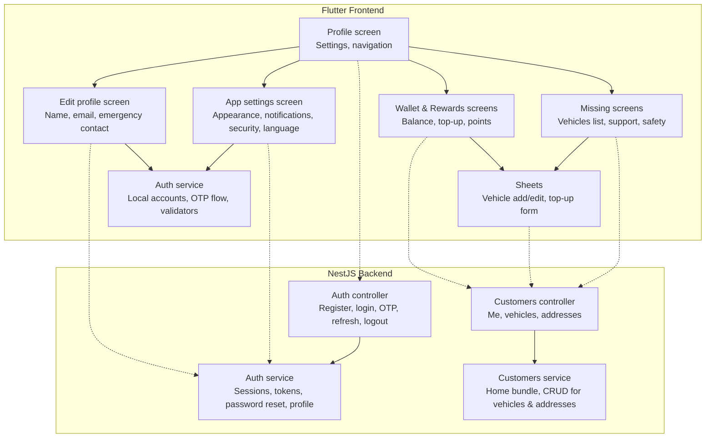

**Diagram sources**
- [account_screens.dart:422-512](file://flutter_app/lib/screens/account_screens.dart#L422-L512)
- [extra_customer_screens.dart:111-302](file://flutter_app/lib/screens/extra_customer_screens.dart#L111-L302)
- [sheets.dart:234-283](file://flutter_app/lib/screens/sheets.dart#L234-L283)
- [missing_screens.dart:46-83](file://flutter_app/lib/screens/missing_screens.dart#L46-L83)
- [auth_service.dart:110-305](file://flutter_app/lib/services/auth_service.dart#L110-L305)
- [auth.controller.ts:42-165](file://backend/src/auth/auth.controller.ts#L42-L165)
- [auth.service.ts:39-560](file://backend/src/auth/auth.service.ts#L39-L560)
- [customers.controller.ts:27-111](file://backend/src/customers/customers.controller.ts#L27-L111)
- [customers.service.ts:44-426](file://backend/src/customers/customers.service.ts#L44-L426)

**Section sources**
- [account_screens.dart:1-512](file://flutter_app/lib/screens/account_screens.dart#L1-L512)
- [extra_customer_screens.dart:1-302](file://flutter_app/lib/screens/extra_customer_screens.dart#L1-L302)
- [auth_service.dart:1-305](file://flutter_app/lib/services/auth_service.dart#L1-L305)
- [auth.controller.ts:1-166](file://backend/src/auth/auth.controller.ts#L1-L166)
- [customers.controller.ts:1-112](file://backend/src/customers/customers.controller.ts#L1-L112)

## Core Components
This section summarizes the main components involved in account and profile management.

| Component | Responsibility | Current State | Backend Contract |
|---|---|---|---|
| `ProfileScreen` | Displays user summary, preferences, delivery shortcuts, account & security entries, and logout | Local state; navigates to other screens | `GET /auth/me`, `PATCH /auth/me` |
| `EditProfileScreen` | Edits full name, email, and emergency contact; shows read-only verified phone | Updates local `auth.profile` and extras; toast feedback | `PATCH /auth/me` or `PATCH /customers/me` |
| `AppSettingsScreen` | Appearance, notifications, security toggles, language selection, currency hint | Local toggles and extras state | Password change via `POST /auth/password/change`; OTP via `POST /auth/otp/request` |
| `WalletScreen` | Shows balance, top-up action, payment methods entry, rewards link | Mock balance and transactions | Wallet endpoints exist under wallets module; current UI calls local state |
| `RewardsScreen` | Points display, redemption confirmation, reward cards | Local points and tier progress | No dedicated backend reward endpoint shown here |
| `NotificationsScreen` | Notification list with fresh indicators and mark-read action | Local notice list | Notifications controller exists; UI currently mocks data |
| Vehicle sheets | Add/edit vehicle fields such as label, make, model, plate, color, tank capacity | Local validation and state update | `POST /customers/vehicles`, `PATCH /customers/vehicles/:id`, `DELETE /customers/vehicles/:id` |
| Vehicles list | Select default vehicle from saved list | Local list and selection | `GET /customers/vehicles` |
| Address book | Saved places, default address, coordinates | Not fully wired in UI | `GET /customers/addresses`, `POST /customers/addresses`, `PATCH /customers/addresses/:id`, `DELETE /customers/addresses/:id` |
| Auth service | Demo accounts, OTP flow, validators, profile sync, sign out | Local storage via shared preferences | Full auth, OTP, sessions, password reset, profile APIs |

**Section sources**
- [account_screens.dart:422-512](file://flutter_app/lib/screens/account_screens.dart#L422-L512)
- [extra_customer_screens.dart:111-302](file://flutter_app/lib/screens/extra_customer_screens.dart#L111-L302)
- [sheets.dart:234-283](file://flutter_app/lib/screens/sheets.dart#L234-L283)
- [missing_screens.dart:46-83](file://flutter_app/lib/screens/missing_screens.dart#L46-L83)
- [auth_service.dart:110-305](file://flutter_app/lib/services/auth_service.dart#L110-L305)
- [customers.controller.ts:52-110](file://backend/src/customers/customers.controller.ts#L52-L110)

## Architecture Overview
The account and profile architecture has two layers:

1. **Flutter prototype layer**: Uses local widgets, state, and shared preferences for demo accounts. Validation helpers are centralized in `Validators`. OTP timing, resend cooldowns, and attempt limits are implemented locally.
2. **Backend API layer**: Provides secure registration, login, OTP verification, token refresh, logout, session listing and revocation, password reset, profile updates, and customer data for vehicles and addresses.

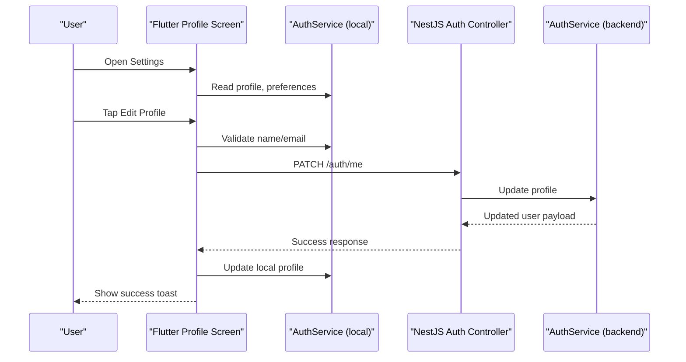

**Diagram sources**
- [extra_customer_screens.dart:136-151](file://flutter_app/lib/screens/extra_customer_screens.dart#L136-L151)
- [auth.controller.ts:134-139](file://backend/src/auth/auth.controller.ts#L134-L139)
- [auth.service.ts:405-425](file://backend/src/auth/auth.service.ts#L405-L425)

**Section sources**
- [README.md:1-18](file://README.md#L1-L18)
- [auth.controller.ts:42-165](file://backend/src/auth/auth.controller.ts#L42-L165)
- [auth.service.ts:39-560](file://backend/src/auth/auth.service.ts#L39-L560)

## Detailed Component Analysis

### Profile and Settings Screen
The profile screen acts as the central hub for account management. It displays the current user’s initials, name, email, and masked phone number. It groups options into preferences, delivery, and account & security sections. Navigation routes include wallet, rewards, saved places, vehicles, notifications, personal details, safety, and support. Logout clears the local session and navigates back to login.

Key behaviors:
- Profile header shows initials and masked phone.
- Preferences toggle push notifications, location services, dark mode, and links to wallet and rewards.
- Delivery shortcuts open saved places and vehicles.
- Account & security opens personal details, safety, and support.
- Logout calls `auth.signOut()` and navigates to login.

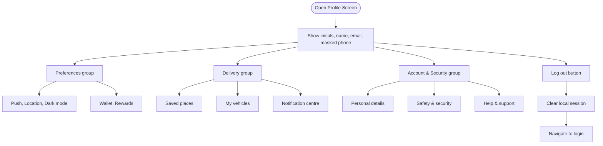

**Diagram sources**
- [account_screens.dart:454-512](file://flutter_app/lib/screens/account_screens.dart#L454-L512)

**Section sources**
- [account_screens.dart:422-512](file://flutter_app/lib/screens/account_screens.dart#L422-L512)

### Edit Profile Screen
The edit profile screen allows users to update their full name and email, view their verified phone number, and set an emergency contact. It validates inputs using `Validators.name`, `Validators.email`, and `Validators.phone`. On save, it updates the local profile and extras, then navigates back to the profile screen.

Important notes:
- Phone number is read-only because changing it requires verification through OTP.
- Photo upload is a placeholder until backend integration.
- Emergency contact is optional and validated only when provided.

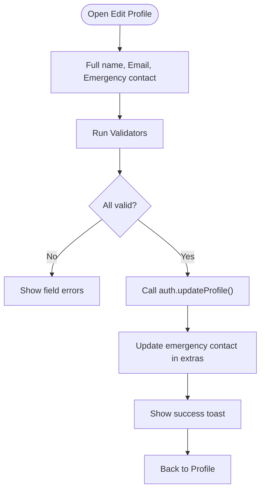

**Diagram sources**
- [extra_customer_screens.dart:121-195](file://flutter_app/lib/screens/extra_customer_screens.dart#L121-L195)
- [auth_service.dart:51-97](file://flutter_app/lib/services/auth_service.dart#L51-L97)

**Section sources**
- [extra_customer_screens.dart:111-195](file://flutter_app/lib/screens/extra_customer_screens.dart#L111-L195)
- [auth_service.dart:51-97](file://flutter_app/lib/services/auth_service.dart#L51-L97)

### App Settings Screen
The app settings screen manages appearance, notifications, security, and general preferences. It includes:
- Dark mode toggle bound to theme state.
- Order updates and promotions toggles stored in extras.
- Biometric sign-in toggle.
- Change password flow that requests an OTP and navigates to the OTP screen.
- Language picker updating extras.
- Currency hint indicating UGX is currently supported.

Security-related implementation:
- Change password triggers `auth.requestPasswordReset(phone)` and starts OTP flow with purpose reset.
- Biometric toggle is local preference; backend integration would require platform-specific biometric setup.

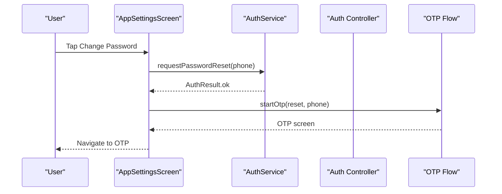

**Diagram sources**
- [extra_customer_screens.dart:229-245](file://flutter_app/lib/screens/extra_customer_screens.dart#L229-L245)
- [auth_service.dart:202-225](file://flutter_app/lib/services/auth_service.dart#L202-L225)
- [auth.controller.ts:100-116](file://backend/src/auth/auth.controller.ts#L100-L116)

**Section sources**
- [extra_customer_screens.dart:197-302](file://flutter_app/lib/screens/extra_customer_screens.dart#L197-L302)
- [auth_service.dart:202-225](file://flutter_app/lib/services/auth_service.dart#L202-L225)

### Wallet and Rewards
The wallet screen shows available balance, top-up action, payment methods navigation, and rewards link. It renders recent activity rows and badges. The rewards screen displays points, tier progress, redeemable rewards, and rules.

Current behavior:
- Top-up is local; it updates mock balance and shows a toast.
- Payment methods navigate to a payment screen; backend payment providers exist but are not wired here.
- Rewards redemption reduces local points and shows confirmation.

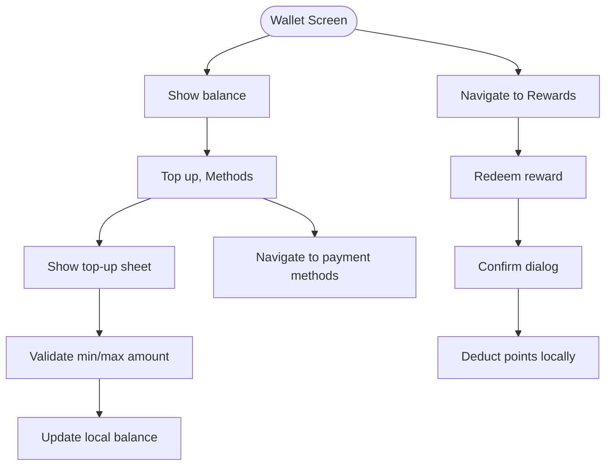

**Diagram sources**
- [account_screens.dart:174-368](file://flutter_app/lib/screens/account_screens.dart#L174-L368)
- [sheets.dart:250-283](file://flutter_app/lib/screens/sheets.dart#L250-L283)

**Section sources**
- [account_screens.dart:174-368](file://flutter_app/lib/screens/account_screens.dart#L174-L368)
- [sheets.dart:250-283](file://flutter_app/lib/screens/sheets.dart#L250-L283)

### Notifications
The notifications screen lists notifications grouped by time, marks them as read, and navigates to tracking for delivery-related notices. Fresh indicators are rendered based on a boolean flag.

Current behavior:
- Mark read updates local notice flags.
- Clicking a notification may navigate to tracking.

**Section sources**
- [account_screens.dart:370-419](file://flutter_app/lib/screens/account_screens.dart#L370-L419)

### Vehicle Management
Vehicle management is split across:
- A vehicle add/edit sheet with fields for label, make, model, plate number, color, and tank capacity.
- A vehicles list screen where users select a default vehicle.
- Backend endpoints for listing, creating, updating, and deleting vehicles.

Validation and UX:
- Plate number is normalized to uppercase.
- Tank capacity accepts numeric input with length limiting.
- Default vehicle logic is handled in the backend transaction.

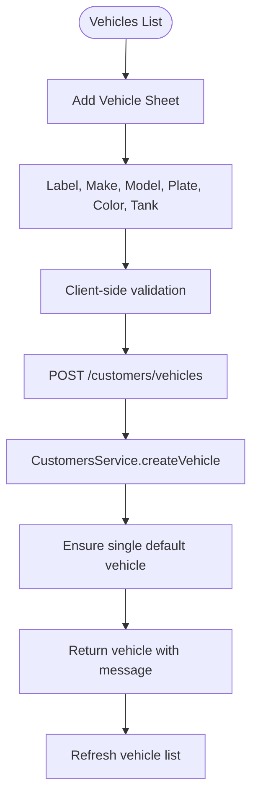

**Diagram sources**
- [sheets.dart:234-247](file://flutter_app/lib/screens/sheets.dart#L234-L247)
- [missing_screens.dart:46-83](file://flutter_app/lib/screens/missing_screens.dart#L46-L83)
- [customers.controller.ts:52-80](file://backend/src/customers/customers.controller.ts#L52-L80)
- [customers.service.ts:189-217](file://backend/src/customers/customers.service.ts#L189-L217)

**Section sources**
- [sheets.dart:234-247](file://flutter_app/lib/screens/sheets.dart#L234-L247)
- [missing_screens.dart:46-83](file://flutter_app/lib/screens/missing_screens.dart#L46-L83)
- [customers.controller.ts:52-80](file://backend/src/customers/customers.controller.ts#L52-L80)
- [customers.service.ts:165-265](file://backend/src/customers/customers.service.ts#L165-L265)

### Saved Addresses
Address management is exposed by the backend but not fully wired into the Flutter account screens yet. The backend supports:
- Listing addresses.
- Creating addresses with label, line, area, city, notes, coordinates, and default flag.
- Updating addresses.
- Soft-deleting addresses to preserve order history.

When coordinates change, the backend sets a geographic point for the address.

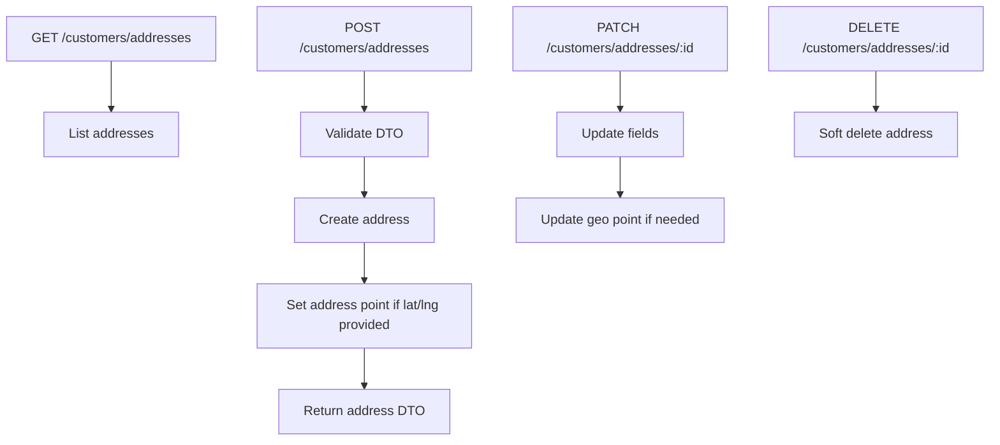

**Diagram sources**
- [customers.controller.ts:82-110](file://backend/src/customers/customers.controller.ts#L82-L110)
- [customers.service.ts:267-358](file://backend/src/customers/customers.service.ts#L267-L358)

**Section sources**
- [customers.controller.ts:82-110](file://backend/src/customers/customers.controller.ts#L82-L110)
- [customers.service.ts:267-358](file://backend/src/customers/customers.service.ts#L267-L358)

### Data Synchronization Between Local Storage and Backend
Currently:
- Flutter uses local state for most account screens.
- `AuthService` persists demo accounts in shared preferences.
- Profile updates modify local `auth.profile` and optionally the current account object.
- Backend provides authenticated endpoints for profile, sessions, passwords, vehicles, and addresses.

Recommended synchronization pattern:
- Replace local mock calls with API calls in `AuthService`.
- Keep local cache for offline resilience, but treat backend as source of truth.
- Use optimistic UI updates with rollback on failure.
- Persist tokens securely and refresh automatically.

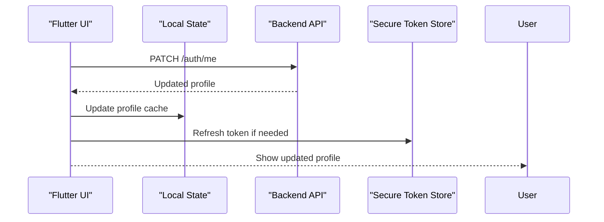

**Diagram sources**
- [auth_service.dart:282-301](file://flutter_app/lib/services/auth_service.dart#L282-L301)
- [auth.controller.ts:134-139](file://backend/src/auth/auth.controller.ts#L134-L139)
- [auth.service.ts:405-425](file://backend/src/auth/auth.service.ts#L405-L425)

**Section sources**
- [auth_service.dart:134-162](file://flutter_app/lib/services/auth_service.dart#L134-L162)
- [auth_service.dart:282-301](file://flutter_app/lib/services/auth_service.dart#L282-L301)
- [auth.controller.ts:134-139](file://backend/src/auth/auth.controller.ts#L134-L139)
- [auth.service.ts:405-425](file://backend/src/auth/auth.service.ts#L405-L425)

### Image Upload Handling
The edit profile screen includes a “Change photo” action that currently shows a toast indicating backend connectivity is required. When implementing image uploads:
- Compress images client-side before upload.
- Upload to a secure file service or backend media endpoint.
- Store the returned URL in the profile avatar field.
- Handle network failures and retry logic.
- Validate MIME type and size server-side.

**Section sources**
- [extra_customer_screens.dart:158-169](file://flutter_app/lib/screens/extra_customer_screens.dart#L158-L169)

### Form Validation Patterns
Validation is centralized in `Validators`:
- Phone normalization to Uganda E.164 format.
- Name minimum length check.
- Email regex validation.
- Password strength checks including length, letter+number requirement, uppercase presence, special characters, and length bonus.

Forms use these validators to show inline errors and prevent submission until valid.

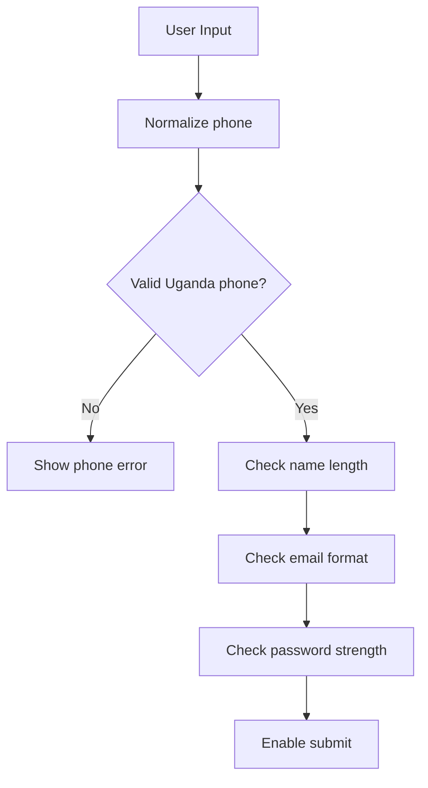

**Diagram sources**
- [auth_service.dart:51-97](file://flutter_app/lib/services/auth_service.dart#L51-L97)

**Section sources**
- [auth_service.dart:51-97](file://flutter_app/lib/services/auth_service.dart#L51-L97)

### Account Security Features
Two-factor authentication:
- Flutter OTP flow supports login, signup, and reset purposes.
- Backend OTP endpoints issue codes, verify codes, and return tokens or reset tokens.
- Resend cooldown and expiration are enforced both locally and on the backend.

Session management:
- Backend issues access and refresh tokens.
- Sessions can be listed and revoked per device.
- Logout revokes current or all sessions.

Privacy controls:
- Profile updates allow name, email, and avatar URL changes.
- Password change invalidates other sessions.
- Soft-delete for addresses preserves historical data.

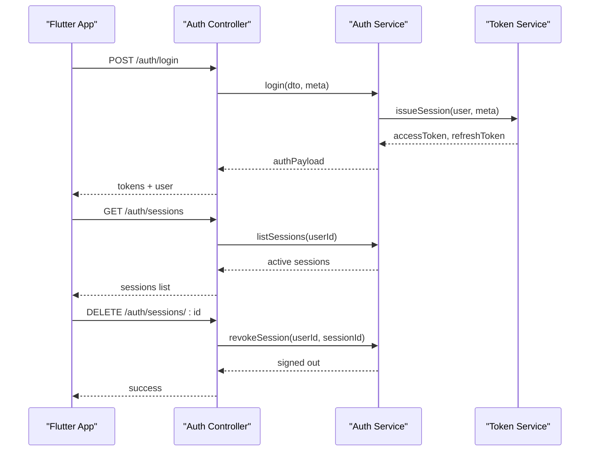

**Diagram sources**
- [auth.controller.ts:64-98](file://backend/src/auth/auth.controller.ts#L64-L98)
- [auth.controller.ts:149-164](file://backend/src/auth/auth.controller.ts#L149-L164)
- [auth.service.ts:163-239](file://backend/src/auth/auth.service.ts#L163-L239)
- [auth.service.ts:427-451](file://backend/src/auth/auth.service.ts#L427-L451)

**Section sources**
- [auth.controller.ts:64-98](file://backend/src/auth/auth.controller.ts#L64-L98)
- [auth.controller.ts:149-164](file://backend/src/auth/auth.controller.ts#L149-L164)
- [auth.service.ts:163-239](file://backend/src/auth/auth.service.ts#L163-L239)
- [auth.service.ts:333-352](file://backend/src/auth/auth.service.ts#L333-L352)
- [auth.service.ts:427-451](file://backend/src/auth/auth.service.ts#L427-L451)

### Data Export and Import Functionality
The current codebase does not expose explicit export/import endpoints for account data. To implement compliance-friendly export/import:
- Export: Aggregate user profile, vehicles, addresses, orders, and wallet transactions into a structured JSON or CSV file.
- Import: Validate and merge imported data, handling duplicates and conflicts.
- Audit: Record export/import actions for compliance.
- Retention: Provide deletion workflows tied to retention policies.

Since no export/import endpoints are present in the referenced files, this section describes recommended implementation rather than existing code.

[No sources needed since this section provides general guidance]

### Account Deletion Workflows
The backend supports soft deletion for addresses and user status checks during login. For full account deletion:
- Implement a `DELETE /auth/me` or similar endpoint.
- Anonymize or remove PII according to policy.
- Preserve audit logs without exposing sensitive data.
- Invalidate all sessions and tokens.
- Notify the user of the irreversible action.

Current references:
- Address soft delete preserves order history.
- Login rejects suspended or deleted users.

**Section sources**
- [customers.service.ts:347-358](file://backend/src/customers/customers.service.ts#L347-L358)
- [auth.service.ts:207-222](file://backend/src/auth/auth.service.ts#L207-L222)

## Dependency Analysis
The Flutter account screens depend on:
- Local state (`app`, `extras`, `auth`).
- Shared preferences for demo accounts.
- Validators for input validation.
- Navigation to related screens.

The backend depends on:
- Prisma for database operations.
- OTP service for verification codes.
- Token service for session management.
- Password service for hashing and verification.
- Audit service for logging sensitive actions.

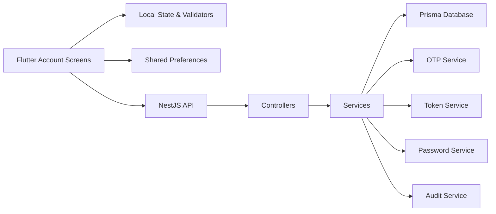

**Diagram sources**
- [auth_service.dart:110-305](file://flutter_app/lib/services/auth_service.dart#L110-L305)
- [auth.controller.ts:42-165](file://backend/src/auth/auth.controller.ts#L42-L165)
- [auth.service.ts:39-560](file://backend/src/auth/auth.service.ts#L39-L560)

**Section sources**
- [auth_service.dart:110-305](file://flutter_app/lib/services/auth_service.dart#L110-L305)
- [auth.controller.ts:42-165](file://backend/src/auth/auth.controller.ts#L42-L165)
- [auth.service.ts:39-560](file://backend/src/auth/auth.service.ts#L39-L560)

## Performance Considerations
- Avoid unnecessary re-renders by minimizing `setState` usage and using scoped state where possible.
- Debounce search and filter operations in lists like orders and notifications.
- Cache profile and settings locally after successful API responses.
- Use pagination for large datasets such as orders and notifications.
- Compress images before upload to reduce bandwidth.
- Batch related API calls when possible, e.g., fetching home bundle data.

[No sources needed since this section provides general guidance]

## Troubleshooting Guide
Common issues and resolutions:
- OTP expired or too many attempts:
  - Flutter enforces expiration and attempt limits locally.
  - Backend OTP service verifies codes and issues new ones.
- Invalid phone number:
  - Ensure normalization to Uganda E.164 format.
  - Backend returns validation errors for invalid phones.
- Profile update conflicts:
  - Duplicate email detection on backend prevents conflicts.
- Session mismatch:
  - Revoke sessions after password changes.
  - Use refresh token rotation to maintain secure sessions.

**Section sources**
- [auth_service.dart:211-265](file://flutter_app/lib/services/auth_service.dart#L211-L265)
- [auth.service.ts:297-317](file://backend/src/auth/auth.service.ts#L297-L317)
- [auth.service.ts:405-425](file://backend/src/auth/auth.service.ts#L405-L425)
- [auth.service.ts:333-352](file://backend/src/auth/auth.service.ts#L333-L352)

## Conclusion
The Flutter account and profile screens provide a comprehensive prototype for user profile editing, vehicle management, saved addresses, wallet and rewards, notifications, and app settings. While the frontend currently relies on local state and mock data, the backend exposes robust APIs for authentication, OTP-based two-factor verification, session management, profile updates, and customer data operations. Integrating the Flutter screens with the backend will enable secure, compliant, and scalable account management, including image uploads, data export/import, and account deletion workflows.

[No sources needed since this section summarizes without analyzing specific files]

## Appendices

### API Endpoints Relevant to Account & Profile
| Endpoint | Method | Purpose | Notes |
|---|---|---|---|
| `/auth/register` | POST | Create customer account and send signup OTP | Throttled |
| `/auth/login` | POST | Sign in with phone and password | Returns tokens |
| `/auth/otp/request` | POST | Request verification or password reset code | Throttled |
| `/auth/otp/verify` | POST | Verify code; returns tokens or reset token | Throttled |
| `/auth/refresh` | POST | Rotate refresh token and issue new access token | Throttled |
| `/auth/logout` | POST | Revoke current session | Protected |
| `/auth/me` | GET | Get current account, profiles, and wallet | Protected |
| `/auth/me` | PATCH | Update name, email, or avatar | Protected |
| `/auth/password/change` | POST | Change password of signed-in account | Protected |
| `/auth/sessions` | GET | List active sessions | Protected |
| `/auth/sessions/:id` | DELETE | Sign out one device | Protected |
| `/customers/me` | GET | My profile, loyalty points, wallet balance | Protected |
| `/customers/me` | PATCH | Update name, email, or avatar | Protected |
| `/customers/home` | GET | Home screen bundle | Protected |
| `/customers/vehicles` | GET | My saved vehicles | Protected |
| `/customers/vehicles` | POST | Save a vehicle | Protected |
| `/customers/vehicles/:id` | PATCH | Update a saved vehicle | Protected |
| `/customers/vehicles/:id` | DELETE | Remove a saved vehicle | Protected |
| `/customers/addresses` | GET | My delivery addresses | Protected |
| `/customers/addresses` | POST | Save a delivery address with coordinates | Protected |
| `/customers/addresses/:id` | PATCH | Update a delivery address | Protected |
| `/customers/addresses/:id` | DELETE | Remove a delivery address (soft delete) | Protected |

**Section sources**
- [auth.controller.ts:42-165](file://backend/src/auth/auth.controller.ts#L42-L165)
- [customers.controller.ts:27-111](file://backend/src/customers/customers.controller.ts#L27-L111)