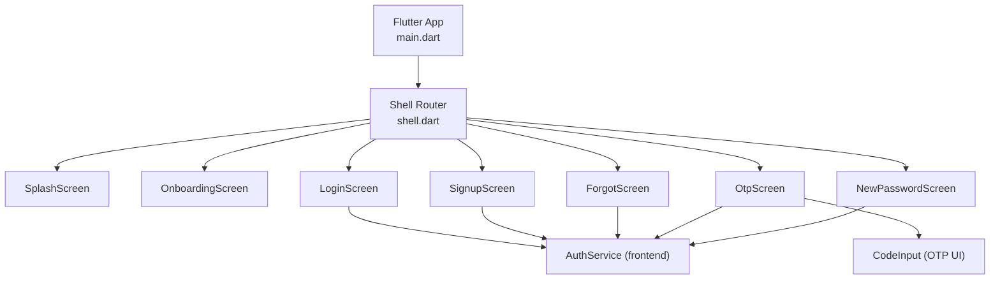
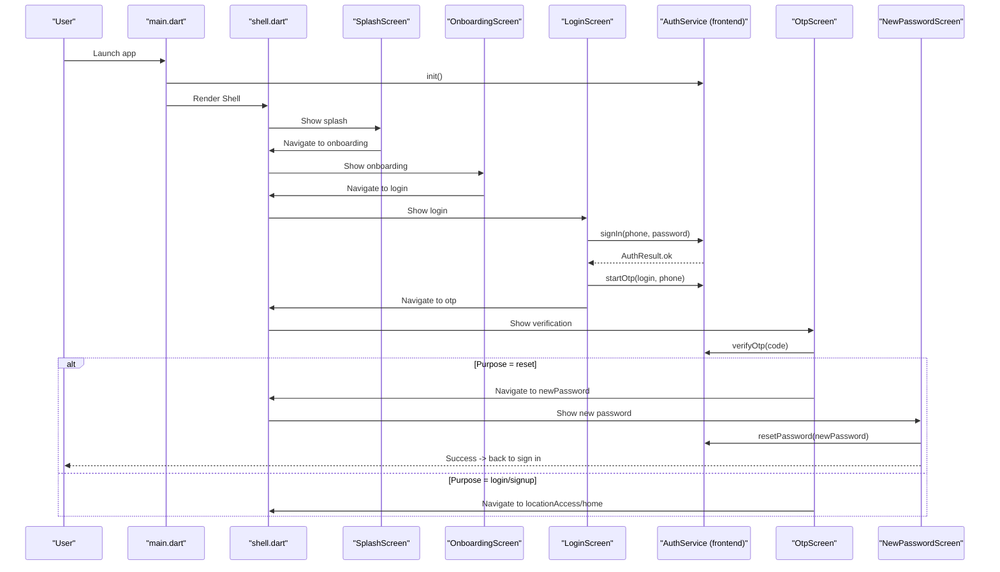
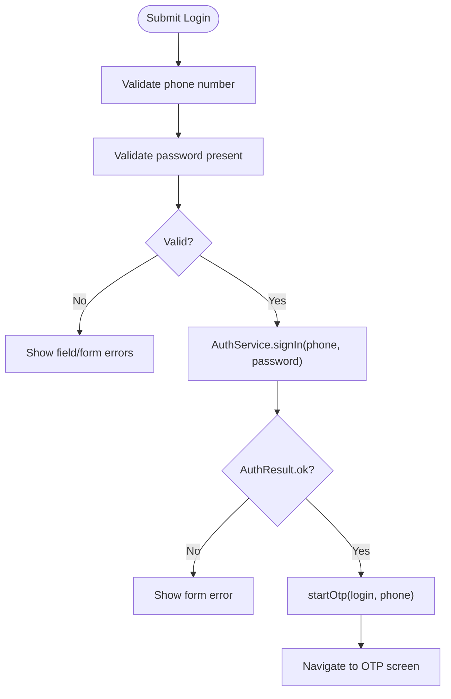
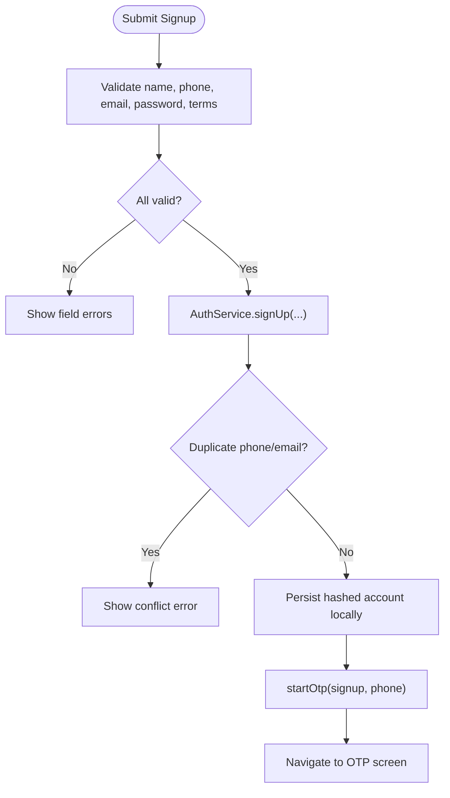
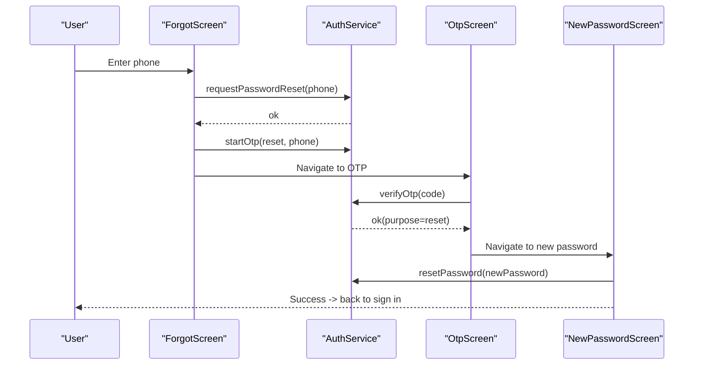
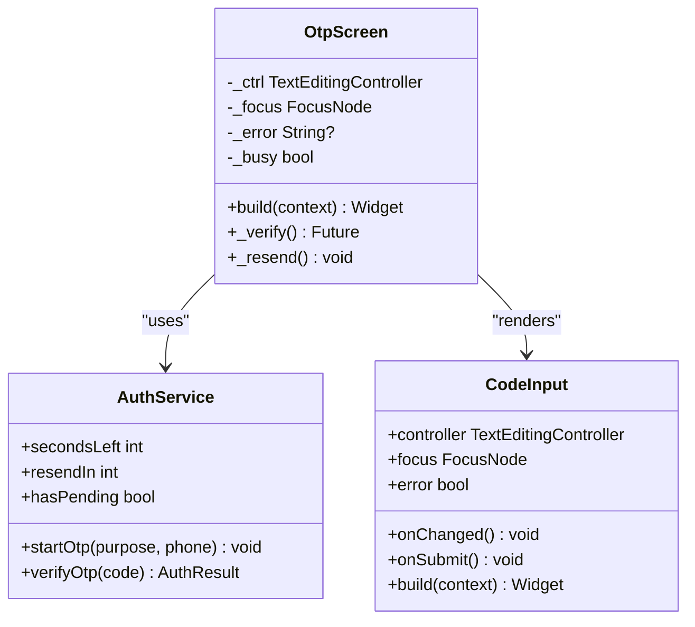
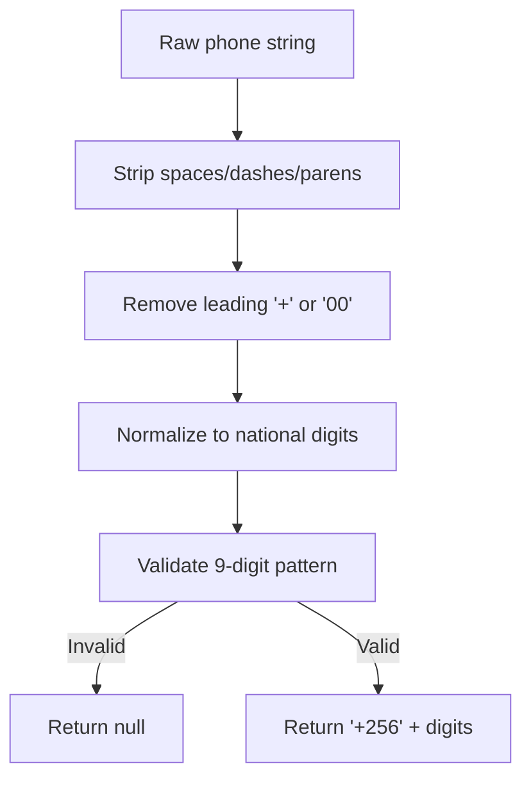
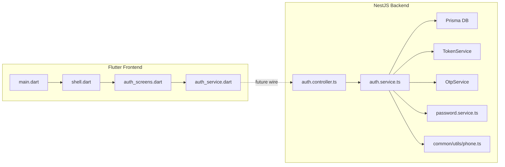

# Authentication Screens

<cite>
**Referenced Files in This Document**
- [main.dart](file://flutter_app/lib/main.dart)
- [shell.dart](file://flutter_app/lib/shell.dart)
- [auth_screens.dart](file://flutter_app/lib/screens/auth_screens.dart)
- [auth_service.dart](file://flutter_app/lib/services/auth_service.dart)
- [widget_test.dart](file://flutter_app/test/widget_test.dart)
- [README.md](file://flutter_app/README.md)
- [auth.controller.ts](file://backend/src/auth/auth.controller.ts)
- [auth.service.ts](file://backend/src/auth/auth.service.ts)
- [phone.ts](file://backend/src/common/utils/phone.ts)
</cite>

## Table of Contents
1. [Introduction](#introduction)
2. [Project Structure](#project-structure)
3. [Core Components](#core-components)
4. [Architecture Overview](#architecture-overview)
5. [Detailed Component Analysis](#detailed-component-analysis)
6. [Dependency Analysis](#dependency-analysis)
7. [Performance Considerations](#performance-considerations)
8. [Troubleshooting Guide](#troubleshooting-guide)
9. [Conclusion](#conclusion)
10. [Appendices](#appendices)

## Introduction
This document explains the complete authentication experience for FuelConnect, from app launch through successful authentication and role-based routing. It covers:
- Splash screen and onboarding
- Login and signup flows
- Forgot password and new password creation
- OTP verification with a custom input component
- Form validations, error handling patterns, loading states
- Security considerations
- Backend integration points (currently mocked on the frontend; backend endpoints are defined)
- Extending authentication flows and adding providers

The Flutter frontend currently uses an in-memory/local storage auth service as a seam for future backend wiring. The NestJS backend defines the production-ready API contracts for registration, login, OTP, refresh, and password reset.

## Project Structure
The authentication screens live under the Flutter app’s screens module, orchestrated by a shell that maps route keys to widgets. The main entry initializes global state and theme before rendering the shell.

**Diagram sources**
- [main.dart:7-18](file://flutter_app/lib/main.dart#L7-L18)
- [shell.dart:18-104](file://flutter_app/lib/shell.dart#L18-L104)
- [auth_screens.dart:13-111](file://flutter_app/lib/screens/auth_screens.dart#L13-L111)
- [auth_screens.dart:308-363](file://flutter_app/lib/screens/auth_screens.dart#L308-L363)
- [auth_screens.dart:368-451](file://flutter_app/lib/screens/auth_screens.dart#L368-L451)
- [auth_screens.dart:456-519](file://flutter_app/lib/screens/auth_screens.dart#L456-L519)
- [auth_screens.dart:605-715](file://flutter_app/lib/screens/auth_screens.dart#L605-L715)
- [auth_screens.dart:720-787](file://flutter_app/lib/screens/auth_screens.dart#L720-L787)
- [auth_service.dart:110-305](file://flutter_app/lib/services/auth_service.dart#L110-L305)

**Section sources**
- [main.dart:7-18](file://flutter_app/lib/main.dart#L7-L18)
- [shell.dart:18-104](file://flutter_app/lib/shell.dart#L18-L104)

## Core Components
- SplashScreen: Shows branding and auto-navigates to onboarding after a short delay or on tap.
- OnboardingScreen: Multi-slide introduction; final slide navigates to login.
- LoginScreen: Validates phone and password, calls AuthService.signIn, then starts OTP for login.
- SignupScreen: Validates name, phone, email, password, terms acceptance; calls AuthService.signUp, then starts OTP for signup.
- ForgotScreen: Validates phone; calls AuthService.requestPasswordReset; starts OTP for reset.
- OtpScreen: Renders CodeInput, enforces code length, verifies via AuthService.verifyOtp, routes based on purpose.
- NewPasswordScreen: Validates new password rules and confirmation; calls AuthService.resetPassword; shows success and returns to sign-in.
- CodeInput: Custom OTP input with paste/SMS autofill support, numeric or alphanumeric mode, and visual feedback.
- AuthService (frontend): Local mock implementation with validation helpers, phone normalization/formatting/masking, OTP lifecycle, and local account persistence.

Key responsibilities:
- Validation: Phone number normalization to Uganda E.164 format, email checks, password strength and matching.
- OTP lifecycle: Start, countdown, resend cooldown, attempts limit, single-use codes.
- Routing: Shell maps Screen enum values to widgets; OTP result determines next screen.

**Section sources**
- [auth_screens.dart:13-111](file://flutter_app/lib/screens/auth_screens.dart#L13-L111)
- [auth_screens.dart:116-221](file://flutter_app/lib/screens/auth_screens.dart#L116-L221)
- [auth_screens.dart:308-363](file://flutter_app/lib/screens/auth_screens.dart#L308-L363)
- [auth_screens.dart:368-451](file://flutter_app/lib/screens/auth_screens.dart#L368-L451)
- [auth_screens.dart:456-519](file://flutter_app/lib/screens/auth_screens.dart#L456-L519)
- [auth_screens.dart:529-603](file://flutter_app/lib/screens/auth_screens.dart#L529-L603)
- [auth_screens.dart:605-715](file://flutter_app/lib/screens/auth_screens.dart#L605-L715)
- [auth_screens.dart:720-787](file://flutter_app/lib/screens/auth_screens.dart#L720-L787)
- [auth_service.dart:51-108](file://flutter_app/lib/services/auth_service.dart#L51-L108)
- [auth_service.dart:110-305](file://flutter_app/lib/services/auth_service.dart#L110-L305)

## Architecture Overview
End-to-end flow from app launch to authenticated home:

**Diagram sources**
- [main.dart:7-18](file://flutter_app/lib/main.dart#L7-L18)
- [shell.dart:18-104](file://flutter_app/lib/shell.dart#L18-L104)
- [auth_screens.dart:308-363](file://flutter_app/lib/screens/auth_screens.dart#L308-L363)
- [auth_screens.dart:605-715](file://flutter_app/lib/screens/auth_screens.dart#L605-L715)
- [auth_screens.dart:720-787](file://flutter_app/lib/screens/auth_screens.dart#L720-L787)
- [auth_service.dart:180-280](file://flutter_app/lib/services/auth_service.dart#L180-L280)

## Detailed Component Analysis

### Splash and Onboarding
- Splash displays branding and transitions to onboarding automatically or on tap.
- Onboarding presents slides with skip and continue actions; final slide navigates to login.

Implementation highlights:
- Timer-driven navigation in splash.
- Slide index management and responsive layout in onboarding.

**Section sources**
- [auth_screens.dart:13-111](file://flutter_app/lib/screens/auth_screens.dart#L13-L111)
- [auth_screens.dart:116-221](file://flutter_app/lib/screens/auth_screens.dart#L116-L221)

### Login Flow
Validation and submission:
- Validates phone using Validators.phone and ensures password is non-empty.
- Calls AuthService.signIn; on success, starts OTP for login and navigates to OTP screen.
- Displays form-level errors and loading state.

Backend mapping (for future integration):
- Frontend currently mocks login; backend exposes POST /auth/login and POST /auth/otp/request.

**Diagram sources**
- [auth_screens.dart:308-363](file://flutter_app/lib/screens/auth_screens.dart#L308-L363)
- [auth_service.dart:180-188](file://flutter_app/lib/services/auth_service.dart#L180-L188)

**Section sources**
- [auth_screens.dart:308-363](file://flutter_app/lib/screens/auth_screens.dart#L308-L363)
- [auth_service.dart:180-188](file://flutter_app/lib/services/auth_service.dart#L180-L188)
- [auth.controller.ts:64-71](file://backend/src/auth/auth.controller.ts#L64-L71)

### Signup Flow
Validation and submission:
- Validates full name, phone, email, password, and terms acceptance.
- Calls AuthService.signUp; on success, starts OTP for signup and navigates to OTP screen.
- Handles duplicate phone/email conflicts locally.

Backend mapping:
- POST /auth/register creates customer account and issues OTP.

**Diagram sources**
- [auth_screens.dart:368-451](file://flutter_app/lib/screens/auth_screens.dart#L368-L451)
- [auth_service.dart:190-200](file://flutter_app/lib/services/auth_service.dart#L190-L200)

**Section sources**
- [auth_screens.dart:368-451](file://flutter_app/lib/screens/auth_screens.dart#L368-L451)
- [auth_service.dart:190-200](file://flutter_app/lib/services/auth_service.dart#L190-L200)
- [auth.controller.ts:48-54](file://backend/src/auth/auth.controller.ts#L48-L54)

### Forgot Password and New Password Creation
Forgot password:
- Validates phone; calls AuthService.requestPasswordReset; starts OTP for reset; navigates to OTP.

New password:
- Validates new password rules and confirmation match; calls AuthService.resetPassword; shows success and returns to sign-in.

**Diagram sources**
- [auth_screens.dart:456-519](file://flutter_app/lib/screens/auth_screens.dart#L456-L519)
- [auth_screens.dart:605-715](file://flutter_app/lib/screens/auth_screens.dart#L605-L715)
- [auth_screens.dart:720-787](file://flutter_app/lib/screens/auth_screens.dart#L720-L787)
- [auth_service.dart:202-280](file://flutter_app/lib/services/auth_service.dart#L202-L280)

**Section sources**
- [auth_screens.dart:456-519](file://flutter_app/lib/screens/auth_screens.dart#L456-L519)
- [auth_screens.dart:720-787](file://flutter_app/lib/screens/auth_screens.dart#L720-L787)
- [auth_service.dart:202-280](file://flutter_app/lib/services/auth_service.dart#L202-L280)
- [auth.controller.ts:100-116](file://backend/src/auth/auth.controller.ts#L100-L116)

### OTP Verification and Custom CodeInput
OTP behavior:
- Starts OTP with purpose and phone; generates secure random code; tracks expiry and resend cooldown; limits attempts; single-use code.
- CodeInput supports paste/SMS autofill, numeric or alphanumeric input, and visual focus/error states.

**Diagram sources**
- [auth_service.dart:110-305](file://flutter_app/lib/services/auth_service.dart#L110-L305)
- [auth_screens.dart:529-603](file://flutter_app/lib/screens/auth_screens.dart#L529-L603)
- [auth_screens.dart:605-715](file://flutter_app/lib/screens/auth_screens.dart#L605-L715)

**Section sources**
- [auth_screens.dart:529-603](file://flutter_app/lib/screens/auth_screens.dart#L529-L603)
- [auth_screens.dart:605-715](file://flutter_app/lib/screens/auth_screens.dart#L605-L715)
- [auth_service.dart:110-305](file://flutter_app/lib/services/auth_service.dart#L110-L305)
- [widget_test.dart:29-44](file://flutter_app/test/widget_test.dart#L29-L44)

### Phone Number Formatting and Normalization
Frontend:
- Validators.normalizePhone converts various formats to E.164 (+256...).
- formatPhone and maskPhone provide user-friendly display and privacy masking.

Backend:
- normalizePhone mirrors the same normalization logic for server-side consistency.

**Diagram sources**
- [auth_service.dart:51-68](file://flutter_app/lib/services/auth_service.dart#L51-L68)
- [phone.ts:5-18](file://backend/src/common/utils/phone.ts#L5-L18)

**Section sources**
- [auth_service.dart:51-108](file://flutter_app/lib/services/auth_service.dart#L51-L108)
- [phone.ts:1-31](file://backend/src/common/utils/phone.ts#L1-L31)

### Role-Based Routing System
Current behavior:
- After OTP verification for login/signup, the app navigates to locationAccess (or home).
- The Shell maps Screen enum values to widgets; additional role-specific screens exist for riders and station managers.

Future extension:
- Use the backend’s user role payload to route users to appropriate dashboards:
  - Customer → customer home/orders
  - Rider → rider dashboard/deliveries
  - Station manager → station management screens

Integration points:
- Backend returns user role in auth payloads and profile endpoints.
- Frontend can inspect role after successful authentication and navigate accordingly.

**Section sources**
- [shell.dart:18-104](file://flutter_app/lib/shell.dart#L18-L104)
- [auth.service.ts:456-531](file://backend/src/auth/auth.service.ts#L456-L531)

## Dependency Analysis
Frontend dependencies:
- Screens depend on AuthService for all auth operations.
- Shell depends on core app state and screen definitions.
- Tests validate validators, OTP behavior, and demo mode.

Backend dependencies:
- AuthController exposes public and protected endpoints.
- AuthService orchestrates Prisma, OTP, tokens, audit, and config.
- Phone utilities ensure consistent normalization across layers.

**Diagram sources**
- [auth_screens.dart:1-934](file://flutter_app/lib/screens/auth_screens.dart#L1-L934)
- [auth_service.dart:1-305](file://flutter_app/lib/services/auth_service.dart#L1-L305)
- [main.dart:7-18](file://flutter_app/lib/main.dart#L7-L18)
- [shell.dart:18-104](file://flutter_app/lib/shell.dart#L18-L104)
- [auth.controller.ts:1-166](file://backend/src/auth/auth.controller.ts#L1-L166)
- [auth.service.ts:1-560](file://backend/src/auth/auth.service.ts#L1-L560)
- [phone.ts:1-31](file://backend/src/common/utils/phone.ts#L1-L31)

**Section sources**
- [auth.controller.ts:1-166](file://backend/src/auth/auth.controller.ts#L1-L166)
- [auth.service.ts:1-560](file://backend/src/auth/auth.service.ts#L1-L560)

## Performance Considerations
- Avoid unnecessary rebuilds by keeping state minimal in screens; use ListenableBuilder where needed.
- Debounce or throttle repeated OTP requests; enforce resend cooldown on both client and server.
- Prefer lazy initialization of heavy assets; keep splash animations lightweight.
- For large lists (e.g., orders), virtualize content when integrating authenticated data.

[No sources needed since this section provides general guidance]

## Troubleshooting Guide
Common issues and resolutions:
- Invalid phone number: Ensure input matches Uganda format; use Validators.phone and normalizePhone.
- Duplicate accounts: Handle conflict errors from signup; guide users to sign in if phone/email exists.
- OTP expired or too many attempts: Enforce expiry and attempt limits; prompt resend after cooldown.
- Password mismatch or weak password: Show rule checklist and strength meter; prevent submission until valid.
- Demo mode OTP code visibility: In demo mode, the code is shown via toast; disable in production.

Operational tips:
- Clear pending OTP state when navigating away from OTP screen.
- Mask phone numbers in UI to avoid leaking sensitive info.
- Log failed attempts at the backend for security monitoring.

**Section sources**
- [auth_service.dart:51-108](file://flutter_app/lib/services/auth_service.dart#L51-L108)
- [auth_service.dart:214-280](file://flutter_app/lib/services/auth_service.dart#L214-L280)
- [auth_screens.dart:605-715](file://flutter_app/lib/screens/auth_screens.dart#L605-L715)
- [widget_test.dart:5-44](file://flutter_app/test/widget_test.dart#L5-L44)

## Conclusion
The authentication system provides a robust, user-friendly flow covering sign-in, sign-up, forgot password, OTP verification, and new password creation. The frontend uses a clear separation between UI screens and a local auth service seam, while the backend defines comprehensive APIs for production readiness. With role-aware payloads from the backend, the app can extend routing to deliver tailored experiences for customers, riders, and station managers.

[No sources needed since this section summarizes without analyzing specific files]

## Appendices

### Extending Authentication Flows
- Add a new provider (e.g., Apple ID):
  - Extend AuthService with a provider-specific method returning AuthResult.
  - Add a button in LoginScreen/SignupScreen to trigger the provider flow.
  - On success, call startOtp or proceed directly depending on policy.
- Integrate backend provider endpoints:
  - Add controller methods for provider callbacks.
  - Map provider responses to internal roles and statuses.

### Integrating Additional Authentication Providers
- Frontend:
  - Introduce provider SDKs and handle platform-specific flows.
  - Normalize inputs and map provider responses to AuthResult.
- Backend:
  - Implement provider verification and token issuance.
  - Link provider identity to existing user records or create new ones.

[No sources needed since this section provides general guidance]