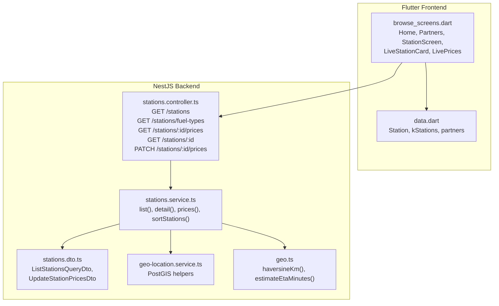
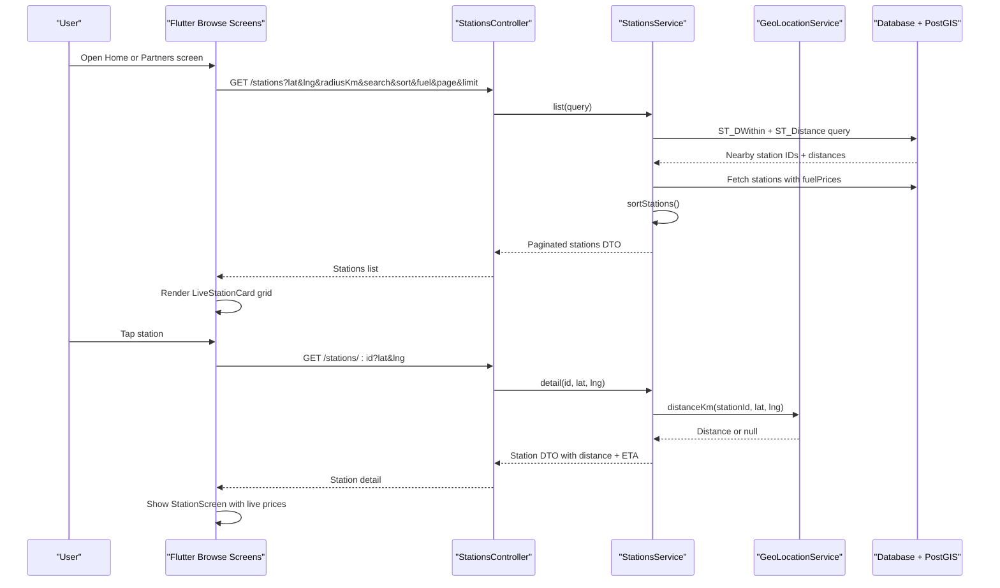
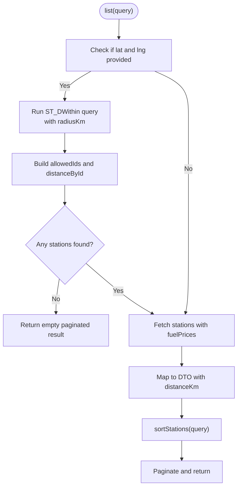
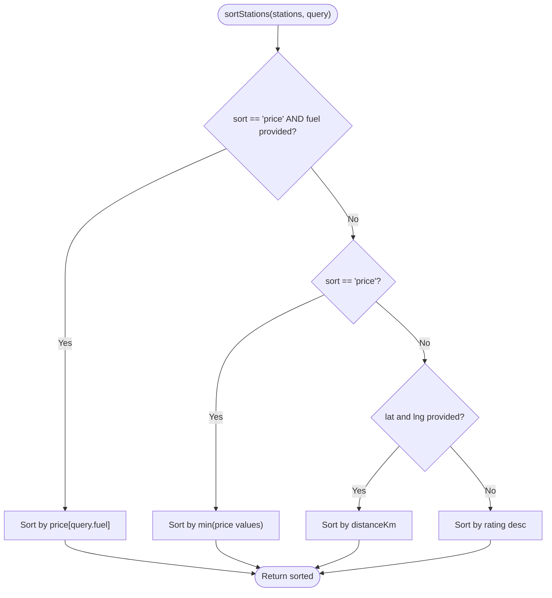
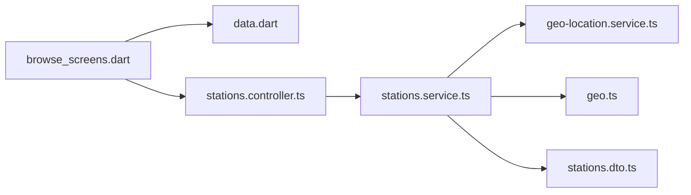

# Browsing & Discovery Screens

<cite>
**Referenced Files in This Document**   
- [browse_screens.dart](file://flutter_app/lib/screens/browse_screens.dart)
- [data.dart](file://flutter_app/lib/core/data.dart)
- [stations.controller.ts](file://backend/src/stations/stations.controller.ts)
- [stations.service.ts](file://backend/src/stations/stations.service.ts)
- [stations.dto.ts](file://backend/src/stations/dto/stations.dto.ts)
- [geo-location.service.ts](file://backend/src/common/services/geo-location.service.ts)
- [geo.ts](file://backend/src/common/utils/geo.ts)
</cite>

## Table of Contents
1. [Introduction](#introduction)
2. [Project Structure](#project-structure)
3. [Core Components](#core-components)
4. [Architecture Overview](#architecture-overview)
5. [Detailed Component Analysis](#detailed-component-analysis)
6. [Dependency Analysis](#dependency-analysis)
7. [Performance Considerations](#performance-considerations)
8. [Troubleshooting Guide](#troubleshooting-guide)
9. [Conclusion](#conclusion)

## Introduction
This document explains the browsing and discovery screens for finding gas stations, comparing them, viewing live fuel prices, and preparing for map-based visualization. It covers:

- The Flutter station search interface and partner listing.
- Location-based filtering and proximity sorting.
- Station comparison features, rating display, and availability indicators.
- Fuel price display, including live demand-driven pricing simulation.
- Backend geospatial query implementation using PostGIS.
- API contracts for nearby stations, fuel types, and station details.
- Guidance for implementing map integration, advanced filters, offline caching, and performance optimization.

The current Flutter prototype uses local mock data for browsing, while the backend already exposes a production-ready stations API with geospatial queries, pagination, and price management.

## Project Structure
The browsing and discovery experience spans both the Flutter frontend and the NestJS backend:

- **Flutter frontend**:
  - `flutter_app/lib/screens/browse_screens.dart` defines the Home screen, Partner stations screen, Station detail screen, live station card, live price model, and simulated real-time price engine.
  - `flutter_app/lib/core/data.dart` provides shared static models such as generic `Station`, partner list, and other app-wide data used across screens.

- **Backend**:
  - `backend/src/stations/stations.controller.ts` exposes public endpoints for listing nearby stations, fetching fuel types, getting station prices, retrieving station details with optional distance, and updating prices (admin/station manager).
  - `backend/src/stations/stations.service.ts` implements geospatial filtering, sorting, DTO mapping, ETA estimation, and price update workflows.
  - `backend/src/stations/dto/stations.dto.ts` defines validation and documentation for query parameters, station creation/update, and price updates.
  - `backend/src/common/services/geo-location.service.ts` manages PostGIS geography columns and distance calculations.
  - `backend/src/common/utils/geo.ts` provides haversine distance and ETA helpers.

**Diagram sources**
- [browse_screens.dart:106-118](file://flutter_app/lib/screens/browse_screens.dart#L106-L118)
- [data.dart:4-22](file://flutter_app/lib/core/data.dart#L4-L22)
- [stations.controller.ts:44-95](file://backend/src/stations/stations.controller.ts#L44-L95)
- [stations.service.ts:51-99](file://backend/src/stations/stations.service.ts#L51-L99)
- [stations.dto.ts:22-58](file://backend/src/stations/dto/stations.dto.ts#L22-L58)
- [geo-location.service.ts:29-34](file://backend/src/common/services/geo-location.service.ts#L29-L34)
- [geo.ts:6-18](file://backend/src/common/utils/geo.ts#L6-L18)

**Section sources**
- [browse_screens.dart:1-736](file://flutter_app/lib/screens/browse_screens.dart#L1-L736)
- [data.dart:1-126](file://flutter_app/lib/core/data.dart#L1-L126)
- [stations.controller.ts:1-97](file://backend/src/stations/stations.controller.ts#L1-L97)
- [stations.service.ts:1-382](file://backend/src/stations/stations.service.ts#L1-L382)
- [stations.dto.ts:1-211](file://backend/src/stations/dto/stations.dto.ts#L1-L211)
- [geo-location.service.ts:1-155](file://backend/src/common/services/geo-location.service.ts#L1-L155)
- [geo.ts:1-27](file://backend/src/common/utils/geo.ts#L1-L27)

## Core Components
This section summarizes the key UI and data components that power browsing and discovery.

### Flutter Station Search Interface
- **Home screen**:
  - Displays a hero banner, location selector, quick stats (petrol average and average arrival time), a search box, and a grid of live station cards.
  - Filters stations by keyword against name, brand, and fuel terms.
  - Navigates to the selected station detail screen.

- **Partner stations screen**:
  - Provides horizontal filter chips: All, Nearest, Best price.
  - Applies client-side sorting based on distance or petrol price.
  - Reuses the same live station card component.

- **Station detail screen**:
  - Shows cover image, verified partner badge, brand label, station name, address, rating, review count, distance, ETA range, live prices, activity feed, and a call-to-action button.
  - Supports saving/un-saving a station as a favorite.

**Section sources**
- [browse_screens.dart:123-281](file://flutter_app/lib/screens/browse_screens.dart#L123-L281)
- [browse_screens.dart:286-368](file://flutter_app/lib/screens/browse_screens.dart#L286-L368)
- [browse_screens.dart:373-544](file://flutter_app/lib/screens/browse_screens.dart#L373-L544)

### Live Station Card and Price Display
- **LiveStationCard**:
  - Shows logo, station name, distance, ETA range, rating, and a “Live” indicator.
  - Displays petrol and diesel price cells with animated price changes and percentage movement pills.

- **Price cell**:
  - Uses a global live price service to show current price per litre and change percentage relative to base price.
  - Animates price updates for smooth UX.

**Section sources**
- [browse_screens.dart:11-104](file://flutter_app/lib/screens/browse_screens.dart#L11-L104)

### Live Prices Engine
- **LivePrices**:
  - Simulates demand-driven price increases when users start ordering or place orders.
  - Decays demand every 20 seconds so prices drift back toward base.
  - Tracks last move amount and percentage, and maintains an event log for the activity feed.
  - Supports remote price overrides via `applyRemote`.

- **LiveStation**:
  - Static model representing a served station with ID, name, brand, address, logo asset, distance, rating, reviews, ETA range, and base fuel prices.

**Section sources**
- [browse_screens.dart:549-726](file://flutter_app/lib/screens/browse_screens.dart#L549-L726)

### Shared Data Models
- **Station**:
  - Generic model used across screens with fields like name, brand, distance string, ETA string, rating, image path, and numeric km.
  - Used by older or alternative screens; the live discovery flow currently uses `LiveStation`.

**Section sources**
- [data.dart:4-22](file://flutter_app/lib/core/data.dart#L4-L22)

## Architecture Overview
The browsing and discovery architecture connects Flutter UI components to backend APIs and geospatial services.

**Diagram sources**
- [stations.controller.ts:44-82](file://backend/src/stations/stations.controller.ts#L44-L82)
- [stations.service.ts:51-99](file://backend/src/stations/stations.service.ts#L51-L99)
- [stations.service.ts:101-117](file://backend/src/stations/stations.service.ts#L101-L117)
- [geo-location.service.ts:88-100](file://backend/src/common/services/geo-location.service.ts#L88-L100)
- [browse_screens.dart:106-118](file://flutter_app/lib/screens/browse_screens.dart#L106-L118)

## Detailed Component Analysis

### Geospatial Query Implementation
The backend performs location-based filtering using PostGIS:

- **Nearby stations query**:
  - Accepts `lat`, `lng`, and `radiusKm`.
  - Uses `ST_DWithin` to filter active stations within the radius.
  - Computes `ST_Distance` to get distance in kilometres.
  - Limits results to 50 nearest stations before further processing.

- **Distance fallback**:
  - If PostGIS distance is unavailable, the service falls back to haversine distance calculation.

- **ETA estimation**:
  - ETA minutes are estimated using a simple formula based on distance and traffic assumptions.

**Diagram sources**
- [stations.service.ts:51-99](file://backend/src/stations/stations.service.ts#L51-L99)
- [stations.service.ts:313-338](file://backend/src/stations/stations.service.ts#L313-L338)
- [geo-location.service.ts:88-100](file://backend/src/common/services/geo-location.service.ts#L88-L100)
- [geo.ts:6-18](file://backend/src/common/utils/geo.ts#L6-L18)

**Section sources**
- [stations.service.ts:51-99](file://backend/src/stations/stations.service.ts#L51-L99)
- [stations.service.ts:101-117](file://backend/src/stations/stations.service.ts#L101-L117)
- [stations.service.ts:313-338](file://backend/src/stations/stations.service.ts#L313-L338)
- [stations.dto.ts:22-58](file://backend/src/stations/dto/stations.dto.ts#L22-L58)
- [geo-location.service.ts:88-100](file://backend/src/common/services/geo-location.service.ts#L88-L100)
- [geo.ts:6-18](file://backend/src/common/utils/geo.ts#L6-L18)

### Proximity-Based Sorting Algorithms
Sorting logic prioritizes:

1. **Price-specific fuel sort**:
   - If `sort=price` and `fuel` is provided, stations are sorted by the price of that specific fuel code.

2. **General price sort**:
   - If `sort=price` without a fuel, stations are sorted by their minimum price across all fuels.

3. **Distance sort**:
   - If coordinates are provided, stations are sorted by computed distance.

4. **Rating sort**:
   - Default fallback sorts by rating descending.

**Diagram sources**
- [stations.service.ts:313-338](file://backend/src/stations/stations.service.ts#L313-L338)

**Section sources**
- [stations.service.ts:313-338](file://backend/src/stations/stations.service.ts#L313-L338)

### Station Comparison Features
- **Client-side comparison**:
  - The Partner stations screen allows sorting by “Nearest” or “Best price”.
  - Live station cards show distance, ETA range, rating, and live prices for quick visual comparison.

- **Backend-supported comparison**:
  - The API supports sorting by distance, price, or rating.
  - Price sorting can be scoped to a specific fuel type.

**Section sources**
- [browse_screens.dart:305-310](file://flutter_app/lib/screens/browse_screens.dart#L305-L310)
- [stations.service.ts:313-338](file://backend/src/stations/stations.service.ts#L313-L338)

### Fuel Price Displays
- **Live price simulation**:
  - Base prices are defined per station and fuel type.
  - Demand from order attempts and confirmed orders increases prices up to a capped premium percentage.
  - Prices decay over time to simulate market stabilization.
  - Percentage change vs base price is shown alongside each fuel cell.

- **Activity feed**:
  - Station detail shows recent price events, including whether an event came from an order attempt or a completed order.

**Section sources**
- [browse_screens.dart:612-726](file://flutter_app/lib/screens/browse_screens.dart#L612-L726)
- [browse_screens.dart:418-442](file://flutter_app/lib/screens/browse_screens.dart#L418-L442)

### UI Components for Station Cards, Search Filters, Ratings, and Availability
- **StationLogo**:
  - Renders station logo with fallback to brand initial if asset missing.

- **LiveStationCard**:
  - Combines logo, name, distance, ETA, rating, and live fuel prices.
  - Animated price transitions and percentage pills.

- **SearchBox**:
  - Text input with hint text and onChange callback to update filtered results.

- **Ratings and Reviews**:
  - Station detail displays rating and review count.

- **Availability Indicators**:
  - “Live” pill indicates real-time price updates.
  - “Verified partner” badge indicates trusted stations.

**Section sources**
- [browse_screens.dart:11-104](file://flutter_app/lib/screens/browse_screens.dart#L11-L104)
- [browse_screens.dart:380-544](file://flutter_app/lib/screens/browse_screens.dart#L380-L544)

### Implementing Advanced Search Features
- **Fuel type filtering**:
  - Use the backend endpoint `GET /stations/fuel-types` to retrieve available fuel codes and names.
  - Filter the station list by matching fuel codes against station price lists.

- **Operating hours display**:
  - Station DTO includes `opensAt` and `closesAt`.
  - Compute current open/closed status on the client by comparing current time with operating hours.

- **Promotional offers**:
  - Extend the station DTO to include promotional fields.
  - Display badges or banners on station cards when promotions are active.

**Section sources**
- [stations.controller.ts:51-56](file://backend/src/stations/stations.controller.ts#L51-L56)
- [stations.service.ts:128-134](file://backend/src/stations/stations.service.ts#L128-L134)
- [stations.service.ts:358-379](file://backend/src/stations/stations.service.ts#L358-L379)

### Caching Strategies for Station Data
Recommended strategies for the Flutter app:

- **In-memory cache**:
  - Cache recent station lists and station details keyed by query parameters.
  - Invalidate cache on user-initiated refresh or when prices update.

- **Persistent cache**:
  - Store station metadata and prices locally for offline access.
  - Use timestamps to determine staleness and trigger background refresh.

- **Optimistic UI updates**:
  - For order attempts and price changes, update UI immediately and reconcile with server state.

- **Pagination-aware caching**:
  - Cache pages separately to avoid re-fetching entire lists.

[No sources needed since this section provides general guidance]

### Offline Capabilities
- **Offline station list**:
  - Serve cached stations when network is unavailable.
  - Show offline indicator and allow users to browse saved stations.

- **Offline price view**:
  - Display last known prices with a stale indicator.
  - Queue actions (e.g., placing orders) until connectivity is restored.

- **Sync strategy**:
  - On reconnect, fetch updated stations and merge with local cache.
  - Resolve conflicts using server timestamps.

[No sources needed since this section provides general guidance]

### Performance Optimization for Large Datasets
- **Server-side pagination**:
  - Use `page` and `limit` query parameters to limit payload size.
  - Implement infinite scroll or page-by-page loading in Flutter.

- **Geospatial indexing**:
  - Ensure PostGIS indexes exist on station locations for fast `ST_DWithin` queries.

- **Selective field retrieval**:
  - Request only necessary fields from the backend to reduce bandwidth.

- **Debounced search**:
  - Debounce search input to avoid excessive filtering and UI rebuilds.

- **Efficient list rendering**:
  - Use `ListView.builder` or similar virtualized lists in Flutter.

**Section sources**
- [stations.dto.ts:22-58](file://backend/src/stations/dto/stations.dto.ts#L22-L58)
- [stations.service.ts:96-99](file://backend/src/stations/stations.service.ts#L96-L99)

## Dependency Analysis
The browsing and discovery feature depends on several modules:

**Diagram sources**
- [browse_screens.dart:1-736](file://flutter_app/lib/screens/browse_screens.dart#L1-L736)
- [data.dart:1-126](file://flutter_app/lib/core/data.dart#L1-L126)
- [stations.controller.ts:1-97](file://backend/src/stations/stations.controller.ts#L1-L97)
- [stations.service.ts:1-382](file://backend/src/stations/stations.service.ts#L1-L382)
- [stations.dto.ts:1-211](file://backend/src/stations/dto/stations.dto.ts#L1-L211)
- [geo-location.service.ts:1-155](file://backend/src/common/services/geo-location.service.ts#L1-L155)
- [geo.ts:1-27](file://backend/src/common/utils/geo.ts#L1-L27)

**Section sources**
- [browse_screens.dart:1-736](file://flutter_app/lib/screens/browse_screens.dart#L1-L736)
- [stations.controller.ts:1-97](file://backend/src/stations/stations.controller.ts#L1-L97)
- [stations.service.ts:1-382](file://backend/src/stations/stations.service.ts#L1-L382)

## Performance Considerations
- **UI responsiveness**:
  - Avoid rebuilding entire station grids on small price changes; use targeted animations and value keys.
  - Debounce search input and filter operations.

- **Network efficiency**:
  - Prefer server-side filtering and sorting over client-side heavy computations.
  - Use pagination and selective field retrieval.

- **Geospatial queries**:
  - Keep radius reasonable to limit database load.
  - Leverage PostGIS indexes for distance queries.

- **Caching**:
  - Cache station lists and details to reduce repeated network calls.
  - Implement cache invalidation strategies based on time and user actions.

[No sources needed since this section provides general guidance]

## Troubleshooting Guide
Common issues and resolutions:

- **No stations returned**:
  - Verify latitude and longitude are valid.
  - Increase `radiusKm` if too restrictive.
  - Check station activation status and location data in the database.

- **Incorrect distance or ETA**:
  - Ensure PostGIS extension is enabled and station locations are set.
  - Validate haversine fallback behavior when PostGIS is unavailable.

- **Price not updating**:
  - Confirm `recordAttempt` or `recordOrder` is called appropriately.
  - Check decay timer and demand accumulation logic.

- **Sorting not applied**:
  - Verify query parameters `sort`, `fuel`, `lat`, and `lng`.
  - Ensure backend sorting logic matches expected priority.

**Section sources**
- [stations.service.ts:51-99](file://backend/src/stations/stations.service.ts#L51-L99)
- [stations.service.ts:101-117](file://backend/src/stations/stations.service.ts#L101-L117)
- [stations.service.ts:313-338](file://backend/src/stations/stations.service.ts#L313-L338)
- [browse_screens.dart:612-726](file://flutter_app/lib/screens/browse_screens.dart#L612-L726)

## Conclusion
The browsing and discovery screens provide a robust foundation for searching, comparing, and visualizing gas stations with live fuel prices. The Flutter prototype demonstrates interactive UI components and simulated real-time pricing, while the backend offers production-grade geospatial queries, sorting, and price management. Integrating map visualization, advanced filters, caching, and offline capabilities will further enhance the user experience and scalability of the system.

[No sources needed since this section summarizes without analyzing specific files]