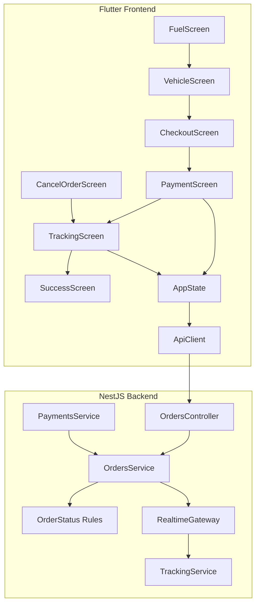
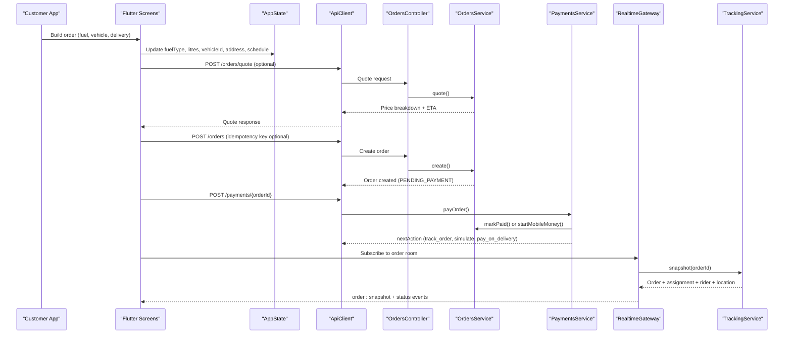
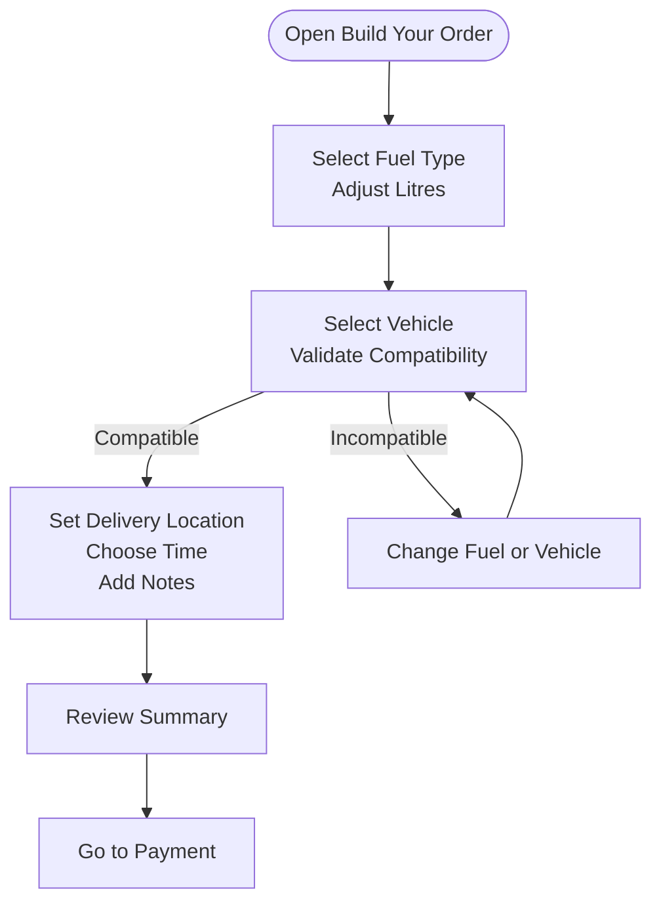
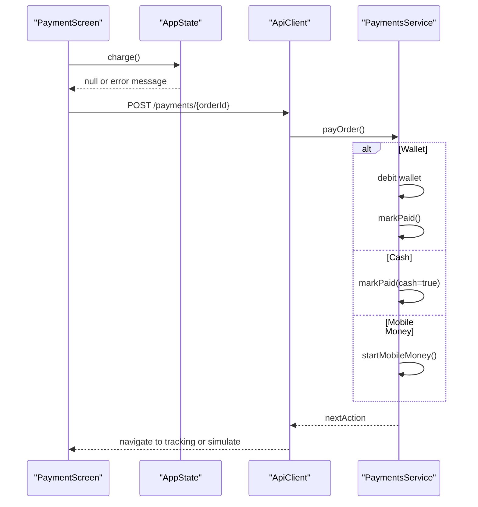
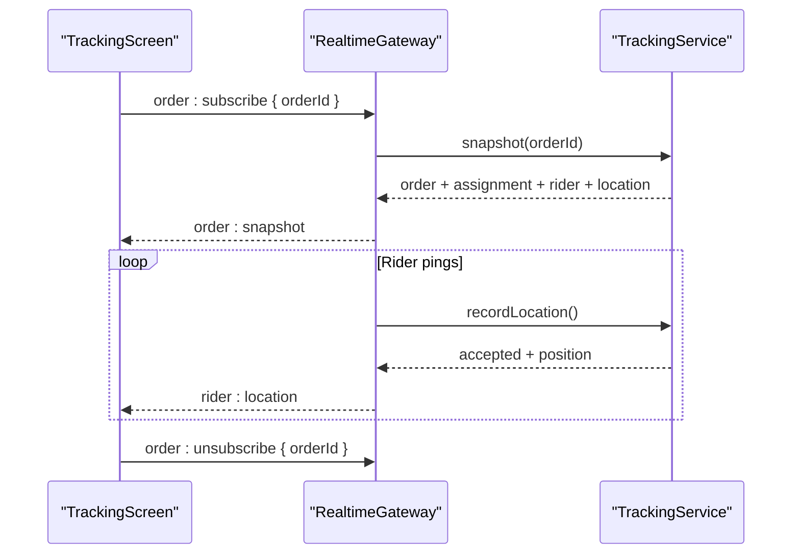
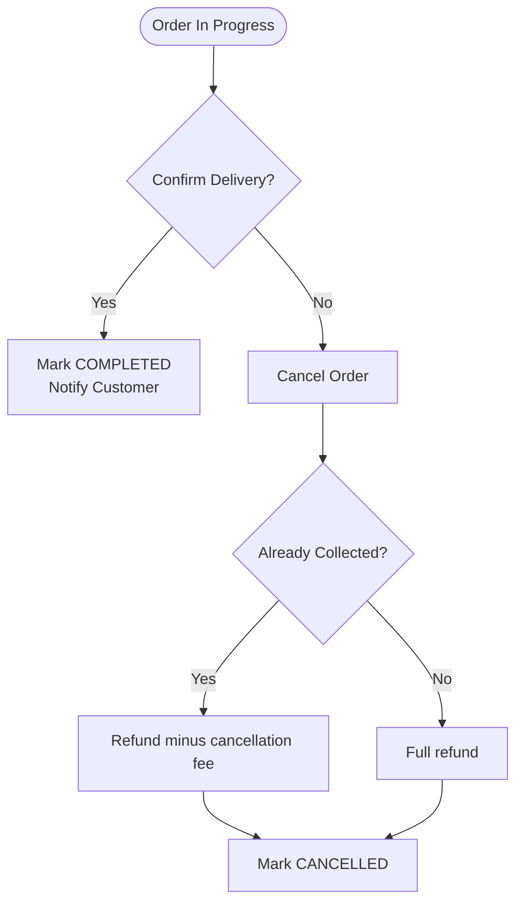
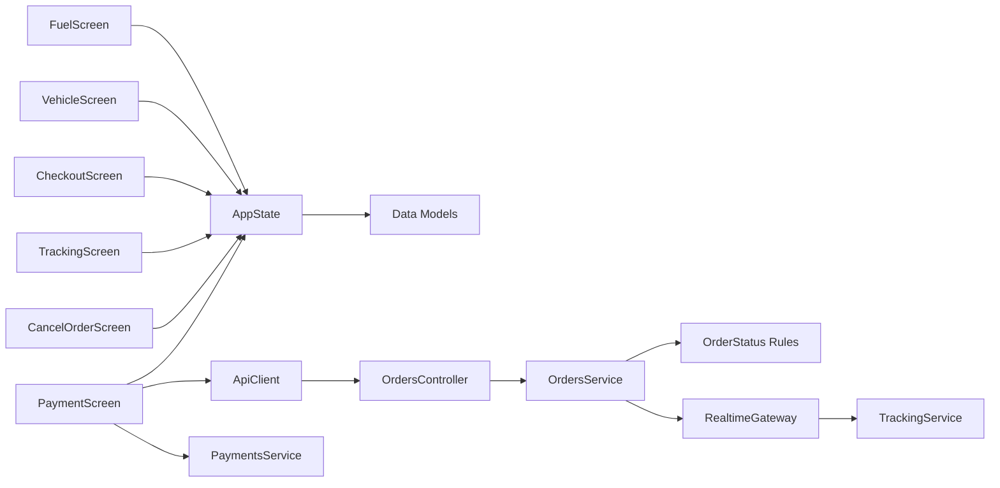

# Order Management Screens

<cite>
**Referenced Files in This Document**
- [order_screens.dart](file://flutter_app/lib/screens/order_screens.dart)
- [app_state.dart](file://flutter_app/lib/core/app_state.dart)
- [data.dart](file://flutter_app/lib/core/data.dart)
- [api_client.dart](file://flutter_app/lib/services/api_client.dart)
- [orders.controller.ts](file://backend/src/orders/orders.controller.ts)
- [orders.service.ts](file://backend/src/orders/orders.service.ts)
- [order-status.ts](file://backend/src/orders/order-status.ts)
- [payments.service.ts](file://backend/src/payments/payments.service.ts)
- [realtime.gateway.ts](file://backend/src/tracking/realtime.gateway.ts)
- [tracking.service.ts](file://backend/src/tracking/tracking.service.ts)
</cite>

## Table of Contents
1. [Introduction](#introduction)
2. [Project Structure](#project-structure)
3. [Core Components](#core-components)
4. [Architecture Overview](#architecture-overview)
5. [Detailed Component Analysis](#detailed-component-analysis)
6. [Dependency Analysis](#dependency-analysis)
7. [Performance Considerations](#performance-considerations)
8. [Troubleshooting Guide](#troubleshooting-guide)
9. [Conclusion](#conclusion)

## Introduction
This document explains the order management screens and workflows for the FuelConnect application. It covers the complete customer order lifecycle from fuel selection through payment, live tracking, completion, cancellation, and history. It also documents state management patterns, location tracking integration, real-time communication with the backend, UI components for forms and status visualization, and error handling for failed orders, payment issues, and network connectivity problems.

The Flutter frontend currently uses mocked data for prototype screens, while the NestJS backend provides a production-ready API contract for orders, payments, and real-time tracking.

## Project Structure
The order workflow spans:
- Flutter screens for building an order, selecting a vehicle, choosing delivery details, paying, tracking, completing, and canceling.
- A global app state object that holds order configuration, pricing, vehicles, addresses, payment methods, wallet balance, and notifications.
- Backend controllers and services for quoting, creating, listing, updating, and transitioning orders.
- Payment service logic for mobile money, cash, and wallet flows.
- Real-time WebSocket gateway and tracking service for live rider location and order updates.

**Diagram sources**
- [order_screens.dart:17-938](file://flutter_app/lib/screens/order_screens.dart#L17-L938)
- [app_state.dart:69-198](file://flutter_app/lib/core/app_state.dart#L69-L198)
- [api_client.dart:32-126](file://flutter_app/lib/services/api_client.dart#L32-L126)
- [orders.controller.ts:21-83](file://backend/src/orders/orders.controller.ts#L21-L83)
- [orders.service.ts:76-800](file://backend/src/orders/orders.service.ts#L76-L800)
- [order-status.ts:1-80](file://backend/src/orders/order-status.ts#L1-L80)
- [payments.service.ts:67-738](file://backend/src/payments/payments.service.ts#L67-L738)
- [realtime.gateway.ts:45-294](file://backend/src/tracking/realtime.gateway.ts#L45-L294)
- [tracking.service.ts:32-282](file://backend/src/tracking/tracking.service.ts#L32-L282)

**Section sources**
- [order_screens.dart:17-938](file://flutter_app/lib/screens/order_screens.dart#L17-L938)
- [app_state.dart:69-198](file://flutter_app/lib/core/app_state.dart#L69-L198)
- [orders.controller.ts:21-83](file://backend/src/orders/orders.controller.ts#L21-L83)
- [orders.service.ts:76-800](file://backend/src/orders/orders.service.ts#L76-L800)
- [payments.service.ts:67-738](file://backend/src/payments/payments.service.ts#L67-L738)
- [realtime.gateway.ts:45-294](file://backend/src/tracking/realtime.gateway.ts#L45-L294)
- [tracking.service.ts:32-282](file://backend/src/tracking/tracking.service.ts#L32-L282)

## Core Components
- FuelScreen: Selects fuel type and quantity, shows estimated total, and navigates to vehicle selection.
- VehicleScreen: Chooses a registered vehicle, validates fuel compatibility, supports adding new vehicles.
- CheckoutScreen: Sets delivery address, time (now or scheduled), optional delivery note, and reviews order summary before payment.
- PaymentScreen: Selects payment method, shows order summary, simulates payment flow, and navigates to tracking.
- TrackingScreen: Visualizes live map, driver info, timeline steps, ETA, and completion actions.
- SuccessScreen: Confirms delivery, displays receipt-like summary, rating, and navigation options.
- CancelOrderScreen: Collects cancellation reason, shows refund summary with fee, and confirms cancellation.
- AppState: Central state for navigation, location, theme, order builder values, pricing, vehicles, places, payment methods, wallet, rewards, and notifications.
- ApiClient: HTTP client with secure token storage, timeouts, and friendly error messages.

Key responsibilities:
- UI orchestration and user input collection occur in the screen widgets.
- Business rules such as totals, product names, and payment validation are centralized in AppState.
- Data models for vehicles, places, payment methods, transactions, notices, and history are defined in data.dart.
- Network calls and authentication are handled by ApiClient when connecting to the backend.

**Section sources**
- [order_screens.dart:17-938](file://flutter_app/lib/screens/order_screens.dart#L17-L938)
- [app_state.dart:69-198](file://flutter_app/lib/core/app_state.dart#L69-L198)
- [data.dart:68-126](file://flutter_app/lib/core/data.dart#L68-L126)
- [api_client.dart:32-126](file://flutter_app/lib/services/api_client.dart#L32-L126)

## Architecture Overview
The order lifecycle is implemented across Flutter screens and NestJS services:
- The Flutter screens collect inputs and update AppState.
- When ready, the app can call backend endpoints via ApiClient to quote, create, list, and confirm orders.
- Payments are initiated through the PaymentsService, which handles wallet, cash, and mobile money flows.
- Order state transitions are enforced by OrdersService using strict transition rules.
- Real-time tracking uses Socket.IO over the /tracking namespace; riders publish locations, customers subscribe to order rooms, and staff can observe operations.

**Diagram sources**
- [order_screens.dart:17-938](file://flutter_app/lib/screens/order_screens.dart#L17-L938)
- [app_state.dart:69-198](file://flutter_app/lib/core/app_state.dart#L69-L198)
- [api_client.dart:32-126](file://flutter_app/lib/services/api_client.dart#L32-L126)
- [orders.controller.ts:21-83](file://backend/src/orders/orders.controller.ts#L21-L83)
- [orders.service.ts:87-254](file://backend/src/orders/orders.service.ts#L87-L254)
- [payments.service.ts:83-286](file://backend/src/payments/payments.service.ts#L83-L286)
- [realtime.gateway.ts:150-173](file://backend/src/tracking/realtime.gateway.ts#L150-L173)
- [tracking.service.ts:77-126](file://backend/src/tracking/tracking.service.ts#L77-L126)

## Detailed Component Analysis

### Order Creation Forms
- Fuel selection: Choose between Petrol, Diesel, and Power; adjust litres with step controls and quick presets; show estimated fuel total based on static prices.
- Vehicle selection: Display registered vehicles with plate, fuel type, color, and tank size; validate fuel compatibility; allow adding new vehicles via a sheet.
- Delivery details: Show a stylized map placeholder, select delivery location, choose immediate or scheduled delivery time, add optional delivery notes, and review order summary.

Implementation highlights:
- FuelScreen updates AppState.fuelType and AppState.litres, computes fuelTotal, and navigates to VehicleScreen.
- VehicleScreen checks AppState.fuelClass against selected vehicle fuel and enables confirmation only when compatible.
- CheckoutScreen manages scheduled delivery state, opens address sheet, and navigates to PaymentScreen after review.

**Diagram sources**
- [order_screens.dart:17-122](file://flutter_app/lib/screens/order_screens.dart#L17-L122)
- [order_screens.dart:127-216](file://flutter_app/lib/screens/order_screens.dart#L127-L216)
- [order_screens.dart:221-361](file://flutter_app/lib/screens/order_screens.dart#L221-L361)
- [app_state.dart:121-147](file://flutter_app/lib/core/app_state.dart#L121-L147)

**Section sources**
- [order_screens.dart:17-122](file://flutter_app/lib/screens/order_screens.dart#L17-L122)
- [order_screens.dart:127-216](file://flutter_app/lib/screens/order_screens.dart#L127-L216)
- [order_screens.dart:221-361](file://flutter_app/lib/screens/order_screens.dart#L221-L361)
- [app_state.dart:121-147](file://flutter_app/lib/core/app_state.dart#L121-L147)

### Payment Selection and Flow
- PaymentScreen lists available payment methods (mobile money, wallet, cash), shows order summary, and triggers charge flow.
- AppState.charge validates wallet balance and records transaction entry; it returns null when payment can proceed.
- PaymentScreen simulates processing delay and navigates to TrackingScreen.

Backend integration:
- PaymentsService.payOrder routes to wallet debit, cash on delivery, or mobile money initiation.
- Wallet payments debit the wallet and mark the order paid; cash orders mark order confirmed with pending payment status; mobile money starts provider collection or sandbox simulation.

**Diagram sources**
- [order_screens.dart:366-456](file://flutter_app/lib/screens/order_screens.dart#L366-L456)
- [app_state.dart:155-184](file://flutter_app/lib/core/app_state.dart#L155-L184)
- [payments.service.ts:83-286](file://backend/src/payments/payments.service.ts#L83-L286)

**Section sources**
- [order_screens.dart:366-456](file://flutter_app/lib/screens/order_screens.dart#L366-L456)
- [app_state.dart:155-184](file://flutter_app/lib/core/app_state.dart#L155-L184)
- [payments.service.ts:83-286](file://backend/src/payments/payments.service.ts#L83-L286)

### Real-Time Tracking Interfaces
- TrackingScreen renders a stylized map, animated truck marker, route line, driver card, timeline steps, and action buttons.
- It simulates progress through periodic timer-driven state changes and allows previewing arrival or confirming delivery.
- Backend real-time layer:
  - RealtimeGateway authenticates sockets, joins rooms per user/rider/station, subscribes/unsubscribes to order rooms, and broadcasts rider locations.
  - TrackingService provides snapshots, latest positions (Redis-first then PostgreSQL), and admin active deliveries.

**Diagram sources**
- [order_screens.dart:461-657](file://flutter_app/lib/screens/order_screens.dart#L461-L657)
- [realtime.gateway.ts:150-184](file://backend/src/tracking/realtime.gateway.ts#L150-L184)
- [tracking.service.ts:77-144](file://backend/src/tracking/tracking.service.ts#L77-L144)
- [tracking.service.ts:155-230](file://backend/src/tracking/tracking.service.ts#L155-L230)

**Section sources**
- [order_screens.dart:461-657](file://flutter_app/lib/screens/order_screens.dart#L461-L657)
- [realtime.gateway.ts:45-294](file://backend/src/tracking/realtime.gateway.ts#L45-L294)
- [tracking.service.ts:32-282](file://backend/src/tracking/tracking.service.ts#L32-L282)

### Order Completion and Cancellation
- SuccessScreen shows delivery complete, order details, rating, and navigation to home or orders.
- CancelOrderScreen collects cancellation reasons, warns about fees once fuel has been collected, shows refund summary, and confirms cancellation.

Backend support:
- OrdersService.cancel enforces cancellable statuses, refunds wallet if needed, updates payment status, and emits notifications.
- OrdersService.confirmDelivery moves delivered orders to completed.

**Diagram sources**
- [order_screens.dart:662-734](file://flutter_app/lib/screens/order_screens.dart#L662-L734)
- [order_screens.dart:739-938](file://flutter_app/lib/screens/order_screens.dart#L739-L938)
- [orders.service.ts:421-476](file://backend/src/orders/orders.service.ts#L421-L476)

**Section sources**
- [order_screens.dart:662-734](file://flutter_app/lib/screens/order_screens.dart#L662-L734)
- [order_screens.dart:739-938](file://flutter_app/lib/screens/order_screens.dart#L739-L938)
- [orders.service.ts:421-476](file://backend/src/orders/orders.service.ts#L421-L476)

### Order History
- The Flutter prototype includes history data structures and sample entries for past orders.
- Backend OrdersService.list supports filtering by scope (active/past) and status, returning paginated results with full order relations.

Integration guidance:
- Use OrdersController.list to fetch history pages.
- Map backend DTOs to Flutter UI components for date, station, product, and price display.

**Section sources**
- [data.dart:116-126](file://flutter_app/lib/core/data.dart#L116-L126)
- [orders.service.ts:256-282](file://backend/src/orders/orders.service.ts#L256-L282)
- [orders.controller.ts:51-56](file://backend/src/orders/orders.controller.ts#L51-L56)

### State Management Patterns
- AppState acts as a single source of truth for order builder fields, pricing, vehicles, places, payment methods, wallet, points, and notifications.
- Navigation stack is managed centrally with go/back/backOr helpers.
- UI components read from AppState and trigger setState locally where needed, then delegate business actions to AppState methods like charge and completeDelivery.

Best practices:
- Keep transient UI state (e.g., loading flags, local form controllers) inside screen state.
- Persist cross-screen business state in AppState.
- When integrating with the backend, move persistent mutations into services and update AppState accordingly.

**Section sources**
- [app_state.dart:69-198](file://flutter_app/lib/core/app_state.dart#L69-L198)
- [order_screens.dart:17-938](file://flutter_app/lib/screens/order_screens.dart#L17-L938)

### Location Tracking Integration
- CheckoutScreen integrates a stylized map placeholder and opens an address sheet to set delivery location.
- TrackingScreen visualizes rider movement and ETA.
- Backend TrackingService stores rider locations in Redis for hot reads and PostgreSQL for persistence, with throttling to prevent excessive pings.

Operational notes:
- Clients should subscribe to order rooms to receive live updates.
- Riders must be authenticated and assigned to the delivery to publish locations.

**Section sources**
- [order_screens.dart:221-361](file://flutter_app/lib/screens/order_screens.dart#L221-L361)
- [order_screens.dart:461-657](file://flutter_app/lib/screens/order_screens.dart#L461-L657)
- [tracking.service.ts:128-230](file://backend/src/tracking/tracking.service.ts#L128-L230)

### Real-Time Communication With the Backend
- RealtimeGateway handles authentication, room subscriptions, and event broadcasting.
- Events include order subscription, rider location publishing, and status emissions from OrdersService.
- Clients should handle unauthorized events and reconnect as needed.

Security considerations:
- Tokens are validated during socket connection.
- Only authorized roles can access operations feed.

**Section sources**
- [realtime.gateway.ts:45-294](file://backend/src/tracking/realtime.gateway.ts#L45-L294)
- [orders.service.ts:796-800](file://backend/src/orders/orders.service.ts#L796-L800)

### UI Components for Forms, Payment, Address, and Status Visualization
- Form components:
  - Fuel selection cards with price labels.
  - Quantity stepper with min/max constraints and preset buttons.
  - Vehicle tiles with radio indicators and compatibility warnings.
  - Delivery time picker and optional note field.
- Payment components:
  - Method selector with badges/icons and captions.
  - Order summary panel with item, delivery fee, service fee, and total.
- Address components:
  - Stylized map placeholder with location button opening address sheet.
- Status visualization:
  - Timeline steps with checkmarks and labels.
  - Driver card with contact action.
  - Live pill and ETA countdown visuals.

These components are implemented within the order screens and rely on shared theme and icon utilities.

**Section sources**
- [order_screens.dart:17-938](file://flutter_app/lib/screens/order_screens.dart#L17-L938)

## Dependency Analysis
The following diagram maps core dependencies among order-related modules:

**Diagram sources**
- [order_screens.dart:17-938](file://flutter_app/lib/screens/order_screens.dart#L17-L938)
- [app_state.dart:69-198](file://flutter_app/lib/core/app_state.dart#L69-L198)
- [data.dart:68-126](file://flutter_app/lib/core/data.dart#L68-L126)
- [api_client.dart:32-126](file://flutter_app/lib/services/api_client.dart#L32-L126)
- [orders.controller.ts:21-83](file://backend/src/orders/orders.controller.ts#L21-L83)
- [orders.service.ts:76-800](file://backend/src/orders/orders.service.ts#L76-L800)
- [order-status.ts:1-80](file://backend/src/orders/order-status.ts#L1-L80)
- [payments.service.ts:67-738](file://backend/src/payments/payments.service.ts#L67-L738)
- [realtime.gateway.ts:45-294](file://backend/src/tracking/realtime.gateway.ts#L45-L294)
- [tracking.service.ts:32-282](file://backend/src/tracking/tracking.service.ts#L32-L282)

**Section sources**
- [order_screens.dart:17-938](file://flutter_app/lib/screens/order_screens.dart#L17-L938)
- [app_state.dart:69-198](file://flutter_app/lib/core/app_state.dart#L69-L198)
- [orders.service.ts:76-800](file://backend/src/orders/orders.service.ts#L76-L800)
- [payments.service.ts:67-738](file://backend/src/payments/payments.service.ts#L67-L738)
- [realtime.gateway.ts:45-294](file://backend/src/tracking/realtime.gateway.ts#L45-L294)
- [tracking.service.ts:32-282](file://backend/src/tracking/tracking.service.ts#L32-L282)

## Performance Considerations
- Minimize re-renders by keeping transient UI state local to screens and persisting only necessary values in AppState.
- Debounce or throttle location updates on the client side; the backend already throttles rider location ingestion.
- Use pagination for order history and avoid fetching large datasets unnecessarily.
- Prefer WebSocket updates for live tracking instead of polling REST endpoints.
- Cache static data (prices, vehicles, places) in AppState to reduce recomputation.

[No sources needed since this section provides general guidance]

## Troubleshooting Guide
Common issues and resolutions:
- Network connectivity problems:
  - ApiClient throws ApiException with friendly messages for timeouts and unreachable servers.
  - Ensure correct API_BASE_URL and HTTPS in release builds.
- Unauthorized sessions:
  - ApiClient clears tokens and invokes onUnauthorized callback on 401 responses.
  - RealtimeGateway emits unauthorized events and disconnects invalid sessions.
- Payment failures:
  - PaymentsService.fail marks payment failed and notifies OrdersService to mark order failed.
  - Webhook signature verification ensures secure provider callbacks.
- Invalid order transitions:
  - OrdersService.transition enforces ORDER_TRANSITIONS; invalid jumps throw conflict exceptions.
- Duplicate order creation:
  - OrdersService.create supports idempotency keys and recent duplicate detection.

Recommended debugging steps:
- Inspect ApiClient error messages and status codes.
- Verify WebSocket authentication and room subscriptions.
- Check backend logs for payment webhook signatures and order transition errors.
- Validate AppState values before calling charge or navigating to tracking.

**Section sources**
- [api_client.dart:32-126](file://flutter_app/lib/services/api_client.dart#L32-L126)
- [realtime.gateway.ts:80-143](file://backend/src/tracking/realtime.gateway.ts#L80-L143)
- [payments.service.ts:609-650](file://backend/src/payments/payments.service.ts#L609-L650)
- [orders.service.ts:482-603](file://backend/src/orders/orders.service.ts#L482-L603)
- [orders.service.ts:127-254](file://backend/src/orders/orders.service.ts#L127-L254)

## Conclusion
The FuelConnect order management system combines intuitive Flutter screens with a robust NestJS backend. Customers build orders by selecting fuel, vehicle, and delivery details; they pay via wallet, cash, or mobile money; and they track deliveries in real time. AppState centralizes order state, while backend services enforce strict order lifecycle transitions, secure payment flows, and reliable real-time communication. Following the patterns and guidelines in this document will help implement consistent, resilient, and user-friendly order features.

[No sources needed since this section summarizes without analyzing specific files]