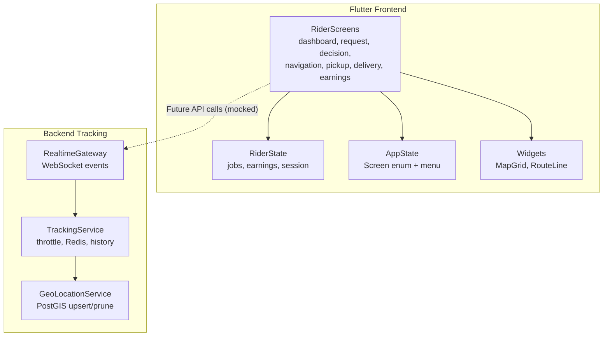
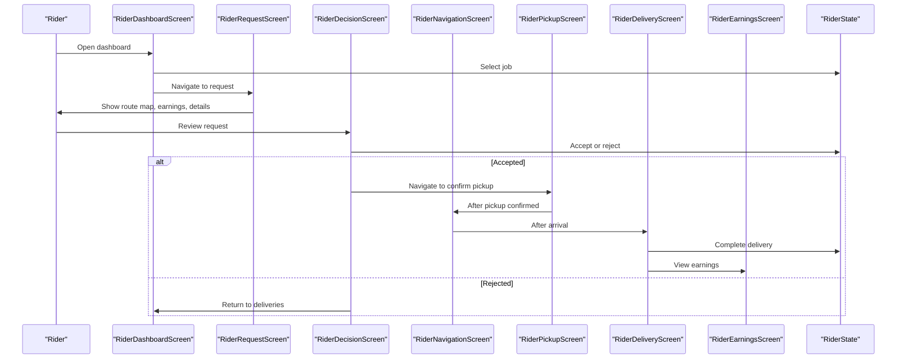
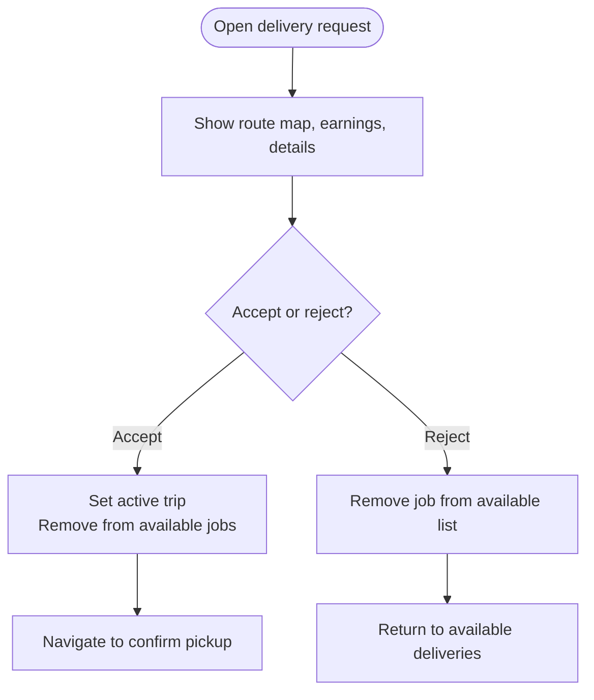
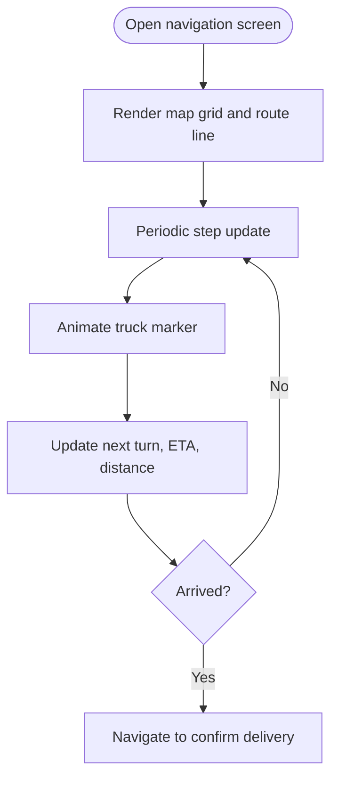
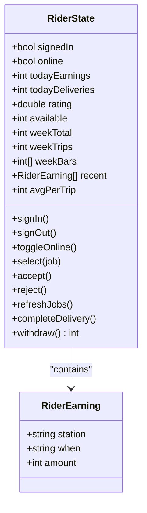
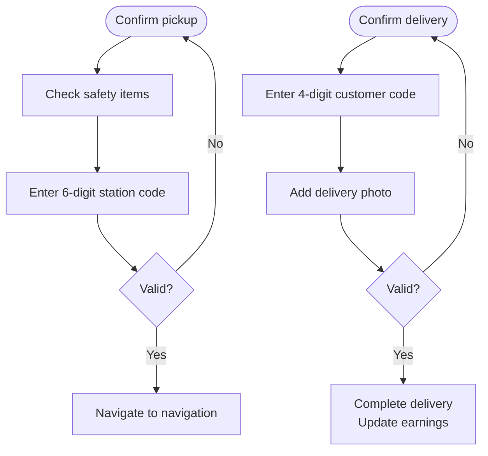
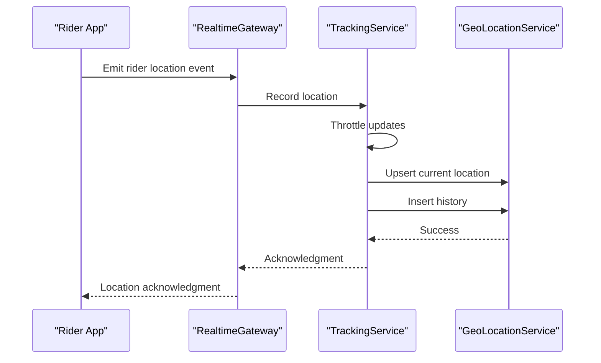
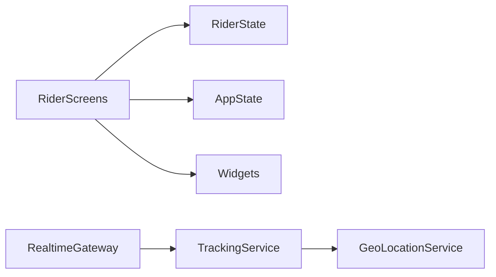

# Rider Interface Screens

<cite>
**Referenced Files in This Document**
- [rider_state.dart](file://flutter_app/lib/core/rider_state.dart)
- [app_state.dart](file://flutter_app/lib/core/app_state.dart)
- [widgets.dart](file://flutter_app/lib/core/widgets.dart)
- [rider_screens.dart](file://flutter_app/lib/screens/rider_screens.dart)
- [realtime.gateway.ts](file://backend/src/tracking/realtime.gateway.ts)
- [tracking.service.ts](file://backend/src/tracking/tracking.service.ts)
- [geo-location.service.ts](file://backend/src/common/services/geo-location.service.ts)
</cite>

## Table of Contents
1. [Introduction](#introduction)
2. [Project Structure](#project-structure)
3. [Core Components](#core-components)
4. [Architecture Overview](#architecture-overview)
5. [Detailed Component Analysis](#detailed-component-analysis)
6. [Dependency Analysis](#dependency-analysis)
7. [Performance Considerations](#performance-considerations)
8. [Troubleshooting Guide](#troubleshooting-guide)
9. [Conclusion](#conclusion)

## Introduction
This document explains the rider-specific interface screens and workflows in the FuelConnect Flutter application, including the rider dashboard, order acceptance flow, navigation integration, earnings tracking, and performance metrics. It also documents how the frontend state models rider jobs, earnings, and session status, and how the backend supports real-time location tracking for active deliveries. The goal is to help developers understand the UI patterns, data flows, and extension points for implementing route optimization, earnings calculation, performance analytics, mapping services, location permissions, and background location updates.

## Project Structure
The rider feature spans a small set of Flutter files and corresponding backend tracking services:

- Flutter frontend
  - `lib/core/rider_state.dart`: Rider domain model and local state.
  - `lib/core/app_state.dart`: Global screen enumeration and navigation registry.
  - `lib/core/widgets.dart`: Shared UI primitives such as map grid and route line visuals.
  - `lib/screens/rider_screens.dart`: All rider-facing screens and interactions.
- Backend tracking
  - `src/tracking/realtime.gateway.ts`: WebSocket gateway for rider location events.
  - `src/tracking/tracking.service.ts`: Throttling, Redis caching, and history persistence.
  - `src/common/services/geo-location.service.ts`: PostGIS-based location storage and pruning.

**Diagram sources**
- [rider_screens.dart:486-616](file://flutter_app/lib/screens/rider_screens.dart#L486-L616)
- [rider_state.dart:44-179](file://flutter_app/lib/core/rider_state.dart#L44-L179)
- [app_state.dart:6-15](file://flutter_app/lib/core/app_state.dart#L6-L15)
- [widgets.dart:364-405](file://flutter_app/lib/core/widgets.dart#L364-L405)
- [realtime.gateway.ts:210-247](file://backend/src/tracking/realtime.gateway.ts#L210-L247)
- [tracking.service.ts:179-222](file://backend/src/tracking/tracking.service.ts#L179-L222)
- [geo-location.service.ts:127-154](file://backend/src/common/services/geo-location.service.ts#L127-L154)

**Section sources**
- [rider_screens.dart:1-13](file://flutter_app/lib/screens/rider_screens.dart#L1-L13)
- [app_state.dart:6-15](file://flutter_app/lib/core/app_state.dart#L6-L15)

## Core Components
- Rider domain model
  - `RiderJob`: Represents a delivery offer with station, pickup/drop areas, customer details, product, vehicle, litres, pay, minutes, and distances.
  - `RiderEarning`: Represents an earnings entry with station, timestamp label, and amount.
  - `RiderState`: Holds signed-in status, online/offline toggle, available jobs, selected job, active trip, earnings totals, weekly stats, recent earnings, and methods for accepting/rejecting jobs, completing deliveries, and withdrawing earnings.
- Screen registry
  - `Screen` enum includes all rider screens: registration, login, dashboard, deliveries, request, decision, navigation, pickup, delivery, and earnings.
- Shared UI widgets
  - `MapGrid` and `RouteLine` provide dark-themed map backgrounds and dotted route lines used by rider screens.

Key responsibilities:
- State management for rider sessions, jobs, and earnings.
- Navigation between rider screens via the global `Screen` enum.
- Visual representation of routes and maps without requiring a live mapping SDK in this prototype.

**Section sources**
- [rider_state.dart:3-42](file://flutter_app/lib/core/rider_state.dart#L3-L42)
- [rider_state.dart:44-179](file://flutter_app/lib/core/rider_state.dart#L44-L179)
- [app_state.dart:6-15](file://flutter_app/lib/core/app_state.dart#L6-L15)
- [widgets.dart:364-405](file://flutter_app/lib/core/widgets.dart#L364-L405)

## Architecture Overview
The rider workflow follows a clear sequence from registration/login through dashboard browsing, request review, acceptance, navigation, pickup confirmation, delivery confirmation, and earnings tracking. Real-time location tracking is modeled on the backend; the Flutter screens currently simulate navigation and do not yet send live GPS coordinates.

**Diagram sources**
- [rider_screens.dart:486-616](file://flutter_app/lib/screens/rider_screens.dart#L486-L616)
- [rider_screens.dart:706-729](file://flutter_app/lib/screens/rider_screens.dart#L706-L729)
- [rider_screens.dart:734-827](file://flutter_app/lib/screens/rider_screens.dart#L734-L827)
- [rider_screens.dart:832-1003](file://flutter_app/lib/screens/rider_screens.dart#L832-L1003)
- [rider_screens.dart:1008-1110](file://flutter_app/lib/screens/rider_screens.dart#L1008-L1110)
- [rider_screens.dart:1115-1267](file://flutter_app/lib/screens/rider_screens.dart#L1115-L1267)
- [rider_screens.dart:1272-1395](file://flutter_app/lib/screens/rider_screens.dart#L1272-L1395)
- [rider_state.dart:129-168](file://flutter_app/lib/core/rider_state.dart#L129-L168)

## Detailed Component Analysis

### Rider Dashboard
The dashboard shows:
- Greeting and rider avatar.
- Today’s earnings, completed deliveries, and rating.
- Active trip banner when a trip is in progress.
- Available nearby requests with a refresh action.
- Quick actions for active trip, earnings, and support.
- Online/offline chip that toggles availability.

UI patterns:
- Uses `ListenableBuilder` to react to `RiderState`.
- Displays empty states and offline messaging.
- Navigates to request detail and other screens using the global `go` function.

Integration points:
- Taps into `rider.jobs`, `rider.activeTrip`, and `rider.online`.
- Calls `rider.refreshJobs()` to simulate fetching new requests.

**Section sources**
- [rider_screens.dart:486-616](file://flutter_app/lib/screens/rider_screens.dart#L486-L616)
- [rider_state.dart:44-179](file://flutter_app/lib/core/rider_state.dart#L44-L179)

### Order Acceptance Interface
The acceptance flow consists of two screens:
- Delivery request: Shows estimated earnings, route details, and a “Review request” button.
- Accept or reject: Includes a countdown timer, reason selection for rejection, and accept/reject buttons.

Processing logic:
- On accept: moves the selected job into `activeTrip`, removes it from available jobs, and navigates to pickup confirmation.
- On reject: removes the selected job from available jobs and returns to the deliveries list.

**Diagram sources**
- [rider_screens.dart:706-729](file://flutter_app/lib/screens/rider_screens.dart#L706-L729)
- [rider_screens.dart:734-827](file://flutter_app/lib/screens/rider_screens.dart#L734-L827)
- [rider_state.dart:129-148](file://flutter_app/lib/core/rider_state.dart#L129-L148)

**Section sources**
- [rider_screens.dart:706-827](file://flutter_app/lib/screens/rider_screens.dart#L706-L827)
- [rider_state.dart:129-148](file://flutter_app/lib/core/rider_state.dart#L129-L148)

### Navigation Integration
The navigation screen simulates turn-by-turn guidance:
- A dark map background with a moving truck marker.
- A bottom sheet showing next turn instructions, ETA, distance, and customer contact.
- Responsive layout: split view on wide screens, stacked map and sheet on mobile.

Current implementation:
- Uses static arrays for positions, turns, ETAs, and distances.
- Advances steps periodically with a timer.
- Does not integrate a real mapping SDK or background GPS in this prototype.

Extension points:
- Replace simulated position updates with real GPS coordinates.
- Integrate a mapping service provider for accurate routing and ETA calculations.
- Add background location tracking to keep the rider marker updated even when the app is minimized.

**Diagram sources**
- [rider_screens.dart:832-1003](file://flutter_app/lib/screens/rider_screens.dart#L832-L1003)
- [widgets.dart:364-405](file://flutter_app/lib/core/widgets.dart#L364-L405)

**Section sources**
- [rider_screens.dart:832-1003](file://flutter_app/lib/screens/rider_screens.dart#L832-L1003)
- [widgets.dart:364-405](file://flutter_app/lib/core/widgets.dart#L364-L405)

### Earnings Tracking and Performance Metrics
The earnings screen provides:
- Available balance to withdraw.
- Weekly totals, number of trips, and average per trip.
- Bar chart visualization of weekly performance.
- Recent earnings list with station, timestamp label, and amount.
- Withdraw action that clears available balance and shows a confirmation toast.

Data model:
- `RiderState` maintains `todayEarnings`, `weekTotal`, `weekTrips`, `avgPerTrip`, `recent`, and `available`.
- Completing a delivery increments earnings and adds a recent earning entry.

**Diagram sources**
- [rider_state.dart:38-42](file://flutter_app/lib/core/rider_state.dart#L38-L42)
- [rider_state.dart:44-179](file://flutter_app/lib/core/rider_state.dart#L44-L179)
- [rider_screens.dart:1272-1395](file://flutter_app/lib/screens/rider_screens.dart#L1272-L1395)

**Section sources**
- [rider_screens.dart:1272-1395](file://flutter_app/lib/screens/rider_screens.dart#L1272-L1395)
- [rider_state.dart:95-179](file://flutter_app/lib/core/rider_state.dart#L95-L179)

### Rider Status Management (Online/Offline)
The dashboard header includes an online/offline chip:
- Toggling the chip updates `RiderState.online`.
- When offline, the dashboard hides available requests and prompts the rider to go online.
- Toast messages inform the rider about status changes.

Implementation notes:
- The chip uses `ListenableBuilder` to rebuild when `rider.online` changes.
- The dashboard conditionally renders either an offline message or available jobs.

**Section sources**
- [rider_screens.dart:18-49](file://flutter_app/lib/screens/rider_screens.dart#L18-L49)
- [rider_screens.dart:571-583](file://flutter_app/lib/screens/rider_screens.dart#L571-L583)
- [rider_state.dart:124-127](file://flutter_app/lib/core/rider_state.dart#L124-L127)

### Pickup and Delivery Confirmation
Pickup confirmation:
- Requires checking safety and verification items.
- Requires entering a 6-digit station pickup code.
- Navigates to navigation after successful confirmation.

Delivery confirmation:
- Requires entering a 4-digit customer delivery code.
- Requires adding a delivery photo.
- On success, completes the delivery, updates earnings, and shows a completion summary.

**Diagram sources**
- [rider_screens.dart:1008-1110](file://flutter_app/lib/screens/rider_screens.dart#L1008-L1110)
- [rider_screens.dart:1115-1267](file://flutter_app/lib/screens/rider_screens.dart#L1115-L1267)
- [rider_state.dart:157-168](file://flutter_app/lib/core/rider_state.dart#L157-L168)

**Section sources**
- [rider_screens.dart:1008-1267](file://flutter_app/lib/screens/rider_screens.dart#L1008-L1267)
- [rider_state.dart:157-168](file://flutter_app/lib/core/rider_state.dart#L157-L168)

### Real-Time Order Assignment System
The current Flutter prototype does not implement real-time order assignment. Instead:
- Available jobs are provided by sample data in `RiderState._sample`.
- The dashboard and deliveries screens allow selecting and reviewing these jobs.
- Future integration should connect to a backend endpoint that pushes new orders to the rider when online.

Recommended approach:
- Use WebSocket or server-sent events to push new orders to the rider app.
- Validate rider online status before assigning orders.
- Implement a timeout mechanism similar to the decision screen countdown.

**Section sources**
- [rider_state.dart:62-83](file://flutter_app/lib/core/rider_state.dart#L62-L83)
- [rider_screens.dart:571-592](file://flutter_app/lib/screens/rider_screens.dart#L571-L592)

### GPS Tracking Implementation
The Flutter navigation screen simulates movement but does not collect real GPS coordinates. The backend, however, has a robust tracking pipeline:

Backend tracking flow:
- WebSocket gateway validates incoming location payloads and emits events.
- Tracking service throttles updates, stores latest position in Redis, and persists history.
- Geo location service writes to PostGIS and prunes old records.

**Diagram sources**
- [realtime.gateway.ts:210-247](file://backend/src/tracking/realtime.gateway.ts#L210-L247)
- [tracking.service.ts:179-222](file://backend/src/tracking/tracking.service.ts#L179-L222)
- [geo-location.service.ts:127-154](file://backend/src/common/services/geo-location.service.ts#L127-L154)

**Section sources**
- [realtime.gateway.ts:210-247](file://backend/src/tracking/realtime.gateway.ts#L210-L247)
- [tracking.service.ts:179-222](file://backend/src/tracking/tracking.service.ts#L179-L222)
- [geo-location.service.ts:127-154](file://backend/src/common/services/geo-location.service.ts#L127-L154)

### Rider-Specific Features Examples
- Route optimization
  - Current: Static route visualization using `MapGrid` and `RouteLine`.
  - Extension: Integrate a routing API to compute optimal paths and display dynamic routes.
- Earnings calculation
  - Current: Local accumulation in `RiderState` upon delivery completion.
  - Extension: Compute earnings based on distance, time, and platform fees from backend responses.
- Performance analytics
  - Current: Weekly bar chart and averages.
  - Extension: Add conversion rates, acceptance ratios, and cancellation reasons.

**Section sources**
- [widgets.dart:364-405](file://flutter_app/lib/core/widgets.dart#L364-L405)
- [rider_state.dart:95-179](file://flutter_app/lib/core/rider_state.dart#L95-L179)
- [rider_screens.dart:1311-1342](file://flutter_app/lib/screens/rider_screens.dart#L1311-L1342)

### Mapping Services, Location Permissions, and Background Tracking
- Mapping services
  - Prototype uses custom widgets (`MapGrid`, `RouteLine`) instead of a mapping SDK.
  - To integrate real maps, replace these widgets with a provider like Google Maps or Mapbox.
- Location permissions
  - The app includes a `locationAccess` screen in the global menu and a `locationOn` flag in `AppState`.
  - For riders, explicitly request foreground and background location permissions before starting navigation.
- Background location tracking
  - Use a background location plugin to continue sending coordinates when the app is minimized.
  - Send periodic updates to the backend WebSocket gateway following the existing payload structure.

**Section sources**
- [app_state.dart:103-106](file://flutter_app/lib/core/app_state.dart#L103-L106)
- [widgets.dart:364-405](file://flutter_app/lib/core/widgets.dart#L364-L405)
- [realtime.gateway.ts:210-247](file://backend/src/tracking/realtime.gateway.ts#L210-L247)

## Dependency Analysis
The rider screens depend on shared state and UI primitives, while the backend tracking services form a separate pipeline for location data.

**Diagram sources**
- [rider_screens.dart:1-13](file://flutter_app/lib/screens/rider_screens.dart#L1-L13)
- [rider_state.dart:44-179](file://flutter_app/lib/core/rider_state.dart#L44-L179)
- [app_state.dart:6-15](file://flutter_app/lib/core/app_state.dart#L6-L15)
- [widgets.dart:364-405](file://flutter_app/lib/core/widgets.dart#L364-L405)
- [realtime.gateway.ts:210-247](file://backend/src/tracking/realtime.gateway.ts#L210-L247)
- [tracking.service.ts:179-222](file://backend/src/tracking/tracking.service.ts#L179-L222)
- [geo-location.service.ts:127-154](file://backend/src/common/services/geo-location.service.ts#L127-L154)

**Section sources**
- [rider_screens.dart:1-13](file://flutter_app/lib/screens/rider_screens.dart#L1-L13)
- [rider_state.dart:44-179](file://flutter_app/lib/core/rider_state.dart#L44-L179)
- [app_state.dart:6-15](file://flutter_app/lib/core/app_state.dart#L6-L15)
- [widgets.dart:364-405](file://flutter_app/lib/core/widgets.dart#L364-L405)
- [realtime.gateway.ts:210-247](file://backend/src/tracking/realtime.gateway.ts#L210-L247)
- [tracking.service.ts:179-222](file://backend/src/tracking/tracking.service.ts#L179-L222)
- [geo-location.service.ts:127-154](file://backend/src/common/services/geo-location.service.ts#L127-L154)

## Performance Considerations
- Avoid unnecessary rebuilds by scoping `ListenableBuilder` to only parts of the UI that depend on `RiderState`.
- Throttle location updates on the client side to match backend intervals and reduce network load.
- Debounce user interactions on heavy screens like navigation to prevent excessive state updates.
- Use pagination for earnings statements and job histories when connecting to the backend.

[No sources needed since this section provides general guidance]

## Troubleshooting Guide
Common issues and resolutions:
- No available requests
  - Ensure the rider is online.
  - Refresh the job list to simulate new requests.
- Request expiration
  - The decision screen includes a countdown; if expired, the rider is returned to the deliveries list.
- Invalid pickup/delivery codes
  - Pickup requires a 6-digit code; delivery requires a 4-digit code.
  - Demo mode accepts any digits of the correct length.
- Earnings not updating
  - Confirm delivery must be completed successfully to increment earnings and add recent entries.

**Section sources**
- [rider_screens.dart:571-592](file://flutter_app/lib/screens/rider_screens.dart#L571-L592)
- [rider_screens.dart:734-827](file://flutter_app/lib/screens/rider_screens.dart#L734-L827)
- [rider_screens.dart:1008-1110](file://flutter_app/lib/screens/rider_screens.dart#L1008-L1110)
- [rider_screens.dart:1115-1267](file://flutter_app/lib/screens/rider_screens.dart#L1115-L1267)

## Conclusion
The rider interface screens provide a complete prototype workflow for registration, login, dashboard browsing, order acceptance, navigation simulation, pickup and delivery confirmation, and earnings tracking. The frontend relies on local state and mock data, while the backend offers a solid foundation for real-time location tracking and history management. To productionize, integrate real mapping services, enforce location permissions, implement background location tracking, and connect the rider screens to backend endpoints for order assignment, earnings calculation, and performance analytics.

[No sources needed since this section summarizes without analyzing specific files]