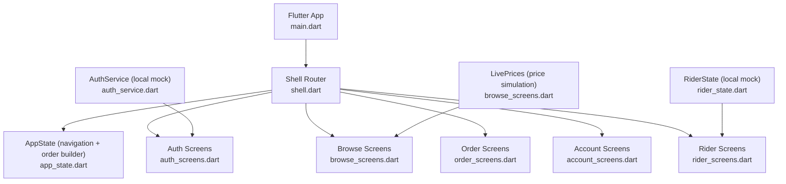
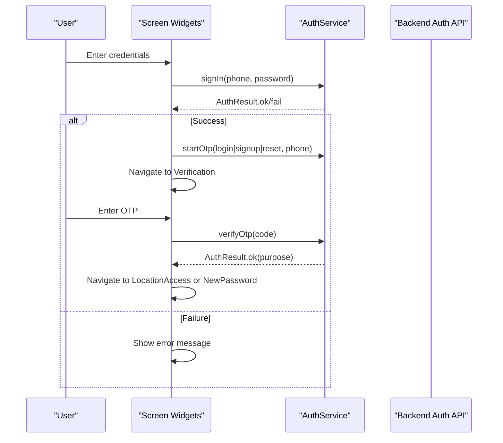
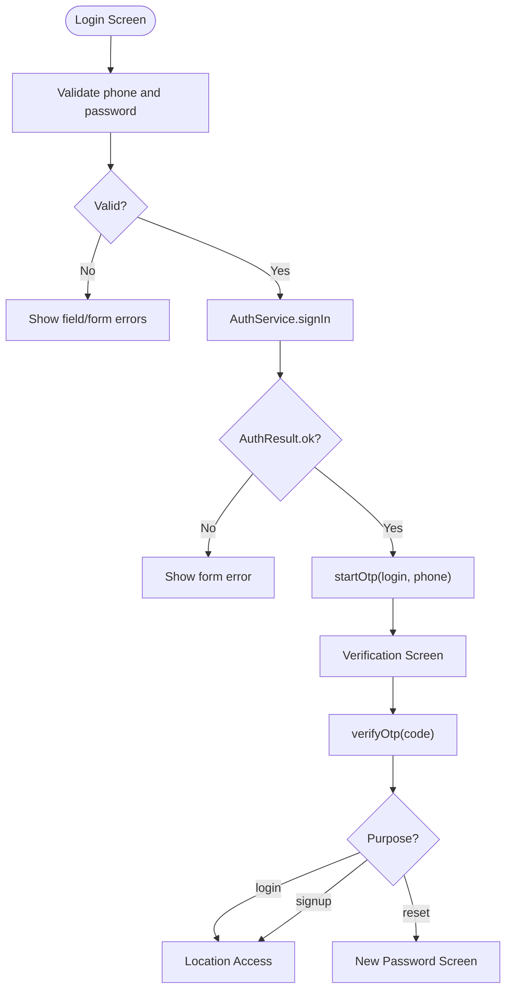
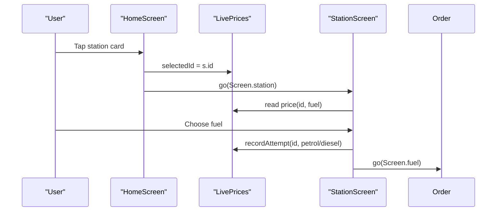
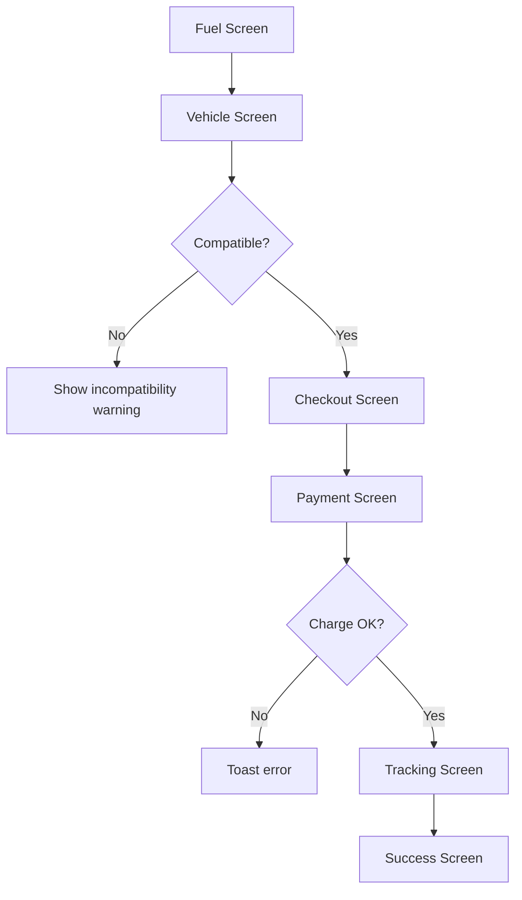
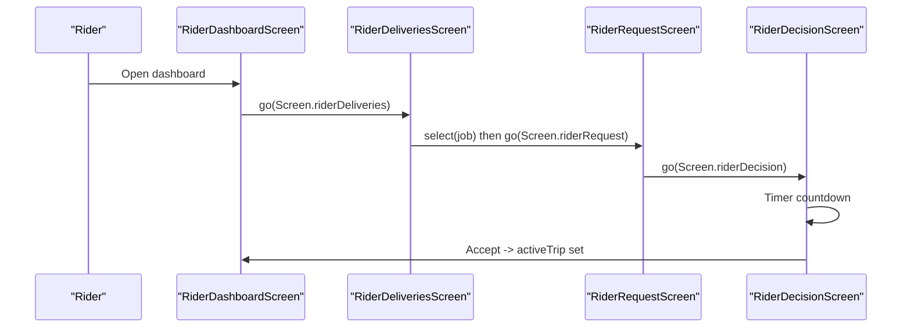
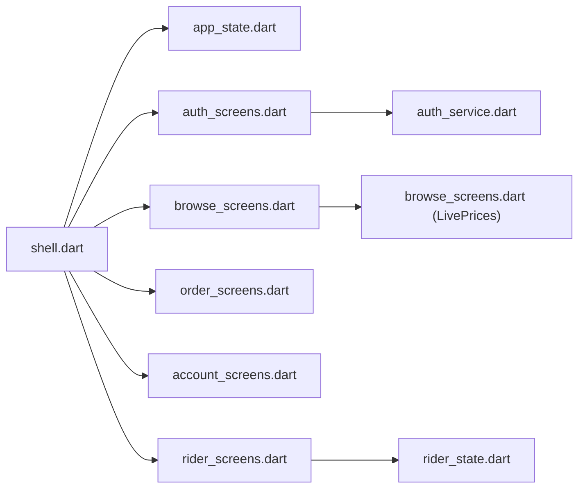

# User Screens & Workflows

<cite>
**Referenced Files in This Document**
- [main.dart](file://flutter_app/lib/main.dart)
- [shell.dart](file://flutter_app/lib/shell.dart)
- [app_state.dart](file://flutter_app/lib/core/app_state.dart)
- [data.dart](file://flutter_app/lib/core/data.dart)
- [auth_service.dart](file://flutter_app/lib/services/auth_service.dart)
- [rider_state.dart](file://flutter_app/lib/core/rider_state.dart)
- [auth_screens.dart](file://flutter_app/lib/screens/auth_screens.dart)
- [browse_screens.dart](file://flutter_app/lib/screens/browse_screens.dart)
- [order_screens.dart](file://flutter_app/lib/screens/order_screens.dart)
- [account_screens.dart](file://flutter_app/lib/screens/account_screens.dart)
- [rider_screens.dart](file://flutter_app/lib/screens/rider_screens.dart)
- [main.ts](file://backend/src/main.ts)
- [auth.controller.ts](file://backend/src/auth/auth.controller.ts)
</cite>

## Table of Contents
1. [Introduction](#introduction)
2. [Project Structure](#project-structure)
3. [Core Components](#core-components)
4. [Architecture Overview](#architecture-overview)
5. [Detailed Component Analysis](#detailed-component-analysis)
6. [Dependency Analysis](#dependency-analysis)
7. [Performance Considerations](#performance-considerations)
8. [Troubleshooting Guide](#troubleshooting-guide)
9. [Conclusion](#conclusion)
10. [Appendices](#appendices)

## Introduction
This document explains all user-facing screens and their workflows in the FuelConnect Flutter application, including authentication, order management, rider-specific flows, browsing experiences, and account management. It describes navigation patterns, data flow between screens, state synchronization, form validation, error handling, loading states, real-time updates, location services usage, platform adaptations, and how to implement new screens following established patterns.

The app currently uses local mock services for authentication, orders, wallet, rewards, and tracking. The backend exposes REST endpoints for auth, stations, orders, payments, wallets, riders, customers, tracking, notifications, reviews, support, and admin operations.

## Project Structure
The Flutter frontend is organized by feature:
- Core state and shared models live under `lib/core`.
- Screen implementations are grouped by domain under `lib/screens`.
- Services encapsulate cross-cutting concerns such as authentication.
- The shell hosts the active screen and a prototype menu that lists every screen.

**Diagram sources**
- [main.dart:7-57](file://flutter_app/lib/main.dart#L7-L57)
- [shell.dart:15-129](file://flutter_app/lib/shell.dart#L15-L129)
- [app_state.dart:69-198](file://flutter_app/lib/core/app_state.dart#L69-L198)
- [auth_service.dart:110-305](file://flutter_app/lib/services/auth_service.dart#L110-L305)
- [rider_state.dart:46-180](file://flutter_app/lib/core/rider_state.dart#L46-L180)
- [browse_screens.dart:549-726](file://flutter_app/lib/screens/browse_screens.dart#L549-L726)

**Section sources**
- [main.dart:7-57](file://flutter_app/lib/main.dart#L7-L57)
- [shell.dart:15-129](file://flutter_app/lib/shell.dart#L15-L129)

## Core Components
- Navigation and global state: `AppState` manages the current screen stack, theme, location flags, order builder values, payment methods, wallet balance, points, transactions, and notifications.
- Shared data models: `Station`, `Partner`, `Vehicle`, `Place`, `PayMethod`, `WalletTx`, `Notice`, `HistoryOrder`.
- Authentication service: Local mock with phone/email/password validation, OTP generation/verification, password reset, profile persistence via `SharedPreferences`, and demo accounts.
- Rider state: Local mock for rider jobs, earnings, availability, and trip lifecycle.
- Live prices: Simulated demand-driven price changes for partner stations, with decay over time and remote override hooks.

Key responsibilities:
- `AppState.go/back`: push, replace, or root navigation; back stack controls.
- `AppState.charge()`: validates wallet balance and records transaction.
- `AuthService.signIn/signUp/requestPasswordReset/startOtp/verifyOtp/resetPassword/updateProfile/signOut`.
- `RiderState.select/accept/reject/completeDelivery/refreshJobs/toggleOnline/signIn/signOut`.
- `LivePrices.recordAttempt/recordOrder/applyRemote/setBase`.

**Section sources**
- [app_state.dart:69-198](file://flutter_app/lib/core/app_state.dart#L69-L198)
- [data.dart:4-126](file://flutter_app/lib/core/data.dart#L4-L126)
- [auth_service.dart:51-305](file://flutter_app/lib/services/auth_service.dart#L51-L305)
- [rider_state.dart:4-180](file://flutter_app/lib/core/rider_state.dart#L4-L180)
- [browse_screens.dart:549-726](file://flutter_app/lib/screens/browse_screens.dart#L549-L726)

## Architecture Overview
The app follows a simple layered architecture:
- UI layer: Screen widgets render state from `AppState`, `AuthService`, `RiderState`, and `LivePrices`.
- State layer: ChangeNotifier-based stores hold user session, order builder, rider job state, and live price simulation.
- Service layer: `AuthService` abstracts authentication logic and persists accounts locally.
- Backend integration: Currently mocked on the client; backend provides REST endpoints documented via Swagger.

**Diagram sources**
- [auth_screens.dart:308-363](file://flutter_app/lib/screens/auth_screens.dart#L308-L363)
- [auth_service.dart:180-265](file://flutter_app/lib/services/auth_service.dart#L180-L265)
- [auth.controller.ts:47-116](file://backend/src/auth/auth.controller.ts#L47-L116)

## Detailed Component Analysis

### Authentication Flows
Screens: Splash, Onboarding, Login, Signup, Forgot Password, Verification (OTP), New Password, Location Access.

Flow highlights:
- Login validates phone and password, then starts an OTP challenge.
- Signup validates name, phone, email, password, and terms acceptance, then starts signup OTP.
- Forgot password validates phone, requests reset, and proceeds to OTP.
- OTP supports numeric or alphanumeric codes, paste/SMS autofill, expiry countdown, resend cooldown, and attempt limits.
- New Password enforces strength rules and confirmation match, then resets the stored hash.

Validation and UX:
- Phone normalization to E.164 Uganda format.
- Email regex check.
- Password strength meter and checklist.
- Loading indicators during async operations.
- Error messages surfaced inline or via toast/snackbar.

Navigation:
- After successful login/signup OTP, navigate to Location Access.
- After successful reset OTP, navigate to New Password.

**Diagram sources**
- [auth_screens.dart:308-363](file://flutter_app/lib/screens/auth_screens.dart#L308-L363)
- [auth_screens.dart:365-451](file://flutter_app/lib/screens/auth_screens.dart#L365-L451)
- [auth_screens.dart:453-519](file://flutter_app/lib/screens/auth_screens.dart#L453-L519)
- [auth_screens.dart:605-715](file://flutter_app/lib/screens/auth_screens.dart#L605-L715)
- [auth_service.dart:180-265](file://flutter_app/lib/services/auth_service.dart#L180-L265)

**Section sources**
- [auth_screens.dart:308-363](file://flutter_app/lib/screens/auth_screens.dart#L308-L363)
- [auth_screens.dart:365-451](file://flutter_app/lib/screens/auth_screens.dart#L365-L451)
- [auth_screens.dart:453-519](file://flutter_app/lib/screens/auth_screens.dart#L453-L519)
- [auth_screens.dart:605-715](file://flutter_app/lib/screens/auth_screens.dart#L605-L715)
- [auth_service.dart:51-117](file://flutter_app/lib/services/auth_service.dart#L51-L117)
- [auth_service.dart:180-265](file://flutter_app/lib/services/auth_service.dart#L180-L265)

### Browsing Experience
Screens: Home, Partner Stations, Station Detail.

Highlights:
- Home shows hero content, quick stats, search box, and station cards.
- Partner Stations supports search and filters (All, Nearest, Best price).
- Station Detail displays station info, live prices, activity feed, and “Choose fuel” action.
- Live prices simulate demand pressure and decay; base prices can be overridden remotely.

Data flow:
- `LivePrices.selectedId` determines which station is shown.
- Opening ordering increments demand via `recordAttempt`; confirming an order calls `recordOrder`.
- Remote price updates use `applyRemote`; admin can set base prices via `setBase`.

**Diagram sources**
- [browse_screens.dart:120-281](file://flutter_app/lib/screens/browse_screens.dart#L120-L281)
- [browse_screens.dart:283-368](file://flutter_app/lib/screens/browse_screens.dart#L283-L368)
- [browse_screens.dart:370-544](file://flutter_app/lib/screens/browse_screens.dart#L370-L544)
- [browse_screens.dart:549-726](file://flutter_app/lib/screens/browse_screens.dart#L549-L726)

**Section sources**
- [browse_screens.dart:120-281](file://flutter_app/lib/screens/browse_screens.dart#L120-L281)
- [browse_screens.dart:283-368](file://flutter_app/lib/screens/browse_screens.dart#L283-L368)
- [browse_screens.dart:370-544](file://flutter_app/lib/screens/browse_screens.dart#L370-L544)
- [browse_screens.dart:549-726](file://flutter_app/lib/screens/browse_screens.dart#L549-L726)

### Order Management Interfaces
Screens: Fuel Selection, Vehicle Selection, Delivery Details, Payment, Tracking, Completed, Orders List, Order Detail, Cancel Order.

Workflow:
- Step 1: Select fuel type and litres; compute estimated total.
- Step 2: Select vehicle; validate fuel compatibility.
- Step 3: Choose delivery address/time; add optional note.
- Step 4: Choose payment method; charge wallet if applicable; show summary.
- Tracking: Animated map, timeline, driver info, ETA, confirm delivery.
- Completed: Rating and receipt view.
- Orders list: Active/completed/cancelled tabs, search, deep link to tracking.
- Cancel order: Reason selection, fee calculation, cancellation flow.

State synchronization:
- `AppState.fuelType`, `litres`, `vehicleId`, `scheduled`, `scheduledAt`, `deliveryAddress`, `deliveryNote`, `payId`, `stationSaved`.
- Derived totals: `fuelTotal`, `orderTotal`, `productName`.
- Wallet charges update balance and insert transaction.

**Diagram sources**
- [order_screens.dart:17-122](file://flutter_app/lib/screens/order_screens.dart#L17-L122)
- [order_screens.dart:124-216](file://flutter_app/lib/screens/order_screens.dart#L124-L216)
- [order_screens.dart:218-361](file://flutter_app/lib/screens/order_screens.dart#L218-L361)
- [order_screens.dart:363-456](file://flutter_app/lib/screens/order_screens.dart#L363-L456)
- [order_screens.dart:458-657](file://flutter_app/lib/screens/order_screens.dart#L458-L657)
- [order_screens.dart:659-734](file://flutter_app/lib/screens/order_screens.dart#L659-L734)
- [order_screens.dart:736-800](file://flutter_app/lib/screens/order_screens.dart#L736-L800)
- [app_state.dart:121-184](file://flutter_app/lib/core/app_state.dart#L121-L184)

**Section sources**
- [order_screens.dart:17-122](file://flutter_app/lib/screens/order_screens.dart#L17-L122)
- [order_screens.dart:124-216](file://flutter_app/lib/screens/order_screens.dart#L124-L216)
- [order_screens.dart:218-361](file://flutter_app/lib/screens/order_screens.dart#L218-L361)
- [order_screens.dart:363-456](file://flutter_app/lib/screens/order_screens.dart#L363-L456)
- [order_screens.dart:458-657](file://flutter_app/lib/screens/order_screens.dart#L458-L657)
- [order_screens.dart:659-734](file://flutter_app/lib/screens/order_screens.dart#L659-L734)
- [order_screens.dart:736-800](file://flutter_app/lib/screens/order_screens.dart#L736-L800)
- [app_state.dart:121-184](file://flutter_app/lib/core/app_state.dart#L121-L184)

### Rider-Specific Screens
Screens: Registration, Login, Dashboard, Available Deliveries, Delivery Request, Accept/Reject Decision, Navigation, Pickup Confirmation, Delivery Confirmation, Earnings.

Highlights:
- Registration is a 3-step form with validation per step and document upload toggles.
- Dashboard shows greeting, stats, active trip banner, available jobs, and actions.
- Available deliveries supports sorting by nearest, highest pay, shortest trip.
- Delivery request shows route map, earnings panel, and detail block.
- Decision screen includes a countdown timer and reason selection for rejection.
- Earnings display weekly metrics and recent payouts.

State synchronization:
- `RiderState` holds signed-in status, online/offline toggle, selected job, active trip, jobs list, earnings, ratings, and withdrawal.

**Diagram sources**
- [rider_screens.dart:225-373](file://flutter_app/lib/screens/rider_screens.dart#L225-L373)
- [rider_screens.dart:375-483](file://flutter_app/lib/screens/rider_screens.dart#L375-L483)
- [rider_screens.dart:485-616](file://flutter_app/lib/screens/rider_screens.dart#L485-L616)
- [rider_screens.dart:618-701](file://flutter_app/lib/screens/rider_screens.dart#L618-L701)
- [rider_screens.dart:703-729](file://flutter_app/lib/screens/rider_screens.dart#L703-L729)
- [rider_screens.dart:731-800](file://flutter_app/lib/screens/rider_screens.dart#L731-L800)
- [rider_state.dart:4-180](file://flutter_app/lib/core/rider_state.dart#L4-L180)

**Section sources**
- [rider_screens.dart:225-373](file://flutter_app/lib/screens/rider_screens.dart#L225-L373)
- [rider_screens.dart:375-483](file://flutter_app/lib/screens/rider_screens.dart#L375-L483)
- [rider_screens.dart:485-616](file://flutter_app/lib/screens/rider_screens.dart#L485-L616)
- [rider_screens.dart:618-701](file://flutter_app/lib/screens/rider_screens.dart#L618-L701)
- [rider_screens.dart:703-729](file://flutter_app/lib/screens/rider_screens.dart#L703-L729)
- [rider_screens.dart:731-800](file://flutter_app/lib/screens/rider_screens.dart#L731-L800)
- [rider_state.dart:4-180](file://flutter_app/lib/core/rider_state.dart#L4-L180)

### Account Management Features
Screens: Orders, Order Detail, Wallet, Rewards, Notifications, Profile/Settings, Addresses, Vehicles, Support, Safety, Edit Profile, App Settings.

Highlights:
- Orders list supports tabs and search; active order links to tracking.
- Wallet shows balance, top-up sheet, payment methods, and transaction history.
- Rewards shows points progress, redeemable items, and rules.
- Notifications list marks items read and deep-links to tracking.
- Profile groups preferences, delivery settings, and account/security options; supports editing profile via sheet.

State synchronization:
- `AppState.walletBalance`, `points`, `txs`, `notices`, `pushOn`, `locationOn`, `themeMode`.
- `AuthService.profile` reflects current user details.

**Section sources**
- [account_screens.dart:11-172](file://flutter_app/lib/screens/account_screens.dart#L11-L172)
- [account_screens.dart:174-273](file://flutter_app/lib/screens/account_screens.dart#L174-L273)
- [account_screens.dart:275-368](file://flutter_app/lib/screens/account_screens.dart#L275-L368)
- [account_screens.dart:370-419](file://flutter_app/lib/screens/account_screens.dart#L370-L419)
- [account_screens.dart:421-512](file://flutter_app/lib/screens/account_screens.dart#L421-L512)
- [app_state.dart:163-198](file://flutter_app/lib/core/app_state.dart#L163-L198)
- [auth_service.dart:40-49](file://flutter_app/lib/services/auth_service.dart#L40-L49)

## Dependency Analysis
- Shell depends on `AppState.current` and routes to concrete screen widgets.
- Screens depend on `AppState` for order builder and UI state, `AuthService` for authentication, `RiderState` for rider flows, and `LivePrices` for station pricing.
- Backend endpoints are not wired yet; client mocks provide full UX.

**Diagram sources**
- [shell.dart:15-129](file://flutter_app/lib/shell.dart#L15-L129)
- [app_state.dart:69-198](file://flutter_app/lib/core/app_state.dart#L69-L198)
- [auth_service.dart:110-305](file://flutter_app/lib/services/auth_service.dart#L110-L305)
- [rider_state.dart:46-180](file://flutter_app/lib/core/rider_state.dart#L46-L180)
- [browse_screens.dart:549-726](file://flutter_app/lib/screens/browse_screens.dart#L549-L726)

**Section sources**
- [shell.dart:15-129](file://flutter_app/lib/shell.dart#L15-L129)
- [app_state.dart:69-198](file://flutter_app/lib/core/app_state.dart#L69-L198)
- [auth_service.dart:110-305](file://flutter_app/lib/services/auth_service.dart#L110-L305)
- [rider_state.dart:46-180](file://flutter_app/lib/core/rider_state.dart#L46-L180)
- [browse_screens.dart:549-726](file://flutter_app/lib/screens/browse_screens.dart#L549-L726)

## Performance Considerations
- Use `ListenableBuilder` sparingly; prefer targeted rebuilds around specific state objects (`AppState`, `RiderState`, `LivePrices`).
- Avoid heavy image decoding on main thread; pre-bundle assets and consider lazy loading where possible.
- Debounce search inputs in large lists; current lists are small but pattern applies when scaling.
- Keep animations short and avoid excessive repaints; use `AnimatedSwitcher` and `ValueKey` for smooth transitions.
- For real-time updates, batch UI updates and minimize layout thrashing.

[No sources needed since this section provides general guidance]

## Troubleshooting Guide
Common issues and resolutions:
- OTP expired or too many attempts: Resend code after cooldown; ensure correct device time and network connectivity.
- Wallet insufficient funds: Prompt user to top up or switch payment method; `AppState.charge()` returns descriptive error.
- Fuel incompatibility: Switch vehicle or fuel type; `VehicleScreen` blocks progression until compatible.
- Rider request expired: Decision screen navigates back automatically when timer reaches zero.
- Theme/location toggles not persisting: Ensure `AppState.toggleTheme` and related flags are updated; app rebuilds via `ListenableBuilder`.

Error handling patterns:
- Form-level errors displayed inline.
- Async failures handled with loading states and user-friendly messages.
- Demo mode shows OTP code via toast for testing.

**Section sources**
- [auth_service.dart:211-265](file://flutter_app/lib/services/auth_service.dart#L211-L265)
- [order_screens.dart:195-213](file://flutter_app/lib/screens/order_screens.dart#L195-L213)
- [order_screens.dart:384-395](file://flutter_app/lib/screens/order_screens.dart#L384-L395)
- [rider_screens.dart:731-800](file://flutter_app/lib/screens/rider_screens.dart#L731-L800)

## Conclusion
The FuelConnect Flutter app provides a complete set of user-facing screens with robust navigation, state synchronization, and realistic UX patterns. Authentication, order building, rider workflows, browsing, and account features are implemented with clear validation, error handling, and loading states. Real-time price simulation and location-related UI elements demonstrate readiness for backend integration. Extending the app involves adding new screens to the shell router, wiring them to existing state stores, and replacing mock services with API calls while preserving contracts.

[No sources needed since this section summarizes without analyzing specific files]

## Appendices

### Screen Navigation Patterns
- Centralized routing via `AppState.go` and `app.backOr`.
- Root navigation used for sign-in/sign-out and major flow resets.
- Replace navigation used for OTP success to prevent back-stack confusion.
- Prototype menu allows jumping to any screen for development and testing.

**Section sources**
- [app_state.dart:69-101](file://flutter_app/lib/core/app_state.dart#L69-L101)
- [shell.dart:15-129](file://flutter_app/lib/shell.dart#L15-L129)

### Data Flow Between Screens
- Order builder state is centralized in `AppState`; screens mutate fields directly.
- Wallet and points updates propagate through `AppState` listeners.
- Rider flows mutate `RiderState`; screens listen via `ListenableBuilder`.
- Live prices drive station cards and detail views; events recorded on ordering actions.

**Section sources**
- [app_state.dart:121-198](file://flutter_app/lib/core/app_state.dart#L121-L198)
- [rider_state.dart:129-176](file://flutter_app/lib/core/rider_state.dart#L129-L176)
- [browse_screens.dart:669-717](file://flutter_app/lib/screens/browse_screens.dart#L669-L717)

### Real-Time Updates Integration
- `LivePrices` simulates demand-driven price changes and decays over time.
- Hooks for server-pushed prices (`applyRemote`) and base overrides (`setBase`).
- Events log recent price movements and attempts.

**Section sources**
- [browse_screens.dart:620-726](file://flutter_app/lib/screens/browse_screens.dart#L620-L726)

### Location Services Usage
- Location flag and string maintained in `AppState`.
- Home screen opens a location sheet to update the current location.
- Settings allow toggling location services preference.

**Section sources**
- [app_state.dart:103-107](file://flutter_app/lib/core/app_state.dart#L103-L107)
- [browse_screens.dart:200-216](file://flutter_app/lib/screens/browse_screens.dart#L200-L216)
- [account_screens.dart:479-486](file://flutter_app/lib/screens/account_screens.dart#L479-L486)

### Platform-Specific UI Adaptations
- Edge-to-edge system UI configuration and safe-area awareness.
- System font scale clamped to maintain layout integrity.
- Responsive layouts below and above 760 px breakpoint.

**Section sources**
- [main.dart:7-57](file://flutter_app/lib/main.dart#L7-L57)
- [README.md:42-45](file://flutter_app/README.md#L42-L45)

### Implementing New Screens
Steps:
1. Define a new `Screen` enum value in `AppState`.
2. Add a `MenuEntry` for the prototype menu.
3. Map the screen in `Shell._screen`.
4. Create the screen widget using `AppPage` and `PageHeader`, consuming `go` for navigation.
5. Read/write shared state via `AppState`, `AuthService`, `RiderState`, or `LivePrices`.
6. Wire backend calls by replacing mock service methods with HTTP requests.

Example references:
- Adding a new screen entry and mapping: [shell.dart:18-103](file://flutter_app/lib/shell.dart#L18-L103), [app_state.dart:6-67](file://flutter_app/lib/core/app_state.dart#L6-L67).
- Using `AppPage` and `PageHeader`: [order_screens.dart:38-40](file://flutter_app/lib/screens/order_screens.dart#L38-L40), [account_screens.dart:127-130](file://flutter_app/lib/screens/account_screens.dart#L127-L130).
- Replacing mock with backend: [auth_service.dart:7-9](file://flutter_app/lib/services/auth_service.dart#L7-L9), [auth.controller.ts:47-116](file://backend/src/auth/auth.controller.ts#L47-L116).

**Section sources**
- [shell.dart:18-103](file://flutter_app/lib/shell.dart#L18-L103)
- [app_state.dart:6-67](file://flutter_app/lib/core/app_state.dart#L6-L67)
- [order_screens.dart:38-40](file://flutter_app/lib/screens/order_screens.dart#L38-L40)
- [account_screens.dart:127-130](file://flutter_app/lib/screens/account_screens.dart#L127-L130)
- [auth_service.dart:7-9](file://flutter_app/lib/services/auth_service.dart#L7-L9)
- [auth.controller.ts:47-116](file://backend/src/auth/auth.controller.ts#L47-L116)

### Backend Integration Notes
- Backend bootstrap sets global prefix, CORS, validation pipe, and Swagger docs.
- Auth controller exposes register, login, OTP request/verify, refresh, forgot/reset password, logout, profile, sessions, and change password endpoints.
- Frontend should call these endpoints while keeping current method signatures for easy migration.

**Section sources**
- [main.ts:12-103](file://backend/src/main.ts#L12-L103)
- [auth.controller.ts:47-166](file://backend/src/auth/auth.controller.ts#L47-L166)