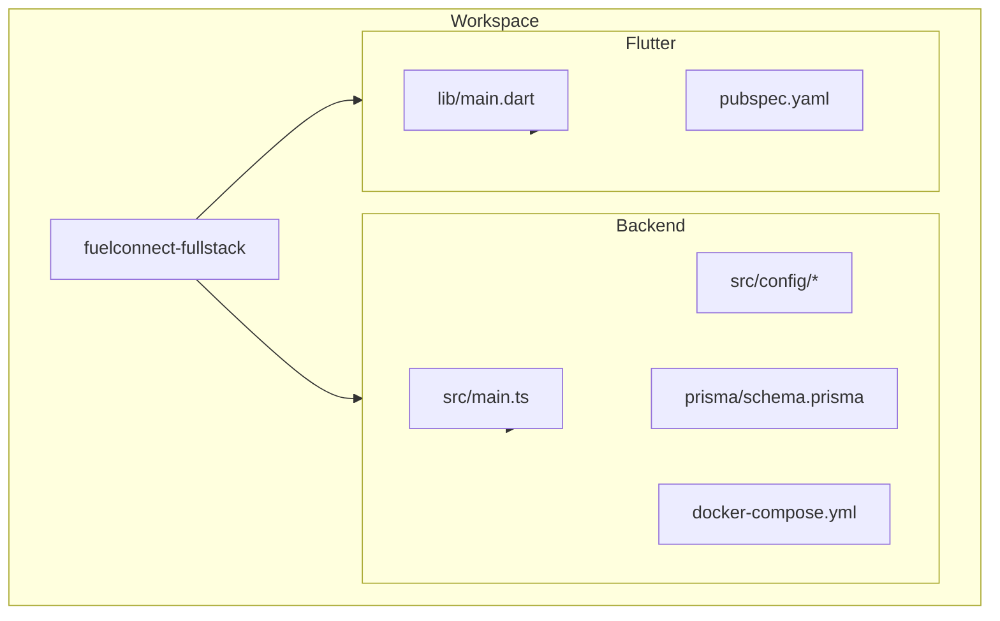
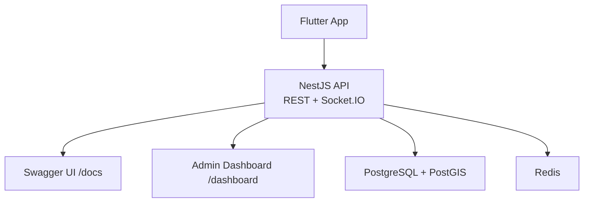

# Getting Started

<cite>
**Referenced Files in This Document**   
- [README.md](file://README.md)
- [backend/README.md](file://backend/README.md)
- [backend/package.json](file://backend/package.json)
- [backend/Dockerfile](file://backend/Dockerfile)
- [backend/docker-compose.yml](file://backend/docker-compose.yml)
- [backend/src/main.ts](file://backend/src/main.ts)
- [backend/src/config/configuration.ts](file://backend/src/config/configuration.ts)
- [backend/src/config/env.validation.ts](file://backend/src/config/env.validation.ts)
- [backend/prisma/schema.prisma](file://backend/prisma/schema.prisma)
- [flutter_app/README.md](file://flutter_app/README.md)
- [flutter_app/pubspec.yaml](file://flutter_app/pubspec.yaml)
- [flutter_app/lib/main.dart](file://flutter_app/lib/main.dart)
</cite>

## Table of Contents
1. [Introduction](#introduction)
2. [Project Structure](#project-structure)
3. [Prerequisites](#prerequisites)
4. [Quick Start](#quick-start)
5. [Backend Setup](#backend-setup)
6. [Frontend Setup](#frontend-setup)
7. [Environment Configuration](#environment-configuration)
8. [Database Initialization](#database-initialization)
9. [Running the Application](#running-the-application)
10. [Verification Steps](#verification-steps)
11. [Troubleshooting Guide](#troubleshooting-guide)
12. [Architecture Overview](#architecture-overview)
13. [Conclusion](#conclusion)

## Introduction
FuelConnect is a full-stack on-demand fuel delivery platform with:
- A NestJS backend providing REST APIs, Socket.IO real-time tracking, JWT authentication, wallet and payments, and an admin dashboard.
- A Flutter frontend prototype for customer and rider flows.

The repository contains both components under one workspace. The backend serves the API and the embedded admin dashboard; the Flutter app currently runs with mocked data but is ready to connect to the backend endpoint contract.

**Section sources**
- [README.md:1-18](file://README.md#L1-L18)

## Project Structure
At a high level:
- `backend/` — NestJS API, Prisma schema, Docker configuration, admin dashboard assets.
- `flutter_app/` — Flutter application source, dependencies, and platform folders.



**Diagram sources**
- [backend/src/main.ts:1-100](file://backend/src/main.ts#L1-L100)
- [backend/src/config/configuration.ts:1-97](file://backend/src/config/configuration.ts#L1-L97)
- [backend/prisma/schema.prisma:1-14](file://backend/prisma/schema.prisma#L1-L14)
- [backend/docker-compose.yml:1-54](file://backend/docker-compose.yml#L1-L54)
- [flutter_app/lib/main.dart:1-57](file://flutter_app/lib/main.dart#L1-L57)
- [flutter_app/pubspec.yaml:1-29](file://flutter_app/pubspec.yaml#L1-L29)

**Section sources**
- [README.md:1-18](file://README.md#L1-L18)

## Prerequisites
Ensure your machine has the following installed before proceeding:

- Node.js 20+ (the backend requires Node 20+)
- Dart SDK 3.4+ and Flutter 3.24+ (for the Flutter frontend)
- PostgreSQL 16 with PostGIS extension enabled (or use Docker Compose)
- Redis 7 (optional in development; required for multi-instance scaling and Socket.IO fan-out)
- Docker and Docker Compose (recommended for local services)

Notes:
- The backend uses TypeScript 5.7 and NestJS 11.
- The Flutter app targets Android/iOS/web and can be run via Chrome or emulators.

**Section sources**
- [backend/package.json:64-66](file://backend/package.json#L64-L66)
- [backend/README.md:7-15](file://backend/README.md#L7-L15)
- [flutter_app/pubspec.yaml:6-8](file://flutter_app/pubspec.yaml#L6-L8)
- [flutter_app/README.md:8-17](file://flutter_app/README.md#L8-L17)

## Quick Start
If you want to get the platform running quickly using Docker:

1. Navigate to the backend directory.
2. Copy the environment template and edit secrets.
3. Start Postgres and Redis containers.
4. Install dependencies, initialize the database, and start the API.

```powershell
cd backend
Copy-Item .env.example .env
# Edit .env: set JWT_SECRET and PAYMENT_WEBHOOK_SECRET
docker compose up -d db redis
npm install
npm run db:setup
npm run start:dev
```

After starting:
- API base: `http://localhost:8000/api/v1`
- Swagger UI: `http://localhost:8000/docs`
- Admin dashboard: `http://localhost:8000/dashboard`
- Health probe: `GET http://localhost:8000/api/v1/health`

For the Flutter frontend, run:

```bash
cd flutter_app
flutter pub get
flutter run -d chrome
```

**Section sources**
- [backend/README.md:50-90](file://backend/README.md#L50-L90)
- [flutter_app/README.md:8-17](file://flutter_app/README.md#L8-L17)

## Backend Setup
Choose either Docker-based setup or local services.

### With Docker (recommended)
- Use `docker-compose.yml` to run Postgres (PostGIS) and Redis.
- The API container reads `.env` and connects to the services by name.

Key files:
- `backend/Dockerfile` — builds and runs the NestJS API.
- `backend/docker-compose.yml` — defines `db`, `redis`, and `api` services.

**Section sources**
- [backend/Dockerfile:1-30](file://backend/Dockerfile#L1-L30)
- [backend/docker-compose.yml:1-54](file://backend/docker-compose.yml#L1-L54)

### Without Docker
You need a running PostgreSQL 16 instance with the PostGIS extension available, and optionally Redis.

Steps:
1. Create `.env` from the example file.
2. Install dependencies.
3. Push the Prisma schema to enable PostGIS and create tables.
4. Seed demo data.
5. Start the dev server.

Commands:
```powershell
cd backend
Copy-Item .env.example .env
npm install
npx prisma db push
npm run db:seed
npm run start:dev
```

**Section sources**
- [backend/README.md:63-79](file://backend/README.md#L63-L79)

## Frontend Setup
The Flutter frontend currently runs with mocked data. You can build it locally or run it in the browser.

Requirements:
- Flutter 3.24+ and Dart 3.4+.

Run steps:
```bash
cd flutter_app
flutter pub get
flutter run -d chrome
```

To build a static web site:
```bash
flutter build web
```

Android note:
- If you need the Safety screen to dial 999, add the appropriate `<queries>` block to `android/app/src/main/AndroidManifest.xml`.

Demo account:
- Phone: `+256 700 123 456`
- Password: `Fuel@2025`

**Section sources**
- [flutter_app/README.md:8-31](file://flutter_app/README.md#L8-L31)
- [flutter_app/pubspec.yaml:6-8](file://flutter_app/pubspec.yaml#L6-L8)

## Environment Configuration
Create a `.env` file in `backend/` based on the example template. At minimum, configure:

Required:
- `DATABASE_URL` — PostgreSQL connection string (must include PostGIS).
- `JWT_SECRET` — at least 32 characters.
- `PAYMENT_WEBHOOK_SECRET` — HMAC key for provider callbacks.

Recommended:
- `PORT` — default `8000`.
- `API_PREFIX` — default `api/v1`.
- `CORS_ORIGINS` — comma-separated allowed origins.
- `REDIS_URL` — optional; enables Socket.IO fan-out across instances.

Optional service credentials:
- MTN MoMo: `MTN_MOMO_API_KEY`, `MTN_MOMO_USER_ID`, `MTN_MOMO_SUBSCRIPTION_KEY`.
- Airtel Money: `AIRTEL_MONEY_CLIENT_ID`, `AIRTEL_MONEY_CLIENT_SECRET`, `AIRTEL_MONEY_MERCHANT_CODE`.

Behavioral toggles:
- `PAYMENTS_SANDBOX=true` — no external calls; simulate settlements.
- `OTP_DEV_MODE=true` — returns verification codes in logs/responses during development.

Configuration validation:
- All variables are validated at boot using Joi. Invalid values will prevent the process from starting.

**Section sources**
- [backend/README.md:158-189](file://backend/README.md#L158-L189)
- [backend/src/config/env.validation.ts:1-45](file://backend/src/config/env.validation.ts#L1-L45)
- [backend/src/config/configuration.ts:1-97](file://backend/src/config/configuration.ts#L1-L97)

## Database Initialization
The backend uses Prisma with PostgreSQL and PostGIS. Geography columns require the PostGIS extension.

Initialization options:
- Docker Compose: `docker compose up -d db redis`, then `npm run db:setup`.
- Local Postgres: `npx prisma db push` followed by `npm run db:seed`.

Seed data includes:
- Demo accounts for super admin, station manager, customer, and riders.
- Stations with fuel prices.
- Sample orders and related entities for dashboards.

Schema highlights:
- Uses `extensions = [postgis]` and geography columns for location data.
- Provides models for users, customers, riders, stations, orders, payments, wallets, tracking, notifications, support tickets, and audit logs.

**Section sources**
- [backend/README.md:63-79](file://backend/README.md#L63-L79)
- [backend/README.md:193-210](file://backend/README.md#L193-L210)
- [backend/prisma/schema.prisma:1-14](file://backend/prisma/schema.prisma#L1-L14)

## Running the Application
Start the backend in development mode:
```powershell
cd backend
npm run start:dev
```

Access points:
- API base: `http://localhost:8000/api/v1`
- Swagger UI: `http://localhost:8000/docs`
- Admin dashboard: `http://localhost:8000/dashboard`
- Health probe: `GET http://localhost:8000/api/v1/health`

Socket.IO namespace:
- `/tracking` for live order tracking and rider location streaming.

Flutter frontend:
```bash
cd flutter_app
flutter run -d chrome
```

Note: The Flutter app currently uses mocked data. Connect screens to the backend incrementally as needed.

**Section sources**
- [backend/README.md:81-103](file://backend/README.md#L81-L103)
- [backend/src/main.ts:85-92](file://backend/src/main.ts#L85-L92)
- [flutter_app/README.md:8-17](file://flutter_app/README.md#L8-L17)

## Verification Steps
Perform these checks to confirm everything is working:

1. Health check:
   - `GET http://localhost:8000/api/v1/health` should return a healthy status.

2. Swagger UI:
   - Open `http://localhost:8000/docs` and verify the API documentation loads.

3. Admin dashboard:
   - Visit `http://localhost:8000/dashboard` and sign in with a seeded staff account.

4. Authentication smoke test:
   - Login with a seeded customer account and retrieve profile info.

5. Orders flow (sandbox):
   - Place an order, initiate payment, and simulate success in sandbox mode.

6. Real-time tracking:
   - Subscribe to an order’s Socket.IO room and observe status/location events.

7. Flutter app:
   - Run the Flutter app and verify the UI renders correctly.

**Section sources**
- [backend/README.md:81-90](file://backend/README.md#L81-L90)
- [backend/README.md:677-699](file://backend/README.md#L677-L699)

## Troubleshooting Guide
Common issues and resolutions:

- PostGIS extension errors when pushing schema:
  - Ensure your PostgreSQL instance has the PostGIS extension enabled.
  - Use `npx prisma db push` as documented for this schema.

- CORS errors from the Flutter app:
  - Set `CORS_ORIGINS` to include your client origin(s).
  - In development, if empty, the API allows all origins with a warning in production.

- Socket.IO not connecting:
  - Verify `REDIS_URL` is configured when running multiple API instances.
  - Confirm the namespace `/tracking` and token-based auth are used.

- Payment webhooks failing signature verification:
  - Ensure `PAYMENT_WEBHOOK_SECRET` matches the provider’s expected secret.
  - Send the exact raw body and compute HMAC-SHA256 over it.

- Flutter app cannot reach the backend:
  - On Android emulator, use `http://10.0.2.2:8000/api/v1`.
  - On iOS simulator or desktop, use `http://localhost:8000/api/v1`.

- Missing environment variables:
  - Validate `.env` against the Joi schema; invalid values prevent startup.

**Section sources**
- [backend/README.md:63-79](file://backend/README.md#L63-L79)
- [backend/src/main.ts:24-33](file://backend/src/main.ts#L24-L33)
- [backend/README.md:373-405](file://backend/README.md#L373-L405)
- [backend/README.md:536-590](file://backend/README.md#L536-L590)
- [backend/src/config/env.validation.ts:1-45](file://backend/src/config/env.validation.ts#L1-L45)

## Architecture Overview
The system consists of:
- Flutter frontend calling the NestJS API.
- NestJS API serving REST endpoints, Swagger docs, and an embedded admin dashboard.
- PostgreSQL with PostGIS for persistent data and geospatial queries.
- Redis for caching and Socket.IO adapter (multi-instance support).



**Diagram sources**
- [backend/src/main.ts:35-92](file://backend/src/main.ts#L35-L92)
- [backend/docker-compose.yml:1-54](file://backend/docker-compose.yml#L1-L54)

## Conclusion
You now have the prerequisites, installation steps, environment configuration, database initialization, and verification procedures to run FuelConnect locally. Start with Docker Compose for the fastest setup, then integrate the Flutter app screen-by-screen with the backend contract. Use the health endpoint, Swagger UI, and admin dashboard to validate your environment and explore the API surface.