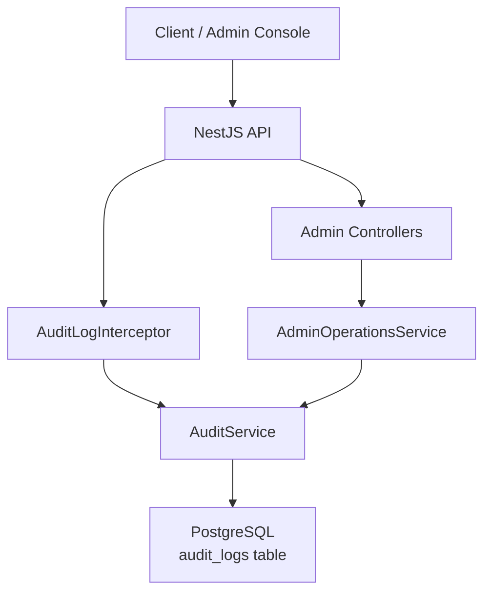
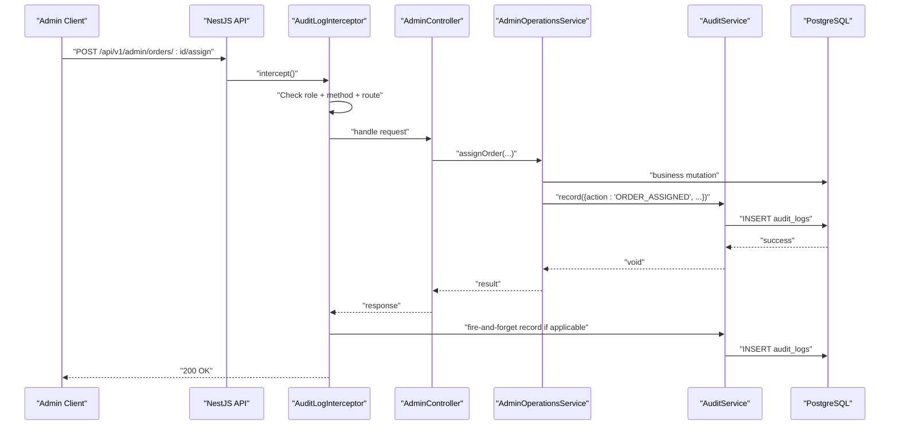
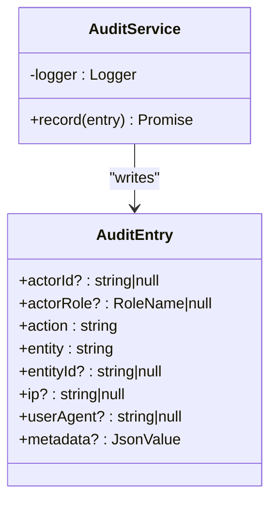
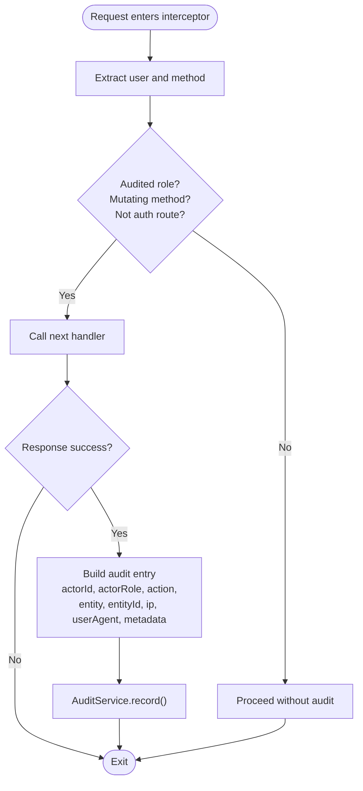
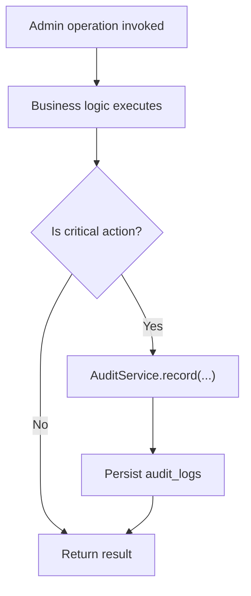
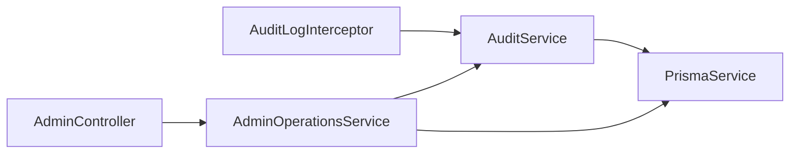

# Audit Logging & Compliance

<cite>
**Referenced Files in This Document**   
- [audit.service.ts](file://backend/src/audit/audit.service.ts)
- [audit-log.interceptor.ts](file://backend/src/common/interceptors/audit-log.interceptor.ts)
- [schema.prisma](file://backend/prisma/schema.prisma)
- [admin-operations.service.ts](file://backend/src/admin/admin-operations.service.ts)
- [admin.controller.ts](file://backend/src/admin/admin.controller.ts)
- [admin.dto.ts](file://backend/src/admin/dto/admin.dto.ts)
- [auth.service.ts](file://backend/src/auth/auth.service.ts)
- [password.service.ts](file://backend/src/common/security/password.service.ts)
- [main.ts](file://backend/src/main.ts)
</cite>

## Table of Contents
1. [Introduction](#introduction)
2. [Project Structure](#project-structure)
3. [Core Components](#core-components)
4. [Architecture Overview](#architecture-overview)
5. [Detailed Component Analysis](#detailed-component-analysis)
6. [Dependency Analysis](#dependency-analysis)
7. [Performance Considerations](#performance-considerations)
8. [Troubleshooting Guide](#troubleshooting-guide)
9. [Conclusion](#conclusion)
10. [Appendices](#appendices)

## Introduction
This document provides comprehensive audit logging and compliance documentation for the FuelConnect platform. It explains how audit trails are implemented, what events are captured, how data is stored, and how the system supports compliance requirements such as GDPR, SOC 2, and ISO 27001. It also covers PII handling, log format standards, query patterns for compliance reporting, retention considerations, security measures, and guidance for forensic investigations and compliance auditing workflows.

## Project Structure
The audit capability is implemented primarily in the backend:
- Audit service and module provide a centralized, Prisma-backed audit trail.
- An interceptor automatically records administrative mutations for audited roles.
- Admin operations explicitly record business-critical actions.
- The database schema defines the `AuditLog` model with indexes for efficient querying.
- Admin endpoints expose paginated audit log queries for compliance review.

**Diagram sources**
- [audit-log.interceptor.ts:25-63](file://backend/src/common/interceptors/audit-log.interceptor.ts#L25-L63)
- [admin.controller.ts:204-209](file://backend/src/admin/admin.controller.ts#L204-L209)
- [admin-operations.service.ts:319-347](file://backend/src/admin/admin-operations.service.ts#L319-L347)
- [audit.service.ts:27-45](file://backend/src/audit/audit.service.ts#L27-L45)
- [schema.prisma:713-730](file://backend/prisma/schema.prisma#L713-L730)

**Section sources**
- [audit.service.ts:1-47](file://backend/src/audit/audit.service.ts#L1-L47)
- [audit-log.interceptor.ts:1-64](file://backend/src/common/interceptors/audit-log.interceptor.ts#L1-L64)
- [schema.prisma:713-730](file://backend/prisma/schema.prisma#L713-L730)
- [admin.controller.ts:204-209](file://backend/src/admin/admin.controller.ts#L204-L209)
- [admin-operations.service.ts:319-347](file://backend/src/admin/admin-operations.service.ts#L319-L347)

## Core Components
- AuditService: Centralized service that writes audit entries to the database using Prisma. It ensures failures do not break the originating request.
- AuditLogInterceptor: NestJS interceptor that captures successful administrative mutations for specific roles and HTTP methods, excluding authentication routes.
- AdminOperationsService: Business logic layer that explicitly records important admin actions (order assignment/refund/status changes, station management, withdrawal processing).
- AdminController: Exposes an endpoint to list audit logs with filtering and pagination.
- AuditLog Model: Database model storing actor, action, entity, entity ID, IP, user agent, metadata, and timestamp.

Key responsibilities:
- Capture who did what, when, from where, and on which entity.
- Provide secure, filtered access to audit logs for compliance and support.
- Ensure audit recording is resilient and non-blocking.

**Section sources**
- [audit.service.ts:10-45](file://backend/src/audit/audit.service.ts#L10-L45)
- [audit-log.interceptor.ts:12-63](file://backend/src/common/interceptors/audit-log.interceptor.ts#L12-L63)
- [admin-operations.service.ts:63-110](file://backend/src/admin/admin-operations.service.ts#L63-L110)
- [admin-operations.service.ts:289-317](file://backend/src/admin/admin-operations.service.ts#L289-L317)
- [admin-operations.service.ts:319-347](file://backend/src/admin/admin-operations.service.ts#L319-L347)
- [admin.controller.ts:204-209](file://backend/src/admin/admin.controller.ts#L204-L209)
- [schema.prisma:713-730](file://backend/prisma/schema.prisma#L713-L730)

## Architecture Overview
The audit architecture combines automatic interception with explicit service-level logging:

**Diagram sources**
- [audit-log.interceptor.ts:28-63](file://backend/src/common/interceptors/audit-log.interceptor.ts#L28-L63)
- [admin.controller.ts:107-116](file://backend/src/admin/admin.controller.ts#L107-L116)
- [admin-operations.service.ts:63-76](file://backend/src/admin/admin-operations.service.ts#L63-L76)
- [audit.service.ts:27-45](file://backend/src/audit/audit.service.ts#L27-L45)
- [schema.prisma:713-730](file://backend/prisma/schema.prisma#L713-L730)

## Detailed Component Analysis

### AuditService
Purpose:
- Provides a robust, fire-and-forget mechanism to persist audit entries.
- Normalizes optional fields and uses JSON nulls for empty metadata.
- Logs write failures without failing the caller.

Data captured:
- Actor identity and role.
- Action name and target entity.
- Entity identifier.
- Request context: IP address and user agent.
- Metadata payload for additional context.

Error handling:
- Catches exceptions during persistence and logs warnings.
- Ensures audit failures never impact business responses.

Complexity:
- O(1) per write; database cost depends on index usage and storage engine.

Optimization opportunities:
- Batched writes or async queueing could reduce latency spikes under high load.
- Partitioning by time ranges can improve long-term performance.

**Diagram sources**
- [audit.service.ts:10-45](file://backend/src/audit/audit.service.ts#L10-L45)

**Section sources**
- [audit.service.ts:1-47](file://backend/src/audit/audit.service.ts#L1-L47)

### AuditLogInterceptor
Purpose:
- Automatically records successful administrative mutations for audited roles.
- Filters out authentication-related routes to avoid noisy logs.
- Captures HTTP method, controller/handler names, path, IP, and user agent.

Auditing rules:
- Roles: ADMIN, SUPER_ADMIN, STATION_MANAGER.
- Methods: POST, PUT, PATCH, DELETE.
- Excludes URLs containing `/auth/`.

Behavior:
- Uses RxJS tap to perform fire-and-forget audit recording after successful response.
- Extracts entityId from route parameters when present.

**Diagram sources**
- [audit-log.interceptor.ts:12-63](file://backend/src/common/interceptors/audit-log.interceptor.ts#L12-L63)

**Section sources**
- [audit-log.interceptor.ts:1-64](file://backend/src/common/interceptors/audit-log.interceptor.ts#L1-L64)

### AdminOperationsService Audit Points
Explicitly audited actions include:
- Order assignment: records rider assignment details.
- Order refund: records amount and reason.
- Order status change: records new status and optional note.
- Station creation/update: records changed fields.
- Withdrawal processing: records approval/rejection/paid transitions.

Query interface:
- Paginated listing of audit logs with filters for actor, entity, action substring, and date range.
- Includes actor details (id, fullName, role).

**Diagram sources**
- [admin-operations.service.ts:63-110](file://backend/src/admin/admin-operations.service.ts#L63-L110)
- [admin-operations.service.ts:289-317](file://backend/src/admin/admin-operations.service.ts#L289-L317)
- [admin-operations.service.ts:319-347](file://backend/src/admin/admin-operations.service.ts#L319-L347)

**Section sources**
- [admin-operations.service.ts:63-110](file://backend/src/admin/admin-operations.service.ts#L63-L110)
- [admin-operations.service.ts:289-317](file://backend/src/admin/admin-operations.service.ts#L289-L317)
- [admin-operations.service.ts:319-347](file://backend/src/admin/admin-operations.service.ts#L319-L347)

### AdminController Audit Endpoint
Exposes:
- GET /admin/audit-logs with query parameters for actorId, entity, action, from, to, plus pagination.

Security:
- Protected by bearer token and role guards for ADMIN/SUPER_ADMIN.

**Section sources**
- [admin.controller.ts:204-209](file://backend/src/admin/admin.controller.ts#L204-L209)
- [admin.controller.ts:36-39](file://backend/src/admin/admin.controller.ts#L36-L39)

### Database Schema: AuditLog Model
Fields:
- id: UUID primary key.
- actorId: Optional foreign key reference to User.
- actorRole: Enum capturing role at time of action.
- action: String describing the action.
- entity: String identifying the affected domain entity.
- entityId: Optional identifier of the specific instance.
- ip: Optional client IP.
- userAgent: Optional client user agent.
- metadata: Optional JSON payload.
- createdAt: Timestamp.

Indexes:
- createdAt for time-based queries.
- actorId for actor-centric queries.

Relationships:
- Optional relation to User via actorId.

**Section sources**
- [schema.prisma:713-730](file://backend/prisma/schema.prisma#L713-L730)

## Dependency Analysis
The audit subsystem has clear boundaries:
- Interceptor depends on AuditService and AuthUser type.
- AdminOperationsService depends on AuditService for explicit logging.
- AuditService depends on PrismaService and Prisma types.
- AdminController exposes audit log queries backed by AdminOperationsService.

**Diagram sources**
- [audit-log.interceptor.ts:1-10](file://backend/src/common/interceptors/audit-log.interceptor.ts#L1-L10)
- [admin-operations.service.ts:1-25](file://backend/src/admin/admin-operations.service.ts#L1-L25)
- [admin.controller.ts:1-24](file://backend/src/admin/admin.controller.ts#L1-L24)
- [audit.service.ts:1-5](file://backend/src/audit/audit.service.ts#L1-L5)

**Section sources**
- [audit-log.interceptor.ts:1-64](file://backend/src/common/interceptors/audit-log.interceptor.ts#L1-L64)
- [admin-operations.service.ts:1-52](file://backend/src/admin/admin-operations.service.ts#L1-L52)
- [admin.controller.ts:1-44](file://backend/src/admin/admin.controller.ts#L1-L44)
- [audit.service.ts:1-25](file://backend/src/audit/audit.service.ts#L1-L25)

## Performance Considerations
- Fire-and-forget design: Audit writes are isolated from request flow to minimize latency impact.
- Indexes on createdAt and actorId support common compliance queries.
- Potential improvements:
  - Asynchronous batching or message queue for high-throughput environments.
  - Time-based partitioning of audit_logs for large datasets.
  - Read replicas for audit analytics to avoid impacting transactional workloads.

[No sources needed since this section provides general guidance]

## Troubleshooting Guide
Common issues and resolutions:
- Missing audit entries:
  - Verify the request method is mutating and the user role is audited.
  - Confirm the URL does not match excluded auth routes.
  - Check application logs for audit write warnings.
- Slow audit log queries:
  - Use provided filters (actorId, entity, action, date range).
  - Ensure proper pagination parameters.
  - Validate database indexes exist for createdAt and actorId.

Operational checks:
- Inspect AuditService logger warnings for persistence errors.
- Validate Prisma connection and permissions for audit_logs table.

**Section sources**
- [audit-log.interceptor.ts:40-59](file://backend/src/common/interceptors/audit-log.interceptor.ts#L40-L59)
- [audit.service.ts:41-44](file://backend/src/audit/audit.service.ts#L41-L44)
- [schema.prisma:727-729](file://backend/prisma/schema.prisma#L727-L729)

## Conclusion
FuelConnect’s audit logging system provides a robust foundation for compliance and operational visibility. Automatic interception captures administrative mutations, while explicit service-level logging ensures critical business actions are recorded. The database schema and query interfaces support efficient compliance reporting. Security controls such as role-based access, hardened password hashing, and resilient audit writes contribute to a strong compliance posture.

[No sources needed since this section summarizes without analyzing specific files]

## Appendices

### Audit Trail Events and Data Captured
Events logged include:
- ORDER_ASSIGNED, ORDER_REFUNDED, ORDER_STATUS_CHANGED.
- STATION_CREATED, STATION_UPDATED.
- WITHDRAWAL_APPROVED, WITHDRAWAL_REJECTED, WITHDRAWAL_PAID.
- Administrative mutations captured by the interceptor for audited roles.

Data captured per entry:
- Actor identity and role.
- Action and entity identifiers.
- Request context: IP and user agent.
- Metadata payload for contextual details.

**Section sources**
- [admin-operations.service.ts:63-110](file://backend/src/admin/admin-operations.service.ts#L63-L110)
- [admin-operations.service.ts:289-317](file://backend/src/admin/admin-operations.service.ts#L289-L317)
- [admin-operations.service.ts:202-209](file://backend/src/admin/admin-operations.service.ts#L202-L209)
- [audit-log.interceptor.ts:46-59](file://backend/src/common/interceptors/audit-log.interceptor.ts#L46-L59)
- [schema.prisma:713-730](file://backend/prisma/schema.prisma#L713-L730)

### Log Format Standards
Standard audit entry structure:
- actorId: string | null
- actorRole: enum | null
- action: string
- entity: string
- entityId: string | null
- ip: string | null
- userAgent: string | null
- metadata: JSON object
- createdAt: timestamp

Guidelines:
- Keep metadata minimal and structured.
- Avoid including sensitive PII in metadata unless necessary and protected.
- Use consistent action naming conventions (e.g., UPPER_SNAKE_CASE).

**Section sources**
- [audit.service.ts:10-19](file://backend/src/audit/audit.service.ts#L10-L19)
- [schema.prisma:713-730](file://backend/prisma/schema.prisma#L713-L730)

### PII Handling Procedures
PII protection measures:
- Passwords are hashed using Argon2id with OWASP-recommended parameters.
- Audit entries capture actor identifiers and roles but do not store passwords or secrets.
- Sensitive fields should be avoided in metadata; use references instead.

Recommendations:
- Mask or hash any PII included in metadata.
- Restrict access to audit logs to authorized roles.
- Apply encryption at rest and in transit for audit data.

**Section sources**
- [password.service.ts:1-25](file://backend/src/common/security/password.service.ts#L1-L25)
- [audit.service.ts:10-45](file://backend/src/audit/audit.service.ts#L10-L45)

### GDPR Compliance Features
GDPR-relevant aspects:
- Data minimization: Audit entries capture only necessary context.
- Access control: Audit logs are restricted to authorized roles.
- Integrity and confidentiality: Secure hashing and resilient logging ensure data integrity.
- Right to erasure: No built-in deletion routine exists for audit_logs; implement retention policies externally.

Anonymization techniques:
- Replace direct identifiers in reports with pseudonyms.
- Hash or truncate IPs and user agents in exported reports.
- Avoid storing raw PII in metadata.

**Section sources**
- [audit.service.ts:27-45](file://backend/src/audit/audit.service.ts#L27-L45)
- [schema.prisma:713-730](file://backend/prisma/schema.prisma#L713-L730)

### Audit Log Security Measures
- Role-based access: Only ADMIN/SUPER_ADMIN can access audit endpoints.
- Helmet middleware applied at bootstrap for baseline security headers.
- Fire-and-forget audit writes prevent denial-of-service via logging failures.

**Section sources**
- [admin.controller.ts:36-39](file://backend/src/admin/admin.controller.ts#L36-L39)
- [main.ts:25-34](file://backend/src/main.ts#L25-L34)
- [audit.service.ts:41-44](file://backend/src/audit/audit.service.ts#L41-L44)

### Compliance Frameworks Supported
- SOC 2: Supports availability, confidentiality, integrity through secure logging, access controls, and error resilience.
- ISO 27001: Aligns with information security management practices via controlled access, secure hashing, and auditability.

Note: These are architectural alignments; formal certification requires organizational processes and external audits.

[No sources needed since this section provides general guidance]

### Audit Report Generation
Report generation approach:
- Use the admin audit logs endpoint with filters for actor, entity, action, and date range.
- Export paginated results for analysis.
- Include actor details (id, fullName, role) for traceability.

Query patterns:
- Filter by actorId to investigate a specific operator.
- Filter by entity and action to track changes to specific resources.
- Use from/to dates to scope reports to regulatory periods.

**Section sources**
- [admin.controller.ts:204-209](file://backend/src/admin/admin.controller.ts#L204-L209)
- [admin-operations.service.ts:319-347](file://backend/src/admin/admin-operations.service.ts#L319-L347)
- [admin.dto.ts:112-139](file://backend/src/admin/dto/admin.dto.ts#L112-L139)

### Data Retention Policies
Current state:
- No built-in deletion routine for audit_logs.
- Tracking history retention exists for rider locations; similar patterns can be adapted for audit logs.

Recommended policy:
- Define retention periods aligned with legal and regulatory requirements.
- Implement scheduled jobs to archive or anonymize old audit entries.
- Ensure retention settings are configurable and auditable.

**Section sources**
- [common/services/geo-location.service.ts:133-139](file://backend/src/common/services/geo-location.service.ts#L133-L139)
- [config/configuration.ts:36-94](file://backend/src/config/configuration.ts#L36-L94)

### Forensic Investigation Procedures
Steps:
- Identify the incident timeframe and actors involved.
- Query audit logs using actorId, entity, action, and date filters.
- Correlate audit entries with business events (orders, payments, withdrawals).
- Preserve evidence by exporting relevant audit entries securely.

Tools:
- Admin audit logs endpoint for interactive investigation.
- Database queries for deep-dive analysis when needed.

**Section sources**
- [admin-operations.service.ts:319-347](file://backend/src/admin/admin-operations.service.ts#L319-L347)
- [admin.controller.ts:204-209](file://backend/src/admin/admin.controller.ts#L204-L209)

### Compliance Auditing Workflows
Workflow:
- Schedule periodic reviews of audit logs for anomalies.
- Validate that all critical admin actions are recorded.
- Verify access controls and encryption measures.
- Generate compliance reports and retain them per policy.

Best practices:
- Automate anomaly detection based on action patterns.
- Enforce least privilege for audit log access.
- Maintain change logs for audit system modifications.

[No sources needed since this section provides general guidance]