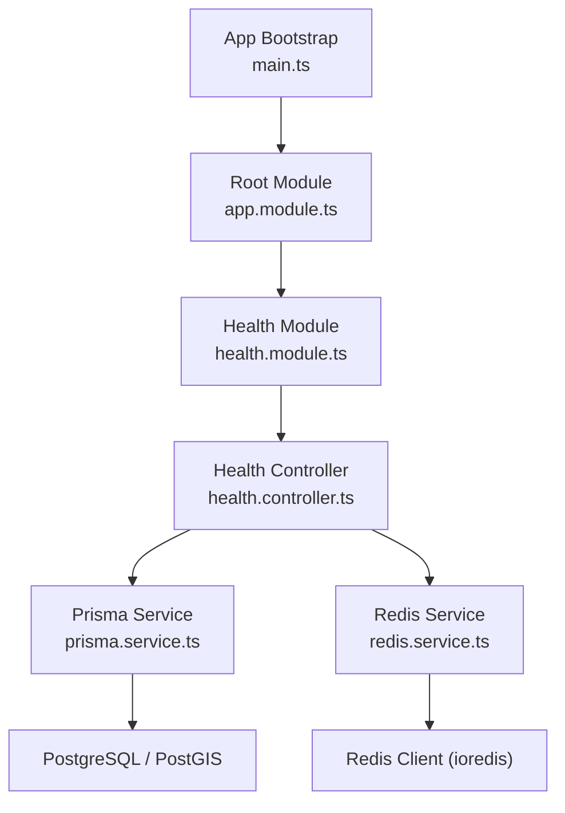
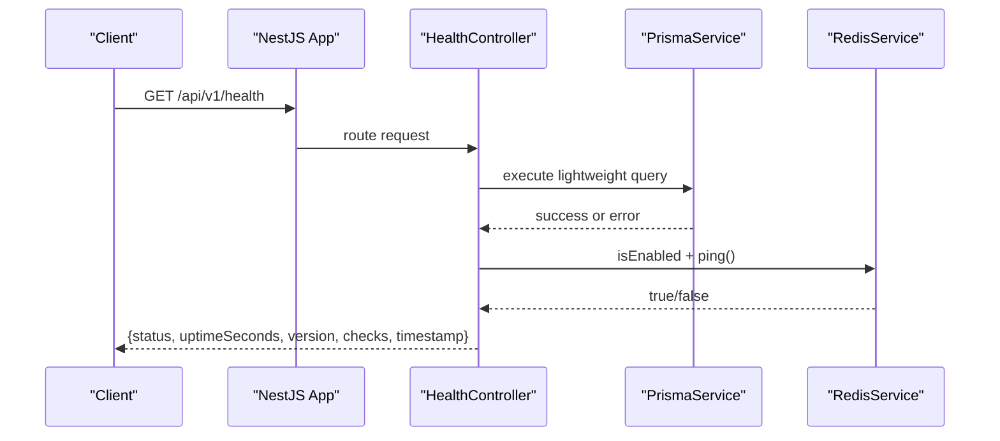
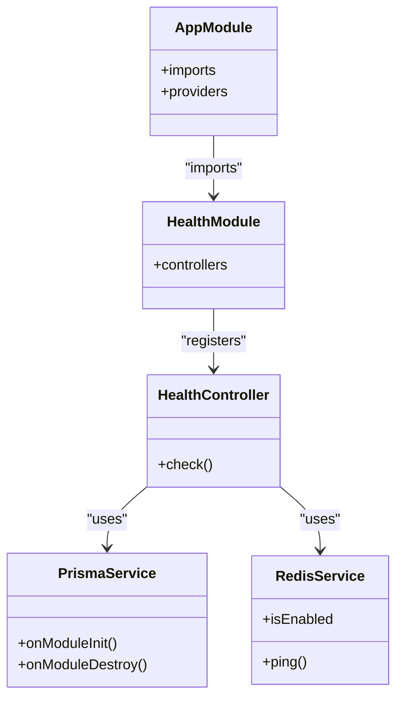

# Health Monitoring & System Status

<cite>
**Referenced Files in This Document**
- [health.controller.ts](file://backend/src/health/health.controller.ts)
- [health.module.ts](file://backend/src/health/health.module.ts)
- [app.module.ts](file://backend/src/app.module.ts)
- [main.ts](file://backend/src/main.ts)
- [prisma.service.ts](file://backend/src/prisma/prisma.service.ts)
- [redis.service.ts](file://backend/src/redis/redis.service.ts)
- [configuration.ts](file://backend/src/config/configuration.ts)
- [docker-compose.yml](file://backend/docker-compose.yml)
- [Dockerfile](file://backend/Dockerfile)
- [package.json](file://backend/package.json)
</cite>

## Table of Contents
1. [Introduction](#introduction)
2. [Project Structure](#project-structure)
3. [Core Components](#core-components)
4. [Architecture Overview](#architecture-overview)
5. [Detailed Component Analysis](#detailed-component-analysis)
6. [Dependency Analysis](#dependency-analysis)
7. [Performance Considerations](#performance-considerations)
8. [Troubleshooting Guide](#troubleshooting-guide)
9. [Conclusion](#conclusion)
10. [Appendices](#appendices)

## Introduction
This document explains the FuelConnect health monitoring system, focusing on the health check endpoint, its response format, and how to extend it for database connections, Redis cache, and external services. It also provides guidance for integrating with external monitoring tools, setting up dashboards and alerting, configuring load balancer checks, container probes, and Kubernetes readiness/liveness probes. Finally, it includes troubleshooting steps and performance considerations for health checks.

## Project Structure
The health monitoring feature is implemented as a small NestJS module exposing a public GET endpoint under the API prefix. The application registers global guards, throttling, Swagger documentation, and static assets during bootstrap.

**Diagram sources**
- [main.ts:12-103](file://backend/src/main.ts#L12-L103)
- [app.module.ts:29-69](file://backend/src/app.module.ts#L29-L69)
- [health.module.ts:1-8](file://backend/src/health/health.module.ts#L1-L8)
- [health.controller.ts:1-42](file://backend/src/health/health.controller.ts#L1-L42)
- [prisma.service.ts:1-34](file://backend/src/prisma/prisma.service.ts#L1-L34)
- [redis.service.ts:1-133](file://backend/src/redis/redis.service.ts#L1-L133)

**Section sources**
- [main.ts:12-103](file://backend/src/main.ts#L12-L103)
- [app.module.ts:29-69](file://backend/src/app.module.ts#L29-L69)

## Core Components
- HealthController exposes a public GET endpoint that performs liveness and dependency checks against PostgreSQL via Prisma and Redis via ioredis.
- PrismaService manages the database connection lifecycle and logs warnings/errors from Prisma.
- RedisService optionally connects to Redis; if unavailable, it falls back to an in-process map for single-instance development. It exposes isEnabled and ping() used by the health check.
- Configuration is centralized and environment-driven, including redisUrl and other runtime settings.

Key responsibilities:
- HealthController: aggregate health status, uptime, version, timestamp, and per-check results.
- PrismaService: connect/disconnect and surface DB connectivity through a simple query.
- RedisService: provide Redis availability and fallback behavior.

**Section sources**
- [health.controller.ts:1-42](file://backend/src/health/health.controller.ts#L1-L42)
- [prisma.service.ts:1-34](file://backend/src/prisma/prisma.service.ts#L1-L34)
- [redis.service.ts:1-133](file://backend/src/redis/redis.service.ts#L1-L133)
- [configuration.ts:1-97](file://backend/src/config/configuration.ts#L1-L97)

## Architecture Overview
The health endpoint is part of the API surface behind the configured API prefix. It is marked public so it bypasses authentication guards. The endpoint returns a JSON payload describing overall status and individual component statuses.

**Diagram sources**
- [health.controller.ts:15-40](file://backend/src/health/health.controller.ts#L15-L40)
- [prisma.service.ts:19-22](file://backend/src/prisma/prisma.service.ts#L19-L22)
- [redis.service.ts:60-67](file://backend/src/redis/redis.service.ts#L60-L67)
- [redis.service.ts:124-131](file://backend/src/redis/redis.service.ts#L124-L131)

## Detailed Component Analysis

### Health Check Endpoint
- Route: GET /api/v1/health (public).
- Behavior:
  - Database check: executes a minimal query; sets database status to up or down.
  - Redis check: if enabled, pings Redis; otherwise reports disabled.
  - Overall status: ok when database is up; degraded when database is down.
  - Response fields include uptimeSeconds, version, timestamp, and checks object.

Response schema:
- status: string ("ok" | "degraded")
- uptimeSeconds: number
- version: string
- checks.database: string ("up" | "down")
- checks.redis: string ("up" | "down" | "disabled")
- timestamp: string (ISO 8601)

HTTP semantics:
- The controller does not explicitly set HTTP status codes; NestJS will return 200 with the JSON body even when status is "degraded". Consumers should parse the status field to determine health.

Extensibility points:
- Add more checks inside the handler and include them in the checks object.
- Return different HTTP status codes based on aggregated health if needed.

**Section sources**
- [health.controller.ts:1-42](file://backend/src/health/health.controller.ts#L1-L42)

### Database Health Check
- Uses PrismaService to run a lightweight query.
- Connection lifecycle is handled by PrismaService, which connects on module init and disconnects on destroy.
- Errors are logged via Prisma’s event listeners.

Recommendations:
- Keep the query minimal to avoid heavy I/O.
- If using read replicas, consider checking primary vs replica separately.

**Section sources**
- [health.controller.ts:19-25](file://backend/src/health/health.controller.ts#L19-L25)
- [prisma.service.ts:1-34](file://backend/src/prisma/prisma.service.ts#L1-L34)

### Redis Health Check
- RedisService attempts to connect using REDIS_URL; if unavailable, it falls back to an in-memory store for single-instance usage.
- isEnabled indicates whether a real Redis client is available.
- ping() returns true only if Redis responds with PONG.

Behavioral notes:
- When Redis is disabled, the health endpoint reports redis as "disabled".
- When Redis is enabled but unreachable, the health endpoint reports redis as "down".

**Section sources**
- [redis.service.ts:10-52](file://backend/src/redis/redis.service.ts#L10-L52)
- [redis.service.ts:60-67](file://backend/src/redis/redis.service.ts#L60-L67)
- [redis.service.ts:124-131](file://backend/src/redis/redis.service.ts#L124-L131)
- [health.controller.ts:27-36](file://backend/src/health/health.controller.ts#L27-L36)

### Configuration and Environment
- Configuration is loaded via @nestjs/config with a validation schema.
- Key variables relevant to health:
  - PORT: server port
  - API_PREFIX: URL prefix for all routes
  - CORS_ORIGINS: allowed origins
  - REDIS_URL: optional Redis connection string
- Defaults are provided for development.

**Section sources**
- [configuration.ts:1-97](file://backend/src/config/configuration.ts#L1-L97)
- [main.ts:20-23](file://backend/src/main.ts#L20-L23)

### Containerization and Probes
- Docker image exposes port 8000 and runs the compiled app.
- docker-compose defines healthchecks for PostgreSQL and Redis containers.
- The API service depends on db and redis being healthy before starting.

Kubernetes guidance:
- Liveness probe: call GET /api/v1/health and expect 200 OK.
- Readiness probe: call GET /api/v1/health and require checks.database = "up" and checks.redis != "disabled" (or "up").
- Startup probe: allow extra time for DB and Redis initialization.

Load balancer guidance:
- Use TCP or HTTP health checks against /api/v1/health.
- For HTTP, treat any non-200 response as unhealthy.
- Optionally parse the JSON body to enforce stricter conditions (e.g., status must be "ok").

**Section sources**
- [Dockerfile:1-30](file://backend/Dockerfile#L1-L30)
- [docker-compose.yml:1-54](file://backend/docker-compose.yml#L1-L54)

## Dependency Analysis
The health module depends on PrismaService and RedisService. The root module wires these dependencies globally. Throttling is applied globally, which affects the health endpoint unless explicitly exempted.

**Diagram sources**
- [app.module.ts:29-69](file://backend/src/app.module.ts#L29-L69)
- [health.module.ts:1-8](file://backend/src/health/health.module.ts#L1-L8)
- [health.controller.ts:1-42](file://backend/src/health/health.controller.ts#L1-L42)
- [prisma.service.ts:1-34](file://backend/src/prisma/prisma.service.ts#L1-L34)
- [redis.service.ts:1-133](file://backend/src/redis/redis.service.ts#L1-L133)

**Section sources**
- [app.module.ts:29-69](file://backend/src/app.module.ts#L29-L69)
- [health.module.ts:1-8](file://backend/src/health/health.module.ts#L1-L8)

## Performance Considerations
- Keep health checks lightweight:
  - Database: use a trivial query like SELECT 1.
  - Redis: use ping().
  - External services: use fast endpoints or dedicated health endpoints with short timeouts.
- Avoid side effects in health checks: do not mutate state or perform expensive operations.
- Timeouts: configure external service checks with strict timeouts to prevent slow responses from blocking the health endpoint.
- Throttling: ensure health endpoints are not rate-limited aggressively; consider excluding them from throttling rules if necessary.
- Concurrency: health checks may be called frequently; ensure they complete quickly and do not contend on locks.

[No sources needed since this section provides general guidance]

## Troubleshooting Guide

Common issues and resolutions:
- Database down:
  - Symptom: checks.database = "down", overall status = "degraded".
  - Actions: verify DATABASE_URL, network connectivity, credentials, and database server health.
- Redis disabled:
  - Symptom: checks.redis = "disabled".
  - Actions: set REDIS_URL and ensure Redis is reachable.
- Redis down:
  - Symptom: checks.redis = "down".
  - Actions: check Redis server status, network, and credentials.
- Health endpoint returns 200 even when degraded:
  - The current implementation always returns 200 with status "degraded". Update the controller to return appropriate HTTP status codes if your orchestrator requires non-200 for unhealthy states.
- High latency on health checks:
  - Ensure external service checks have timeouts and circuit breakers.
  - Avoid heavy queries or side effects.

Operational tips:
- Use container healthchecks for dependencies (already defined for db and redis in docker-compose).
- In Kubernetes, define startup, liveness, and readiness probes targeting /api/v1/health.
- For load balancers, configure HTTP health checks against /api/v1/health and failover when non-200 or when status != "ok".

**Section sources**
- [health.controller.ts:18-40](file://backend/src/health/health.controller.ts#L18-L40)
- [redis.service.ts:28-52](file://backend/src/redis/redis.service.ts#L28-L52)
- [docker-compose.yml:14-33](file://backend/docker-compose.yml#L14-L33)

## Conclusion
FuelConnect provides a concise health endpoint that validates core dependencies (database and Redis) and returns a structured JSON response. The system is containerized with sensible defaults and can be extended with additional checks. To integrate with external monitoring, expose metrics alongside the health endpoint and configure dashboards and alerting rules based on the health response. Properly configure liveness/readiness probes and load balancer checks to ensure reliable orchestration and traffic routing.

[No sources needed since this section summarizes without analyzing specific files]

## Appendices

### Health Check Response Examples
- Healthy:
  - status: "ok"
  - checks.database: "up"
  - checks.redis: "up" or "disabled"
- Degraded:
  - status: "degraded"
  - checks.database: "down"
  - checks.redis: "up" or "down" or "disabled"

Note: The endpoint currently returns HTTP 200 in both cases. Consumers should inspect the status field.

**Section sources**
- [health.controller.ts:30-39](file://backend/src/health/health.controller.ts#L30-L39)

### Implementing Custom Health Checks
- Database connections:
  - Use a lightweight query or connection test similar to the existing database check.
- Redis cache:
  - Use ping() to validate connectivity.
- External services:
  - Create a service-specific health method that performs a fast validation (e.g., calling a provider’s /health endpoint).
  - Aggregate results in the health controller and include them in the checks object.
- Error handling:
  - Catch exceptions and mark the check as failed without failing the entire endpoint unless required.
  - Optionally return distinct HTTP status codes for critical failures.

**Section sources**
- [health.controller.ts:18-40](file://backend/src/health/health.controller.ts#L18-L40)
- [redis.service.ts:124-131](file://backend/src/redis/redis.service.ts#L124-L131)

### Monitoring Dashboard Setup
- Metrics:
  - Introduce a metrics endpoint (for example, Prometheus-compatible) to expose process metrics, request counts, and custom business metrics.
- Dashboards:
  - Configure Grafana to scrape metrics and visualize health trends, error rates, and dependency status.
- Alerting:
  - Define alerts for:
    - Health status != "ok"
    - checks.database = "down"
    - checks.redis = "down"
    - Elevated error rates or latency spikes
- Notification channels:
  - Connect alerting to email, Slack, PagerDuty, or other channels based on severity.

[No sources needed since this section provides general guidance]

### Load Balancer, Container, and Kubernetes Probes
- Load balancer:
  - HTTP health check against /api/v1/health.
  - Treat non-200 or status != "ok" as unhealthy.
- Container health probes:
  - Use docker-compose healthchecks for dependencies (already present).
- Kubernetes:
  - Liveness: GET /api/v1/health -> 200 OK.
  - Readiness: GET /api/v1/health -> 200 OK and checks.database = "up".
  - Startup: allow extra delay for DB and Redis initialization.

**Section sources**
- [docker-compose.yml:14-33](file://backend/docker-compose.yml#L14-L33)
- [Dockerfile:28-29](file://backend/Dockerfile#L28-L29)