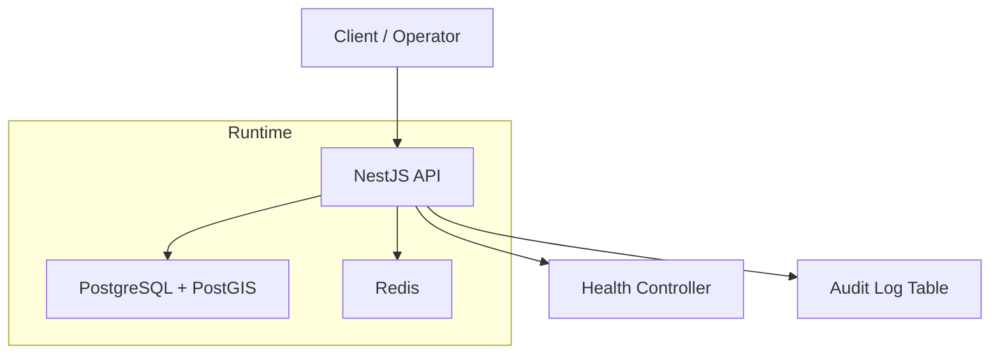
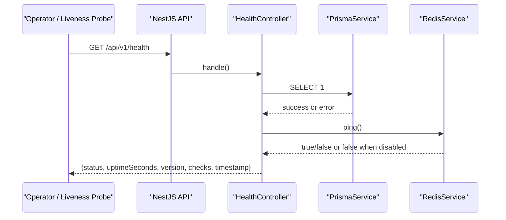
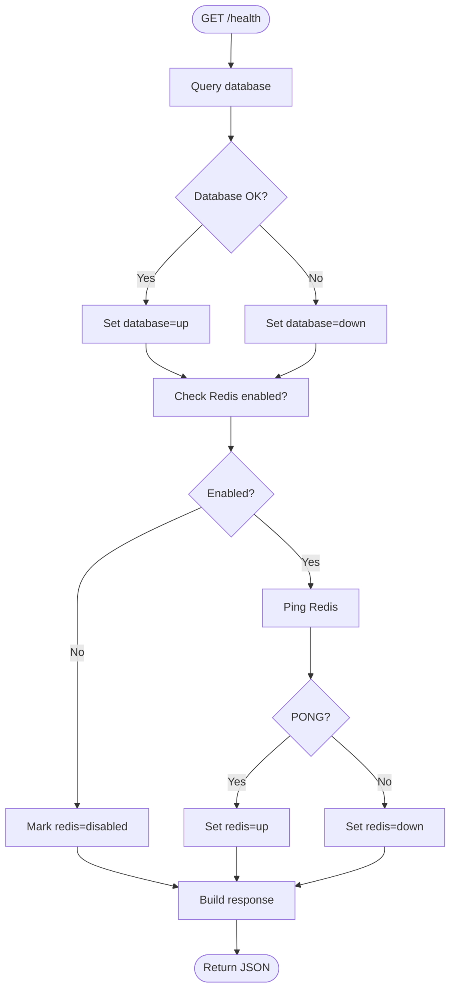
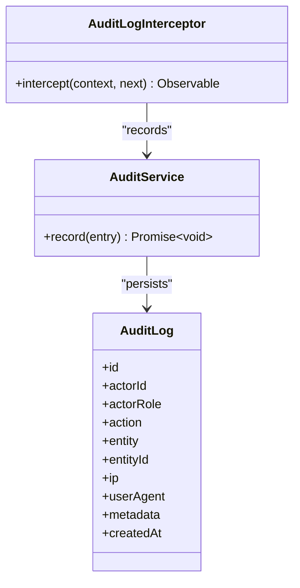
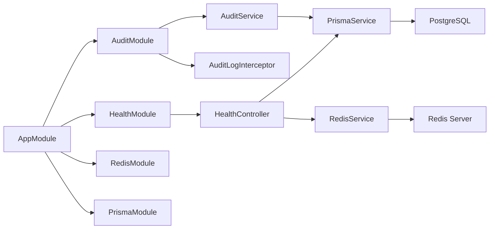

# Monitoring & Maintenance

<cite>
**Referenced Files in This Document**
- [health.controller.ts](file://backend/src/health/health.controller.ts)
- [app.module.ts](file://backend/src/app.module.ts)
- [main.ts](file://backend/src/main.ts)
- [configuration.ts](file://backend/src/config/configuration.ts)
- [redis.service.ts](file://backend/src/redis/redis.service.ts)
- [prisma.service.ts](file://backend/src/prisma/prisma.service.ts)
- [all-exceptions.filter.ts](file://backend/src/common/filters/all-exceptions.filter.ts)
- [audit-log.interceptor.ts](file://backend/src/common/interceptors/audit-log.interceptor.ts)
- [audit.service.ts](file://backend/src/audit/audit.service.ts)
- [schema.prisma](file://backend/prisma/schema.prisma)
- [docker-compose.yml](file://backend/docker-compose.yml)
- [Dockerfile](file://backend/Dockerfile)
</cite>

## Table of Contents
1. [Introduction](#introduction)
2. [Project Structure](#project-structure)
3. [Core Components](#core-components)
4. [Architecture Overview](#architecture-overview)
5. [Detailed Component Analysis](#detailed-component-analysis)
6. [Dependency Analysis](#dependency-analysis)
7. [Performance Considerations](#performance-considerations)
8. [Troubleshooting Guide](#troubleshooting-guide)
9. [Conclusion](#conclusion)
10. [Appendices](#appendices)

## Introduction
This document provides comprehensive monitoring and maintenance guidance for the FuelConnect platform. It covers health checks, application monitoring, performance metrics collection, audit logging, compliance considerations, data retention, logging strategies, log aggregation, alerting, database maintenance, backup strategies, performance tuning, cache management, memory optimization, resource utilization monitoring, troubleshooting, debugging, security monitoring, incident response, maintenance schedules, capacity planning, and disaster recovery.

## Project Structure
The backend is a NestJS application with:
- Health endpoint exposing liveness and dependency checks.
- Global exception handling and structured error responses.
- Audit logging via an interceptor and service backed by Prisma.
- Redis-backed caching with graceful fallback to in-process memory.
- Configuration-driven behavior including rate limiting and environment toggles.
- Dockerized services for PostgreSQL (PostGIS), Redis, and the API.

**Diagram sources**
- [health.controller.ts:1-42](file://backend/src/health/health.controller.ts#L1-L42)
- [redis.service.ts:1-133](file://backend/src/redis/redis.service.ts#L1-L133)
- [prisma.service.ts:1-34](file://backend/src/prisma/prisma.service.ts#L1-L34)
- [schema.prisma:713-730](file://backend/prisma/schema.prisma#L713-L730)

**Section sources**
- [main.ts:12-103](file://backend/src/main.ts#L12-L103)
- [app.module.ts:29-69](file://backend/src/app.module.ts#L29-L69)

## Core Components
- Health controller: returns overall status, uptime, version, and dependency checks for database and Redis.
- Exception filter: centralizes error mapping, logging, and consistent error envelopes.
- Audit system: records administrative mutations with actor, action, entity, IP, user agent, and metadata.
- Redis service: optional distributed cache with in-memory fallback; used for hot-path state and cross-instance signals.
- Configuration: environment-driven settings for JWT, OTP, pricing, payments, tracking, and feature flags.
- Database layer: Prisma client with lifecycle hooks and structured logging.

**Section sources**
- [health.controller.ts:1-42](file://backend/src/health/health.controller.ts#L1-L42)
- [all-exceptions.filter.ts:1-126](file://backend/src/common/filters/all-exceptions.filter.ts#L1-L126)
- [audit-log.interceptor.ts:1-64](file://backend/src/common/interceptors/audit-log.interceptor.ts#L1-L64)
- [audit.service.ts:1-47](file://backend/src/audit/audit.service.ts#L1-L47)
- [redis.service.ts:1-133](file://backend/src/redis/redis.service.ts#L1-L133)
- [configuration.ts:1-97](file://backend/src/config/configuration.ts#L1-L97)
- [prisma.service.ts:1-34](file://backend/src/prisma/prisma.service.ts#L1-L34)

## Architecture Overview
The API exposes REST endpoints and real-time capabilities. Operational surfaces include:
- Health check endpoint for liveness/readiness.
- Swagger UI for API documentation.
- Admin dashboard static assets served under a dedicated path.
- Global guards, interceptors, and filters for security, auditing, and error handling.

**Diagram sources**
- [health.controller.ts:15-40](file://backend/src/health/health.controller.ts#L15-L40)
- [prisma.service.ts:19-22](file://backend/src/prisma/prisma.service.ts#L19-L22)
- [redis.service.ts:124-131](file://backend/src/redis/redis.service.ts#L124-L131)

**Section sources**
- [main.ts:63-103](file://backend/src/main.ts#L63-L103)
- [app.module.ts:29-69](file://backend/src/app.module.ts#L29-L69)

## Detailed Component Analysis

### Health Check Endpoints
- Endpoint: GET /api/v1/health
- Behavior:
  - Checks database connectivity using a raw query.
  - Checks Redis availability via ping when enabled; otherwise reports disabled.
  - Returns status ok/degraded, process uptime, package version, and per-dependency states.
- Operational use:
  - Kubernetes liveness/readiness probes.
  - External monitoring systems polling for service health.

**Diagram sources**
- [health.controller.ts:18-40](file://backend/src/health/health.controller.ts#L18-L40)

**Section sources**
- [health.controller.ts:1-42](file://backend/src/health/health.controller.ts#L1-L42)

### Application Monitoring Setup
- Bootstrap configuration:
  - Helmet enabled with specific policy adjustments.
  - CORS configured from environment; warns if empty in production.
  - Global prefix set for all routes.
  - Static dashboard assets served at /dashboard.
  - Validation pipe globally applied with structured error factory.
  - Swagger UI mounted at /docs.
  - Shutdown hooks enabled.
- Process-level observability:
  - Uptime exposed via health endpoint.
  - Version exposed via package metadata.
- Recommended external monitoring:
  - Poll /health every 15–30 seconds.
  - Alert on status not equal to ok.
  - Track uptime and version drift across deployments.

**Section sources**
- [main.ts:12-103](file://backend/src/main.ts#L12-L103)

### Performance Metrics Collection
- Built-in metrics:
  - Health endpoint exposes uptime and dependency states.
  - Request validation errors are logged through the global exception filter.
- Suggested instrumentation:
  - Add request duration histograms per route.
  - Expose process metrics (CPU, memory, event loop lag).
  - Export database connection pool metrics.
  - Emit Redis latency and hit/miss ratios.
- Aggregation:
  - Forward logs and metrics to a centralized collector (e.g., Prometheus/Grafana stack or equivalent).
  - Use structured JSON logs with correlation IDs where available.

[No sources needed since this section provides general guidance]

### Audit Logging Implementation and Compliance
- Interceptor:
  - Records successful administrative mutations for audited roles.
  - Skips authentication-related routes.
  - Captures actor identity, role, HTTP method, handler, entity, entity ID, IP, user agent, and metadata.
- Service:
  - Persists audit entries to the audit_logs table.
  - Ensures audit failures do not break the calling request.
- Data model:
  - audit_logs includes actor references, action, entity, timestamps, and JSON metadata.
- Compliance considerations:
  - Retain audit logs according to organizational policy.
  - Protect PII in metadata fields.
  - Restrict access to audit queries to authorized operators.

**Diagram sources**
- [audit-log.interceptor.ts:24-63](file://backend/src/common/interceptors/audit-log.interceptor.ts#L24-L63)
- [audit.service.ts:21-46](file://backend/src/audit/audit.service.ts#L21-L46)
- [schema.prisma:713-730](file://backend/prisma/schema.prisma#L713-L730)

**Section sources**
- [audit-log.interceptor.ts:1-64](file://backend/src/common/interceptors/audit-log.interceptor.ts#L1-L64)
- [audit.service.ts:1-47](file://backend/src/audit/audit.service.ts#L1-L47)
- [schema.prisma:713-730](file://backend/prisma/schema.prisma#L713-L730)

### Data Retention Policies
- Tracking history retention:
  - Configured via tracking.historyRetentionDays.
- Session and OTP lifetimes:
  - Sessions have expiration and revocation fields.
  - OTP codes expire and track attempts.
- Recommendations:
  - Implement periodic cleanup jobs for expired sessions, OTPs, and old tracking locations.
  - Archive or purge historical data based on retention policies.

**Section sources**
- [configuration.ts:92-95](file://backend/src/config/configuration.ts#L92-L95)
- [schema.prisma:172-189](file://backend/prisma/schema.prisma#L172-L189)
- [schema.prisma:191-207](file://backend/prisma/schema.prisma#L191-L207)

### Logging Strategies, Log Aggregation, and Alerting
- Strategy:
  - Structured logging via NestJS Logger and Prisma events.
  - Centralized error envelope with status, message, path, timestamp, and optional requestId.
- Aggregation:
  - Ship container stdout/stderr to a log aggregator.
  - Parse JSON logs and index key fields (method, path, statusCode, message).
- Alerting:
  - Alert on 5xx spikes, repeated validation failures, and audit write failures.
  - Alert on health check degradation.

**Section sources**
- [all-exceptions.filter.ts:41-126](file://backend/src/common/filters/all-exceptions.filter.ts#L41-L126)
- [prisma.service.ts:8-17](file://backend/src/prisma/prisma.service.ts#L8-L17)

### Database Maintenance Procedures
- Connection lifecycle:
  - Prisma connects on module init and disconnects on destroy.
  - Warn/error events are forwarded to the logger.
- Maintenance tasks:
  - Schedule vacuum and analyze operations.
  - Monitor connection pool saturation and slow queries.
  - Validate indexes and constraints periodically.

**Section sources**
- [prisma.service.ts:1-34](file://backend/src/prisma/prisma.service.ts#L1-L34)

### Backup Strategies
- Containerized storage:
  - PostgreSQL and Redis volumes defined in docker-compose.
- Recommended practices:
  - Automated logical backups for PostgreSQL (e.g., pg_dump) with encryption and offsite replication.
  - Snapshot-based backups for persistent volumes.
  - Test restore procedures regularly.

**Section sources**
- [docker-compose.yml:1-54](file://backend/docker-compose.yml#L1-L54)

### Performance Tuning
- Rate limiting:
  - Global throttling at 120 requests per minute per IP.
  - Sensitive routes can be further restricted.
- Caching:
  - Redis for hot paths; in-memory fallback for single-instance development.
- Database:
  - Tune connection pool size and query timeouts.
  - Use appropriate indexes and avoid N+1 queries.

**Section sources**
- [app.module.ts:38-40](file://backend/src/app.module.ts#L38-L40)
- [redis.service.ts:10-19](file://backend/src/redis/redis.service.ts#L10-L19)

### Cache Management, Memory Optimization, and Resource Utilization Monitoring
- Redis service:
  - Optional connection with retry strategy and offline queue disabled.
  - Graceful fallback to in-process Map when Redis is unavailable.
  - TTL-aware entries with expiry checks.
- Memory considerations:
  - Avoid unbounded caches; enforce TTLs and eviction policies.
  - Monitor heap usage and GC pauses.
- Resource monitoring:
  - Track CPU, memory, file descriptors, and network I/O.
  - Correlate with request latency and error rates.

**Section sources**
- [redis.service.ts:28-52](file://backend/src/redis/redis.service.ts#L28-L52)
- [redis.service.ts:69-131](file://backend/src/redis/redis.service.ts#L69-L131)

### Security Monitoring, Intrusion Detection, and Incident Response
- Security controls:
  - Helmet middleware applied.
  - CORS configured from environment variables.
  - Global JWT and role guards.
  - Throttling to mitigate abuse.
- Monitoring:
  - Watch for 401/403 spikes, unusual geographic login patterns, and high failure rates.
  - Review audit logs for privileged actions.
- Incident response:
  - Isolate affected instances.
  - Rotate secrets and invalidate sessions.
  - Preserve evidence and perform postmortem analysis.

**Section sources**
- [main.ts:25-34](file://backend/src/main.ts#L25-L34)
- [app.module.ts:61-66](file://backend/src/app.module.ts#L61-L66)

### Troubleshooting Guide
Common operational issues and diagnostics:
- Health check degraded:
  - Verify database connectivity and credentials.
  - Confirm Redis URL and reachability.
- High error rates:
  - Inspect structured error responses and server logs.
  - Identify validation failures and upstream provider errors.
- Audit logs missing:
  - Ensure audited roles and mutating methods are used.
  - Check audit write failures and database availability.
- Cache misses or stale data:
  - Validate TTLs and Redis connectivity.
  - Confirm fallback mode is acceptable for current deployment topology.

Operational tips:
- Use /docs to validate endpoints and payloads.
- Use /dashboard for quick operational visibility.
- Correlate request IDs and timestamps across logs.

**Section sources**
- [health.controller.ts:18-40](file://backend/src/health/health.controller.ts#L18-L40)
- [all-exceptions.filter.ts:45-104](file://backend/src/common/filters/all-exceptions.filter.ts#L45-L104)
- [audit-log.interceptor.ts:40-60](file://backend/src/common/interceptors/audit-log.interceptor.ts#L40-L60)

### Debugging Techniques and Performance Profiling
- Debugging:
  - Enable verbose logging in non-production environments.
  - Use Swagger UI to reproduce problematic requests.
  - Inspect Prisma warnings/errors emitted during runtime.
- Profiling:
  - Profile Node.js processes for CPU and memory hotspots.
  - Measure end-to-end latency and identify slow database queries.
  - Evaluate Redis latency and throughput under load.

**Section sources**
- [prisma.service.ts:8-17](file://backend/src/prisma/prisma.service.ts#L8-L17)
- [main.ts:90-103](file://backend/src/main.ts#L90-L103)

### Maintenance Schedules
- Daily:
  - Review health check trends and error rate dashboards.
  - Verify backup completion and integrity.
- Weekly:
  - Analyze audit logs for anomalies.
  - Review rate limiting and throttling effectiveness.
- Monthly:
  - Perform database maintenance (vacuum, analyze).
  - Review and prune unused indexes and tables.
  - Update dependencies and assess vulnerabilities.

[No sources needed since this section provides general guidance]

### Capacity Planning Guidelines
- Scale horizontally:
  - Run multiple API replicas behind a load balancer.
  - Ensure Redis is shared across instances for distributed features.
- Right-size resources:
  - Monitor CPU, memory, disk I/O, and network bandwidth.
  - Plan for peak traffic and bursty workloads.
- Database sizing:
  - Size storage for growth projections.
  - Provision read replicas if necessary.

[No sources needed since this section provides general guidance]

### Disaster Recovery Procedures
- Failover:
  - Automate failover to secondary database regions.
  - Maintain warm standby Redis clusters.
- Recovery steps:
  - Restore latest backups to new infrastructure.
  - Rebuild caches from authoritative data sources.
  - Validate health checks and run smoke tests.
- Communication:
  - Notify stakeholders and provide status updates.
  - Document incidents and lessons learned.

[No sources needed since this section provides general guidance]

## Dependency Analysis
The application composes several modules and services that impact monitoring and maintenance:

**Diagram sources**
- [app.module.ts:29-69](file://backend/src/app.module.ts#L29-L69)
- [health.controller.ts:1-42](file://backend/src/health/health.controller.ts#L1-L42)
- [audit-log.interceptor.ts:1-64](file://backend/src/common/interceptors/audit-log.interceptor.ts#L1-L64)
- [audit.service.ts:1-47](file://backend/src/audit/audit.service.ts#L1-L47)
- [redis.service.ts:1-133](file://backend/src/redis/redis.service.ts#L1-L133)
- [prisma.service.ts:1-34](file://backend/src/prisma/prisma.service.ts#L1-L34)

**Section sources**
- [app.module.ts:29-69](file://backend/src/app.module.ts#L29-L69)

## Performance Considerations
- Keep health checks lightweight and idempotent.
- Avoid synchronous blocking operations in interceptors and filters.
- Prefer asynchronous retries with bounded backoff for external dependencies.
- Use connection pooling and tune timeouts for database and Redis.
- Minimize payload sizes and avoid unnecessary serialization.

[No sources needed since this section provides general guidance]

## Troubleshooting Guide
- Health check failures:
  - Validate DATABASE_URL and REDIS_URL.
  - Check container networking and DNS resolution.
- Elevated 5xx errors:
  - Inspect exception filter logs for stack traces.
  - Correlate with upstream payment or notification providers.
- Audit gaps:
  - Confirm audited roles and mutation methods.
  - Verify audit_logs table permissions and space.
- Cache inconsistencies:
  - Check Redis availability and TTL configurations.
  - Validate fallback behavior in multi-instance deployments.

**Section sources**
- [all-exceptions.filter.ts:45-104](file://backend/src/common/filters/all-exceptions.filter.ts#L45-L104)
- [redis.service.ts:28-52](file://backend/src/redis/redis.service.ts#L28-L52)

## Conclusion
FuelConnect’s monitoring and maintenance posture centers on a robust health endpoint, structured error handling, comprehensive audit logging, and resilient caching with Redis. Operators should integrate these components into their observability stack, automate backups and maintenance tasks, and establish clear incident response procedures. Continuous profiling and capacity planning will ensure reliable operation under varying loads.

[No sources needed since this section summarizes without analyzing specific files]

## Appendices

### Environment Variables and Configuration Keys
Key configuration areas affecting operations:
- General: env, port, apiPrefix, corsOrigins, redisUrl.
- Security: jwt.* (secret, TTLs), otp.* (TTLs, attempts, devMode).
- Business: pricing.*, payments.*, tracking.* (minIntervalMs, historyRetentionDays).

**Section sources**
- [configuration.ts:1-97](file://backend/src/config/configuration.ts#L1-L97)

### Docker Services and Health Probes
- PostgreSQL:
  - Image: postgis/postgis:16-3.4
  - Health probe: pg_isready
- Redis:
  - Image: redis:7-alpine
  - Health probe: redis-cli ping
- API:
  - Depends on healthy db and redis
  - Exposes port 8000

**Section sources**
- [docker-compose.yml:1-54](file://backend/docker-compose.yml#L1-L54)
- [Dockerfile:1-30](file://backend/Dockerfile#L1-L30)