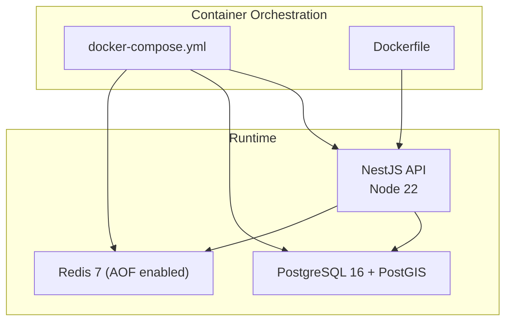
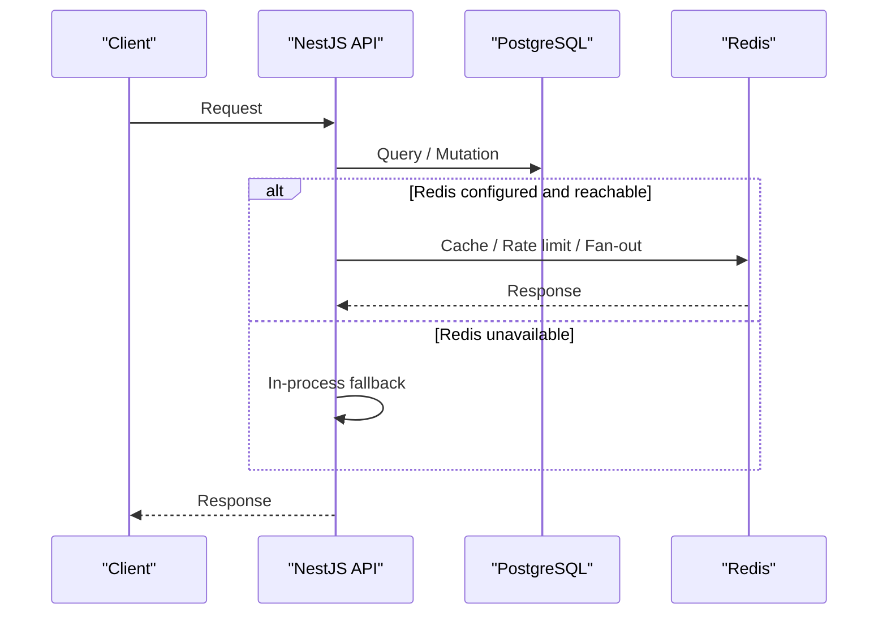
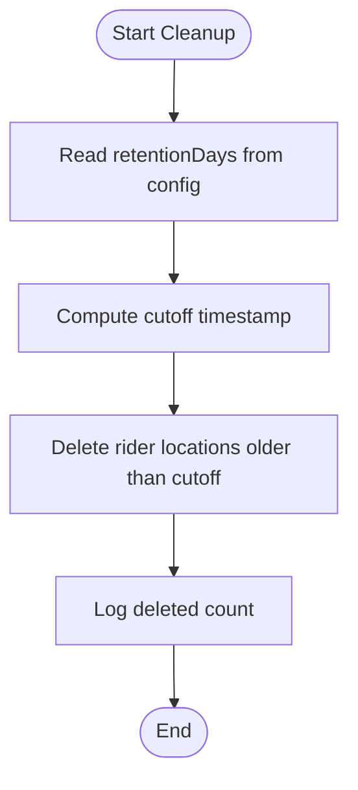
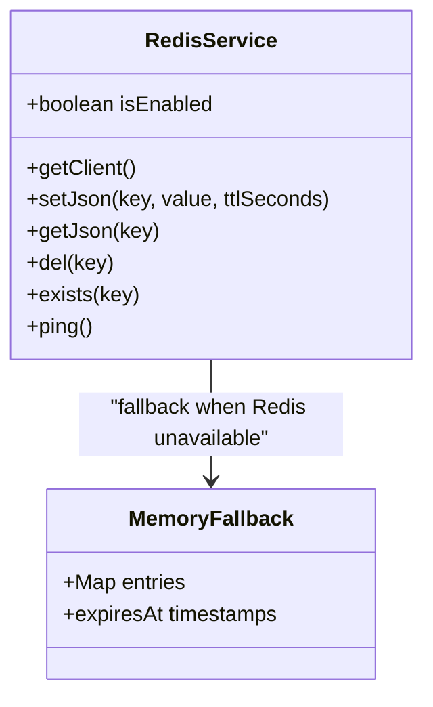
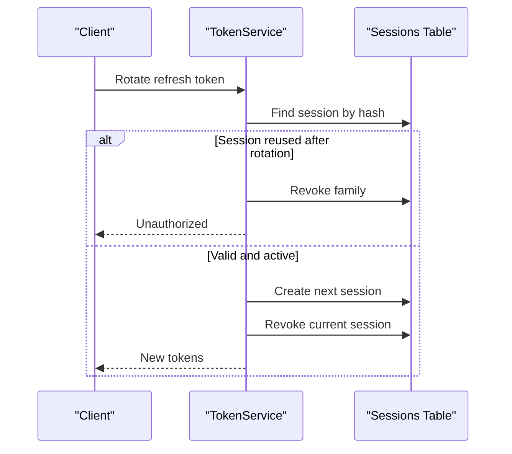
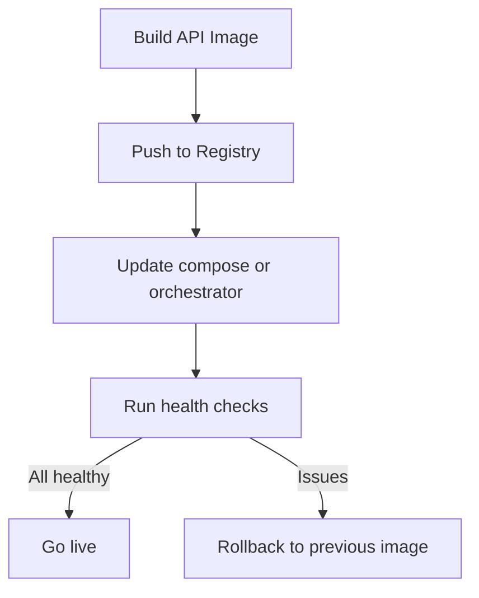
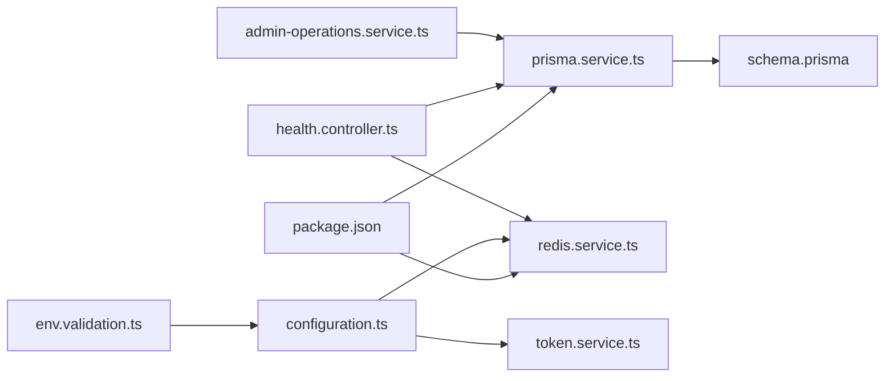
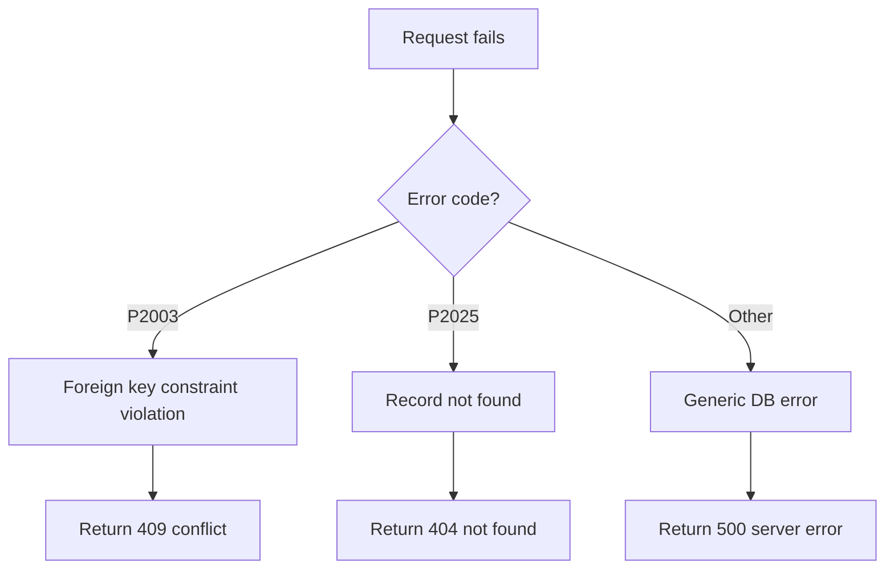

# Operational Maintenance Procedures

<cite>
**Referenced Files in This Document**
- [package.json](file://backend/package.json)
- [docker-compose.yml](file://backend/docker-compose.yml)
- [Dockerfile](file://backend/Dockerfile)
- [configuration.ts](file://backend/src/config/configuration.ts)
- [env.validation.ts](file://backend/src/config/env.validation.ts)
- [schema.prisma](file://backend/prisma/schema.prisma)
- [redis.service.ts](file://backend/src/redis/redis.service.ts)
- [prisma.service.ts](file://backend/src/prisma/prisma.service.ts)
- [token.service.ts](file://backend/src/auth/token.service.ts)
- [admin-operations.service.ts](file://backend/src/admin/admin-operations.service.ts)
- [health.controller.ts](file://backend/src/health/health.controller.ts)
- [geo-location.service.ts](file://backend/src/common/services/geo-location.service.ts)
- [all-exceptions.filter.ts](file://backend/src/common/filters/all-exceptions.filter.ts)
- [audit.service.ts](file://backend/src/audit/audit.service.ts)
</cite>

## Table of Contents
1. [Introduction](#introduction)
2. [Project Structure](#project-structure)
3. [Core Components](#core-components)
4. [Architecture Overview](#architecture-overview)
5. [Detailed Component Analysis](#detailed-component-analysis)
6. [Dependency Analysis](#dependency-analysis)
7. [Performance Considerations](#performance-considerations)
8. [Troubleshooting Guide](#troubleshooting-guide)
9. [Conclusion](#conclusion)
10. [Appendices](#appendices)

## Introduction
This document provides operational maintenance procedures for the FuelConnect platform. It covers database maintenance, migration management, data cleanup, cache and Redis operations, session lifecycle, deployment and rolling updates, log rotation, disk space management, certificate and security patching, dependency updates, disaster recovery, failover testing, business continuity planning, routine schedules, automated tasks, and operational runbooks. The guidance is grounded in the repository’s configuration, Docker setup, Prisma schema, health checks, Redis fallback behavior, token/session handling, admin operations, and audit logging.

## Project Structure
FuelConnect is a NestJS backend with:
- PostgreSQL + PostGIS as the primary relational store.
- Redis used for caching, rate limiting, and Socket.IO fan-out when available.
- Prisma for schema definition and migrations.
- Docker Compose for local and containerized orchestration.
- Health endpoints for liveness and dependency checks.
- Admin operations for day-to-day operational tasks.

**Diagram sources**
- [docker-compose.yml:1-54](file://backend/docker-compose.yml#L1-L54)
- [Dockerfile:1-30](file://backend/Dockerfile#L1-L30)

**Section sources**
- [docker-compose.yml:1-54](file://backend/docker-compose.yml#L1-L54)
- [Dockerfile:1-30](file://backend/Dockerfile#L1-L30)
- [package.json:1-68](file://backend/package.json#L1-L68)

## Core Components
- Database layer: Prisma client with PostgreSQL + PostGIS extension; connection lifecycle managed by PrismaService.
- Cache layer: RedisService with ioredis, optional in-process fallback for single-instance development.
- Session and tokens: TokenService manages short-lived access tokens and rotating refresh tokens backed by sessions.
- Health and observability: HealthController exposes dependency status; AuditService records administrative actions.
- Data retention: GeoLocationService prunes rider location history based on configured retention days.
- Configuration: Environment variables validated at boot via Joi; runtime defaults provided by configuration module.

**Section sources**
- [prisma.service.ts:1-34](file://backend/src/prisma/prisma.service.ts#L1-L34)
- [redis.service.ts:1-133](file://backend/src/redis/redis.service.ts#L1-L133)
- [token.service.ts:1-198](file://backend/src/auth/token.service.ts#L1-L198)
- [health.controller.ts:1-42](file://backend/src/health/health.controller.ts#L1-L42)
- [audit.service.ts:1-46](file://backend/src/audit/audit.service.ts#L1-L46)
- [geo-location.service.ts:127-154](file://backend/src/common/services/geo-location.service.ts#L127-L154)
- [configuration.ts:1-97](file://backend/src/config/configuration.ts#L1-L97)
- [env.validation.ts:1-44](file://backend/src/config/env.validation.ts#L1-L44)

## Architecture Overview
The system runs as a single API service depending on PostgreSQL and optionally Redis. Redis is not mandatory; if unavailable, the application falls back to an in-memory map for local-only usage. Health checks validate database connectivity and Redis availability. Admin operations provide operational controls over orders, payments, withdrawals, stations, tickets, and audit logs.

**Diagram sources**
- [redis.service.ts:10-52](file://backend/src/redis/redis.service.ts#L10-L52)
- [health.controller.ts:18-39](file://backend/src/health/health.controller.ts#L18-L39)

## Detailed Component Analysis

### Database Maintenance Procedures
- Backup strategy:
  - Use PostgreSQL logical backups (e.g., pg_dump) against the production database instance referenced by DATABASE_URL.
  - Back up both schema and data; include PostGIS geometry/geography data.
  - Schedule regular backups and retain according to compliance requirements.
  - Validate restore procedures periodically.
- Migration management:
  - Development: use npm scripts to generate and apply migrations.
  - Production: apply migrations through CI/CD or controlled ops process before deploying new API versions.
  - Always test migrations against a staging copy of the database.
- Data cleanup operations:
  - Rider location history pruning is implemented via a retention window controlled by environment configuration.
  - Audit logs and other append-only tables should be archived and purged according to policy.

**Diagram sources**
- [geo-location.service.ts:132-140](file://backend/src/common/services/geo-location.service.ts#L132-L140)
- [configuration.ts:92-95](file://backend/src/config/configuration.ts#L92-L95)

**Section sources**
- [schema.prisma:1-14](file://backend/prisma/schema.prisma#L1-L14)
- [package.json:14-20](file://backend/package.json#L14-L20)
- [geo-location.service.ts:132-140](file://backend/src/common/services/geo-location.service.ts#L132-L140)
- [configuration.ts:92-95](file://backend/src/config/configuration.ts#L92-L95)

### Cache Maintenance and Redis Cluster Management
- Redis role:
  - Caches latest rider positions, shared rate-limit signals, and Socket.IO fan-out across API replicas.
  - Optional: when REDIS_URL is empty or Redis is unreachable, the service uses an in-process Map fallback.
- Operational tasks:
  - Monitor Redis connectivity and latency.
  - Ensure AOF persistence is enabled (as configured).
  - For multi-instance deployments, ensure Redis is reachable and properly secured.
  - Periodically inspect memory usage and eviction policies if using a managed Redis.
- Fallback behavior:
  - If Redis is down, the API continues operating with reduced capabilities (no cross-instance sharing).

**Diagram sources**
- [redis.service.ts:20-52](file://backend/src/redis/redis.service.ts#L20-L52)
- [redis.service.ts:69-131](file://backend/src/redis/redis.service.ts#L69-L131)

**Section sources**
- [redis.service.ts:10-52](file://backend/src/redis/redis.service.ts#L10-L52)
- [redis.service.ts:69-131](file://backend/src/redis/redis.service.ts#L69-L131)
- [docker-compose.yml:20-33](file://backend/docker-compose.yml#L20-L33)

### Session Cleanup Procedures
- Sessions are stored in the database with hashed refresh tokens and expiration metadata.
- Token rotation revokes previous sessions and detects reuse (potential theft), revoking the whole family.
- Operational cleanup:
  - Purge expired sessions periodically.
  - Revoke all sessions for compromised users.
  - Monitor revoked sessions and reasons.

**Diagram sources**
- [token.service.ts:69-151](file://backend/src/auth/token.service.ts#L69-L151)
- [schema.prisma:172-189](file://backend/prisma/schema.prisma#L172-L189)

**Section sources**
- [token.service.ts:40-166](file://backend/src/auth/token.service.ts#L40-L166)
- [schema.prisma:172-189](file://backend/prisma/schema.prisma#L172-L189)

### Deployment Maintenance Tasks
- Container build:
  - Multi-stage Dockerfile builds Node 22 Alpine image, installs dependencies, compiles TypeScript, and copies artifacts into a minimal runtime image.
- Service orchestration:
  - docker-compose defines PostgreSQL, Redis, and API services with health checks and persistent volumes.
- Rolling updates:
  - Deploy new API containers while keeping DB and Redis stable.
  - Apply migrations before or during rollout depending on backward compatibility.
  - Use zero-downtime strategies (blue/green or canary) if supported by your orchestrator.
- Rollback procedures:
  - Keep previous container images and migration state.
  - If migration is not backward compatible, coordinate rollback with data revert steps.

**Diagram sources**
- [Dockerfile:1-30](file://backend/Dockerfile#L1-L30)
- [docker-compose.yml:35-50](file://backend/docker-compose.yml#L35-L50)

**Section sources**
- [Dockerfile:1-30](file://backend/Dockerfile#L1-L30)
- [docker-compose.yml:1-54](file://backend/docker-compose.yml#L1-L54)

### Log Rotation, Disk Space Management, and Storage Optimization
- Logging:
  - Prisma emits warn/error events captured by PrismaService logger.
  - AuditService writes administrative actions to audit_logs table; failures are logged but do not break requests.
- Disk space:
  - Monitor PostgreSQL WAL and table bloat; vacuum and analyze regularly.
  - Archive and purge old audit logs and rider location history based on retention policies.
  - Clean up Docker layers and unused images.
- Storage optimization:
  - Use compression for backups.
  - Partition large tables (e.g., audit_logs, rider_locations) by time if needed.

**Section sources**
- [prisma.service.ts:8-17](file://backend/src/prisma/prisma.service.ts#L8-L17)
- [audit.service.ts:27-45](file://backend/src/audit/audit.service.ts#L27-L45)
- [schema.prisma:713-730](file://backend/prisma/schema.prisma#L713-L730)

### Certificate Management, Security Patching, and Dependency Updates
- Certificates:
  - Place TLS termination at the reverse proxy or load balancer; rotate certificates externally.
- Security patching:
  - Update base images (Node 22 Alpine) and OS packages regularly.
  - Apply security patches to PostgreSQL and Redis images.
- Dependency updates:
  - Review and update npm dependencies; lock versions via package-lock.json.
  - Run type checks and tests before updating.

**Section sources**
- [Dockerfile:1-30](file://backend/Dockerfile#L1-L30)
- [package.json:25-63](file://backend/package.json#L25-L63)

### Disaster Recovery, Failover Testing, and Business Continuity
- Disaster recovery:
  - Maintain tested restore procedures for PostgreSQL backups.
  - Validate PostGIS functionality post-restore.
- Failover testing:
  - Simulate Redis outage to verify in-process fallback behavior.
  - Test database unavailability and error responses.
- Business continuity:
  - Define RTO/RPO targets.
  - Automate backup verification and restore drills.

**Section sources**
- [redis.service.ts:10-52](file://backend/src/redis/redis.service.ts#L10-L52)
- [health.controller.ts:18-39](file://backend/src/health/health.controller.ts#L18-L39)

### Routine Maintenance Schedules, Automated Tasks, and Operational Runbooks
- Daily:
  - Verify health endpoint status.
  - Check Redis connectivity and memory usage.
  - Review failed requests and audit logs.
- Weekly:
  - Run data cleanup jobs (rider location pruning).
  - Review and archive audit logs.
- Monthly:
  - Apply security patches and dependency updates.
  - Test backup restore.
- Runbooks:
  - Database restore procedure.
  - Redis cluster restart and failover.
  - Session purge and token secret rotation.

**Section sources**
- [geo-location.service.ts:132-140](file://backend/src/common/services/geo-location.service.ts#L132-L140)
- [health.controller.ts:18-39](file://backend/src/health/health.controller.ts#L18-L39)

## Dependency Analysis
The following diagram maps key runtime dependencies and their roles in maintenance:

**Diagram sources**
- [package.json:1-68](file://backend/package.json#L1-L68)
- [env.validation.ts:1-44](file://backend/src/config/env.validation.ts#L1-L44)
- [configuration.ts:1-97](file://backend/src/config/configuration.ts#L1-L97)
- [prisma.service.ts:1-34](file://backend/src/prisma/prisma.service.ts#L1-L34)
- [redis.service.ts:1-133](file://backend/src/redis/redis.service.ts#L1-L133)
- [token.service.ts:1-198](file://backend/src/auth/token.service.ts#L1-L198)
- [health.controller.ts:1-42](file://backend/src/health/health.controller.ts#L1-L42)
- [admin-operations.service.ts:1-363](file://backend/src/admin/admin-operations.service.ts#L1-L363)
- [schema.prisma:1-731](file://backend/prisma/schema.prisma#L1-L731)

**Section sources**
- [package.json:1-68](file://backend/package.json#L1-L68)
- [env.validation.ts:1-44](file://backend/src/config/env.validation.ts#L1-L44)
- [configuration.ts:1-97](file://backend/src/config/configuration.ts#L1-L97)
- [prisma.service.ts:1-34](file://backend/src/prisma/prisma.service.ts#L1-L34)
- [redis.service.ts:1-133](file://backend/src/redis/redis.service.ts#L1-L133)
- [token.service.ts:1-198](file://backend/src/auth/token.service.ts#L1-L198)
- [health.controller.ts:1-42](file://backend/src/health/health.controller.ts#L1-L42)
- [admin-operations.service.ts:1-363](file://backend/src/admin/admin-operations.service.ts#L1-L363)
- [schema.prisma:1-731](file://backend/prisma/schema.prisma#L1-L731)

## Performance Considerations
- Database:
  - Ensure proper indexing on frequently queried columns (already defined in schema).
  - Tune PostgreSQL parameters for connection pooling and memory usage.
- Redis:
  - Monitor memory and eviction policies; consider maxmemory and policies appropriate for workload.
- Application:
  - Use health checks to detect degraded states early.
  - Avoid heavy synchronous operations in request paths.

[No sources needed since this section provides general guidance]

## Troubleshooting Guide
- Database errors:
  - All exceptions filter maps Prisma error codes to user-friendly messages.
  - Common codes include foreign key violations and not found scenarios.
- Redis issues:
  - If Redis is down, the API falls back to in-process cache; cross-instance features will be limited.
  - Use health endpoint to check Redis status.
- Session problems:
  - Rotated or expired sessions result in unauthorized responses; instruct users to re-authenticate.
- Admin operations:
  - Use admin endpoints to review audit logs, payments, withdrawals, and tickets.

**Diagram sources**
- [all-exceptions.filter.ts:114-125](file://backend/src/common/filters/all-exceptions.filter.ts#L114-L125)

**Section sources**
- [all-exceptions.filter.ts:114-125](file://backend/src/common/filters/all-exceptions.filter.ts#L114-L125)
- [redis.service.ts:10-52](file://backend/src/redis/redis.service.ts#L10-L52)
- [health.controller.ts:18-39](file://backend/src/health/health.controller.ts#L18-L39)
- [token.service.ts:82-105](file://backend/src/auth/token.service.ts#L82-L105)
- [admin-operations.service.ts:319-347](file://backend/src/admin/admin-operations.service.ts#L319-L347)

## Conclusion
FuelConnect’s operational maintenance relies on robust configuration validation, Prisma-backed schema and migrations, optional Redis caching with safe fallbacks, structured session management, comprehensive audit logging, and clear health checks. By following the documented procedures for backups, migrations, data cleanup, Redis operations, deployment rollouts, and troubleshooting, operators can maintain high availability, performance, and security.

[No sources needed since this section summarizes without analyzing specific files]

## Appendices

### Environment Variables Reference
Key variables validated at boot and used by the application:
- PORT, API_PREFIX, CORS_ORIGINS
- DATABASE_URL, REDIS_URL
- JWT_SECRET, JWT_ACCESS_TTL, REFRESH_TOKEN_TTL_DAYS, RESET_TOKEN_TTL
- OTP_TTL_SECONDS, OTP_RESEND_SECONDS, OTP_MAX_ATTEMPTS, OTP_DEV_MODE
- DELIVERY_BASE_FEE, DELIVERY_PER_KM_FEE, DELIVERY_FREE_KM, SERVICE_FEE, RIDER_COMMISSION_PERCENT, DISPATCH_RADIUS_KM, ASSIGNMENT_TIMEOUT_SECONDS
- PAYMENT_WEBHOOK_SECRET, PAYMENTS_SANDBOX, MTN_MOMO_*, AIRTEL_MONEY_*
- TRACKING_MIN_INTERVAL_MS, TRACKING_HISTORY_RETENTION_DAYS

**Section sources**
- [env.validation.ts:1-44](file://backend/src/config/env.validation.ts#L1-L44)
- [configuration.ts:48-96](file://backend/src/config/configuration.ts#L48-L96)

### Scripts and Commands
- Build and start:
  - npm run build
  - npm run start:prod
- Database:
  - npm run prisma:generate
  - npm run prisma:migrate
  - npm run db:seed
  - npm run db:setup

**Section sources**
- [package.json:7-20](file://backend/package.json#L7-L20)