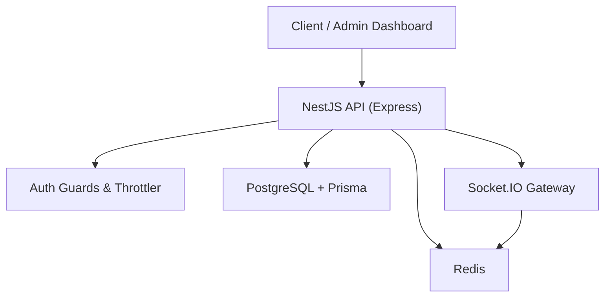
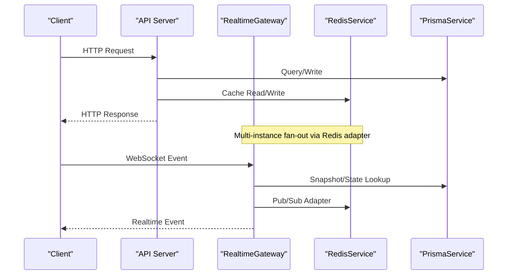
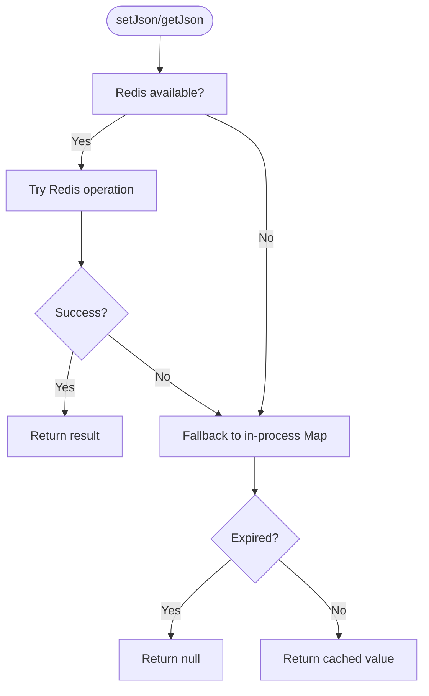
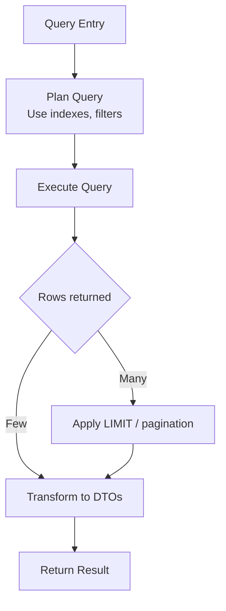
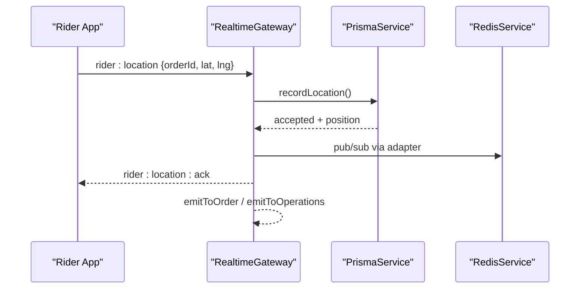
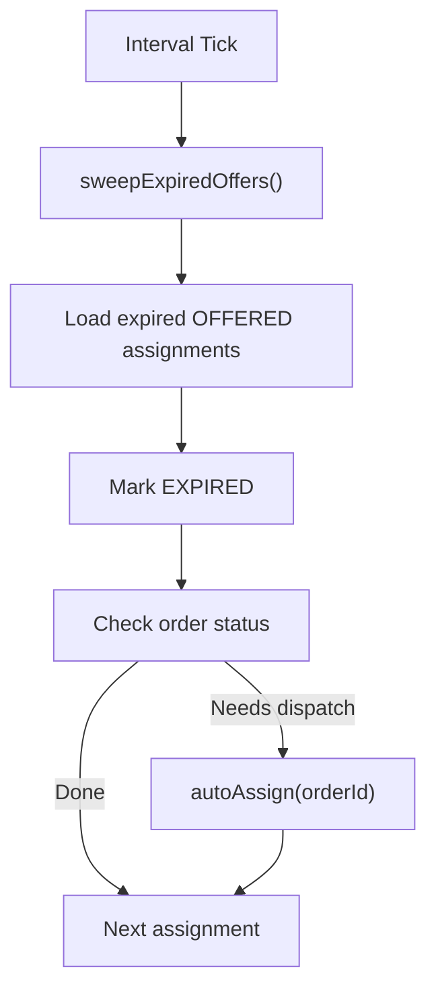
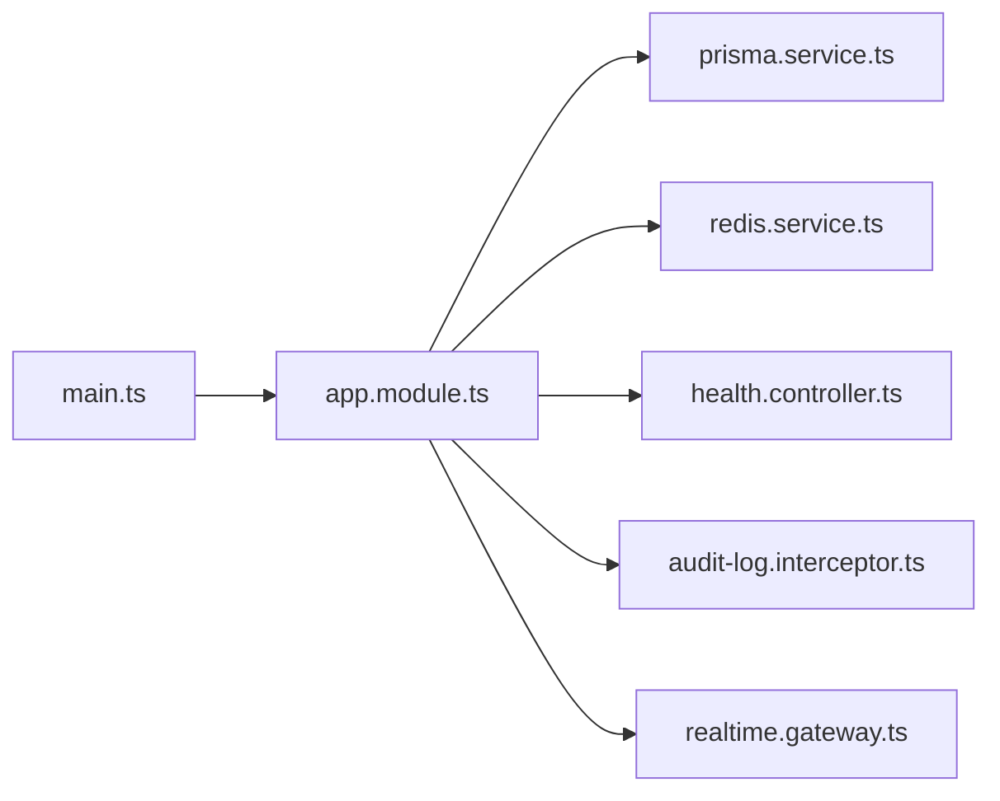

# Performance Monitoring & Optimization

<cite>
**Referenced Files in This Document**
- [main.ts](file://backend/src/main.ts)
- [app.module.ts](file://backend/src/app.module.ts)
- [redis.service.ts](file://backend/src/redis/redis.service.ts)
- [prisma.service.ts](file://backend/src/prisma/prisma.service.ts)
- [health.controller.ts](file://backend/src/health/health.controller.ts)
- [audit-log.interceptor.ts](file://backend/src/common/interceptors/audit-log.interceptor.ts)
- [geo-location.service.ts](file://backend/src/common/services/geo-location.service.ts)
- [dispatch.service.ts](file://backend/src/orders/dispatch.service.ts)
- [realtime.gateway.ts](file://backend/src/tracking/realtime.gateway.ts)
</cite>

## Table of Contents
1. [Introduction](#introduction)
2. [Project Structure](#project-structure)
3. [Core Components](#core-components)
4. [Architecture Overview](#architecture-overview)
5. [Detailed Component Analysis](#detailed-component-analysis)
6. [Dependency Analysis](#dependency-analysis)
7. [Performance Considerations](#performance-considerations)
8. [Troubleshooting Guide](#troubleshooting-guide)
9. [Conclusion](#conclusion)

## Introduction
This document provides performance monitoring and optimization guidance for the FuelConnect backend. It focuses on:
- Metrics collection, KPIs, and observability hooks
- Redis caching strategies, memory management, and tuning
- Database query performance analysis and slow query detection
- CPU and memory usage monitoring, resource utilization tracking, and capacity planning
- Profiling techniques, bottleneck identification, and critical path optimization
- Load testing, stress testing, and regression detection
- Scaling considerations and best practices for high-traffic scenarios

## Project Structure
The backend is a NestJS application with:
- Global request guards, interceptors, and throttling
- Prisma-based database access
- Redis-backed caching and Socket.IO fan-out
- Real-time tracking via WebSockets
- Health checks exposing dependency status and uptime

**Diagram sources**
- [main.ts:12-103](file://backend/src/main.ts#L12-L103)
- [app.module.ts:29-67](file://backend/src/app.module.ts#L29-L67)
- [redis.service.ts:10-18](file://backend/src/redis/redis.service.ts#L10-L18)
- [realtime.gateway.ts:45-78](file://backend/src/tracking/realtime.gateway.ts#L45-L78)

**Section sources**
- [main.ts:12-103](file://backend/src/main.ts#L12-L103)
- [app.module.ts:29-67](file://backend/src/app.module.ts#L29-L67)

## Core Components
- Bootstrap and global middleware: validation, CORS, static dashboard, Swagger UI, shutdown hooks
- Application module: configuration, throttling, feature modules, global guards/interceptors/filters
- Redis service: optional Redis client with in-process fallback; JSON set/get/del/exists/ping
- Prisma service: connection lifecycle, logging events to logger
- Health controller: liveness/readiness-style check including DB and Redis
- Audit interceptor: fire-and-forget audit logging for admin mutations
- Geo location service: spatial queries and rider pruning
- Dispatch service: periodic sweep of expired offers and auto-reassignment
- Realtime gateway: WebSocket auth, rooms, and Redis adapter for multi-instance fan-out

**Section sources**
- [main.ts:12-103](file://backend/src/main.ts#L12-L103)
- [app.module.ts:29-67](file://backend/src/app.module.ts#L29-L67)
- [redis.service.ts:10-132](file://backend/src/redis/redis.service.ts#L10-L132)
- [prisma.service.ts:4-33](file://backend/src/prisma/prisma.service.ts#L4-L33)
- [health.controller.ts:9-41](file://backend/src/health/health.controller.ts#L9-L41)
- [audit-log.interceptor.ts:20-63](file://backend/src/common/interceptors/audit-log.interceptor.ts#L20-L63)
- [geo-location.service.ts:102-154](file://backend/src/common/services/geo-location.service.ts#L102-L154)
- [dispatch.service.ts:25-60](file://backend/src/orders/dispatch.service.ts#L25-L60)
- [realtime.gateway.ts:45-78](file://backend/src/tracking/realtime.gateway.ts#L45-L78)

## Architecture Overview
The runtime architecture integrates HTTP APIs, real-time channels, caching, and persistence:

**Diagram sources**
- [main.ts:12-103](file://backend/src/main.ts#L12-L103)
- [redis.service.ts:69-131](file://backend/src/redis/redis.service.ts#L69-L131)
- [prisma.service.ts:19-33](file://backend/src/prisma/prisma.service.ts#L19-L33)
- [realtime.gateway.ts:63-78](file://backend/src/tracking/realtime.gateway.ts#L63-L78)

## Detailed Component Analysis

### Redis Caching Strategy and Tuning
Responsibilities:
- Rider position cache (short TTL hot path)
- Shared rate limiting signals across instances
- Socket.IO fan-out adapter

Key behaviors:
- Optional Redis; falls back to in-process Map when unavailable
- JSON serialization with TTL expiration
- Graceful degradation on errors with warnings

Tuning recommendations:
- Use short TTLs for ephemeral data (e.g., rider positions)
- Monitor Redis latency and error rates via health checks
- Ensure network resilience with retry strategy already configured
- Size Redis memory appropriately for expected key volume and TTL distribution

**Diagram sources**
- [redis.service.ts:69-131](file://backend/src/redis/redis.service.ts#L69-L131)

**Section sources**
- [redis.service.ts:10-132](file://backend/src/redis/redis.service.ts#L10-L132)

### Database Query Performance and Slow Query Detection
Observability:
- Prisma logs warn/error events to the application logger
- Health endpoint validates DB connectivity

Spatial queries:
- PostGIS used for distance calculations and filtering riders/stations
- Queries include bounds and indexes assumptions (ST_DWithin)

Optimization techniques:
- Prefer indexed columns and selective WHERE clauses
- Limit result sets and avoid N+1 patterns
- Batch writes where possible
- Periodic pruning of high-volume tables (e.g., rider location history)

**Diagram sources**
- [prisma.service.ts:9-17](file://backend/src/prisma/prisma.service.ts#L9-L17)
- [geo-location.service.ts:102-154](file://backend/src/common/services/geo-location.service.ts#L102-L154)

**Section sources**
- [prisma.service.ts:4-33](file://backend/src/prisma/prisma.service.ts#L4-L33)
- [geo-location.service.ts:102-154](file://backend/src/common/services/geo-location.service.ts#L102-L154)

### Real-Time Tracking and Fan-Out
Features:
- WebSocket authentication and room management
- Redis adapter for cross-instance broadcasting
- Location ingestion and broadcast to order rooms and operations

Scaling notes:
- Without Redis adapter, only single-instance broadcasts work
- Room scoping reduces unnecessary fan-out

**Diagram sources**
- [realtime.gateway.ts:201-252](file://backend/src/tracking/realtime.gateway.ts#L201-L252)
- [realtime.gateway.ts:63-78](file://backend/src/tracking/realtime.gateway.ts#L63-L78)

**Section sources**
- [realtime.gateway.ts:45-78](file://backend/src/tracking/realtime.gateway.ts#L45-L78)
- [realtime.gateway.ts:201-252](file://backend/src/tracking/realtime.gateway.ts#L201-L252)

### Dispatch Service and Background Sweeping
Behavior:
- Periodic interval sweeps expired delivery offers
- Re-dispatches orders when no valid assignment remains
- Uses geo queries to find nearby available riders

Operational tips:
- Tune sweep interval based on offer timeout and traffic
- Monitor re-dispatch failures and log reasons
- Avoid overlapping sweeps with internal locking flag

**Diagram sources**
- [dispatch.service.ts:51-60](file://backend/src/orders/dispatch.service.ts#L51-L60)
- [dispatch.service.ts:319-353](file://backend/src/orders/dispatch.service.ts#L319-L353)

**Section sources**
- [dispatch.service.ts:25-60](file://backend/src/orders/dispatch.service.ts#L25-L60)
- [dispatch.service.ts:319-353](file://backend/src/orders/dispatch.service.ts#L319-L353)

### Health Checks and Operational Signals
Endpoints:
- GET /health returns status, uptime, version, and dependency checks (database, redis)

Usage:
- Liveness probe: process is alive
- Readiness probe: dependencies are healthy
- Alerting: degraded status triggers alerts

**Section sources**
- [health.controller.ts:9-41](file://backend/src/health/health.controller.ts#L9-L41)

### Audit Logging and Observability
Interceptor:
- Records successful administrative mutations
- Fire-and-forget to avoid impacting response time
- Captures actor role, action, entity, IP, user agent, metadata

Integration:
- Applied globally via APP_INTERCEPTOR
- Useful for compliance and post-incident analysis

**Section sources**
- [audit-log.interceptor.ts:20-63](file://backend/src/common/interceptors/audit-log.interceptor.ts#L20-L63)
- [app.module.ts:61-67](file://backend/src/app.module.ts#L61-L67)

## Dependency Analysis
High-level runtime dependencies:
- Express server with Helmet and CORS
- ThrottlerGuard for baseline rate limiting
- PrismaService for DB connectivity and event logging
- RedisService for caching and pub/sub
- RealtimeGateway for WebSocket communication

**Diagram sources**
- [main.ts:12-103](file://backend/src/main.ts#L12-L103)
- [app.module.ts:29-67](file://backend/src/app.module.ts#L29-L67)

**Section sources**
- [main.ts:12-103](file://backend/src/main.ts#L12-L103)
- [app.module.ts:29-67](file://backend/src/app.module.ts#L29-L67)

## Performance Considerations

### Metrics Collection and KPIs
- Uptime: exposed by health endpoint
- Dependency health: database and Redis status
- Version: included in health response
- Throughput and latency: enable via Swagger UI request duration and add application-level metrics (e.g., Prometheus counters/histograms)
- Error rates: leverage global exception filter and Prisma warning/error logs
- Audit trail: administrative mutation logs for operational insights

Recommended KPIs:
- API latency percentiles (p50, p95, p99)
- Error rate by route and status code
- Redis hit ratio and latency
- DB query latency and slow query count
- WebSocket connections per instance and message throughput
- Dispatch success rate and average assignment time

**Section sources**
- [health.controller.ts:18-41](file://backend/src/health/health.controller.ts#L18-L41)
- [prisma.service.ts:9-17](file://backend/src/prisma/prisma.service.ts#L9-L17)

### Redis Caching Strategies and Memory Management
- Use short TTLs for volatile state (rider locations)
- Serialize payloads once and reuse keys consistently
- Monitor memory growth and eviction policies
- Keep offline queue disabled to fail fast under load
- Log and degrade gracefully when Redis is unavailable

**Section sources**
- [redis.service.ts:28-52](file://backend/src/redis/redis.service.ts#L28-L52)
- [redis.service.ts:69-131](file://backend/src/redis/redis.service.ts#L69-L131)

### Database Query Performance Analysis
- Enable Prisma query logging in non-production environments to capture slow queries
- Analyze PostGIS queries for index usage and proper bounding boxes
- Avoid full table scans by constraining radius and active flags
- Batch updates and use transactions for related writes
- Prune historical data regularly to keep tables lean

**Section sources**
- [prisma.service.ts:9-17](file://backend/src/prisma/prisma.service.ts#L9-L17)
- [geo-location.service.ts:102-154](file://backend/src/common/services/geo-location.service.ts#L102-L154)

### CPU and Memory Usage Monitoring
- Track Node.js heap and RSS via process metrics
- Watch for memory leaks in long-lived services (e.g., timers, caches)
- Profile CPU hotspots using built-in profilers or APM tools
- Set appropriate worker processes and cluster mode if needed

[No sources needed since this section provides general guidance]

### Capacity Planning Guidelines
- Estimate peak concurrent WebSocket connections and scale horizontally
- Size Redis memory for expected key volume and TTL profile
- Provision DB connections based on concurrency and query complexity
- Plan autoscaling triggers around CPU, memory, and request latency

[No sources needed since this section provides general guidance]

### Profiling and Bottleneck Identification
- Use Node.js profiler to identify hot functions
- Add timing instrumentation around critical paths (dispatch, geo queries, Redis ops)
- Correlate slow requests with DB and Redis metrics
- Validate that background tasks do not block event loop

[No sources needed since this section provides general guidance]

### Load Testing and Stress Testing
- Simulate realistic user journeys: login, station list, order creation, real-time tracking
- Measure p95/p99 latency and error rates under load
- Gradually increase concurrency to find breaking points
- Include WebSocket load tests for location streaming
- Detect regressions by comparing against baselines

[No sources needed since this section provides general guidance]

### Scaling Patterns and Best Practices
- Horizontal scaling: run multiple API instances behind a load balancer
- Enable Redis adapter for Socket.IO fan-out across instances
- Use shared rate limiting via Redis for consistent throttling
- Stateless session design with JWT and externalized sessions if needed
- Cache read-heavy endpoints and invalidate strategically

**Section sources**
- [realtime.gateway.ts:63-78](file://backend/src/tracking/realtime.gateway.ts#L63-L78)
- [app.module.ts:38-44](file://backend/src/app.module.ts#L38-L44)

## Troubleshooting Guide

Common issues and mitigations:
- Redis unavailable: service falls back to in-process cache; verify REDIS_URL and network connectivity
- Socket.IO without Redis adapter: limited to single instance; ensure adapter initialization succeeds
- DB connectivity failures: health endpoint reports degraded status; check credentials and network
- Excessive background work: ensure timers are unrefed and intervals are bounded
- Validation errors: global ValidationPipe returns structured errors; inspect payload shapes

Actionable steps:
- Inspect health endpoint for dependency status
- Review logs for Redis and Prisma warnings/errors
- Validate environment variables and CORS settings
- Reduce payload sizes and limit result sets in queries

**Section sources**
- [redis.service.ts:28-52](file://backend/src/redis/redis.service.ts#L28-L52)
- [realtime.gateway.ts:63-78](file://backend/src/tracking/realtime.gateway.ts#L63-L78)
- [health.controller.ts:18-41](file://backend/src/health/health.controller.ts#L18-L41)
- [main.ts:50-61](file://backend/src/main.ts#L50-L61)

## Conclusion
FuelConnect’s backend includes essential building blocks for performance monitoring and optimization:
- Health checks expose system and dependency status
- Redis provides resilient caching and multi-instance real-time fan-out
- Prisma logging enables DB observability
- Background dispatch and geo queries require careful tuning and pruning
- Global guards, throttling, and audit logging support secure, observable operations

Adopt the recommended metrics, profiling, and scaling practices to maintain low latency, high availability, and predictable performance under load.