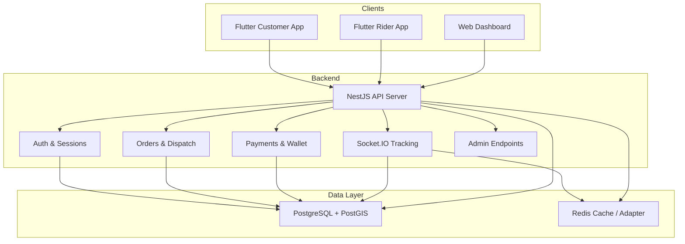
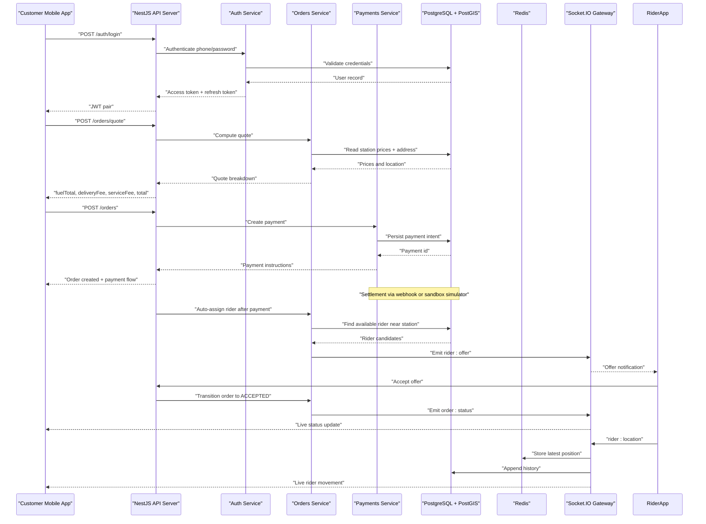
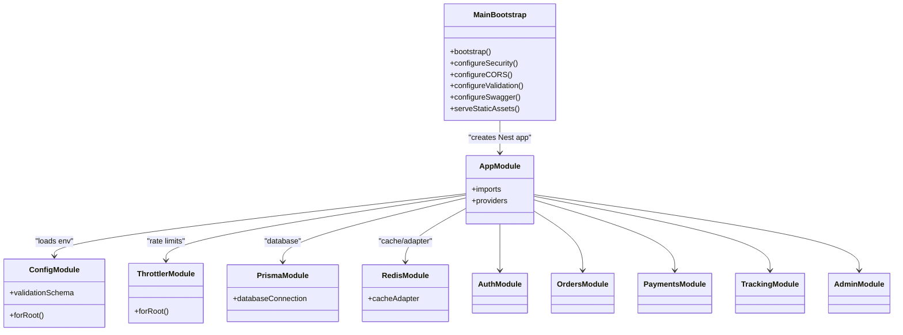
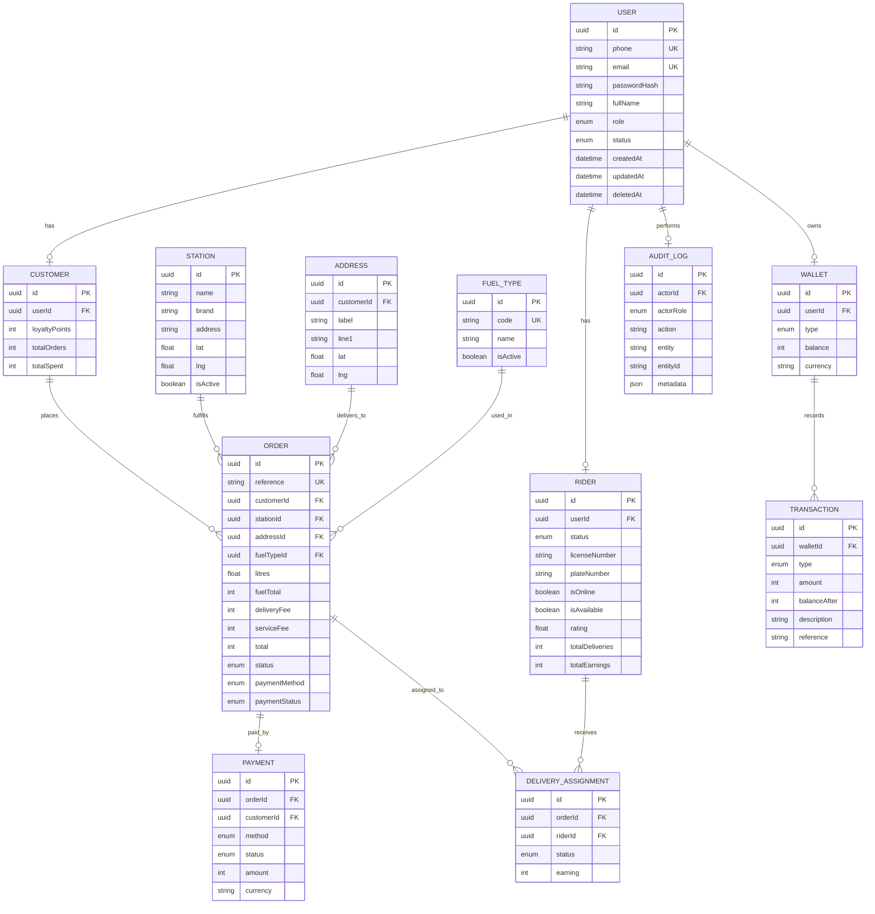
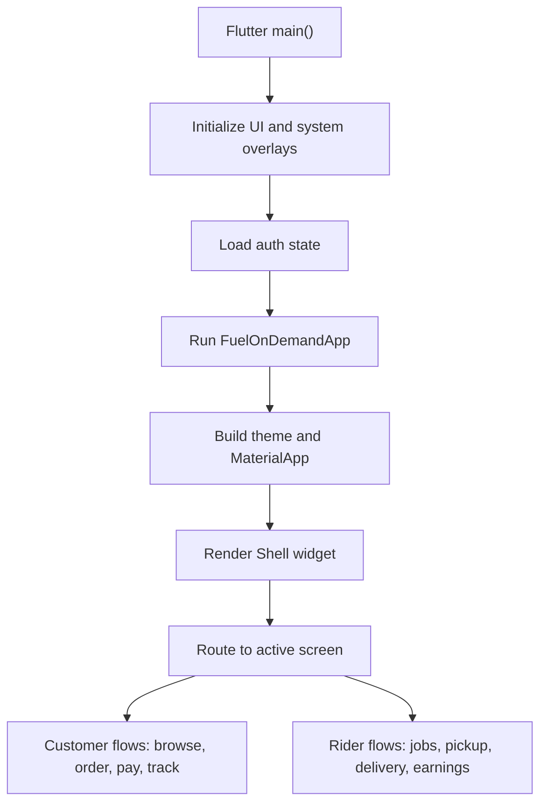
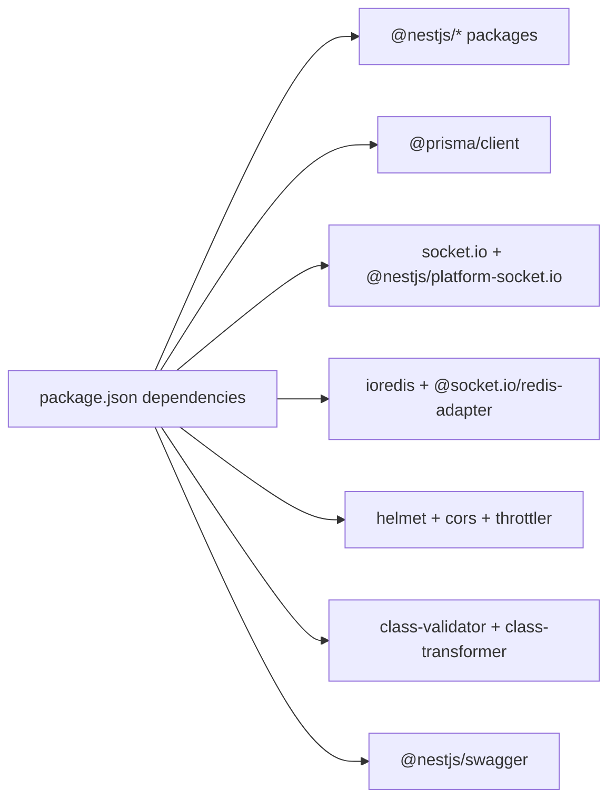

# Project Overview

<cite>
**Referenced Files in This Document**   
- [README.md](file://README.md)
- [backend/README.md](file://backend/README.md)
- [flutter_app/README.md](file://flutter_app/README.md)
- [backend/package.json](file://backend/package.json)
- [flutter_app/pubspec.yaml](file://flutter_app/pubspec.yaml)
- [backend/src/main.ts](file://backend/src/main.ts)
- [backend/src/app.module.ts](file://backend/src/app.module.ts)
- [backend/prisma/schema.prisma](file://backend/prisma/schema.prisma)
- [flutter_app/lib/main.dart](file://flutter_app/lib/main.dart)
- [flutter_app/lib/shell.dart](file://flutter_app/lib/shell.dart)
</cite>

## Table of Contents
1. [Introduction](#introduction)
2. [Project Structure](#project-structure)
3. [Core Components](#core-components)
4. [Architecture Overview](#architecture-overview)
5. [Detailed Component Analysis](#detailed-component-analysis)
6. [Dependency Analysis](#dependency-analysis)
7. [Performance Considerations](#performance-considerations)
8. [Troubleshooting Guide](#troubleshooting-guide)
9. [Conclusion](#conclusion)

## Introduction
FuelConnect is an on-demand fuel delivery platform that connects customers with nearby gas stations through a mobile-first experience and a real-time backend. Customers place orders for petrol, diesel, or other fuels; the system finds a suitable station, calculates pricing, assigns a rider, and tracks the delivery live. Riders receive offers, pick up fuel from stations, and deliver it to customers. Administrators manage users, riders, stations, payments, support tickets, and live operations through a web dashboard served by the same API.

The platform’s core value proposition is convenience and transparency: customers order fuel from their phones, see accurate quotes and live tracking, and pay through wallets or mobile money. Stations gain visibility into demand and can update prices. Riders earn income by completing deliveries. The system enforces security, auditability, and operational control through role-based access, session management, OTP verification, payment webhooks, and an audit log.

Key differentiators from traditional fuel delivery approaches include:
- Real-time Socket.IO tracking instead of static status updates.
- Server-side pricing computed from station fuel prices rather than client-provided amounts.
- Idempotent order creation and payment settlement to prevent duplicates.
- A unified backend serving customer apps, rider apps, and an admin dashboard.
- PostGIS-powered distance, ETA, and dispatch logic.
- Integrated wallet, mobile money, cash-on-delivery, and withdrawal workflows.

**Section sources**
- [README.md:1-18](file://README.md#L1-L18)
- [backend/README.md:1-15](file://backend/README.md#L1-L15)

## Project Structure
The repository contains three primary layers:
- Backend API server built with NestJS, Prisma, PostgreSQL with PostGIS, Redis, and Socket.IO.
- Flutter frontend prototype implementing customer and rider screens.
- Static admin dashboard served directly by the backend under `/dashboard`.

**Diagram sources**
- [backend/src/main.ts:11-93](file://backend/src/main.ts#L11-L93)
- [backend/src/app.module.ts:29-67](file://backend/src/app.module.ts#L29-L67)
- [backend/README.md:107-149](file://backend/README.md#L107-L149)
- [backend/README.md:536-591](file://backend/README.md#L536-L591)

**Section sources**
- [README.md:1-18](file://README.md#L1-L18)
- [backend/README.md:19-46](file://backend/README.md#L19-L46)
- [backend/src/main.ts:11-93](file://backend/src/main.ts#L11-L93)
- [backend/src/app.module.ts:29-67](file://backend/src/app.module.ts#L29-L67)

## Core Components
FuelConnect consists of three main components:

- **Mobile app (Flutter)**  
  Implements the customer and rider user interfaces. It includes authentication flows, ordering, payment selection, live tracking, wallet top-up, rewards, notifications, profile management, support, and rider job workflows. The current implementation uses mocked data but is designed to connect screen-by-screen to the backend contract.

- **Web dashboard (admin console)**  
  Served statically by the backend at `/dashboard`. It provides administrative views for overview statistics, orders, users, riders, stations, payments, withdrawals, support tickets, audit logs, and live deliveries. Authentication uses the same JWT session model as the mobile apps.

- **API server (NestJS)**  
  Provides REST endpoints under `/api/v1`, Swagger documentation at `/docs`, and a Socket.IO namespace at `/tracking`. It handles authentication, OTP, customers, riders, stations, orders, payments, wallets, reviews, support, notifications, tracking, and admin operations. It also serves the static dashboard.

Technology stack highlights:
- Backend runtime: Node.js with TypeScript and NestJS.
- Database: PostgreSQL with PostGIS extension managed via Prisma.
- Caching and real-time fan-out: Redis.
- Real-time communication: Socket.IO gateway for live tracking and operations feeds.
- Frontend: Flutter for cross-platform mobile prototypes.

**Section sources**
- [backend/README.md:1-15](file://backend/README.md#L1-L15)
- [backend/README.md:107-149](file://backend/README.md#L107-L149)
- [backend/README.md:536-591](file://backend/README.md#L536-L591)
- [flutter_app/README.md:1-65](file://flutter_app/README.md#L1-L65)
- [backend/package.json:1-68](file://backend/package.json#L1-L68)
- [flutter_app/pubspec.yaml:1-29](file://flutter_app/pubspec.yaml#L1-L29)

## Architecture Overview
At a high level, FuelConnect follows a layered architecture:

- Clients authenticate and request services over REST.
- The NestJS application validates requests, applies global guards, and routes to feature modules.
- Business logic resides in services for orders, payments, riders, customers, and admin operations.
- Data is persisted in PostgreSQL with PostGIS geography columns for location-aware queries.
- Redis supports caching, rate limiting, and Socket.IO adapter fan-out across instances.
- Socket.IO provides real-time events for order status, rider locations, offers, and operations monitoring.

**Diagram sources**
- [backend/README.md:214-276](file://backend/README.md#L214-L276)
- [backend/README.md:320-358](file://backend/README.md#L320-L358)
- [backend/README.md:361-406](file://backend/README.md#L361-L406)
- [backend/README.md:536-591](file://backend/README.md#L536-L591)

**Section sources**
- [backend/src/main.ts:11-93](file://backend/src/main.ts#L11-L93)
- [backend/src/app.module.ts:29-67](file://backend/src/app.module.ts#L29-L67)
- [backend/README.md:320-358](file://backend/README.md#L320-L358)
- [backend/README.md:536-591](file://backend/README.md#L536-L591)

## Detailed Component Analysis

### Backend API Server
The NestJS bootstrap configures security headers, CORS, global prefix, static assets, validation, Swagger, shutdown hooks, and logging. The root module wires configuration, throttling, Prisma, Redis, common infrastructure, and all feature modules. Global guards enforce throttling, JWT authentication, and role-based access. An audit interceptor records administrative mutations.

Key responsibilities:
- Application lifecycle and middleware setup.
- Environment validation and typed configuration.
- API versioning and documentation.
- Cross-cutting concerns: validation, exceptions, auditing, rate limiting.
- Feature modules: auth, customers, riders, stations, orders, payments, wallets, tracking, notifications, reviews, support, admin.

**Diagram sources**
- [backend/src/main.ts:11-93](file://backend/src/main.ts#L11-L93)
- [backend/src/app.module.ts:29-67](file://backend/src/app.module.ts#L29-L67)

**Section sources**
- [backend/src/main.ts:11-93](file://backend/src/main.ts#L11-L93)
- [backend/src/app.module.ts:29-67](file://backend/src/app.module.ts#L29-L67)
- [backend/package.json:25-49](file://backend/package.json#L25-L49)

### Database Model and Domain Entities
The Prisma schema defines the domain entities for FuelConnect. It includes identity, customers, riders, stations, fuel types, orders, payments, wallets, transactions, tracking, reviews, support, and audit logs. Geography columns are used alongside latitude and longitude to enable spatial queries such as nearest-station and rider-dispatch calculations.

Important entity relationships:
- User is the central identity linked to Customer, Rider, Wallet, Session, OtpCode, Notification, AuditLog, SupportTicket, and StationManager roles.
- Order links Customer, Station, Address, Vehicle, FuelType, Payment, and DeliveryAssignment.
- Rider has vehicles, assignments, locations, current location, and earnings.
- Station has fuel prices and price history.
- Payment and Transaction form an append-only ledger for financial integrity.

**Diagram sources**
- [backend/prisma/schema.prisma:17-132](file://backend/prisma/schema.prisma#L17-L132)
- [backend/prisma/schema.prisma:137-731](file://backend/prisma/schema.prisma#L137-L731)

**Section sources**
- [backend/prisma/schema.prisma:1-731](file://backend/prisma/schema.prisma#L1-L731)

### Flutter Frontend
The Flutter application initializes the UI, sets system overlays, loads authentication state, and renders the shell. The shell hosts all prototype screens for customers and riders, including authentication, home, station browsing, fuel ordering, checkout, payment, tracking, orders, wallet, rewards, notifications, profile, addresses, vehicles, support, safety, and rider job flows.

Current state:
- The app runs locally and demonstrates the full prototype UX.
- Backend integration is not yet wired; most services are mocked.
- The design matches the original Figma prototype with responsive layouts and theme toggles.

**Diagram sources**
- [flutter_app/lib/main.dart:7-57](file://flutter_app/lib/main.dart#L7-L57)
- [flutter_app/lib/shell.dart:15-130](file://flutter_app/lib/shell.dart#L15-L130)

**Section sources**
- [flutter_app/lib/main.dart:7-57](file://flutter_app/lib/main.dart#L7-L57)
- [flutter_app/lib/shell.dart:15-130](file://flutter_app/lib/shell.dart#L15-L130)
- [flutter_app/README.md:1-65](file://flutter_app/README.md#L1-L65)

### Admin Dashboard
The admin dashboard is a dependency-free static site served by the backend under `/dashboard`. It authenticates using the same JWT session model as the mobile apps and calls admin endpoints for statistics, orders, users, riders, stations, payments, withdrawals, support tickets, audit logs, and live deliveries.

Operational characteristics:
- No separate build step or server required.
- Uses `localStorage` for admin session persistence.
- Includes a floating request log for quick smoke testing of API calls.
- Enforces staff-only access at both UI and API levels.

**Section sources**
- [backend/README.md:107-155](file://backend/README.md#L107-L155)
- [backend/src/main.ts:37-38](file://backend/src/main.ts#L37-L38)

## Dependency Analysis
The backend depends on several external libraries and services:
- NestJS ecosystem for controllers, modules, decorators, and HTTP/WebSocket handling.
- Prisma Client for database access and schema management.
- PostgreSQL with PostGIS for relational and geographic data.
- Redis for optional caching and Socket.IO adapter fan-out.
- Socket.IO for real-time tracking and event distribution.
- Helmet, CORS, ValidationPipe, and ThrottlerGuard for security and resilience.

**Diagram sources**
- [backend/package.json:25-49](file://backend/package.json#L25-L49)

**Section sources**
- [backend/package.json:1-68](file://backend/package.json#L1-L68)
- [backend/src/app.module.ts:29-67](file://backend/src/app.module.ts#L29-L67)

## Performance Considerations
- Use Redis in production to enable Socket.IO fan-out across multiple API instances and share live positions.
- Throttle sensitive routes such as login, OTP, and password reset to reduce abuse.
- Keep tracking location updates throttled per rider to avoid excessive writes.
- Prune rider location history periodically to control database growth.
- Store monetary values as integers to avoid floating-point precision issues.
- Leverage PostGIS indexes for efficient distance and proximity queries.
- Serve the admin dashboard statically to reduce backend load for UI assets.

[No sources needed since this section provides general guidance]

## Troubleshooting Guide
Common operational checks:
- Verify the API base URL, port, and global prefix match the Flutter client expectations.
- Confirm Swagger UI is accessible at `/docs` for endpoint inspection.
- Ensure environment variables are validated at boot; invalid configuration prevents startup.
- Check health probe endpoint for basic service readiness.
- For real-time features, confirm Socket.IO namespace and authentication handshake.
- For payments, use the sandbox simulator when external providers are not configured.
- For admin dashboard, sign in with a staff account and verify the floating request log shows successful calls.

**Section sources**
- [backend/README.md:81-103](file://backend/README.md#L81-L103)
- [backend/README.md:158-190](file://backend/README.md#L158-L190)
- [backend/README.md:388-399](file://backend/README.md#L388-L399)
- [backend/README.md:702-710](file://backend/README.md#L702-L710)

## Conclusion
FuelConnect delivers a complete on-demand fuel marketplace by combining a Flutter mobile prototype, a NestJS backend, PostgreSQL with PostGIS, Redis, and Socket.IO. The platform connects customers, stations, and riders through secure authentication, robust order lifecycle management, server-side pricing, real-time tracking, and comprehensive admin controls. While the Flutter frontend currently uses mocked data, the backend is structured to support incremental integration screen-by-screen, enabling teams to validate business flows, improve performance, and scale operations confidently.

[No sources needed since this section summarizes without analyzing specific files]