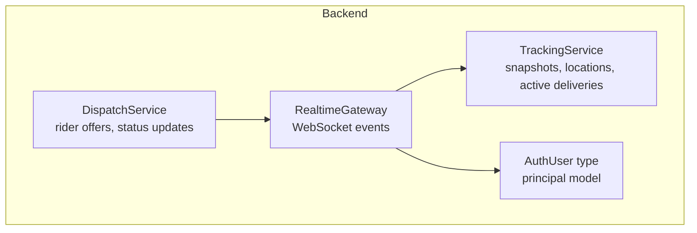
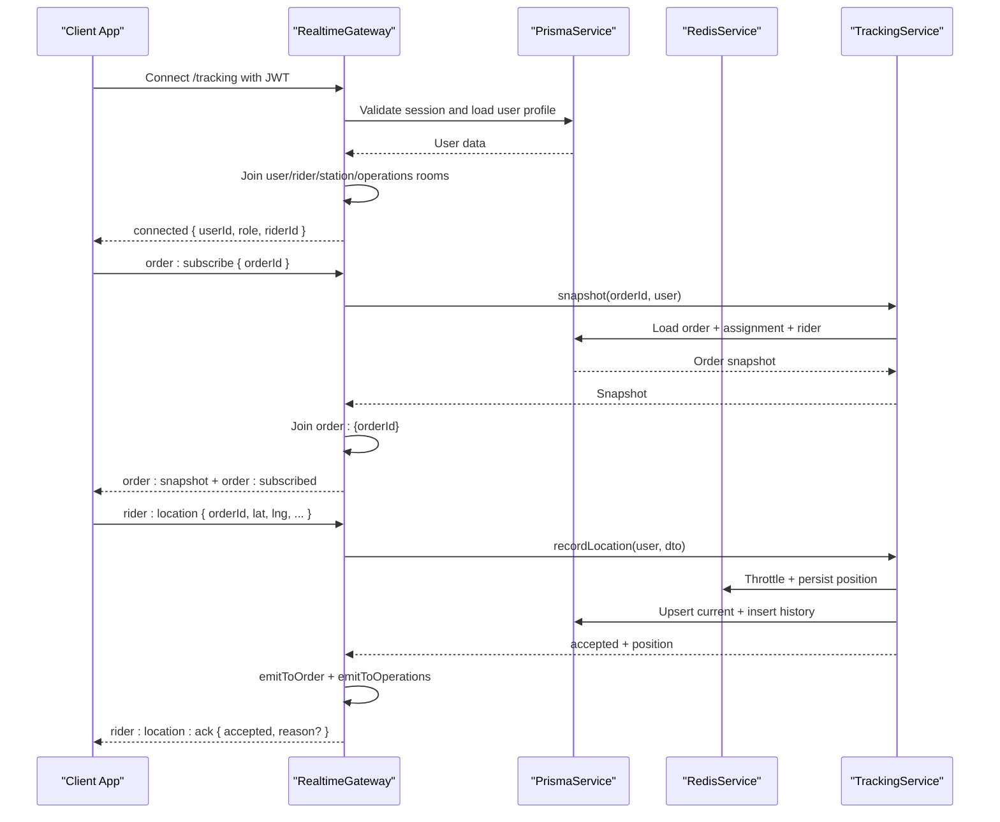
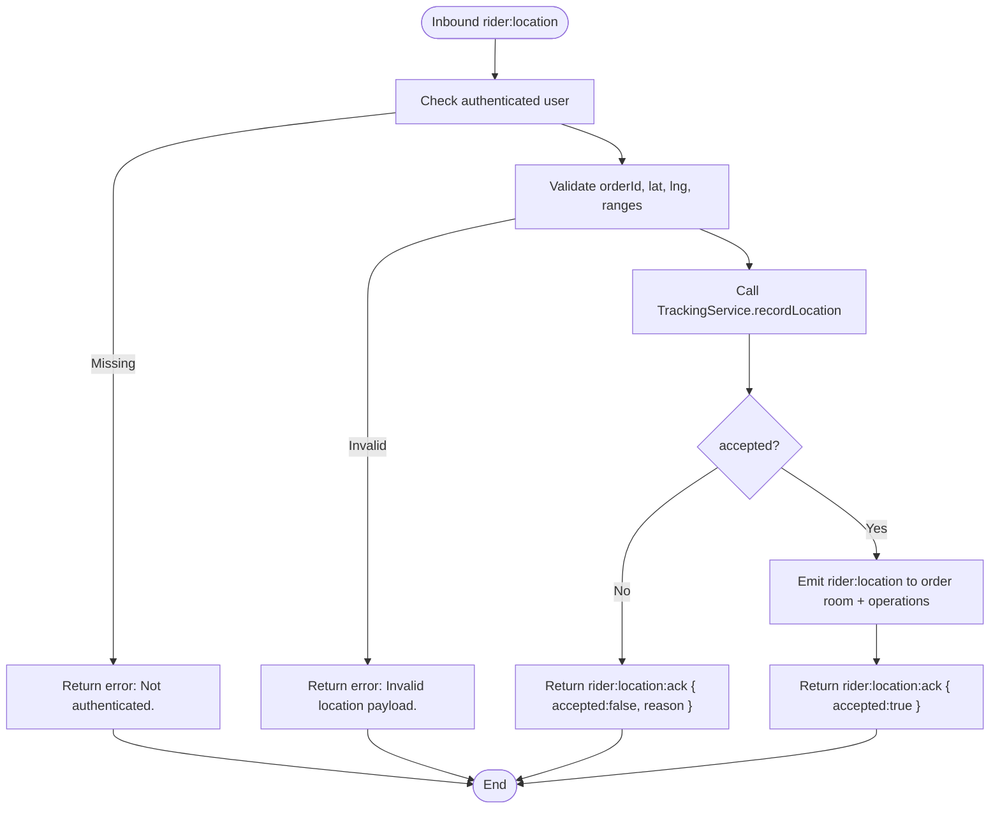
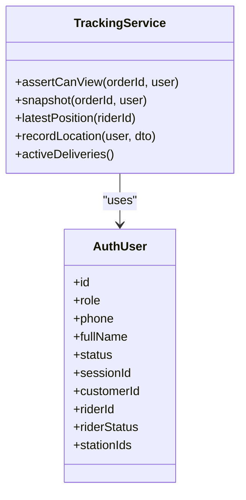
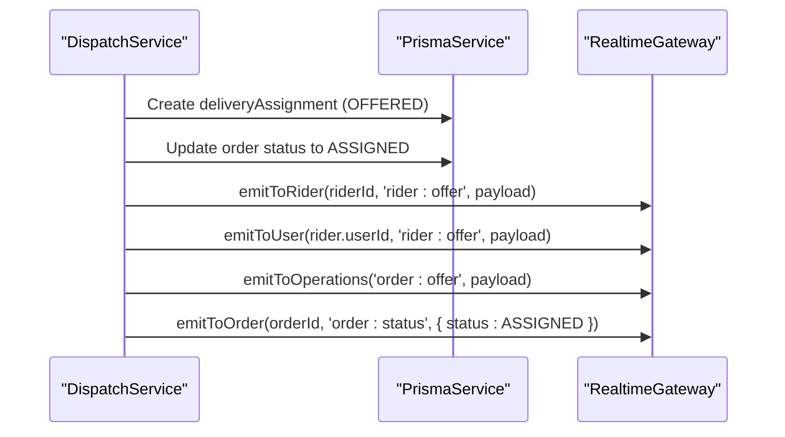
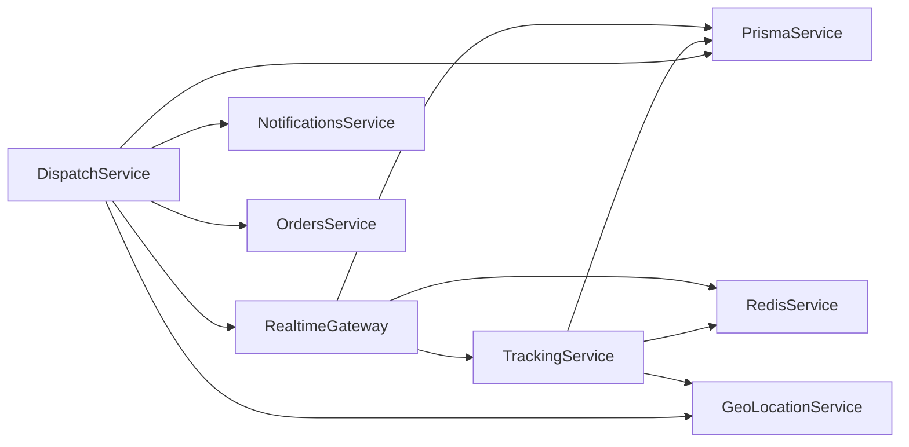

# Event Handling & Message Routing

<cite>
**Referenced Files in This Document**
- [realtime.gateway.ts](file://backend/src/tracking/realtime.gateway.ts)
- [tracking.service.ts](file://backend/src/tracking/tracking.service.ts)
- [dispatch.service.ts](file://backend/src/orders/dispatch.service.ts)
- [auth-user.ts](file://backend/src/common/types/auth-user.ts)
</cite>

## Table of Contents
1. [Introduction](#introduction)
2. [Project Structure](#project-structure)
3. [Core Components](#core-components)
4. [Architecture Overview](#architecture-overview)
5. [Detailed Component Analysis](#detailed-component-analysis)
6. [Dependency Analysis](#dependency-analysis)
7. [Performance Considerations](#performance-considerations)
8. [Troubleshooting Guide](#troubleshooting-guide)
9. [Conclusion](#conclusion)

## Introduction
This document explains the real-time event handling and message routing patterns used by the system’s WebSocket layer. It focuses on:
- Supported events: order:subscribe, order:unsubscribe, admin:subscribe, rider:location
- Message formats, parameter validation, and response structures
- Room-based messaging for order-specific communications, user-targeted notifications, and operations-wide broadcasts
- Authorization checks, permission validation, and access control
- Subscription patterns, payload examples, and error responses
- Ordering guarantees, duplicate handling, and delivery confirmation patterns

The implementation is built with NestJS WebSockets and Socket.IO, using Redis for cross-instance broadcasting and persistence layers for location history and snapshots.

## Project Structure
The real-time communication logic lives under the tracking module and integrates with orders and common authentication types.

**Diagram sources**
- [realtime.gateway.ts:45-61](file://backend/src/tracking/realtime.gateway.ts#L45-L61)
- [tracking.service.ts:32-39](file://backend/src/tracking/tracking.service.ts#L32-L39)
- [dispatch.service.ts:36-49](file://backend/src/orders/dispatch.service.ts#L36-L49)
- [auth-user.ts:8-19](file://backend/src/common/types/auth-user.ts#L8-L19)

**Section sources**
- [realtime.gateway.ts:45-61](file://backend/src/tracking/realtime.gateway.ts#L45-L61)
- [tracking.service.ts:32-39](file://backend/src/tracking/tracking.service.ts#L32-L39)
- [dispatch.service.ts:36-49](file://backend/src/orders/dispatch.service.ts#L36-L49)
- [auth-user.ts:8-19](file://backend/src/common/types/auth-user.ts#L8-L19)

## Core Components
- RealtimeGateway: Handles WebSocket connections, authenticates clients, manages rooms, and routes inbound/outbound events.
- TrackingService: Provides order snapshots, validates access to orders, records rider locations, and exposes active deliveries for the operations feed.
- DispatchService: Creates rider offers, emits offer and status events through the gateway, and coordinates order state transitions.
- AuthUser: Defines the authenticated principal attached to each socket connection.

Key responsibilities:
- Authentication and session validation at connection time
- Role-based room membership (user, rider, station, operations)
- Order-scoped subscriptions and broadcasts
- Rider location ingestion with throttling and persistence
- Operations-wide live map feed for staff

**Section sources**
- [realtime.gateway.ts:80-143](file://backend/src/tracking/realtime.gateway.ts#L80-L143)
- [tracking.service.ts:41-75](file://backend/src/tracking/tracking.service.ts#L41-L75)
- [dispatch.service.ts:163-246](file://backend/src/orders/dispatch.service.ts#L163-L246)
- [auth-user.ts:8-19](file://backend/src/common/types/auth-user.ts#L8-L19)

## Architecture Overview
The real-time architecture uses a single Socket.IO namespace for tracking-related events. Clients authenticate via JWT during handshake, join logical rooms based on roles and entities, and subscribe to order-specific channels. Staff members can also subscribe to an operations channel for system-wide visibility.

**Diagram sources**
- [realtime.gateway.ts:80-143](file://backend/src/tracking/realtime.gateway.ts#L80-L143)
- [realtime.gateway.ts:151-173](file://backend/src/tracking/realtime.gateway.ts#L151-L173)
- [realtime.gateway.ts:201-252](file://backend/src/tracking/realtime.gateway.ts#L201-L252)
- [tracking.service.ts:77-126](file://backend/src/tracking/tracking.service.ts#L77-L126)
- [tracking.service.ts:155-229](file://backend/src/tracking/tracking.service.ts#L155-L229)

## Detailed Component Analysis

### RealtimeGateway
Responsibilities:
- Establishes the Socket.IO server under the /tracking namespace
- Authenticates clients using JWT from handshake auth, headers, or query
- Builds an AuthUser principal and joins appropriate rooms
- Validates and handles inbound events
- Emits outbound events to targeted rooms

Authentication flow:
- Extracts token from handshake.auth.token, authorization header, or query.token
- Verifies JWT type is access and validates session existence and status
- Attaches AuthUser to client.data and joins rooms:
  - user:{userId}
  - rider:{riderId} if applicable
  - station:{stationId} for each managed station
  - operations for staff roles

Event handlers:
- order:subscribe
  - Requires authenticated user and valid UUID orderId
  - Calls TrackingService.snapshot to verify access and build snapshot
  - Joins order:{orderId} and emits order:snapshot
  - Returns order:subscribed
- order:unsubscribe
  - Leaves order:{orderId} if provided and valid
  - Returns order:unsubscribed
- admin:subscribe
  - Requires authenticated staff role (admin/super-admin/station-manager)
  - Joins operations room
  - Emits operations:snapshot with active deliveries
  - Returns operations:subscribed
- rider:location
  - Requires authenticated user
  - Validates orderId (UUID), lat/lng (finite numbers within bounds)
  - Optional fields: speedKph, heading, accuracyM
  - Delegates to TrackingService.recordLocation
  - If accepted, emits rider:location to order:{orderId} and operations
  - Always returns rider:location:ack with accepted flag and optional reason

Outbound helpers:
- emitToUser(userId, event, payload)
- emitToRider(riderId, event, payload)
- emitToOrder(orderId, event, payload)
- emitToOperations(event, payload)

Error handling:
- Connection failures emit unauthorized and disconnect
- Inbound errors return event: error with message
- Location ack includes accepted=false and reason when rejected

**Diagram sources**
- [realtime.gateway.ts:201-252](file://backend/src/tracking/realtime.gateway.ts#L201-L252)

**Section sources**
- [realtime.gateway.ts:45-78](file://backend/src/tracking/realtime.gateway.ts#L45-L78)
- [realtime.gateway.ts:80-143](file://backend/src/tracking/realtime.gateway.ts#L80-L143)
- [realtime.gateway.ts:151-184](file://backend/src/tracking/realtime.gateway.ts#L151-L184)
- [realtime.gateway.ts:186-199](file://backend/src/tracking/realtime.gateway.ts#L186-L199)
- [realtime.gateway.ts:201-252](file://backend/src/tracking/realtime.gateway.ts#L201-L252)
- [realtime.gateway.ts:255-292](file://backend/src/tracking/realtime.gateway.ts#L255-L292)

### TrackingService
Responsibilities:
- Access control for order snapshots
- Building rich order snapshots including assignment and rider info
- Managing rider location ingestion with throttling and persistence
- Providing active deliveries for the operations feed

Access control:
- assertCanView verifies that the requester is:
  - The order owner (customer)
  - The assigned rider
  - Admin or super-admin
  - Station manager managing the order’s station
- Throws forbidden exception if not authorized

Snapshot:
- Loads order with related station, address, fuel type, customer, and assignments
- Selects the most relevant assignment (accepted or completed, else first)
- Retrieves latest rider position from Redis or database
- Returns normalized snapshot structure

Location recording:
- Enforces rider-only publishing
- Validates latitude/longitude
- Confirms assignment exists and is accepted
- Ensures order is in an active delivery status
- Applies server-side throttle via Redis key per rider
- Persists:
  - Latest position to Redis with TTL
  - Current location to Postgres via GeoLocationService
  - History entry to Postgres via GeoLocationService
- Returns accepted=true with position details

Active deliveries:
- Queries recent active orders and enriches with rider positions
- Used to populate operations:snapshot

**Diagram sources**
- [tracking.service.ts:41-75](file://backend/src/tracking/tracking.service.ts#L41-L75)
- [tracking.service.ts:77-126](file://backend/src/tracking/tracking.service.ts#L77-L126)
- [tracking.service.ts:155-229](file://backend/src/tracking/tracking.service.ts#L155-L229)
- [tracking.service.ts:234-280](file://backend/src/tracking/tracking.service.ts#L234-L280)
- [auth-user.ts:8-19](file://backend/src/common/types/auth-user.ts#L8-L19)

**Section sources**
- [tracking.service.ts:41-75](file://backend/src/tracking/tracking.service.ts#L41-L75)
- [tracking.service.ts:77-126](file://backend/src/tracking/tracking.service.ts#L77-L126)
- [tracking.service.ts:155-229](file://backend/src/tracking/tracking.service.ts#L155-L229)
- [tracking.service.ts:234-280](file://backend/src/tracking/tracking.service.ts#L234-L280)

### DispatchService
Responsibilities:
- Auto-assigning riders to orders near stations
- Manually assigning riders for admins
- Emitting rider offers and order status updates via RealtimeGateway
- Sweeping expired offers and re-dispatching

Message emissions:
- Emits rider:offer to the specific rider and their user room
- Emits order:offer to the operations room
- Emits order:status to the order room when an order becomes assigned

**Diagram sources**
- [dispatch.service.ts:163-246](file://backend/src/orders/dispatch.service.ts#L163-L246)

**Section sources**
- [dispatch.service.ts:63-110](file://backend/src/orders/dispatch.service.ts#L63-L110)
- [dispatch.service.ts:113-161](file://backend/src/orders/dispatch.service.ts#L113-L161)
- [dispatch.service.ts:163-246](file://backend/src/orders/dispatch.service.ts#L163-L246)
- [dispatch.service.ts:320-353](file://backend/src/orders/dispatch.service.ts#L320-L353)

## Dependency Analysis
- RealtimeGateway depends on:
  - JwtService for token verification
  - PrismaService for user/session lookup
  - RedisService for adapter setup and potential caching
  - TrackingService for snapshots, location recording, and active deliveries
- TrackingService depends on:
  - PrismaService for order, assignment, rider, and location queries
  - RedisService for throttle keys and hot location cache
  - GeoLocationService for upserting current location and inserting history
  - ConfigService for minIntervalMs
- DispatchService depends on:
  - PrismaService for order and assignment management
  - GeoLocationService for nearby rider search
  - RealtimeGateway for emitting offers and status updates
  - NotificationsService for persistent notifications
  - OrdersService for order transitions

**Diagram sources**
- [realtime.gateway.ts:56-61](file://backend/src/tracking/realtime.gateway.ts#L56-L61)
- [tracking.service.ts:34-39](file://backend/src/tracking/tracking.service.ts#L34-L39)
- [dispatch.service.ts:42-49](file://backend/src/orders/dispatch.service.ts#L42-L49)

**Section sources**
- [realtime.gateway.ts:56-61](file://backend/src/tracking/realtime.gateway.ts#L56-L61)
- [tracking.service.ts:34-39](file://backend/src/tracking/tracking.service.ts#L34-L39)
- [dispatch.service.ts:42-49](file://backend/src/orders/dispatch.service.ts#L42-L49)

## Performance Considerations
- Redis adapter enables multi-instance broadcasting; without it, only a single instance receives messages.
- Rider location ingestion is throttled per rider using Redis to limit frequency.
- Latest rider positions are cached in Redis with TTL to reduce database reads.
- Active deliveries query limits results to 100 entries for the operations feed.
- Polling transport is enabled alongside WebSocket for fallback connectivity.

[No sources needed since this section provides general guidance]

## Troubleshooting Guide
Common issues and resolutions:
- Unauthorized connection:
  - Cause: Missing or invalid JWT, wrong token type, revoked/expired session
  - Symptom: Client receives unauthorized and disconnects
  - Resolution: Ensure handshake includes valid access token and active session
- Invalid order subscription:
  - Cause: Missing or non-UUID orderId
  - Symptom: Error event returned with message about required orderId
  - Resolution: Send a valid UUID orderId
- Access denied to order:
  - Cause: Requester is not owner, assigned rider, staff, or station manager
  - Symptom: Forbidden error during snapshot retrieval
  - Resolution: Verify user permissions and order relationships
- Invalid location payload:
  - Cause: Missing orderId, lat/lng out of range, or non-finite values
  - Symptom: Error event with message about invalid payload
  - Resolution: Validate and normalize payload before sending
- Location refused:
  - Cause: Not assigned to delivery, order not active, or throttled
  - Symptom: rider:location:ack with accepted=false and reason
  - Resolution: Confirm assignment and order status; respect throttle interval

**Section sources**
- [realtime.gateway.ts:131-143](file://backend/src/tracking/realtime.gateway.ts#L131-L143)
- [realtime.gateway.ts:151-173](file://backend/src/tracking/realtime.gateway.ts#L151-L173)
- [realtime.gateway.ts:201-252](file://backend/src/tracking/realtime.gateway.ts#L201-L252)
- [tracking.service.ts:41-75](file://backend/src/tracking/tracking.service.ts#L41-L75)
- [tracking.service.ts:155-229](file://backend/src/tracking/tracking.service.ts#L155-L229)

## Conclusion
The real-time system provides robust event handling and message routing for order tracking and operations monitoring. It enforces strict authentication and authorization, validates all incoming payloads, and uses room-based messaging to target order-specific, user-specific, and operations-wide audiences. Rider location updates are throttled and persisted efficiently, while dispatch flows integrate seamlessly with the WebSocket layer to deliver offers and status changes in real time.

[No sources needed since this section summarizes without analyzing specific files]