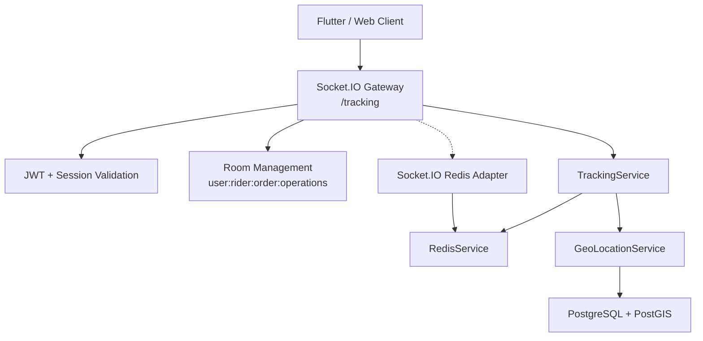
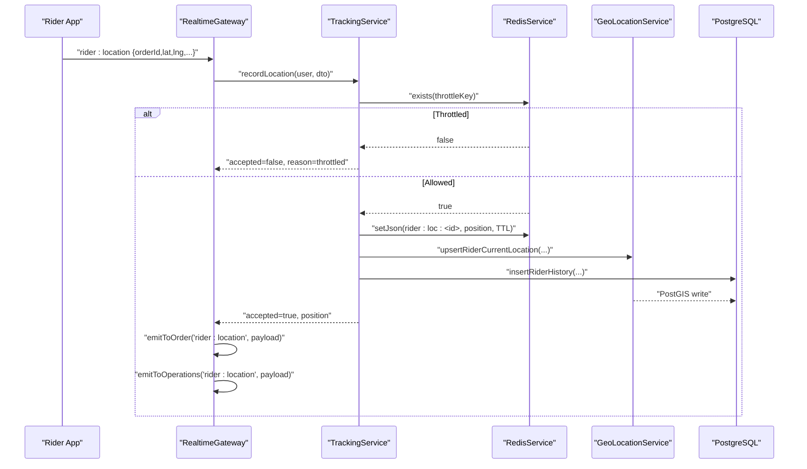
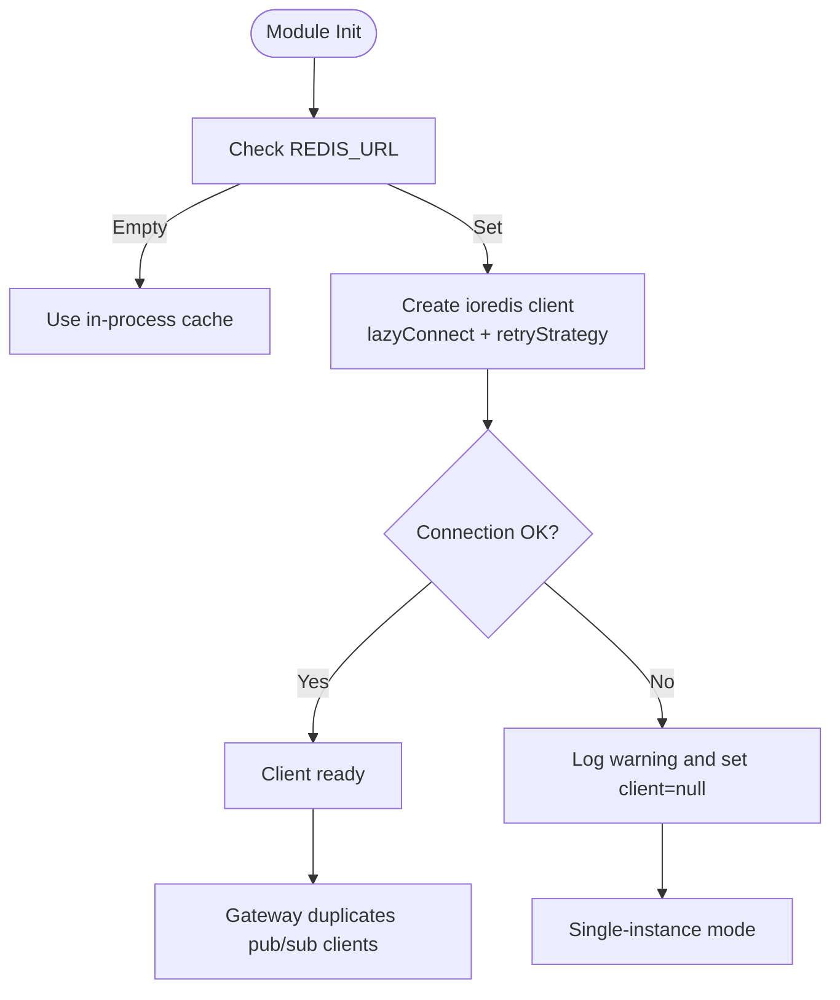
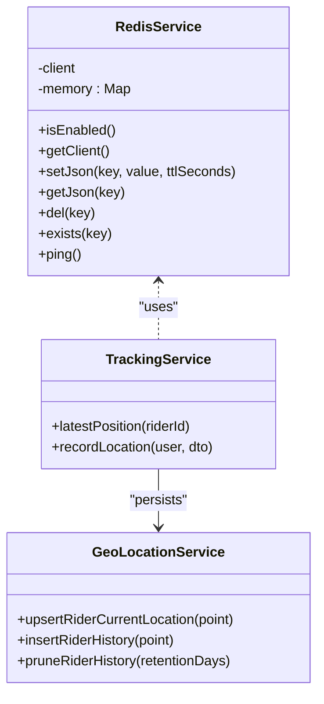
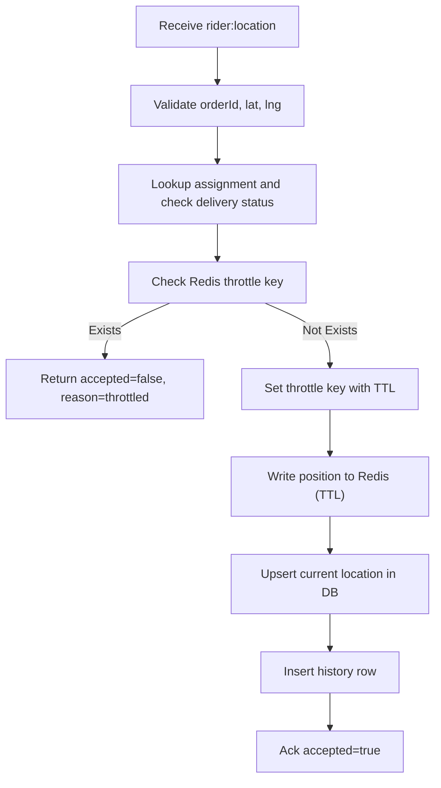
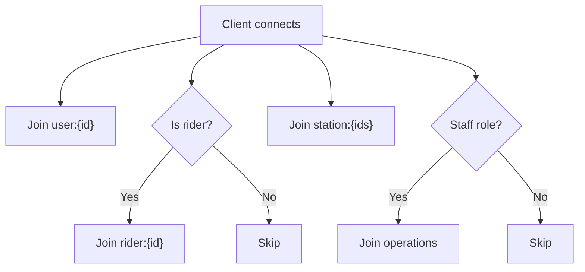
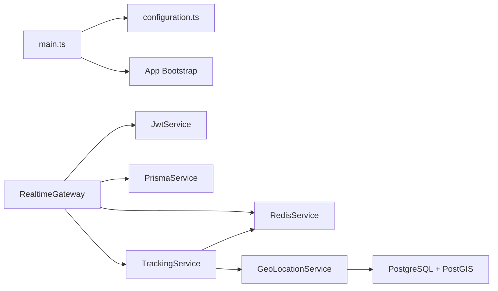

# Performance Optimization & Scaling

<cite>
**Referenced Files in This Document**
- [redis.service.ts](file://backend/src/redis/redis.service.ts)
- [realtime.gateway.ts](file://backend/src/tracking/realtime.gateway.ts)
- [tracking.service.ts](file://backend/src/tracking/tracking.service.ts)
- [configuration.ts](file://backend/src/config/configuration.ts)
- [main.ts](file://backend/src/main.ts)
- [geo-location.service.ts](file://backend/src/common/services/geo-location.service.ts)
- [README.md](file://backend/README.md)
</cite>

## Table of Contents
1. [Introduction](#introduction)
2. [Project Structure](#project-structure)
3. [Core Components](#core-components)
4. [Architecture Overview](#architecture-overview)
5. [Detailed Component Analysis](#detailed-component-analysis)
6. [Dependency Analysis](#dependency-analysis)
7. [Performance Considerations](#performance-considerations)
8. [Troubleshooting Guide](#troubleshooting-guide)
9. [Conclusion](#conclusion)

## Introduction
This document explains how the real-time tracking system is designed for performance and horizontal scaling. It focuses on:
- Redis adapter configuration for multi-instance Socket.IO fan-out
- Connection resilience and fallback behavior
- Location update throttling, message broadcasting, and room management
- Memory and persistence patterns for live positions and history
- Monitoring approaches for WebSocket connections, memory usage, and operational metrics
- Guidelines for high-concurrency scenarios, connection limits, and resource allocation
- Debugging tools and common bottlenecks in WebSocket applications

The guidance is grounded in the actual backend implementation and configuration.

## Project Structure
The real-time layer is implemented with NestJS, Socket.IO, and Redis:
- `RealtimeGateway` handles authentication, rooms, and event routing over `/tracking`.
- `TrackingService` enforces business rules, throttles location updates, and coordinates Redis and database writes.
- `RedisService` provides a resilient Redis client with an in-process fallback for development.
- `GeoLocationService` persists current locations and historical GPS points using PostGIS.
- Configuration centralizes tracking intervals, retention, and environment variables.

**Diagram sources**
- [realtime.gateway.ts:45-78](file://backend/src/tracking/realtime.gateway.ts#L45-L78)
- [realtime.gateway.ts:80-148](file://backend/src/tracking/realtime.gateway.ts#L80-L148)
- [tracking.service.ts:128-229](file://backend/src/tracking/tracking.service.ts#L128-L229)
- [redis.service.ts:28-52](file://backend/src/redis/redis.service.ts#L28-L52)
- [geo-location.service.ts:43-86](file://backend/src/common/services/geo-location.service.ts#L43-L86)

**Section sources**
- [realtime.gateway.ts:45-78](file://backend/src/tracking/realtime.gateway.ts#L45-L78)
- [tracking.service.ts:128-229](file://backend/src/tracking/tracking.service.ts#L128-L229)
- [redis.service.ts:28-52](file://backend/src/redis/redis.service.ts#L28-L52)
- [configuration.ts:48-96](file://backend/src/config/configuration.ts#L48-L96)

## Core Components
- **RedisService**: Manages a single ioredis client, supports lazy connect, retry strategy, error logging, and graceful shutdown. Provides JSON get/set/delete/exists/ping helpers and falls back to an in-memory map when Redis is unavailable.
- **RealtimeGateway**: Authenticates sockets via JWT, joins scoped rooms, subscribes clients to order snapshots, and broadcasts rider location updates to order rooms and operations.
- **TrackingService**: Validates rider permissions, enforces per-rider throttling, writes latest position to Redis (hot path), updates PostgreSQL current location, and appends history rows.
- **GeoLocationService**: Encapsulates PostGIS writes for current locations and history, plus pruning and distance queries.
- **Configuration**: Centralizes `tracking.minIntervalMs`, `tracking.historyRetentionDays`, and other runtime settings.

**Section sources**
- [redis.service.ts:10-67](file://backend/src/redis/redis.service.ts#L10-L67)
- [realtime.gateway.ts:29-78](file://backend/src/tracking/realtime.gateway.ts#L29-L78)
- [tracking.service.ts:32-39](file://backend/src/tracking/tracking.service.ts#L32-L39)
- [geo-location.service.ts:15-27](file://backend/src/common/services/geo-location.service.ts#L15-L27)
- [configuration.ts:34-38](file://backend/src/config/configuration.ts#L34-L38)

## Architecture Overview
The system uses Socket.IO namespaces and rooms for targeted messaging, with Redis enabling cross-instance fan-out. The hot path for live maps reads from Redis; cold reads fall back to PostgreSQL.

**Diagram sources**
- [realtime.gateway.ts:201-252](file://backend/src/tracking/realtime.gateway.ts#L201-L252)
- [tracking.service.ts:155-229](file://backend/src/tracking/tracking.service.ts#L155-L229)
- [redis.service.ts:69-122](file://backend/src/redis/redis.service.ts#L69-L122)
- [geo-location.service.ts:43-86](file://backend/src/common/services/geo-location.service.ts#L43-L86)

## Detailed Component Analysis

### Redis Adapter and Horizontal Scaling
- The gateway configures the Socket.IO Redis adapter by duplicating the shared Redis client into separate publisher and subscriber clients.
- If Redis is not available, the gateway logs that it runs without the adapter, limiting fan-out to a single instance.
- RedisService creates one ioredis client with:
  - Lazy connection
  - Limited retries per request
  - Disabled offline queue
  - Exponential backoff capped at a maximum delay
  - Error logging and graceful quit on module destroy

**Diagram sources**
- [redis.service.ts:28-52](file://backend/src/redis/redis.service.ts#L28-L52)
- [realtime.gateway.ts:63-78](file://backend/src/tracking/realtime.gateway.ts#L63-L78)

**Section sources**
- [redis.service.ts:28-52](file://backend/src/redis/redis.service.ts#L28-L52)
- [realtime.gateway.ts:63-78](file://backend/src/tracking/realtime.gateway.ts#L63-L78)

### Connection Pooling Strategies
- The codebase uses a single ioredis client per process rather than an explicit pool. This reduces overhead but means all Redis operations share the same connection pool managed by ioredis.
- For horizontal scaling, the gateway duplicates the client for pub/sub channels used by the Socket.IO adapter.
- Recommendations:
  - Keep one Redis client per service/process.
  - Tune ioredis options if needed (e.g., maxRetriesPerRequest, retryStrategy).
  - Avoid creating new clients per request or per handler.

**Section sources**
- [redis.service.ts:35-45](file://backend/src/redis/redis.service.ts#L35-L45)
- [realtime.gateway.ts:70-74](file://backend/src/tracking/realtime.gateway.ts#L70-L74)

### Memory Management Best Practices
- RedisService maintains an in-memory Map fallback keyed by string keys with expiration timestamps. Expired entries are lazily removed on read.
- Live positions use short TTLs in Redis to keep hot data fresh while allowing automatic cleanup.
- History retention is enforced by pruning old rows in PostgreSQL.

**Diagram sources**
- [redis.service.ts:20-132](file://backend/src/redis/redis.service.ts#L20-L132)
- [tracking.service.ts:128-229](file://backend/src/tracking/tracking.service.ts#L128-L229)
- [geo-location.service.ts:43-140](file://backend/src/common/services/geo-location.service.ts#L43-L140)

**Section sources**
- [redis.service.ts:69-122](file://backend/src/redis/redis.service.ts#L69-L122)
- [tracking.service.ts:128-144](file://backend/src/tracking/tracking.service.ts#L128-L144)
- [geo-location.service.ts:132-140](file://backend/src/common/services/geo-location.service.ts#L132-L140)

### Location Update Throttling Mechanisms
- Per-rider throttle key prevents rapid-fire location pings.
- The minimum interval is configurable via `TRACKING_MIN_INTERVAL_MS`; default is 2500 ms.
- Throttling is implemented with a Redis key that expires after the configured interval.

**Diagram sources**
- [tracking.service.ts:155-229](file://backend/src/tracking/tracking.service.ts#L155-L229)
- [configuration.ts:92-95](file://backend/src/config/configuration.ts#L92-L95)

**Section sources**
- [tracking.service.ts:181-189](file://backend/src/tracking/tracking.service.ts#L181-L189)
- [configuration.ts:92-95](file://backend/src/config/configuration.ts#L92-L95)
- [README.md:188-189](file://backend/README.md#L188-L189)

### Message Batching Techniques
- The current implementation emits each accepted location immediately to the order room and operations room. There is no explicit batching window.
- To reduce broadcast volume under high concurrency:
  - Introduce a small time-based batch window (e.g., 100–250 ms) to aggregate multiple positions before emitting.
  - Deduplicate identical positions within the window.
  - Ensure acknowledgments remain immediate while broadcasts are coalesced.

[No sources needed since this section proposes conceptual improvements]

### Efficient Room Management Patterns
- Clients join:
  - `user:{userId}` for personal notifications
  - `rider:{riderId}` for rider-specific events
  - `station:{stationId}` for station-scoped events
  - `order:{orderId}` for delivery tracking
  - `operations` for staff/admin live feed
- The gateway ensures proper joining and leaving during subscription and unsubscription flows.

**Diagram sources**
- [realtime.gateway.ts:122-129](file://backend/src/tracking/realtime.gateway.ts#L122-L129)

**Section sources**
- [realtime.gateway.ts:122-129](file://backend/src/tracking/realtime.gateway.ts#L122-L129)

### Monitoring Approaches for WebSocket Connections
- The bootstrap enables shutdown hooks and exposes Swagger UI for API inspection.
- The gateway logs connection and disconnection events at debug level.
- Health checks can leverage `RedisService.ping()` to validate Redis connectivity.

Recommendations:
- Add a dedicated health endpoint exposing:
  - Redis ping result
  - Active socket counts per namespace
  - Room sizes for critical rooms (`operations`, active orders)
- Instrument application metrics:
  - WebSocket connection count
  - Event throughput (per event type)
  - Throttle rejection rate
  - Redis latency and error rates
  - Database write latency for geo operations

**Section sources**
- [main.ts:95-103](file://backend/src/main.ts#L95-L103)
- [realtime.gateway.ts:145-148](file://backend/src/tracking/realtime.gateway.ts#L145-L148)
- [redis.service.ts:124-131](file://backend/src/redis/redis.service.ts#L124-L131)

### Memory Usage Tracking and Performance Metrics Collection
- No built-in memory metrics collection is present in the analyzed files.
- Recommended additions:
  - Periodically sample `process.memoryUsage()` and expose via a metrics endpoint.
  - Track heap growth trends and alert on sustained increases.
  - Monitor long-lived objects such as large room payloads or cached snapshots.

[No sources needed since this section provides general guidance]

### Handling High-Concurrency Scenarios
- Throttling protects against excessive location pings.
- Use Redis-backed state for cross-instance coordination (adapter, throttle keys).
- Limit snapshot query size (already bounded in admin active deliveries).
- Consider:
  - Backpressure handling in clients
  - Adaptive throttling based on server load
  - Separate queues for heavy writes (history vs. current location)

**Section sources**
- [tracking.service.ts:234-280](file://backend/src/tracking/tracking.service.ts#L234-L280)
- [tracking.service.ts:181-189](file://backend/src/tracking/tracking.service.ts#L181-L189)

### Connection Limits and Resource Allocation
- Socket.IO defaults may need tuning for high concurrency:
  - Maximum HTTP uplink size
  - Ping/pong intervals and timeouts
  - MaxHttpBufferSize
- Node.js process limits:
  - Increase heap size if necessary
  - Use clustering only if you understand WebSocket affinity and session sharing
- External resources:
  - Ensure Redis has sufficient memory and persistence tuned for TTL-heavy workloads
  - Ensure PostgreSQL has adequate indexes and connection pools for geo queries

[No sources needed since this section provides general guidance]

## Dependency Analysis
The following diagram shows key dependencies among core components involved in real-time communication.

**Diagram sources**
- [main.ts:12-23](file://backend/src/main.ts#L12-L23)
- [realtime.gateway.ts:56-61](file://backend/src/tracking/realtime.gateway.ts#L56-L61)
- [tracking.service.ts:34-39](file://backend/src/tracking/tracking.service.ts#L34-L39)
- [geo-location.service.ts:24-27](file://backend/src/common/services/geo-location.service.ts#L24-L27)

**Section sources**
- [main.ts:12-23](file://backend/src/main.ts#L12-L23)
- [realtime.gateway.ts:56-61](file://backend/src/tracking/realtime.gateway.ts#L56-L61)
- [tracking.service.ts:34-39](file://backend/src/tracking/tracking.service.ts#L34-L39)

## Performance Considerations
- Hot path optimization:
  - Read latest position from Redis first; fall back to PostgreSQL only when missing.
  - Keep Redis TTLs short to avoid stale data and reduce memory pressure.
- Write path optimization:
  - Batch history inserts where possible.
  - Use UPSERT for current locations to minimize duplicate writes.
- Broadcasting efficiency:
  - Prefer room-targeted emissions over global broadcasts.
  - Consider debouncing or coalescing frequent updates.
- Database considerations:
  - Ensure PostGIS extension is enabled and indexed appropriately.
  - Prune history regularly to prevent table bloat.

**Section sources**
- [tracking.service.ts:128-144](file://backend/src/tracking/tracking.service.ts#L128-L144)
- [geo-location.service.ts:43-86](file://backend/src/common/services/geo-location.service.ts#L43-L86)
- [geo-location.service.ts:132-140](file://backend/src/common/services/geo-location.service.ts#L132-L140)

## Troubleshooting Guide
Common issues and diagnostics:
- Redis unavailable:
  - Symptom: Logs indicate fallback to in-process cache; Socket.IO runs without Redis adapter.
  - Action: Verify `REDIS_URL`, network reachability, and Redis availability.
- Throttled location updates:
  - Symptom: Acknowledgment returns `accepted=false, reason=throttled`.
  - Action: Adjust `TRACKING_MIN_INTERVAL_MS` or investigate client-side frequency.
- Unauthorized sockets:
  - Symptom: Client receives unauthorized event and disconnects.
  - Action: Validate JWT token, session validity, and token transport method.
- Missing snapshots:
  - Symptom: Order subscription does not return expected data.
  - Action: Check permissions, order existence, and assignment status.

Operational tips:
- Use Swagger UI to inspect API endpoints and test non-real-time paths.
- Log Redis ping results and include them in health checks.
- Monitor room membership for `operations` and active orders to detect leaks.

**Section sources**
- [redis.service.ts:46-51](file://backend/src/redis/redis.service.ts#L46-L51)
- [realtime.gateway.ts:136-142](file://backend/src/tracking/realtime.gateway.ts#L136-L142)
- [tracking.service.ts:181-189](file://backend/src/tracking/tracking.service.ts#L181-L189)
- [main.ts:90-103](file://backend/src/main.ts#L90-L103)

## Conclusion
The real-time tracking system balances low-latency live updates with scalable architecture through:
- Redis-backed hot path caching and cross-instance fan-out
- Robust connection handling and graceful fallbacks
- Server-enforced throttling and efficient room scoping
- Clear separation between live positions and historical records

For further scaling:
- Implement message batching for high-frequency updates
- Add comprehensive monitoring and metrics collection
- Tune Socket.IO and Node.js parameters for your workload
- Continuously prune history and monitor memory usage

[No sources needed since this section summarizes without analyzing specific files]