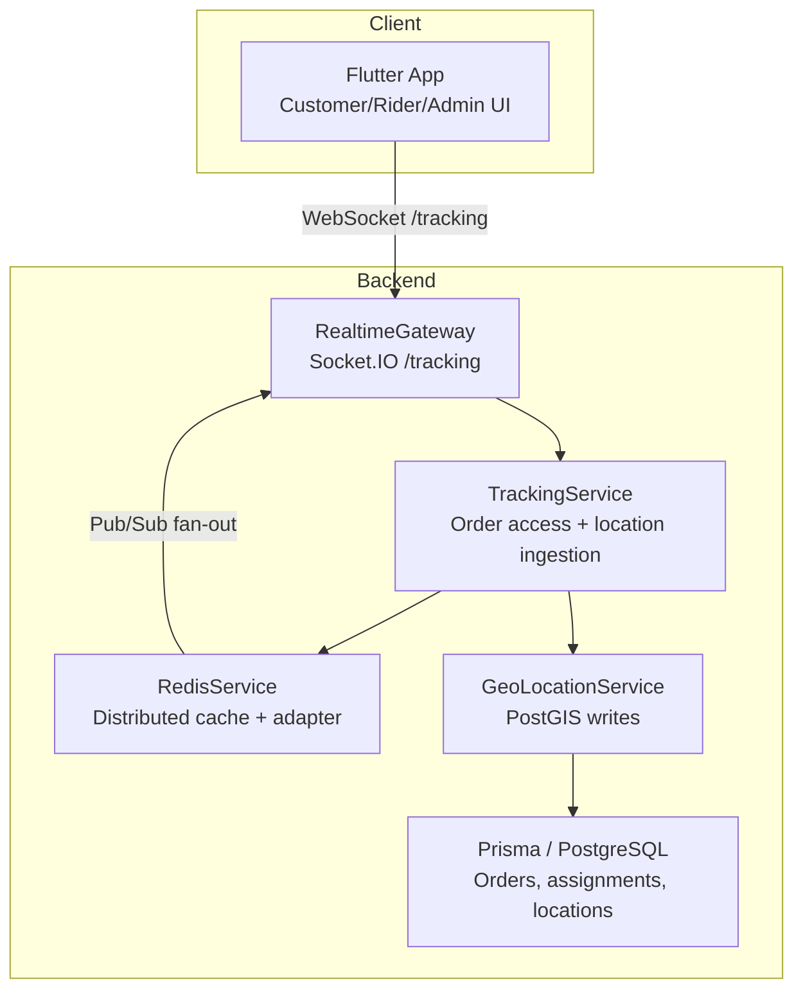
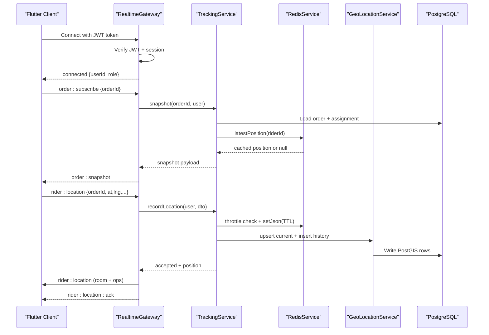
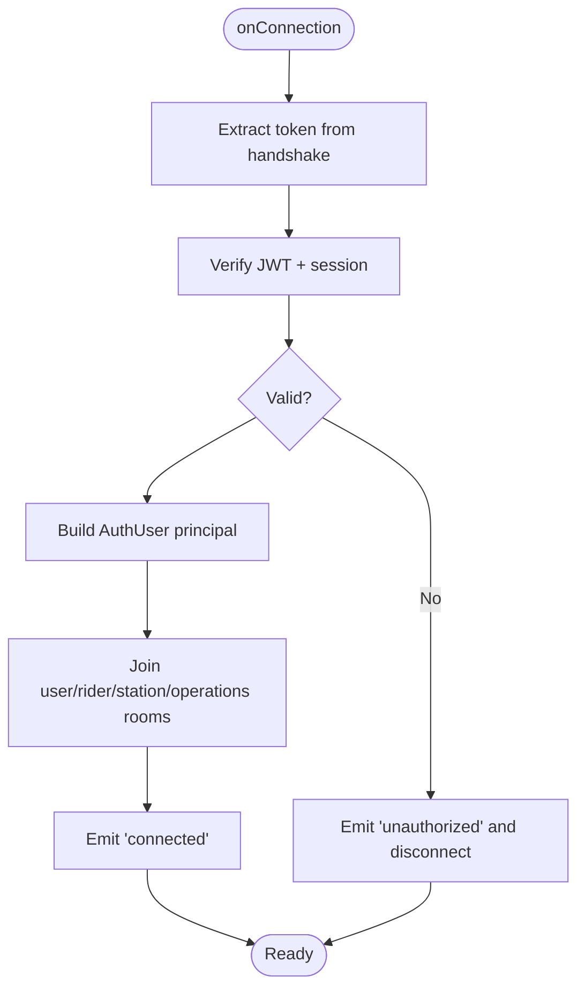
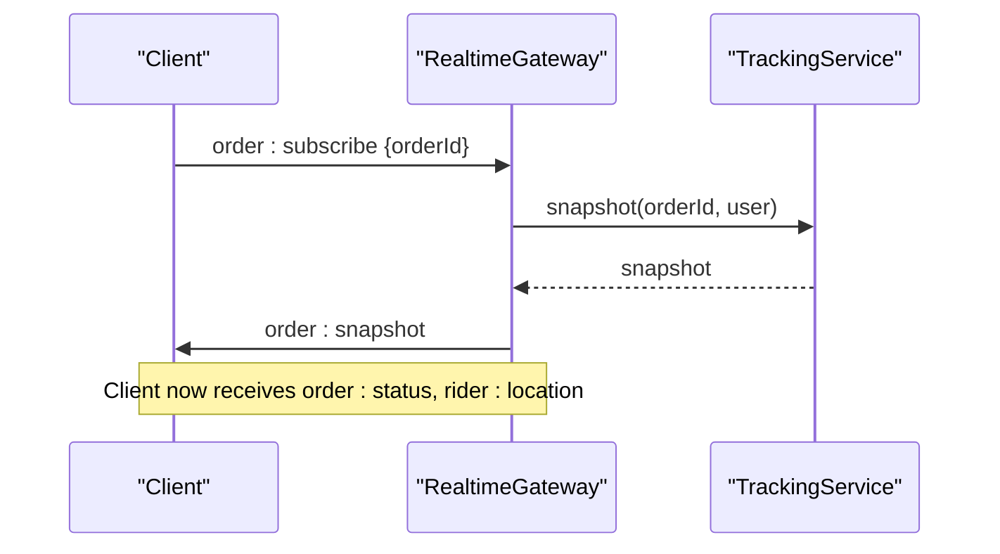
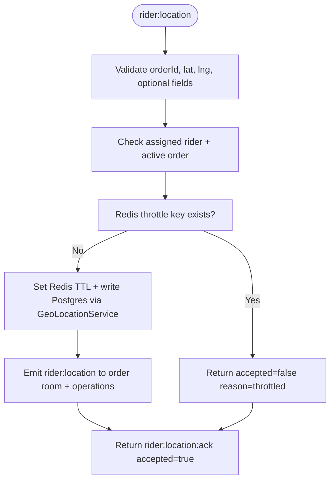
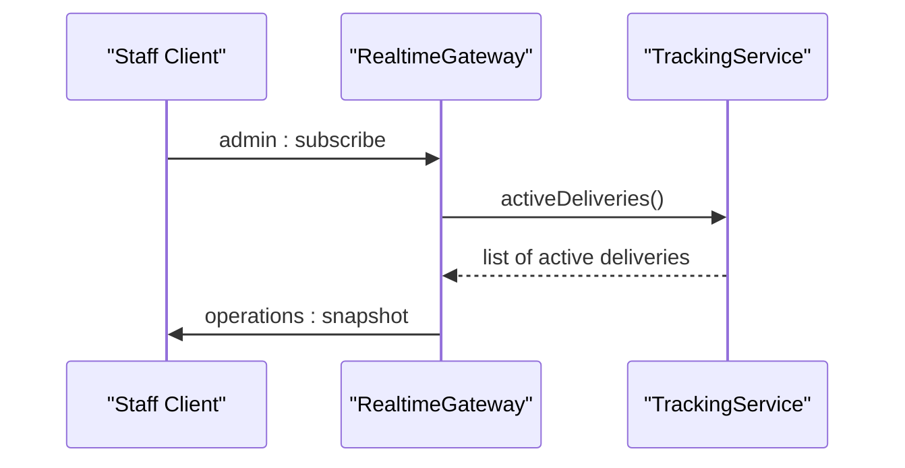
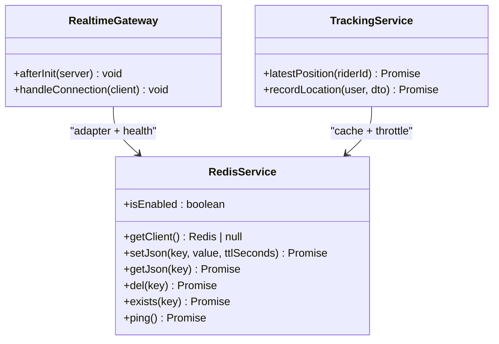
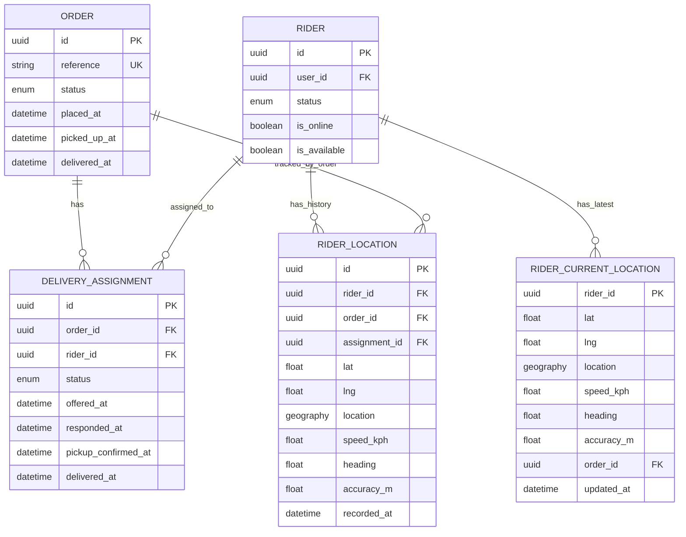
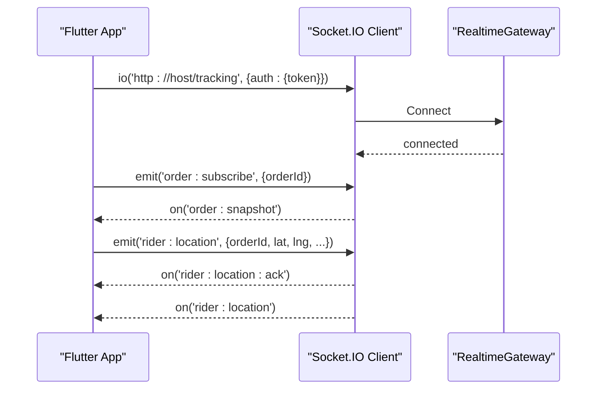
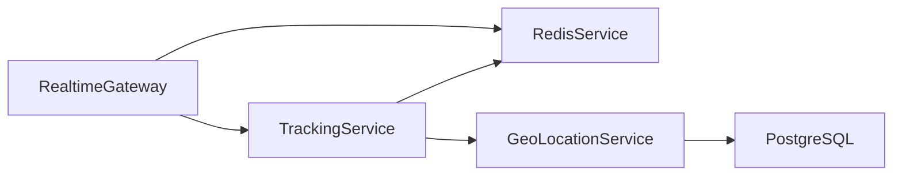

# Real-time Communication

<cite>
**Referenced Files in This Document**
- [realtime.gateway.ts](file://backend/src/tracking/realtime.gateway.ts)
- [tracking.service.ts](file://backend/src/tracking/tracking.service.ts)
- [tracking.dto.ts](file://backend/src/tracking/dto/tracking.dto.ts)
- [redis.service.ts](file://backend/src/redis/redis.service.ts)
- [geo-location.service.ts](file://backend/src/common/services/geo-location.service.ts)
- [schema.prisma](file://backend/prisma/schema.prisma)
- [app.module.ts](file://backend/src/app.module.ts)
- [main.ts](file://backend/src/main.ts)
- [order_screens.dart](file://flutter_app/lib/screens/order_screens.dart)
- [README.md](file://backend/README.md)
</cite>

## Table of Contents
1. [Introduction](#introduction)
2. [Project Structure](#project-structure)
3. [Core Components](#core-components)
4. [Architecture Overview](#architecture-overview)
5. [Detailed Component Analysis](#detailed-component-analysis)
6. [Dependency Analysis](#dependency-analysis)
7. [Performance Considerations](#performance-considerations)
8. [Troubleshooting Guide](#troubleshooting-guide)
9. [Conclusion](#conclusion)

## Introduction
This document explains the real-time communication system built with Socket.IO and Redis for the FuelConnect backend. It covers the WebSocket gateway, connection handling, event-driven architecture, location tracking, live rider positioning, live order updates, message formats, error recovery, scaling considerations, Redis integration, client-side patterns, monitoring, and troubleshooting.

The system exposes a Socket.IO namespace `/tracking` where authenticated clients subscribe to orders or operations feeds, riders publish GPS positions, and the server broadcasts live updates to relevant rooms. Redis is used for distributed fan-out across API instances, short-lived rider position caching, and rate-limiting signals.

## Project Structure
The real-time layer lives under `backend/src/tracking`, with shared services under `backend/src/common` and Redis configuration under `backend/src/redis`. The Flutter app contains example Socket.IO usage in its documentation and screen code.

**Diagram sources**
- [realtime.gateway.ts:45-78](file://backend/src/tracking/realtime.gateway.ts#L45-L78)
- [tracking.service.ts:32-39](file://backend/src/tracking/tracking.service.ts#L32-L39)
- [redis.service.ts:20-52](file://backend/src/redis/redis.service.ts#L20-L52)
- [geo-location.service.ts:23-27](file://backend/src/common/services/geo-location.service.ts#L23-L27)
- [schema.prisma:452-547](file://backend/prisma/schema.prisma#L452-L547)

**Section sources**
- [realtime.gateway.ts:45-78](file://backend/src/tracking/realtime.gateway.ts#L45-L78)
- [app.module.ts:29-60](file://backend/src/app.module.ts#L29-L60)
- [main.ts:63-101](file://backend/src/main.ts#L63-L101)

## Core Components
- **RealtimeGateway**: Socket.IO gateway that authenticates connections, manages rooms, validates inbound events, and emits real-time messages.
- **TrackingService**: Business logic for order snapshots, permission checks, rider location ingestion, throttling, and admin active-deliveries feed.
- **RedisService**: Optional Redis client with an in-process fallback; provides JSON storage with TTLs, existence checks, and raw client access for the Socket.IO adapter.
- **GeoLocationService**: PostGIS helpers for upserting current rider locations, inserting history points, distance queries, and pruning old history.
- **Prisma Schema**: Defines orders, assignments, riders, rider locations, and related entities consumed by the tracking pipeline.

Key responsibilities:
- Connection authentication via JWT and session validation.
- Room-based routing for per-user, per-rider, per-order, and operations channels.
- Rider location ingestion with authorization, throttling, hot/cold storage, and broadcast.
- Admin operations feed for live map visibility.

**Section sources**
- [realtime.gateway.ts:29-61](file://backend/src/tracking/realtime.gateway.ts#L29-L61)
- [tracking.service.ts:32-39](file://backend/src/tracking/tracking.service.ts#L32-L39)
- [redis.service.ts:10-18](file://backend/src/redis/redis.service.ts#L10-L18)
- [geo-location.service.ts:15-22](file://backend/src/common/services/geo-location.service.ts#L15-L22)
- [schema.prisma:452-547](file://backend/prisma/schema.prisma#L452-L547)

## Architecture Overview
The real-time flow connects clients to the Socket.IO gateway, which delegates business logic to TrackingService. Location data flows through Redis for fast reads and Postgres for persistence.

**Diagram sources**
- [realtime.gateway.ts:80-143](file://backend/src/tracking/realtime.gateway.ts#L80-L143)
- [realtime.gateway.ts:151-173](file://backend/src/tracking/realtime.gateway.ts#L151-L173)
- [realtime.gateway.ts:201-251](file://backend/src/tracking/realtime.gateway.ts#L201-L251)
- [tracking.service.ts:77-126](file://backend/src/tracking/tracking.service.ts#L77-L126)
- [tracking.service.ts:128-144](file://backend/src/tracking/tracking.service.ts#L128-L144)
- [tracking.service.ts:155-229](file://backend/src/tracking/tracking.service.ts#L155-L229)
- [geo-location.service.ts:43-86](file://backend/src/common/services/geo-location.service.ts#L43-L86)

## Detailed Component Analysis

### WebSocket Gateway and Connection Management
The gateway defines the `/tracking` namespace, enables CORS, supports both WebSocket and polling transports, and configures a Redis adapter for multi-instance fan-out.

Connection lifecycle:
- Extracts JWT from handshake auth, Authorization header, or query parameter.
- Verifies token type and validates the session against Prisma.
- Builds a principal object and joins rooms:
  - `user:{id}`
  - `rider:{riderId}` when applicable
  - `station:{id}` for each managed station
  - `operations` for staff roles
- Emits `connected` on success or `unauthorized` on failure and disconnects.

**Diagram sources**
- [realtime.gateway.ts:80-143](file://backend/src/tracking/realtime.gateway.ts#L80-L143)

**Section sources**
- [realtime.gateway.ts:45-78](file://backend/src/tracking/realtime.gateway.ts#L45-L78)
- [realtime.gateway.ts:80-143](file://backend/src/tracking/realtime.gateway.ts#L80-L143)

### Event-Driven Order Subscriptions
Clients subscribe to an order room to receive live updates. On subscription:
- The gateway validates the request and calls TrackingService to build a snapshot.
- The client joins the `order:{orderId}` room.
- The server emits `order:snapshot` with order, assignment, rider, and current location.

Outbound events include:
- `order:snapshot`: initial state on subscribe.
- `rider:location`: live position broadcast to the order room and operations channel.
- `order:status`: status changes for the order room.
- `rider:offer`: delivery offer for a specific rider.
- `notification`: generic per-user notification.

**Diagram sources**
- [realtime.gateway.ts:151-173](file://backend/src/tracking/realtime.gateway.ts#L151-L173)
- [tracking.service.ts:77-126](file://backend/src/tracking/tracking.service.ts#L77-L126)

**Section sources**
- [realtime.gateway.ts:29-44](file://backend/src/tracking/realtime.gateway.ts#L29-L44)
- [realtime.gateway.ts:151-184](file://backend/src/tracking/realtime.gateway.ts#L151-L184)

### Rider Location Ingestion and Live Positioning
Riders publish GPS coordinates for an active delivery. The gateway validates the payload and delegates to TrackingService.

Processing steps:
- Validate UUID orderId and numeric lat/lng within bounds.
- Check that the caller is the assigned rider and the order is in an active status.
- Apply server-side throttling using Redis.
- Upsert the latest position into Redis with a TTL and persist to Postgres via GeoLocationService.
- Broadcast `rider:location` to the order room and operations channel.
- Return `rider:location:ack` with acceptance status.

**Diagram sources**
- [realtime.gateway.ts:201-251](file://backend/src/tracking/realtime.gateway.ts#L201-L251)
- [tracking.service.ts:155-229](file://backend/src/tracking/tracking.service.ts#L155-L229)
- [geo-location.service.ts:43-86](file://backend/src/common/services/geo-location.service.ts#L43-L86)

**Section sources**
- [realtime.gateway.ts:201-251](file://backend/src/tracking/realtime.gateway.ts#L201-L251)
- [tracking.service.ts:155-229](file://backend/src/tracking/tracking.service.ts#L155-L229)

### Admin Operations Feed
Staff members can subscribe to a global operations feed to see active deliveries and their last known positions.

Flow:
- Validate staff role.
- Join the `operations` room.
- Fetch active deliveries with rider positions from TrackingService.
- Emit `operations:snapshot` with the list.

**Diagram sources**
- [realtime.gateway.ts:186-199](file://backend/src/tracking/realtime.gateway.ts#L186-L199)
- [tracking.service.ts:233-280](file://backend/src/tracking/tracking.service.ts#L233-L280)

**Section sources**
- [realtime.gateway.ts:186-199](file://backend/src/tracking/realtime.gateway.ts#L186-L199)
- [tracking.service.ts:233-280](file://backend/src/tracking/tracking.service.ts#L233-L280)

### Message Formats and Protocol Specifics
Inbound events:
- `order:subscribe`: `{ orderId }`
- `order:unsubscribe`: `{ orderId }`
- `admin:subscribe`: `{}`
- `rider:location`: `{ orderId, lat, lng, speedKph?, heading?, accuracyM? }`

Outbound events:
- `connected`: `{ userId, role, riderId }`
- `order:snapshot`: full delivery snapshot including order, assignment, rider, and location.
- `rider:location`: live position broadcast to order room and operations.
- `order:status`: order status change for the order room.
- `rider:offer`: new delivery offer for a specific rider.
- `notification`: generic per-user notification.
- `rider:location:ack`: `{ accepted, reason? }`

Validation rules:
- `orderId` must be a valid UUID.
- `lat` must be between -90 and 90; `lng` between -180 and 180.
- Optional fields are validated as finite numbers within defined ranges.

**Section sources**
- [realtime.gateway.ts:29-44](file://backend/src/tracking/realtime.gateway.ts#L29-L44)
- [realtime.gateway.ts:80-143](file://backend/src/tracking/realtime.gateway.ts#L80-L143)
- [realtime.gateway.ts:151-184](file://backend/src/tracking/realtime.gateway.ts#L151-L184)
- [realtime.gateway.ts:201-251](file://backend/src/tracking/realtime.gateway.ts#L201-L251)
- [tracking.dto.ts:5-53](file://backend/src/tracking/dto/tracking.dto.ts#L5-L53)

### Redis Integration and Distributed Session Management
Redis is used for:
- Socket.IO pub/sub adapter enabling fan-out across multiple API instances.
- Short-lived rider position cache (`rider:loc:{riderId}`, TTL 300 seconds).
- Shared throttling signal (`rider:loc:throttle:{riderId}`).

Behavior:
- If Redis URL is missing or unavailable, the service falls back to an in-process Map.
- The gateway logs warnings when the adapter is unavailable and continues in single-instance mode.
- Health checks and existence checks are provided for operational use.

**Diagram sources**
- [redis.service.ts:20-132](file://backend/src/redis/redis.service.ts#L20-L132)
- [realtime.gateway.ts:63-78](file://backend/src/tracking/realtime.gateway.ts#L63-L78)
- [tracking.service.ts:128-144](file://backend/src/tracking/tracking.service.ts#L128-L144)
- [tracking.service.ts:181-188](file://backend/src/tracking/tracking.service.ts#L181-L188)

**Section sources**
- [redis.service.ts:10-18](file://backend/src/redis/redis.service.ts#L10-L18)
- [redis.service.ts:28-52](file://backend/src/redis/redis.service.ts#L28-L52)
- [redis.service.ts:69-122](file://backend/src/redis/redis.service.ts#L69-L122)
- [realtime.gateway.ts:63-78](file://backend/src/tracking/realtime.gateway.ts#L63-L78)

### Data Model and Persistence
The tracking pipeline interacts with several database tables:
- Orders and assignments define the context for tracking.
- Rider current locations store the latest position for fast retrieval.
- Rider locations store historical points for analysis and retention policies.
- PostGIS geography columns enable accurate distance calculations.

**Diagram sources**
- [schema.prisma:452-547](file://backend/prisma/schema.prisma#L452-L547)
- [schema.prisma:331-367](file://backend/prisma/schema.prisma#L331-L367)

**Section sources**
- [schema.prisma:452-547](file://backend/prisma/schema.prisma#L452-L547)
- [schema.prisma:331-367](file://backend/prisma/schema.prisma#L331-L367)
- [geo-location.service.ts:43-86](file://backend/src/common/services/geo-location.service.ts#L43-L86)

### Client-Side WebSocket Implementation
The Flutter app demonstrates how to connect to the `/tracking` namespace, attach the JWT token, subscribe to order updates, and stream rider location.

Key patterns:
- Connect to `http://{host}/tracking` with `OptionBuilder().setAuth({token})`.
- Listen for `order:status` and `rider:location`.
- Emit `order:subscribe` with the target orderId.
- For rider apps, emit `rider:location` every 3–5 seconds while the job is ACCEPTED.
- Reconnect handling: re-emit subscriptions after reconnect.

**Diagram sources**
- [README.md:648-675](file://backend/README.md#L648-L675)
- [order_screens.dart:458-484](file://flutter_app/lib/screens/order_screens.dart#L458-L484)

**Section sources**
- [README.md:648-675](file://backend/README.md#L648-L675)
- [order_screens.dart:458-484](file://flutter_app/lib/screens/order_screens.dart#L458-L484)

## Dependency Analysis
The real-time subsystem depends on:
- NestJS WebSockets and Socket.IO for transport and namespaces.
- Redis for distributed adapter and caching.
- Prisma and PostgreSQL for persistent data.
- GeoLocationService for PostGIS operations.

**Diagram sources**
- [realtime.gateway.ts:56-61](file://backend/src/tracking/realtime.gateway.ts#L56-L61)
- [tracking.service.ts:32-39](file://backend/src/tracking/tracking.service.ts#L32-L39)
- [redis.service.ts:20-52](file://backend/src/redis/redis.service.ts#L20-L52)
- [geo-location.service.ts:23-27](file://backend/src/common/services/geo-location.service.ts#L23-L27)

**Section sources**
- [app.module.ts:29-60](file://backend/src/app.module.ts#L29-L60)
- [main.ts:63-101](file://backend/src/main.ts#L63-L101)

## Performance Considerations
- Use Redis for hot path rider positions to avoid repeated database reads.
- Enforce server-side throttling to limit excessive GPS pings.
- Keep Socket.IO payloads minimal; prefer incremental updates over full snapshots.
- Prefer WebSocket transport for low-latency scenarios; fall back to polling if needed.
- Scale horizontally by enabling the Redis adapter; ensure Redis availability for multi-instance deployments.
- Tune `tracking.minIntervalMs` based on expected update frequency and network conditions.
- Monitor Redis latency and memory usage; consider separate Redis instances for production workloads.

[No sources needed since this section provides general guidance]

## Troubleshooting Guide
Common issues and resolutions:
- Missing or invalid JWT: Ensure the client attaches a valid access token in handshake auth, Authorization header, or query parameter.
- Expired session: The gateway rejects connections with an `unauthorized` event; refresh tokens and reconnect.
- Invalid location payload: Validate orderId and lat/lng ranges; handle `rider:location:ack` with `accepted=false`.
- Throttled location updates: Reduce emission frequency; respect server-side minimum interval.
- Redis unavailable: The system warns and falls back to single-instance mode; verify Redis connectivity and configuration.
- Room not receiving events: Confirm the client joined the correct room (`order:{orderId}`) and re-subscribe after reconnect.

Operational tips:
- Log gateway connection and disconnection events for debugging.
- Inspect Redis keys `rider:loc:{riderId}` and `rider:loc:throttle:{riderId}` during investigations.
- Use Swagger UI at `/docs` to explore REST endpoints alongside WebSocket behavior.
- Monitor health endpoints and Redis ping results.

**Section sources**
- [realtime.gateway.ts:80-143](file://backend/src/tracking/realtime.gateway.ts#L80-L143)
- [realtime.gateway.ts:201-251](file://backend/src/tracking/realtime.gateway.ts#L201-L251)
- [redis.service.ts:28-52](file://backend/src/redis/redis.service.ts#L28-L52)
- [main.ts:63-101](file://backend/src/main.ts#L63-L101)

## Conclusion
The real-time communication system combines Socket.IO for event-driven messaging with Redis for distributed scalability and caching. The gateway enforces secure, role-aware connections and routes events to appropriate rooms. TrackingService centralizes order access control, location ingestion, and admin feed generation, while GeoLocationService persists high-frequency location data efficiently. Clients should implement robust reconnection and subscription recovery, adhere to throttling constraints, and optimize payload sizes for smooth real-time experiences.

[No sources needed since this section summarizes without analyzing specific files]