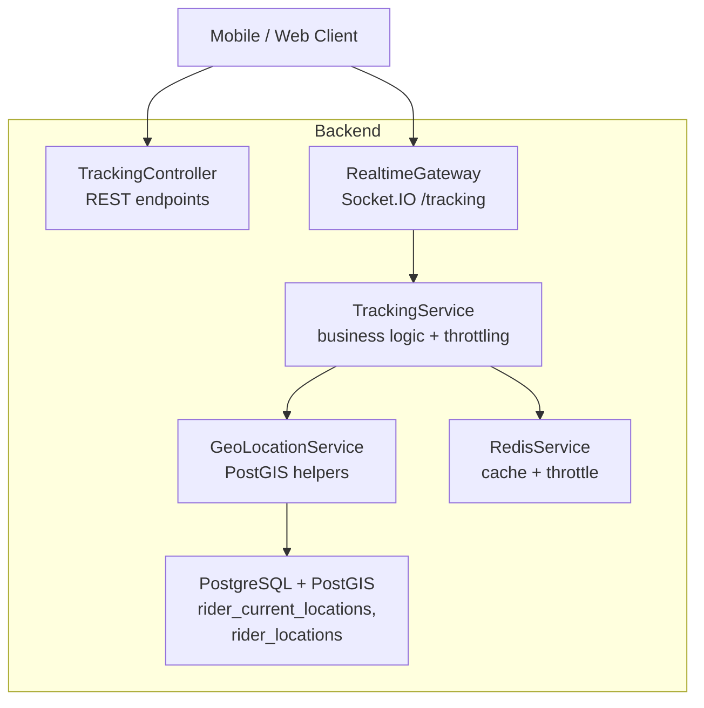
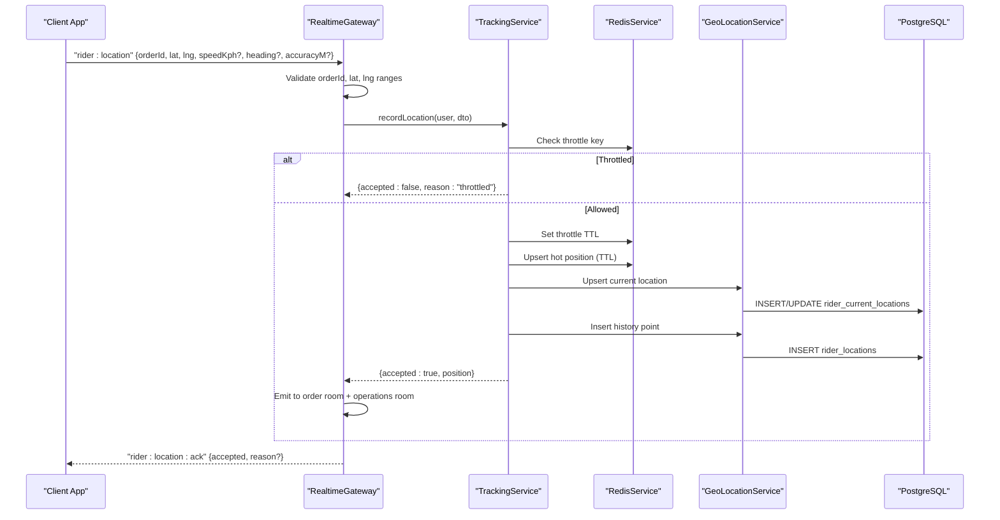
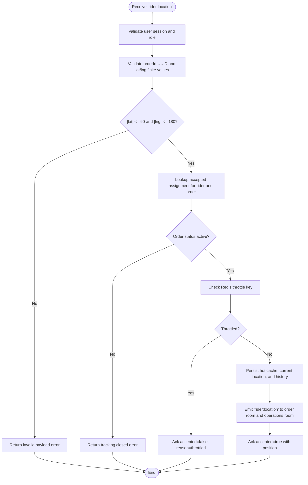
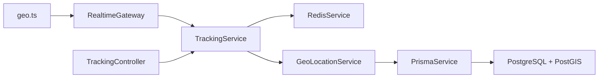

# Real-time Location Tracking System

<cite>
**Referenced Files in This Document**
- [tracking.controller.ts](file://backend/src/tracking/tracking.controller.ts)
- [tracking.service.ts](file://backend/src/tracking/tracking.service.ts)
- [realtime.gateway.ts](file://backend/src/tracking/realtime.gateway.ts)
- [tracking.dto.ts](file://backend/src/tracking/dto/tracking.dto.ts)
- [geo-location.service.ts](file://backend/src/common/services/geo-location.service.ts)
- [geo.ts](file://backend/src/common/utils/geo.ts)
- [schema.prisma](file://backend/prisma/schema.prisma)
</cite>

## Table of Contents
1. [Introduction](#introduction)
2. [Project Structure](#project-structure)
3. [Core Components](#core-components)
4. [Architecture Overview](#architecture-overview)
5. [Detailed Component Analysis](#detailed-component-analysis)
6. [Dependency Analysis](#dependency-analysis)
7. [Performance Considerations](#performance-considerations)
8. [Troubleshooting Guide](#troubleshooting-guide)
9. [Conclusion](#conclusion)

## Introduction
This document explains the real-time location tracking system used by riders, customers, and operations staff to track active deliveries. It covers:
- Rider location submission workflow over WebSocket
- GPS coordinate validation rules for latitude and longitude
- Position throttling to control update frequency
- Order-based room system for broadcasting updates
- Location data structure and optional metadata such as speed, heading, and accuracy
- Location recording service and database persistence strategies
- Real-time event emission patterns
- Client-side reporting examples, server-side validation, and error handling
- Performance optimization techniques, update frequency control, and battery usage considerations

## Project Structure
The tracking subsystem is implemented under the backend NestJS application and consists of:
- A REST controller exposing snapshot endpoints for order and rider positions
- A WebSocket gateway handling subscription, unsubscription, and live location events
- A service layer validating business rules, enforcing throttling, and coordinating persistence
- A shared geo service wrapping PostGIS writes for current locations and history
- DTOs defining request validation constraints
- Prisma models defining the persistent schema

**Diagram sources**
- [tracking.controller.ts:1-26](file://backend/src/tracking/tracking.controller.ts#L1-L26)
- [realtime.gateway.ts:45-61](file://backend/src/tracking/realtime.gateway.ts#L45-L61)
- [tracking.service.ts:32-39](file://backend/src/tracking/tracking.service.ts#L32-L39)
- [geo-location.service.ts:23-27](file://backend/src/common/services/geo-location.service.ts#L23-L27)
- [schema.prisma:331-367](file://backend/prisma/schema.prisma#L331-L367)

**Section sources**
- [tracking.controller.ts:1-26](file://backend/src/tracking/tracking.controller.ts#L1-L26)
- [realtime.gateway.ts:45-61](file://backend/src/tracking/realtime.gateway.ts#L45-L61)
- [tracking.service.ts:32-39](file://backend/src/tracking/tracking.service.ts#L32-L39)
- [geo-location.service.ts:23-27](file://backend/src/common/services/geo-location.service.ts#L23-L27)
- [schema.prisma:331-367](file://backend/prisma/schema.prisma#L331-L367)

## Core Components
- TrackingController: REST fallback endpoints for delivery snapshots and a rider’s latest position.
- RealtimeGateway: Socket.IO gateway for subscribing to orders, unsubscribing, admin operations feed, and publishing rider location updates.
- TrackingService: Validates assignment and order state, enforces client-side throttling, persists hot and cold location data, and returns structured responses.
- GeoLocationService: PostGIS helper for upserting current rider locations, inserting historical points, distance queries, and pruning old history.
- DTOs: Request validation for order subscription and rider location payloads.
- Prisma Schema: Defines rider current location and location history tables with geography columns.

Key responsibilities:
- Validation: UUID checks, numeric range checks for lat/lng, and optional metadata bounds.
- Authorization: Only the assigned rider can publish; only authorized users can view order snapshots.
- Throttling: Server-side minimum interval enforced via Redis.
- Persistence: Hot cache in Redis, current location in PostgreSQL, and historical trajectory in PostgreSQL.
- Broadcasting: Order-scoped rooms and an operations room for admin feeds.

**Section sources**
- [tracking.controller.ts:10-24](file://backend/src/tracking/tracking.controller.ts#L10-L24)
- [realtime.gateway.ts:150-252](file://backend/src/tracking/realtime.gateway.ts#L150-L252)
- [tracking.service.ts:41-230](file://backend/src/tracking/tracking.service.ts#L41-L230)
- [geo-location.service.ts:43-86](file://backend/src/common/services/geo-location.service.ts#L43-L86)
- [tracking.dto.ts:11-53](file://backend/src/tracking/dto/tracking.dto.ts#L11-L53)
- [schema.prisma:331-367](file://backend/prisma/schema.prisma#L331-L367)

## Architecture Overview
The system uses a hybrid architecture:
- REST API for snapshots and last-known positions
- WebSocket for real-time bidirectional communication
- Redis for low-latency caching and rate limiting
- PostgreSQL with PostGIS for spatial data and history retention

**Diagram sources**
- [realtime.gateway.ts:201-252](file://backend/src/tracking/realtime.gateway.ts#L201-L252)
- [tracking.service.ts:155-230](file://backend/src/tracking/tracking.service.ts#L155-L230)
- [geo-location.service.ts:43-86](file://backend/src/common/services/geo-location.service.ts#L43-L86)
- [schema.prisma:331-367](file://backend/prisma/schema.prisma#L331-L367)

## Detailed Component Analysis

### Rider Location Submission Workflow
The rider location submission flow ensures that only valid, authorized, and throttled updates are accepted and broadcast.

**Diagram sources**
- [realtime.gateway.ts:201-252](file://backend/src/tracking/realtime.gateway.ts#L201-L252)
- [tracking.service.ts:155-230](file://backend/src/tracking/tracking.service.ts#L155-L230)

**Section sources**
- [realtime.gateway.ts:201-252](file://backend/src/tracking/realtime.gateway.ts#L201-L252)
- [tracking.service.ts:155-230](file://backend/src/tracking/tracking.service.ts#L155-L230)

### GPS Coordinate Validation Rules
Validation occurs at two layers:
- WebSocket layer: Ensures orderId is a UUID, lat/lng are finite numbers, and absolute values do not exceed geographic limits.
- DTO layer: Enforces stricter Min/Max constraints for lat (-90 to 90), lng (-180 to 180), speed (0 to 200), heading (0 to 360), and accuracy (0 to 5000).

Rules summary:
- Latitude: -90 ≤ lat ≤ 90
- Longitude: -180 ≤ lng ≤ 180
- Speed (optional): 0 ≤ speedKph ≤ 200
- Heading (optional): 0 ≤ heading ≤ 360
- Accuracy (optional): 0 ≤ accuracyM ≤ 5000

These constraints ensure physically plausible coordinates and reasonable telemetry metadata.

**Section sources**
- [realtime.gateway.ts:209-219](file://backend/src/tracking/realtime.gateway.ts#L209-L219)
- [tracking.dto.ts:11-53](file://backend/src/tracking/dto/tracking.dto.ts#L11-L53)

### Position Throttling Mechanisms
To prevent excessive updates and reduce battery/network load:
- The gateway validates incoming requests before calling the service.
- The service checks a Redis key per rider to enforce a minimum interval between accepted submissions.
- If the key exists, the request is rejected with a throttled reason.
- On success, a TTL is set based on configuration, defaulting to a minimum interval in milliseconds converted to seconds.

Configuration:
- Minimum interval is read from environment configuration, with a sensible default if missing.

Behavior:
- Throttling is applied server-side regardless of client behavior.
- Clients should respect the acknowledgment response and back off when throttled.

**Section sources**
- [tracking.service.ts:181-188](file://backend/src/tracking/tracking.service.ts#L181-L188)

### Order-Based Room System
The WebSocket gateway organizes clients into rooms:
- Per-user room: `user:{userId}`
- Per-rider room: `rider:{riderId}`
- Per-station room: `station:{stationId}`
- Operations room: `operations` for staff/admins
- Per-order room: `order:{orderId}` for delivery-specific broadcasts

Subscription flow:
- Clients subscribe to an order using `order:subscribe`, receive a full snapshot, and join the order room.
- Unsubscribing leaves the order room.
- Admins subscribe to the operations feed and receive active deliveries.

Broadcasting:
- Accepted rider location updates are emitted to the order room and the operations room.
- Other events like status changes or offers can be routed similarly.

**Section sources**
- [realtime.gateway.ts:150-199](file://backend/src/tracking/realtime.gateway.ts#L150-L199)
- [realtime.gateway.ts:254-273](file://backend/src/tracking/realtime.gateway.ts#L254-L273)

### Location Data Structure
The internal live position structure includes:
- Latitude and longitude
- Optional speed in kilometers per hour
- Optional heading in degrees
- Optional accuracy in meters
- Timestamp of update

DTO fields:
- Required: orderId, lat, lng
- Optional: speedKph, heading, accuracyM

Persistence mapping:
- Current location table stores the latest position per rider with associated order context.
- History table stores each recorded point with assignment context and timestamp.

**Section sources**
- [tracking.service.ts:15-22](file://backend/src/tracking/tracking.service.ts#L15-L22)
- [tracking.dto.ts:11-53](file://backend/src/tracking/dto/tracking.dto.ts#L11-L53)
- [schema.prisma:331-367](file://backend/prisma/schema.prisma#L331-L367)

### Location Recording Service and Database Persistence
The recording service performs:
- Authorization check: Only riders can publish.
- Assignment verification: The rider must be assigned and the order must be active.
- Throttling enforcement: Prevents rapid-fire submissions.
- Parallel persistence:
  - Redis hot cache for latest position with TTL
  - PostgreSQL current location via PostGIS helper
  - PostgreSQL history insertion via PostGIS helper

Database strategy:
- `rider_current_locations`: One row per rider, updated on each accepted ping.
- `rider_locations`: Append-only history with indexes for efficient queries.
- Geography columns maintained alongside plain lat/lng for accurate distance calculations.

Best-effort writes:
- Geo writes are wrapped to avoid breaking the main flow if PostGIS is unavailable.

Retention:
- A pruning utility deletes history older than a configured number of days.

**Section sources**
- [tracking.service.ts:155-230](file://backend/src/tracking/tracking.service.ts#L155-L230)
- [geo-location.service.ts:43-86](file://backend/src/common/services/geo-location.service.ts#L43-L86)
- [geo-location.service.ts:132-154](file://backend/src/common/services/geo-location.service.ts#L132-L154)
- [schema.prisma:331-367](file://backend/prisma/schema.prisma#L331-L367)

### Real-Time Event Emission Patterns
Events:
- Inbound:
  - `order:subscribe`: Subscribe to an order and receive a snapshot
  - `order:unsubscribe`: Leave an order room
  - `admin:subscribe`: Join operations feed (staff only)
  - `rider:location`: Submit a new location
- Outbound:
  - `order:snapshot`: Full delivery snapshot on subscription
  - `rider:location`: Live position broadcast to order room and operations room
  - `order:status`: Status change for the order room
  - `rider:offer`: Delivery offer for a specific rider
  - `notification`: Generic per-user notification

Room scoping:
- Order-scoped events go to `order:{orderId}`
- Operations-scoped events go to `operations`
- User-scoped events go to `user:{userId}`

**Section sources**
- [realtime.gateway.ts:29-44](file://backend/src/tracking/realtime.gateway.ts#L29-L44)
- [realtime.gateway.ts:150-252](file://backend/src/tracking/realtime.gateway.ts#L150-L252)
- [realtime.gateway.ts:254-273](file://backend/src/tracking/realtime.gateway.ts#L254-L273)

### Client-Side Location Reporting Example
A typical client flow:
- Connect to `/tracking` with a bearer token
- Subscribe to an order: send `order:subscribe` with the order ID
- Receive `order:snapshot` containing order details and current rider position
- Periodically send `rider:location` with orderId, lat, lng, and optional speed/heading/accuracy
- Handle `rider:location:ack` to determine acceptance or throttling
- Listen for `rider:location` events to update the map in real time
- Unsubscribe when done: send `order:unsubscribe`

Notes:
- Respect throttling acknowledgments and implement exponential backoff
- Use device motion sensors to derive heading and speed where available
- Limit update frequency to conserve battery and network resources

[No sources needed since this section provides conceptual guidance]

### Server-Side Validation and Error Handling
Validation and errors:
- Missing or invalid orderId: return error message indicating a valid order ID is required
- Invalid lat/lng: return invalid location payload error
- Not assigned to delivery: forbidden exception
- Tracking closed for order: bad request exception
- Throttled: acknowledgment with accepted=false and reason=throttled
- General exceptions: acknowledgment with accepted=false and reason=message

Authorization:
- Only riders can publish locations
- Only authorized users can view order snapshots (owner, assigned rider, staff, station manager)

**Section sources**
- [realtime.gateway.ts:156-172](file://backend/src/tracking/realtime.gateway.ts#L156-L172)
- [realtime.gateway.ts:209-252](file://backend/src/tracking/realtime.gateway.ts#L209-L252)
- [tracking.service.ts:41-75](file://backend/src/tracking/tracking.service.ts#L41-L75)
- [tracking.service.ts:155-179](file://backend/src/tracking/tracking.service.ts#L155-L179)

### Performance Optimization Techniques
- Hot path caching: Latest position stored in Redis with TTL for fast reads
- Parallel persistence: Redis, current location, and history written concurrently
- Throttling: Server-enforced minimum interval reduces unnecessary writes and emissions
- Room scoping: Targeted broadcasts minimize fan-out
- PostGIS geometry: Accurate distance queries without expensive conversions
- Best-effort geo writes: Failures do not break core flows

Optimization recommendations:
- Tune `tracking.minIntervalMs` based on traffic and device capabilities
- Adjust Redis TTL to balance freshness and memory usage
- Implement client-side adaptive sampling: increase interval when stationary, decrease when moving quickly
- Batch UI updates on the client to reduce re-renders

**Section sources**
- [tracking.service.ts:128-144](file://backend/src/tracking/tracking.service.ts#L128-L144)
- [tracking.service.ts:181-222](file://backend/src/tracking/tracking.service.ts#L181-L222)
- [geo-location.service.ts:142-154](file://backend/src/common/services/geo-location.service.ts#L142-L154)

### Location Update Frequency Control and Battery Usage
Guidelines:
- Default minimum interval is configurable; use it as a baseline
- Mobile devices should adapt update frequency based on:
  - Movement speed: higher speed warrants more frequent updates
  - Battery level: reduce frequency when battery is low
  - Network conditions: throttle updates on poor connectivity
- Avoid sending zero-change pings; debounce small movements
- Use background location services carefully and pause when app is inactive

[No sources needed since this section provides general guidance]

## Dependency Analysis
The tracking module depends on:
- Authentication and authorization via JWT and session checks
- Redis for caching and throttling
- PostgreSQL with PostGIS for spatial data
- Shared utilities for UUID validation and geospatial math

**Diagram sources**
- [realtime.gateway.ts:56-61](file://backend/src/tracking/realtime.gateway.ts#L56-L61)
- [tracking.controller.ts:10-16](file://backend/src/tracking/tracking.controller.ts#L10-L16)
- [tracking.service.ts:34-39](file://backend/src/tracking/tracking.service.ts#L34-L39)
- [geo-location.service.ts:23-27](file://backend/src/common/services/geo-location.service.ts#L23-L27)
- [geo.ts:24-26](file://backend/src/common/utils/geo.ts#L24-L26)

**Section sources**
- [realtime.gateway.ts:56-61](file://backend/src/tracking/realtime.gateway.ts#L56-L61)
- [tracking.controller.ts:10-16](file://backend/src/tracking/tracking.controller.ts#L10-L16)
- [tracking.service.ts:34-39](file://backend/src/tracking/tracking.service.ts#L34-L39)
- [geo-location.service.ts:23-27](file://backend/src/common/services/geo-location.service.ts#L23-L27)
- [geo.ts:24-26](file://backend/src/common/utils/geo.ts#L24-L26)

## Performance Considerations
- Prefer Redis for hot reads of latest position
- Keep history append-only and prune regularly
- Use PostGIS for distance queries instead of client-side haversine loops
- Scale horizontally with Socket.IO Redis adapter for multi-instance deployments
- Monitor Redis latency and PostgreSQL query performance for geo operations

[No sources needed since this section provides general guidance]

## Troubleshooting Guide
Common issues and resolutions:
- Invalid location payload: Ensure lat/lng are within valid ranges and orderId is a UUID
- Tracking closed: Verify order status is active and assignment is accepted
- Throttled: Back off and retry after the configured minimum interval
- Unauthorized socket connection: Check bearer token validity and session expiration
- PostGIS write failures: Inspect logs; geo writes are best-effort but may indicate extension issues

Operational tips:
- Enable Socket.IO Redis adapter for multi-instance scaling
- Configure appropriate retention days for history pruning
- Log and monitor rejection reasons to detect client misbehavior

**Section sources**
- [realtime.gateway.ts:136-142](file://backend/src/tracking/realtime.gateway.ts#L136-L142)
- [realtime.gateway.ts:209-252](file://backend/src/tracking/realtime.gateway.ts#L209-L252)
- [tracking.service.ts:155-188](file://backend/src/tracking/tracking.service.ts#L155-L188)
- [geo-location.service.ts:142-154](file://backend/src/common/services/geo-location.service.ts#L142-L154)

## Conclusion
The real-time location tracking system combines robust validation, secure authorization, efficient caching, and scalable real-time broadcasting. By enforcing server-side throttling, leveraging Redis and PostGIS, and organizing events through order-scoped rooms, the system delivers reliable live tracking while minimizing resource consumption. Clients should adhere to the documented validation rules and throttling policies to ensure smooth operation and optimal battery usage.