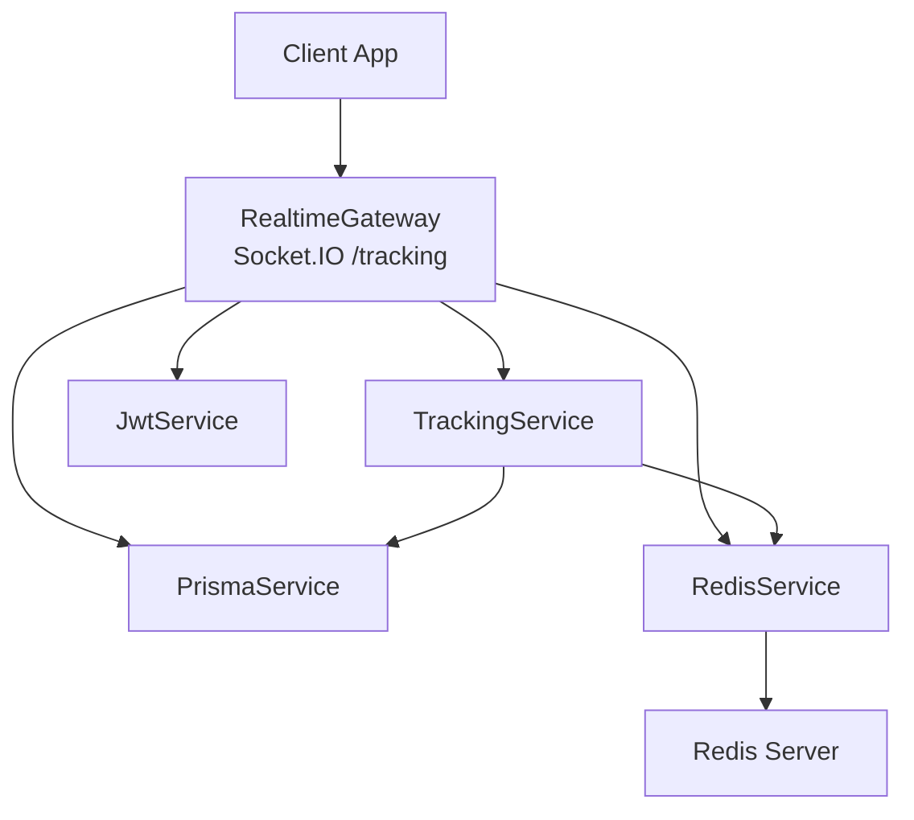
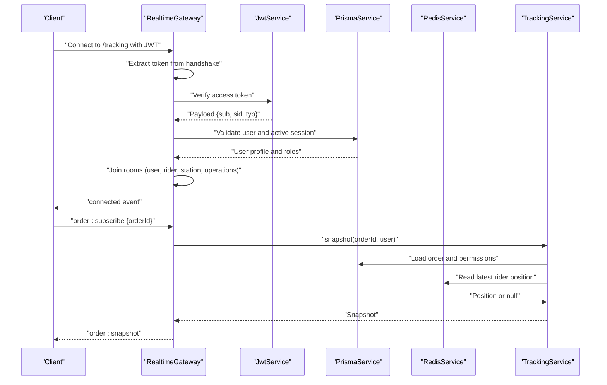
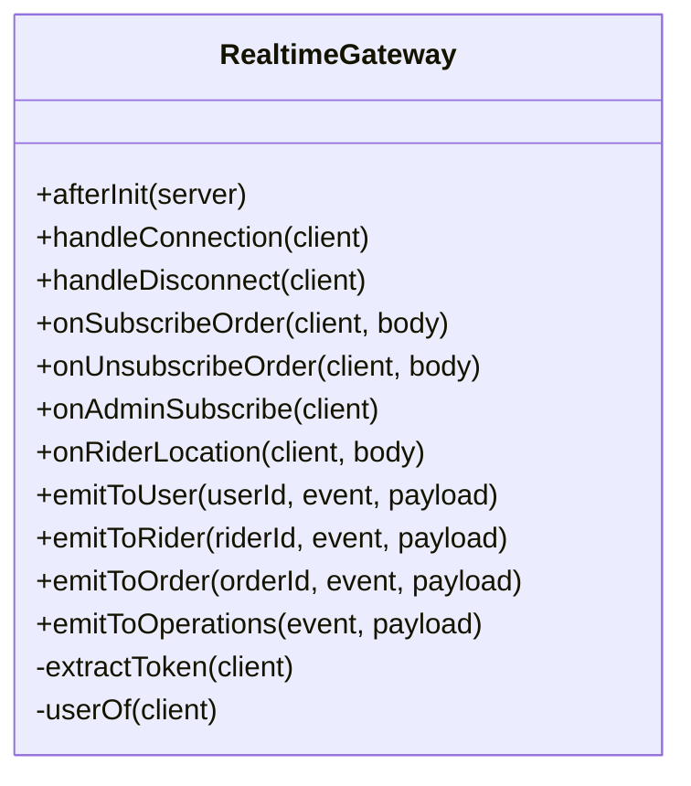
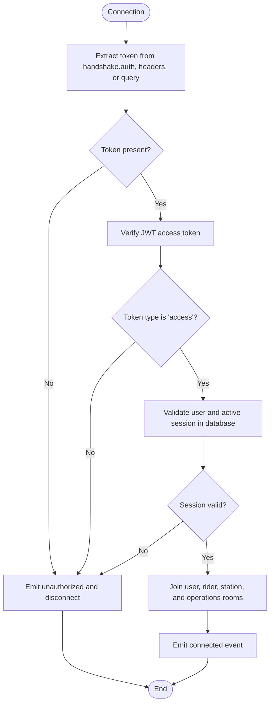
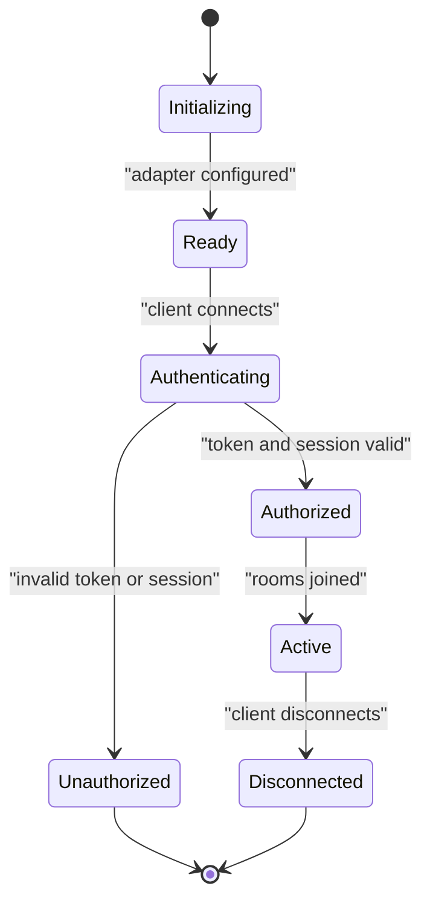
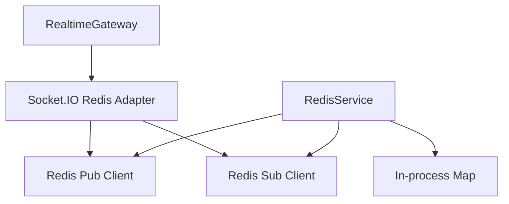
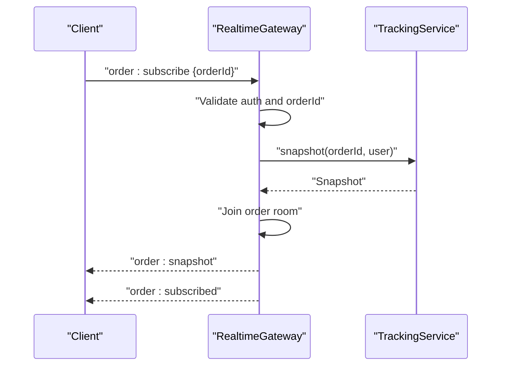
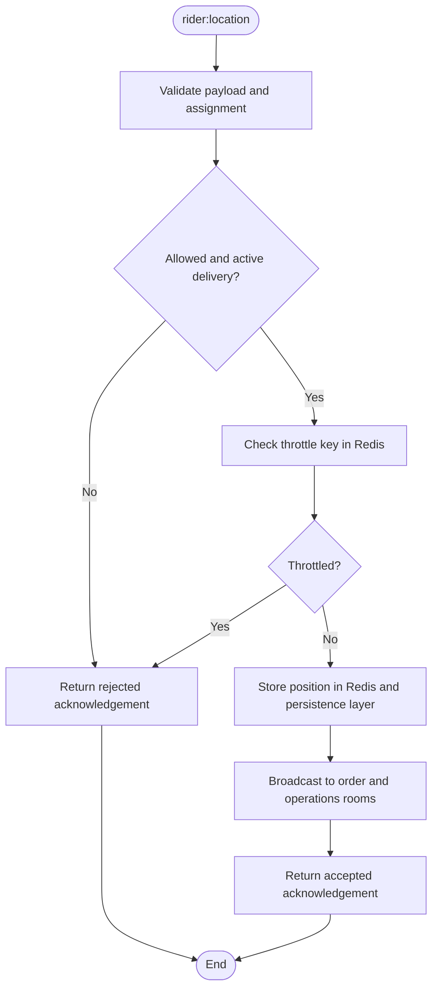
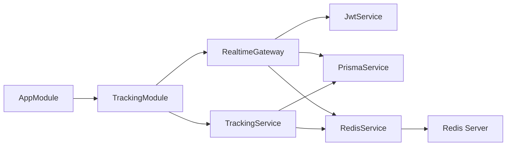

# WebSocket Architecture & Connection Management

<cite>
**Referenced Files in This Document**
- [main.ts](file://backend/src/main.ts)
- [app.module.ts](file://backend/src/app.module.ts)
- [realtime.gateway.ts](file://backend/src/tracking/realtime.gateway.ts)
- [tracking.module.ts](file://backend/src/tracking/tracking.module.ts)
- [tracking.service.ts](file://backend/src/tracking/tracking.service.ts)
- [token.service.ts](file://backend/src/auth/token.service.ts)
- [auth-user.ts](file://backend/src/common/types/auth-user.ts)
- [redis.service.ts](file://backend/src/redis/redis.service.ts)
</cite>

## Table of Contents
1. [Introduction](#introduction)
2. [Project Structure](#project-structure)
3. [Core Components](#core-components)
4. [Architecture Overview](#architecture-overview)
5. [Detailed Component Analysis](#detailed-component-analysis)
6. [Dependency Analysis](#dependency-analysis)
7. [Performance Considerations](#performance-considerations)
8. [Troubleshooting Guide](#troubleshooting-guide)
9. [Conclusion](#conclusion)

## Introduction
This document explains the real-time WebSocket architecture used by the FuelConnect backend. It focuses on the Socket.IO gateway, JWT-based authentication, connection lifecycle management, namespace configuration, CORS and transport settings, role-based room joining, Redis-backed distributed communication, and operational concerns such as scaling, memory usage, and graceful disconnection.

The system exposes a single Socket.IO namespace for tracking and delivery updates. Clients authenticate using short-lived access tokens that include a session identifier. The gateway validates the token, verifies the active session in the database, attaches an authenticated principal to the socket, and joins the client into appropriate rooms based on user roles and relationships.

## Project Structure
The WebSocket implementation is centered around the tracking feature:

- The NestJS application bootstrap configures global CORS, validation, shutdown hooks, and Swagger documentation.
- The root module imports the tracking module and shared infrastructure modules such as Redis and Prisma.
- The tracking module registers the real-time gateway and tracking service.
- The gateway handles Socket.IO connections, authentication, authorization, and event routing.
- The tracking service implements business logic for order snapshots, rider location ingestion, throttling, and admin delivery lists.
- The Redis service provides optional distributed caching and adapter support.
- The token service manages JWT access tokens and sessions.

**Diagram sources**
- [realtime.gateway.ts:45-78](file://backend/src/tracking/realtime.gateway.ts#L45-L78)
- [tracking.service.ts:32-39](file://backend/src/tracking/tracking.service.ts#L32-L39)
- [redis.service.ts:20-26](file://backend/src/redis/redis.service.ts#L20-L26)

**Section sources**
- [main.ts:12-34](file://backend/src/main.ts#L12-L34)
- [app.module.ts:29-60](file://backend/src/app.module.ts#L29-L60)
- [tracking.module.ts:7-12](file://backend/src/tracking/tracking.module.ts#L7-L12)

## Core Components
- RealtimeGateway: Socket.IO gateway implementing connection handling, authentication, room management, and event handlers for order subscriptions, admin operations, and rider location updates.
- TrackingService: Business layer for order visibility checks, snapshot generation, live position retrieval, rider location recording with throttling, and active delivery aggregation.
- RedisService: Optional Redis integration with in-process fallback, used for hot path caching, rate limiting signals, and Socket.IO fan-out across instances.
- TokenService: JWT access token issuance and rotation, session creation, revocation, and reset token handling.
- AuthUser types: Shared principal model used by both HTTP and WebSocket layers.

Key responsibilities:
- Authentication: Extract and validate JWT access tokens during Socket.IO handshake.
- Authorization: Validate active sessions and enforce role-based access.
- Room management: Join clients into per-user, per-rider, per-station, per-order, and operations rooms.
- Event routing: Emit events to specific rooms or broadcast to operations.
- Distributed scaling: Use Redis adapter when available; otherwise run in single-instance mode.

**Section sources**
- [realtime.gateway.ts:45-148](file://backend/src/tracking/realtime.gateway.ts#L45-L148)
- [tracking.service.ts:41-144](file://backend/src/tracking/tracking.service.ts#L41-L144)
- [redis.service.ts:10-19](file://backend/src/redis/redis.service.ts#L10-L19)
- [token.service.ts:27-67](file://backend/src/auth/token.service.ts#L27-L67)
- [auth-user.ts:8-27](file://backend/src/common/types/auth-user.ts#L8-L27)

## Architecture Overview
The WebSocket architecture uses Socket.IO over the `/tracking` namespace. Connections are authenticated via JWT access tokens embedded in the handshake. After successful authentication, the gateway joins the socket into relevant rooms and emits a confirmation event. Subsequent events are routed through the gateway to the tracking service, which enforces business rules and persists data.

**Diagram sources**
- [realtime.gateway.ts:80-143](file://backend/src/tracking/realtime.gateway.ts#L80-L143)
- [realtime.gateway.ts:151-173](file://backend/src/tracking/realtime.gateway.ts#L151-L173)
- [tracking.service.ts:77-126](file://backend/src/tracking/tracking.service.ts#L77-L126)
- [tracking.service.ts:128-144](file://backend/src/tracking/tracking.service.ts#L128-L144)

## Detailed Component Analysis

### Socket.IO Gateway and Namespace Configuration
The gateway is configured with:
- Namespace: `/tracking`
- CORS: enabled with credentials
- Transports: `websocket` and `polling`

On initialization, it attempts to enable the Redis adapter for cross-instance fan-out. If Redis is unavailable, it logs a warning and continues in single-instance mode.

**Diagram sources**
- [realtime.gateway.ts:45-78](file://backend/src/tracking/realtime.gateway.ts#L45-L78)
- [realtime.gateway.ts:150-277](file://backend/src/tracking/realtime.gateway.ts#L150-L277)

**Section sources**
- [realtime.gateway.ts:45-78](file://backend/src/tracking/realtime.gateway.ts#L45-L78)

### Authentication Flow Using JWT Tokens
Authentication occurs during the connection phase:
- Token extraction supports multiple sources: handshake auth object, handshake headers, and query parameters.
- The gateway verifies the token type must be an access token.
- The gateway validates the user’s active status and ensures the session exists and has not been revoked or expired.
- On success, the gateway attaches an `AuthUser` principal to the socket and joins relevant rooms.
- On failure, the gateway emits an unauthorized event and disconnects the client.

**Diagram sources**
- [realtime.gateway.ts:80-143](file://backend/src/tracking/realtime.gateway.ts#L80-L143)
- [realtime.gateway.ts:279-292](file://backend/src/tracking/realtime.gateway.ts#L279-L292)

**Section sources**
- [realtime.gateway.ts:80-143](file://backend/src/tracking/realtime.gateway.ts#L80-L143)
- [realtime.gateway.ts:279-292](file://backend/src/tracking/realtime.gateway.ts#L279-L292)
- [auth-user.ts:8-27](file://backend/src/common/types/auth-user.ts#L8-L27)

### Connection Lifecycle Management
- Initialization: The gateway sets up the Redis adapter if possible.
- Connection: Authentication, session validation, principal attachment, and room joining occur here.
- Events: Inbound events are validated and processed; outbound events are emitted to rooms.
- Disconnection: The gateway logs disconnections for authenticated sockets.

**Diagram sources**
- [realtime.gateway.ts:63-78](file://backend/src/tracking/realtime.gateway.ts#L63-L78)
- [realtime.gateway.ts:80-148](file://backend/src/tracking/realtime.gateway.ts#L80-L148)

**Section sources**
- [realtime.gateway.ts:63-148](file://backend/src/tracking/realtime.gateway.ts#L63-L148)

### Namespace Configuration, CORS, and Transport Protocols
- Namespace: `/tracking`
- CORS: Enabled with credentials; the gateway allows all origins at the Socket.IO level.
- Transports: Both `websocket` and `polling` are enabled for compatibility.

Global CORS is also configured at the application level, allowing credentials and supporting multiple origins.

**Section sources**
- [realtime.gateway.ts:45-49](file://backend/src/tracking/realtime.gateway.ts#L45-L49)
- [main.ts:25-34](file://backend/src/main.ts#L25-L34)

### Role-Based Room Joining Patterns
After authentication, the gateway joins the client into:
- Per-user room: `user:{userId}`
- Per-rider room: `rider:{riderId}` (if applicable)
- Per-station rooms: `station:{stationId}` for each managed station
- Operations room: `operations` for staff roles including admin, super admin, and station manager

These rooms determine where events are broadcast, enabling targeted delivery updates and admin monitoring.

**Section sources**
- [realtime.gateway.ts:122-129](file://backend/src/tracking/realtime.gateway.ts#L122-L129)

### Redis Adapter Setup for Distributed Communication
The gateway attempts to configure the Socket.IO Redis adapter using duplicated Redis pub/sub clients. If Redis is unavailable, it logs a warning and runs without cross-instance fan-out.

The Redis service:
- Connects lazily with retry strategies.
- Provides raw client access for the adapter.
- Falls back to an in-process map when Redis is unavailable.
- Supports JSON storage with TTLs for hot-path data like rider positions.

**Diagram sources**
- [realtime.gateway.ts:63-78](file://backend/src/tracking/realtime.gateway.ts#L63-L78)
- [redis.service.ts:28-51](file://backend/src/redis/redis.service.ts#L28-L51)
- [redis.service.ts:64-67](file://backend/src/redis/redis.service.ts#L64-L67)

**Section sources**
- [realtime.gateway.ts:63-78](file://backend/src/tracking/realtime.gateway.ts#L63-L78)
- [redis.service.ts:28-51](file://backend/src/redis/redis.service.ts#L28-L51)
- [redis.service.ts:64-80](file://backend/src/redis/redis.service.ts#L64-L80)

### User Authentication Process and Session Validation
- Access tokens are signed with a session ID (`sid`) and token type (`typ`).
- The gateway verifies the token type and then queries the database for the user and session.
- The session must be active, not revoked, and not expired.
- The principal includes user identity, role, phone, full name, status, and derived identifiers such as customer ID, rider ID, and station IDs.

**Section sources**
- [token.service.ts:185-196](file://backend/src/auth/token.service.ts#L185-L196)
- [realtime.gateway.ts:85-120](file://backend/src/tracking/realtime.gateway.ts#L85-L120)

### Error Handling for Unauthorized Connections
When authentication fails:
- The gateway emits an `unauthorized` event with a message indicating session expiration.
- The connection is disconnected immediately.
- Debug logging records the rejection reason.

**Section sources**
- [realtime.gateway.ts:136-142](file://backend/src/tracking/realtime.gateway.ts#L136-L142)

### Example: Connection Establishment and Token Extraction
Clients connect to the `/tracking` namespace and provide a JWT access token via one of these methods:
- Handshake auth object: `{ auth: { token: "Bearer <token>" } }`
- Handshake header: `Authorization: Bearer <token>`
- Query parameter: `?token=<token>`

The gateway strips the `Bearer ` prefix if present before verification.

**Section sources**
- [realtime.gateway.ts:279-292](file://backend/src/tracking/realtime.gateway.ts#L279-L292)

### Example: Order Subscription Flow
A client subscribes to an order:
- Validates authentication and orderId format.
- Calls the tracking service to generate a snapshot.
- Joins the order room and receives the initial snapshot.
- Emits subscription confirmation.

**Diagram sources**
- [realtime.gateway.ts:151-173](file://backend/src/tracking/realtime.gateway.ts#L151-L173)
- [tracking.service.ts:77-126](file://backend/src/tracking/tracking.service.ts#L77-L126)

**Section sources**
- [realtime.gateway.ts:151-173](file://backend/src/tracking/realtime.gateway.ts#L151-L173)

### Rider Location Ingestion and Broadcasting
Riders publish location updates:
- The gateway validates the payload and ensures the user is an assigned rider for an active delivery.
- Throttling is enforced using Redis keys to limit frequency.
- Accepted locations are stored in Redis and persisted via geospatial services.
- The gateway broadcasts the location to the order room and operations room.

**Diagram sources**
- [realtime.gateway.ts:201-252](file://backend/src/tracking/realtime.gateway.ts#L201-L252)
- [tracking.service.ts:155-230](file://backend/src/tracking/tracking.service.ts#L155-L230)

**Section sources**
- [realtime.gateway.ts:201-252](file://backend/src/tracking/realtime.gateway.ts#L201-L252)
- [tracking.service.ts:155-230](file://backend/src/tracking/tracking.service.ts#L155-L230)

## Dependency Analysis
The following diagram shows how components depend on each other:

**Diagram sources**
- [app.module.ts:29-60](file://backend/src/app.module.ts#L29-L60)
- [tracking.module.ts:7-12](file://backend/src/tracking/tracking.module.ts#L7-L12)
- [realtime.gateway.ts:56-61](file://backend/src/tracking/realtime.gateway.ts#L56-L61)
- [tracking.service.ts:32-39](file://backend/src/tracking/tracking.service.ts#L32-L39)
- [redis.service.ts:20-26](file://backend/src/redis/redis.service.ts#L20-L26)

**Section sources**
- [app.module.ts:29-60](file://backend/src/app.module.ts#L29-L60)
- [tracking.module.ts:7-12](file://backend/src/tracking/tracking.module.ts#L7-L12)

## Performance Considerations
- Hot-path caching: Rider positions are cached in Redis with short TTLs to reduce database load.
- Throttling: Rider location submissions are rate-limited using Redis keys to prevent abuse and reduce bandwidth.
- Fan-out: The Redis adapter enables efficient broadcasting across multiple server instances.
- Graceful degradation: If Redis is unavailable, the service falls back to in-process storage for local development, though cross-instance features will not work.
- Memory management: Avoid storing large payloads in socket data; keep only lightweight principals and timestamps.
- Connection scaling: Prefer stateless authentication and rely on Redis for shared state. Monitor room counts and avoid excessive per-client state.

[No sources needed since this section provides general guidance]

## Troubleshooting Guide
Common issues and resolutions:
- Missing token: Ensure the client sends a valid JWT access token in handshake auth, headers, or query parameters.
- Wrong token type: Only access tokens are accepted; refresh tokens cannot be used for WebSocket authentication.
- Invalid session: Check that the session exists, is not revoked, and has not expired.
- Unauthorized connection: The gateway emits an unauthorized event and disconnects the client; verify token validity and session state.
- Redis adapter unavailable: Logs indicate whether the adapter is disabled; ensure Redis URL is configured and reachable.
- Throttled location updates: Rider location submissions may be rejected due to rate limiting; adjust client-side frequency.

**Section sources**
- [realtime.gateway.ts:136-142](file://backend/src/tracking/realtime.gateway.ts#L136-L142)
- [realtime.gateway.ts:63-78](file://backend/src/tracking/realtime.gateway.ts#L63-L78)
- [tracking.service.ts:181-188](file://backend/src/tracking/tracking.service.ts#L181-L188)

## Conclusion
The FuelConnect WebSocket architecture centers on a secure, role-aware Socket.IO gateway under the `/tracking` namespace. Authentication relies on short-lived JWT access tokens with session validation against the database. The gateway manages connection lifecycles, joins clients into scoped rooms, and routes events through a tracking service that enforces business rules and leverages Redis for performance and distribution. When Redis is available, the Socket.IO adapter enables horizontal scaling; otherwise, the system degrades gracefully to single-instance operation. Proper error handling, throttling, and room scoping ensure reliable real-time communication for customers, riders, and operations staff.

[No sources needed since this section summarizes without analyzing specific files]