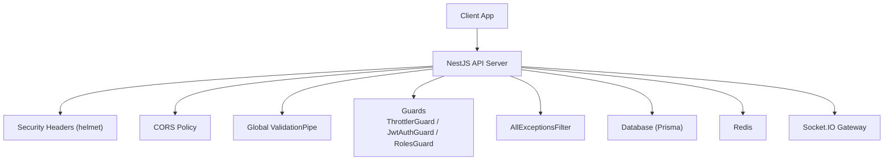
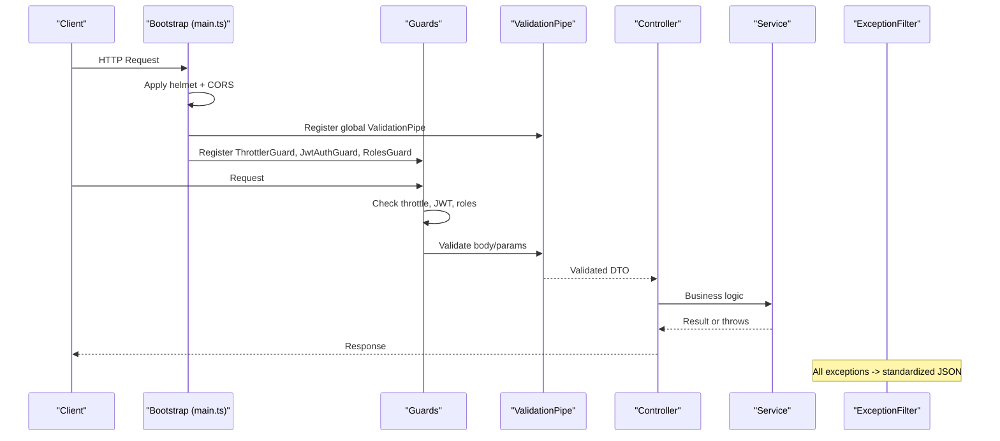
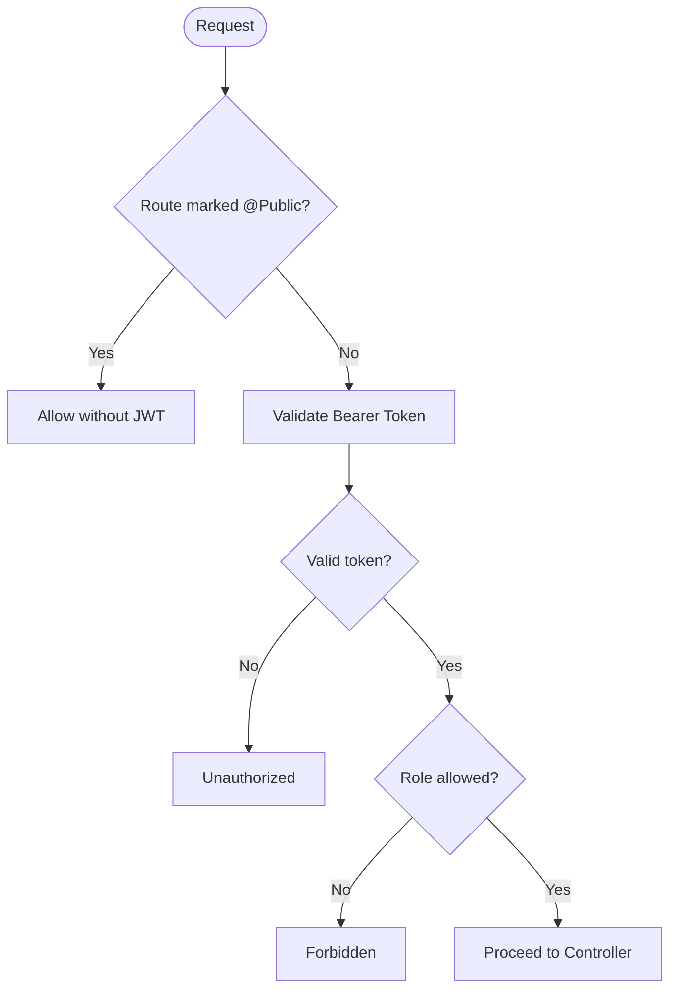
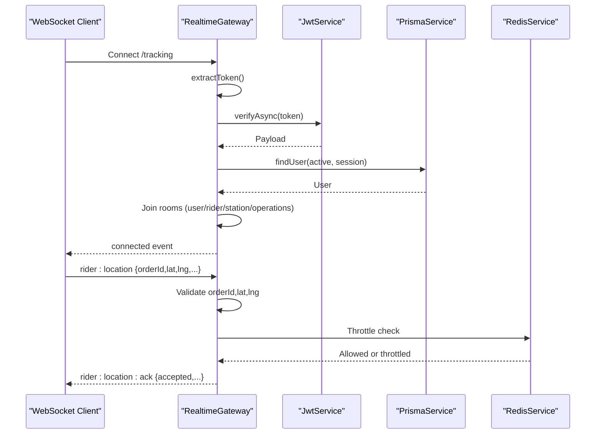
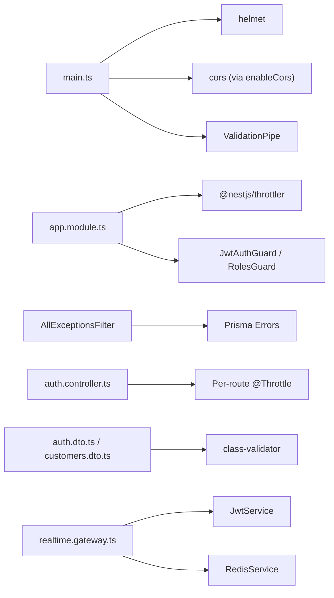

# API Security

<cite>
**Referenced Files in This Document**
- [main.ts](file://backend/src/main.ts)
- [app.module.ts](file://backend/src/app.module.ts)
- [all-exceptions.filter.ts](file://backend/src/common/filters/all-exceptions.filter.ts)
- [jwt-auth.guard.ts](file://backend/src/common/guards/jwt-auth.guard.ts)
- [roles.guard.ts](file://backend/src/common/guards/roles.guard.ts)
- [public.decorator.ts](file://backend/src/common/decorators/public.decorator.ts)
- [validation.ts](file://backend/src/common/utils/validation.ts)
- [audit-log.interceptor.ts](file://backend/src/common/interceptors/audit-log.interceptor.ts)
- [auth.controller.ts](file://backend/src/auth/auth.controller.ts)
- [auth.dto.ts](file://backend/src/auth/dto/auth.dto.ts)
- [customers.dto.ts](file://backend/src/customers/dto/customers.dto.ts)
- [realtime.gateway.ts](file://backend/src/tracking/realtime.gateway.ts)
</cite>

## Table of Contents
1. [Introduction](#introduction)
2. [Project Structure](#project-structure)
3. [Core Components](#core-components)
4. [Architecture Overview](#architecture-overview)
5. [Detailed Component Analysis](#detailed-component-analysis)
6. [Dependency Analysis](#dependency-analysis)
7. [Performance Considerations](#performance-considerations)
8. [Troubleshooting Guide](#troubleshooting-guide)
9. [Conclusion](#conclusion)
10. [Appendices](#appendices)

## Introduction
This document describes the security model for FuelConnect’s REST and WebSocket APIs. It covers HTTP security headers, CORS configuration, request validation and filtering, authentication and authorization, error handling that avoids information leakage, rate limiting and abuse prevention, API versioning, security testing guidance, and WebSocket connection and message security. The goal is to help developers and reviewers understand how the system protects data in transit and at rest, how it validates inputs, and how it detects and responds to threats.

## Project Structure
The backend is a NestJS application with:
- Global bootstrap configuration for security headers, CORS, global validation, and API prefixing.
- Global guards for throttling, JWT authentication, and role-based access control.
- A centralized exception filter for consistent, safe error responses.
- DTOs with class-validator decorators for input validation across endpoints.
- A Socket.IO gateway for real-time tracking with per-connection authentication and message validation.

**Diagram sources**
- [main.ts:12-61](file://backend/src/main.ts#L12-L61)
- [app.module.ts:29-67](file://backend/src/app.module.ts#L29-L67)
- [realtime.gateway.ts:45-49](file://backend/src/tracking/realtime.gateway.ts#L45-L49)

**Section sources**
- [main.ts:12-61](file://backend/src/main.ts#L12-L61)
- [app.module.ts:29-67](file://backend/src/app.module.ts#L29-L67)

## Core Components
- Security headers: Helmet is applied globally; some policies are disabled intentionally for dashboard compatibility.
- CORS: Configured from environment; defaults to allow all origins when not set, with a production warning.
- API versioning: Global API prefix configured via environment variables.
- Input validation: Global ValidationPipe whitelists fields, transforms payloads, disables implicit conversion, and returns structured validation errors.
- Authentication: JWT guard skips public routes marked with a decorator and enforces bearer tokens otherwise.
- Authorization: Role guard enforces role-based access using Prisma role enums.
- Error handling: Centralized filter maps domain and database errors to safe user messages and logs server-side details.
- Rate limiting: Global default throttle plus stricter per-route limits on sensitive auth endpoints.
- Audit logging: Interceptor records mutating actions with actor context and metadata.

**Section sources**
- [main.ts:20-61](file://backend/src/main.ts#L20-L61)
- [app.module.ts:38-67](file://backend/src/app.module.ts#L38-L67)
- [jwt-auth.guard.ts:11-33](file://backend/src/common/guards/jwt-auth.guard.ts#L11-L33)
- [roles.guard.ts:8-31](file://backend/src/common/guards/roles.guard.ts#L8-L31)
- [all-exceptions.filter.ts:41-104](file://backend/src/common/filters/all-exceptions.filter.ts#L41-L104)
- [audit-log.interceptor.ts:43-63](file://backend/src/common/interceptors/audit-log.interceptor.ts#L43-L63)

## Architecture Overview
The request lifecycle flows through middleware and guards before reaching controllers. Validation runs early, and exceptions are caught centrally. Real-time features use a separate Socket.IO namespace with its own authentication and validation.

**Diagram sources**
- [main.ts:25-61](file://backend/src/main.ts#L25-L61)
- [app.module.ts:38-67](file://backend/src/app.module.ts#L38-L67)
- [all-exceptions.filter.ts:41-104](file://backend/src/common/filters/all-exceptions.filter.ts#L41-L104)

## Detailed Component Analysis

### HTTP Security Headers and CORS
- Helmet is enabled with specific policies disabled for dashboard compatibility.
- CORS is configured from environment variables; if empty, it allows all origins with credentials and logs a production warning.
- API prefix provides a simple versioning boundary under which all REST endpoints are mounted.

Recommendations:
- Explicitly configure CORS origins in production.
- Re-enable strict CSP unless there is a documented reason to disable it.
- Keep the API prefix stable and introduce new versions by adding a new prefix rather than changing existing paths.

**Section sources**
- [main.ts:20-36](file://backend/src/main.ts#L20-L36)

### API Versioning Strategy
- The global prefix is read from configuration and defaults to a v1 path.
- Swagger documentation sets an API version string.

Backward compatibility considerations:
- Maintain old prefixes during deprecation windows.
- Use response versioning or field deprecation markers where needed.
- Avoid breaking changes within a major version prefix.

**Section sources**
- [main.ts:20-23](file://backend/src/main.ts#L20-L23)
- [main.ts:63-88](file://backend/src/main.ts#L63-L88)

### Request and Response Filtering
- Global ValidationPipe:
  - Whitelisting removes unknown properties.
  - Transform converts and normalizes payloads.
  - Implicit conversion is disabled to prevent type coercion surprises.
  - Custom exception factory returns a friendly message and flattened field errors.
- Flattening utility consolidates nested validation errors into a flat map for client consumption.

Best practices:
- Define DTOs for every endpoint.
- Use explicit validators and custom decorators for domain rules.
- Return only safe, user-facing messages; log detailed diagnostics server-side.

**Section sources**
- [main.ts:50-61](file://backend/src/main.ts#L50-L61)
- [validation.ts:1-31](file://backend/src/common/utils/validation.ts#L1-L31)

### Input Validation and Sanitization Patterns
- Authentication DTOs enforce phone number format, email format, password strength, and enum constraints.
- Customer DTOs validate strings, URLs, numbers, and numeric ranges.
- ValidationPipe ensures only allowed fields pass through and coerces types safely.

Patterns observed:
- Phone pattern matching for regional formats.
- Password complexity enforced via length and regex.
- Numeric bounds and decimal precision checks.
- Optional fields explicitly marked.

Sanitization approach:
- Whitelisting prevents injection of unexpected fields.
- Type transformation reduces ambiguity.
- Domain-specific validators catch invalid business values early.

**Section sources**
- [auth.dto.ts:15-121](file://backend/src/auth/dto/auth.dto.ts#L15-L121)
- [customers.dto.ts:15-66](file://backend/src/customers/dto/customers.dto.ts#L15-L66)
- [main.ts:50-61](file://backend/src/main.ts#L50-L61)

### Authentication and Authorization
- JWT Guard:
  - Skips authentication for routes decorated as public.
  - Enforces bearer token validation for protected routes.
  - Returns a clear session expiration message when authentication fails.
- Roles Guard:
  - Enforces role-based access using Prisma role enums.
  - Allows super-admin bypass where required.
  - Throws forbidden errors for unauthorized roles.

Public route decoration:
- Public decorator marks endpoints that should skip JWT checks.

**Diagram sources**
- [jwt-auth.guard.ts:11-33](file://backend/src/common/guards/jwt-auth.guard.ts#L11-L33)
- [roles.guard.ts:8-31](file://backend/src/common/guards/roles.guard.ts#L8-L31)
- [public.decorator.ts:1-6](file://backend/src/common/decorators/public.decorator.ts#L1-L6)

**Section sources**
- [jwt-auth.guard.ts:11-33](file://backend/src/common/guards/jwt-auth.guard.ts#L11-L33)
- [roles.guard.ts:8-31](file://backend/src/common/guards/roles.guard.ts#L8-L31)
- [public.decorator.ts:1-6](file://backend/src/common/decorators/public.decorator.ts#L1-L6)

### Error Handling Strategies
- Centralized exception filter standardizes error envelopes with status, human-readable message, optional field errors, path, timestamp, and optional request ID.
- HTTP exceptions preserve their status and controlled messages.
- Database errors are mapped to safe user messages while still logging full details server-side.
- Unknown errors are logged and returned as generic server errors.

Information leakage prevention:
- Stack traces and internal details are never included in responses.
- Only minimal, user-friendly messages are exposed.
- Sensitive statuses like 401, 403, 404, 409, 429 keep service-provided messages.

**Section sources**
- [all-exceptions.filter.ts:41-124](file://backend/src/common/filters/all-exceptions.filter.ts#L41-L124)

### Rate Limiting and Abuse Prevention
- Global default throttle: 120 requests per minute per IP.
- Sensitive auth endpoints have stricter per-route limits:
  - Registration and rider registration: lower limits.
  - Login: moderate limit.
  - OTP request/verify: low to moderate limits.
  - Refresh token rotation: higher but bounded limit.
  - Password reset flow: low limits.

Abuse prevention recommendations:
- Monitor 429 responses and correlate with IPs and user agents.
- Combine rate limiting with CAPTCHA or progressive delays for repeated failures.
- Track failed login attempts and lock accounts after thresholds.

**Section sources**
- [app.module.ts:38-40](file://backend/src/app.module.ts#L38-L40)
- [auth.controller.ts:50-116](file://backend/src/auth/auth.controller.ts#L50-L116)

### Audit Logging and Observability
- Audit interceptor records mutating operations with actor identity, role, action, entity, entity ID, IP, user agent, and metadata.
- Excludes sensitive auth paths from audit to avoid capturing secrets.
- Logs include enough context for incident investigation without exposing payloads.

Operational guidance:
- Ensure audit storage is secure and retention-compliant.
- Correlate audit entries with request IDs and timestamps.
- Alert on anomalous patterns such as bulk mutations or unusual actor behavior.

**Section sources**
- [audit-log.interceptor.ts:43-63](file://backend/src/common/interceptors/audit-log.interceptor.ts#L43-L63)

### WebSocket Security for Real-Time Features
- Namespace: /tracking with CORS enabled and both WebSocket and polling transports.
- Connection authentication:
  - Extracts token from handshake auth, Authorization header, or query parameter.
  - Verifies JWT type and active session against the database.
  - Attaches authenticated principal to socket data and joins rooms based on role and entities.
- Message validation:
  - Validates order subscription parameters.
  - Restricts admin operations to staff roles.
  - Validates location payload structure and ranges.
  - Applies server-side throttling for rider location updates.

**Diagram sources**
- [realtime.gateway.ts:45-49](file://backend/src/tracking/realtime.gateway.ts#L45-L49)
- [realtime.gateway.ts:80-143](file://backend/src/tracking/realtime.gateway.ts#L80-L143)
- [realtime.gateway.ts:201-251](file://backend/src/tracking/realtime.gateway.ts#L201-L251)

**Section sources**
- [realtime.gateway.ts:45-49](file://backend/src/tracking/realtime.gateway.ts#L45-L49)
- [realtime.gateway.ts:80-143](file://backend/src/tracking/realtime.gateway.ts#L80-L143)
- [realtime.gateway.ts:150-251](file://backend/src/tracking/realtime.gateway.ts#L150-L251)

### Secure API Design Patterns and Anti-Patterns
Secure patterns implemented:
- Strict input validation via DTOs and ValidationPipe.
- Centralized error envelope preventing stack trace leaks.
- Role-based access control with explicit guards.
- Per-route throttling for sensitive endpoints.
- WebSocket authentication and message validation.

Anti-patterns to avoid:
- Returning raw exceptions or stack traces to clients.
- Using wildcard CORS in production without explicit origin lists.
- Disabling authentication for sensitive endpoints.
- Accepting unvalidated or loosely typed payloads.
- Storing secrets in code or logs.
- Overly broad role permissions without least-privilege checks.

[No sources needed since this section summarizes general guidance]

### Security Testing Approaches
- Penetration testing guidelines:
  - Validate CORS misconfigurations and credential handling.
  - Test rate limiting boundaries and backoff behavior.
  - Attempt JWT tampering, replay, and session fixation.
  - Probe WebSocket authentication bypass and message injection.
  - Verify error responses do not leak internals.
- Vulnerability scanning:
  - Run dependency scans regularly.
  - Scan container images and infrastructure configurations.
  - Integrate SAST/DAST into CI pipelines.
- Monitoring and detection:
  - Alert on spikes in 401/403/429 responses.
  - Detect abnormal WebSocket connection rates and malformed messages.
  - Correlate audit logs with anomaly detection systems.

[No sources needed since this section provides general guidance]

## Dependency Analysis
The following diagram shows key security-related dependencies and their interactions.

**Diagram sources**
- [main.ts:25-61](file://backend/src/main.ts#L25-L61)
- [app.module.ts:38-67](file://backend/src/app.module.ts#L38-L67)
- [auth.controller.ts:50-116](file://backend/src/auth/auth.controller.ts#L50-L116)
- [auth.dto.ts:15-121](file://backend/src/auth/dto/auth.dto.ts#L15-L121)
- [customers.dto.ts:15-66](file://backend/src/customers/dto/customers.dto.ts#L15-L66)
- [realtime.gateway.ts:45-49](file://backend/src/tracking/realtime.gateway.ts#L45-L49)

**Section sources**
- [main.ts:25-61](file://backend/src/main.ts#L25-L61)
- [app.module.ts:38-67](file://backend/src/app.module.ts#L38-L67)
- [auth.controller.ts:50-116](file://backend/src/auth/auth.controller.ts#L50-L116)
- [realtime.gateway.ts:45-49](file://backend/src/tracking/realtime.gateway.ts#L45-L49)

## Performance Considerations
- ValidationPipe transform and whitelist add minimal overhead but significantly improve security posture.
- Global guards run on every request; ensure they remain lightweight.
- WebSocket room management scales with active connections; consider sharding or horizontal scaling with Redis adapter.
- Rate limiting uses in-memory counters by default; for multi-instance deployments, use a shared store (e.g., Redis-backed throttler).

[No sources needed since this section provides general guidance]

## Troubleshooting Guide
Common issues and resolutions:
- Unexpected 400 validation errors:
  - Check DTO constraints and ensure payloads match expected types and formats.
  - Inspect flattened validation errors returned by the global pipe.
- 401 Unauthorized:
  - Confirm bearer token presence and validity.
  - Verify session exists and is active.
- 403 Forbidden:
  - Review role requirements and current user role.
- 429 Too Many Requests:
  - Adjust client retry strategy; review per-route throttle settings.
- WebSocket unauthorized:
  - Ensure token is attached in handshake and matches an active session.
  - Validate message payloads according to gateway expectations.

**Section sources**
- [all-exceptions.filter.ts:41-124](file://backend/src/common/filters/all-exceptions.filter.ts#L41-L124)
- [jwt-auth.guard.ts:11-33](file://backend/src/common/guards/jwt-auth.guard.ts#L11-L33)
- [roles.guard.ts:8-31](file://backend/src/common/guards/roles.guard.ts#L8-L31)
- [realtime.gateway.ts:80-143](file://backend/src/tracking/realtime.gateway.ts#L80-L143)

## Conclusion
FuelConnect’s API security relies on layered controls: strict input validation, robust authentication and authorization, centralized error handling, rate limiting, and secure WebSocket handling. To maintain this posture:
- Keep CORS and CSP tightly configured.
- Enforce DTO validation on all endpoints.
- Monitor and alert on security-relevant metrics.
- Regularly test and scan for vulnerabilities.
- Evolve API versions carefully to preserve backward compatibility.

[No sources needed since this section summarizes without analyzing specific files]

## Appendices

### Configuration Checklist
- Set explicit CORS origins in production.
- Configure API prefix for versioning.
- Enable and tune rate limiting per route sensitivity.
- Ensure audit logging captures sufficient context.
- Validate WebSocket token handling and message schemas.

[No sources needed since this section provides general guidance]