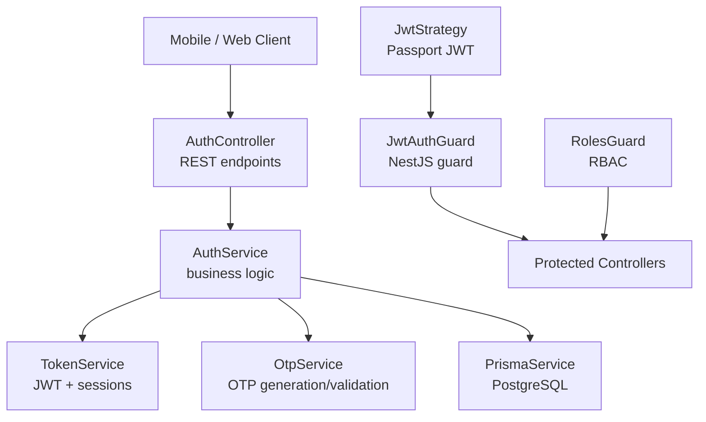
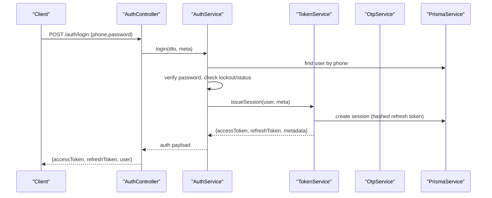
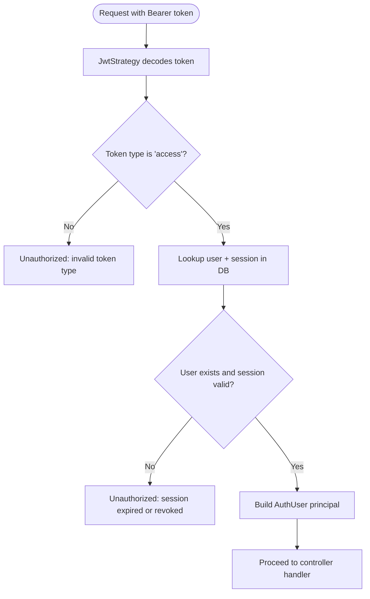
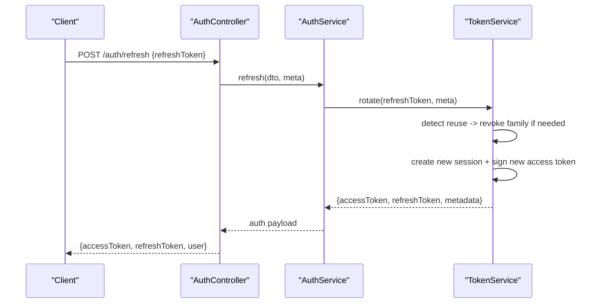
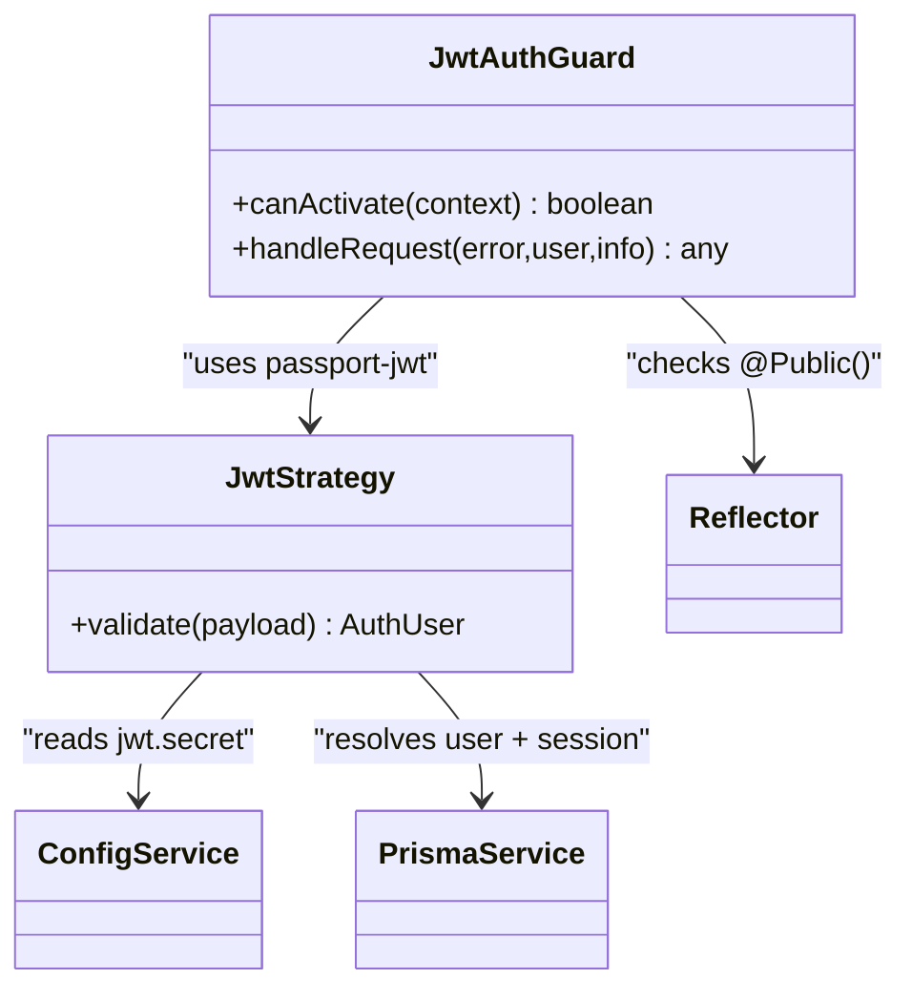
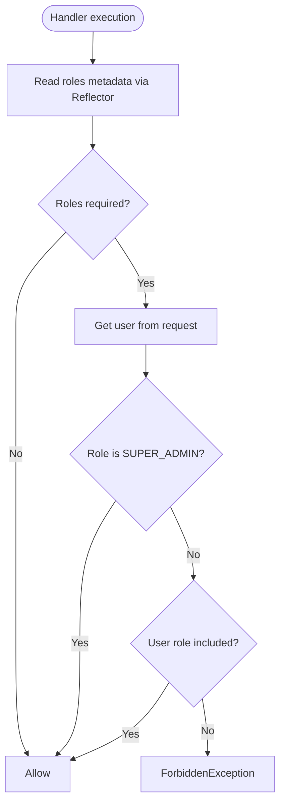
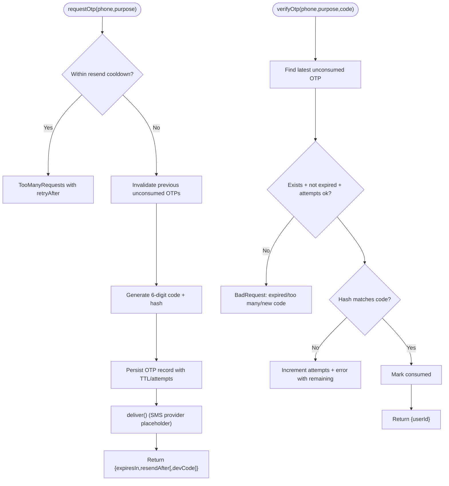
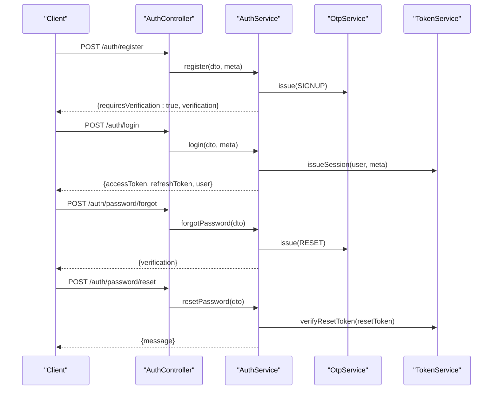
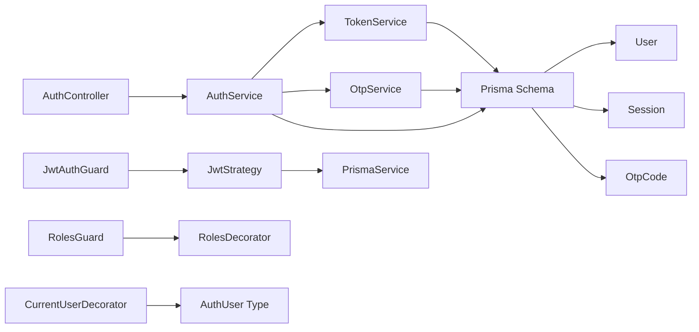

# Authentication & Authorization

<cite>
**Referenced Files in This Document**
- [auth.controller.ts](file://backend/src/auth/auth.controller.ts)
- [auth.service.ts](file://backend/src/auth/auth.service.ts)
- [jwt.strategy.ts](file://backend/src/auth/strategies/jwt.strategy.ts)
- [token.service.ts](file://backend/src/auth/token.service.ts)
- [otp.service.ts](file://backend/src/auth/otp.service.ts)
- [jwt-auth.guard.ts](file://backend/src/common/guards/jwt-auth.guard.ts)
- [roles.guard.ts](file://backend/src/common/guards/roles.guard.ts)
- [roles.decorator.ts](file://backend/src/common/decorators/roles.decorator.ts)
- [current-user.decorator.ts](file://backend/src/common/decorators/current-user.decorator.ts)
- [public.decorator.ts](file://backend/src/common/decorators/public.decorator.ts)
- [auth-user.ts](file://backend/src/common/types/auth-user.ts)
- [configuration.ts](file://backend/src/config/configuration.ts)
- [schema.prisma](file://backend/prisma/schema.prisma)
</cite>

## Table of Contents
1. [Introduction](#introduction)
2. [Project Structure](#project-structure)
3. [Core Components](#core-components)
4. [Architecture Overview](#architecture-overview)
5. [Detailed Component Analysis](#detailed-component-analysis)
6. [Dependency Analysis](#dependency-analysis)
7. [Performance Considerations](#performance-considerations)
8. [Troubleshooting Guide](#troubleshooting-guide)
9. [Conclusion](#conclusion)

## Introduction
This document explains the authentication and authorization system in FuelConnect. It covers:
- JWT-based authentication with short-lived access tokens and opaque, rotated refresh tokens.
- Passport.js JWT strategy integration with NestJS guards.
- Role-based access control using a custom `@Roles()` decorator and roles guard.
- Phone-based OTP verification for signup, login, and password reset flows.
- Session management, token storage recommendations, and mobile security considerations.
- Protected routes, custom guards, and authorization patterns.
- Troubleshooting guidance and performance optimization tips.

## Project Structure
The authentication subsystem is implemented in the backend under `src/auth` and shared infrastructure under `src/common`. The data model is defined in Prisma.

**Diagram sources**
- [auth.controller.ts:42-165](file://backend/src/auth/auth.controller.ts#L42-L165)
- [auth.service.ts:39-560](file://backend/src/auth/auth.service.ts#L39-L560)
- [token.service.ts:32-198](file://backend/src/auth/token.service.ts#L32-L198)
- [otp.service.ts:29-164](file://backend/src/auth/otp.service.ts#L29-L164)
- [jwt.strategy.ts:9-75](file://backend/src/auth/strategies/jwt.strategy.ts#L9-L75)
- [jwt-auth.guard.ts:11-35](file://backend/src/common/guards/jwt-auth.guard.ts#L11-L35)
- [roles.guard.ts:8-33](file://backend/src/common/guards/roles.guard.ts#L8-L33)

**Section sources**
- [auth.controller.ts:42-165](file://backend/src/auth/auth.controller.ts#L42-L165)
- [auth.service.ts:39-560](file://backend/src/auth/auth.service.ts#L39-L560)
- [schema.prisma:137-207](file://backend/prisma/schema.prisma#L137-L207)

## Core Components
- AuthController: Public and protected REST endpoints for registration, login, OTP, refresh, logout, profile, and session management.
- AuthService: Orchestrates user lifecycle, OTP flows, password reset, session creation, and profile operations.
- JwtStrategy: Passport strategy that validates bearer tokens and resolves an authenticated principal per request.
- TokenService: Issues access tokens, manages opaque refresh tokens, rotates sessions, and handles reset tokens.
- OtpService: Generates hashed OTPs, enforces TTL, resend cooldown, attempt limits, and single-use semantics.
- Guards and Decorators: `JwtAuthGuard`, `RolesGuard`, `@Public()`, `@Roles()`, and `@CurrentUser()`.

**Section sources**
- [auth.controller.ts:42-165](file://backend/src/auth/auth.controller.ts#L42-L165)
- [auth.service.ts:39-560](file://backend/src/auth/auth.service.ts#L39-L560)
- [jwt.strategy.ts:9-75](file://backend/src/auth/strategies/jwt.strategy.ts#L9-L75)
- [token.service.ts:32-198](file://backend/src/auth/token.service.ts#L32-L198)
- [otp.service.ts:29-164](file://backend/src/auth/otp.service.ts#L29-L164)
- [jwt-auth.guard.ts:11-35](file://backend/src/common/guards/jwt-auth.guard.ts#L11-L35)
- [roles.guard.ts:8-33](file://backend/src/common/guards/roles.guard.ts#L8-L33)
- [roles.decorator.ts:1-8](file://backend/src/common/decorators/roles.decorator.ts#L1-L8)
- [public.decorator.ts:1-7](file://backend/src/common/decorators/public.decorator.ts#L1-L7)
- [current-user.decorator.ts:1-13](file://backend/src/common/decorators/current-user.decorator.ts#L1-L13)

## Architecture Overview
The authentication flow uses a layered approach:
- Controllers expose HTTP endpoints.
- Services implement business rules and coordinate persistence.
- Guards enforce authentication and authorization before handlers run.
- Strategies decode and validate tokens and resolve user context.
- Data layer persists users, sessions, and OTP records.

**Diagram sources**
- [auth.controller.ts:64-71](file://backend/src/auth/auth.controller.ts#L64-L71)
- [auth.service.ts:163-239](file://backend/src/auth/auth.service.ts#L163-L239)
- [token.service.ts:40-67](file://backend/src/auth/token.service.ts#L40-L67)
- [schema.prisma:172-189](file://backend/prisma/schema.prisma#L172-L189)

## Detailed Component Analysis

### JWT-Based Authentication Flow
- Access tokens are short-lived JWTs containing minimal claims and a session identifier.
- Refresh tokens are opaque random values stored as hashes in the database; they are rotated on each use.
- On every protected request, the strategy queries the database to ensure the session exists and is active.

**Diagram sources**
- [jwt.strategy.ts:10-73](file://backend/src/auth/strategies/jwt.strategy.ts#L10-L73)
- [auth-user.ts:8-33](file://backend/src/common/types/auth-user.ts#L8-L33)

**Section sources**
- [jwt.strategy.ts:10-73](file://backend/src/auth/strategies/jwt.strategy.ts#L10-L73)
- [token.service.ts:185-196](file://backend/src/auth/token.service.ts#L185-L196)
- [auth-user.ts:8-33](file://backend/src/common/types/auth-user.ts#L8-L33)

### Token Generation, Validation, and Refresh
- Access token generation includes user identity, role, phone, session ID, and token type.
- Refresh token rotation creates a new session, revokes the old one, and detects reuse to revoke the entire family.
- Reset tokens are short-lived JWTs used only for password reset.

**Diagram sources**
- [auth.controller.ts:91-98](file://backend/src/auth/auth.controller.ts#L91-L98)
- [auth.service.ts:319-322](file://backend/src/auth/auth.service.ts#L319-L322)
- [token.service.ts:69-151](file://backend/src/auth/token.service.ts#L69-L151)

**Section sources**
- [token.service.ts:40-151](file://backend/src/auth/token.service.ts#L40-L151)
- [token.service.ts:168-183](file://backend/src/auth/token.service.ts#L168-L183)
- [configuration.ts:57-62](file://backend/src/config/configuration.ts#L57-L62)

### Passport.js JWT Strategy Integration with NestJS Guards
- `JwtStrategy` extracts the bearer token, verifies signature and expiration, and resolves the current user from the database.
- `JwtAuthGuard` wraps Passport’s `AuthGuard('jwt')`, respects `@Public()` routes, and normalizes unauthorized responses.

**Diagram sources**
- [jwt.strategy.ts:10-73](file://backend/src/auth/strategies/jwt.strategy.ts#L10-L73)
- [jwt-auth.guard.ts:11-35](file://backend/src/common/guards/jwt-auth.guard.ts#L11-L35)
- [public.decorator.ts:1-7](file://backend/src/common/decorators/public.decorator.ts#L1-L7)

**Section sources**
- [jwt.strategy.ts:10-73](file://backend/src/auth/strategies/jwt.strategy.ts#L10-L73)
- [jwt-auth.guard.ts:11-35](file://backend/src/common/guards/jwt-auth.guard.ts#L11-L35)

### Role-Based Access Control (RBAC)
- `@Roles(...)` sets metadata indicating allowed roles.
- `RolesGuard` reads this metadata and checks the authenticated user’s role.
- `SUPER_ADMIN` bypasses role checks.

**Diagram sources**
- [roles.decorator.ts:1-8](file://backend/src/common/decorators/roles.decorator.ts#L1-L8)
- [roles.guard.ts:8-33](file://backend/src/common/guards/roles.guard.ts#L8-L33)

**Section sources**
- [roles.decorator.ts:1-8](file://backend/src/common/decorators/roles.decorator.ts#L1-L8)
- [roles.guard.ts:8-33](file://backend/src/common/guards/roles.guard.ts#L8-L33)

### OTP Verification System
- OTPs are generated as numeric codes, hashed with a salt including the phone number and secret, and stored with purpose, TTL, and attempt limits.
- Resend cooldown prevents rapid reissuance.
- Verification marks the code as consumed and returns the associated user ID when applicable.

**Diagram sources**
- [otp.service.ts:38-90](file://backend/src/auth/otp.service.ts#L38-L90)
- [otp.service.ts:92-127](file://backend/src/auth/otp.service.ts#L92-L127)

**Section sources**
- [otp.service.ts:38-127](file://backend/src/auth/otp.service.ts#L38-L127)
- [auth.service.ts:241-317](file://backend/src/auth/auth.service.ts#L241-L317)

### Login, Registration, and Password Reset Flows
- Registration creates a user, customer/rider profile, wallet, and issues a signup OTP.
- Login validates credentials, enforces lockout after repeated failures, ensures account status, and issues a session.
- Password reset uses OTP to obtain a short-lived reset token, then updates the password and revokes all sessions.

**Diagram sources**
- [auth.controller.ts:48-116](file://backend/src/auth/auth.controller.ts#L48-L116)
- [auth.service.ts:53-98](file://backend/src/auth/auth.service.ts#L53-L98)
- [auth.service.ts:163-239](file://backend/src/auth/auth.service.ts#L163-L239)
- [auth.service.ts:357-396](file://backend/src/auth/auth.service.ts#L357-L396)
- [token.service.ts:168-183](file://backend/src/auth/token.service.ts#L168-L183)

**Section sources**
- [auth.service.ts:53-239](file://backend/src/auth/auth.service.ts#L53-L239)
- [auth.service.ts:357-396](file://backend/src/auth/auth.service.ts#L357-L396)

### Protected Routes, Custom Guards, and Authorization Patterns
- Public endpoints are marked with `@Public()` to skip authentication.
- Protected endpoints require a valid bearer token processed by `JwtAuthGuard`.
- Role-scoped endpoints can be restricted with `@Roles(...)` and `RolesGuard`.
- `@CurrentUser()` injects the authenticated principal or a specific property.

Examples:
- Public: registration, login, OTP request/verify, refresh, password reset endpoints.
- Protected: logout, me, update profile, change password, sessions list/revoke.
- RBAC: apply `@Roles(RoleName.ADMIN, RoleName.SUPER_ADMIN)` to admin-only controllers/handlers.

**Section sources**
- [auth.controller.ts:48-165](file://backend/src/auth/auth.controller.ts#L48-L165)
- [jwt-auth.guard.ts:11-35](file://backend/src/common/guards/jwt-auth.guard.ts#L11-L35)
- [roles.guard.ts:8-33](file://backend/src/common/guards/roles.guard.ts#L8-L33)
- [current-user.decorator.ts:1-13](file://backend/src/common/decorators/current-user.decorator.ts#L1-L13)

## Dependency Analysis
The following diagram shows key dependencies among authentication components and their data model relationships.

**Diagram sources**
- [auth.controller.ts:42-165](file://backend/src/auth/auth.controller.ts#L42-L165)
- [auth.service.ts:39-560](file://backend/src/auth/auth.service.ts#L39-L560)
- [token.service.ts:32-198](file://backend/src/auth/token.service.ts#L32-L198)
- [otp.service.ts:29-164](file://backend/src/auth/otp.service.ts#L29-L164)
- [jwt.strategy.ts:9-75](file://backend/src/auth/strategies/jwt.strategy.ts#L9-L75)
- [jwt-auth.guard.ts:11-35](file://backend/src/common/guards/jwt-auth.guard.ts#L11-L35)
- [roles.guard.ts:8-33](file://backend/src/common/guards/roles.guard.ts#L8-L33)
- [roles.decorator.ts:1-8](file://backend/src/common/decorators/roles.decorator.ts#L1-L8)
- [current-user.decorator.ts:1-13](file://backend/src/common/decorators/current-user.decorator.ts#L1-L13)
- [auth-user.ts:8-33](file://backend/src/common/types/auth-user.ts#L8-L33)
- [schema.prisma:137-207](file://backend/prisma/schema.prisma#L137-L207)

**Section sources**
- [auth.controller.ts:42-165](file://backend/src/auth/auth.controller.ts#L42-L165)
- [auth.service.ts:39-560](file://backend/src/auth/auth.service.ts#L39-L560)
- [token.service.ts:32-198](file://backend/src/auth/token.service.ts#L32-L198)
- [otp.service.ts:29-164](file://backend/src/auth/otp.service.ts#L29-L164)
- [jwt.strategy.ts:9-75](file://backend/src/auth/strategies/jwt.strategy.ts#L9-L75)
- [jwt-auth.guard.ts:11-35](file://backend/src/common/guards/jwt-auth.guard.ts#L11-L35)
- [roles.guard.ts:8-33](file://backend/src/common/guards/roles.guard.ts#L8-L33)
- [roles.decorator.ts:1-8](file://backend/src/common/decorators/roles.decorator.ts#L1-L8)
- [current-user.decorator.ts:1-13](file://backend/src/common/decorators/current-user.decorator.ts#L1-L13)
- [auth-user.ts:8-33](file://backend/src/common/types/auth-user.ts#L8-L33)
- [schema.prisma:137-207](file://backend/prisma/schema.prisma#L137-L207)

## Performance Considerations
- Short-lived access tokens reduce exposure window and allow frequent rotation without re-authentication.
- Database-backed session validation ensures immediate effect of logout and suspension.
- OTP resend throttling reduces SMS load and abuse.
- Use environment-driven TTLs to tune latency vs. security trade-offs.

Recommendations:
- Keep access token TTL low (e.g., minutes) and refresh token TTL moderate (e.g., days).
- Avoid storing sensitive payloads in tokens; keep them minimal.
- Cache frequently accessed read-only user profiles at the edge where appropriate, but never cache authorization-sensitive state.
- Monitor OTP delivery latency and failure rates; integrate a production SMS provider.

[No sources needed since this section provides general guidance]

## Troubleshooting Guide
Common issues and resolutions:
- Invalid or missing bearer token: Ensure clients send `Authorization: Bearer <accessToken>` and that the token has not expired.
- Session expired or revoked: Re-authenticate or call `/auth/refresh` with a valid refresh token.
- Too many failed login attempts: Account may be locked temporarily; wait for unlock period or use OTP reset.
- OTP resend too soon: Respect the server-provided retry-after delay.
- OTP incorrect or exhausted: Request a new code; do not retry beyond the limit.
- Refresh token reuse detected: All sessions were revoked due to potential theft; force re-login.
- Password changed: Other device sessions are invalidated; sign in again on other devices.

Operational checks:
- Verify JWT secret configuration and environment variables.
- Confirm database connectivity for session and OTP lookups.
- Inspect audit logs for authentication events.

**Section sources**
- [jwt.strategy.ts:26-59](file://backend/src/auth/strategies/jwt.strategy.ts#L26-L59)
- [auth.service.ts:163-239](file://backend/src/auth/auth.service.ts#L163-L239)
- [otp.service.ts:38-127](file://backend/src/auth/otp.service.ts#L38-L127)
- [token.service.ts:69-151](file://backend/src/auth/token.service.ts#L69-L151)

## Conclusion
FuelConnect implements a robust, secure authentication and authorization system:
- Stateless JWT access tokens with database-backed session validation.
- Secure, rotated refresh tokens with theft detection.
- Comprehensive OTP support for phone-based verification and password reset.
- Clear separation of concerns between controllers, services, guards, and strategies.
- Flexible RBAC through decorators and guards.

For mobile clients:
- Store the refresh token securely (e.g., platform keystore/Keychain).
- Store the access token in memory and refresh proactively before expiry.
- Send tokens over HTTPS and avoid logging sensitive headers.
- Implement automatic logout on refresh token rejection.

[No sources needed since this section summarizes without analyzing specific files]